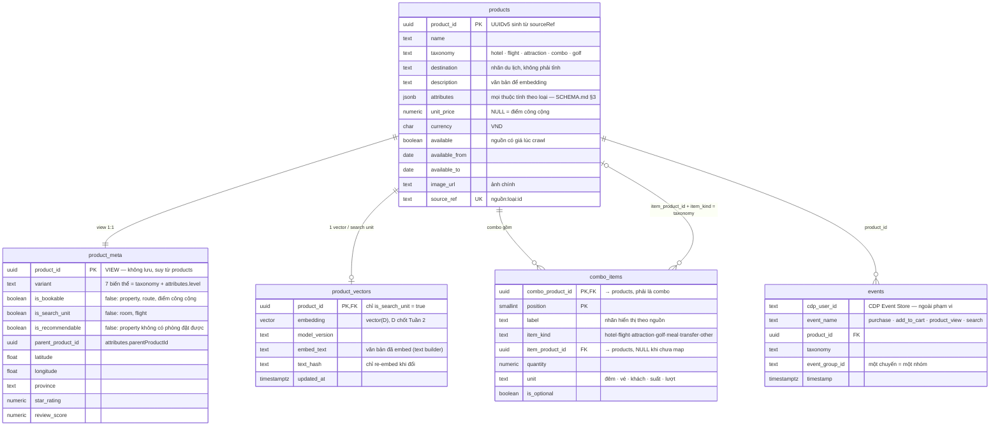

# Product schema — catalog V-OTA trên PostgreSQL

Bản 2.2 · 20/09/2026 · **phương án tối giản theo handbook** · đi kèm trang ERD "V-OTA Product Schema" (artifact).
Schema toàn hệ thống (cdp · catalog · app · insider) và **DDL chính thức** nằm ở `DATABASE_SCHEMA.md` — tài liệu này chỉ giải thích phần product catalog.
Tài liệu này là **schema quan hệ trong PostgreSQL của V-OTA**; `SCHEMA.md` là contract của file `products.jsonl` (13 trường CDP). Hai tài liệu bổ sung nhau.

---

## 1. Bốn quyết định

1. **Một bảng `products`, không tách bảng theo loại.** Đúng 13 trường CDP (handbook §6). Thuộc tính khác nhau giữa 5 `taxonomy` nằm ở `attributes` JSONB, truy vấn bằng expression index và view. Không có 7 bảng chi tiết như bản 1.
2. **Hai schema trong một database.** `cdp` = mirror CDP thật, `CdpClient` (role `cdp_reader`) chỉ được đọc schema này. `catalog` = bảng và view riêng của V-OTA. **Insider clone là service riêng, không có bảng nào ở đây** — nó chỉ nhận customer attributes và events có TTL qua `InsiderClient`.
3. **Combo = sản phẩm + bill of materials.** Combo là một dòng `cdp.products` có giá, vector, event riêng. Thành phần ở `catalog.combo_items` — bảng duy nhất thêm ngoài contract. Không lồng combo.
4. **Vai trò suy ra, không nhập tay.** View `catalog.product_meta` tính `variant`, `is_bookable` (property, route, điểm công cộng = false) và `is_search_unit` (room, flight = false) từ 13 trường + attributes. Không lưu, không thể lệch.

## 2. Hai schema, một database — ai đọc gì

| Schema | Đối tượng | Ai ghi | Ai đọc |
|---|---|---|---|
| **`cdp`** (contract) | `products` (13 trường + attributes); sau này `profiles`, `events`, `users`, `bookings` | Loader, từ `products.jsonl` | `CdpClient` (role `cdp_reader`, chỉ USAGE trên `cdp`); Search dùng cột để lọc |
| **`catalog`** (riêng V-OTA) | view `product_meta`, bảng `combo_items`, bảng `product_vectors`, view `product_parents`, view `search_rows` | Loader (combo_items), text builder → `POST /embed` (product_vectors) | Backend V-OTA (role `vota_app`), Search, Recsys |

Handbook gọi DB này là "CDP clone" vì nó chứa cả bảng mirror CDP lẫn bảng demo-only; ranh giới thật nằm ở cấp schema. Khi lên CDP production chỉ phải viết hai chỗ: adapter `CdpClient` và job đồng bộ `catalog.product_vectors`; mọi thứ ở `catalog` đã khoá theo `product_id`.

## 3. ERD



Bốn quan hệ: `products` ↔ `product_meta` (1:1, view); `products` → `product_vectors` (0..1, chỉ search unit); `products` (combo) → `combo_items` (1:N); `combo_items` → `products` (thành phần, 0..1 vì có thể chưa map). Cha–con hạng phòng → khách sạn, chuyến → tuyến đi qua `attributes.parentProductId`, có index biểu thức và view `product_parents`. `events` vẽ để thấy khoá nối cho Recsys; thiết kế `events`/`bookings` nằm ngoài tài liệu này.

## 4. Vai trò sản phẩm: `variant`, `is_bookable`, `is_search_unit`

Property và route là nơi chứa sản phẩm, không phải thứ khách trả tiền — nhưng chúng là thứ khách *tìm* và *xem*. 243/559 khách sạn trong crawl không có hạng phòng nào, nên bỏ property khỏi catalog là mất 43% khách sạn. Giải pháp: giữ tất cả trong `products`, tách *vai trò* bằng hai cờ suy ra trong view `product_meta`.

| variant | Từ | Số lượng | is_bookable | is_search_unit | Có vector | Trang chi tiết |
|---|---|---|---|---|---|---|
| `hotel_property` | hotel + level=property | 559 | false | true | có | Danh sách hạng phòng, nút "Chọn phòng"; 243 cái không có phòng: chỉ hiển thị, không đặt, `is_recommendable = false` |
| `hotel_room` | hotel + level=room | 907 | true | false | không (dùng của cha) | Hộp đặt nhận/trả phòng, số phòng |
| `flight_route` | flight + level=route | 60 | false | true | có | Danh sách chuyến bay của tuyến |
| `flight` | flight + level=flight | 184 | true | false | không (dùng của cha) | Hộp đặt số khách |
| `attraction` | attraction | 407 | true, trừ `ticketed=false` (139) | true | có | Vé: hộp đặt ngày + số khách. Điểm công cộng: không có nút đặt |
| `combo` | combo | 93 | true | true | có | "Bao gồm" từ `combo_items`, hộp đặt ngày bắt đầu + số khách |
| `golf` | golf | 6 | true | true | có | Hộp đặt ngày + số khách |

`is_recommendable` = search unit và (tự đặt được hoặc có ≥ 1 con đặt được): 243 property không có phòng vẫn search ra nhưng không vào `/recommendations`. Quy tắc `is_bookable` nằm ở một chỗ duy nhất (định nghĩa view): `level ∉ {property, route}` và `ticketed ≠ false` và `unit_price IS NOT NULL`. Booking API kiểm tra cờ này trước khi tạo line item; UI đổi nút theo cờ. Thêm ngoại lệ sau này chỉ sửa view, không migrate.

## 5. Combo: một sản phẩm gom nhiều sản phẩm

- **Combo là một dòng `cdp.products`** với `taxonomy = 'combo'`: có `product_id`, `name`, `unit_price`, `available*`, vector riêng. Search, Recsys, giỏ hàng, booking và event đối xử với nó như mọi sản phẩm khác — mua combo là *một* line item, ghi *một* event `purchase` với `taxonomy = 'combo'`.
- **Thành phần nằm ở `catalog.combo_items`** (bill of materials). Mỗi dòng là một hạng mục hiển thị theo `position`: `label`, `item_kind`, `quantity`, `unit`. `item_product_id` trỏ tới sản phẩm thật khi map được (hạng phòng, vé, chuyến bay, golf); `NULL` khi hạng mục không phải sản phẩm bán lẻ (buffet sáng, xe đưa đón) hoặc crawler chưa map được — `label` + `item_kind` vẫn đủ để hiển thị và tính vertical.
- **Vì sao không dùng `parentProductId`:** cha–con là 1:N "thuộc về". Combo là M:N "gồm", kèm số lượng → bảng nối, không phải FK tự tham chiếu.
- **Thuộc tính cấp combo** (số đêm, giá theo gói hay theo khách, số khách tối thiểu) là khoá mới trong `attributes` do loader gán: `nights`, `priceBasis` (`per_package` | `per_person`), `minPax`. Đúng nguyên tắc SCHEMA.md — mọi thứ ngoài 13 trường đi vào attributes.
- **Giá:** `unit_price` của combo là giá gói của nguồn, *không* cộng từ thành phần. `attributes.priceBasis` giải quyết mâu thuẫn trong UX spec (hộp đặt tính `unit_price × số khách` nhưng PriceTag ghi "/ gói"). "Tiết kiệm" = Σ(giá lẻ × quantity) − giá combo, chỉ tính khi mọi hạng mục bán lẻ đã map được.
- **Nguồn thành phần combo: parse từ `description`** (chốt 18/09). Job `parse_combos` sinh `combo_items` với ba cột bổ sung: `source` (`description_parse` · `manual` · `api`), `confidence` (0–1, độ tin của bước map sang `product_id`), `evidence` (đoạn description đã khớp). Dòng `confidence < 0.8` hoặc chưa map thì soát tay; sửa tay đổi `source = 'manual'` để lần parse sau không ghi đè. Spec parser: `DATABASE_SCHEMA.md` §8.

### Ví dụ: Combo 3N2Đ Vinpearl Nha Trang + VinWonders

| Đối tượng | Dòng |
|---|---|
| `cdp.products` | `product_id = C…` · name "Combo 3N2Đ Vinpearl Nha Trang + VinWonders" · taxonomy `combo` · destination "Nha Trang" · unit_price 9.800.000 · available 15/09/2026 → 31/03/2027 · attributes {nights: 2, priceBasis: "per_person", minPax: 2, latitude…} |
| `catalog.product_meta` | (view) variant `combo` · is_bookable true · is_search_unit true |
| `catalog.combo_items` | position 1 · "2 đêm phòng Deluxe Ocean View" · item_kind `hotel` · item_product_id = *hạng phòng R…* · quantity 2 · unit `đêm` |
| `catalog.combo_items` | position 2 · "Vé VinWonders 1 ngày" · item_kind `attraction` · item_product_id = *vé VW00466* · quantity 1 · unit `vé` |
| `catalog.combo_items` | position 3 · "Buffet sáng" · item_kind `meal` · item_product_id `NULL` · quantity 2 · unit `suất` |
| `catalog.product_vectors` | embed_text = "Combo 3N2Đ … Nha Trang. Gồm: 2 đêm phòng Deluxe Ocean View, vé VinWonders 1 ngày, buffet sáng. <description>" |

### Quy tắc

1. **Chỉ combo mới có thành phần:** cột `combo_taxonomy` GENERATED = `'combo'`, FK `(combo_product_id, combo_taxonomy) → products (product_id, taxonomy)`.
2. **Không lồng combo:** `item_kind` không nhận `combo` (CHECK), `item_product_id ≠ combo_product_id`.
3. **Loại hạng mục luôn đúng loại thật:** FK `(item_product_id, item_kind) → products (product_id, taxonomy)`.
4. **Xoá combo thì xoá thành phần** (CASCADE); xoá sản phẩm đang là thành phần thì bị chặn.
5. **Recsys:** khi khách mua combo, các vertical combo phủ được loại khỏi gợi ý cross-vertical của chuyến:

```sql
SELECT array_agg(DISTINCT item_kind)
FROM   catalog.combo_items
WHERE  combo_product_id = :combo_id
AND    item_kind IN ('hotel','flight','attraction','golf');   -- {attraction, hotel}
```

## 6. Bảng và view

| Đối tượng | Schema | Loại | Vai trò | Khoá / ràng buộc |
|---|---|---|---|---|
| `products` | cdp | bảng | Catalog CDP, đúng 13 trường, mọi taxonomy; `attributes` JSONB giữ mọi thuộc tính theo loại | PK `product_id` · UNIQUE `source_ref` · UNIQUE `(product_id, taxonomy)` · index cột: taxonomy, (destination, taxonomy), available; GIN attributes; index biểu thức: level, parentProductId, province, starRating |
| `product_meta` | catalog | view | variant, is_bookable, is_search_unit, parent_product_id, toạ độ, province, sao, review — suy từ products. Nơi duy nhất định nghĩa hai cờ | — |
| `combo_items` | catalog | bảng | Thành phần combo, có thứ tự, số lượng, đơn vị; link tuỳ chọn sang sản phẩm thật | PK `(combo_product_id, position)` · FK combo → products (…, 'combo') · FK `(item_product_id, item_kind)` → products |
| `product_vectors` | catalog | bảng | Embedding + model_version + văn bản đã embed. HNSW cosine. Chỉ nạp search unit | PK `product_id` → products |
| `product_parents` | catalog | view | Cặp (con, cha) — roll-up event phòng → khách sạn, chuyến → tuyến | — |
| `search_rows` | catalog | view | Dòng phẳng 13 trường + meta cho Search, không JSON | — |

Bỏ so với bản 1: `product_details`, 7 bảng theo variant, `product_images`, `amenities`, `destinations`. Ảnh phụ, tiện ích, chính sách đọc thẳng từ `attributes`. Quy ước: cột snake_case, `CdpClient` map sang camelCase của CDP.

## 7. Từ `attributes` tới truy vấn

Không tách cột nên câu hỏi là "khoá này truy vấn bằng gì": cột trong view `product_meta` (đã ép kiểu), index biểu thức trên `cdp.products` (lọc nhanh), hoặc đọc thẳng JSONB (hiển thị). Thêm index khi có màn hình cần lọc, không cần đổi bảng.

| Khoá attributes | Cách truy vấn | Ghi chú |
|---|---|---|
| `level` | `product_meta.variant` · index `(attributes->>'level')` | quyết định variant, is_bookable, is_search_unit |
| `parentProductId` | `product_meta.parent_product_id` · `product_parents` · index | phòng của khách sạn, chuyến của tuyến |
| `ticketed` | trong `is_bookable` | false = điểm công cộng |
| `latitude`, `longitude`, `locationPrecision`, `province`, `city`, `brand` | `product_meta` · index `province` | bán kính dùng earthdistance khi cần |
| `starRating` | `product_meta.star_rating` · index có điều kiện `taxonomy = 'hotel'` | filter sao |
| `reviewScore`, `reviewCount` | `product_meta` | sort/hiển thị |
| `familyFriendly`, `oceanView`, `amenities`, `audience` | GIN: `attributes @> '{"oceanView": true}'` | tag trên thẻ kết quả |
| `descriptionSource`, `descriptionLang`, `descriptionOriginal` | `product_meta.description_is_derived` · JSONB | text builder |
| `images`, `policies`, `highlights`, `conditions`, `url`, `fieldSources` | đọc JSONB ở trang chi tiết | không lọc |
| `roomName`, `roomSizeM2`, `maxOccupancy`, `bed`, `propertyType`, `starRatingType` | đọc JSONB | |
| `priceDate`, `priceNights`, `priceAdults`, `otaPrices`, `vinpearlPrice`, `memberPrices`, `adultOriginalPrice`, `childPrice` | đọc JSONB | luôn đọc `priceDate` |
| `venue`, `openingHours`, `durationMinutes` | đọc JSONB | text builder dùng venue |
| `originCity`, `destinationCity`, `originDestination`, `destinationAirportName`, `originLatitude`, `originLongitude`, `airline`, `flightNumber`, `priceObservedAt` | đọc JSONB; thêm index `originDestination` khi có filter cặp điểm đến | |
| `hotelName` | không dùng | = `name` của cha |
| *mới:* `nights`, `priceBasis`, `minPax` | đọc JSONB | khoá cấp combo do loader gán; `priceBasis` mặc định `per_package`, `per_person` khi text nói giá theo khách |
| *mới:* `availability` {from, days, calendar}, `sourceAvailableFrom/To` | đọc JSONB ở hộp đặt | lịch kín/trống 30 ngày, chuỗi 1/0 đọc-only; ký tự i = ngày from + i. `available_from/to` = cửa sổ `[as_of, as_of+29]` cắt với khoảng của nguồn (giữ nguồn ở `sourceAvailableFrom/To`); loader `--as-of`, chạy lại trước demo |
| *mới:* `departureAt`, `arrivalAt`, `checkInTime`, `checkOutTime` | đọc JSONB | giờ cố định — không nằm trong `available_from/to` |
| *thành phần combo* | `catalog.combo_items` | chưa có trong attributes — việc mở #1 |

## 8. Search & Recsys dùng catalog thế nào

**Cái gì được index.** Chỉ dòng `is_search_unit = true` vào `product_vectors`: property, route, attraction, combo, golf — khoảng 1.125 vector thay vì 2.216, nên kết quả search không lặp một khách sạn ba lần. Phòng và chuyến bay hiện ở trang cha; khi tính user vector từ event mua phòng/chuyến, map con → cha qua `product_parents` rồi lấy vector của cha.

**Text builder theo variant** — mỗi biến thể một công thức; dùng hay bỏ mô tả tự sinh (`description_is_derived`) là quyết định của Search, ghi vào `model_version`.

| Variant | Ghép từ |
|---|---|
| `hotel_property` | name · destination · "X sao" · propertyType · 5 tiện ích chính · tên các hạng phòng · description |
| `flight_route` | "Vé máy bay A – B" · các hãng khai thác (từ chuyến con) · description |
| `attraction` | name · venue · destination · audience · thời lượng · description |
| `combo` | name · destination · "N đêm" · **label của mọi combo_items** · description |
| `golf` | name · venue · destination · description |

**Ba truy vấn** — mọi `WHERE` là cột của `cdp.products`; không JSONB trên đường nóng.

```sql
-- GET /search?q=   (embed(q) → :q)
SELECT p.*
FROM   catalog.product_vectors v
JOIN   cdp.products p USING (product_id)
WHERE  p.available
AND    (:taxonomy IS NULL OR p.taxonomy = :taxonomy)
AND    (:destination IS NULL OR p.destination = :destination)
ORDER  BY v.embedding <=> :q
LIMIT  20;

-- GET /similar/{id}  (id là search unit; nếu là phòng/chuyến → dùng cha)
WITH me AS (SELECT embedding FROM catalog.product_vectors WHERE product_id = :id)
SELECT p.*
FROM   catalog.product_vectors v JOIN cdp.products p USING (product_id), me
WHERE  p.available AND p.product_id <> :id
ORDER  BY v.embedding <=> me.embedding
LIMIT  8;

-- GET /recommendations  (user vector :u từ events, decay theo event_group_id;
--                        :done = taxonomy đã đặt trong chuyến, kể cả vertical combo đã mua phủ)
SELECT p.*
FROM   catalog.product_vectors v JOIN cdp.products p USING (product_id)
WHERE  p.available
AND    p.destination = :trip_destination
AND    p.taxonomy <> ALL (:done)
ORDER  BY v.embedding <=> :u
LIMIT  10;
```

## 9. Ràng buộc toàn vẹn và quyền (đã test trên PostgreSQL 16 + pgvector 0.6)

1. `cdp.products` có `UNIQUE (product_id, taxonomy)` — khoá phụ để bảng khác khoá đúng loại bằng FK thay vì trigger.
2. `combo_items.combo_taxonomy` GENERATED = `'combo'` + FK về cặp trên → chỉ combo mới có thành phần.
3. FK `(item_product_id, item_kind) → products (product_id, taxonomy)` + CHECK `item_kind <> 'combo'` → loại hạng mục đúng, không lồng combo.
4. Kiểm tra giá trị: taxonomy 5 giá trị · `available_from ≤ available_to` · quantity > 0 · unit 5 giá trị.
5. Role `cdp_reader` chỉ có USAGE trên `cdp`: truy vấn `catalog.*` bị từ chối (`insufficient_privilege`).

Kết quả test: view `product_meta` cho đúng cờ với 6 bản ghi mẫu (property/route không bookable; phòng bookable nhưng không phải search unit; điểm công cộng không bookable); 3 test tiêu cực trên `combo_items` và 1 test quyền đều bị từ chối đúng thiết kế; planner dùng index biểu thức `level`.

## 10. Việc còn mở — cần chốt với team

| # | Câu hỏi | Ảnh hưởng | Ai chốt |
|---|---|---|---|
| 1 | ~~Nguồn dữ liệu thành phần combo~~ — **đã chốt: parse từ description** (18/09), spec ở DATABASE_SCHEMA.md §8 | — | — |
| 2 | Kích thước vector D và model (đo ở Tuần 2) | `vector(D)`; đổi = re-index | Search |
| 3 | ~~Ngữ nghĩa ngày bay~~ — đã chốt 20/09: `available_from = available_to = ngày bay`, giờ ở `attributes.departureAt`; quy tắc chung: from/to = ngày sớm nhất–muộn nhất được chọn usingDate; lịch 30 ngày ở `attributes.availability` {from, days, calendar "1/0"} đọc-only | — | — |
| 4 | ~~243 khách sạn không có hạng phòng~~ — đã chốt 20/09: chỉ hiển thị, không đặt; `is_recommendable` loại khỏi gợi ý | — | — |
| 5 | ~~`priceBasis` mặc định~~ — đã chốt 20/09: `per_package`; parser đổi sang `per_person` khi description/attributes nói giá theo khách | — | — |
| 6 | Tên cột: snake_case + map ở CdpClient (đề xuất) hay giữ camelCase có ngoặc kép để "mirror exactly"? | DDL và ORM | Backend + Integration |
| 7 | Mọi route có ít nhất một chuyến không? (chưa kiểm tra được vì `products.jsonl` không nằm trong project) | Trang chi tiết tuyến trống | Data |

### Lịch sử quyết định

- **Bản 1 (18/09 sáng):** supertype/subtype — `product_details` + 7 bảng theo variant + images/amenities/destinations, 15 bảng. Đã chạy thử được.
- **Bản 2 (18/09 chiều, hiện tại):** tối giản theo handbook — 1 bảng + JSONB + `combo_items`; tách schema `cdp`/`catalog`; thêm `is_bookable`, `is_search_unit` qua view. Lý do: search/recsys không cần bảng chi tiết; ít bảng để materialize; ranh giới CDP rõ ở cấp schema. Chuyển ngược lại bản 1 chỉ là thêm bảng đổ từ attributes, không mất dữ liệu.

## 11. DDL

DDL chính thức (đã gộp cả `combo_items` bản có `source`/`confidence`/`evidence`) nằm trong `DATABASE_SCHEMA.md` §10 — file `vota_schema.sql`. Không giữ bản sao ở đây để tránh lệch.

## 12. Thứ tự nạp dữ liệu (loader)

1. `cdp.products` ← `products.jsonl`, đúng 13 trường, `attributes` giữ nguyên; loader gán thêm `nights`/`priceBasis`/`minPax` cho combo khi parse được.
2. `catalog.combo_items` ← nguồn thành phần combo (việc mở #1); có thể nạp trước chỉ với `label` + `item_kind`.
3. Text builder theo variant cho các dòng `is_search_unit = true` → `POST /embed` → `catalog.product_vectors` (chỉ re-embed khi `text_hash` đổi).
