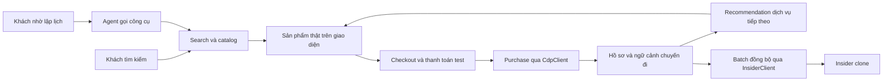
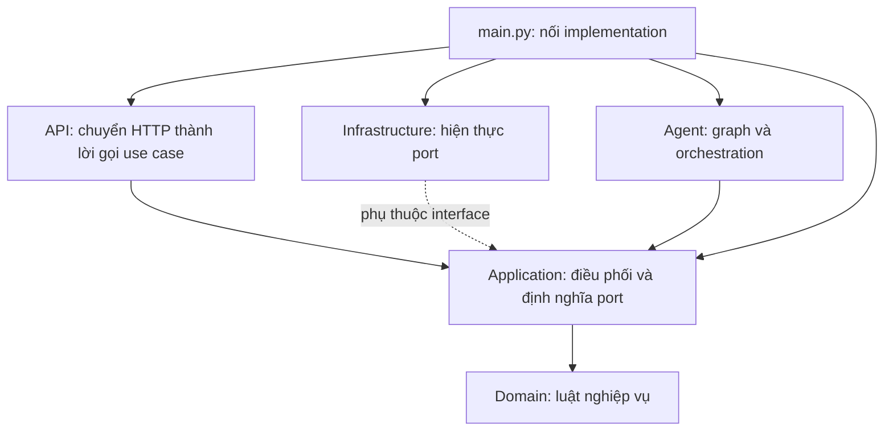
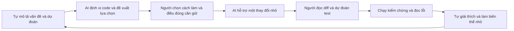

# Hoàn thiện V-OTA, báo cáo cuối kỳ và học kỹ thuật khi dùng AI

Ngày soạn: 04/10/2026. Dành cho nhóm 5 thực tập sinh và người phụ trách Itinerary Agent.

Đây là hướng dẫn và đề xuất phân bổ công sức, không phải PRD mới, quyết định cắt scope hay xác nhận hệ thống đã đạt nghiệm thu. Phục vụ FR-SRC-01..04, FR-REC-01..04, FR-AGT-01..05, FR-CDP-01, FR-BKG-02; NFR-REL-01/02, NFR-PERF-01/02, NFR-MAINT-01/02 và các AC tương ứng trong [requirements](../prd/requirements.md). Quy tắc dự án vẫn theo [AGENTS.md](../../AGENTS.md).

## 1. Câu trả lời cho tình huống hiện tại

**Đích phù hợp là một demo tích hợp đáng tin cậy, có bằng chứng chất lượng và đội ngũ giải thích được các quyết định của mình.** Deploy staging là một phần của đích đó. Chạy ở quy mô lớn chỉ nên trở thành công việc cụ thể khi có mục tiêu tải, bằng chứng nút thắt và thời gian phù hợp; không nên tự thêm hạ tầng để tạo cảm giác chuyên nghiệp.

Handbook §2 đặt recommendation ở trung tâm; §11 yêu cầu staging, đóng băng code, tag release, số liệu tái tạo được và video dự phòng. Vòng lặp quan trọng nhất là khách đặt dịch vụ, hành vi được ghi lại, gợi ý tiếp theo thay đổi. Agent là một cách sử dụng nền tảng ấy.

Bạn đúng khi muốn dành thời gian hiểu để giải thích. Nhưng “hiểu kiến trúc” cần đi tiếp thành khả năng lần theo một request, dự đoán một lỗi và sửa được một phần nhỏ. Nhớ tên Hexagonal Architecture chưa đủ để kiểm soát code mà AI tạo ra.

Cảm giác lo khi sản phẩm phát triển nhanh hơn mức mình hiểu là có cơ sở. Bạn không cần quay lại viết tay toàn bộ. Bạn cần lấy lại một phần công việc suy nghĩ mà trước đây đã giao hết cho AI: xác định điều đúng, dự đoán, chọn cách kiểm chứng và giải thích kết quả.

**Không cần dùng hết quota.** Quota là tài nguyên sẵn có, không phải thước đo năng lực hay năng suất. Mục tiêu tốt hơn: mỗi ngày khép lại một vấn đề sản phẩm và làm chủ thêm một cơ chế kỹ thuật.

## 2. Handbook yêu cầu gì, và PRD hiện hành khác ở đâu?

Nguồn chính: [handbook](../spec/recsys-internship-handbook-v3-vi.md) §2, §9, §11–13; [PRD implementation plan](../prd/implementation-plan.md), [deployment plan](../prd/deployment-plan.md), [test plan](../prd/test-plan.md).

| Nội dung | Căn cứ | Hàm ý cho nhóm |
|---|---|---|
| Search, recommendation, đăng nhập, vòng lặp booking → recommendation, bộ khung đánh giá | Handbook §2: các phần không được bỏ | Đưa lên đầu danh sách nghiệm thu và câu chuyện demo |
| Agent dùng sản phẩm thật, đúng điểm đến, có đường đi tới đặt dịch vụ | Handbook §9; FR-AGT; AC-AGT-01 | Chat hay nhưng thẻ sản phẩm không dùng được thì chưa đủ |
| Staging, code freeze thứ Năm tuần 5, tag release, số liệu từ cùng bản build | Handbook §11 | Đóng gói, tái lập và tổng duyệt là đầu ra thật |
| Baseline random, most-popular, most-popular-in-destination; dữ liệu lịch sử sinh | Handbook §12 | Không dùng số offline để tuyên bố tăng doanh thu thật |
| Search/recommendation p95 ≤ 250 ms; assistant first token ≤ 1 s, hoàn tất ≤ 4 s | PRD NFR-PERF-01/02 | Đo và báo gap theo PRD; không thay bằng ngưỡng dễ hơn trong handbook |
| Production được mô tả trong lộ trình và vận hành | PRD implementation plan §2, deployment plan | Không tuyên bố “chỉ demo nên miễn mọi tiêu chí”; báo rõ mức sẵn sàng và phần còn thiếu |

Handbook hiện trong repo còn ghi pgvector/embedding local ở một số mục. [Architecture](../prd/architecture.md) hiện quy định Weaviate + Cohere và Clean/Hexagonal Architecture. [Note gửi mentor](../spec/bench/note-mentor-lech-handbook.md) ghi ba khác biệt so với handbook gốc, trạng thái vẫn là **chờ mentor xác nhận bằng văn bản** ở thời điểm đọc. Điều này không chứng minh mentor chưa trả lời ngoài repo; nhóm cần kiểm lại bằng chứng xác nhận.

Không tự đổi stack, giảm NFR hoặc bỏ một FR để kịp demo. Nếu cần thay đổi yêu cầu, đi qua quy trình đề xuất/chốt hiện có. Cũng không tự coi một nhãn “Production Launch” là yêu cầu phục vụ hàng nghìn người hoặc kết nối production thật: thanh toán thật và kết nối tồn kho thật vẫn ngoài phạm vi.

## 3. Final product nên bàn giao dưới dạng nào?

Một gói bàn giao gồm sáu phần liên kết với nhau:

| Phần | Nội dung cụ thể | Bằng chứng nên có |
|---|---|---|
| Bản demo | URL staging; tài khoản test; dữ liệu demo hợp lệ; luồng chính hoạt động | Chạy trên trình duyệt với backend và dịch vụ thật của môi trường demo |
| Release tái lập | Commit/tag, cấu hình không chứa secret, phiên bản catalog/index, hướng dẫn chạy | Người không sở hữu workstream chạy được theo hướng dẫn |
| Hồ sơ chất lượng | Search/RecSys baseline; agent eval; E2E; độ trễ; danh sách lỗi | Run ID, commit, dataset/split, cấu hình, lệnh tái sinh |
| Hồ sơ vận hành | Sơ đồ triển khai, log/trace, health, backup/rollback theo phạm vi đã làm | Một buổi diễn tập lỗi và cách phục hồi; ghi phần chưa thử |
| Báo cáo | Bài toán → lựa chọn → bằng chứng → hạn chế → bước tiếp | Slide chính ngắn; phụ lục kỹ thuật đủ để hỏi sâu |
| Bàn giao con người | Mỗi mảng có owner và người hiểu dự phòng | Người dự phòng lần được một request và xử lý một lỗi mẫu |

Một giao diện giống sản phẩm công ty có thể là đúng yêu cầu bài tập. Giá trị nhóm chứng minh được là khả năng tái tạo cơ chế cốt lõi, nối các hệ thống qua interface và kiểm chứng quyết định. Không cần tự phát minh tính năng khác biệt vào cuối kỳ để chứng tỏ sáng tạo.

Không thể suy ra tiêu chí giữ lại của chương trình từ repo. Trong buổi sync gần nhất, đề nghị tech lead chốt ba điểm: trọng số demo/kỹ thuật/đánh giá; kỳ vọng tải cụ thể; phạm vi hỏi đáp cá nhân. Đây là căn chỉnh kỳ vọng, không cần chờ trả lời mới làm các việc hoàn thiện đã rõ.

### Một hành trình demo 5–7 phút

1. Nêu nhu cầu của một khách và tìm sản phẩm bằng câu tiếng Việt tự nhiên.
2. Đăng nhập tài khoản có lịch sử đã chuẩn bị; giải thích vì sao gợi ý khác khách mới.
3. Yêu cầu agent lập lịch; cho thấy một lượt làm rõ hoặc chỉnh sửa và thẻ sản phẩm thật.
4. Chọn một phòng đặt được, đi qua checkout theo flow hiện hành, thanh toán test.
5. Quay lại khối recommendation: cho thấy thay đổi sang dịch vụ bổ sung, với điểm đến và chuyến đi tương ứng.
6. Mở một trace hoặc bằng chứng event đã khử dữ liệu nhạy cảm để nối điều thấy trên UI với cơ chế phía sau.
7. Nếu còn thời gian, trình bày một ca không có kết quả hoặc dịch vụ lỗi được xử lý có kiểm soát.

Không ép khách sạn qua giỏ: FR-BKG-01 hiện yêu cầu khách sạn/vé máy bay đi bằng Đặt ngay. Ngày demo phải nằm trong dữ liệu hợp lệ. Chuẩn bị trạng thái tài khoản để diễn tập nhiều lần; chỉ reset dữ liệu demo do nhóm kiểm soát, không tuỳ tiện reset staging chung. Có video từ cùng release và nói rõ khi chuyển sang video.

Sơ đồ này mô tả câu chuyện nghiệp vụ cần chứng minh, không khẳng định mọi mũi tên đã được xác minh runtime. Việc đồng bộ Insider có thể demo riêng để không kéo dài luồng mua hàng.

## 4. Deploy và scale: làm đến đâu?

**Đề xuất ưu tiên:** ổn định môi trường staging hiện có, đo nó, giải thích giới hạn của nó. Chưa có lý do để mở một dự án hạ tầng mới chỉ cho buổi báo cáo.

| Mức | Việc nên làm | Điều được phép kết luận |
|---|---|---|
| Chạy được | Deploy đúng release; login, SSE, catalog, checkout test chạy qua domain thực | Luồng đã chạy trên môi trường được nêu |
| Chạy ổn định trong demo | Diễn tập lặp lại; kiểm quota/key, ngày dữ liệu, health, lỗi; có rollback và video | Sẵn sàng cho kịch bản demo đã kiểm |
| Hiểu giới hạn | Đo tải nhỏ trên môi trường được phép, có latency, lỗi, tài nguyên và chi phí | Chịu được tải đã đo dưới cấu hình đã ghi |
| Vận hành quy mô doanh nghiệp | SLO theo tải, phục hồi, bảo mật, dung lượng, trực vận hành, tích hợp thật | Chỉ tuyên bố sau khi có yêu cầu và bằng chứng tương ứng |

Nếu nhóm còn thời gian sau khi khép gap cốt lõi, có thể đề xuất thử tải 1 → 5 → 10 người dùng đồng thời, mỗi mức vài phút với request mix cố định. Đây là **ví dụ thiết kế phép đo**, không phải tiêu chí nghiệm thu hay cam kết capacity. Tách workload agent trả phí khỏi search/đọc catalog, đặt ngân sách và điều kiện dừng; thống nhất với người quản lý staging trước khi chạy.

Báo n, thời lượng, throughput, p50/p95, error/timeout rate, cache warm/cold, cấu hình máy, vùng triển khai và tỷ lệ request mỗi loại. 10 người đồng thời không bằng 10 request/giây. Đo riêng thời gian phản hồi SSE đầu tiên, token nội dung đầu tiên và hoàn tất lịch trình: một event “đang xử lý” không chứng minh đạt first-token SLO.

Nếu chậm, lần theo breakdown rồi tối ưu đúng chỗ. Thêm replica backend không tự sửa thời gian API LLM, embedding, mạng tới vector store hoặc giới hạn quota bên ngoài. “Có thể scale” cần giải thích state nằm đâu, giới hạn connection/rate limit, dữ liệu nào cần nhất quán và chi phí tăng thế nào.

### Bằng chứng trong repo cần kiểm lại ở tuần 4

Đây là ảnh chụp lịch sử, **không phải audit bản đang deploy ngày 04/10**:

| Bằng chứng đã đọc | Điều nó cho biết | Việc tiếp theo |
|---|---|---|
| [Agent report 02/10](../../src/evaluation/reports/eval-2026-10-02-agent-test-cases.md), commit `95dfc8c` | Report ghi grounding/schema 100%, tool accuracy 100% trên 9 lượt tính được; tổng 27 lượt PASS 8, FAIL 19; p95 14.737 ms. Có lỗi kết nối provider và lỗi judge | Phân loại lỗi sản phẩm, môi trường, bộ chấm; xác định mẫu số metric; chạy lại đúng bản release. Không gọi đây là agent đạt 100% |
| [Search latency 01/10](../../src/evaluation/reports/eval-2026-10-01-search-cloud-latency.md), backend `fe7e04d` | p95 server toàn nhóm 4.007 ms; request tuần tự; kết quả có caveat mạng/vùng và cache | Đo lại sau thay đổi, so NFR 250 ms; không trình bày số này như kết quả chịu tải |
| [History UX widget](../../history/2026-10-02-ux-tien-trinh-va-nut-dung-widget.md) | Test UI đã dùng API mô phỏng; chưa chứng minh E2E với backend/LLM thật ở entry đó | Kiểm lại luồng thật, không dùng test mock thay cho acceptance |
| [Đề xuất hỏi tiếp](../prd/update-archive/2026-10-02-hoi-tiep-khi-cau-hoi-bi-cat-ngang.md) | Còn ở trạng thái chờ chốt khi đọc | Tách khỏi bug đã được phép sửa; không tự áp dụng hành vi mới |

Grounding đúng và request thất bại có thể đồng thời xảy ra: một request lỗi không sinh sản phẩm giả nhưng vẫn không hoàn thành nhiệm vụ. Báo cả task success, tỷ lệ lỗi và grounding cùng mẫu số. Không bỏ request lỗi để làm p95 đẹp hơn; nếu chỉ tính latency thành công thì ghi rõ và kèm error rate.

## 5. Kế hoạch tuần 4–6 cho nhóm 5 người

Theo thông tin bạn cung cấp và ngày soạn, tạm ánh xạ: tuần 4 = 05–09/10, tuần 5 = 12–16/10, tuần 6 = 19–23/10/2026. Đây là lịch gợi ý cần khớp lịch chương trình thực tế. [Plan benchmark Day 4–5](../plan/2026-10-01-plan-day4-5.md) đang ghi freeze 08/10; không tự coi đó là lịch freeze toàn nhóm hoặc thay thế nó bằng 15/10. Làm rõ phạm vi hai mốc với lead.

### Tuần 4: khép gap và tạo bằng chứng

| Mốc | Cả nhóm | Riêng người phụ trách agent | Đầu ra |
|---|---|---|---|
| Thứ Hai | Chạy một hành trình thật; lập bảng FR/AC → bằng chứng → gap → owner | Tái hiện các ca fail quan trọng; tách lỗi provider, state, tool, judge | Backlog có ưu tiên, không chỉ danh sách tính năng |
| Thứ Ba–Tư | Sửa gap chặn luồng; tích hợp trên staging càng sớm càng tốt | Khép lỗi được phép sửa; đo trace từng bước; kiểm grounding và bảo toàn intent | Một luồng E2E và các ca lỗi có kết quả tái hiện |
| Thứ Năm | Kiểm feedback loop và nhánh khách mới; đối chiếu dữ liệu/contract | Đi cùng bạn Search/RecSys để trace một request agent xuống engine | Sơ đồ dựa trên code, một bug hoặc phép đo liên mảng |
| Thứ Sáu | Demo nội bộ có bấm giờ; đọc bảng số liệu cùng caveat | Trình bày 3 phút không đọc script, trả lời 5 câu hỏi | Gap còn lại có owner và thứ tự; khung slide ban đầu |

Ưu tiên: (1) mất dữ liệu/sai tiền/rò dữ liệu và lỗi chặn hành trình; (2) tính đúng đắn, feedback loop, grounding, chất lượng đánh giá; (3) độ trễ và ổn định; (4) polish giúp demo dễ hiểu. Việc đang chờ chốt PRD đi một hàng riêng, không lẫn với bug đã có AC rõ.

### Tuần 5: ổn định và đóng băng

- Thứ Hai–Tư: kiểm tích hợp, đo lại performance/chất lượng; hoàn tất Insider batch theo phạm vi; rehearsal môi trường và luồng lỗi. Chỉ thêm thử tải khi không làm trễ các việc này.
- Thứ Năm: theo mốc freeze đã thống nhất, chốt release/tag sau kiểm tra; ghi rõ các NFR chưa đạt. Người khác chạy theo README. Không giấu gap bằng việc đổi ngưỡng.
- Thứ Sáu: chạy bộ số cuối từ release đó; ghi commit, dataset, model/config, môi trường; quay video; mỗi owner viết một trang bàn giao.

### Tuần 6: chuyển từ người xây sang người giải thích

- Thứ Hai: ghép báo cáo thành một câu chuyện; kiểm mỗi phát biểu với bằng chứng.
- Thứ Ba: slide và demo script đầy đủ; video chạy được trên máy trình bày.
- Thứ Tư: hỏi đáp chéo; bỏ chi tiết không phục vụ kết luận; soạn đề xuất sáu tuần tiếp theo.
- Thứ Năm: hai lượt tổng duyệt có bấm giờ, gồm tình huống mạng/LLM không sẵn sàng.
- Thứ Sáu: demo và phản hồi. Theo handbook, tuần 6 không merge; lỗi mới đưa vào hạn chế đã biết. Muốn thay đổi kế hoạch freeze phải chốt lại, không sửa nóng ngầm.

Không đợi tuần 6 mới viết slide. Mỗi quyết định và phép đo từ tuần 4 tạo ra một mảnh nội dung; tuần cuối chủ yếu biên tập và luyện nói.

### Chia trách nhiệm mà không biến thành năm silo

Giữ owner hiện tại của nhóm; bảng dưới là vai trò kiểm tra, không áp đặt chia người mới:

| Mảng | Owner cần nắm sâu | Người dự phòng cần làm được |
|---|---|---|
| Data/CDP | Nguồn dữ liệu, chuẩn hoá, seed, quyền truy cập | Trace một product và một event |
| Search/RecSys | Retrieval, user vector, ranking, baseline/split | Giải thích một kết quả và lần theo điểm lọc |
| Backend/integration | Session, checkout, event, Insider | Trace một giao dịch thành công và một lỗi |
| Web | State, API, loading/error, hành trình người dùng | Khoanh vùng lỗi UI/BFF/backend bằng network |
| Agent | State, routing, tool, grounding, eval | Đọc một trace và tái hiện một ca hội thoại |

Mỗi người trình bày một luồng của người khác trong 10–15 phút; owner chỉ sửa chỗ sai sau phần trình bày. Học qua bàn giao một lỗi hoặc test cụ thể hiệu quả hơn buổi tour mọi folder.

## 6. Thuyết trình những gì, vì sao?

Đề xuất khung 15–18 phút, chỉnh theo thời lượng ban tổ chức. Một người giữ mạch xuyên suốt và bảng thuật ngữ; năm người không làm năm phần giới thiệu dự án độc lập.

| Slide | Nội dung | Vì sao người nghe cần biết |
|---|---|---|
| 1. Bài toán | Khách tìm dịch vụ và lập chuyến đi; vấn đề với kết quả thiếu ngữ cảnh | Xác định giá trị cần tạo |
| 2. Phạm vi và thành công | Một nền tảng, search + recommendation + assistant; tiêu chí đo | Ngăn kỳ vọng nhầm với OTA production đầy đủ |
| 3. Demo | Hành trình ở §3, khoảng 5 phút | Cho thấy trải nghiệm và vòng phản hồi thật |
| 4. Kiến trúc | Một hình các service và đường dữ liệu; hai ranh giới quan trọng | Cho thấy nhóm biết hệ thống vận hành thế nào |
| 5. Search/RecSys | Một quyết định retrieval/profile và bảng baseline cùng split | Chứng minh kết quả không chỉ “trông hợp lý” |
| 6. Agent | Một trace; phần LLM và phần tất định; cách đảm bảo sản phẩm thật | Giải thích độ tin cậy và vai trò agent trong hệ thống |
| 7. Kết quả | Chất lượng, task success, latency, chi phí; target và actual | Phân biệt yêu cầu với thành tích đã đo |
| 8. Quyết định và bài học | 2 trade-off có bằng chứng trước/sau hoặc ablation | Thể hiện khả năng phán đoán kỹ thuật |
| 9. Giới hạn và vận hành | Dữ liệu sinh, quota/provider, NFR còn gap, mức tải đã đo | Cho phép người nghe đánh giá đúng mức sẵn sàng |
| 10. Bước tiếp theo | Ba ưu tiên có giá trị, điều kiện đầu vào và cách đo | Chứng minh biết tiếp tục phát triển có mục đích |

Phụ lục: graph chi tiết; contract; split/leakage; công thức metric; cấu hình benchmark; breakdown latency; state/storage; quyền dữ liệu; kịch bản lỗi; đóng góp cá nhân. Không chiếu danh sách hàng chục framework ở slide chính.

### Cách nói technical mà vẫn rõ

Dùng cấu trúc: **vấn đề → cơ chế → bằng chứng → giới hạn**.

Ví dụ agent: “Khách có thể sửa điểm đến qua nhiều lượt. Chúng em lưu intent và tách bước hiểu yêu cầu khỏi bước truy xuất, nên có thể kiểm tra state trước khi gọi tool. Với ca này, trace cho thấy điểm đến đã đổi trước lúc search. Bộ test hiện chứng minh các ca đã chạy; vẫn cần đo thêm những kiểu nói khác.” Chỉ dùng lời này khi bạn đã kiểm trace tương ứng.

Ví dụ grounding: “ID và giá phải đến từ catalog, tổng tiền do backend tính. Chúng em kiểm tra các sản phẩm trả về thay vì chỉ nhắc LLM đừng bịa. Grounding không đồng nghĩa lịch trình tối ưu hoặc nhà cung cấp xác nhận tồn kho thật.”

Ví dụ năng lực cá nhân: “Em phụ trách agent. Với lỗi X, em dự đoán vấn đề ở state, dùng trace Y để kiểm chứng, chọn sửa Z vì…, sau đó chạy lại A/B. Phần code có AI hỗ trợ; em chịu trách nhiệm lựa chọn và xác minh.” Điền bằng công việc thực tế, không nhận phần của bạn khác.

### Câu hỏi cần luyện

| Câu hỏi | Một câu trả lời tốt phải có |
|---|---|
| Sản phẩm đã giống hệ thống công ty, các em đóng góp gì? | Phạm vi tái tạo, cơ chế đã hiện thực, bằng chứng, điểm có thể chuyển giao; không tự nhận thay thế production |
| Tại sao dùng embedding khi lịch sử rất ít? | Đặc điểm dữ liệu, baseline và kết quả thực nghiệm; không chỉ “semantic tốt hơn” |
| Đặt khách sạn xong sao không gợi ý thêm khách sạn? | Ngữ cảnh chuyến đi, category exclusion, xử lý chuyến đã kết thúc |
| Vì sao dùng LangGraph? | Nhu cầu state/nhánh/trace; chi phí thêm phức tạp; khi workflow đơn giản hơn là đủ |
| Vì sao không gọi LLM trả lịch luôn? | Ranh giới dữ liệu thật, validation, cost/latency và failure mode |
| Hexagonal giúp gì ở chính repo này? | Một port, adapter, vị trí wiring, test thay adapter; cả chi phí nhiều lớp |
| Grounding 100% mà user vẫn thất bại được không? | Có: timeout, sai intent, không có kết quả, hoặc flow booking hỏng; tách metric |
| LLM/Search chết thì sao? | Hành vi thực tế đã kiểm và bằng chứng; không đọc ý định thiết kế thành kết quả |
| Có phục vụ 10.000 người được không? | Chưa suy được từ demo; nêu tải đã đo, bottleneck, phép đo tiếp theo |
| AI viết phần lớn, em làm gì? | Quyết định, điều tra, đánh giá, review, và một thay đổi nhỏ tự làm chủ |

Nếu chưa biết: “Phần đó bạn X sở hữu. Em hiểu interface và luồng dữ liệu là…, nhưng chưa đo/kiểm tra chi tiết này nên chưa khẳng định. Cách em xác minh sẽ là…”. Thừa nhận ranh giới hiểu biết rõ ràng tốt hơn đoán thông số.

## 7. Bạn nên học sâu gì, học rộng gì?

**Giữ agent làm chiều sâu, bổ sung một luồng dọc xuyên hệ thống làm chiều rộng.** Hai tuần không đủ để đạt mức owner ở cả năm mảng. Cũng không cần vậy để chứng minh khả năng nhận việc mới.

Thang tự kiểm tra:

- Mức 0: nhận ra tên khái niệm.
- Mức 1: giải thích đầu vào, đầu ra, mục đích bằng lời của mình.
- Mức 2: trace được một request và chỉ ra chỗ có thể sai.
- Mức 3: tự sửa một phần nhỏ, viết/đọc test và dự đoán ảnh hưởng.
- Mức 4: so sánh phương án bằng phép đo, xử lý failure mode và giúp người khác làm việc.

Mục tiêu gợi ý cuối tuần 5: agent đạt mức 3 ở các đường chính, một chủ đề đạt mức 4; các mảng khác đạt mức 1–2; tự xử lý một thay đổi nhỏ ngoài agent có người owner review.

### Bản đồ đọc có chọn lọc

Các đường dẫn đã được kiểm tra tồn tại; đây là điểm bắt đầu học, không phải audit toàn bộ implementation:

| Chủ đề | Điểm bắt đầu | Bài tập chủ động |
|---|---|---|
| Wiring kiến trúc | `src/backend/app/main.py`, `application/ports/itinerary_tools.py`, `tests/architecture/test_import_rules.py` | Vẽ adapter nào được inject vào port; phân biệt chiều import với chiều gọi lúc chạy |
| Graph và state | `src/backend/app/agents/graph.py`, `routing.py`, `state.py`, `nodes.py` | Dự đoán chuỗi node cho một lượt thiếu dữ liệu rồi đối chiếu trace |
| Chính sách agent | `src/backend/app/agents/steps/classification.py`, `tool_planning.py`, `evaluation.py`, `composition.py` | Chọn một điều kiện rẽ nhánh, tự viết input làm đi nhánh khác |
| Agent gọi engine | `src/backend/app/application/itinerary/use_cases.py`, `engine_tools.py` | Trace một yêu cầu từ intent tới bộ lọc search rồi trở lại response |
| Search | `src/backend/app/application/search/use_cases.py` | Giải thích lọc, retrieval, lấy dữ liệu hiển thị; chỉ ra cách đo từng bước |
| Recommendation | `src/backend/app/domain/recommendation/profile.py`, `application/recommendation/use_cases.py` | Tính tay một ví dụ trọng số với ba event, xem đổi ngày chuyến ảnh hưởng gì |
| Booking/CDP | `src/backend/app/application/booking/create_hold.py`, `application/ports/cdp_client.py` | Cùng owner trace từ thanh toán xác nhận tới purchase và khối recommendation |
| Hội thoại | `application/ports/conversation_archive.py`, `infrastructure/persistence/postgres_conversation_archive.py` | Giải thích khác biệt state đang làm việc và lịch sử lâu dài; kiểm refresh và quyền sở hữu |
| Đánh giá | `src/evaluation/agent/README.md`, `src/evaluation/agent/golden.py`, `src/evaluation/tests/test_golden.py` | Tìm định nghĩa mẫu số, phân biệt lỗi agent và lỗi judge |

Chỉ đọc 3–5 file quanh một câu hỏi, rồi làm bài tập. Đừng đọc hết repo theo thứ tự thư mục.

### Hexagonal: thứ bạn cần thực sự chứng minh

Đây là sơ đồ trách nhiệm/phụ thuộc rút gọn theo PRD, không phải call graph đầy đủ. Runtime use case gọi adapter qua port; điều đó không có nghĩa source application được import infrastructure.

Bạn nên mở đúng một port và trả lời: ai gọi nó; dữ liệu trao đổi là gì; adapter nào đang dùng; được nối ở đâu; thay bằng fake trong test thế nào; khi adapter lỗi thì ai quyết định phản hồi. Cấu trúc folder chỉ là một tín hiệu. Test kiến trúc có thể bắt một số import sai, không chứng minh nghiệp vụ đúng hoặc mọi abstraction đều cần thiết.

## 8. Quy trình làm việc với AI mà vẫn học

Đề xuất một vòng 60–90 phút cho một thay đổi vừa sức. Thời lượng là gợi ý, không phải nghi thức bắt buộc cho mọi sửa nhỏ.

1. **Trước AI, 5–10 phút:** viết input/output mong muốn, ràng buộc, hai ca biên; dự đoán vùng lỗi. Sai cũng được, nhưng phải có giả thuyết của mình.
2. **Nhờ AI định vị, 10 phút:** yêu cầu tên file/symbol, luồng dữ liệu, hai phương án và trade-off. Kiểm lại vị trí quan trọng trong code.
3. **Chốt lát cắt nhỏ:** một lỗi hay một hành vi với acceptance rõ. Tuân thủ quy tắc đọc tài liệu/chốt PRD hiện có.
4. **AI hỗ trợ triển khai:** giao phần lặp lại, boilerplate và tìm kiếm. Yêu cầu báo những cơ chế mới được thêm, không chỉ tóm tắt số file.
5. **Bạn giữ phần suy nghĩ, 15–20 phút:** đọc diff của nhánh nghiệp vụ, một đường lỗi và test. Dự đoán test nào fail nếu bỏ validation hoặc đổi điều kiện; chỉ thử trong môi trường local an toàn.
6. **Kiểm bằng hành động, 10–15 phút:** chạy, đọc trace, tự viết một test hoặc sửa một nhánh nhỏ trước khi hỏi lời giải. Nếu mắc quá 10–15 phút, xin gợi ý từng bước để không đình trệ giao hàng.
7. **Đóng vòng, 5 phút:** tắt câu trả lời AI, nói lại cơ chế trong 2 phút; ghi điều chưa hiểu và một bằng chứng. Ngày hôm sau tự giải thích lại hoặc làm một biến thể.

Không cần tự gõ tay mọi dòng. Nhưng mỗi ngày nên tự làm một đơn vị có ý nghĩa: một hàm thuần, một case test, một truy vấn đọc dữ liệu, một thay đổi điều kiện, hoặc một lần chẩn đoán có giả thuyết. Xem AI viết và thấy code chạy không thay thế được bước dự đoán và điều chỉnh của bạn.

### Cách phát hiện “mình chưa biết để mà hỏi”

Sau mỗi diff, yêu cầu AI lập bảng tối đa năm cơ chế đáng chú ý:

| Cơ chế | File/symbol | Giải quyết vấn đề gì? | Bỏ đi sẽ hỏng gì? | Cách kiểm chứng |
|---|---|---|---|---|
| Ví dụ: timeout | Điền theo diff thực | Giới hạn thời gian chờ | Request có thể chờ quá lâu | Fake tool chậm + assertion thời gian/trạng thái |
| Ví dụ: idempotency | Điền theo diff thực | Tránh tác động lặp | Retry có thể ghi trùng | Gửi lại cùng sự kiện và kiểm số tác động |

Đó là danh sách cần kiểm tra, không phải mặc định code đang có đúng cơ chế. Chọn 1–2 mục ảnh hưởng hành vi nhất để học sâu trong ngày; mục khác ghi backlog cá nhân. Chưa hiểu một dòng formatting không chặn bạn; chưa hiểu một cơ chế ghi tiền/dữ liệu hoặc quyền sở hữu thì cần owner cùng review.

### Bốn prompt dùng ngay

**Trước khi làm:**

> Chưa sửa code. Với ca này, chỉ ra tối đa 5 file/symbol quyết định hành vi, vẽ luồng dữ liệu ngắn, nêu các invariant và 2 phương án. Phân biệt điều thấy trong code với suy đoán. Sau đó để tôi dự đoán kết quả trước khi giải thích.

**Sau khi có diff:**

> Từ diff này, chỉ ra tối đa 5 khái niệm/cơ chế mà tôi có thể chưa biết. Mỗi mục phải có file/symbol, lý do dùng, trade-off, điều xảy ra nếu bỏ và một thí nghiệm local để kiểm. Đừng giải thích mọi dòng. Kiểm tra cả khả năng cách triển khai của bạn đang dư thừa hoặc sai.

**Khi học/debug:**

> Đây là giả thuyết và dự đoán của tôi: […]. Hãy phản biện dựa trên code/trace. Chưa đưa patch hoặc lời giải hoàn chỉnh; cho một gợi ý kiểm chứng kế tiếp. Sau khi tôi chạy, giúp đối chiếu kết quả.

**Khi luyện báo cáo:**

> Hỏi tôi từng câu về quyết định kỹ thuật này. Chờ tôi trả lời rồi chỉ ra chỗ sai, bằng chứng còn thiếu và câu hỏi đào sâu. Đừng viết hộ câu trả lời trước. Không khen đúng nếu tôi chỉ nhắc lại tên framework.

Một nghiên cứu thực nghiệm về học thư viện Python mới ghi nhận nhóm dùng AI có điểm hiểu thấp hơn trung bình; một số cách tương tác tập trung vào khái niệm/gỡ hiểu nhầm đi cùng kết quả tốt hơn. Tuy nhiên, mẫu nhỏ và đánh giá ngay sau task không chứng minh kết quả dài hạn hay nguyên nhân cho từng cách dùng. Dùng nghiên cứu này như lý do để bảo vệ thời gian tự suy nghĩ, không để kết luận “dùng AI là không học được”. Nguồn: [Anthropic, 29/01/2026](https://www.anthropic.com/research/AI-assistance-coding-skills).

## 9. Phân bổ thời gian và quota

Gợi ý cho một ngày có khoảng 6 giờ tập trung, không tính họp và nghỉ:

| Phần | Thời gian | Kết quả |
|---|---:|---|
| Giao hàng agent | 3 giờ | Một lát cắt hoàn chỉnh, có kiểm chứng |
| Hiểu sâu phần vừa đổi | 1 giờ | Một cơ chế tự giải thích và một biến thể tự làm |
| Học liên mảng với đồng đội | 1 giờ | Một request/bug ngoài agent đã trace |
| Đánh giá, ghi bằng chứng, chuẩn bị báo cáo | 1 giờ | Một số đo hoặc một phần nội dung có nguồn |

Trong ngày chữa lỗi gấp có thể dịch chuyển, nhưng đừng xoá giờ học liên tục cả tuần. Nên gắn giờ học với chính task đang giao để tránh biến thành một giáo trình riêng gây quá tải.

Dùng AI thêm cho việc có đầu ra kiểm tra được: rà case còn thiếu, tìm đường gọi, so sánh hai cách triển khai, tạo dữ liệu test giả, giải thích một trace, hỏi đáp thử. Đừng giao thêm feature chỉ vì còn quota hoặc tạo hàng trăm trang giải thích mà mình không đọc.

Nếu tốc độ AI vượt tốc độ review, giảm kích thước task và số thay đổi đang mở. Quota không phải nút thắt khi phần chưa hiểu đang tích lại. Một chỉ số cá nhân hữu ích hơn lượng token: **bao nhiêu thay đổi tuần này bạn có thể giải thích, kiểm chứng và sửa tiếp khi yêu cầu đổi**.

### Mẫu ghi chú 5 dòng mỗi ngày

1. Hôm nay tôi chịu trách nhiệm cho quyết định nào?
2. Tôi từng dự đoán gì; bằng chứng xác nhận/bác bỏ ra sao?
3. Cơ chế mới tôi có thể giải thích mà không nhìn AI là gì?
4. Tôi đã tự sửa/viết/kiểm tra phần nhỏ nào?
5. Điều chưa hiểu quan trọng nhất và bước kiểm chứng ngày mai là gì?

## 10. Chuẩn bị cho thử việc và nhận task khác

Chưa biết sau này bạn được giao việc gì, nên tập trung năng lực chuyển được giữa các mảng: đọc contract, lần request, hiểu state/data ownership, debug bằng bằng chứng, viết test đúng hành vi và giải thích trade-off. Đây cũng là nền của agent tốt.

Trong hai tuần tới, chọn **một** task ngoài agent cùng owner: một ca backend validation nhỏ, một lỗi tích hợp frontend, hoặc một phép đo search. Bạn tự đưa giả thuyết, làm thay đổi nhỏ và trình bày kết quả; owner review. Không lấy phần việc cốt lõi của bạn khác rồi làm dở cả hai.

Nếu được giữ lại, tháng đầu nhận việc mới có thể đi theo bốn bước: hiểu một luồng → sửa một bug nhỏ → sở hữu một thay đổi vừa → tự vận hành/đánh giá thay đổi đó. Hỏi kỳ vọng và tiêu chí xong trước khi tối ưu công nghệ. Không cần hứa mình đã biết mọi mảng; cần cho thấy bạn có cách đi từ chưa biết tới làm chủ.

## 11. Việc có thể bắt đầu ngay ở buổi làm việc kế tiếp

1. Cả nhóm dành 45 phút chạy hành trình demo thật, ghi nơi đứt và bằng chứng. Chưa dùng “gần xong” làm trạng thái.
2. Lập bảng ưu tiên gồm FR/AC, gap, owner, người kiểm chéo, điều kiện xong và link kết quả; các mục chờ PRD tách riêng.
3. Xác nhận với lead phạm vi freeze, rubric báo cáo và bằng chứng chấp thuận khác biệt handbook.
4. Bạn chọn một trace agent và giải thích đường đi từ request tới sản phẩm trên UI; nhờ bạn Search kiểm phần ranh giới engine.
5. Tự làm một test/biến thể nhỏ của trace đó; tạo một slide “quyết định → bằng chứng → giới hạn”.

## 12. Giới hạn của tài liệu này

Đã đọc handbook, PRD và các báo cáo/lịch sử được liên kết; đã đối chiếu topology graph và đường dẫn học trong checkout hiện tại. Chưa chạy lại benchmark, chưa audit toàn bộ code, chưa kiểm môi trường deploy, chưa đánh giá năng lực từng thành viên. Những số lịch sử ở §4 không đại diện mặc định cho release cuối.

Tài liệu đề xuất cách ưu tiên và học; không sửa source, tự chốt đề xuất PRD, thay lịch đã thống nhất hay thay tiêu chí tuyển dụng của chương trình.
