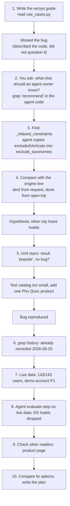

# How the Bug Was Found: Category Exclusion Applies to the Wrong City

This guide tells how the bug in `docs/plan/2026-10-05-fix-category-exclusion-other-city.md` was found, step by step. It shows the method, not only the result, so you can use the same method on other code. Requirements: FR-REC-02, AC-AGT-01.

## 1. Short answer

I did not find the bug by reading one file. I found it by following one field, `excludedVerticals`, from the code that writes it (the recommendation engine) to the code that reads it (the Itinerary Agent). Then I asked: "Does the reader understand this field the same way as the writer?" They did not.

- **Writer (engine):** `excludedVerticals` = categories bought in the user's open trip, wherever that trip is.
- **Reader (agent):** `excludedVerticals` = categories already bought for the trip the user is planning now.

These two meanings are the same only when both trips are in the same city. When they are in different cities, the agent removes hotels it should keep.

## 2. Timeline



## 3. Step by step

### Step 1: I read the line, but I missed the bug

While I wrote `docs/guide/recommendation-system-ste100.md`, I read this code in `src/backend/app/application/recommendation/use_cases.py:125-128`:

```python
if profile.active_trip is not None:
    t = profile.active_trip
    dest, done = destination or t.destination, t.purchased_taxonomies
```

I described it correctly in the guide (§6.7, rules 2 and 3), but I did not question it. A description answers "what does the code do?". It does not answer "is that right for every caller?". That second question needs the callers.

**Lesson:** describing code is not reviewing it. Reading only the writer side hides bugs that live between two modules.

### Step 2: Change the point of view to the consumer

You asked what an agent owner might not know. So I searched how the agent uses recommendations:

```bash
grep -rn -i "recommend" src/backend/app/agents src/backend/app/application/itinerary src/backend/app/domain/itinerary --include=*.py
```

Three results mattered:

| File | What it does |
|---|---|
| `agents/runtime_dependencies.py:52` | `require_recommendations = authorization is not None`: logged-in users always call the engine. |
| `agents/steps/tool_planning.py:271` | Adds `get_recommendations` to the plan if the LLM did not, with the destination of the request. |
| `agents/steps/evaluation.py:46-60` | `_relaxed_constraints`: if `strategy == "cross_vertical"`, copy `excludedVerticals` into `exclude_taxonomies`. |

The docstring of `_relaxed_constraints` says: "`excludedVerticals` là thứ user đã mua trong chuyến thật trên CDP". That sentence shows the agent's assumption: the bought categories belong to the trip being planned.

### Step 3: Put the two sides next to each other

| Question | Engine (writer) | Agent (reader) |
|---|---|---|
| Which city does the request use? | `dest = destination or t.destination`: the requested city | The requested city |
| Which trip do the bought categories come from? | `done = t.purchased_taxonomies`: always the open trip | Assumed: the trip being planned |
| Does the code compare the two cities? | No | Cannot: the response has no field for the trip's city |

The mismatch is visible in one line: `dest` can change with the request, but `done` never does. Hypothesis: a user with an open trip to city X who asks for city Y loses the categories bought for X.

**Lesson:** when two values on one line come from different sources, ask what happens when the sources disagree.

### Step 4: Prove it in the smallest possible test

I did not change any code to test the hypothesis. I reused the backend test fixtures (`src/backend/tests/conftest.py`): user `P1` has an open trip to Nha Trang with a hotel purchase. I called the engine with `destination="Phú Quốc"`.

**First result: `strategy=popular`, no exclusion. The bug seemed absent.**

I did not stop there. I read why: the test catalog has only one Phú Quốc product, a hotel. After the engine removes hotels, the mask is empty, MMR selects nothing, and the engine falls back to the cold start path. The small test data hid the bug.

I added one Phú Quốc attraction and ran again:

```text
ENGINE strategy=cross_vertical destination=Phú Quốc excluded=['hotel']
AGENT candidates=['A3'] warnings=[('H3', 'PRODUCT_DROPPED_TAXONOMY')]
```

Bug reproduced: the agent dropped the Phú Quốc hotel `H3` that Search found.

**Lesson:** a test that does not show a bug can be a test with wrong data. Before you accept "no bug", explain why the test took the path it took.

### Step 5: Check whether someone already knew

```bash
grep -rn "_relaxed_constraints\|excludedVerticals" history/*.md
```

`history/2026-09-25-khong-luu-vertical-bi-loai-va-de-xuat-hoi-ngay-di.md` already says, under "Còn lại": "khi truyền `destination`, `excludedVerticals` vẫn lấy từ chuyến đang diễn ra của user dù chuyến đó ở thành phố khác. Chưa sửa; thuộc workstream RecSys." The bug was known for 10 days but had no owner, no evidence and no plan, so nobody fixed it.

**Lesson:** search `history/` before you report a bug. A "Còn lại" line is not a task; a bug needs evidence and a plan to get fixed.

### Step 6: Measure on real data

A unit test proves the bug can happen. It does not say how often. I ran the real engine (`build_recsys` from `main.py`) on the local Postgres and Weaviate, without starting the backend:

- For each user with purchases, call the engine with no destination. Keep users whose strategy is `cross_vertical` (they have an open trip with a purchase).
- Call again with a different city. Count how many still get categories removed.

`RecommendForUser` accepts a `now` argument, so I ran it twice: at the seed date and today.

| `now` | Open trip with purchase | Still excluded for another city | Hotels excluded |
|---|---:|---:|---:|
| 2026-09-22 (seed date) | 143 | 143 | 130 |
| 2026-10-04 (today) | 1 | 1 | 1 |

The one user today is `VP0000001`. I checked `app.users`: its persona is `P1_frequent`, the demo account. That changed the severity to high.

**Lesson:** use the parameters the code already gives you (`now`, `events`, `destination`) to replay other dates without changing data.

### Step 7: Prove the full effect without the LLM

The LLM is not deterministic, so a chat test would be weak evidence. The bug is in the deterministic part, so I called the agent's `evaluate_retrieval` directly with:

- the real engine response for `VP0000001` and Hà Nội;
- 5 real Hà Nội hotels as Search results.

```text
ENGINE strategy=cross_vertical destination=Hà Nội excludedVerticals=['hotel']
AGENT decision=compose candidate taxonomies={'flight': 2, 'attraction': 2, 'combo': 2} dropped={'PRODUCT_DROPPED_TAXONOMY': 5}
```

**Lesson:** test the smallest deterministic function that shows the effect. Keep the LLM out of the evidence when the LLM is not the cause.

### Step 8: Look for other readers of the same field

If one consumer misreads a field, others may too. I searched the frontend for `fetchRecommendations` and `excludedVerticals`. `ProductDetailView.tsx:399` shows "Hoàn thiện chuyến {city}" when `trip.destination === product.destination`, but the engine always echoes the requested destination, so the check is always true. Same root cause: the response does not say where the open trip is.

### Step 9: Choose the fix by its effect on every reader

| Option | Why accepted or rejected |
|---|---|
| A. Engine ignores the open trip when the city differs | Every reader gets correct data: strategy `long_term`, no exclusion. No agent change. |
| B. Engine keeps `cross_vertical` but removes nothing | The label still says "you have a trip here". The web popover would say "Chuyến Hà Nội của bạn đã có khách sạn": false. |
| C. Fix only the agent | The agent cannot know the trip's city from the response. |
| D. Add `activeTripDestination` to the contract | Useful later, but a contract change. A works without it. |

I also checked that the fix does not change the offline bench: `src/evaluation/recsys_bench/engine.py:96` calls the engine without `destination`.

## 4. Checklist you can reuse

1. Pick one field that crosses a module boundary (engine → agent, backend → frontend).
2. Read where it is written. Write down what it means there.
3. `grep` every place it is read. Write down what each reader assumes. Read docstrings and test names: they state assumptions.
4. Look for a line where two values come from different sources. Ask what happens when they disagree.
5. Reproduce with the smallest test. If nothing happens, explain why before you conclude "no bug".
6. `grep history/` for the same symptom.
7. Measure on real data. Use time and input parameters to replay other cases.
8. Show the effect with a deterministic function, not with the LLM.
9. Check every other reader of the field.
10. Choose the fix that makes the data correct for all readers, then write the plan before you change code.

## 5. Where the evidence is

- Defect report, fix plan and the three scripts to reproduce: `docs/plan/2026-10-05-fix-category-exclusion-other-city.md` (Appendix A).
- How the engine works: `docs/guide/recommendation-system-ste100.md`.
- First record: `history/2026-09-25-khong-luu-vertical-bi-loai-va-de-xuat-hoi-ngay-di.md`.
