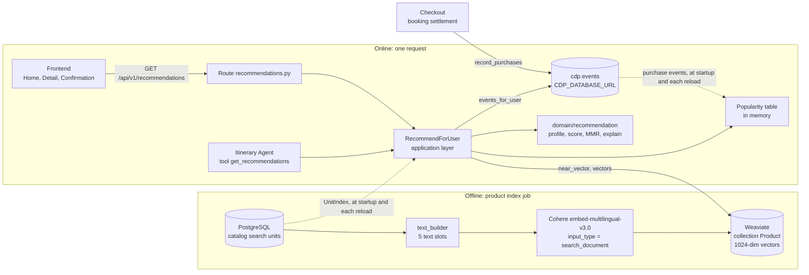
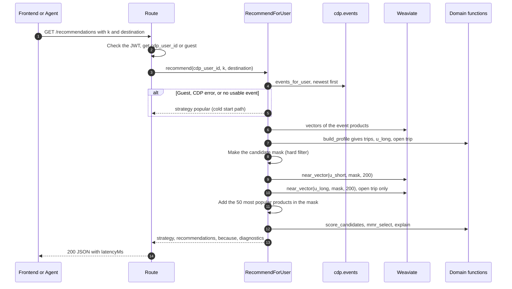
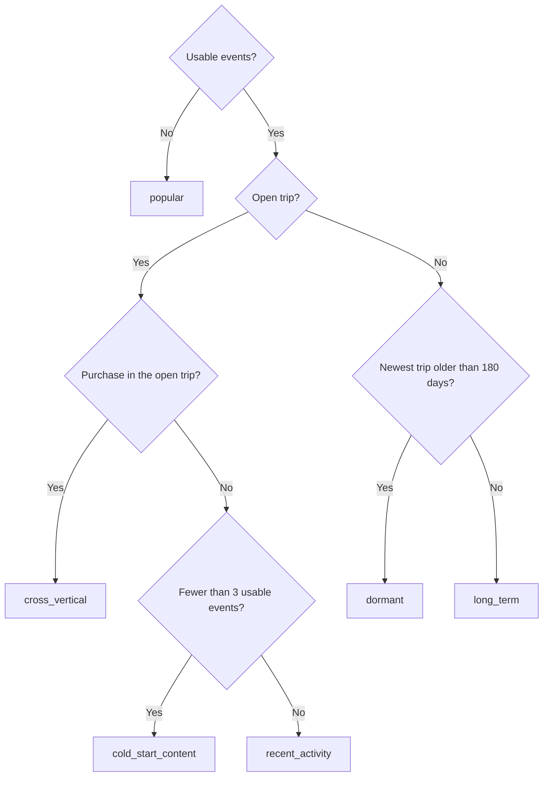
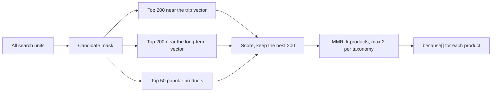
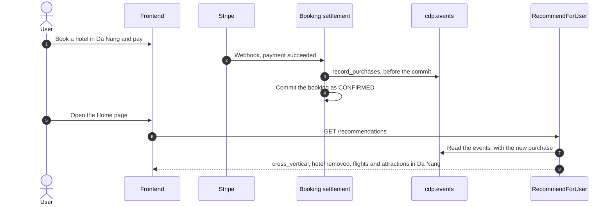

# Recommendation System: Technical Description (ASD-STE100)

| Item | Value |
|---|---|
| Document type | Guide. It is not a spec. If this guide does not agree with the PRD, the OpenAPI contract or the code, use the PRD, the contract and the code. |
| Language standard | ASD-STE100 Simplified Technical English |
| Requirements | FR-REC-01, FR-REC-02, FR-REC-03, FR-REC-04 and AC-REC-01, AC-REC-02 in `docs/prd/requirements.md` |
| Code version | Branch `feat/agent`, commit `585fcfc`. Engine rules `ENGINE_RULES_VERSION = "2026-10-02-trip-ended"`. |
| Date | 2026-10-04 |

## 0. How to read this guide

This guide obeys these ASD-STE100 rules:

- Each paragraph has one topic.
- A procedure sentence has a maximum of 20 words. A description sentence has a maximum of 25 words.
- The text uses the active voice and simple tenses.
- One word has one meaning. Section 12 gives the technical names.
- Lists and tables show complex data.

Code names, file names and API fields stay in their original form, for example `RecommendForUser`. Formulas are in code blocks. The diagrams use Mermaid. GitHub and the VS Code Markdown preview show them as pictures.

## 1. Purpose

The recommendation system selects products for one user. The web shows these products on three pages:

- The Home page.
- The product detail page.
- The booking confirmation page.

The Itinerary Agent also uses the system through the tool `get_recommendations`.

The system has three tasks:

1. It finds products that are similar to the history of the user (FR-REC-01).
2. It finds the next product for a trip that is not complete (FR-REC-02). Example: after a hotel booking in Đà Nẵng, it shows flights and attractions in Đà Nẵng.
3. It gives a reason for each personal recommendation in the field `because[]` (FR-REC-03).

## 2. Main idea

A product and a user are vectors in the same space.

1. An embedding model changes the text of each product into a vector of 1024 numbers.
2. Products with a similar meaning have vectors with a similar direction.
3. The engine calculates a user vector from the products that the user viewed, added to the cart or bought.
4. The products nearest to the user vector are the candidates.
5. The engine adds popularity to the score. Then it removes categories that the user already bought for the trip.
6. The engine makes the list diverse. Then it explains each product.

The handbook calls this "one engine, three faces". Search uses a query vector. Recommendation uses a user vector. The agent uses both.

## 3. System overview

The system has two parts. An offline job makes the product vectors. The backend uses these vectors for each request.

**Diagram 1: Components and data flow**



| Component | File | Function |
|---|---|---|
| Route | `src/backend/app/api/v1/routes/recommendations.py` | Reads the JWT. Gives `cdp_user_id` or no user to the use case. |
| Response helper | `src/backend/app/application/recommendation/responses.py` | Adds `cdpUserId` and `diagnostics.latencyMs`. The route and the agent use the same helper. |
| Use case | `src/backend/app/application/recommendation/use_cases.py` | `RecommendForUser` controls all the steps in section 5. `BuildPopularity` makes the popularity table. |
| Domain | `src/backend/app/domain/recommendation/profile.py` | Pure numpy. Trip vectors, user vector, strategy, score, MMR, `because[]`. |
| Domain | `src/backend/app/domain/recommendation/popularity.py` | Popular destinations, seasons, popular products. |
| Product index | `src/backend/app/application/ports/unit_index.py` | `UnitIndex`: metadata of each search unit. Makes the candidate mask. |
| Vector store | `src/backend/app/infrastructure/vectors/weaviate_store.py` | Top-K search and vector lookup in Weaviate. |
| History reader | `src/backend/app/infrastructure/cdp/postgres_cdp_reader.py` | Reads `cdp.events` through `CDP_DATABASE_URL`. |
| Index job | `src/backend/jobs/embed_products.py` | Makes the product text, calls Cohere, writes vectors to Weaviate. |
| Frontend | `src/frontend/src/services/recsys.ts` | Calls the API with `k = 4`. Maps the response for the cards. |
| Composition | `src/backend/app/main.py` | `build_recsys` makes all objects. `RecsysRefresher` makes them again each reload. |

## 4. Data

### 4.1. Product vectors

- Only search units have a vector. A search unit is a hotel property, a flight route, an attraction, a combo or a golf product.
- Rooms and flights do not have a vector. The engine uses the vector of the parent. `UnitIndex.resolve` changes a child id into the parent id.
- The index job makes one text for each search unit with `domain/catalog/text_builder.py` (version `catalog-text-v2`).
- The text has five slots: HEADLINE, FIT, FEATURES, ROLLUP and EXCERPT.
- The text does not contain price, date, rating or review count. These values change at each crawl.
- The job sends the text to Cohere with `input_type=search_document`. It writes the vector to Weaviate (`vectorizer: none`).
- The model version is `embed-multilingual-v3.0:catalog-text-v2`. The backend compares this value at startup.

> **NOTE:** The index and the queries must use the same model. A different model gives bad results and no error.

### 4.2. User events

The engine reads the events of one user from `cdp.events`. The connection is `CDP_DATABASE_URL`. The role `vota_app` cannot read `cdp.events`.

| Event name | Weight `W_TYPE` | Meaning |
|---|---:|---|
| `purchase` | 1.0 | The user bought the product. |
| `add_to_cart` | 0.5 | The user added the product to the cart. |
| `product_view` | 0.2 | The user opened the product page. |
| `search` | 0.1 | The user searched. A search event has no product, so the engine does not use it. |

The engine uses these event fields:

- `productId`: the product. It can be a room or a flight.
- `eventName`: one name from the table above.
- `timestamp`: the time of the event.
- `eventGroupId`: the trip. If this field is empty, the event is a trip of one event (`_solo_<productId>`).
- `usingDate`: the date of use, for example the check-in date or the flight date.

### 4.3. Popularity table

`BuildPopularity` reads all `purchase` events of the last 730 days. The backend makes the table at startup and at each catalog reload. The default reload interval is 900 seconds (`CATALOG_REFRESH_SECONDS`).

| Function | Result |
|---|---|
| `unit_scores(destination)` | For each product: purchases in the last 90 days, divided by the maximum. The value is 0 to 1. |
| `top_destinations_month(k=3)` | The destinations with the most bookings in the last 30 days. |
| `seasonal_destinations(k=3)` | The destinations with the most bookings in the same months of past years. If there are not sufficient bookings, the `SEASONS` table gives more. |

## 5. Request flow

**Diagram 2: One request, from the page to the response**



The steps in section 6 give the details of each arrow.

## 6. Engine steps

### 6.1. Step 1: Identify the user

- The route gets `cdp_user_id` only from a valid JWT.
- The route does not accept `cdp_user_id` as a query parameter. This prevents IDOR.
- If there is no JWT, the user is a guest. The engine uses the cold start path (section 6.11).
- If the JWT is not valid or is expired, the route gives `401 INVALID_TOKEN`. It does not change the user into a guest.
- `GET /internal/recommendations` accepts any `cdp_user_id`. It is only for demo and evaluation, and it needs `X-Service-Token`.

### 6.2. Step 2: Read and resolve the events

1. The engine reads the events of the user from the CDP.
2. If the CDP is unavailable, the engine uses the cold start path. It writes a `WARNING` log without `cdp_user_id`.
3. The engine changes each room or flight id into the parent id.
4. The engine removes events of products that are not in the catalog or that have no vector.

### 6.3. Step 3: Make a vector for each trip

The engine groups the events by trip (`eventGroupId`). Then it calculates one vector for each trip:

```text
v_trip = normalize( Σ  W_TYPE(event) × 2^(−daysAgo / 30) × v_product )
```

- The half-life is 30 days (`H_SHORT_DAYS`). An event from 30 days ago has half the weight of an event from today.
- One trip uses a maximum of 3 events for the same product (`MAX_REPEAT_PER_TRIP`). This limit applies only to the vector.
- The trip age, the end date and the bought categories use all events of the trip. The limit does not apply to them.

### 6.4. Step 4: Make the long-term vector

```text
u_long = normalize( Σ  2^(−tripAge / 365) × v_trip )
```

The half-life of a trip is 365 days (`H_LONG_DAYS`). `tripAge` is the age of the newest event in the trip, in days.

### 6.5. Step 5: Find the open trip (FR-REC-02)

A trip is open if it is not complete:

1. If a trip has a `usingDate`, the trip is open while `max(usingDate) >= today`.
2. If a trip has no `usingDate` (views only), the trip is open while its newest event is 14 days old or less (`ACTIVE_TRIP_MAX_AGE_DAYS`).
3. "Today" uses Vietnam time (UTC+7), because `usingDate` is a local date.
4. If more than one trip is open, the engine uses the trip with the newest event.

Examples:

- A user bought a hotel 120 days ago for a trip in 10 days. The trip is open.
- A user came back from a trip 3 days ago. The trip is closed. The engine selects products for the next trip.

> **NOTE:** `usingDate` is the start date of use. The CDP has no end date. Because of this, a stay of many nights closes on the day after check-in.

### 6.6. Step 6: Select the strategy

The strategy is a result of the engine. The client cannot send it.

**Diagram 3: Strategy decision**



| Strategy | Condition | Meaning for the user |
|---|---|---|
| `cross_vertical` | Open trip with a purchase | Give the parts of the trip that the user did not book, for example a flight after a hotel. |
| `recent_activity` | Open trip, no purchase, 3 or more events | Give products similar to the recent views. |
| `cold_start_content` | Open trip, no purchase, fewer than 3 events | Same as above, but with little data. |
| `long_term` | No open trip, newest trip 180 days old or less | Give products for the next trip from all history. |
| `dormant` | No open trip, newest trip older than 180 days | Same as `long_term`, for a user who did not come back for a long time. |
| `popular` | Guest, CDP error or no usable event | Give popular destinations and products. `because[]` is empty. |

### 6.7. Step 7: Make the candidate mask (hard filter)

The mask is a list of allowed products. The engine applies it before the vector search.

1. Keep only products that are available and recommendable (`is_recommendable`).
2. If there is an open trip, keep only one destination: the request destination or, if empty, the trip destination.
3. If there is an open trip, remove all categories (taxonomies) that the user bought in this trip.
4. If there is no open trip, keep the destination of the request. Do not remove categories.
5. Remove all products that the user bought before.
6. If the mask is empty and the request has no destination, remove the destination limit. Keep the category exclusion.

The engine sends the allowed ids to Weaviate. If the engine filtered after the search, fewer than `k` products could remain.

### 6.8. Step 8: Get candidates

**Diagram 4: From the full catalog to `k` products**



- If there is an open trip, the engine searches near the trip vector and near `u_long`.
- If there is no open trip, the engine searches near `u_long` only.
- The 50 popular products let a popular product enter the list when it is far from the profile.

### 6.9. Step 9: Score the candidates (FR-REC-04)

```text
score = 0.6 × cos(v, u_short) + 0.25 × pop + 0.15 × cos(v, u_long)
```

- `u_short` is the trip vector if there is an open trip. If not, `u_short` is `u_long`.
- `pop` is `unit_scores(destination)` from section 4.3, a value from 0 to 1.
- The weights are `W_SHORT`, `W_POP` and `W_LONG` in `profile.py`.
- Availability is not in the score. The mask in step 7 removes unavailable products.

### 6.10. Step 10: Make the list diverse (MMR)

The engine selects one product at a time. For each candidate `i`, it calculates:

```text
MMR(i) = 0.7 × score(i) − 0.3 × max cos(v_i, v_j)   for all j already selected
```

- The engine selects the candidate with the highest `MMR(i)`.
- A maximum of 2 products can have the same taxonomy (`MAX_PER_VERTICAL`).
- Without this step, the top 5 can be five similar resorts.

The engine sets `nextVertical` to the most frequent taxonomy in the result.

### 6.11. Step 11: Explain each product (FR-REC-03)

`because[]` shows which events of the user make the product relevant.

```text
c_e            = tripWeight × W_TYPE(e) × 2^(−daysAgo_e / 30)
share_e        = c_e × cos(v_e, v_item) / Σ c
contribution_e = share_e / Σ (positive share)
```

- If there is an open trip, the engine uses only its events and `tripWeight = 1`.
- If not, the engine uses all trips and `tripWeight = 2^(−tripAge / 365)`.
- The engine keeps events with `contribution >= 0.15`, a maximum of 3, from the highest value to the lowest.
- `because[0]` is the strongest reason. The card shows it.
- If no event gets 0.15, `because[]` is empty. The engine does not make a reason that has no data.

### 6.12. Cold start path

The engine uses this path for guests, CDP errors, users without usable events and an empty MMR result.

1. If the request has a destination, the engine gives the top products of that destination. It sorts by purchases in 90 days, then by `reviewCount`.
2. If not, the engine makes two sections: popular destinations of this month and seasonal destinations.
3. Each section has the top products of its destinations. The flat list takes the first `k` different products.
4. If there is no popularity table, the engine sorts all products by `reviewCount`.

For all items, `because[]` is empty and `diagnostics.coldStart` is `true`.

## 7. Feedback loop after a booking (K1)

This loop is the main demo moment. The user books a hotel. When the user goes back to Home, the list shows the parts of the trip that the user did not book.

**Diagram 5: Booking changes the next recommendation**



- Each request reads the events again. The engine keeps the results in a Redis cache (from 2026-10-12), but the cache key has a fingerprint of these events. The new purchase changes the key, so the next request calculates again and shows the change immediately. Nothing must delete the cache.
- If the CDP write fails, the webhook gives HTTP 500. Stripe sends the webhook again.

## 8. Errors and fallback

| Condition | Result |
|---|---|
| No JWT | `200`, `cdpUserId: null`, `strategy: popular` |
| JWT not valid or expired | `401 INVALID_TOKEN` |
| CDP unavailable or timeout | `200`, `strategy: popular`, `coldStart: true`, `eventsUsed: 0`, one `WARNING` log |
| No usable event | `200`, `strategy: popular` |
| MMR selects no product | `200`, `strategy: popular` |
| Engine not loaded (database not seeded, Weaviate empty) | The backend tries again each 30 seconds. Until then, the route has no engine and gives an error. |
| Frontend gets an error or no response in 3 seconds | The page hides the block and shows "Thử lại". It does not show fake products. |

## 9. Parameters

All values are in `src/backend/app/domain/recommendation/profile.py`, except where the table shows a different file.

| Name | Value | Function |
|---|---|---|
| `W_TYPE` | purchase 1.0, add_to_cart 0.5, product_view 0.2, search 0.1 | Weight of each event type |
| `H_SHORT_DAYS` | 30 | Half-life of an event in a trip vector |
| `H_LONG_DAYS` | 365 | Half-life of a trip in the long-term vector |
| `ACTIVE_TRIP_MAX_AGE_DAYS` | 14 | Parameter N of FR-REC-02 for trips without `usingDate` |
| `DORMANT_AFTER_DAYS` | 180 | Limit for `dormant` |
| `MAX_REPEAT_PER_TRIP` | 3 | Maximum events for one product in one trip vector |
| `W_SHORT`, `W_POP`, `W_LONG` | 0.6, 0.25, 0.15 | Score weights |
| `MMR_LAMBDA` | 0.7 | Balance between score and diversity |
| `MAX_PER_VERTICAL` | 2 | Maximum products for each taxonomy |
| `candidate_k` | 200 | Top-K from Weaviate (`recommend_candidate_k` in `core/config.py`) |
| `popular_k` | 50 | Popular candidates (`use_cases.py`) |
| `min_share`, `top` | 0.15, 3 | Limits of `because[]` (`explain`) |
| `k` | 1 to 20, default 5 | Query parameter. The frontend uses 4. |

To change a value, change it in code. Then run the offline evaluation (section 10) before and after the change.

## 10. Offline evaluation

The harness is `src/evaluation/recsys_bench`. It uses two frozen splits of the seed data:

- **LLBO** (leave last booking out): it hides the last booking of each user and tries to find it. 1,007 users.
- **Temporal**: it cuts the history at T = 2026-07-07 and tries to find the purchases after T. 102 users.

Results v5, `k = 20`, from `src/evaluation/reports/eval-2026-10-02-recsys-bench-v5.md`:

| Split | Arm | Recall@5 | NDCG@5 | Recall@20 |
|---|---|---:|---:|---:|
| LLBO | random (3 seeds) | 0.0023 | 0.0012 | 0.0083 |
| LLBO | most_popular | 0.0993 | 0.0611 | 0.2929 |
| LLBO | most_popular_in_destination | 0.4965 | 0.3624 | 0.6346 |
| LLBO | engine (no taxonomy limit) | 0.6693 | 0.4973 | 0.8510 |
| LLBO | engine_prod (production limit) | 0.5720 | 0.4536 | 0.5909 |
| Temporal | most_popular_in_destination | 0.0294 | 0.0149 | 0.0980 |
| Temporal | engine | 0.1863 | 0.1452 | 0.2157 |
| Temporal | engine_prod | 0.1275 | 0.1189 | 0.1275 |

Read these values with care:

- The histories come from the seed job, not from real users. The values show a direction, not a proof.
- In the temporal split, a difference of 0.02 is 2 users.
- `engine_prod` gives fewer than 20 products, because of the limit of 2 for each taxonomy. Because of this, its Recall@20 is low.

The report gives the commands that make these values again.

## 11. Known differences between the spec and the code

The spec `docs/spec/hop-dong-tich-hop-search-recommendation.md` §4 does not agree with the code on these items. The code obeys the PRD (FR-REC-04 asks for semantic relevance plus popularity). These items are open. This guide does not change them.

| Item | Spec | Code now |
|---|---|---|
| Event weights | §4.3: purchase 5.0, add_to_cart 3.0, product_view 1.0 | 1.0, 0.5, 0.2, search 0.1 |
| Weight of a complete trip | §4.3: `tripFactor = 0.2` | Not in the code. A closed trip keeps its full weight in `u_long`. |
| Final score | §4.7: `cos + 0.05 × log(1 + reviewCount)` | `0.6 × cos(short) + 0.25 × pop + 0.15 × cos(long)` |
| Diversity limit | §4.7: max 2 for each `parentProductId` | Max 2 for each taxonomy |
| Dormant limit | §4.4, §4.8: 90 days | 180 days. The spec records this difference. |
| Dormant rule | §4.8: half-life × 3, prefer `lastDestination` | Not in the code |
| All categories removed | §4.5: remove the exclusion, set `exclusionRelaxed: true` | Not in the code. The engine removes only the destination limit, then uses the cold start path. |
| Cold start by home city | §4.8 step 2: `profile.homeCity` | Not in the code |
| User vector cache | §5, §7.1: cache, `userVectorCacheHit`, `userVectorNorm` | Closed on 2026-10-12. The spec now has a cache of the results in Redis. The key has a fingerprint of the events (§5). `userVectorCacheHit` is in the response when the cache is on. `userVectorNorm` is not in the response. |
| Event limit | §4.2: max 500 newest events | Closed on 2026-10-12. `events_for_user` reads max 500 newest events. |

To close one item, write a proposal or change the code. Then run the offline evaluation again.

## 12. Technical names

| Name | Meaning |
|---|---|
| Search unit | A product that has a vector: hotel property, flight route, attraction, combo or golf product. |
| Taxonomy (vertical) | The product category: `hotel`, `flight`, `attraction`, `combo`, `golf`. |
| Event | One action of a user in `cdp.events`. |
| Trip | All events with the same `eventGroupId`. |
| Open trip | A trip that is not complete (section 6.5). |
| Trip vector (`u_short`) | The vector of one trip (section 6.3). |
| Long-term vector (`u_long`) | The vector of all trips of the user (section 6.4). |
| Candidate mask | The list of allowed products for one request (section 6.7). |
| MMR | Maximal Marginal Relevance. A method that selects relevant products that are not similar to each other. |
| Cold start | The path for users with no usable history (section 6.12). |
| CDP | Customer Data Platform. In this repository, the schema `cdp` in PostgreSQL is a clone of it. |
