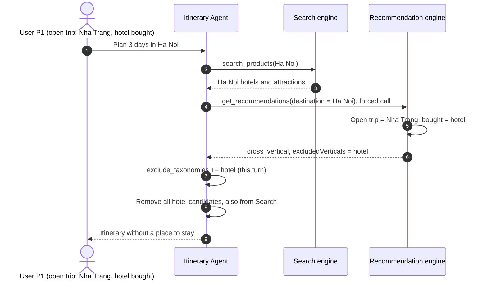
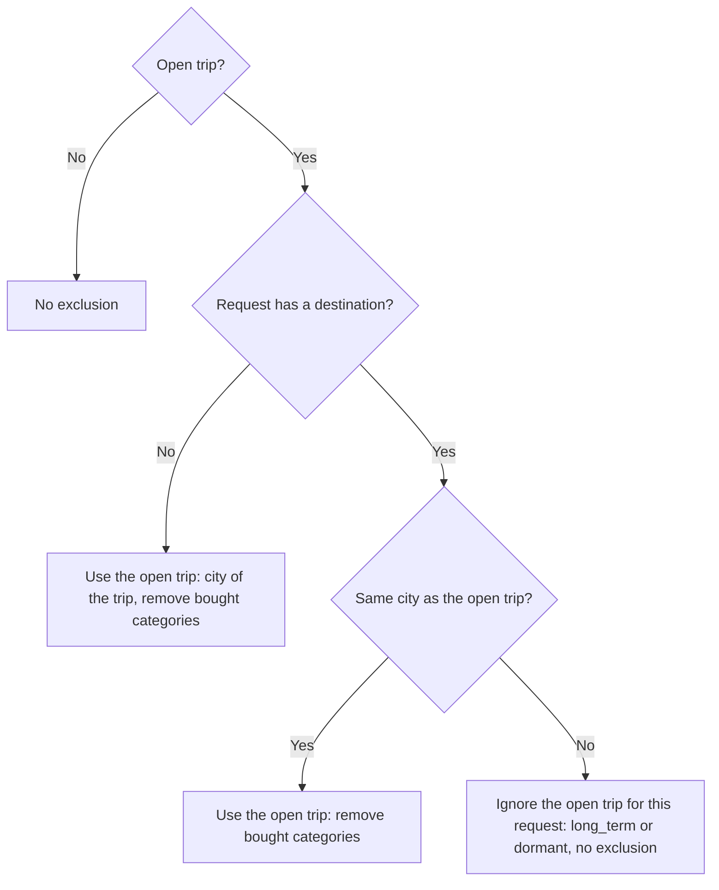

# Defect Report and Fix Plan: Category Exclusion Applies to the Wrong City

| Item | Value |
|---|---|
| Document type | Plan: defect report and fix plan. It is not approved. |
| Status | For review |
| Date | 2026-10-05 |
| Author | Nguyễn Minh Nhật / Claude Code |
| Reviewer | Nguyễn Minh Nhật |
| Language standard | ASD-STE100 Simplified Technical English (rules in `docs/guide/recommendation-system-ste100.md` §0) |
| Requirements | FR-REC-02, AC-REC-02, FR-AGT-03, AC-AGT-01 (`docs/prd/requirements.md`) |
| Severity | High. The defect occurs on the demo account `P1_frequent`. |
| Code version | Branch `feat/agent`, commit `585fcfc` |
| Location of the defect | Recommendation engine (RecSys workstream) |
| Location of the effect | Itinerary Agent (agent workstream) and the product detail page (web workstream) |
| First record | `history/2026-09-25-khong-luu-vertical-bi-loai-va-de-xuat-hoi-ngay-di.md`, section "Còn lại / rủi ro". The defect is not fixed. |

## 1. Summary

A logged-in user books a hotel for a trip to city X. Then the user asks for city Y.

- The recommendation engine removes the hotel category for city Y. It must remove the category only for city X.
- The Itinerary Agent receives this list of removed categories. Then it removes all hotels from the itinerary for city Y. These hotels include the hotels that Search found.
- The user gets an itinerary without a place to stay. The reply does not give the true reason.

The defect occurs for each category that the user bought for the trip, not only for hotels.

## 2. Background: category exclusion (FR-REC-02)

FR-REC-02 gives this rule. The user booked a hotel at destination X, and the trip is not complete. Then the system must prefer flights to X and activities at X. It must remove the categories that the user already bought for this trip.

The engine applies the rule in two steps (guide `docs/guide/recommendation-system-ste100.md` §6.5 and §6.7):

1. It finds the open trip. A trip is open if `max(usingDate) >= today`.
2. It removes the categories that the user bought in the open trip from the candidate mask. Then it sets `strategy: cross_vertical` and `diagnostics.excludedVerticals`.

The rule is about destination X. It does not say what to do when the request is for a different destination.

## 3. Expected and actual behaviour

Conditions: the user `VP0000001` (`P1_frequent`) has an open trip to Nha Trang with a hotel purchase. The user asks for Hà Nội.

| Item | Expected | Actual |
|---|---|---|
| `GET /recommendations?destination=Hà Nội`: `strategy` | `long_term`. The user has no trip to Hà Nội. | `cross_vertical` |
| `diagnostics.excludedVerticals` | `[]` | `["hotel"]` |
| `destination` | `Hà Nội` | `Hà Nội`. This value tells the client that the open trip is in Hà Nội. This is not true. |
| Hotels in the recommendations | Possible | None |
| Agent: hotels from Search | Kept as candidates | All removed with `PRODUCT_DROPPED_TAXONOMY` |
| Agent: itinerary | Has a place to stay | No place to stay |

## 4. Root cause

### 4.1. The engine uses the open trip for all destinations

`src/backend/app/application/recommendation/use_cases.py:125-128`:

```python
if profile.active_trip is not None:
    t = profile.active_trip
    dest, done = destination or t.destination, t.purchased_taxonomies
    m = idx.mask(destination=dest, only_recommendable=True) & ~np.isin(idx.taxonomy, list(done))
    ...
```

- `dest` is the request destination if the request has one. If not, `dest` is the destination of the trip.
- `done` is always the set of categories that the user bought in the open trip. The code does not compare `destination` with `t.destination`.
- `Profile.strategy` (`domain/recommendation/profile.py`) uses only the profile. It does not know the request destination. Because of this, it gives `cross_vertical` for each destination.

### 4.2. The response does not show the city of the open trip

The response field `destination` is always the request destination. The contract has no field for the city of the open trip. Because of this, a client cannot find the defect from the response.

### 4.3. The agent applies the list to the full itinerary

`src/backend/app/agents/steps/evaluation.py:46-60`, function `_relaxed_constraints`:

- If the recommendation response has `strategy: cross_vertical`, the agent adds `diagnostics.excludedVerticals` to `exclude_taxonomies` for this turn.
- The agent does not do this if the user asks for a hotel (`require_hotel`).
- Then `collect` (`application/itinerary/retrieval.py:63`) removes each candidate of these categories. Search candidates are also removed.

This agent rule is correct for the same city. It is the expected cross-sell behaviour, and the test `test_cross_sell_excludes_hotel_and_preserves_real_because` checks it.

### 4.4. The agent calls the engine on each turn of a logged-in user

`src/backend/app/agents/runtime_dependencies.py:52` sets `require_recommendations` when the request has a token. Then `tool_planning.py:271-276` adds `get_recommendations` to each tool plan. The call uses the canonical destination of the request. Because of this, the defect occurs on each turn for an affected user.

**Diagram 1: Defect path**



## 5. Evidence

### 5.1. Unit-level reproduction (no database)

Data: the backend test catalog (`src/backend/tests/conftest.py`) and one more product, `A3` (attraction, Phú Quốc). User `P1` has an open trip to Nha Trang with a hotel purchase. Time: 2026-09-21.

```text
ENGINE strategy=cross_vertical destination=Phú Quốc excluded=['hotel'] recs=[('A3', 'attraction')]
AGENT candidates=['A3'] decision=compose warnings=[('H3', 'PRODUCT_DROPPED_TAXONOMY')]
```

`H3` is the Phú Quốc hotel from Search. The agent removed it.

> **NOTE:** Without `A3`, the mask for Phú Quốc is empty. Then the engine uses the cold start path and the defect does not show. The real catalog has many products in each city, so the defect shows.

### 5.2. Live engine on the local database

Data: local PostgreSQL and Weaviate, 7,352 events, 1,500 users with purchases. Procedure: Appendix A.2. For each user with `strategy: cross_vertical`, the script asks again for a different city.

| Time (`now`) | Users with an open trip and a purchase | Categories still removed for a different city | Hotels removed for a different city |
|---|---:|---:|---:|
| 2026-09-22 (seed date) | 143 | 143 | 130 |
| 2026-10-04 23:54, Vietnam time (time of the run) | 1 | 1 | 1 |

The user in the second row is `VP0000001`, the `P1_frequent` demo account: open trip to Nha Trang, request for Hà Nội. The result has 2 flights, 2 attractions and 2 combos in Hà Nội.

After a reseed with a new `--as-of` date, the number of affected users is near the first row again.

### 5.3. Live agent evaluate step for the demo account

Procedure: Appendix A.3. The script gives the agent a real engine response and 5 real Hà Nội hotels as Search results. It does not use an LLM.

```text
ENGINE strategy=cross_vertical destination=Hà Nội excludedVerticals=['hotel'] taxonomies={'flight': 2, 'attraction': 2, 'combo': 2}
SEARCH hotels in Hà Nội given to the agent: 5
AGENT decision=compose candidate taxonomies={'flight': 2, 'attraction': 2, 'combo': 2} dropped={'PRODUCT_DROPPED_TAXONOMY': 5}
```

### 5.4. Earlier record

The entry `history/2026-09-25-khong-luu-vertical-bi-loai-va-de-xuat-hoi-ngay-di.md` reports a Hà Nội itinerary with only a hotel. That turn had `attraction` in the removed categories. The same entry records this destination defect as open and as a RecSys task. The data in the entry does not show whether this defect caused that report.

## 6. Impact

### 6.1. Affected

- **Itinerary Agent.** A logged-in user with an open trip to city X asks for city Y. The itinerary does not have the categories that the user bought for X. For a hotel, the itinerary has no place to stay. AC-AGT-01 expects places to stay and activities as real product cards.
- **Reply text.** The agent treats `PRODUCT_DROPPED_TAXONOMY` as a choice of the user, not as a supply problem (`retrieval.py:153`). Each removed hotel gets only the general warning text `Một sản phẩm chưa đủ căn cứ hoặc không đáp ứng yêu cầu đã được loại.` The reply does not tell the user about the booking in city X.
- **Demo.** The defect occurs on the `P1_frequent` account. Example: book a hotel in Nha Trang, then ask the assistant for a different city.
- **Product detail page (found by a code review, not tested in a browser).** `ProductDetailView.tsx:344` asks for recommendations with `destination = product.destination`. The block "Hoàn thiện chuyến {city}" shows when `trip.destination === product.destination`. This condition is always true, because the engine sends back the request destination. Because of this, the block can show for a city where the user has no trip, and it has no hotels.

### 6.2. Not affected

- Guests (no token). The agent does not call the engine, and the engine has no profile.
- Requests for the same city as the open trip. The exclusion is correct there.
- Requests without a destination, for example the Home page without `activeDestination`.
- Users without an open trip that has a purchase.
- Agent turns where the user asks for a hotel (`require_hotel`). The agent does not apply the list then.
- The offline bench. It calls the engine without `destination` (`src/evaluation/recsys_bench/engine.py:96`).

## 7. Fix options

| Option | Change | Result | Recommendation |
|---|---|---|---|
| A | Engine: if the request destination is not the city of the open trip, do not use the open trip for this request. | `strategy` is `long_term` or `dormant`. No category is removed. `excludedVerticals` is `[]`. | **Use this option.** |
| B | Engine: keep the open trip, but remove no category when the city is different. | `strategy` stays `cross_vertical`. The web shows "Chuyến {city} của bạn đã có khách sạn" for the wrong city. | Do not use. |
| C | Agent only: ignore `excludedVerticals` when the city is different. | The agent cannot find the city of the open trip in the response (§4.2). | Not possible without option D. |
| D | Contract: add `diagnostics.activeTripDestination`. | Clients can see the city of the open trip. This is an additive contract change. | Optional, later. Option A does not need it. |

## 8. Recommended fix (option A)

### 8.1. Engine change

In `src/backend/app/application/recommendation/use_cases.py`, after `build_profile(...)`:

```python
# Chuyến đang mở ở thành phố khác với thành phố được hỏi: gợi ý cho chuyến mới, không loại danh mục (FR-REC-02).
if destination and profile.active_trip is not None and profile.active_trip.destination != destination:
    profile = replace(profile, active_trip=None)
```

- `replace` comes from `dataclasses`.
- `Profile.strategy` then gives `long_term` or `dormant`. The candidate mask does not remove categories.
- The engine searches near `u_long`. `u_long` contains the open trip with its full weight, so the taste of the user stays in the result.
- `explain` uses all trips, so `because[]` stays correct.
- The comparison uses the exact catalog value. The agent sends the canonical catalog destination, and the web sends `product.destination`.

**Diagram 2: Open trip decision after the fix**



### 8.2. Behaviour after the fix

| Request | Before | After |
|---|---|---|
| No destination | `cross_vertical`, city of the trip, categories removed | No change |
| Destination = city of the open trip | `cross_vertical`, categories removed | No change |
| Destination ≠ city of the open trip | `cross_vertical`, categories removed | `long_term` or `dormant`, no category removed |

### 8.3. Agent and web

- **Agent:** no code change. The engine no longer sends `cross_vertical` for a different city, so `_relaxed_constraints` does not apply the list.
- **Web (optional, separate change):** show the block "Hoàn thiện chuyến {city}" only when `trip.strategy === 'cross_vertical'`. After the engine fix, this condition is correct.

## 9. Test plan

### 9.1. New unit tests (engine)

Add to `src/backend/tests/unit/application/` with the `services` fixture and one more product in a second city:

1. Open trip to Nha Trang with a hotel purchase, request for Phú Quốc. Expect `strategy` in `{long_term, dormant}`, `excludedVerticals == []`, and the Phú Quốc hotel is a possible result.
2. Same user, request for Nha Trang. Expect `cross_vertical` and `excludedVerticals == ["hotel"]`.
3. Same user, no destination. Expect `cross_vertical` and `destination == "Nha Trang"`.
4. Each response validates against `RecommendationResponse`.

### 9.2. Agent test

Add one test to `src/backend/tests/unit/agents/test_itinerary_runtime.py`. The recommendation response is `long_term` with `excludedVerticals: []`. Expect the hotel from Search in the candidates. The current test `test_cross_sell_excludes_hotel_and_preserves_real_because` must still pass.

### 9.3. Regression and live checks

Do these steps from the repository root:

1. Run `.venv/bin/python -m pytest src/backend/tests/unit/application src/backend/tests/unit/agents src/backend/tests/unit/domain`.
2. Run `.venv/bin/python -m pytest src/backend/tests/contract src/backend/tests/architecture`.
3. Run the script of Appendix A.2 with `2026-09-22T03:00:00+00:00`. Expect `other_city_still_excluded` equal to 0.
4. Run the script of Appendix A.3. Expect 5 hotels in the agent candidates and no `PRODUCT_DROPPED_TAXONOMY`.
5. Run the recsys bench only if the reviewer asks for it. The bench does not use `destination`, so its values do not change.

## 10. Documents to update with the fix

- `docs/spec/hop-dong-tich-hop-search-recommendation.md` §4.4 and §4.5: add one line. The open trip applies only when the request has no destination or the same destination.
- `docs/guide/recommendation-system-ste100.md` §6.5 and §6.7: add the same rule.
- `src/backend/app/domain/recommendation/profile.py`: change `ENGINE_RULES_VERSION`, because the behaviour changes without a constant change. Its comment requires this.
- `history/`: one new entry for the fix.

## 11. PRD check

FR-REC-02 describes the exclusion for "điểm đến X", the city of the booking. Option A limits the exclusion to that city. Because of this, the fix agrees with the PRD, and a proposal in `docs/prd/update/` is possibly not necessary. The reviewer makes the decision (question 3 in section 12).

## 12. Questions for the reviewer

1. Do you approve option A?
2. Who makes the engine change: the RecSys workstream or the agent workstream? The defect is in the RecSys code.
3. Is a proposal in `docs/prd/update/` necessary (section 11)?
4. Is the web change in §8.3 part of this fix or a separate task?
5. Must the comparison in §8.1 ignore case and spaces, or is the exact catalog value sufficient?

## Appendix A. Procedures to reproduce

Do these procedures from the repository root. They need `.venv`. A.2 and A.3 also need the local PostgreSQL and Weaviate (`docker compose up -d --wait postgres weaviate`) and a seeded database. Put each script in a temporary directory, not in the repository.

### A.1. Unit-level reproduction

```python
"""Open trip in Nha Trang (hotel bought), request for Phú Quốc. No database."""
import json, pathlib, tempfile
from datetime import datetime, timezone
from src.backend.tests.conftest import ROWS, EVENTS, FakeEmbedder, P
from src.backend.tests.fakes.in_memory_vector_store import InMemoryVectorStore
from src.backend.tests.fakes.jsonl_cdp_reader import JsonlCdpReader
from src.backend.app.application.recommendation import BuildPopularity, RecommendForUser
from src.backend.app.agents.steps.evaluation import evaluate_retrieval

rows = ROWS + [P("A3", "VinWonders Phú Quốc", "attraction", "Phú Quốc", {}, price=900000)]
d = pathlib.Path(tempfile.mkdtemp())
(d / "products.jsonl").write_text("\n".join(json.dumps(r, ensure_ascii=False) for r in rows), encoding="utf-8")
(d / "events.jsonl").write_text("\n".join(json.dumps(r, ensure_ascii=False) for r in EVENTS), encoding="utf-8")
index, vectors = InMemoryVectorStore(str(d / "products.jsonl"), FakeEmbedder(), str(d / ".embcache")).load()
cdp = JsonlCdpReader(str(d / "events.jsonl"))
now = datetime(2026, 9, 21, tzinfo=timezone.utc)
r = RecommendForUser(index, vectors, cdp, BuildPopularity(index, cdp)(now=now))("P1", k=10, now=now, destination="Phú Quốc")
print("ENGINE", r["strategy"], r["destination"], r["diagnostics"]["excludedVerticals"])

h3 = next(x for x in rows if x["productId"] == "H3")
hit = {k: h3[k] for k in ("productId", "name", "taxonomy", "destination", "unitPrice", "currency", "available", "attributes", "imageUrl")}
state = {"intent": {"destination": "Phú Quốc", "days": 3}, "constraints": {}, "details": {},
         "tool_results": [{"name": "search_products", "data": {"results": [{**hit, "priceUnit": "PER_NIGHT", "score": 0.9}]}},
                          {"name": "get_recommendations", "data": r}]}
out = evaluate_retrieval(state)
print("AGENT", sorted(out["candidates"]), [(w["productId"], w["code"]) for w in out["warnings"]])
```

Command: `PYTHONPATH=. .venv/bin/python <script>`.

### A.2. Live engine count

```python
"""For each user with cross_vertical, ask again for a different city. Argument: optional ISO time for `now`."""
import collections, sys
from datetime import datetime, timezone
import psycopg
from dotenv import dotenv_values
from src.backend.app.core.config import get_settings
from src.backend.app.main import build_recsys

now = datetime.fromisoformat(sys.argv[1]) if len(sys.argv) > 1 else datetime.now(timezone.utc)
svc = build_recsys(get_settings())
rec, index = svc["recommend"], svc["index"]
users = [r[0] for r in psycopg.connect(dotenv_values(".env")["CDP_DATABASE_URL"]).execute(
    "select distinct cdp_user_id from cdp.events where event_name = 'purchase' order by 1").fetchall()]
cities = [c for c, _ in collections.Counter(map(str, index.destination)).most_common(6)]
stats = collections.Counter()
for u in users:
    base = rec(u, k=10, now=now)
    if base["strategy"] != "cross_vertical":
        continue
    stats["open_trip_with_purchase"] += 1
    other = next(c for c in cities if c != base["destination"])
    excluded = rec(u, k=10, now=now, destination=other)["diagnostics"]["excludedVerticals"]
    stats["other_city_still_excluded"] += bool(excluded)
    stats["other_city_hotel_excluded"] += "hotel" in excluded
print(now.isoformat(), len(users), dict(stats))
```

Command: `PYTHONPATH=. .venv/bin/python -W ignore <script> 2026-09-22T03:00:00+00:00`. The run takes some minutes.

### A.3. Live agent evaluate step for the demo account

```python
"""Real engine response for VP0000001 and 5 real Hà Nội hotels as Search hits, given to the agent evaluate step."""
import collections
from src.backend.app.core.config import get_settings
from src.backend.app.main import build_recsys
from src.backend.app.application.search.use_cases import hit
from src.backend.app.agents.steps.evaluation import evaluate_retrieval

svc = build_recsys(get_settings()); index = svc["index"]
r = svc["recommend"]("VP0000001", k=10, destination="Hà Nội")
hotels = [i for i in range(len(index.units)) if index.taxonomy[i] == "hotel" and index.destination[i] == "Hà Nội"
          and index.available[i] and index.recommendable[i]][:5]
state = {"intent": {"destination": "Hà Nội", "days": 3}, "constraints": {}, "details": {},
         "tool_results": [{"name": "search_products", "data": {"results": [hit(index, i, 0.9, rank=n) for n, i in enumerate(hotels, 1)]}},
                          {"name": "get_recommendations", "data": r}]}
out = evaluate_retrieval(state)
print("ENGINE", r["strategy"], r["diagnostics"]["excludedVerticals"])
print("AGENT", dict(collections.Counter(p["taxonomy"] for p in out["candidates"].values())),
      dict(collections.Counter(w["code"] for w in out["warnings"])))
```

Command: `PYTHONPATH=. .venv/bin/python -W ignore <script>`. This result depends on the date: `VP0000001` has an open trip until its `usingDate`.
