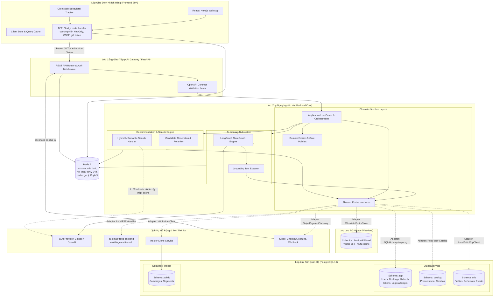
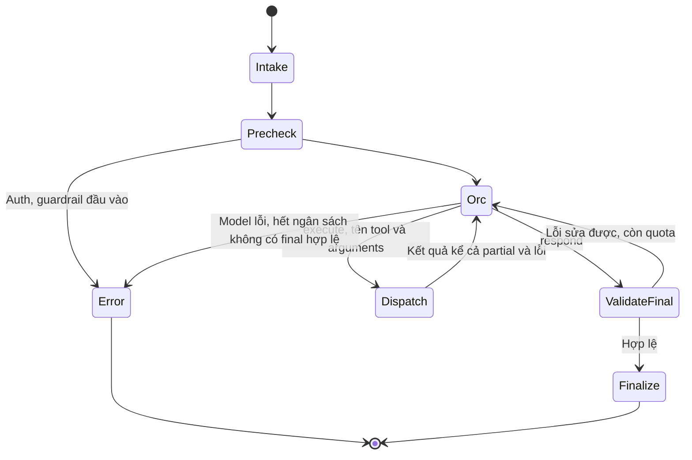

# System Architecture & Technical Design — V-OTA Platform

Tài liệu này đặc tả kiến trúc tổng thể hệ thống, các phân lớp kỹ thuật (Clean Architecture), ngăn xếp công nghệ (Technology Stack) và các nguyên tắc thiết kế áp dụng trên toàn bộ nền tảng V-OTA.

---

## 1. Sơ Đồ Kiến Trúc Tổng Thể (System Architecture)

Hệ thống V-OTA được thiết kế theo mô hình dịch vụ hướng thành phần (Component-Based Service Architecture), kết hợp giữa kiến trúc phân lớp sạch và mô hình tác tử AI điều phối:



---

## 2. Kiến Trúc Phân Lớp Backend (Clean Architecture)

Backend tuân thủ nghiêm ngặt nguyên tắc **Clean Architecture / Hexagonal Architecture**, đảm bảo mã nguồn nghiệp vụ độc lập hoàn toàn với framework và cơ sở dữ liệu:

```
src/backend/app/
├── domain/<domain>/         # LỚP 1: entity, value object, business rule thuần (auth, booking, catalog, itinerary, recommendation, search)
├── application/             # LỚP 2: use case và port
│   ├── ports/               # Giao diện trừu tượng, MỖI PORT MỘT FILE: cdp_client, insider_client, embedder,
│   │                        #   vector_store, payment_gateway, llm, contract_validator, itinerary_tools, auth...
│   └── <domain>/            # Use case theo domain (auth, booking, catalog, itinerary, recommendation, search, tracking)
│                            #   itinerary/engine_tools.py: tool itinerary gọi engine search/recommendation/catalog trong tiến trình (ITINERARY_DATA_MODE=inprocess)
├── infrastructure/          # LỚP 3: hiện thực port
│   ├── persistence/         # PostgreSQL qua DATABASE_URL (role vota_app); conversation store
│   ├── cdp/                 # Mọi adapter CDP: LocalCdpClient, đọc lịch sử, HttpCdpClient, hàng đợi ghi event nền
│   ├── clients/             # HTTP client ra service ngoài, gồm HttpInsiderClient; tool itinerary dạng fixture (=fixture, mặc định dev/test) và HTTP tuỳ chọn (=http)
│   ├── auth/                # Hash mật khẩu, JWT
│   ├── llm/                 # Adapter LLM provider (agent lấy LLM qua port llm, không tự import SDK)
│   ├── embeddings/          # LocalE5Embedder (multilingual-e5-small)
│   ├── vectors/             # WeaviateVectorStore
│   ├── payments/            # StripePaymentGateway: Checkout Session, Refund, kiểm chữ ký webhook
│   └── contracts/           # Kiểm dữ liệu theo OpenAPI bundle (jsonschema)
├── agents/                  # LangGraph: state, graph, node, steps/ (luật của từng bước) và tools/; hiện thực port planner itinerary
├── api/                     # LỚP 4: chỉ xử lý HTTP
│   ├── deps.py              # FastAPI Depends: lấy use case đã nối sẵn, route không tự lắp ráp
│   ├── middleware.py        # Request ID, CORS, đo thời gian / trạng thái request cho /metrics...
│   ├── errors.py            # Error Envelope + exception handler
│   └── v1/
│       ├── router.py        # Router v1 duy nhất; route không tự khai prefix /api/v1
│       ├── schemas/         # DTO request/response (pydantic) theo domain
│       └── routes/          # Router theo domain
├── core/                    # settings (một lớp Settings duy nhất), logging, request context (không import FastAPI)
└── main.py                  # composition root: nối infrastructure vào use case

src/backend/tests/
├── fakes/                   # Bản giả của port cho test offline: CDP đọc JSONL, in-memory vector store
├── unit/                    # domain/, application/, agents/
├── integration/
├── contract/
└── architecture/            # Test tự động kiểm quy tắc phụ thuộc bên dưới
```

Mỗi domain có namespace riêng trong `domain/` và `application/` để các team làm song song, tránh file tổng hợp quá lớn.

### Quy tắc Phụ Thuộc (Dependency Rules):
1. **Hướng phụ thuộc từ ngoài vào trong:** Lớp bên trong (`domain`, `application`) tuyệt đối không được `import` bất kỳ module nào từ lớp bên ngoài (`infrastructure`, `api`).
2. **Nghiệp vụ không phụ thuộc cơ sở dữ liệu:** Các Use Case chỉ gọi đến các abstract class trong `application/ports/`. Việc dùng PostgreSQL, MongoDB hay mock file là quyết định của tầng `infrastructure`.
3. **Cách ly vai trò kết nối DB:** Kết nối `DATABASE_URL` (cho app) chỉ SELECT được `cdp.products` (để dựng `catalog.*`), không đọc được `cdp.events`/`cdp.profiles` và không ghi vào `cdp`. Adapter `LocalCdpClient` phải sử dụng một chuỗi kết nối riêng biệt `CDP_DATABASE_URL` với tài khoản `cdp_writer`.
4. **`domain`** không import FastAPI, database driver, LangGraph hoặc SDK bên ngoài.
5. **`application`** điều phối use case và khai báo port; chỉ composition root (`main.py`) được nối implementation vào use case.
6. **`api`** chỉ chuyển HTTP request/response sang application model, không chứa truy vấn DB hay prompt.
7. **`agents`** không tự truy cập DB và không tạo dữ liệu sản phẩm; chỉ dùng port do `application` cung cấp.
8. **`api`** chỉ gọi use case trong `application`, không import `agents` hay `infrastructure`. Use case itinerary gọi agent qua port; `main.py` nối LangGraph vào port đó.
9. **`core`** không import FastAPI. Phần dính framework (middleware, exception handler) nằm trong `api/`.
10. Bản giả dùng cho test đặt ở `tests/fakes/`, không đặt trong `infrastructure/`.
    Đo lần gọi (web / agent) đi qua port `call_telemetry` trong `application/ports/`; bộ nhớ đệm sự kiện hiện thực ở `infrastructure/`, endpoint ở `api/` (`docs/prd/deployment-plan.md` §5).
11. Quy tắc 1–9 được kiểm tự động bằng test trong `tests/architecture/`; test này chạy trong CI như unit test.

```text
api -> application -> domain
                  ^
infrastructure ---|
agents -> application ports
```

---

## 3. Kiến Trúc Trợ Lý AI & Cơ Chế Grounding (AI Agent Architecture)

Orc hiểu yêu cầu, tự chọn công cụ và tham số, chọn sản phẩm, phác lịch và soạn mọi câu trả lời nghiệp vụ.
Sau mỗi batch công cụ, kết quả luôn quay về orc. Orc được trả lời/hỏi lại không gọi tool khi không cần dữ kiện mới.
Code kiểm quyền, schema, nguồn, ràng buộc và ngân sách thực thi; không tự thêm truy vấn, tiếp trang, nhóm sản phẩm,
thẻ hoặc chọn phương án thay orc. LangGraph thực thi vòng quyết định, không có chuỗi nghiệp vụ bắt buộc ở v2.



### Công cụ, lập lịch và hai loại ngân sách

- Năm tool nghiệp vụ: find_products (Search + Catalog list), recommend (Recommendation + Similar), get_products
  (Detail tối đa 10 refs, kèm hạng phòng), lookup_flights và plan_itinerary. Tên điểm đến catalog đặt sẵn
  trong system prompt, cache ngắn ngoài ngân sách lượt; không lấy được danh sách thì dùng tên khách nói.
  Chỉ cung cấp tool có adapter hoạt động; từng tham số có mô tả, đơn vị, null/default, ví dụ và lỗi.
  Danh tính do server lấy từ phiên; model không truyền userId, URL, secret hay quyền thực thi.
- Có điểm đến vẫn được dùng Recommendation; strategy/because/diagnostics thể hiện rõ popular/fallback,
  không gọi là cá nhân hóa khi không có căn cứ. Không đổi thuật toán Search/Rec trong chuyển đổi này.
- Orc chọn refs, thứ tự và buổi trong ngày. plan_itinerary tính giờ từ thời lượng, giờ mở cửa và đệm sân bay,
  số đêm, số phòng, tiền từng dòng; trả violations,
  warnings, assumptions và changes. Không thêm, bỏ, thay sản phẩm; tối ưu giữ multiset refs và các mốc khóa.
  Không gọi compose_plan để chọn thay orc. Có thể không lưu trú, 0 đêm, không chuyến bay, không combo.
  Ngày trọn vẹn có 2–3 hoạt động, tối đa một sản phẩm mỗi buổi sáng/chiều/tối; hoạt động cả ngày dùng
  cả sáng và chiều nhưng tính một sản phẩm. Ngày đến/về theo giờ bay có thể ít hơn. Thiếu thời lượng dùng
  ước tính hai giờ có công bố; thiếu giờ mở/di chuyển thì feasibility provisional. Không tự đổi buổi hay sản phẩm.
  Lưu trú tối đa số ngày − 1 đêm, trả phòng ngày cuối; có thể chia chặng khách sạn. Số phòng = ceil(tổng khách /
  priceAdults); thiếu priceAdults dùng maxOccupancy kèm PRICE_CAPACITY_UNKNOWN. Số phòng khách nói rõ được giữ
  và kiểm sức chứa, tối đa 9. Tiền phòng = giá/đêm × đêm × phòng. Combo gợi ý riêng ở thẻ, không vào lịch.
- Giá theo số người/phòng, tối đa 9 phòng, ngày hợp lệ, tuyến/giờ bay và khoảng đệm sân bay 90/150 phút vẫn kiểm.
  Tối ưu khoảng cách chỉ khi orc yêu cầu, trong tập refs gửi vào; không nói tối ưu toàn catalog.
- Ngân sách chuyến đi là warning-only: vượt vẫn trả/lưu lịch, công bố tổng, ngân sách, số vượt và phạm vi tính.
  Không tự chọn lịch rẻ nhất, không chặn chỉ vì vượt tiền. Giá chưa đủ: total/over_by null, known subtotal và
  unpriced refs rõ; không tuyên bố trong ngân sách hay mức vượt chính xác khi thiếu tổng.
- Ngân sách thực thi độc lập: baseline 4 batch execute, không giới hạn số call trong một batch, không trần số request
  nguồn (chặn bằng deadline lượt), 6 model calls (5 quyết định + 1 repair). *(Chốt Nguyễn Minh Nhật 2026-10-14,
  `update-archive/2026-10-14-orc-4-luot-tool-khong-tran-call-moi-luot.md`,
  `update-archive/2026-10-14-bo-tran-request-nguon.md`.)* Chừa final sau batch cuối và thời gian theo timeout model hiện có;
  không tăng deadline để hoàn tất. Retry transient tối đa một lần cùng arguments, cũng tính request nguồn.
  Dành quota trước await; cache hit không tính request nguồn nhưng tính call logic. Batch giữ thứ tự call_id.
  Thành công trùng fingerprint trả cached result; lỗi retryable không bị đánh dấu thành công.

### Grounding, guardrail và commit hội thoại

- ProductId, tên, giá, ảnh, link, ngày và mọi facts lấy từ tool của chính lượt, ref do server cấp.
  Registry giữ provenance và presented_to_orc; lịch sử chỉ nhận diện sản phẩm, phải refresh trước khi hiện lại.
  Cùng sản phẩm hai nguồn dùng một ref; cursor opaque gắn owner/conversation/run/query fingerprint.
- Bộ lọc miễn phí tìm điểm tham quan tự do: attraction/golf giá 0 hoặc ticketed=false là vào cửa tự do.
  Attraction/golf không giá và không ghi ticketed=true được nhận theo quy ước tham quan tự do, tính 0 tiền
  vào cửa kèm FREE_ENTRY_ASSUMED cần xác nhận; không khẳng định miễn phí đã xác minh, giá nguồn vẫn null.
  Vé ghi ticketed=true nhưng không giá và hotel/flight/combo thiếu giá vẫn unknown, không tính 0.
  Catalog lọc freeOnly trước phân trang, không tự đọc thêm trang hay chọn thẻ thay orc. entryPolicy tuỳ chọn
  giữ căn cứ free/assumed_free/paid/unknown từ nguồn dù C2 lược bỏ attributes=false; không đổi C2.
  Chat/nút/Think không kể về catalog, cursor, offset hay phân trang; chỉ nói giới hạn xác minh cho khách.
  *(Chốt Nguyễn Minh Nhật 2026-10-13, `update-archive/2026-10-13-tham-quan-tu-do-trong-bo-loc-v2.md`.)*
  Lịch điểm miễn phí không có nghĩa ăn uống/di chuyển miễn phí; công bố phạm vi chi phí đã biết.
  Yêu cầu mới “không tốn tiền” không bị ngân sách cũ ghi đè; orc hỏi/nêu cách hiểu nếu phạm vi chưa rõ.
- Final dùng refs/fact refs và disclosures được orc chọn; renderer hydrate thuần, không bù thẻ hoặc nút.
  Sai schema/ref/fact/card limit/locked/time hoặc thiếu disclosure trả repair cho orc; không tự sửa lựa chọn.
  Tối đa 10 sản phẩm khác nhau mỗi taxonomy trong hợp recommendations + alternatives toàn lượt;
  không có trần tổng 20 và không cắt lịch nhiều ngày còn 10. Nút tối đa 3, nút sai trả repair.
- Fatal: truy cập sai owner, tool ngoài quyền, lộ secret, đầu vào bị chặn theo NFR-SEC-04.
  Warning: vượt tiền, giá/giờ unknown, partial coverage; final phải công bố cảnh báo bắt buộc của plan.
  Lỗi một call không hủy các call độc lập thành công. Validator không gọi tool hay suy ý định bằng regex.
- Giữ precheck trước LLM, auth/rate limit hiện có. Lỗi request/auth/rate limit, đầu vào bị chặn, model lỗi hoặc
  hết ngân sách được trả thông báo hệ thống ngắn; không gắn sản phẩm mới hay sửa lịch đã lưu.
  Catalog và lịch sử là dữ liệu không tin cậy, không phải system instruction. Không thêm LLM guardrail thứ hai.
- shown/context/constraints/pending chỉ commit sau final hợp lệ, đúng một lần/run. planEffect=keep giữ lịch/revision;
  replace cần plan_result_id hợp lệ do plan_itinerary của lượt này, người dùng đã cho phép lập/sửa lịch và revision khớp.
  Tool thử lịch không commit. Restore legacy thiếu schema_version lấy intent/refs/lịch, đánh dấu refresh.
- Redis working memory 24 giờ; archive Postgres cho user đăng nhập vẫn giữ quyền owner và lỗi archive không phá lượt.
  Claim owner/conversation/clientTurnId nguyên tử ở store dùng chung, cùng request trả final đã có, đang chạy trả
  TURN_IN_PROGRESS + Retry-After, ID giống nội dung khác trả IDEMPOTENCY_CONFLICT. Không thêm bảng DB.
- Tiến trình theo công việc orc thực sự yêu cầu, có thể tìm nhiều vòng hoặc trả lời ngay. Code đếm riêng tìm thấy,
  đủ điều kiện, orc chọn, thực sự hiện. Think là lời giải thích công khai ngắn trong quyết định có cấu trúc của orc, kiểm trước khi phát; Act từ call thật, Observe từ kết quả/lỗi thật. Không thêm model call, không prompt hay suy luận nội bộ (chốt Nguyễn Minh Nhật 2026-10-13, `update-archive/2026-10-13-giai-thich-quyet-dinh-agent-trong-tien-trinh.md`).
  Không hiện thẻ sản phẩm trước câu trả lời (chốt Nguyễn Minh Nhật 2026-10-14, `update-archive/2026-10-14-bo-the-xem-truoc-trong-tien-trinh.md`).
- Giữ model/provider/SDK cấu hình hiện có. Function calling với schema riêng từng tool, hội thoại trong lượt
  nối thêm assistant/tool messages; không có args tự do. update_trip ghi trường ngữ cảnh được phép có bằng chứng
  từ tin nhắn/nút/form; respond mang câu trả lời cấu trúc. Hai tool này không tính lượt nghiệp vụ.
  Hết lượt chỉ bind respond. Một batch chạy mọi call nghiệp vụ orc gửi; request nguồn sau deadline trả TIME_LIMIT, không thực thi. Mọi câu vé/đổi lịch/nút vé quay về orc, không shortcut final nghiệp vụ.

### Chuyển phiên bản và nghiệm thu

Assistant v2 có entrypoint OpenAPI riêng, request/response/SSE riêng (xem §6), còn v1 giữ hành vi cho client cũ.
Đây là adapter version; không tạo lại classifier/explore/converse LLM hoặc cờ ITINERARY_ORCHESTRATOR đã gỡ.
Web Next.js mặc định assistant v2 để người dùng kiểm thử từ 13/10/2026; không đặt NEXT_PUBLIC_ASSISTANT_API cũng dùng v2. Chỉ giá trị v1 tường minh mới chọn client tương thích cũ. Không chuyển Streamlit hoặc runner khác trong thay đổi này (chỉ đạo Nguyễn Minh Nhật 2026-10-13, `update-archive/2026-10-13-nextjs-mac-dinh-assistant-v2.md`). Nghiệm thu model/catalog thật E12 chưa được coi là đạt; thực hiện trước nghiệm thu phát hành. Kiểm inventory trước khi ngừng backend v1; không tự ngừng v1. Grounding/schema 100%, tool calling ≥95%, ca trọng yếu chạy ba lần;
NFR-PERF-02 vẫn phải đo, tiến trình không tính là first text token. Scripted model không chứng minh tự chủ LLM.

*(Chốt Nguyễn Minh Nhật 2026-10-13, `update-archive/2026-10-13-orc-tu-chu-goi-tool-va-chon-san-pham.md`.)*

---

## 4. Ngăn Xếp Công Nghệ Chuẩn Hóa (Technology Stack)

| Thành phần | Công nghệ lựa chọn | Lý do kiến trúc & Ưu thế |
|---|---|---|
| **Backend Framework** | **Python 3.11+, FastAPI, Pydantic v2** | Hiệu năng cao nhờ AsyncIO, tự động sinh OpenAPI spec, xác thực dữ liệu chặt chẽ bằng Pydantic. |
| **Orchestration Agent**| **LangGraph (LangChain ecosystem)** | Quản lý đồ thị trạng thái (Stateful Multi-turn), kiểm soát luồng rẽ nhánh chặt chẽ, dễ debug. |
| **Cơ sở dữ liệu chính** | **PostgreSQL 16** | Lưu trữ quan hệ ACID cho `cdp`, `catalog`, `app` và database `insider`. Không còn cần extension `pgvector` — vector đã tách sang Weaviate. |
| **Cơ sở dữ liệu vector** | **Weaviate** | Dịch vụ vector riêng, có volume riêng nên **không bị dựng lại mỗi lần seed Postgres** — đây là lý do tách khỏi pgvector. Index ANN + cosine (HNSW ở local/self-host, `hfresh` trên Weaviate Cloud nếu gói chỉ cho phép loại này); hỗ trợ hybrid search (BM25 + vector) natively, khớp FR-SRC-01. |
| **Cổng thanh toán** | **Stripe (test mode), Stripe Checkout hosted page** | V-OTA không chạm dữ liệu thẻ; có sẵn 3DS; có thẻ test cho từng loại lỗi; webhook có chữ ký. |
| **Mô hình Embedding** | **`intfloat/multilingual-e5-small`** | Đa ngôn ngữ (bao gồm tiếng Việt), chạy CPU trong backend (~470 MB model, tải một lần, có cache). **384 chiều.** Tiền tố `passage: ` khi nạp, `query: ` khi truy vấn; sai tiền tố làm giảm chất lượng mà không báo lỗi. |
| **Frontend Framework** | **React / Next.js / TypeScript** | Xây dựng giao diện Single Page Application linh hoạt, tương tác mượt mà, type-safety cao. |
| **Session store, rate limit, working memory & cache gợi ý** | **Redis 7** (`maxmemory-policy noeviction`) | Giữ phiên web, bộ đếm rate limit/lockout, khoá refresh và working memory 24 giờ của trợ lý ở DB index riêng. Mất dữ liệu thì trợ lý nạp lại bản archive gần nhất cho user đăng nhập hoặc bắt đầu ngữ cảnh mới cho khách; lịch sử lâu dài vẫn còn trong Postgres. Cache kết quả gợi ý cá nhân hoá (`GET /recommendations`) nằm ở DB index riêng, TTL 15 phút. Khoá chứa dấu vân tay lịch sử event của khách, nên event mới luôn cho khoá mới; không bao giờ trả gợi ý tính từ lịch sử cũ. Mất cache hoặc Redis lỗi thì tính trực tiếp. Mọi khoá phải có TTL. Không dùng `allkeys-lru`. |
| **Quản trị API** | **OpenAPI 3.1.0 Contract-First** | Hợp đồng giao tiếp trung tâm, tự động sinh mock server và kiểm tra tính tuân thủ của các nhóm phát triển. |
| **Container & Triển khai**| **Docker, Docker Compose** | Đóng gói môi trường đồng nhất giữa phát triển local và máy chủ staging. |

---

## 5. Các Ranh Giới Giao Tiếp & Giao Thức Tích Hợp

1. **Frontend $\leftrightarrow$ Backend:** Giao tiếp qua giao thức HTTPS RESTful JSON, định dạng chuẩn hóa theo hợp đồng `src/shared/contracts/openapi.yaml` (v1) và `assistant-v2.openapi.yaml` (assistant v2).
2. **Backend $\leftrightarrow$ CDP:**
   - Môi trường phát triển nội bộ: Giao tiếp qua `LocalCdpClient` ghi trực tiếp vào schema `cdp` bằng role riêng.
   - Môi trường mở rộng: Giao tiếp qua `HttpCdpClient` gọi REST API tới dịch vụ CDP tập trung.
3. **Backend $\leftrightarrow$ Insider:** Giao tiếp qua `HttpInsiderClient` bằng REST API qua giao thức HTTPS, xác thực bằng header chuyên biệt (`X-PARTNER-NAME`, `X-REQUEST-TOKEN`).
4. **Backend $\leftrightarrow$ AI Model Providers:** Giao tiếp qua HTTPS REST / SSE (Server-Sent Events) có hỗ trợ streaming token phản hồi tức thì.
5. **Backend $\leftrightarrow$ Weaviate:** Backend tự sinh vector bằng model local rồi tự ghi — **Weaviate không giữ khoá và không tự vector hóa** (collection khai báo `vectorizer: none`). Cụ thể:
   - **Nạp:** job embed đọc search unit từ `catalog`, embed bằng e5-small với tiền tố `passage: `, ghi vector kèm `productId` vào collection của Weaviate (`VECTOR_COLLECTION`).
   - **Truy vấn:** use case search embed câu đã chuẩn hoá bằng e5-small với tiền tố `query: ` rồi đưa vector sang Weaviate để lấy top-K. Dùng sai tiền tố sẽ làm giảm chất lượng xếp hạng mà không báo lỗi.
   - **Hiểu câu truy vấn (query plan).** Use case search phân tích câu bằng luật + gazetteer dựng từ catalog (điểm đến, loại sản phẩm, phủ định, chiều bay, giá/sao, số khách) và bảng địa danh / điểm vui chơi giữ trong repo (`domain/search/gazetteer.py`: landmark, khu vực, sân bay, venue → điểm đến catalog), rồi lọc trước khi truy xuất. Khi plan có độ tin cậy thấp, use case **có thể** gọi LLM qua port riêng (`QueryHypothesisPort`, adapter ở `infrastructure/llm/`) để lấy một giả thuyết JSON theo schema cố định (`intent`, các thực thể, `hard_filters`, `must_not`, `soft_preferences`, `unknown_slots`). Server kiểm mọi giá trị với catalog (taxonomy, bảng điểm đến, từ vựng tiện ích, tuyến bay); giá trị không tồn tại bị bỏ, không tạo filter sai. LLM **không** trả `productId`, **không** xếp hạng, **không** nới hard filter của request, chỉ điền trường luật để trống. Kết quả cache theo câu đã chuẩn hoá. Ba chế độ theo cấu hình: `off` (mặc định), `shadow` (chạy nền, chỉ ghi so sánh luật ↔ LLM vào log, không đổi kết quả), `on` (chỉ khi `confidence < ngưỡng`, có hạn thời gian; quá hạn → plan luật). Bật `on` chỉ khi bench chứng minh không tụt ở các slice an toàn (`out_of_catalog`, `named_entity`, `cross_vertical`) và p95 vẫn đạt NFR-PERF-01 nhờ cache.
   - Giữ được đường test offline: `tests/fakes/in_memory_vector_store.py` hiện thực cùng port `vector_store.py`, nên unit test không cần mạng.
   - Weaviate chỉ giữ vector và `productId`. Mọi thuộc tính hiển thị (tên, giá, ảnh) vẫn lấy từ Postgres — quy tắc grounding không đổi.
6. **Backend $\leftrightarrow$ Stripe:** Backend gọi Stripe qua HTTPS bằng secret key; mọi lệnh ghi (tạo phiên, đóng phiên, hoàn tiền) có `Idempotency-Key`. Stripe gọi lại Backend qua webhook `POST /api/v1/payments/stripe/webhook`, không qua BFF, xác thực bằng chữ ký `Stripe-Signature`. Số tiền luôn do Backend tính từ catalog.

---

## 6. Cấu Trúc Repository & Quy Ước Mã Nguồn

### 6.1. Cấu trúc monorepo

```text
src/
├── frontend/          # Next.js (App Router) + TypeScript + Tailwind CSS
│   └── src/
│       ├── app/           # route segment, layout, route handler; globals.css
│       ├── components/    # UI dùng chung ≥ 2 feature, không chứa business rule
│       ├── features/      # auth, booking, catalog, itinerary, recommendations, search
│       ├── hooks/
│       ├── services/      # HTTP client và client sinh từ OpenAPI
│       ├── test/
│       └── types/
├── backend/           # FastAPI — cấu trúc ở §2; tests/unit, tests/integration, tests/contract
├── shared/
│   ├── contracts/     # OpenAPI dùng chung (nguồn sự thật cho API)
│   └── mocks/         # fixture hợp lệ với contract
├── data_collection/   # collector, chuẩn hóa, dedupe; seed/ = loader + mock data
├── evaluation/        # split, metrics, benchmark, report offline
├── insider_clone/     # service giả lập bề mặt Insider
└── cdp_clone/         # service HTTP tạm gác; hiện CDP clone là schema `cdp` trong `db/`
```

Ngoài `src/`: `db/` (DDL, initdb, migration, verify), `docs/` (`prd/`, `spec/`, `plan/`, `guide/` — xem `AGENTS.md` §7; `guide/` chứa hướng dẫn cho người phát triển như cách đọc code, cách chạy, quy trình — không tạo quy tắc mới, khi lệch PRD, contract hoặc `AGENTS.md` thì các nguồn đó thắng), `history/`. Các thư mục cũ ở gốc `src/` (`src/agents`, `src/api`, `src/models`, `src/services`, `src/main.py`, `src/config.py`) đã bị xoá; không tạo lại. `src/__init__.py` được giữ để import dạng `src.backend.app…` chạy được.

Assistant v2 bổ sung `src/shared/contracts/assistant-v2.openapi.yaml`, `paths/assistant-v2.yaml`,
`schemas/assistant-v2.yaml`; validator kiểm cả v1/v2/CDP, frontend sinh `assistant-v2.gen.ts` riêng.
API v2 đặt ở `api/v2/` cùng quy tắc layering §2; không thay semantics v1. *(Chốt Nguyễn Minh Nhật 2026-10-13, `update-archive/2026-10-13-orc-tu-chu-goi-tool-va-chon-san-pham.md`.)*

### 6.2. Quy tắc frontend

- `app/` chỉ chứa route segment (`layout.tsx`, `page.tsx`, `route.ts`), ghép layout và feature; không chứa business rule.
- Mỗi folder trong `features/` sở hữu component, hook, state và test của nghiệp vụ đó.
- Ưu tiên Server Component; chỉ đánh dấu `"use client"` khi cần tương tác/state phía client.
- Mọi HTTP call đi qua `services/`; component không gọi `fetch` trực tiếp. Web không gọi CDP clone.
- Kiểu request/response sinh từ OpenAPI; không tự định nghĩa lại `SearchRequest`, `ProductSummary`, `ItineraryResponse`.
- Tách server state và UI state; token không được log hoặc đưa vào URL.
- **Trình duyệt không bao giờ giữ JWT**: không `localStorage`/`sessionStorage`/URL/body. Route handler BFF trong `src/frontend/src/app/api/` giữ cookie phiên `vota_sid` (HttpOnly), kiểm CSRF (double-submit `vota_csrf` + `Origin`), xoá `cookie`/`authorization` do trình duyệt gửi và gắn `Authorization: Bearer` khi proxy sang FastAPI. BFF không ký token — khoá ký RS256 chỉ ở FastAPI. Chi tiết: `docs/spec/hop-dong-tich-hop-auth.md`.
- Styling bằng Tailwind utility class; token màu/spacing ở `tailwind.config.ts`, không viết CSS tùy ý ngoài `globals.css`.

### 6.3. Quy ước thêm module mới

1. Xác định feature/domain sở hữu hành vi và mã FR/NFR tương ứng trong [requirements.md](requirements.md).
2. Cập nhật OpenAPI trước nếu thay đổi giao diện giữa các team.
3. Business rule đặt trong `domain`, orchestration trong `application`, SDK/DB/HTTP trong `infrastructure`.
4. Thêm unit test và contract/integration test tương ứng theo [test-plan.md](test-plan.md).
5. Không tạo folder `utils` chung; helper nằm gần domain sử dụng hoặc đặt tên theo trách nhiệm cụ thể.

### 6.4. Review chéo

Thay đổi contract cần reviewer của Web và Backend. Thay đổi schema CDP/Insider hoặc port `CdpClient` cần reviewer của Data/Integration. Phân công workstream: [implementation-plan.md](implementation-plan.md).

*(Bộ tool và luật lập lịch A–G chốt Nguyễn Minh Nhật 2026-10-13, `update-archive/2026-10-13-thiet-ke-lai-bo-tool-orc.md`.)*
