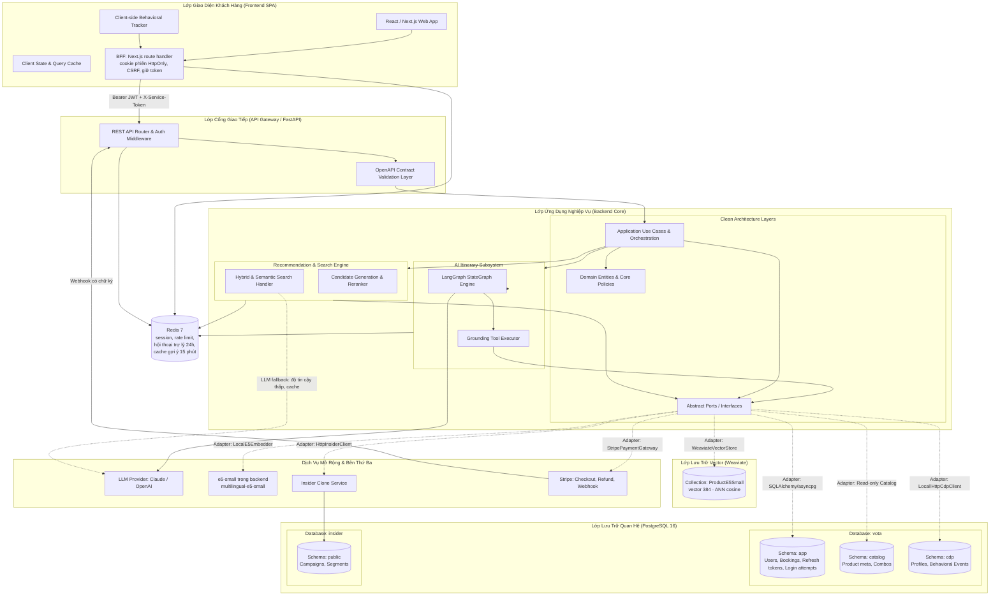
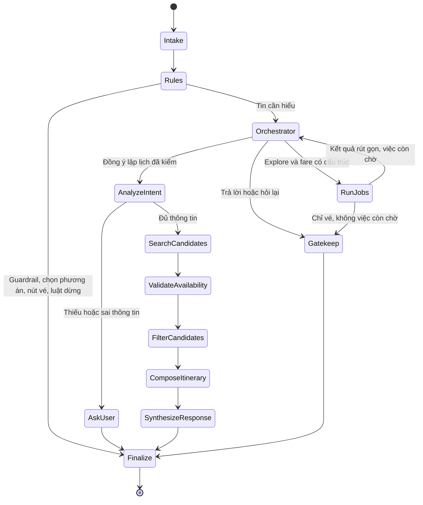

# System Architecture & Technical Design — V-OTA Platform

Tài liệu này đặc tả kiến trúc tổng thể hệ thống, các phân lớp kỹ thuật (Clean Architecture), ngăn xếp công nghệ (Technology Stack) và các nguyên tắc thiết kế áp dụng trên toàn bộ nền tảng V-OTA.

---

## 1. Sơ Đồ Kiến Trúc Tổng Thể (System Architecture)

Hệ thống V-OTA được thiết kế theo mô hình dịch vụ hướng thành phần (Component-Based Service Architecture), kết hợp giữa kiến trúc phân lớp sạch và mô hình tác tử AI điều phối:



---

## 2. Kiến Trúc Phân Lớp Backend (Clean Architecture)

Backend tuân thủ nghiêm ngặt nguyên tắc **Clean Architecture / Hexagonal Architecture**, đảm bảo mã nguồn nghiệp vụ độc lập hoàn toàn với framework và cơ sở dữ liệu:

```
src/backend/app/
├── domain/<domain>/         # LỚP 1: entity, value object, business rule thuần (auth, booking, catalog, itinerary, recommendation, search)
├── application/             # LỚP 2: use case và port
│   ├── ports/               # Giao diện trừu tượng, MỖI PORT MỘT FILE: cdp_client, insider_client, embedder,
│   │                        #   vector_store, payment_gateway, llm, contract_validator, itinerary_tools, auth...
│   └── <domain>/            # Use case theo domain (auth, booking, catalog, itinerary, recommendation, search, tracking)
│                            #   itinerary/engine_tools.py: tool itinerary gọi engine search/recommendation/catalog trong tiến trình (ITINERARY_DATA_MODE=inprocess)
├── infrastructure/          # LỚP 3: hiện thực port
│   ├── persistence/         # PostgreSQL qua DATABASE_URL (role vota_app); conversation store
│   ├── cdp/                 # Mọi adapter CDP: LocalCdpClient, đọc lịch sử, HttpCdpClient, hàng đợi ghi event nền
│   ├── clients/             # HTTP client ra service ngoài, gồm HttpInsiderClient; tool itinerary dạng fixture (=fixture, mặc định dev/test) và HTTP tuỳ chọn (=http)
│   ├── auth/                # Hash mật khẩu, JWT
│   ├── llm/                 # Adapter LLM provider (agent lấy LLM qua port llm, không tự import SDK)
│   ├── embeddings/          # LocalE5Embedder (multilingual-e5-small)
│   ├── vectors/             # WeaviateVectorStore
│   ├── payments/            # StripePaymentGateway: Checkout Session, Refund, kiểm chữ ký webhook
│   └── contracts/           # Kiểm dữ liệu theo OpenAPI bundle (jsonschema)
├── agents/                  # LangGraph: state, graph, node, steps/ (luật của từng bước) và tools/; hiện thực port planner itinerary
├── api/                     # LỚP 4: chỉ xử lý HTTP
│   ├── deps.py              # FastAPI Depends: lấy use case đã nối sẵn, route không tự lắp ráp
│   ├── middleware.py        # Request ID, CORS, đo thời gian / trạng thái request cho /metrics...
│   ├── errors.py            # Error Envelope + exception handler
│   └── v1/
│       ├── router.py        # Router v1 duy nhất; route không tự khai prefix /api/v1
│       ├── schemas/         # DTO request/response (pydantic) theo domain
│       └── routes/          # Router theo domain
├── core/                    # settings (một lớp Settings duy nhất), logging, request context (không import FastAPI)
└── main.py                  # composition root: nối infrastructure vào use case

src/backend/tests/
├── fakes/                   # Bản giả của port cho test offline: CDP đọc JSONL, in-memory vector store
├── unit/                    # domain/, application/, agents/
├── integration/
├── contract/
└── architecture/            # Test tự động kiểm quy tắc phụ thuộc bên dưới
```

Mỗi domain có namespace riêng trong `domain/` và `application/` để các team làm song song, tránh file tổng hợp quá lớn.

### Quy tắc Phụ Thuộc (Dependency Rules):
1. **Hướng phụ thuộc từ ngoài vào trong:** Lớp bên trong (`domain`, `application`) tuyệt đối không được `import` bất kỳ module nào từ lớp bên ngoài (`infrastructure`, `api`).
2. **Nghiệp vụ không phụ thuộc cơ sở dữ liệu:** Các Use Case chỉ gọi đến các abstract class trong `application/ports/`. Việc dùng PostgreSQL, MongoDB hay mock file là quyết định của tầng `infrastructure`.
3. **Cách ly vai trò kết nối DB:** Kết nối `DATABASE_URL` (cho app) chỉ SELECT được `cdp.products` (để dựng `catalog.*`), không đọc được `cdp.events`/`cdp.profiles` và không ghi vào `cdp`. Adapter `LocalCdpClient` phải sử dụng một chuỗi kết nối riêng biệt `CDP_DATABASE_URL` với tài khoản `cdp_writer`.
4. **`domain`** không import FastAPI, database driver, LangGraph hoặc SDK bên ngoài.
5. **`application`** điều phối use case và khai báo port; chỉ composition root (`main.py`) được nối implementation vào use case.
6. **`api`** chỉ chuyển HTTP request/response sang application model, không chứa truy vấn DB hay prompt.
7. **`agents`** không tự truy cập DB và không tạo dữ liệu sản phẩm; chỉ dùng port do `application` cung cấp.
8. **`api`** chỉ gọi use case trong `application`, không import `agents` hay `infrastructure`. Use case itinerary gọi agent qua port; `main.py` nối LangGraph vào port đó.
9. **`core`** không import FastAPI. Phần dính framework (middleware, exception handler) nằm trong `api/`.
10. Bản giả dùng cho test đặt ở `tests/fakes/`, không đặt trong `infrastructure/`.
    Đo lần gọi (web / agent) đi qua port `call_telemetry` trong `application/ports/`; bộ nhớ đệm sự kiện hiện thực ở `infrastructure/`, endpoint ở `api/` (`docs/prd/deployment-plan.md` §5).
11. Quy tắc 1–9 được kiểm tự động bằng test trong `tests/architecture/`; test này chạy trong CI như unit test.

```text
api -> application -> domain
                  ^
infrastructure ---|
agents -> application ports
```

---

## 3. Kiến Trúc Trợ Lý AI & Cơ Chế Grounding (AI Agent Architecture)

Trợ lý lập lịch trình không phải là một chuỗi prompt đơn giản mà là một hệ thống tác tử có cấu trúc dựa trên **LangGraph**:



**Một orchestrator (LLM) làm đầu mối hội thoại** (chốt 2026-10-12,
`update-archive/2026-10-12-orchestrator-va-kham-pha-llm.md`). Mỗi vòng chọn `answer`, `ask`, `plan` hoặc `execute`.
`plan` giữ nhánh lập lịch hiện tại (`extract` → hỏi lại hoặc `tool` → `evaluate` → `filter` → `compose` → `narrate`).
`execute` khai loại việc, ý định `new|more|about_shown|cheaper|dearer`, mã thẻ, phạm vi, điều kiện và việc còn chờ.
Code chạy các việc độc lập song song; việc phụ thuộc chạy vòng sau. Explore là nhóm tool chỉ đọc, không có LLM riêng;
fare dùng logic vé hiện tại. Code giữ kết quả đầy đủ và con trỏ; LLM nhận mã `#n`, dữ kiện rút gọn, số mục chưa liệt kê
và cờ nguồn còn trang. Tin chỉ hỏi vé, vòng đầu đúng một việc fare và không còn việc chờ, dùng nguyên câu vé không thêm
lời gọi LLM. Phanh: tối đa 3 việc/vòng, 3 vòng thực thi/lượt, trần tool (khởi đầu 10), ngân sách thời gian và chặn việc trùng.

**Gác cổng trước finalize:** thẻ/link chỉ tới sản phẩm đã tra và đã có trong bản rút gọn của lượt; số liệu LLM viết chỉ qua
placeholder được code điền. Lặp theo ý định: muốn thêm loại thẻ đã hiện trong cả hội thoại theo điểm đến + loại; hỏi thẻ
cũ tra lại đúng thẻ; rẻ/đắt hơn so giá mới và giữ điều kiện chưa đổi; câu hỏi mới được gặp lại thẻ cũ. Số thẻ theo AC-AGT-06: giữ mức mặc định khi không nêu số lượng (3 điểm tham quan/tour,
2 khách sạn khi hỏi chung hoặc 4 khi hỏi riêng chỗ ở); số lượng được yêu cầu do orchestrator trích có cấu trúc,
code kiểm và dùng cho cả tìm ứng viên lẫn chọn thẻ, tổng tối đa 20 thẻ/lượt. Tiếp tục dùng bản rút gọn và
con trỏ `continue_from` trong ngân sách; thiếu thì trả một phần và nói rõ, không tăng vô hạn lời gọi hay gửi toàn
catalog cho LLM. Chốt 2026-10-13, `update-archive/2026-10-13-so-luong-goi-y-theo-yeu-cau.md`. Nhãn “nhất” do code tính. Mỗi lượt chỉ một câu hỏi,
kể cả nhiều việc vé thiếu thông tin: các việc khác chờ đúng lượt sau. Chỉ thay câu hỏi vé khi việc sau khai thay và
code xác nhận cùng yêu cầu vừa điền đúng trường thiếu; không thay khối đã trả lời hoặc yêu cầu độc lập.
Đồng ý lập lịch kiểm từ trường cấu trúc: trả lời lời mời đang chờ, xin lập lịch, thông tin chuyến đã trích được, xin form.
Từ chối/dừng xoá lời mời ngay lượt đó; chỉ câu mời được chèn tạo lời mời đang chờ, nút không tạo lại.
**Đã xem chỉ ghi ở finalize theo response cuối**; tìm được mà chưa hiện chưa tính.

Orchestrator có model riêng (người dùng chọn GPT-6.1 Sol/OpenAI); các bước khác giữ model chung. Model ID/provider cấu
hình tường minh, bỏ trống dùng chung; thiếu khoá hoặc dựng lỗi thì cảnh báo và dùng model chung. Nhiệt độ, reasoning,
ngân sách thời gian đặt bằng số đo. Orchestrator là luồng duy nhất (chốt 2026-10-13,
`update-archive/2026-10-12-orchestrator-thanh-luong-chinh.md`, `update-archive/2026-10-13-go-luong-cu-sau-demo.md`): không
còn cờ bật/tắt, không còn bước phân loại bằng LLM và các node khám phá, trò chuyện bằng LLM của luồng cũ; code của luồng
cũ đã gỡ để nhóm không phải đọc và sửa trùng. Không ý AC nào bị bỏ: ý AC trước đây chỉ luồng cũ đáp ứng được kiểm và làm
trên orchestrator. Không còn đo so sánh hai
kiến trúc. Kiểm tra bắt buộc gồm: các kịch bản demo chạy với LLM thật; ý AC mà kịch bản chạm tới đạt; snapshot hành vi
ghi bằng orchestrator và phát lại được offline.

### Tiêu chuẩn Grounding (Chống Bịa Đặt):
- **Khung tiến trình (AC-AGT-09):** dữ kiện do code tính từ state hoặc đếm tại nơi lọc kết quả tool của lượt đó, gửi qua SSE dạng mã và số; Web viết câu chữ. Stream không mang prompt, output thô của LLM hay token. Thẻ hiện trước lời tư vấn chỉ gồm sản phẩm của lịch `compose` đã dựng và đã kiểm nguồn. Chốt Phần A và C ngày 2026-10-13.
- **Không suy đoán dữ liệu sản phẩm:** LLM chỉ đóng vai trò phân tích ý định ngôn ngữ và sắp xếp lịch trình thời gian. LLM được chỉ ra cặp điểm tham quan trùng nhau trong danh sách ứng viên (chỉ thấy mã và tên, node `filter`); hệ thống chỉ nhận cặp gồm hai mã có trong danh sách và tự chọn giữ mã nào bằng luật; LLM lỗi hoặc quá giờ thì chỉ dùng phần lọc bằng luật. Mọi thông tin về `productId`, `title`, `price`, `imageUrl` bắt buộc phải được lấy nguyên trạng từ kết quả trả về của công cụ truy xuất (`ToolCatalogSearch`): Search, Recommendation, hoặc Similar (`getSimilarProducts`) khi đổi một sản phẩm đã hiển thị. Câu trả lời khám phá (FR-AGT-06) chỉ nêu sản phẩm có trong kết quả Search của chính lượt đó; LLM chọn thẻ trong kết quả tool của chính lượt đó, chỉ nhắc sản phẩm qua mã ngắn `#n`; code kiểm mã, luật lặp theo ý định, tính nhãn so sánh và điền số.
- **Ranh giới trí nhớ:** không gọi tool chỉ nhắc tên đã gợi ý và lúc nào, không thẻ/link/số/dữ kiện sản phẩm. Thẻ, giá, đơn vị giá, tiện ích, địa chỉ, giờ mở, còn chỗ đều tra lại đúng sản phẩm ngay lượt này. Mọi số liệu sản phẩm trong lời LLM là placeholder của mã đã tra; so với một mốc phải ghi đúng việc (khoảng cách, chênh giá). Code chỉ điền khi xác định đúng một giá trị, không đoán khi mơ hồ. Khối vé code viết được chèn nguyên văn sau kiểm số và được miễn quét số.
- **Vé máy bay** chỉ lấy từ chuyến bay thật của catalog; `compose` chọn chuyến bằng luật tất định (AC-AGT-02), LLM không chọn hay tạo chuyến. Câu trả lời vé máy bay (FR-AGT-07, AC-AGT-05, AC-AGT-08) do code viết từ chuyến bay của catalog tra ngay lượt đó; LLM của orchestrator chỉ hiểu câu hỏi (nơi đi, nơi đến, ngày, khung giờ, rẻ hay đắt nhất, hỏi lý do, hỏi ngày có chuyến), mọi tên nơi được đối chiếu với catalog trước khi dùng. Nút do code tạo cho câu trả lời vé đi thẳng nhánh vé, không qua LLM. Vị trí trình duyệt chỉ dùng ở Web để gợi ý nơi đi; toạ độ không vào state của agent (AC-AGT-03).
- **Response phân biệt theo `status`:** `ItineraryResponse` là `oneOf` gồm `COMPLETED`, `NEEDS_CLARIFICATION`, `NO_RESULTS`, `FALLBACK` (`src/shared/contracts/schemas/itinerary-agent.yaml`). `NEEDS_CLARIFICATION` có `searchResults` tuỳ chọn cho thẻ của lượt khám phá (1.24.0) và thẻ chuyến bay của câu trả lời vé (`searchResults.flight`, tối đa 4, 1.25.0); `COMPLETED` có `suggestions` tuỳ chọn, tối đa 3 (1.25.0), ví dụ nút lập lại lịch từ ngày gần nhất còn bán khi lịch chỉ là lịch tham khảo. Trường cụ thể theo contract, không theo ví dụ trong PRD.
- **Backend tự tính tổng tiền.** Điểm tham quan tự do — điểm tham quan hoặc golf có `ticketed = false`, hoặc không có giá — tính 0 đ vào tổng và hiển thị là "tham quan tự do", không hiển thị là có giá 0 đ. Mục khác thiếu giá (khách sạn, vé máy bay, combo...) thì tổng là `null` kèm cảnh báo, không coi thiếu giá là 0.
- **LLM lỗi:** dùng fallback dựa trên luật hoặc trả `FALLBACK`/lỗi có kiểm soát.
- **Lọc đầu vào trước LLM (NFR-SEC-04):** `precheck` chạy luật tất định trước khi gọi LLM của orchestrator: mẫu chèn lệnh/đòi secret, rồi lọc tin nhắn rác (rỗng, ký tự lặp, tỉ lệ chữ thấp, gõ bậy, tục tĩu). Khớp thì trả câu cố định, không gọi LLM nào. Luật "gõ bậy" chỉ xét tin nhắn đầu của hội thoại; giữa hội thoại câu cụt được để LLM đọc. Giới hạn tần suất gửi tin nằm ở route API, trước khi graph chạy.
- **Ngữ cảnh cho LLM:** mọi lượt gọi LLM (orchestrator, trích intent, chọn điểm đến, lập tool plan, viết câu trả lời) nhận cùng ngữ cảnh hội thoại: lịch sử gần nhất có giới hạn, chuyến đi đã chốt, sản phẩm đã cho xem và câu hỏi gần nhất của trợ lý. Ngữ cảnh là dữ liệu không tin cậy, không phải chỉ dẫn.
- **Hội thoại** có hai tầng lưu: Redis giữ working memory 24 giờ (intent, ràng buộc, lịch sử gần nhất và sản phẩm vừa hiển thị); Postgres giữ lâu dài các lượt `user`/`assistant` của người dùng đã đăng nhập trong `app.conversations` và `app.conversation_messages`. Web cho phép user đã đăng nhập liệt kê, mở lại và tiếp tục hội thoại của chính mình. Ghi archive lỗi không làm hỏng lượt chat. Giá và tình trạng còn chỗ luôn được tải lại, không dùng bản lưu trong hội thoại; câu hỏi vé sau khi có lịch cũng tra lại chuyến theo tuyến của chuyến (AC-AGT-05). Working memory giữ thêm giai đoạn hội thoại (đã đồng ý lập lịch chưa, lời mời đang chờ, nơi bị chê, câu hỏi vé đang nói dở) để các lượt sau hiểu "ok", "chỗ đó", "ngày khác thì sao".

---

## 4. Ngăn Xếp Công Nghệ Chuẩn Hóa (Technology Stack)

| Thành phần | Công nghệ lựa chọn | Lý do kiến trúc & Ưu thế |
|---|---|---|
| **Backend Framework** | **Python 3.11+, FastAPI, Pydantic v2** | Hiệu năng cao nhờ AsyncIO, tự động sinh OpenAPI spec, xác thực dữ liệu chặt chẽ bằng Pydantic. |
| **Orchestration Agent**| **LangGraph (LangChain ecosystem)** | Quản lý đồ thị trạng thái (Stateful Multi-turn), kiểm soát luồng rẽ nhánh chặt chẽ, dễ debug. |
| **Cơ sở dữ liệu chính** | **PostgreSQL 16** | Lưu trữ quan hệ ACID cho `cdp`, `catalog`, `app` và database `insider`. Không còn cần extension `pgvector` — vector đã tách sang Weaviate. |
| **Cơ sở dữ liệu vector** | **Weaviate** | Dịch vụ vector riêng, có volume riêng nên **không bị dựng lại mỗi lần seed Postgres** — đây là lý do tách khỏi pgvector. Index ANN + cosine (HNSW ở local/self-host, `hfresh` trên Weaviate Cloud nếu gói chỉ cho phép loại này); hỗ trợ hybrid search (BM25 + vector) natively, khớp FR-SRC-01. |
| **Cổng thanh toán** | **Stripe (test mode), Stripe Checkout hosted page** | V-OTA không chạm dữ liệu thẻ; có sẵn 3DS; có thẻ test cho từng loại lỗi; webhook có chữ ký. |
| **Mô hình Embedding** | **`intfloat/multilingual-e5-small`** | Đa ngôn ngữ (bao gồm tiếng Việt), chạy CPU trong backend (~470 MB model, tải một lần, có cache). **384 chiều.** Tiền tố `passage: ` khi nạp, `query: ` khi truy vấn; sai tiền tố làm giảm chất lượng mà không báo lỗi. |
| **Frontend Framework** | **React / Next.js / TypeScript** | Xây dựng giao diện Single Page Application linh hoạt, tương tác mượt mà, type-safety cao. |
| **Session store, rate limit, working memory & cache gợi ý** | **Redis 7** (`maxmemory-policy noeviction`) | Giữ phiên web, bộ đếm rate limit/lockout, khoá refresh và working memory 24 giờ của trợ lý ở DB index riêng. Mất dữ liệu thì trợ lý nạp lại bản archive gần nhất cho user đăng nhập hoặc bắt đầu ngữ cảnh mới cho khách; lịch sử lâu dài vẫn còn trong Postgres. Cache kết quả gợi ý cá nhân hoá (`GET /recommendations`) nằm ở DB index riêng, TTL 15 phút. Khoá chứa dấu vân tay lịch sử event của khách, nên event mới luôn cho khoá mới; không bao giờ trả gợi ý tính từ lịch sử cũ. Mất cache hoặc Redis lỗi thì tính trực tiếp. Mọi khoá phải có TTL. Không dùng `allkeys-lru`. |
| **Quản trị API** | **OpenAPI 3.1.0 Contract-First** | Hợp đồng giao tiếp trung tâm, tự động sinh mock server và kiểm tra tính tuân thủ của các nhóm phát triển. |
| **Container & Triển khai**| **Docker, Docker Compose** | Đóng gói môi trường đồng nhất giữa phát triển local và máy chủ staging. |

---

## 5. Các Ranh Giới Giao Tiếp & Giao Thức Tích Hợp

1. **Frontend $\leftrightarrow$ Backend:** Giao tiếp qua giao thức HTTPS RESTful JSON, định dạng chuẩn hóa theo hợp đồng `src/shared/contracts/openapi.yaml`.
2. **Backend $\leftrightarrow$ CDP:**
   - Môi trường phát triển nội bộ: Giao tiếp qua `LocalCdpClient` ghi trực tiếp vào schema `cdp` bằng role riêng.
   - Môi trường mở rộng: Giao tiếp qua `HttpCdpClient` gọi REST API tới dịch vụ CDP tập trung.
3. **Backend $\leftrightarrow$ Insider:** Giao tiếp qua `HttpInsiderClient` bằng REST API qua giao thức HTTPS, xác thực bằng header chuyên biệt (`X-PARTNER-NAME`, `X-REQUEST-TOKEN`).
4. **Backend $\leftrightarrow$ AI Model Providers:** Giao tiếp qua HTTPS REST / SSE (Server-Sent Events) có hỗ trợ streaming token phản hồi tức thì.
5. **Backend $\leftrightarrow$ Weaviate:** Backend tự sinh vector bằng model local rồi tự ghi — **Weaviate không giữ khoá và không tự vector hóa** (collection khai báo `vectorizer: none`). Cụ thể:
   - **Nạp:** job embed đọc search unit từ `catalog`, embed bằng e5-small với tiền tố `passage: `, ghi vector kèm `productId` vào collection của Weaviate (`VECTOR_COLLECTION`).
   - **Truy vấn:** use case search embed câu đã chuẩn hoá bằng e5-small với tiền tố `query: ` rồi đưa vector sang Weaviate để lấy top-K. Dùng sai tiền tố sẽ làm giảm chất lượng xếp hạng mà không báo lỗi.
   - **Hiểu câu truy vấn (query plan).** Use case search phân tích câu bằng luật + gazetteer dựng từ catalog (điểm đến, loại sản phẩm, phủ định, chiều bay, giá/sao, số khách) và bảng địa danh / điểm vui chơi giữ trong repo (`domain/search/gazetteer.py`: landmark, khu vực, sân bay, venue → điểm đến catalog), rồi lọc trước khi truy xuất. Khi plan có độ tin cậy thấp, use case **có thể** gọi LLM qua port riêng (`QueryHypothesisPort`, adapter ở `infrastructure/llm/`) để lấy một giả thuyết JSON theo schema cố định (`intent`, các thực thể, `hard_filters`, `must_not`, `soft_preferences`, `unknown_slots`). Server kiểm mọi giá trị với catalog (taxonomy, bảng điểm đến, từ vựng tiện ích, tuyến bay); giá trị không tồn tại bị bỏ, không tạo filter sai. LLM **không** trả `productId`, **không** xếp hạng, **không** nới hard filter của request, chỉ điền trường luật để trống. Kết quả cache theo câu đã chuẩn hoá. Ba chế độ theo cấu hình: `off` (mặc định), `shadow` (chạy nền, chỉ ghi so sánh luật ↔ LLM vào log, không đổi kết quả), `on` (chỉ khi `confidence < ngưỡng`, có hạn thời gian; quá hạn → plan luật). Bật `on` chỉ khi bench chứng minh không tụt ở các slice an toàn (`out_of_catalog`, `named_entity`, `cross_vertical`) và p95 vẫn đạt NFR-PERF-01 nhờ cache.
   - Giữ được đường test offline: `tests/fakes/in_memory_vector_store.py` hiện thực cùng port `vector_store.py`, nên unit test không cần mạng.
   - Weaviate chỉ giữ vector và `productId`. Mọi thuộc tính hiển thị (tên, giá, ảnh) vẫn lấy từ Postgres — quy tắc grounding không đổi.
6. **Backend $\leftrightarrow$ Stripe:** Backend gọi Stripe qua HTTPS bằng secret key; mọi lệnh ghi (tạo phiên, đóng phiên, hoàn tiền) có `Idempotency-Key`. Stripe gọi lại Backend qua webhook `POST /api/v1/payments/stripe/webhook`, không qua BFF, xác thực bằng chữ ký `Stripe-Signature`. Số tiền luôn do Backend tính từ catalog.

---

## 6. Cấu Trúc Repository & Quy Ước Mã Nguồn

### 6.1. Cấu trúc monorepo

```text
src/
├── frontend/          # Next.js (App Router) + TypeScript + Tailwind CSS
│   └── src/
│       ├── app/           # route segment, layout, route handler; globals.css
│       ├── components/    # UI dùng chung ≥ 2 feature, không chứa business rule
│       ├── features/      # auth, booking, catalog, itinerary, recommendations, search
│       ├── hooks/
│       ├── services/      # HTTP client và client sinh từ OpenAPI
│       ├── test/
│       └── types/
├── backend/           # FastAPI — cấu trúc ở §2; tests/unit, tests/integration, tests/contract
├── shared/
│   ├── contracts/     # OpenAPI dùng chung (nguồn sự thật cho API)
│   └── mocks/         # fixture hợp lệ với contract
├── data_collection/   # collector, chuẩn hóa, dedupe; seed/ = loader + mock data
├── evaluation/        # split, metrics, benchmark, report offline
├── insider_clone/     # service giả lập bề mặt Insider
└── cdp_clone/         # service HTTP tạm gác; hiện CDP clone là schema `cdp` trong `db/`
```

Ngoài `src/`: `db/` (DDL, initdb, migration, verify), `docs/` (`prd/`, `spec/`, `plan/`, `guide/` — xem `AGENTS.md` §7; `guide/` chứa hướng dẫn cho người phát triển như cách đọc code, cách chạy, quy trình — không tạo quy tắc mới, khi lệch PRD, contract hoặc `AGENTS.md` thì các nguồn đó thắng), `history/`. Các thư mục cũ ở gốc `src/` (`src/agents`, `src/api`, `src/models`, `src/services`, `src/main.py`, `src/config.py`) đã bị xoá; không tạo lại. `src/__init__.py` được giữ để import dạng `src.backend.app…` chạy được.

### 6.2. Quy tắc frontend

- `app/` chỉ chứa route segment (`layout.tsx`, `page.tsx`, `route.ts`), ghép layout và feature; không chứa business rule.
- Mỗi folder trong `features/` sở hữu component, hook, state và test của nghiệp vụ đó.
- Ưu tiên Server Component; chỉ đánh dấu `"use client"` khi cần tương tác/state phía client.
- Mọi HTTP call đi qua `services/`; component không gọi `fetch` trực tiếp. Web không gọi CDP clone.
- Kiểu request/response sinh từ OpenAPI; không tự định nghĩa lại `SearchRequest`, `ProductSummary`, `ItineraryResponse`.
- Tách server state và UI state; token không được log hoặc đưa vào URL.
- **Trình duyệt không bao giờ giữ JWT**: không `localStorage`/`sessionStorage`/URL/body. Route handler BFF trong `src/frontend/src/app/api/` giữ cookie phiên `vota_sid` (HttpOnly), kiểm CSRF (double-submit `vota_csrf` + `Origin`), xoá `cookie`/`authorization` do trình duyệt gửi và gắn `Authorization: Bearer` khi proxy sang FastAPI. BFF không ký token — khoá ký RS256 chỉ ở FastAPI. Chi tiết: `docs/spec/hop-dong-tich-hop-auth.md`.
- Styling bằng Tailwind utility class; token màu/spacing ở `tailwind.config.ts`, không viết CSS tùy ý ngoài `globals.css`.

### 6.3. Quy ước thêm module mới

1. Xác định feature/domain sở hữu hành vi và mã FR/NFR tương ứng trong [requirements.md](requirements.md).
2. Cập nhật OpenAPI trước nếu thay đổi giao diện giữa các team.
3. Business rule đặt trong `domain`, orchestration trong `application`, SDK/DB/HTTP trong `infrastructure`.
4. Thêm unit test và contract/integration test tương ứng theo [test-plan.md](test-plan.md).
5. Không tạo folder `utils` chung; helper nằm gần domain sử dụng hoặc đặt tên theo trách nhiệm cụ thể.

### 6.4. Review chéo

Thay đổi contract cần reviewer của Web và Backend. Thay đổi schema CDP/Insider hoặc port `CdpClient` cần reviewer của Data/Integration. Phân công workstream: [implementation-plan.md](implementation-plan.md).
