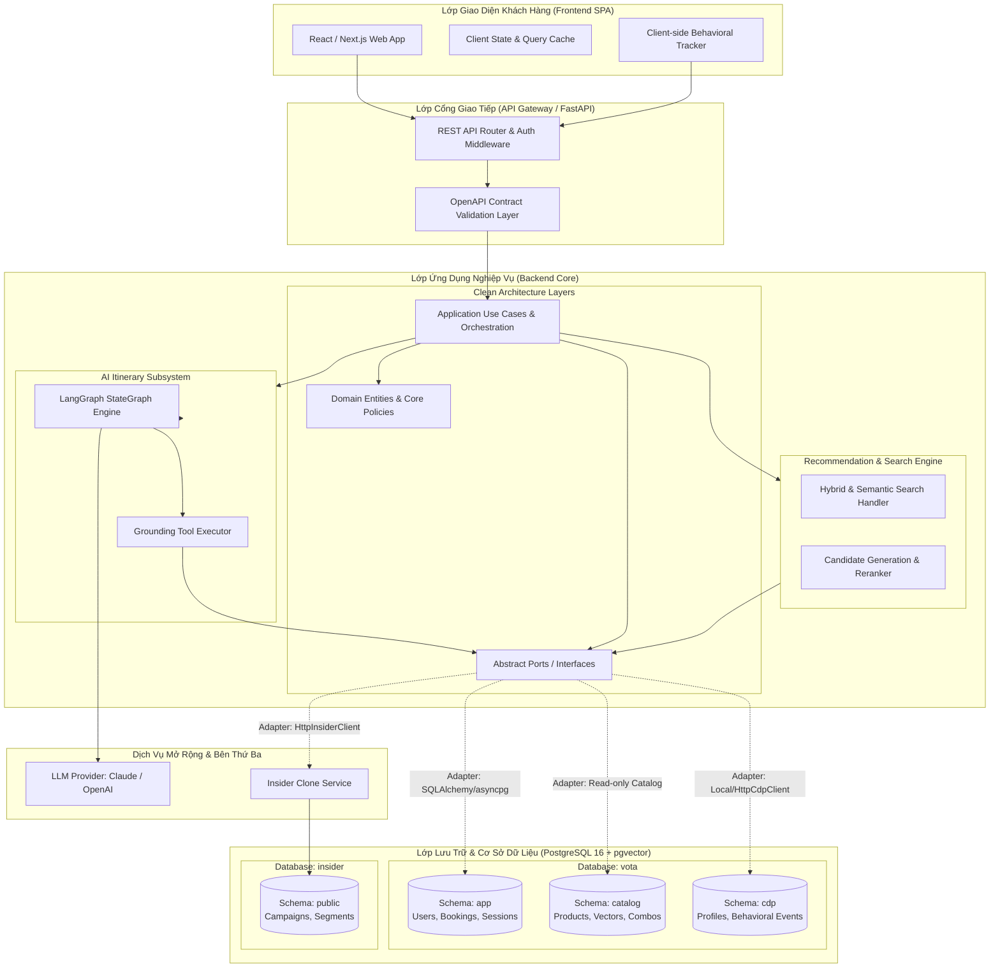
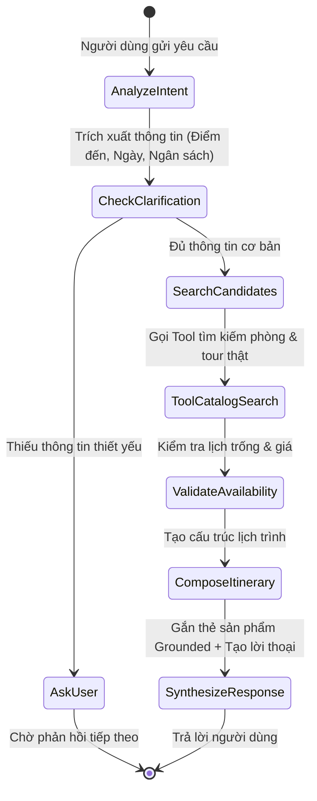

# System Architecture & Technical Design — V-OTA Platform

Tài liệu này đặc tả kiến trúc tổng thể hệ thống, các phân lớp kỹ thuật (Clean Architecture), ngăn xếp công nghệ (Technology Stack) và các nguyên tắc thiết kế áp dụng trên toàn bộ nền tảng V-OTA.

---

## 1. Sơ Đồ Kiến Trúc Tổng Thể (System Architecture)

Hệ thống V-OTA được thiết kế theo mô hình dịch vụ hướng thành phần (Component-Based Service Architecture), kết hợp giữa kiến trúc phân lớp sạch và mô hình tác tử AI điều phối:



---

## 2. Kiến Trúc Phân Lớp Backend (Clean Architecture)

Backend tuân thủ nghiêm ngặt nguyên tắc **Clean Architecture / Hexagonal Architecture**, đảm bảo mã nguồn nghiệp vụ độc lập hoàn toàn với framework và cơ sở dữ liệu:

```
src/backend/app/
├── domain/                  # LỚP 1: Thực thể nghiệp vụ thuần túy (Entities, Value Objects, Enums)
│   ├── booking.py           # Logic trạng thái đơn hàng, quy tắc tính giá
│   ├── product.py           # Tiêu chuẩn sản phẩm, định nghĩa tính khả dụng
│   └── recommendation.py    # Cấu trúc đề xuất, lý do giải thích (because)
│
├── application/             # LỚP 2: Các trường hợp sử dụng (Use Cases & Ports)
│   ├── ports/               # Giao diện trừu tượng (Abstract Interfaces)
│   │   ├── catalog_repo.py  # Cổng truy xuất kho sản phẩm
│   │   ├── cdp_client.py    # Cổng tương tác với Customer Data Platform
│   │   ├── insider_client.py# Cổng tương tác với hệ thống tiếp thị đa kênh
│   │   └── vector_search.py # Cổng tìm kiếm vector ngữ nghĩa
│   └── use_cases/           # Logic điều phối quy trình nghiệp vụ
│       ├── search_products.py
│       ├── get_recommendations.py
│       └── create_booking.py
│
├── infrastructure/          # LỚP 3: Triển khai kỹ thuật & Adapters bên ngoài
│   ├── database/            # Quản lý kết nối PostgreSQL, DDL migration
│   ├── repositories/        # Cài đặt cụ thể các Repository qua SQLAlchemy/SQL
│   ├── cdp/                 # LocalCdpClient (SQL riêng) hoặc HttpCdpClient (HTTP)
│   ├── insider/             # HttpInsiderClient (giao tiếp HTTP với Insider)
│   └── embeddings/          # Mô hình sinh vector (OpenAI / HuggingFace)
│
├── agents/                  # Phân hệ Trợ lý AI (LangGraph Workflows)
│   ├── state.py             # Quản lý trạng thái hội thoại và context lịch trình
│   ├── graph.py             # Định nghĩa StateGraph, các bước suy luận và rẽ nhánh
│   └── tools/               # Các công cụ nghiệp vụ được bọc thành Tool cho LLM
│
└── api/                     # LỚP 4: Giao tiếp REST API (FastAPI Routers & Schemas)
    ├── v1/                  # Routers theo từng domain nghiệp vụ
    └── middlewares/         # Xử lý CORS, Auth, Request Tracking, Error Envelope
```

### Quy tắc Phụ Thuộc (Dependency Rules):
1. **Hướng phụ thuộc từ ngoài vào trong:** Lớp bên trong (`domain`, `application`) tuyệt đối không được `import` bất kỳ module nào từ lớp bên ngoài (`infrastructure`, `api`).
2. **Nghiệp vụ không phụ thuộc cơ sở dữ liệu:** Các Use Case chỉ gọi đến các abstract class trong `application/ports/`. Việc dùng PostgreSQL, MongoDB hay mock file là quyết định của tầng `infrastructure`.
3. **Cách ly vai trò kết nối DB:** Kết nối `DATABASE_URL` (cho app) không có quyền ghi vào schema `cdp`. Adapter `LocalCdpClient` phải sử dụng một chuỗi kết nối riêng biệt `CDP_DATABASE_URL` với tài khoản `cdp_writer`.

---

## 3. Kiến Trúc Trợ Lý AI & Cơ Chế Grounding (AI Agent Architecture)

Trợ lý lập lịch trình không phải là một chuỗi prompt đơn giản mà là một hệ thống tác tử có cấu trúc dựa trên **LangGraph**:



### Tiêu chuẩn Grounding (Chống Bịa Đặt):
- **Không suy đoán dữ liệu sản phẩm:** LLM chỉ đóng vai trò phân tích ý định ngôn ngữ và sắp xếp lịch trình thời gian. Mọi thông tin về `productId`, `title`, `price`, `imageUrl` bắt buộc phải được lấy nguyên trạng từ kết quả trả về của `ToolCatalogSearch`.
- **Cấu trúc dữ liệu hai thành phần:** Mỗi tin nhắn phản hồi của Assistant đều gồm hai phần độc lập: văn bản diễn đạt tự nhiên (`content`) và khối dữ liệu sản phẩm có cấu trúc (`structured_data`), giúp frontend hiển thị thẻ tương tác chuyên nghiệp.

---

## 4. Ngăn Xếp Công Nghệ Chuẩn Hóa (Technology Stack)

| Thành phần | Công nghệ lựa chọn | Lý do kiến trúc & Ưu thế |
|---|---|---|
| **Backend Framework** | **Python 3.11+, FastAPI, Pydantic v2** | Hiệu năng cao nhờ AsyncIO, tự động sinh OpenAPI spec, xác thực dữ liệu chặt chẽ bằng Pydantic. |
| **Orchestration Agent**| **LangGraph (LangChain ecosystem)** | Quản lý đồ thị trạng thái (Stateful Multi-turn), kiểm soát luồng rẽ nhánh chặt chẽ, dễ debug. |
| **Cơ sở dữ liệu chính** | **PostgreSQL 16 + pgvector** | Lưu trữ quan hệ ACID vững chắc kết hợp khả năng tìm kiếm vector tương đồng (HNSW index) trong cùng một hệ cơ sở dữ liệu. |
| **Mô hình Embedding** | **text-embedding-3-small / bge-m3** | Hiệu suất biểu diễn ngữ nghĩa tiếng Việt xuất sắc, chi phí hợp lý, kích thước vector chuẩn 768 chiều. |
| **Frontend Framework** | **React / Next.js / TypeScript** | Xây dựng giao diện Single Page Application linh hoạt, tương tác mượt mà, type-safety cao. |
| **Quản trị API** | **OpenAPI 3.1.0 Contract-First** | Hợp đồng giao tiếp trung tâm, tự động sinh mock server và kiểm tra tính tuân thủ của các nhóm phát triển. |
| **Container & Triển khai**| **Docker, Docker Compose** | Đóng gói môi trường đồng nhất giữa phát triển local và máy chủ staging. |

---

## 5. Các Ranh Giới Giao Tiếp & Giao Thức Tích Hợp

1. **Frontend $\leftrightarrow$ Backend:** Giao tiếp qua giao thức HTTPS RESTful JSON, định dạng chuẩn hóa theo hợp đồng `src/shared/contracts/openapi.yaml`.
2. **Backend $\leftrightarrow$ CDP:**
   - Môi trường phát triển nội bộ: Giao tiếp qua `LocalCdpClient` ghi trực tiếp vào schema `cdp` bằng role riêng.
   - Môi trường mở rộng: Giao tiếp qua `HttpCdpClient` gọi REST API tới dịch vụ CDP tập trung.
3. **Backend $\leftrightarrow$ Insider:** Giao tiếp qua `HttpInsiderClient` bằng REST API qua giao thức HTTPS, xác thực bằng header chuyên biệt (`X-PARTNER-NAME`, `X-REQUEST-TOKEN`).
4. **Backend $\leftrightarrow$ AI Model Providers:** Giao tiếp qua HTTPS REST / SSE (Server-Sent Events) có hỗ trợ streaming token phản hồi tức thì.
