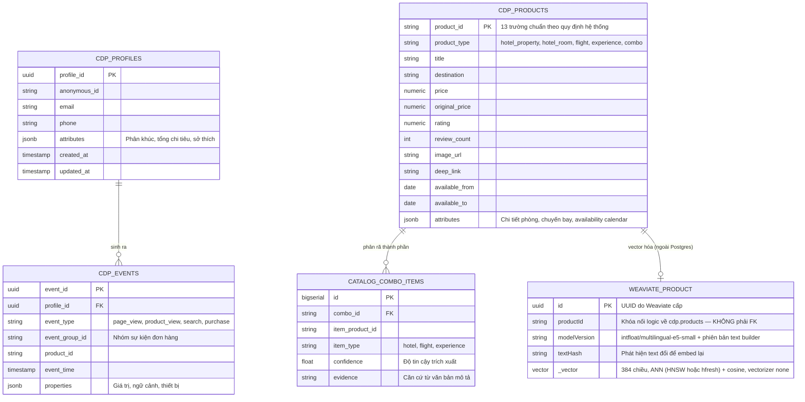

# Data Model & Storage Architecture — V-OTA Platform

Tài liệu này định nghĩa toàn bộ mô hình dữ liệu, sơ đồ quan hệ thực thể (ERD), ranh giới bảo mật phân quyền và vòng đời trạng thái của các thực thể trong nền tảng V-OTA.

---

## 1. Tổng Quan Kiến Trúc Lưu Trữ & Phân Định Ranh Giới

Hệ sinh thái lưu trữ của V-OTA gồm hai cơ sở dữ liệu PostgreSQL độc lập cho dữ liệu quan hệ, cộng một dịch vụ Weaviate riêng cho vector:

```
+-------------------------------------------------------------------------+
| DATABASE: vota  (PostgreSQL 16)                                         |
|                                                                         |
|  [Schema: cdp]           [Schema: catalog]           [Schema: app]      |
|  - products              - product_meta (view)       - users            |
|  - profiles              - combo_items               - bookings         |
|  - events                                            - booking_items    |
|                                                      - payments         |
|                                                      - conversations    |
|                                                      - messages         |
|                                                      - refresh_tokens   |
|                                                      - login_attempts   |
|                                                                         |
|  (Role: cdp_writer)      (Role: vota_app)            (Role: vota_app)   |
+-------------------------------------------------------------------------+
                                      |
                               (HTTP API only)
                                      v
+-------------------------------------------------------------------------+
| DATABASE: insider (Độc lập, service Insider Clone quản lý riêng)        |
|  - partners, profiles, identifiers, events, channel_events             |
+-------------------------------------------------------------------------+

+-------------------------------------------------------------------------+
| WEAVIATE (dịch vụ riêng, volume riêng)                                  |
|  Collection e5: ProductE5 — vector 384 chiều (multilingual-e5-small)    |
|  Thuộc tính: productId (khóa nối về Postgres), modelVersion, textHash   |
|  vectorizer: none — backend tự sinh vector và tự ghi                    |
+-------------------------------------------------------------------------+
```

**Vì sao vector không nằm trong Postgres:** vòng seed `make demo-db` dựng lại database `vota` từ đầu, nên nếu vector nằm chung thì mỗi lần seed đều phải embed lại toàn bộ catalog. Tách sang Weaviate với volume riêng giúp vector sống độc lập với vòng đời seed quan hệ. Hệ quả: `catalog.product_vectors` và extension `pgvector` **đã được gỡ khỏi schema**.

### Ranh giới truy cập nghiêm ngặt:
1. **Cô lập dữ liệu sự kiện CDP:** Ứng dụng nghiệp vụ (`vota_app`) **tuyệt đối không được phép truy cập SQL trực tiếp** (không SELECT, INSERT, JOIN) vào `cdp.events` hoặc `cdp.profiles`. Mọi thao tác đều phải đi qua cổng giao tiếp `CdpClient`.
2. **Không tạo Khóa Ngoại (Foreign Key) chéo giữa các Schema độc lập:** Bảng `app.bookings` không tham chiếu trực tiếp đến `cdp.events.event_id`. Hai phân hệ liên kết logic thông qua cặp mã nghiệp vụ `event_group_id` + `product_id` + `using_date`.
3. **Tính độc lập của dịch vụ Insider:** Backend V-OTA không mở bất kỳ kết nối DB nào đến database `insider`, mọi tương tác tiếp thị đa kênh đều qua giao thức HTTP an toàn (`HttpInsiderClient`).

---

## 2. Sơ Đồ Thực Thể & Quan Hệ (Entity Relationship Diagrams)

### 2.1. Phân Hệ Dữ Liệu Khách Hàng (`cdp`) & Danh Mục Sản Phẩm (`catalog`)



### 2.2. Phân Hệ Nghiệp Vụ Ứng Dụng (`app`)

```mermaid
erDiagram
    APP_USERS ||--o{ APP_BOOKINGS : "đặt hàng"
    APP_USERS ||--o{ APP_CONVERSATIONS : "sở hữu cuộc trò chuyện"
    APP_BOOKINGS ||--o{ APP_BOOKING_ITEMS : "chứa các dịch vụ"
    APP_BOOKINGS ||--o{ APP_BOOKING_TRAVELERS : "đoàn khách"
    APP_BOOKINGS ||--o| APP_PAYMENTS : "thanh toán"
    APP_CONVERSATIONS ||--o{ APP_MESSAGES : "lưu các tin nhắn"
    APP_USERS ||--o{ APP_REFRESH_TOKENS : "chuỗi rotation"
    APP_USERS |o--o{ APP_LOGIN_ATTEMPTS : "nhật ký đăng nhập"

    APP_USERS {
        uuid user_id PK
        string email UK
        string password_hash
        string full_name
        string phone
        string role "customer, admin"
        string persona_tag "P1_family, P2_biz, P3_explorer, P4_deal"
        timestamp email_verified_at "NULL = chưa xác minh"
        timestamp created_at
    }

    APP_REFRESH_TOKENS {
        uuid token_id PK
        uuid user_id FK
        uuid family_id "Cả chuỗi rotation; tái dùng thì thu hồi theo đây"
        string token_hash UK "SHA-256, không lưu bản rõ"
        string session_id "Ràng buộc phiên"
        timestamp expires_at
        timestamp rotated_at
        timestamp revoked_at
        string revoked_reason
    }

    APP_LOGIN_ATTEMPTS {
        bigint attempt_id PK
        string email_hash "sha256(lower(email)), không lưu email thô"
        uuid user_id FK "NULL nếu email không tồn tại"
        string ip_prefix "/24 hoặc /48"
        boolean succeeded
        string failure_reason
        timestamp attempted_at
    }

    APP_BOOKINGS {
        uuid booking_id PK
        uuid user_id FK
        string booking_code UK "Mã hiển thị: VOTA-XXXXXX"
        string event_group_id "Liên kết logic với CDP purchase event"
        string status "pending_payment, confirmed, payment_failed, expired, cancelled, completed"
        timestamp hold_expires_at
        timestamp confirmed_at
        timestamp cancelled_at
        string cancel_reason
        timestamp purchase_events_cancelled_at
        numeric total_amount
        string currency "VND"
        timestamp created_at
        timestamp updated_at
    }

    APP_BOOKING_ITEMS {
        uuid item_id PK
        uuid booking_id FK
        string product_id 
        string product_title
        string product_type
        numeric price_at_booking
        int quantity
        date using_date
        jsonb metadata "Các dòng giá, danh sách hành khách của mục và phân phòng; thông tin vé, phòng, ghi chú đặc biệt; vé máy bay có ticketing {status ISSUING|ISSUED|VOIDED, pnr, tickets theo travelerRef, simulated: true}; ghế và hành lý ký gửi theo từng hành khách và chặng"
    }

    APP_BOOKING_TRAVELERS {
        uuid traveler_id PK
        uuid booking_id FK
        string traveler_ref "Mã tham chiếu trong đơn"
        int position
        string traveler_type "adult, child"
        string surname "Họ"
        string given_names "Tên đệm và tên"
        string full_name "Nối từ surname và given_names"
        date birth_date "Bắt buộc với trẻ em; không trả qua API, không gửi CDP/Insider/Stripe"
        jsonb documents "FR-BKG-13: {title, nationality, docType, docNumber, docExpiry}. Chỉ khi giỏ có flight; docNumber không trả nguyên qua API (chỉ 4 số cuối), không gửi CDP/Insider/Stripe"
    }

    APP_PAYMENTS {
        uuid payment_id PK
        uuid booking_id FK "UNIQUE — một đơn một phiên thanh toán"
        string provider "stripe | fake | seed (booking dựng sẵn cho P1)"
        string checkout_session_id UK
        string payment_intent_id UK
        string checkout_url "Chỉ dùng khi status = open"
        bigint amount "VND, là số nguyên (Stripe coi VND là tiền tệ không có số lẻ)"
        string currency "VND"
        string status "open, succeeded, failed, expired, refund_pending, refunded, refund_failed"
        int failed_attempts
        string last_failure_code
        string refund_id
        timestamp created_at
        timestamp updated_at
    }

    APP_CONVERSATIONS {
        uuid conversation_id PK
        uuid user_id FK "Null nếu khách vãng lai"
        string session_id
        string title "Ví dụ: Lịch trình Nha Trang 3N2Đ"
        timestamp created_at
        timestamp updated_at
    }

    APP_MESSAGES {
        uuid message_id PK
        uuid conversation_id FK
        string sender "user, assistant, tool"
        text content "Nội dung phản hồi hoặc prompt"
        jsonb structured_data "Dữ liệu lịch trình, thẻ sản phẩm grounded"
        timestamp created_at
    }
```



Giỏ hàng (FR-BKG-08): mỗi mục lưu thêm số người lớn, số trẻ em và snapshot giá trẻ em của sản phẩm tại thời điểm thêm. Ngày sinh chỉ lưu ở `app.booking_travelers`.

`expires_at` của `app.conversations` là hạn của working memory 24 giờ, không phải hạn xoá archive. Hội thoại và tin nhắn của user đã đăng nhập được giữ lâu dài; API lịch sử luôn lọc theo `cdp_user_id`. Khách chưa đăng nhập không được ghi vào hai bảng này.

---

## 3. Đặc Tả Thuộc Tính JSONB & Quy Chuẩn Trường

### 3.1. Cấu trúc `cdp.products.attributes`
Mọi thông tin động theo loại sản phẩm được chuẩn hóa trong trường `attributes`:
- **Khách sạn (`hotel_room`):**
  ```json
  {
    "roomType": "Deluxe Ocean View",
    "bedType": "1 King Bed hoặc 2 Twin Beds",
    "maxGuests": 3,
    "roomAreaM2": 38,
    "amenities": ["Hồ bơi", "Buffet sáng", "Wifi miễn phí", "Bồn tắm"],
    "availability": {
      "from": "2026-10-01",
      "days": 30,
      "calendar": "111111001111111111110011111111"
    }
  }
  ```
- **Chuyến bay (`flight_instance`):**
  ```json
  {
    "airline": "Vietnam Airlines",
    "flightNumber": "VN1344",
    "origin": "SGN",
    "destination": "CXR",
    "departureTime": "08:30:00",
    "arrivalTime": "09:45:00",
    "fareClasses": [
      { "code": "ECO", "name": "Phổ thông", "price": 634000, "carryOnKg": 7, "checkedKg": 0, "mealIncluded": false, "changeRule": "Phí + chênh lệch giá", "soldOut": false }
    ]
  }
  ```
  Dịch vụ thêm của hãng (FR-BKG-11) nằm trong `attributes` của chuyến bay (nạp từ bảng giá theo hãng):
  ```json
  {
    "baggageOptions": [ { "kg": 20, "price": 220000 }, { "kg": 30, "price": 330000 } ],
    "seatPricing": { "standard": 0, "front": 150000, "exit": 200000 },
    "aircraft": { "type": "A321", "rows": 30, "columns": ["A","B","C","D","E","F"], "exitRows": [12,13], "frontRows": [1,2,3,4,5] }
  }
  ```
  Thiếu `baggageOptions`/`seatPricing` thì không bán dịch vụ thêm tương ứng. Ghế "đã có người" trên sơ đồ là mô phỏng.

  `unitPrice` của sản phẩm là giá của hạng rẻ nhất còn chỗ. Thiếu `fareClasses` thì coi như một hạng duy nhất với giá `unitPrice`.

Vé có báo giá theo ngày cố định giữ `level: flight`, `fixedDepartureDate: true`, `tripType: oneWay | roundTrip` và `cabinClass` khi nguồn xác nhận. Định danh mới bao gồm hành trình, ngày và hạng vé, không thay ID cũ. `available_from = available_to` là ngày đi. Job cào (dữ liệu thật) không dời ngày của vé này; ngoài cửa sổ hoặc hết hạn báo giá thì không đặt được. Riêng seed demo (`make demo-db`, snapshot có version): vé có ngày đi ngoài cửa sổ được dời vào cửa sổ như vé không cố định ngày (`as_of + crc32(productId) % 30`), hai chặng dời cùng số ngày, giữ giờ bay và `stayDays`, `returnDate` cùng ngày ghi trong tên/mô tả đổi theo; vé có ngày đi trong cửa sổ giữ ngày thật. Giá giữ nguyên từ nguồn (gắn với ngày gốc, chỉ là giá tham khảo) và `priceValidUntil` giữ nguyên, nên `fareClasses` báo `EXPIRED` khi báo giá hết hạn nhưng vé seed vẫn đặt được. Vé khứ hồi có `returnFlight` (số hiệu, hãng, sân bay đi/đến, giờ đi/đến), `returnDate`, `stayDays`, `priceValidUntil` nếu có. `unitPrice` là tổng hai chặng cho một người lớn (`priceBasis: per_person`); `quantity` là số khách. Ngày về không ghi vào `using_date_to`, không nhân số đêm. Thiếu hạng vé thì giữ chưa biết. Giá lịch sử giữ thời điểm nguồn, không được coi là báo giá mới.

**Vé Thương gia mô phỏng (demo).**

- Mặc định bật ở mọi bước nạp catalog: seed demo local (`make demo-db`, luôn bật), `seed --catalog-only` / `daily.py` và job fresh. Tắt bằng `SIMULATED_BUSINESS_FARES=0` trong env của job (seed demo đầy đủ không tắt được).
- Sau mỗi lần nạp catalog: mỗi vé máy bay thật `level: flight` có số hiệu chuyến (một chiều và khứ hồi), hạng khác `BUSINESS`/`FIRST`, sinh một vé cùng hành trình, `cabinClass: BUSINESS`. Không sinh khi đã có vé Thương gia thật cùng hành trình và ngày: giá thật luôn thắng.
- Giá = giá vé gốc × 2,65, làm tròn nghìn đồng. 2,65 là tỉ lệ Thương gia / Phổ thông trên bảng "Giá vé tham khảo" công khai của Vietnam Airlines, chặng Hà Nội – TP.HCM (3.957.000 / 1.494.000 một chiều; 7.914.000 / 2.988.000 khứ hồi).
- `sourceRef` là `demo:business:<sourceRef vé gốc>`; `productId` sinh cố định từ `sourceRef` này.
- Đánh dấu: `attributes.simulated = true`; `attributes.fieldSources.unitPrice = "mô phỏng"`; tên có hậu tố "(giá minh hoạ)"; mô tả ghi rõ giá minh hoạ, không phải giá nguồn báo.
- Ngày, giờ, chiều về, `available`, cửa sổ đặt chỗ và `priceValidUntil` chép từ vé gốc, cập nhật lại mỗi lần nạp.
- Vé gốc hết đặt được, có vé Thương gia thật thay thế, hoặc tắt cấu hình → vé mô phỏng chuyển `available = false`. Không xoá dòng, vì đơn cũ có thể trỏ tới.

### 3.2. Cấu trúc `app.messages.structured_data` (Grounded Itinerary)
Dữ liệu lịch trình do AI Assistant trả về phải tuân thủ cấu trúc định dạng chuẩn:
```json
{
  "destination": "Nha Trang",
  "totalDays": 3,
  "estimatedBudget": 8900000,
  "itinerary": [
    {
      "day": 1,
      "title": "Khám phá Vịnh Nha Trang & Nhận phòng",
      "activities": [
        {
          "timeSlot": "afternoon",
          "title": "Nhận phòng Vinpearl Resort & Spa",
          "isProduct": true,
          "productId": "hotel_vnp_nt_01",
          "price": 3200000,
          "bookingUrl": "/products/hotel_vnp_nt_01"
        },
        {
          "timeSlot": "evening",
          "title": "Thưởng thức hải sản Tháp Bà",
          "isProduct": false,
          "notes": "Địa điểm tự do, chi phí ước tính khoảng 300.000đ/người"
        }
      ]
    }
  ]
}
```

---

## 4. Vòng Đời Trạng Thái Của Các Thực Thể Chính (Entity Lifecycles)

### 4.1. Vòng đời Đơn hàng (`app.bookings.status`)
```
                 [ Tạo giữ chỗ + phiên Stripe ] ──> PENDING_PAYMENT (tối đa 30 phút)
                                                          │
   ┌──────────────────┬───────────────────┬───────────────┼──────────────────────┐
   │ Stripe thu tiền  │ Từ chối thẻ lần 3 │ Hết 30 phút   │ Khách huỷ            │
   │ + ghi CDP        │ (hoặc tiền lệch)  │               │ (chưa trả tiền)      │
   v                  v                   v               v
CONFIRMED       PAYMENT_FAILED         EXPIRED        CANCELLED
   │
   ├── Khách huỷ trong hạn → hoàn 100% ──> CANCELLED
   │
   └── Qua ngày sử dụng ──> COMPLETED
```

Trạng thái xuất vé máy bay (FR-BKG-12) thuộc từng mục đơn (`booking_items.metadata.ticketing`), không đổi vòng đời đơn.

### 4.2. Vòng đời Sản phẩm & Khả năng phục vụ
- **is_search_unit = true:** Sản phẩm đại diện cho một thực thể tìm kiếm (Ví dụ: Một resort/khách sạn tổng quan). Xuất hiện trong kết quả tìm kiếm và danh mục gợi ý.
- **is_bookable = true:** Đơn vị có thể thêm vào giỏ và đặt chỗ (Ví dụ: Từng loại phòng cụ thể, từng chuyến bay trong ngày).
- **is_recommendable = true:** Đủ tiêu chuẩn chất lượng và tính khả dụng để đưa vào các thuật toán gợi ý tự động.

---

## 5. Chiến Lược Di Chuyển Schema & Đảm Bảo Tính Toàn Vẹn (Migrations)

1. **Nguồn sự thật cho DDL:** File SQL gốc tại `db/vota_schema.sql` và `db/insider_schema.sql`. Khi khởi tạo môi trường mới, Docker Compose sẽ nạp thông qua thư mục `db/init/`.
2. **Nguyên tắc Migration trên Cơ sở dữ liệu đang vận hành:**
   - Tuyệt đối không xóa và chạy lại init script trên database đã có dữ liệu.
   - Mọi thay đổi cấu trúc bảng, thêm cột hoặc tạo chỉ mục mới phải được đóng gói thành các file migration idempotent (có khả năng chạy lại nhiều lần mà không gây lỗi) trong `db/migrations/` và thực thi qua bộ điều phối `db/migrations/run.py`.
3. **Phân bổ tài nguyên Vector:** Collection `Product` của Weaviate chỉ chứa sản phẩm có `is_search_unit = true` để tối ưu bộ nhớ và tốc độ truy vấn. Weaviate tự dựng index ANN (cosine) theo loại mà cluster cho phép nên không cần khai báo index thủ công.
4. **Weaviate nằm ngoài vòng migration của Postgres.** `db/migrations/run.py` chỉ áp thay đổi cho database quan hệ. Đổi chiều vector hoặc đổi model embedding = tạo lại collection và chạy lại job embed, không phải viết migration SQL. Vì `productId` chỉ là khóa nối logic (không có FK xuyên hệ), xóa sản phẩm ở Postgres **không** tự xóa vector — job embed phải dọn các vector mồ côi.
