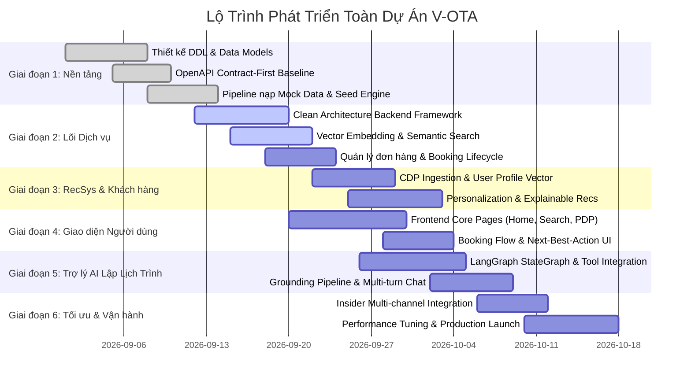

# Implementation Plan & Project Milestones — V-OTA Platform

Tài liệu này xác định lộ trình triển khai tổng thể của toàn bộ dự án V-OTA, phân chia các giai đoạn phát triển (Milestones), phân bổ trách nhiệm theo từng nhóm chuyên môn (Workstreams) và xác định tiêu chuẩn hoàn thành (Definition of Done).

---

## 1. Lộ Trình Triển Khai Toàn Dự Án (Project Roadmap)

Dự án được triển khai qua 6 giai đoạn kế tiếp nhau với các mục tiêu kỹ thuật rõ rệt:

---

## 2. Chi Tiết Các Giai Đoạn & Hạng Mục Công Việc (Phases & Tasks)

### Giai Đoạn 1: Nền Tảng Dữ Liệu & Hợp Đồng Giao Tiếp (Foundations & Contracts)
- **Hạng mục công việc:**
  - Thiết kế DDL hoàn chỉnh cho 2 database `vota` và `insider`.
  - Thiết lập chuẩn OpenAPI Contract 3.1.0 cho toàn bộ các API domain.
  - Xây dựng bộ công cụ nạp dữ liệu `src/data_collection/seed/` hỗ trợ snapshot thật và dữ liệu tổng hợp.
  - Thiết lập kịch bản thẩm định cơ sở dữ liệu `db/verify.sql`.
- **Đầu ra then chốt:** Khởi động database bằng Docker Compose thành công, chạy `verify.sql` toàn bộ PASS.

### Giai Đoạn 2: Lõi Dịch Vụ Nghiệp Vụ & Tìm Kiếm Ngữ Nghĩa (Core Services & Semantic Search)
- **Hạng mục công việc:**
  - Triển khai cấu trúc Clean Architecture cho Backend (`domain`, `application`, `infrastructure`, `api`).
  - Xây dựng pipeline tạo vector embedding cho mô tả sản phẩm và tiện ích bằng pgvector.
  - Viết logic tìm kiếm lai (Hybrid Search) kết hợp Full-text search và Vector Cosine Similarity.
  - Triển khai phân hệ xác thực tài khoản và chuyển đổi Persona phục vụ kiểm thử.
- **Đầu ra then chốt:** API `/api/v1/search` phản hồi kết quả tìm kiếm ngữ nghĩa chính xác với thời gian $\le 250\text{ ms}$.

### Giai Đoạn 3: Hệ Thống Gợi Ý & Dữ Liệu Khách Hàng (RecSys & Customer Intelligence)
- **Hạng mục công việc:**
  - Xây dựng adapter `LocalCdpClient` / `HttpCdpClient` để ghi nhận sự kiện hành vi.
  - Tính toán vector sở thích người dùng từ lịch sử xem, tìm kiếm và đặt hàng.
  - Xây dựng thuật toán Candidate Generation cho từng ngữ cảnh (Home, Product Detail, Post-booking).
  - Tạo lý do gợi ý tự động (`because`) minh bạch cho từng sản phẩm đề xuất.
- **Đầu ra then chốt:** API `/api/v1/recommendations` trả về danh sách cá nhân hóa theo từng persona, khép kín vòng lặp sau khi mua hàng.

### Giai Đoạn 4: Trải Nghiệm Giao Diện Người Dùng (Frontend & Interaction)
- **Hạng mục công việc:**
  - Xây dựng giao diện Web Responsive với các màn hình chính: Trang chủ, Tìm kiếm, Chi tiết sản phẩm.
  - Tích hợp bộ bắt sự kiện hành vi ở phía client gửi tự động về backend qua `/api/v1/events`.
  - Triển khai quy trình giỏ hàng và màn hình xác nhận đơn hàng kích hoạt gợi ý chặng tiếp theo.
- **Đầu ra then chốt:** Người dùng có thể hoàn tất luồng tìm kiếm $\rightarrow$ xem chi tiết $\rightarrow$ đặt chỗ mượt mà trên trình duyệt.

### Giai Đoạn 5: Trợ Lý AI Lập Lịch Trình (Grounded Itinerary Assistant)
- **Hạng mục công việc:**
  - Xây dựng đồ thị trạng thái hội thoại dựa trên LangGraph (`StateGraph`).
  - Đóng gói các công cụ tìm kiếm catalog, kiểm tra phòng trống thành các Tools tiêu chuẩn cho LLM.
  - Xây dựng bộ lọc Grounding: thẩm định 100% ID sản phẩm trong lịch trình trước khi trả lời người dùng.
  - Thiết kế giao diện chat đa lượt với các thẻ sản phẩm tương tác (Grounded Cards).
- **Đầu ra then chốt:** Trợ lý lên lịch trình 3N2Đ chính xác theo ngân sách, không bịa đặt sản phẩm, cho phép bấm vào từng thẻ để đặt chỗ.

### Giai Đoạn 6: Tương Tác Đa Kênh, Tối Ưu Hóa & Đóng Gói Vận Hành (Optimization & Launch)
- **Hạng mục công việc:**
  - Tích hợp dịch vụ Insider Clone thông qua `HttpInsiderClient` để đồng bộ thuộc tính và phân khúc.
  - Tối ưu hóa chỉ mục cơ sở dữ liệu (HNSW tuning), cấu hình connection pooling.
  - Đo lường và tinh chỉnh các chỉ số RecSys (NDCG, Recall@K).
  - Hoàn thiện tài liệu vận hành và kịch bản phục hồi khi xảy ra lỗi.
- **Đầu ra then chốt:** Toàn bộ hệ thống sẵn sàng vận hành ổn định trên môi trường Staging và Production.

---

## 3. Phân Công Trách Nhiệm Theo Nhóm (Workstream Ownership)

| Nhóm chuyên môn | Trách nhiệm chính | File & Thư mục sở hữu |
|---|---|---|
| **Backend Core** | Clean Architecture, nghiệp vụ đặt hàng, Auth, API Routers, Database Adapters | `src/backend/app/domain/`, `application/`, `infrastructure/`, `api/` |
| **Data & RecSys** | Pipeline dữ liệu, Vector Embeddings, Thuật toán Candidate Generation & Reranking | `src/data_collection/`, `src/backend/app/application/use_cases/recommendation/` |
| **AI Agent** | LangGraph StateGraph, Tool Calling, Quản lý ngữ cảnh và Grounding Pipeline | `src/backend/app/agents/`, `docs/spec/hop-dong-tich-hop-itinerary-assistant.md` |
| **Frontend** | Giao diện người dùng, Tích hợp API, Tracking sự kiện, Giao diện Trợ lý AI | `src/frontend/` |
| **DevOps & QA** | Quản lý Docker, Migration cơ sở dữ liệu, CI/CD, Contract & Integration Tests | `db/`, `src/shared/contracts/tests/`, `docker-compose.yml` |

---

## 4. Tiêu Chuẩn Hoàn Thành (Definition of Done - DoD)

Một tính năng hoặc một giai đoạn được coi là hoàn tất khi đáp ứng đầy đủ các tiêu chuẩn sau:
1. **Contract First:** Có định nghĩa schema đầy đủ trong `src/shared/contracts/` và đã vượt qua bài test `validate_contract.py`.
2. **Clean Code & Test Coverage:** Mã nguồn tuân thủ kiến trúc phân lớp, có unit test với độ bao phủ $\ge 80\%$, không có lint warning.
3. **Database Integrity:** Các thay đổi cơ sở dữ liệu có migration script idempotent đi kèm, chạy `db/verify.sql` đạt kết quả PASS.
4. **Documentation & History:** Cập nhật tài liệu liên quan trong `docs/` và tạo entry ghi nhận chi tiết trong `history/`.
5. **Grounding Guaranteed (Dành cho AI):** 100% sản phẩm gợi ý có thể truy xuất và đặt chỗ thực tế trong hệ thống.
