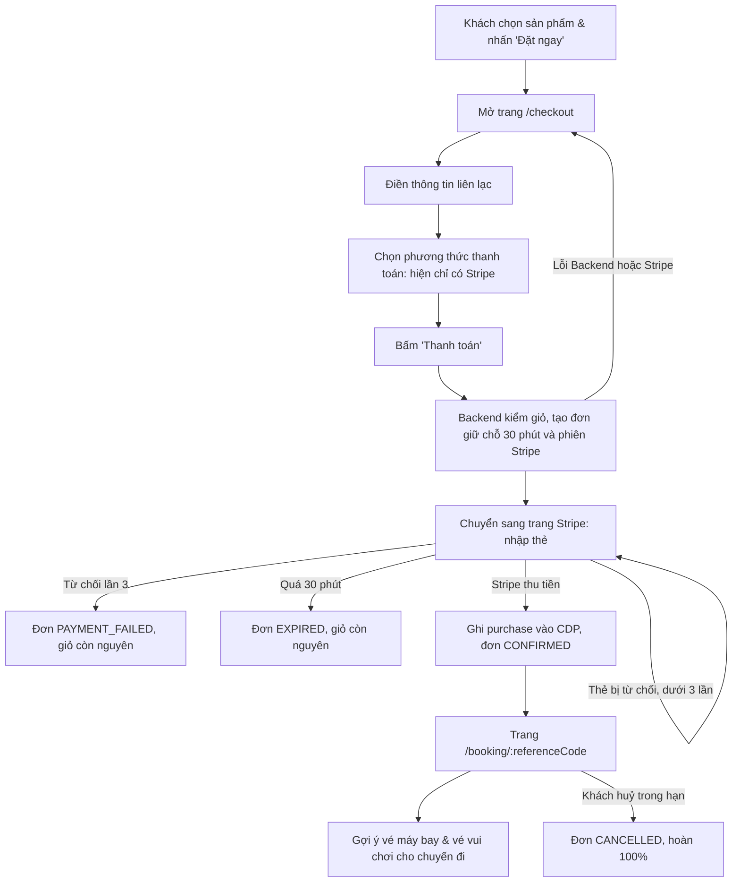

# Thanh toán booking qua Stripe, V-OTA là Merchant of Record, có giữ chỗ và cho khách huỷ

- Ngày: 2026-09-24
- Người đề xuất: mihhquan / Claude Code
- Trạng thái: đã áp dụng
- Chốt bởi / ngày: mihhquan, 2026-09-24 (phần PRD đã áp dụng; source chưa sửa — xem plan)
- PRD bị ảnh hưởng: `docs/prd/project-brief.md` §4.1, §4.2 · `docs/prd/requirements.md` §1.5, §2.3, §3 · `docs/prd/data-model.md` §1, §2.2, §4.1 · `docs/prd/architecture.md` §1, §2, §4, §5 · `docs/prd/deployment-plan.md` §1, §2 · `docs/prd/user-flow.md` §2, §3.3 · `docs/prd/test-plan.md` §2.3, §3
- Mã FR/NFR: FR-BKG-02, FR-BKG-03, FR-BKG-04 (sửa) · FR-BKG-05, FR-BKG-06, FR-BKG-07, NFR-SEC-03 (mới — cần cấp mã) · NFR-REL-02 (giữ nguyên, áp dụng thêm cho thanh toán)

## Lý do

Người dùng yêu cầu dùng Stripe làm phương thức thanh toán cho booking theo mô hình Merchant of Record (MoR), và phải xử lý bốn tình huống: đặt chỗ thành công, thanh toán thất bại, khách huỷ booking, trạng thái giữ chỗ.

PRD hiện tại không cho phép điều này:

- `project-brief.md` §4.1 chỉ có "thanh toán mô phỏng"; §4.2 để "cổng thanh toán thực tế" ngoài phạm vi.
- `requirements.md` §1.5 (FR-BKG) không có giữ chỗ, thanh toán thất bại, huỷ hay hoàn tiền. AC-BKG-01 coi bấm "thanh toán" là xong đơn.
- `data-model.md` §4.1 có `PENDING → CONFIRMED | CANCELLED` nhưng không nói thanh toán nằm ở đâu. DDL (`db/vota_schema.sql`) chỉ có `confirmed | cancelled`; contract (`schemas/booking.yaml`) để `status` luôn là `CONFIRMED`; spec backend §7.2 ghi "Không có huỷ, không có hoàn tiền".

Stripe vẫn giữ được tinh thần "không có giao dịch tiền thật" của PRD: dự án **chỉ dùng Stripe test mode**. Stripe không mở tài khoản cho doanh nghiệp đăng ký tại Việt Nam, nên live mode cũng không khả thi trong phạm vi dự án. Đổi lại, sản phẩm có luồng thanh toán thật sự chạy được (3DS, thẻ bị từ chối, webhook, hoàn tiền) thay cho một nút "Xác nhận" giả, và V-OTA không phải chạm vào dữ liệu thẻ vì trang nhập thẻ do Stripe host.

Chi phí: thêm một dịch vụ ngoài, một endpoint webhook phải truy cập được từ Internet, bảng `app.payments`, hai endpoint mới và một job đối soát chạy nền.

## Mô hình MoR, tóm tắt

V-OTA là người bán đứng tên trên giao dịch. Khách trả toàn bộ tiền đơn vào tài khoản Stripe của V-OTA; tên V-OTA hiện trên sao kê thẻ. V-OTA chịu trách nhiệm hoàn tiền, tranh chấp (chargeback) và thuế trên toàn bộ giá trị đơn, rồi tự trả giá net cho khách sạn, hãng bay, đơn vị tour. Vì V-OTA là người bán duy nhất nên dùng **một** tài khoản Stripe, không dùng Stripe Connect (Connect dành cho mô hình marketplace, nơi nhà cung cấp là người bán).

## Các quyết định cần chốt

Mỗi dòng có một phương án agent đề xuất. Người chốt có thể chọn phương án khác; tài liệu spec và plan sẽ sửa theo.

| # | Câu hỏi | Đề xuất | Phương án khác |
|---|---|---|---|
| Q1 | Giao diện thanh toán | **Stripe Checkout hosted page**: Backend tạo Checkout Session, Web chuyển trang sang Stripe. Web không cần Stripe.js, V-OTA không thấy số thẻ | Payment Element nhúng trong `/checkout`: giao diện liền mạch hơn nhưng Web phải làm form thẻ, 3DS và nhiều trạng thái hơn |
| Q2 | Thời gian giữ chỗ | **30 phút**. Stripe chỉ cho phiên Checkout hết hạn sau 30 phút đến 24 giờ, nên 30 là mức thấp nhất | 60 phút hoặc dài hơn: khoá giá lâu hơn |
| Q3 | Giữ chỗ giữ những gì | Giữ **giá và thành phần đơn** trong thời gian giữ. **Không trừ tồn kho**, vì hệ thống không có bảng tồn kho (`attributes.availability` chỉ đọc) và tồn kho thời gian thực nằm ngoài phạm vi (§4.2) | Thêm bảng tồn kho: mở rộng phạm vi lớn, không đề xuất |
| Q4 | Số lần thẻ bị từ chối tối đa | **3 lần** trong một đơn, sau đó đơn chuyển `PAYMENT_FAILED`. Mục đích là chặn kẻ gian dùng trang thanh toán để thử hàng loạt thẻ ăn cắp (card testing) | Không giới hạn, để Stripe Radar tự chặn |
| Q5 | Chính sách huỷ | Huỷ **cả đơn**, không huỷ từng mục. Chưa trả tiền: huỷ bất cứ lúc nào. Đã trả tiền: hoàn **100%** nếu huỷ trước 00:00 (giờ Việt Nam) của ngày liền trước `usingDate` sớm nhất trong đơn; quá hạn thì không huỷ trực tuyến | Có phí huỷ theo phần trăm; huỷ từng mục; mỗi sản phẩm một chính sách riêng |
| Q6 | Phiên bản contract | **Sửa trong v1.** Theo `hop-dong-tich-hop-backend.md` §8.7, thêm field và thêm giá trị enum là tương thích ngược, nhưng ý nghĩa của `201` ở `POST /bookings` đổi từ "đã đặt xong" thành "đã giữ chỗ, chờ thanh toán". Hiện chưa client nào gọi endpoint này (backend chưa có route booking, Web đang dùng state local) nên không ai bị vỡ | Tạo `/api/v2/bookings` và giữ v1 như cũ |
| Q7 | Webhook đi đường nào | Stripe gọi **thẳng FastAPI** tại `POST /api/v1/payments/stripe/webhook`, không qua BFF. Xác thực bằng chữ ký `Stripe-Signature`, không dùng JWT | Đi qua route handler Next.js rồi chuyển tiếp: thêm một chặng, BFF phải giữ nguyên raw body để kiểm chữ ký |
| Q8 | Việc ngoài phạm vi | Stripe live mode, cổng ngân hàng/ví nội địa, trả tiền cho nhà cung cấp, tự động xử lý tranh chấp (chỉ ghi log), hoá đơn VAT, email xác nhận | — |

## Nội dung đề xuất

### `project-brief.md`

§4.1, dòng Frontend:

> …tương tác chat lập lịch trình và thanh toán mô phỏng.

→

> …tương tác chat lập lịch trình và thanh toán qua trang Stripe Checkout ở chế độ test (không có giao dịch tiền thật).

§4.1, dòng Backend: "quản lý đơn hàng (Booking/Checkout)" → "quản lý đơn hàng (Booking/Checkout: giữ chỗ, thanh toán Stripe, huỷ và hoàn tiền)".

§4.2, dòng đầu:

> Tích hợp cổng thanh toán thực tế của ngân hàng (hệ thống sử dụng luồng xác nhận đơn hàng và mô phỏng giao dịch nội bộ).

→

> Nhận tiền thật: Stripe live mode, cổng thanh toán ngân hàng hoặc ví nội địa. Dự án chỉ dùng Stripe test mode, V-OTA đóng vai Merchant of Record. Cũng ngoài phạm vi: trả tiền cho nhà cung cấp, tự động xử lý tranh chấp (chargeback), hoá đơn VAT.

### `requirements.md`

§1.5, **FR-BKG-02**, thêm gạch đầu dòng cuối:

> - Kiểm tra đạt thì tạo đơn ở trạng thái giữ chỗ `PENDING_PAYMENT`. Số tiền tính từ catalog tại thời điểm tạo đơn, không nhận từ client.

§1.5, **FR-BKG-03**, thay toàn bộ các gạch đầu dòng:

> - Thu tiền qua Stripe Checkout (VND, thẻ) theo FR-BKG-06.
> - Chỉ chuyển đơn sang `CONFIRMED` khi Stripe xác nhận đã thu tiền: qua webhook có chữ ký hợp lệ, hoặc do Backend tự hỏi lại Stripe. Việc trình duyệt quay về từ trang Stripe không phải bằng chứng thanh toán.
> - Ghi sự kiện `purchase` sang CDP ngay trước khi lưu `CONFIRMED` vào `app.bookings`. Khi tiền đã thu mà lưu đơn lỗi thì **không huỷ** sự kiện, mà thử lại cho tới khi đơn được xác nhận (Stripe gửi lại webhook, job đối soát chạy lại).
> - Huỷ sự kiện `purchase` (`cancel_purchase`) khi khách huỷ đơn đã xác nhận (FR-BKG-07), để gợi ý không dùng chuyến đã huỷ.

§1.5, **FR-BKG-04**: "Sau khi hoàn tất đơn hàng" → "Sau khi đơn chuyển `CONFIRMED`".

§1.5, thêm ba yêu cầu mới:

> - **FR-BKG-05 (Giữ chỗ):** Đơn `PENDING_PAYMENT` giữ giá và thành phần trong 30 phút. Mỗi người dùng có tối đa một đơn đang giữ chỗ; tạo đơn mới khi còn đơn giữ chỗ thì bị từ chối kèm mã đơn cũ để tiếp tục hoặc huỷ. Hết hạn mà chưa trả tiền thì đơn chuyển `EXPIRED`. Giữ chỗ không trừ tồn kho. Giỏ hàng giữ nguyên cho tới khi đơn `CONFIRMED`.
> - **FR-BKG-06 (Thanh toán Stripe theo mô hình MoR và xử lý thất bại):** V-OTA là Merchant of Record, thu toàn bộ tiền đơn bằng một tài khoản Stripe ở test mode. Thẻ bị từ chối thì khách thử lại trong cùng phiên, tối đa 3 lần; lần thứ 3 thì đơn chuyển `PAYMENT_FAILED`. Stripe không phản hồi khi tạo phiên thì không tạo đơn và trả lỗi cho phép thử lại. Phân biệt thông báo cho lỗi nghiệp vụ (thẻ bị từ chối, không đủ số dư, xác thực 3DS thất bại) và lỗi kỹ thuật (cổng thanh toán không phản hồi, lỗi hệ thống).
> - **FR-BKG-07 (Khách huỷ và hoàn tiền):** Khách huỷ cả đơn. Đơn chưa trả tiền: huỷ ngay, đóng phiên thanh toán. Đơn đã trả tiền: hoàn 100% qua Stripe nếu huỷ trước 00:00 (giờ Việt Nam) của ngày liền trước ngày sử dụng sớm nhất; quá hạn thì không huỷ trực tuyến. Huỷ lặp lại trả về kết quả cũ, không hoàn tiền hai lần.

§2.3, thêm:

> - **NFR-SEC-03 (Dữ liệu thanh toán):** V-OTA không nhận, lưu hay ghi log dữ liệu thẻ; trang nhập thẻ do Stripe host. Khoá Stripe chỉ nằm ở Backend. Webhook phải được kiểm chữ ký `Stripe-Signature` trước khi xử lý, và xử lý phải idempotent vì Stripe có thể gửi trùng hoặc sai thứ tự.

§3, sửa **AC-BKG-01** và thêm ba dòng:

| Mã | Kịch bản | Hành vi kỳ vọng |
|---|---|---|
| **AC-BKG-01** (sửa) | Người dùng bấm thanh toán giỏ hàng và trả bằng thẻ test hợp lệ | Hệ thống kiểm tra lịch trống, tạo đơn giữ chỗ, chuyển sang trang Stripe. Sau khi Stripe xác nhận thu tiền: ghi event `purchase` vào CDP, chuyển đơn `CONFIRMED`, hiển thị trang thành công với mã đơn hợp lệ |
| **AC-BKG-02** (mới) | Thẻ bị từ chối 3 lần liên tiếp | Mỗi lần trang Stripe báo lỗi và cho thử lại. Lần thứ 3 đơn chuyển `PAYMENT_FAILED`, không có event `purchase`, giỏ hàng còn nguyên |
| **AC-BKG-03** (mới) | Người dùng không trả tiền trong 30 phút; hoặc bấm thanh toán lần nữa khi đang có đơn giữ chỗ | Đơn chuyển `EXPIRED`, trang thanh toán Stripe không còn dùng được. Trường hợp thứ hai trả `409 BOOKING_PENDING_PAYMENT` kèm mã đơn đang giữ |
| **AC-BKG-04** (mới) | Người dùng huỷ đơn đã thanh toán, còn trong hạn huỷ | Đơn `CANCELLED`, Stripe có một lệnh hoàn toàn bộ tiền, event `purchase` bị huỷ và không còn được dùng cho gợi ý. Huỷ khi quá hạn trả `409 BOOKING_NOT_CANCELLABLE` |

### `data-model.md`

§1, sơ đồ khối: thêm `- payments` vào danh sách bảng của schema `app`.

§2.2, ERD:

- Thêm quan hệ `APP_BOOKINGS ||--o| APP_PAYMENTS : "thanh toán"`.
- `APP_BOOKINGS.status`: `"pending, confirmed, cancelled, completed"` → `"pending_payment, confirmed, payment_failed, expired, cancelled, completed"`. Thêm các trường `hold_expires_at`, `confirmed_at`, `cancelled_at`, `cancel_reason`, `purchase_events_cancelled_at`.
- Thêm thực thể:

```
APP_PAYMENTS {
    uuid payment_id PK
    uuid booking_id FK "UNIQUE — một đơn một phiên thanh toán"
    string provider "stripe | fake | seed (booking dựng sẵn cho P1)"
    string checkout_session_id UK
    string payment_intent_id UK
    string checkout_url "Chỉ dùng khi status = open"
    bigint amount "VND, là số nguyên (Stripe coi VND là tiền tệ không có số lẻ)"
    string currency "VND"
    string status "open, succeeded, failed, expired, refund_pending, refunded, refund_failed"
    int failed_attempts
    string last_failure_code
    string refund_id
    timestamp created_at
    timestamp updated_at
}
```

§4.1, thay sơ đồ vòng đời đơn:

```
                 [ Tạo giữ chỗ + phiên Stripe ] ──> PENDING_PAYMENT (tối đa 30 phút)
                                                          │
   ┌──────────────────┬───────────────────┬───────────────┼──────────────────────┐
   │ Stripe thu tiền  │ Từ chối thẻ lần 3 │ Hết 30 phút   │ Khách huỷ            │
   │ + ghi CDP        │ (hoặc tiền lệch)  │               │ (chưa trả tiền)      │
   v                  v                   v               v
CONFIRMED       PAYMENT_FAILED         EXPIRED        CANCELLED
   │
   ├── Khách huỷ trong hạn → hoàn 100% ──> CANCELLED
   │
   └── Qua ngày sử dụng ──> COMPLETED
```

### `architecture.md`

- §1, subgraph `External`: thêm node `Stripe[Stripe: Checkout, Refund, Webhook]`; thêm cạnh `Ports -.->|Adapter: StripePaymentGateway| Stripe` và `Stripe -->|Webhook có chữ ký| Router`. Schema `app` ghi thêm `Payments`.
- §2, cây thư mục: `application/ports/` thêm `payment_gateway`; `infrastructure/` thêm dòng `payments/  # StripePaymentGateway: Checkout Session, Refund, kiểm chữ ký webhook`.
- §4, thêm dòng: **Cổng thanh toán — Stripe (test mode), Stripe Checkout hosted page.** V-OTA không chạm dữ liệu thẻ; có sẵn 3DS; có thẻ test cho từng loại lỗi; webhook có chữ ký.
- §5, thêm mục 6: **Backend ↔ Stripe.** Backend gọi Stripe qua HTTPS bằng secret key; mọi lệnh ghi (tạo phiên, đóng phiên, hoàn tiền) có `Idempotency-Key`. Stripe gọi lại Backend qua webhook `POST /api/v1/payments/stripe/webhook`, không qua BFF, xác thực bằng chữ ký. Số tiền luôn do Backend tính từ catalog.

### `deployment-plan.md`

§1, thêm dòng **Cổng thanh toán**: Local — Stripe test mode, `stripe listen` chuyển webhook về máy; Staging — Stripe test mode, webhook trỏ về URL staging; Production — ngoài phạm vi (live mode).

§2, thêm các biến:

| Tên biến | Mục đích | Môi trường | Ràng buộc |
|---|---|---|---|
| `STRIPE_SECRET_KEY` | Khoá API Stripe (`sk_test_…`) | Tất cả | Bí mật, chỉ Backend giữ, không commit. Backend từ chối khởi động nếu nhận khoá `sk_live_` |
| `STRIPE_WEBHOOK_SECRET` | Khoá kiểm chữ ký webhook (`whsec_…`); ở local lấy từ `stripe listen` | Tất cả | Bí mật |
| `PAYMENT_PROVIDER` | `stripe` hoặc `fake` (test/offline, không gọi mạng) | Tất cả | Không bí mật |
| `BOOKING_HOLD_MINUTES` | Thời gian giữ chỗ, mặc định `30`, không được nhỏ hơn 30 | Tất cả | Không bí mật |
| `PAYMENT_MAX_FAILED_ATTEMPTS` | Số lần thẻ bị từ chối tối đa, mặc định `3` | Tất cả | Không bí mật |
| `PUBLIC_WEB_URL` | Gốc URL web để dựng `success_url`, `cancel_url` | Tất cả | Không bí mật |

### `user-flow.md`

§2, bảng route:

- `/checkout`: mục đích → "Xem lại đơn, nhập thông tin liên lạc, chọn phương thức thanh toán, bấm Thanh toán để chuyển sang trang Stripe"; thành phần `Confirm Booking CTA` → `Payment Method Selector, Pay CTA`.
- `/booking/confirmation`: mục đích → "Hiển thị đơn theo trạng thái: đang giữ chỗ (đồng hồ đếm ngược, tiếp tục thanh toán), đã xác nhận (mã đặt chỗ, gợi ý chặng tiếp), thanh toán thất bại, hết hạn, đã huỷ; huỷ đơn". Đồng thời sửa tên route thành `/booking/:referenceCode` cho khớp với code và `hop-dong-tich-hop-frontend.md` §4.6.

§3.3, thêm đoạn mô tả bước thanh toán ngay dưới tiêu đề, trước sơ đồ:

> Ở `/checkout`, khách làm lần lượt ba việc: (1) điền đủ thông tin liên lạc; (2) chọn phương thức thanh toán; (3) bấm **Thanh toán**.
>
> - **Phương thức thanh toán.** Trang hiển thị danh sách phương thức. Hiện chỉ hỗ trợ **Stripe** (thẻ, test mode); phương thức này được chọn sẵn. Các phương thức khác (ví điện tử, chuyển khoản, cổng ngân hàng nội địa…) nếu có hiển thị thì ở dạng vô hiệu hoá kèm nhãn "Sắp có", không chọn được. Danh sách để mở rộng về sau mà không đổi luồng.
> - **Chưa rời trang khi chưa bấm Thanh toán.** Điền thông tin và chọn phương thức chỉ là thao tác trên `/checkout`, không gọi Stripe và không tạo đơn. Nút **Thanh toán** bị vô hiệu hoá cho tới khi thông tin liên lạc hợp lệ và đã chọn phương thức.
> - **Bấm Thanh toán mới sang Stripe.** Khi bấm, Web gọi Backend; Backend kiểm giỏ, tạo đơn giữ chỗ 30 phút và Stripe Checkout Session, rồi Web chuyển trình duyệt sang trang Stripe để nhập thẻ. Nút hiện trạng thái đang xử lý và chặn bấm lặp. Nếu Backend hoặc Stripe lỗi thì khách ở lại `/checkout` với thông báo lỗi và bấm lại được.
> - **Quay về.** Xong trên Stripe (thành công, thất bại hoặc khách bấm quay lại), trình duyệt về `/booking/:referenceCode`; trạng thái đơn do Backend quyết định, không do việc quay về.

§3.3, thay sơ đồ:



§4, thêm wireframe `/checkout`:

```
+-------------------------------------------------------------------------------+
| [LOGO] V-OTA                                                    [Tài khoản v] |
+-------------------------------------------------------------------------------+
| 1. Thông tin liên lạc                     | Tóm tắt đơn                       |
|   Họ tên      [__________________]        |  Vinpearl Resort - Deluxe (2 đêm) |
|   Email       [__________________]        |  Vé VinWonders x2                 |
|   Số điện thoại [________________]        |  -------------------------------- |
|                                           |  Tổng thanh toán: 6.400.000 đ     |
| 2. Phương thức thanh toán                 |                                   |
|   (o) Stripe - Thẻ thanh toán (test)      |  Giữ chỗ 30 phút sau khi bấm      |
|   ( ) Ví điện tử          [Sắp có]        |  Thanh toán.                      |
|   ( ) Chuyển khoản        [Sắp có]        |                                   |
|                                           |  [        THANH TOÁN        ]     |
|                                           |  Bạn sẽ được chuyển sang Stripe.  |
+-------------------------------------------------------------------------------+
```

### `test-plan.md`

§2.3, thêm hai kịch bản tích hợp: webhook sai chữ ký bị từ chối và không đổi dữ liệu; webhook gửi trùng không đổi trạng thái lần hai.

§3, bước 6: hành động → "Thêm sản phẩm vào giỏ, bấm Thanh toán, trả bằng thẻ test `4242 4242 4242 4242`"; kỳ vọng → "Qua trang Stripe, quay về trang thành công với mã `VOTA-…`"; kiểm tra ngầm → "`app.bookings` = `confirmed`, `app.payments` = `succeeded`, có event `purchase` trong CDP". Thêm bước 8: "Huỷ đơn vừa đặt" → "Đơn `CANCELLED`" → "Stripe Dashboard (test) có refund; event `purchase` bị huỷ".

## Thay đổi source sau khi chốt

Thứ tự và chi tiết: `docs/plan/2026-09-24-booking-thanh-toan-stripe.md`. Sơ đồ sequence/activity: `docs/spec/booking/so-do-luong-dat-cho-thanh-toan.md`.

- **Contract:** `src/shared/contracts/paths/booking.yaml` (đổi mô tả `POST /bookings`, thêm `POST /bookings/{referenceCode}/cancel`), `paths/payments.yaml` mới (webhook), `schemas/booking.yaml` (`status` thành enum, thêm `holdExpiresAt`, `payment`, `cancellation`, `cancellableUntil`, `CancelBookingRequest`), `schemas/common.yaml` (mã lỗi `BOOKING_PENDING_PAYMENT`, `BOOKING_ALREADY_PAID`, `BOOKING_NOT_CANCELLABLE`, `PAYMENT_PROVIDER_UNAVAILABLE`, `INVALID_WEBHOOK_SIGNATURE`), `openapi.yaml`, mock trong `src/shared/mocks/booking/`.
- **DDL:** `db/vota_schema.sql`, `db/init/01_vota.sql`, migration mới `db/migrations/0003_booking_payments.sql`, `db/verify.sql`; seed `src/data_collection/seed/` tạo dòng `app.payments` cho booking của P1.
- **Backend:** `domain/booking/`, `application/booking/`, `application/ports/payment_gateway.py`, `infrastructure/payments/stripe_gateway.py`, repository booking/payment trong `infrastructure/persistence/`, `api/v1/routes/booking.py`, `api/v1/routes/payments.py`, `api/v1/schemas/booking.py`, `api/errors.py`, `core/config.py`, `main.py`, `tests/fakes/fake_payment_gateway.py`, `requirements.txt` (thêm `stripe`).
- **Frontend:** `services/` (booking qua BFF), `components/checkout/CheckoutView.tsx`, `app/(storefront)/booking/[referenceCode]/page.tsx`, nối giỏ với backend thay cho state local trong `context/TravelContext.tsx`.
- **Spec:** `hop-dong-tich-hop-backend.md` §7.2–§7.4, §8.2; `hop-dong-tich-hop-frontend.md` §4.5, §4.6, §8; `hop-dong-tich-hop-cdp.md` §5 (thời điểm ghi `purchase`, không huỷ event khi tiền đã thu, huỷ khi khách huỷ); `product.md` §1.3 (dòng loại trừ thanh toán thật) và §4.5 (thay băng "Bản demo: không có thanh toán thật").
- **Cấu hình:** `.env.example`, `docker-compose.yml` (truyền biến Stripe vào backend), `src/backend/README.md`.
