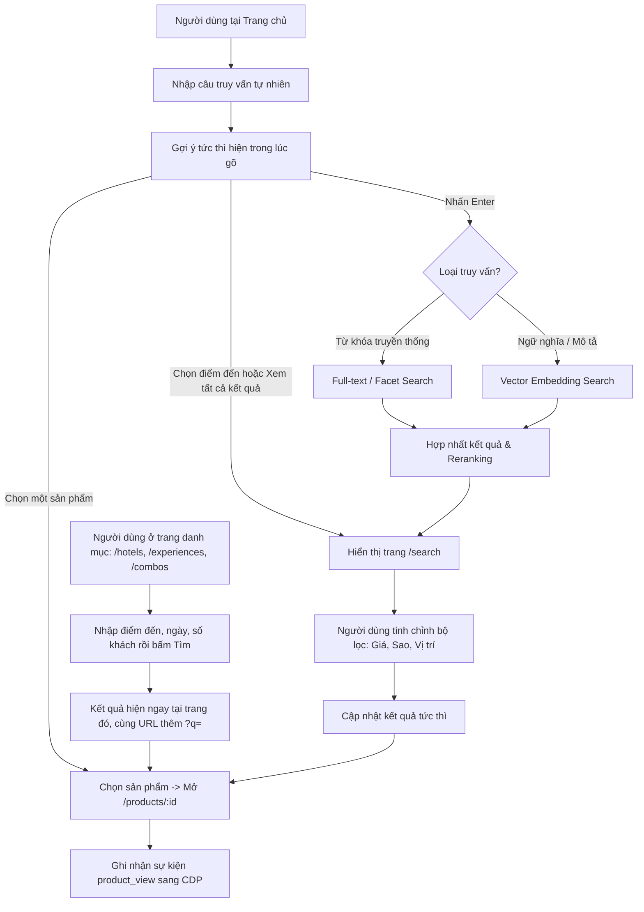
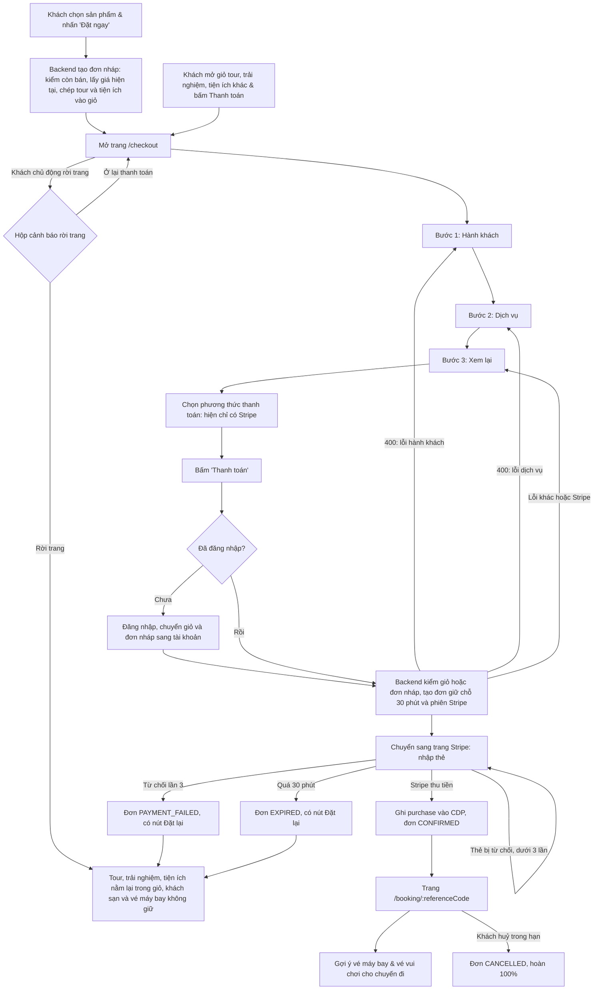

# User Flow & Experience Design — V-OTA Platform

Tài liệu này đặc tả toàn bộ hành trình trải nghiệm người dùng (User Journey), các sơ đồ luồng thao tác (User Flows), kiến trúc điều hướng (Site Architecture & Route Map) và thiết kế wireframe cho các màn hình chính của nền tảng V-OTA.

---

## 1. Hành Trình Người Dùng Theo Phong Cách Du Lịch (User Journeys)

Hệ thống được tối ưu hóa cho 4 luồng trải nghiệm chính tương ứng với các nhóm người dùng:

```
[Khách truy cập] ──> [Định danh / Đăng nhập] ──> [Khám phá / Tìm kiếm] ──> [Lập lịch trình AI] ──> [Đặt dịch vụ] ──> [Nhận gợi ý chặng kế tiếp]
```

### 1.1. Hành trình khách thích nghỉ dưỡng biển cùng gia đình
1. **Khám phá:** Truy cập trang chủ, nhìn thấy các resort ven biển có hồ bơi trẻ em và không gian xanh kèm lý do gợi ý *"Phù hợp cho chuyến đi gia đình"*.
2. **Tìm kiếm:** Gõ *"resort yên tĩnh gần biển có buffet sáng"*, nhận kết quả các khu nghỉ dưỡng đã được lọc sẵn tiện ích gia đình.
3. **Đặt phòng:** Chọn phòng Family Suite, tiến hành xác nhận đặt phòng.
4. **Hậu mãi tức thì:** Màn hình xác nhận ngay lập tức hiển thị gợi ý vé máy bay khứ hồi và vé tham quan công viên giải trí tại điểm đến vừa đặt.

### 1.2. Hành trình khách thích khám phá văn hoá, ẩm thực
1. **Tiếp cận:** Mở widget Trợ lý AI, yêu cầu *"Lập lịch trình 3 ngày khám phá ẩm thực và văn hóa Hội An - Đà Nẵng ngân sách tiết kiệm"*.
2. **Tương tác AI:** Trợ lý AI phân tích ý định, gửi lại lịch trình chia theo buổi với các địa điểm nổi tiếng kèm thẻ sản phẩm homestay và tour trải nghiệm thực tế.
3. **Điều chỉnh:** Bấm vào thẻ sản phẩm để xem chi tiết đánh giá và ảnh, yêu cầu AI đổi một điểm tham quan buổi chiều.
4. **Đặt lịch trình:** Đặt từng mục ngay trên lịch trình; mỗi mục thanh toán riêng.

---

## 2. Bản Đồ Điều Hướng & Danh Mục Màn Hình (Route Table)

| Tuyến đường (Route) | Tên màn hình | Mục đích chính | Thành phần cốt lõi |
|---|---|---|---|
| `/` | **Trang chủ (Home)** | Khám phá ban đầu, tìm kiếm nhanh, khối gợi ý cá nhân hóa | Hero Search Bar (gợi ý tức thì khi gõ), Category Nav, Personalized Carousels, Trending Destinations |
| `/hotels` | **Khách sạn & resort** | Duyệt và tìm khách sạn theo điểm đến, ngày, số phòng và số khách; kết quả hiện ngay dưới tấm tìm kiếm | Hero, Search Sheet, Kết quả tìm kiếm (Filter Sidebar hạng sao và giá, Sort popup, Product Row Cards, Xem thêm) khi đã tìm; chưa tìm thì Product Shelves (phổ biến, giá tốt), Destination Tiles |
| `/flights` | **Vé máy bay** | Tìm vé theo điểm đi, điểm đến, ngày, hành khách và chọn chuyến bay ngay tại trang; chưa nhập đủ thì trang nhắc nhập | Hero, Search Sheet, Kết quả chuyến bay (Filter Sidebar, Date Strip, Sort popup, Flight Cards, Vé của tôi) hoặc lời nhắc nhập, Destination Tiles |
| `/experiences` | **Tour và trải nghiệm** | Duyệt và tìm vé tham quan, vui chơi và sân golf (`?type=attraction\|golf`); kết quả hiện ngay dưới tấm tìm kiếm, chỉ trong tab đang chọn | Hero, Search Sheet, Tab loại, Kết quả tìm kiếm (Sort popup, Product Row Cards, Xem thêm) khi đã tìm; chưa tìm thì Product Shelves, Destination Tiles |
| `/combos` | **Combo du lịch** | Duyệt và tìm gói kết hợp; kết quả hiện ngay dưới tấm tìm kiếm | Hero, Search Sheet, Kết quả tìm kiếm (Sort popup, Product Row Cards, Xem thêm) khi đã tìm; chưa tìm thì Product Shelves, Destination Tiles |
| `/search` | **Kết quả tìm kiếm** | Hiển thị kết quả tìm kiếm ngữ nghĩa và bộ lọc đa chiều | Query Header, ô tìm kiếm có gợi ý tức thì, Tab nhóm (Tất cả · Lưu trú · Tour và trải nghiệm · Tiện ích khác), Hàng cuộn ngang theo nhóm (tab Tất cả), Filter Sidebar (chỉ Lưu trú), Sort popup (mọi tab trừ Tất cả), Product Row Cards, Xem thêm |
| `/products/:id` | **Chi tiết sản phẩm** | Thông tin đầy đủ về phòng, vé, tour; trạng thái khả dụng | Image Gallery, Attribute Badges, Availability Calendar, Pricing, Book-now CTA; Add-to-Cart CTA (chỉ tour, trải nghiệm, tiện ích khác) |
| `/checkout` (từ giỏ), `/checkout?draft=<mã đơn nháp>` (từ Đặt ngay) | **Thanh toán / Đặt chỗ** | Ba bước: khai đoàn khách và người liên hệ; chọn ai dùng từng dịch vụ (khách sạn xếp phòng); xem lại, chọn phương thức, bấm Thanh toán để chuyển sang trang Stripe | Stepper, Party Counter, Traveler Forms, Service Allocation Cards, Order Summary (sticky; bottom bar trên mobile), Payment Method Selector, Pay CTA |
| `/booking/:referenceCode` | **Xác nhận đơn hàng / Chi tiết đơn hàng** | Hiển thị đơn theo trạng thái: đang giữ chỗ (đồng hồ đếm ngược, tiếp tục thanh toán), đã xác nhận (mã đặt chỗ, gợi ý chặng tiếp), thanh toán thất bại, hết hạn, đã huỷ; huỷ đơn; xem lại đầy đủ đơn ở mọi trạng thái (FR-BKG-15) | Booking Status Card, Booking Detail Blocks, Cancellation Policy, Payment Panel, Next Best Action Recommendations (Flight, Tours) |
| `/profile` | **Hồ sơ cá nhân** | Xem và sửa họ tên, số điện thoại; xem email; đổi mật khẩu (FR-USR-04) | Account Shell (menu trái, tab trên điện thoại), Profile Form, Password Form |
| `/profile/booking_history` | **Lịch sử đặt chỗ** | Xem lại đơn theo ba tab Sắp đến, Hoàn thành, Đã huỷ; lọc theo dịch vụ và ngày đặt; phân trang (FR-BKG-14) | Account Shell, Tab trạng thái, Service Chips, Date Filter, Booking Cards, Pagination, Empty State |

---

## 3. Sơ Đồ Luồng Thao Tác Cốt Lõi (Core User Flows)

### 3.1. Luồng Khám Phá & Tìm Kiếm Ngữ Nghĩa (Search Flow)



### 3.2. Luồng Trợ Lý AI Lập Lịch Trình (Itinerary Assistant Flow)

```mermaid
flowchart TD
    A[Mở widget trợ lý] --> H{Đã đăng nhập?}
    H -->|Có| L[Xem danh sách hội thoại của chính mình]
    L --> M[Chọn hội thoại cũ hoặc tạo hội thoại mới]
    H -->|Không| B[Nhập yêu cầu lịch trình hoặc chọn gợi ý]
    M --> B
    B --> C[Backend trích xuất Intent: Điểm đến, Thời gian, Ngân sách]
    C --> D[Gọi Tool Search truy xuất sản phẩm thật từ Catalog]
    D --> E{Có sản phẩm phù hợp?}
    E -->|Có| F[LangGraph cấu trúc lịch trình từng ngày]
    E -->|Thiếu| G[Mở rộng điều kiện tìm kiếm hoặc hỏi thêm người dùng]
    F --> H["Lời diễn giải kèm thẻ sản phẩm Grounded ngay sau lần nhắc đầu tiên; bấm thẻ mở panel chi tiết cạnh bản đồ"]
    H --> I[Người dùng bấm 'Xem chi tiết', hoặc đặt từng mục (Đặt ngay / Thêm vào giỏ)]
    I --> J[Mỗi mục đặt riêng: tạo đơn nháp và mở trang Thanh toán]
```

### 3.3. Luồng Đặt Chỗ & Khép Kín Vòng Lặp Cá Nhân Hóa (Booking & Recs Loop)

> Ở `/checkout`, khách đi qua ba bước: (1) **Hành khách**: số người lớn, trẻ em, họ và tên đệm và tên từng người, ngày sinh trẻ em và người liên hệ; (2) **Dịch vụ**: chọn ai dùng từng dịch vụ, khách sạn xếp khách vào phòng, giá cập nhật theo loại khách; (3) **Xem lại và thanh toán**: kiểm tra, chọn phương thức, đồng ý điều khoản và bấm **Thanh toán**. Bấm Tiếp tục khi còn lỗi thì ở lại bước đó và thấy danh sách lỗi. Chỉ sửa giỏ hoặc đơn nháp, không tạo đơn cho tới khi bấm Thanh toán.
>
> - **Phương thức thanh toán.** Trang hiển thị danh sách phương thức. Hiện chỉ hỗ trợ **Stripe** (thẻ, test mode); phương thức này được chọn sẵn. Các phương thức khác (ví điện tử, chuyển khoản, cổng ngân hàng nội địa…) nếu có hiển thị thì ở dạng vô hiệu hoá kèm nhãn "Sắp có", không chọn được. Danh sách để mở rộng về sau mà không đổi luồng.
> - **Chưa rời trang khi chưa bấm Thanh toán.** Điền thông tin và chọn phương thức chỉ là thao tác trên `/checkout`, không gọi Stripe và không tạo đơn. Nút **Thanh toán** ở bước (3) bị vô hiệu hoá cho tới khi đã chọn phương thức và đồng ý điều khoản; thông tin ở bước (1) và (2) đã được kiểm khi bấm Tiếp tục.
> - **Rời trang khi chưa thanh toán.** Khách bấm logo, nút quay lại, một liên kết khác trên trang, hoặc Back của trình duyệt khi đang ở bước Hành khách thì hộp "Rời trang thanh toán?" hiện lên (trên điện thoại trượt lên từ đáy màn hình), nêu thứ sẽ mất và thứ còn trong giỏ. "Ở lại thanh toán" đóng hộp và giữ nguyên dữ liệu đang nhập; "Rời trang" mới rời đi. Back giữa ba bước vẫn chỉ lùi một bước. Đóng tab hoặc tải lại trang thì trình duyệt hỏi bằng hộp mặc định của nó.
> - **Bấm Thanh toán mới sang Stripe.** Khi bấm, Web gọi Backend; Backend kiểm giỏ hoặc đơn nháp, tạo đơn giữ chỗ 30 phút và Stripe Checkout Session, rồi Web chuyển trình duyệt sang trang Stripe để nhập thẻ. Nút hiện trạng thái đang xử lý và chặn bấm lặp. Nếu Backend hoặc Stripe lỗi thì khách ở lại `/checkout` với thông báo lỗi và bấm lại được.
> - **Đăng nhập.** Khách chưa đăng nhập vẫn thêm giỏ. Bấm Đặt ngay hoặc Thanh toán thì hộp đăng nhập mở ngay trên trang; đăng nhập xong, giỏ của phiên khách chuyển sang tài khoản và Web tự tiếp tục: vào `/checkout` với đơn nháp của lần Đặt ngay đó (hoặc với giỏ) để khách hoàn tất. Mở thẳng `/checkout` khi chưa đăng nhập vẫn bị chặn ở nút Thanh toán như cũ (lớp bảo vệ dự phòng).
> - **Quay về.** Xong trên Stripe (thành công, thất bại hoặc khách bấm quay lại), trình duyệt về `/booking/:referenceCode`; trạng thái đơn do Backend quyết định, không do việc quay về.



---

## 4. Thiết Kế Wireframe Các Màn Hình Chính (ASCII Wireframes)

### 4.1. Màn hình Trang Chủ (`/`)
```
+-------------------------------------------------------------------------------+
| [LOGO] V-OTA  Di chuyển v  Lưu trú v  Tour và trải nghiệm v  Tiện ích khác v  [VN] [Tài khoản v] |
+-------------------------------------------------------------------------------+
|                                                                               |
|   KHÁM PHÁ KỲ NGHỈ TIẾP THEO BẰNG NGÔN NGỮ CỦA BẠN                           |
|   +---------------------------------------------------------------+ +-------+ |
|   | [icon] Bạn muốn trải nghiệm chuyến đi như thế nào hôm nay?    | | TÌM   | |
|   +---------------------------------------------------------------+ +-------+ |
|   Gợi ý nhanh: [Nghỉ dưỡng gia đình] [Khách sạn trung tâm] [Tour ẩm thực]   |
|                                                                               |
+-------------------------------------------------------------------------------+
| GỢI Ý DÀNH RIÊNG CHO BẠN (Dựa trên sở thích nghỉ dưỡng gia đình)              |
| +-------------------------+ +-------------------------+ +-------------------+ |
| | [Ảnh Resort Nha Trang]  | | [Ảnh Villa Phú Quốc]    | | [Ảnh Hotel Đà Nẵng| |
| | Vinpearl Resort & Spa   | | Premier Village Resort  | | Furama Resort     | |
| | 4.8* (1.2k) - Bãi biển  | | 4.9* (850) - Hồ bơi con | | 4.7* (920)        | |
| | 3.200.000 đ/đêm         | | 4.500.000 đ/đêm         | | 2.800.000 đ/đêm   | |
| | (i) Vì bạn thích resort | | (i) Phù hợp gia đình    | | (i) Khách xem lại | |
| +-------------------------+ +-------------------------+ +-------------------+ |
+-------------------------------------------------------------------------------+
| HOÀN THIỆN CHUYẾN ĐI CỦA BẠN (Tiện ích bổ trợ)                                |
| [ Thẻ vé máy bay khứ hồi ]    [ Thẻ vé công viên giải trí ]                   |
+-------------------------------------------------------------------------------+
```

### 4.2. Widget Trợ Lý Lịch Trình AI

Trợ lý là **một giao diện duy nhất**: widget nổi (linh vật ở góc dưới phải) có ở mọi trang trừ `/checkout`. Các nút "Hỏi trợ lý", "Lên kế hoạch cùng trợ lý", tab "Trợ lý" của thanh tab dưới trên mobile đều mở widget, có thể kèm câu điền sẵn. Không có route riêng cho trợ lý.

```
Thu gọn: hộp chat ở góc dưới phải.
Toàn màn hình (desktop):
+------------------------------------+------------------------------------------------+
| [Lịch sử]  Trợ lý du lịch AI       | Mặc định: LỊCH TRÌNH THEO NGÀY + BẢN ĐỒ        |
|                                    |   thẻ, tổng chi phí                          |
| [AI]: **Ngày 1**                   |                                                |
|   Sáng: tắm biển, dạo bãi cát...   | Bấm thẻ → PANEL CHI TIẾT thay danh sách ngày,  |
|                                    |   bản đồ giữ nguyên:                           |
|   [ảnh] Bãi biển Trần Phú  ★4.5 [›]|   [ảnh lớn][ảnh][ảnh][+n]                 [X]  |
|   Tối: xem show...                 |   Tên · mô tả                                  |
|   [ảnh] Combo Tata Show 620.000 ₫  |   Địa chỉ [Chỉ đường] · Giờ mở cửa             |
|                                    |   ★ 4.5 (2.046 đánh giá) · Giá                 |
| [ Mô tả chuyến đi...          [↑] ]|   [Đặt ngay] [Xem trang chi tiết]              |
+------------------------------------+------------------------------------------------+
```

1. **Thẻ trong khung chat:** mỗi sản phẩm của lịch trình (khách sạn, chặng bay, hoạt động, gói nhiều ngày gợi ý riêng) có một thẻ gọn **ngay sau lần nhắc đầu tiên** trong lời diễn giải: ảnh nhỏ, tên, điểm đánh giá và số lượt (nếu có), địa chỉ, giá hoặc "Tham quan tự do", nút "Thêm". Dữ liệu thẻ lấy từ `itinerary`/`searchResults` của response, không từ chữ của LLM. Mỗi sản phẩm một thẻ; id lạ bỏ qua. Thẻ chặng bay hiện hãng, số hiệu, giờ đi/đến, bay thẳng hay nối chuyến, giá × số khách và nút [Đặt ngay]. Khi câu trả lời có hàng thẻ "Phương án khác" (AC-AGT-04), mục "Nơi nghỉ" chỉ hiện hàng thẻ đó: khách sạn không có dòng chữ hay thẻ gọn riêng *(chốt 2026-10-08, đề xuất `update-archive/2026-10-08-hang-the-thay-khach-san-noi-nghi.md`)*.
   **Ngân sách dự tính:** câu trả lời có lịch trình và biết đủ giá thì có một khối "Ngân sách dự tính" ở cuối bong bóng chat: tổng tiền, số ngày và đêm, một thanh màu chia tổng theo ba nhóm và từng dòng số tiền. Ba nhóm là Vé máy bay, Lưu trú và Vui chơi (tour, điểm tham quan, golf; điểm tham quan tự do tính 0 đ). Số tiền mỗi nhóm do backend tính từ giá sản phẩm trong lịch, cộng lại đúng bằng tổng tiền. Nhóm bằng 0 vẫn có dòng nhưng không có đoạn trên thanh. Khi người dùng nêu ngân sách, khối ghi ngân sách và trạng thái "Trong ngân sách" hoặc "Vượt ngân sách". Khối ghi rõ tổng chưa gồm ăn uống và đi lại tại điểm đến; không có khoản ước tính nào ngoài sản phẩm. Giá chưa đủ (tổng chưa biết) thì không có khối. Đổi khách sạn bằng hàng thẻ thì khối cập nhật theo lịch mới *(chốt 2026-10-09, đề xuất `update-archive/2026-10-09-ngan-sach-du-tinh.md`)*.
2. **Bấm thẻ:** mở panel chi tiết ở cột phải, thay chỗ danh sách ngày; **bản đồ vẫn hiện** và focus đúng điểm. Đang ở dạng thu gọn thì widget mở toàn màn hình trước. X hoặc Esc: về danh sách ngày. Tên của sản phẩm đã có thẻ chỉ in đậm, không làm link.
3. **Panel chi tiết** (dữ liệu từ `GET /products/{productId}`): bộ ảnh, tên, mô tả, địa chỉ + "Chỉ đường" (mở Google Maps theo toạ độ; ẩn khi không có toạ độ), giờ mở cửa (nếu có), điểm đánh giá + số lượt (không gắn logo nguồn), giá, "Thêm vào giỏ", "Xem trang chi tiết". Nút "Xem trang chi tiết" chỉ hiện khi sản phẩm không có nhãn "Tham quan tự do"; điểm tham quan tự do vẫn xem được bộ ảnh, mô tả, địa chỉ và chỉ đường trong panel.
4. **Ngoài phạm vi:** danh sách bình luận, ảnh/video của người đánh giá (catalog không có dữ liệu này, không hiển thị và không tạo giả); giao diện mobile.

> **Nút đặt trong lịch trình:** khách sạn và vé máy bay chỉ có `[Đặt ngay]`; tour, golf, combo có `[Thêm vào giỏ] [Đặt ngay]` (trên thẻ trong chat, panel chi tiết và ghim bản đồ). Lịch trình không có thanh toán gộp: mỗi mục thanh toán riêng.

> **Form gợi ý thông tin chuyến đi:** khi trợ lý đã hỏi một lượt mà vẫn thiếu điểm đến, số ngày, ngày đi hoặc số người (form hiện ở mỗi lượt cho tới khi đủ; ngân sách không bắt buộc), khung chat hiển thị ngay dưới câu trả lời một form đã điền sẵn giá trị gợi ý (điểm đến — chỉ vài lựa chọn tiêu biểu, số ngày 1–7, ngày khởi hành không trước hôm nay, số người, ngân sách, nơi đi — không bắt buộc, có nút "Dùng vị trí hiện tại" theo AC-AGT-03) kèm nút **Xác nhận**. Bấm xác nhận gửi ngay câu yêu cầu hoàn chỉnh dựng từ form như một tin nhắn của người dùng; trợ lý coi đó là yêu cầu đầy đủ và lập lịch, không hỏi thêm. Form xuất hiện trong widget trợ lý.

### 4.3. Màn hình Xác Nhận Đơn Hàng & Vòng Lặp Gợi Ý Tiếp Theo (`/booking/:referenceCode`)
```
+-------------------------------------------------------------------------------+
| [LOGO] V-OTA                                                    [Tài khoản v] |
+-------------------------------------------------------------------------------+
|                                                                               |
|   [v] ĐẶT CHỖ THÀNH CÔNG!                                                     |
|   Mã đơn hàng: #VOTA-2026-89412                                               |
|   Đã gửi email xác nhận đến: customer@example.com                             |
|                                                                               |
|   +-----------------------------------------------------------------------+   |
|   | THÔNG TIN CHUYẾN ĐI ĐÃ ĐẶT                                            |   |
|   | Vinpearl Resort & Spa Nha Trang - Phòng Deluxe Hướng Biển             |   |
|   | Nhận phòng: 15/10/2026  -  Trả phòng: 17/10/2026 (2 đêm)             |   |
|   | Tổng thanh toán: 6.400.000 đ                                          |   |
|   +-----------------------------------------------------------------------+   |
|   Khối này còn liệt kê hành khách của từng dịch vụ (khách sạn theo phòng,    |
|   đánh dấu người đại diện) và các dòng giá; không hiện ngày sinh.            |
|   Với vé máy bay, khối này thêm: trạng thái xuất vé; từng chặng có PNR và    |
|   bảng hành khách (tên in trên vé, ghế, hành lý, số vé); hai ô nhắc làm thủ  |
|   tục và giấy tờ cần mang. Nhãn "Mô phỏng - không dùng được tại sân bay".    |
|                                                                               |
|   BẠN ĐÃ CÓ VÉ MÁY BAY ĐẾN NHA TRANG CHƯA?                                    |
|   Hệ thống tìm thấy các chuyến bay phù hợp với lịch nhận phòng của bạn:       |
|   +------------------------------------+ +--------------------------------+   |
|   | Vietnam Airlines (SGN -> CXR)      | | Vietjet Air (SGN -> CXR)       |   |
|   | Khởi hành: 08:30 - 15/10/2026      | | Khởi hành: 10:15 - 15/10/2026   |   |
|   | Giá từ: 1.450.000 đ/khách          | | Giá từ: 920.000 đ/khách        |   |
|   | [ Đặt thêm chuyến này ]            | | [ Đặt thêm chuyến này ]        |   |
|   +------------------------------------+ +--------------------------------+   |
|                                                                               |
|   HOẠT ĐỘNG NỔI BẬT GẦN KHÁCH SẠN CỦA BẠN:                                    |
|   [ Thẻ Tour lặn ngắm san hô Hòn Mun ]     [ Thẻ Vé tắm bùn khoáng I-Resort ] |
|                                                                               |
|   [ QUAY VỀ TRANG CHỦ ]                            [ QUẢN LÝ ĐƠN HÀNG NÀY ]   |
+-------------------------------------------------------------------------------+
```

### 4.4. Màn hình Thanh Toán (`/checkout`)
Bước ① Hành khách (bước ② Dịch vụ: mỗi dịch vụ một thẻ chọn ai dùng, khách sạn xếp người vào từng phòng, giá theo loại khách; bước ③ Xem lại và thanh toán: tóm tắt, phương thức, điều khoản, nút Thanh toán):
```
+-------------------------------------------------------------------------------+
| [LOGO] V-OTA                                                    [Tài khoản v] |
+-------------------------------------------------------------------------------+
| (1) Hành khách  -->  (2) Dịch vụ  -->  (3) Xem lại và thanh toán              |
+-------------------------------------------+-----------------------------------+
| Đoàn khách                                | Tóm tắt đơn (dính bên phải)       |
|   Người lớn (từ 12 tuổi)   [-] 2 [+]      |  Vinpearl Resort - Deluxe (2 đêm) |
|   Trẻ em (dưới 12 tuổi)    [-] 1 [+]      |  Vé VinWonders: 2 NL + 1 TE       |
|                                           |  -------------------------------- |
| Hành khách 1 (người lớn)                  |  Tổng thanh toán: 6.400.000 đ     |
|   Họ [____________] Tên đệm và tên [____] |                                   |
| Hành khách 3 (trẻ em)                     |  Giữ chỗ 30 phút sau khi bấm      |
|   Họ [____________] Tên đệm và tên [____] |  Thanh toán.                      |
|   Ngày sinh [__/__/____]                  |                                   |
|                                           |  [   TIẾP TỤC   ]                 |
| Người liên hệ                             |                                   |
|   Email [______________]  SĐT [________]  |                                   |
+-------------------------------------------+-----------------------------------+
```
Bước ③ có khối "Phương thức thanh toán" như cũ: (o) Stripe - Thẻ thanh toán (test); ( ) Ví điện tử [Sắp có]; ( ) Chuyển khoản [Sắp có].

Thẻ vé máy bay khứ hồi ]    [ Thẻ vé công viên giải trí ]                   |
+-------------------------------------------------------------------------------+
```

### 4.3. Màn hình Xác Nhận Đơn Hàng & Vòng Lặp Gợi Ý Tiếp Theo (`/booking/:referenceCode`)
```
+-------------------------------------------------------------------------------+
| [LOGO] V-OTA                                                    [Tài khoản v] |
+-------------------------------------------------------------------------------+
|                                                                               |
|   [v] ĐẶT CHỖ THÀNH CÔNG!                                                     |
|   Mã đơn hàng: #VOTA-2026-89412                                               |
|   Đã gửi email xác nhận đến: customer@example.com                             |
|                                                                               |
|   +-----------------------------------------------------------------------+   |
|   | THÔNG TIN CHUYẾN ĐI ĐÃ ĐẶT                                            |   |
|   | Vinpearl Resort & Spa Nha Trang - Phòng Deluxe Hướng Biển             |   |
|   | Nhận phòng: 15/10/2026  -  Trả phòng: 17/10/2026 (2 đêm)             |   |
|   | Tổng thanh toán: 6.400.000 đ                                          |   |
|   +-----------------------------------------------------------------------+   |
|   Khối này còn liệt kê hành khách của từng dịch vụ (khách sạn theo phòng,    |
|   đánh dấu người đại diện) và các dòng giá; không hiện ngày sinh.            |
|   Với vé máy bay, khối này thêm: trạng thái xuất vé; từng chặng có PNR và    |
|   bảng hành khách (tên in trên vé, ghế, hành lý, số vé); hai ô nhắc làm thủ  |
|   tục và giấy tờ cần mang. Nhãn "Mô phỏng - không dùng được tại sân bay".    |
|                                                                               |
|   BẠN ĐÃ CÓ VÉ MÁY BAY ĐẾN NHA TRANG CHƯA?                                    |
|   Hệ thống tìm thấy các chuyến bay phù hợp với lịch nhận phòng của bạn:       |
|   +------------------------------------+ +--------------------------------+   |
|   | Vietnam Airlines (SGN -> CXR)      | | Vietjet Air (SGN -> CXR)       |   |
|   | Khởi hành: 08:30 - 15/10/2026      | | Khởi hành: 10:15 - 15/10/2026   |   |
|   | Giá từ: 1.450.000 đ/khách          | | Giá từ: 920.000 đ/khách        |   |
|   | [ Đặt thêm chuyến này ]            | | [ Đặt thêm chuyến này ]        |   |
|   +------------------------------------+ +--------------------------------+   |
|                                                                               |
|   HOẠT ĐỘNG NỔI BẬT GẦN KHÁCH SẠN CỦA BẠN:                                    |
|   [ Thẻ Tour lặn ngắm san hô Hòn Mun ]     [ Thẻ Vé tắm bùn khoáng I-Resort ] |
|                                                                               |
|   [ QUAY VỀ TRANG CHỦ ]                            [ QUẢN LÝ ĐƠN HÀNG NÀY ]   |
+-------------------------------------------------------------------------------+
```

### 4.4. Màn hình Thanh Toán (`/checkout`)
```
+-------------------------------------------------------------------------------+
| [LOGO] V-OTA                                                    [Tài khoản v] |
+-------------------------------------------------------------------------------+
| 1. Thông tin liên lạc                     | Tóm tắt đơn                       |
|   Họ tên      [__________________]        |  Vinpearl Resort - Deluxe (2 đêm) |
|   Email       [__________________]        |  Vé VinWonders x2                 |
|   Số điện thoại [________________]        |  -------------------------------- |
|                                           |  Tổng thanh toán: 6.400.000 đ     |
| 2. Phương thức thanh toán                 |                                   |
|   (o) Stripe - Thẻ thanh toán (test)      |  Giữ chỗ 30 phút sau khi bấm      |
|   ( ) Ví điện tử          [Sắp có]        |  Thanh toán.                      |
|   ( ) Chuyển khoản        [Sắp có]        |                                   |
|                                           |  [        THANH TOÁN        ]     |
|                                           |  Bạn sẽ được chuyển sang Stripe.  |
+-------------------------------------------------------------------------------+
```

Thẻ vé máy bay khứ hồi (FR-BKG-10), hiển thị ở bước Dịch vụ, tóm tắt đơn, bước Xem lại và trang đơn:
```
+-------------------------------------------------------------------------------+
| Khứ hồi · 2 chặng                                                             |
|  VJ1602  SGN -> CXR   17/10  08:30 - 09:45                                    |
|    Hạng: (o) Phổ thông   ( ) Phổ thông linh hoạt      [So sánh điều kiện các hạng] |
|                    -- 2 đêm ở Nha Trang --                                    |
|  VJ601   CXR -> SGN   19/10  18:10 - 19:25                                    |
|    Hạng: ( ) Phổ thông   (o) Phổ thông linh hoạt      [So sánh điều kiện các hạng] |
+-------------------------------------------------------------------------------+
```

Mục "Chỗ ngồi" và màn hình sơ đồ ghế của vé máy bay (FR-BKG-11), ở bước Dịch vụ:
```
+-------------------------------------------------------------------------------+
| Chỗ ngồi                                                                      |
|  SGN -> CXR   Nguyễn A: 6A · Trần B: chưa chọn (hãng xếp miễn phí)  [Chọn ghế] |
|  CXR -> SGN   chưa chọn                                             [Chọn ghế] |
+-------------------------------------------------------------------------------+

+-------------------------------------------------------------------------------+
| Chọn ghế   [ SGN -> CXR ] [ CXR -> SGN ]        Hành khách: (o) Nguyễn A ( ) Trần B |
|         A  B  C     D  E  F        Chú giải: [ ] Tiêu chuẩn  [H] Hàng đầu         |
|   6    [ ][ ][X]   [ ][ ][ ]                 [T] Lối thoát hiểm  [X] Đã có người  |
|  12    [T][T][T]   [T][T][T]        Phí chọn ghế: 150.000 đ        [ XÁC NHẬN ]  |
|  Tình trạng ghế là mô phỏng; hãng có thể xếp ghế khác.                          |
+-------------------------------------------------------------------------------+
```

### 4.5. Hồ sơ cá nhân (`/profile`), Lịch sử đặt chỗ (`/profile/booking_history`) và Chi Tiết Đơn (`/booking/:referenceCode`)

Giao diện chốt ngày 2026-10-07 trên bản mẫu https://claude.ai/artifact/J5umeEEBdAnLcYsaKgBL8B (FR-USR-04, FR-BKG-14) và https://claude.ai/artifact/ATHDHksuHw5ddMFS5ADqX9 (FR-BKG-15). Hồ sơ và lịch sử dùng chung khung tài khoản: menu trái (thẻ người dùng, "Hồ sơ cá nhân", "Lịch sử đặt chỗ") trên máy tính, hai tab ngang trên điện thoại. Hồ sơ: thẻ "Thông tin cá nhân" (họ tên, email chỉ xem, số điện thoại, nút Lưu thay đổi và Huỷ thay đổi) và thẻ "Mật khẩu". Đường dẫn "Đơn hàng của tôi" ở trang chi tiết đơn dẫn về `/profile/booking_history`.
```
+-------------------------------------------------------------------------------+
| Đơn hàng của tôi                                  Ngày đặt [ Tất cả        v ] |
| +---------------------------------------------------------------------------+ |
| |   Sắp đến          |        Hoàn thành        |          Đã huỷ           | |
| |  [Tất cả][Khách sạn][Vé máy bay][Vé tham quan][Combo][Sân Golf]  (cuộn ngang) |
| |                                                                           | |
| |  +---------------------------------------------------------------------+  | |
| |  | VOTA-20261006-4K7Q  Đặt lúc 06/10/2026 09:12      (o) Chờ thanh toán |  | |
| |  | [icon] Hà Nội -> Đà Nẵng · VN 123           12/10 · 2 người   2.480.000 d | |
| |  | Đang giữ chỗ cho bạn, còn 14:32                                      |  | |
| |  | Tổng thanh toán 2.480.000 d          [Huỷ giữ chỗ] [Thanh toán ngay] |  | |
| |  +---------------------------------------------------------------------+  | |
| |  ... (5 đơn mỗi trang)                                                    | |
| |  Hiển thị 1-5 trong 12 đơn              [<] [1] 2 3 [>]                   | |
| +---------------------------------------------------------------------------+ |
+-------------------------------------------------------------------------------+
Trống: hình minh hoạ + "Bạn chưa có chuyến đi nào." + [Tìm khách sạn].
Lỗi: "Chưa tải được đơn hàng của bạn." + [Thử lại] + mã yêu cầu.

Chi tiết đơn (hai cột trên máy tính, một cột trên điện thoại):
+--------------------------------------------------+----------------------------+
| Đơn hàng của tôi / Chi tiết đơn hàng             | Thông tin thanh toán       |
| [Dòng trạng thái và lý do]                       |  Mã đơn VOTA-...  [Sao chép]|
| Thông tin đặt chỗ (mỗi dịch vụ một khối)         |  Từng dòng giá             |
|   Nhận phòng ----- 1 đêm · 2 khách ----- Trả phòng|  Tổng thanh toán           |
|   Tên, hạng sao, địa chỉ, [Bản đồ]               |  Trạng thái, phương thức   |
|   Phòng đã chọn, tiện ích, ảnh                   |  [Nút hành động]           |
| Thông tin khách hàng                             |                            |
| Thông tin khách lưu trú / hành khách             |                            |
| Thông tin dịch vụ (địa chỉ, hỗ trợ, chính sách)  |                            |
| Chính sách hoàn huỷ (hai mốc theo FR-BKG-07)     |                            |
+--------------------------------------------------+----------------------------+
```
