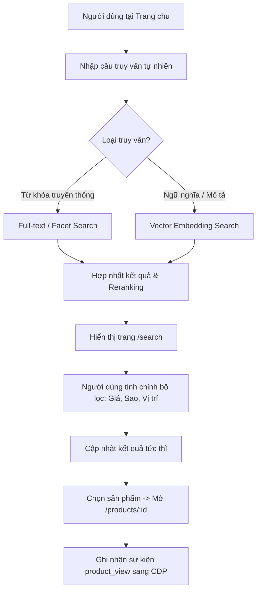
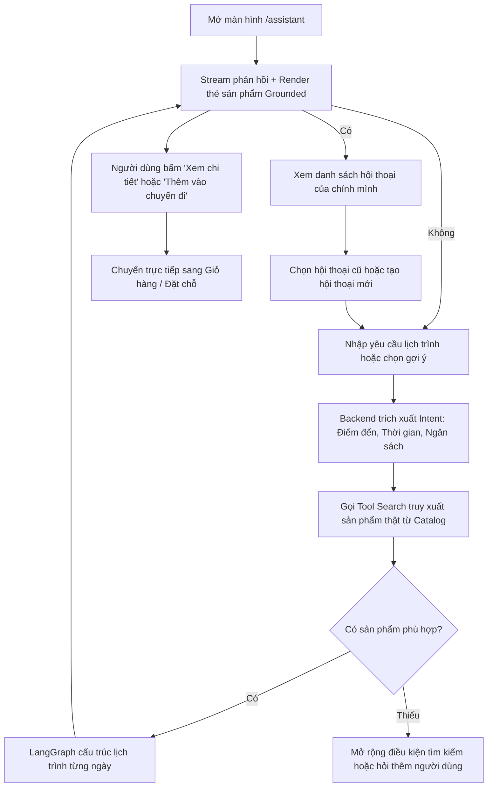
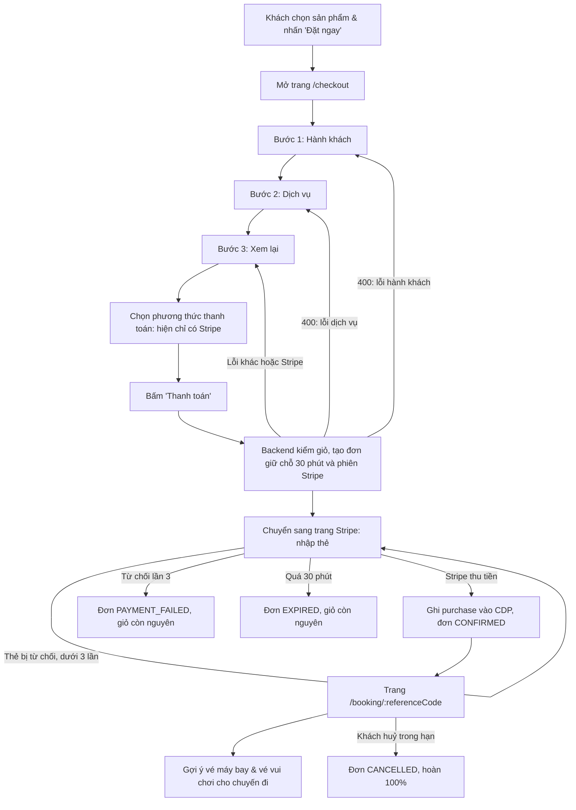

# User Flow & Experience Design — V-OTA Platform

Tài liệu này đặc tả toàn bộ hành trình trải nghiệm người dùng (User Journey), các sơ đồ luồng thao tác (User Flows), kiến trúc điều hướng (Site Architecture & Route Map) và thiết kế wireframe cho các màn hình chính của nền tảng V-OTA.

---

## 1. Hành Trình Người Dùng Theo Persona (User Journeys)

Hệ thống được tối ưu hóa cho 4 luồng trải nghiệm chính tương ứng với các nhóm người dùng:

```
[Khách truy cập] ──> [Định danh / Đăng nhập] ──> [Khám phá / Tìm kiếm] ──> [Lập lịch trình AI] ──> [Đặt dịch vụ] ──> [Nhận gợi ý chặng kế tiếp]
```

### 1.1. Hành trình Khách nghỉ dưỡng gia đình (Persona P1)
1. **Khám phá:** Truy cập trang chủ, nhìn thấy các resort ven biển có hồ bơi trẻ em và không gian xanh kèm lý do gợi ý *"Phù hợp cho chuyến đi gia đình"*.
2. **Tìm kiếm:** Gõ *"resort yên tĩnh gần biển có buffet sáng"*, nhận kết quả các khu nghỉ dưỡng đã được lọc sẵn tiện ích gia đình.
3. **Đặt phòng:** Chọn phòng Family Suite, tiến hành xác nhận đặt phòng.
4. **Hậu mãi tức thì:** Màn hình xác nhận ngay lập tức hiển thị gợi ý vé máy bay khứ hồi và vé tham quan công viên giải trí tại điểm đến vừa đặt.

### 1.2. Hành trình Khách du lịch tự túc / Trải nghiệm (Persona P3)
1. **Tiếp cận:** Vào mục Trợ lý Lịch trình (AI Assistant), yêu cầu *"Lập lịch trình 3 ngày khám phá ẩm thực và văn hóa Hội An - Đà Nẵng ngân sách tiết kiệm"*.
2. **Tương tác AI:** Trợ lý AI phân tích ý định, gửi lại lịch trình chia theo buổi với các địa điểm nổi tiếng kèm thẻ sản phẩm homestay và tour trải nghiệm thực tế.
3. **Điều chỉnh:** Bấm vào thẻ sản phẩm để xem chi tiết đánh giá và ảnh, yêu cầu AI đổi một điểm tham quan buổi chiều.
4. **Thêm vào giỏ & Đặt:** Lưu toàn bộ các sản phẩm đã chọn trong lịch trình vào giỏ hàng và tiến hành thanh toán một lần.

---

## 2. Bản Đồ Điều Hướng & Danh Mục Màn Hình (Route Table)

| Tuyến đường (Route) | Tên màn hình | Mục đích chính | Thành phần cốt lõi |
|---|---|---|---|
| `/` | **Trang chủ (Home)** | Khám phá ban đầu, tìm kiếm nhanh, khối gợi ý cá nhân hóa | Hero Search Bar, Category Nav, Personalized Carousels, Trending Destinations |
| `/hotels` | **Khách sạn & resort** | Duyệt và bắt đầu tìm khách sạn theo điểm đến, ngày, số phòng và số khách | Hero, Search Sheet, Product Shelves (phổ biến, giá tốt), Destination Tiles |
| `/flights` | **Vé máy bay** | Duyệt chặng bay và bắt đầu tìm vé theo điểm đi, điểm đến, ngày, hành khách | Hero, Search Sheet, Product Shelves, Destination Tiles |
| `/experiences` | **Tour và trải nghiệm** | Duyệt vé tham quan, vui chơi và sân golf (`?type=attraction\|golf`) | Hero, Search Sheet, Tab loại, Product Shelves, Destination Tiles |
| `/combos` | **Combo du lịch** | Duyệt gói kết hợp | Hero, Search Sheet, Product Shelves, Destination Tiles |
| `/search` | **Kết quả tìm kiếm** | Hiển thị kết quả tìm kiếm ngữ nghĩa và bộ lọc đa chiều | Query Header, Filter Sidebar, Sort Controls, Product Grid Cards, Pagination |
| `/products/:id` | **Chi tiết sản phẩm** | Thông tin đầy đủ về phòng, vé, tour; trạng thái khả dụng | Image Gallery, Attribute Badges, Availability Calendar, Pricing, Add-to-Cart CTA |
| `/assistant` | **Trợ lý Lịch trình** | Tương tác trò chuyện với AI Agent để tạo và tùy chỉnh kế hoạch | Chat Stream, Intent Chips, Day-by-Day Timeline, Grounded Product Cards |
| `/checkout` | **Thanh toán / Đặt chỗ** | Ba bước: khai đoàn khách và người liên hệ; chọn ai dùng từng dịch vụ (khách sạn xếp phòng); xem lại, chọn phương thức, bấm Thanh toán để chuyển sang trang Stripe | Stepper, Party Counter, Traveler Forms, Service Allocation Cards, Order Summary (sticky; bottom bar trên mobile), Payment Method Selector, Pay CTA |
| `/booking/:referenceCode` | **Xác nhận đơn hàng** | Hiển thị đơn theo trạng thái: đang giữ chỗ (đồng hồ đếm ngược, tiếp tục thanh toán), đã xác nhận (mã đặt chỗ, gợi ý chặng tiếp), thanh toán thất bại, hết hạn, đã huỷ; huỷ đơn | Booking Status Card, Next Best Action Recommendations (Flight, Tours) |
| `/profile` | **Hồ sơ & Lịch sử** | Quản lý thông tin cá nhân, lịch sử đơn hàng và chuyến đi | User Preferences, Booking History, Saved Items |

---

## 3. Sơ Đồ Luồng Thao Tác Cốt Lõi (Core User Flows)

### 3.1. Luồng Khám Phá & Tìm Kiếm Ngữ Nghĩa (Search Flow)



### 3.2. Luồng Trợ Lý AI Lập Lịch Trình (Itinerary Assistant Flow)



### 3.3. Luồng Đặt Chỗ & Khép Kín Vòng Lặp Cá Nhân Hóa (Booking & Recs Loop)

> Ở `/checkout`, khách đi qua ba bước: (1) **Hành khách**: số người lớn, trẻ em, họ và tên đệm và tên từng người, ngày sinh trẻ em và người liên hệ; (2) **Dịch vụ**: chọn ai dùng từng dịch vụ, khách sạn xếp khách vào phòng, giá cập nhật theo loại khách; (3) **Xem lại và thanh toán**: kiểm tra, chọn phương thức, đồng ý điều khoản và bấm **Thanh toán**. Bấm Tiếp tục khi còn lỗi thì ở lại bước đó và thấy danh sách lỗi. Chỉ sửa giỏ, không tạo đơn cho tới khi bấm Thanh toán.
>
> - **Phương thức thanh toán.** Trang hiển thị danh sách phương thức. Hiện chỉ hỗ trợ **Stripe** (thẻ, test mode); phương thức này được chọn sẵn. Các phương thức khác (ví điện tử, chuyển khoản, cổng ngân hàng nội địa…) nếu có hiển thị thì ở dạng vô hiệu hoá kèm nhãn "Sắp có", không chọn được. Danh sách để mở rộng về sau mà không đổi luồng.
> - **Chưa rời trang khi chưa bấm Thanh toán.** Điền thông tin và chọn phương thức chỉ là thao tác trên `/checkout`, không gọi Stripe và không tạo đơn. Nút **Thanh toán** ở bước (3) bị vô hiệu hoá cho tới khi đã chọn phương thức và đồng ý điều khoản; thông tin ở bước (1) và (2) đã được kiểm khi bấm Tiếp tục.
> - **Bấm Thanh toán mới sang Stripe.** Khi bấm, Web gọi Backend; Backend kiểm giỏ, tạo đơn giữ chỗ 30 phút và Stripe Checkout Session, rồi Web chuyển trình duyệt sang trang Stripe để nhập thẻ. Nút hiện trạng thái đang xử lý và chặn bấm lặp. Nếu Backend hoặc Stripe lỗi thì khách ở lại `/checkout` với thông báo lỗi và bấm lại được.
> - **Quay về.** Xong trên Stripe (thành công, thất bại hoặc khách bấm quay lại), trình duyệt về `/booking/:referenceCode`; trạng thái đơn do Backend quyết định, không do việc quay về.



---

## 4. Thiết Kế Wireframe Các Màn Hình Chính (ASCII Wireframes)

### 4.1. Màn hình Trang Chủ (`/`)
```
+-------------------------------------------------------------------------------+
| [LOGO] V-OTA  Di chuyển v  Lưu trú v  Tour và trải nghiệm v  Tiện ích khác v  [Trợ lý AI] [VN] [Tài khoản v] |
+-------------------------------------------------------------------------------+
|                                                                               |
|   KHÁM PHÁ KỲ NGHỈ TIẾP THEO BẰNG NGÔN NGỮ CỦA BẠN                           |
|   +---------------------------------------------------------------+ +-------+ |
|   | [icon] Bạn muốn trải nghiệm chuyến đi như thế nào hôm nay?    | | TÌM   | |
|   +---------------------------------------------------------------+ +-------+ |
|   Gợi ý nhanh: [Nghỉ dưỡng gia đình] [Khách sạn trung tâm] [Tour ẩm thực]   |
|                                                                               |
+-------------------------------------------------------------------------------+
| GỢI Ý DÀNH RIÊNG CHO BẠN (Dựa trên sở thích nghỉ dưỡng gia đình)              |
| +-------------------------+ +-------------------------+ +-------------------+ |
| | [Ảnh Resort Nha Trang]  | | [Ảnh Villa Phú Quốc]    | | [Ảnh Hotel Đà Nẵng| |
| | Vinpearl Resort & Spa   | | Premier Village Resort  | | Furama Resort     | |
| | 4.8* (1.2k) - Bãi biển  | | 4.9* (850) - Hồ bơi con | | 4.7* (920)        | |
| | 3.200.000 đ/đêm         | | 4.500.000 đ/đêm         | | 2.800.000 đ/đêm   | |
| | (i) Vì bạn thích resort | | (i) Phù hợp gia đình    | | (i) Khách xem lại | |
| +-------------------------+ +-------------------------+ +-------------------+ |
+-------------------------------------------------------------------------------+
| HOÀN THIỆN CHUYẾN ĐI CỦA BẠN (Tiện ích bổ trợ)                                |
| [ Thẻ vé máy bay khứ hồi ]    [ Thẻ vé công viên giải trí ]                   |
+-------------------------------------------------------------------------------+
```

### 4.2. Màn hình Trợ Lý Lịch Trình AI (`/assistant`)
```
+-------------------------------------------------------------------------------+
| [LOGO] V-OTA  >  Trợ lý Lịch trình Thông minh   [Lịch sử] [Lịch trình mới] |
+-------------------------------------------------------------------------------+
|                                    | BẢN XEM TRƯỚC LỊCH TRÌNH                 |
| [AI]: Chào bạn! Mình có thể giúp gì| Nha Trang 3 Ngày 2 Đêm - Gia đình        |
| cho chuyến đi sắp tới?             | --------------------------------------- |
|                                    | NGÀY 1: Nhận phòng & Tắm biển           |
| [User]: Lên giúp mình lịch trình   | 14:00 - Nhận phòng Vinpearl Resort      |
| Nha Trang 3N2Đ cho 2 người lớn,    | +-------------------------------------+ |
| 1 bé 5 tuổi, ngân sách 10 triệu.   | | [Img] Vinpearl Resort & Spa         | |
|                                    | | Giá: 3.200.000 đ - Deluxe Ocean     | |
| [AI]: Dưới đây là kế hoạch chi tiết| | [Xem phòng] [Thêm vào đơn hàng]     | |
| đã được thiết kế phù hợp với lịch  | +-------------------------------------+ |
| sinh hoạt của bé:                  | 18:00 - Ăn tối hải sản Tháp Bà        |
| - Ngày 1: Nhận phòng & nghỉ ngơi   | --------------------------------------- |
| - Ngày 2: Vui chơi tại VinWonders  | NGÀY 2: Khám phá VinWonders             |
| - Ngày 3: Mua sắm & về TP.HCM      | 08:30 - Vé vui chơi trọn gói            |
|                                    | +-------------------------------------+ |
| Bạn có muốn đổi giờ bay hay khách  | | [Img] Vé VinWonders Nha Trang       | |
| sạn khác không?                    | | Giá: 850.000 đ/người                | |
|                                    | | [Đặt vé ngay]                       | |
| +--------------------------------+ | +-------------------------------------+ |
| | Nhập yêu cầu tùy chỉnh...      | | TỔNG CHI PHÍ TẠM TÍNH: 8.900.000 đ      |
| +--------------------------------+ | [ TIẾN HÀNH ĐẶT TRỌN LỊCH TRÌNH ]       |
+-------------------------------------------------------------------------------+
```

> **Form gợi ý thông tin chuyến đi:** khi trợ lý đã hỏi một lượt mà vẫn chưa biết điểm đến hoặc số ngày, khung chat hiển thị ngay dưới câu trả lời một form đã điền sẵn giá trị gợi ý (điểm đến — chỉ vài lựa chọn tiêu biểu, số ngày 1–7, ngày khởi hành không trước hôm nay, số người, ngân sách) kèm nút **Xác nhận**. Bấm xác nhận đặt câu yêu cầu hoàn chỉnh vào ô nhập tin nhắn để người dùng sửa hoặc gửi. Form xuất hiện ở cả màn `/assistant` lẫn widget trợ lý nổi.

### 4.3. Màn hình Xác Nhận Đơn Hàng & Vòng Lặp Gợi Ý Tiếp Theo (`/booking/:referenceCode`)
```
+-------------------------------------------------------------------------------+
| [LOGO] V-OTA                                                    [Tài khoản v] |
+-------------------------------------------------------------------------------+
|                                                                               |
|   [v] ĐẶT CHỖ THÀNH CÔNG!                                                     |
|   Mã đơn hàng: #VOTA-2026-89412                                               |
|   Đã gửi email xác nhận đến: customer@example.com                             |
|                                                                               |
|   +-----------------------------------------------------------------------+   |
|   | THÔNG TIN CHUYẾN ĐI ĐÃ ĐẶT                                            |   |
|   | Vinpearl Resort & Spa Nha Trang - Phòng Deluxe Hướng Biển             |   |
|   | Nhận phòng: 15/10/2026  -  Trả phòng: 17/10/2026 (2 đêm)             |   |
|   | Tổng thanh toán: 6.400.000 đ                                          |   |
|   +-----------------------------------------------------------------------+   |
|   Khối này còn liệt kê hành khách của từng dịch vụ (khách sạn theo phòng,    |
|   đánh dấu người đại diện) và các dòng giá; không hiện ngày sinh.            |
|   Với vé máy bay, khối này thêm: trạng thái xuất vé; từng chặng có PNR và    |
|   bảng hành khách (tên in trên vé, ghế, hành lý, số vé); hai ô nhắc làm thủ  |
|   tục và giấy tờ cần mang. Nhãn "Mô phỏng - không dùng được tại sân bay".    |
|                                                                               |
|   BẠN ĐÃ CÓ VÉ MÁY BAY ĐẾN NHA TRANG CHƯA?                                    |
|   Hệ thống tìm thấy các chuyến bay phù hợp với lịch nhận phòng của bạn:       |
|   +------------------------------------+ +--------------------------------+   |
|   | Vietnam Airlines (SGN -> CXR)      | | Vietjet Air (SGN -> CXR)       |   |
|   | Khởi hành: 08:30 - 15/10/2026      | | Khởi hành: 10:15 - 15/10/2026   |   |
|   | Giá từ: 1.450.000 đ/khách          | | Giá từ: 920.000 đ/khách        |   |
|   | [ Đặt thêm chuyến này ]            | | [ Đặt thêm chuyến này ]        |   |
|   +------------------------------------+ +--------------------------------+   |
|                                                                               |
|   HOẠT ĐỘNG NỔI BẬT GẦN KHÁCH SẠN CỦA BẠN:                                    |
|   [ Thẻ Tour lặn ngắm san hô Hòn Mun ]     [ Thẻ Vé tắm bùn khoáng I-Resort ] |
|                                                                               |
|   [ QUAY VỀ TRANG CHỦ ]                            [ QUẢN LÝ ĐƠN HÀNG NÀY ]   |
+-------------------------------------------------------------------------------+
```

### 4.4. Màn hình Thanh Toán (`/checkout`)
Bước ① Hành khách (bước ② Dịch vụ: mỗi dịch vụ một thẻ chọn ai dùng, khách sạn xếp người vào từng phòng, giá theo loại khách; bước ③ Xem lại và thanh toán: tóm tắt, phương thức, điều khoản, nút Thanh toán):
```
+-------------------------------------------------------------------------------+
| [LOGO] V-OTA                                                    [Tài khoản v] |
+-------------------------------------------------------------------------------+
| (1) Hành khách  -->  (2) Dịch vụ  -->  (3) Xem lại và thanh toán              |
+-------------------------------------------+-----------------------------------+
| Đoàn khách                                | Tóm tắt đơn (dính bên phải)       |
|   Người lớn (từ 12 tuổi)   [-] 2 [+]      |  Vinpearl Resort - Deluxe (2 đêm) |
|   Trẻ em (dưới 12 tuổi)    [-] 1 [+]      |  Vé VinWonders: 2 NL + 1 TE       |
|                                           |  -------------------------------- |
| Hành khách 1 (người lớn)                  |  Tổng thanh toán: 6.400.000 đ     |
|   Họ [____________] Tên đệm và tên [____] |                                   |
| Hành khách 3 (trẻ em)                     |  Giữ chỗ 30 phút sau khi bấm      |
|   Họ [____________] Tên đệm và tên [____] |  Thanh toán.                      |
|   Ngày sinh [__/__/____]                  |                                   |
|                                           |  [   TIẾP TỤC   ]                 |
| Người liên hệ                             |                                   |
|   Email [______________]  SĐT [________]  |                                   |
+-------------------------------------------+-----------------------------------+
```
Bước ③ có khối "Phương thức thanh toán" như cũ: (o) Stripe - Thẻ thanh toán (test); ( ) Ví điện tử [Sắp có]; ( ) Chuyển khoản [Sắp có].

Thẻ vé máy bay khứ hồi ]    [ Thẻ vé công viên giải trí ]                   |
+-------------------------------------------------------------------------------+
```

### 4.2. Màn hình Trợ Lý Lịch Trình AI (`/assistant`)
```
+-------------------------------------------------------------------------------+
| [LOGO] V-OTA  >  Trợ lý Lịch trình Thông minh   [Lịch sử] [Lịch trình mới] |
+-------------------------------------------------------------------------------+
|                                    | BẢN XEM TRƯỚC LỊCH TRÌNH                 |
| [AI]: Chào bạn! Mình có thể giúp gì| Nha Trang 3 Ngày 2 Đêm - Gia đình        |
| cho chuyến đi sắp tới?             | --------------------------------------- |
|                                    | NGÀY 1: Nhận phòng & Tắm biển           |
| [User]: Lên giúp mình lịch trình   | 14:00 - Nhận phòng Vinpearl Resort      |
| Nha Trang 3N2Đ cho 2 người lớn,    | +-------------------------------------+ |
| 1 bé 5 tuổi, ngân sách 10 triệu.   | | [Img] Vinpearl Resort & Spa         | |
|                                    | | Giá: 3.200.000 đ - Deluxe Ocean     | |
| [AI]: Dưới đây là kế hoạch chi tiết| | [Xem phòng] [Thêm vào đơn hàng]     | |
| đã được thiết kế phù hợp với lịch  | +-------------------------------------+ |
| sinh hoạt của bé:                  | 18:00 - Ăn tối hải sản Tháp Bà        |
| - Ngày 1: Nhận phòng & nghỉ ngơi   | --------------------------------------- |
| - Ngày 2: Vui chơi tại VinWonders  | NGÀY 2: Khám phá VinWonders             |
| - Ngày 3: Mua sắm & về TP.HCM      | 08:30 - Vé vui chơi trọn gói            |
|                                    | +-------------------------------------+ |
| Bạn có muốn đổi giờ bay hay khách  | | [Img] Vé VinWonders Nha Trang       | |
| sạn khác không?                    | | Giá: 850.000 đ/người                | |
|                                    | | [Đặt vé ngay]                       | |
| +--------------------------------+ | +-------------------------------------+ |
| | Nhập yêu cầu tùy chỉnh...      | | TỔNG CHI PHÍ TẠM TÍNH: 8.900.000 đ      |
| +--------------------------------+ | [ TIẾN HÀNH ĐẶT TRỌN LỊCH TRÌNH ]       |
+-------------------------------------------------------------------------------+
```

### 4.3. Màn hình Xác Nhận Đơn Hàng & Vòng Lặp Gợi Ý Tiếp Theo (`/booking/:referenceCode`)
```
+-------------------------------------------------------------------------------+
| [LOGO] V-OTA                                                    [Tài khoản v] |
+-------------------------------------------------------------------------------+
|                                                                               |
|   [v] ĐẶT CHỖ THÀNH CÔNG!                                                     |
|   Mã đơn hàng: #VOTA-2026-89412                                               |
|   Đã gửi email xác nhận đến: customer@example.com                             |
|                                                                               |
|   +-----------------------------------------------------------------------+   |
|   | THÔNG TIN CHUYẾN ĐI ĐÃ ĐẶT                                            |   |
|   | Vinpearl Resort & Spa Nha Trang - Phòng Deluxe Hướng Biển             |   |
|   | Nhận phòng: 15/10/2026  -  Trả phòng: 17/10/2026 (2 đêm)             |   |
|   | Tổng thanh toán: 6.400.000 đ                                          |   |
|   +-----------------------------------------------------------------------+   |
|   Khối này còn liệt kê hành khách của từng dịch vụ (khách sạn theo phòng,    |
|   đánh dấu người đại diện) và các dòng giá; không hiện ngày sinh.            |
|   Với vé máy bay, khối này thêm: trạng thái xuất vé; từng chặng có PNR và    |
|   bảng hành khách (tên in trên vé, ghế, hành lý, số vé); hai ô nhắc làm thủ  |
|   tục và giấy tờ cần mang. Nhãn "Mô phỏng - không dùng được tại sân bay".    |
|                                                                               |
|   BẠN ĐÃ CÓ VÉ MÁY BAY ĐẾN NHA TRANG CHƯA?                                    |
|   Hệ thống tìm thấy các chuyến bay phù hợp với lịch nhận phòng của bạn:       |
|   +------------------------------------+ +--------------------------------+   |
|   | Vietnam Airlines (SGN -> CXR)      | | Vietjet Air (SGN -> CXR)       |   |
|   | Khởi hành: 08:30 - 15/10/2026      | | Khởi hành: 10:15 - 15/10/2026   |   |
|   | Giá từ: 1.450.000 đ/khách          | | Giá từ: 920.000 đ/khách        |   |
|   | [ Đặt thêm chuyến này ]            | | [ Đặt thêm chuyến này ]        |   |
|   +------------------------------------+ +--------------------------------+   |
|                                                                               |
|   HOẠT ĐỘNG NỔI BẬT GẦN KHÁCH SẠN CỦA BẠN:                                    |
|   [ Thẻ Tour lặn ngắm san hô Hòn Mun ]     [ Thẻ Vé tắm bùn khoáng I-Resort ] |
|                                                                               |
|   [ QUAY VỀ TRANG CHỦ ]                            [ QUẢN LÝ ĐƠN HÀNG NÀY ]   |
+-------------------------------------------------------------------------------+
```

### 4.4. Màn hình Thanh Toán (`/checkout`)
```
+-------------------------------------------------------------------------------+
| [LOGO] V-OTA                                                    [Tài khoản v] |
+-------------------------------------------------------------------------------+
| 1. Thông tin liên lạc                     | Tóm tắt đơn                       |
|   Họ tên      [__________________]        |  Vinpearl Resort - Deluxe (2 đêm) |
|   Email       [__________________]        |  Vé VinWonders x2                 |
|   Số điện thoại [________________]        |  -------------------------------- |
|                                           |  Tổng thanh toán: 6.400.000 đ     |
| 2. Phương thức thanh toán                 |                                   |
|   (o) Stripe - Thẻ thanh toán (test)      |  Giữ chỗ 30 phút sau khi bấm      |
|   ( ) Ví điện tử          [Sắp có]        |  Thanh toán.                      |
|   ( ) Chuyển khoản        [Sắp có]        |                                   |
|                                           |  [        THANH TOÁN        ]     |
|                                           |  Bạn sẽ được chuyển sang Stripe.  |
+-------------------------------------------------------------------------------+
```

Thẻ vé máy bay khứ hồi (FR-BKG-10), hiển thị ở bước Dịch vụ, tóm tắt đơn, bước Xem lại và trang đơn:
```
+-------------------------------------------------------------------------------+
| Khứ hồi · 2 chặng                                                             |
|  VJ1602  SGN -> CXR   17/10  08:30 - 09:45                                    |
|    Hạng: (o) Phổ thông   ( ) Phổ thông linh hoạt      [So sánh điều kiện các hạng] |
|                    -- 2 đêm ở Nha Trang --                                    |
|  VJ601   CXR -> SGN   19/10  18:10 - 19:25                                    |
|    Hạng: ( ) Phổ thông   (o) Phổ thông linh hoạt      [So sánh điều kiện các hạng] |
+-------------------------------------------------------------------------------+
```

Mục "Chỗ ngồi" và màn hình sơ đồ ghế của vé máy bay (FR-BKG-11), ở bước Dịch vụ:
```
+-------------------------------------------------------------------------------+
| Chỗ ngồi                                                                      |
|  SGN -> CXR   Nguyễn A: 6A · Trần B: chưa chọn (hãng xếp miễn phí)  [Chọn ghế] |
|  CXR -> SGN   chưa chọn                                             [Chọn ghế] |
+-------------------------------------------------------------------------------+

+-------------------------------------------------------------------------------+
| Chọn ghế   [ SGN -> CXR ] [ CXR -> SGN ]        Hành khách: (o) Nguyễn A ( ) Trần B |
|         A  B  C     D  E  F        Chú giải: [ ] Tiêu chuẩn  [H] Hàng đầu         |
|   6    [ ][ ][X]   [ ][ ][ ]                 [T] Lối thoát hiểm  [X] Đã có người  |
|  12    [T][T][T]   [T][T][T]        Phí chọn ghế: 150.000 đ        [ XÁC NHẬN ]  |
|  Tình trạng ghế là mô phỏng; hãng có thể xếp ghế khác.                          |
+-------------------------------------------------------------------------------+
```
