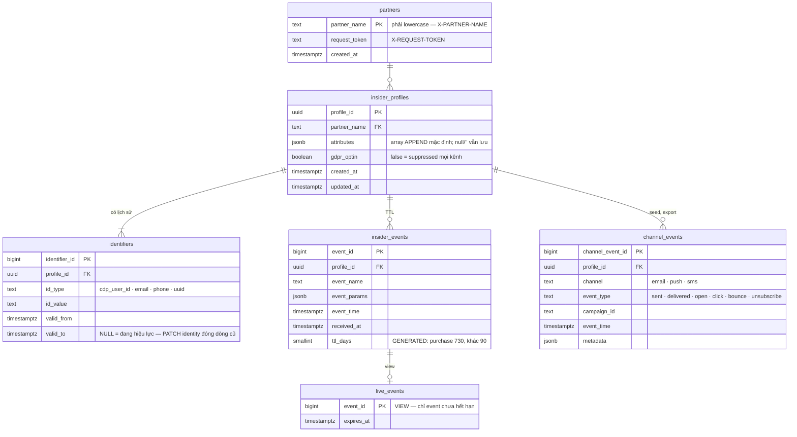

# Database schema toàn hệ thống V-OTA

Bản 20/09/2026 · tuần 1 · đi kèm trang "V-OTA Database Schema" (artifact). **Đây là nguồn DDL duy nhất** của hệ thống (`vota_schema.sql`, `insider_schema.sql` ở cuối). `PRODUCT_SCHEMA.md` giải thích sâu phần product catalog; `SCHEMA.md` là contract của file `products.jsonl`.

Hai database trên một PostgreSQL 16 (docker-compose): `vota` với ba schema `cdp` (mirror CDP), `catalog` (dựng lại được), `app` (trạng thái BE/FE/agent); và `insider` (mock của Insider, service riêng). 24 bảng, 4 view (`vota` 19 bảng + 3 view, `insider` 5 bảng + 1 view — đếm lại 29/09/2026 sau migration `0005_checkout_travelers` thêm `app.booking_travelers`; trước đó 23 bảng, đếm 24/09/2026 sau migration `0003_booking_payments` thêm `app.payments`; con số "20 bảng" trước đây có từ trước khi migration `0001_auth_p0` thêm `refresh_tokens`, `login_attempts` và `schema_migrations`). Vector sản phẩm KHÔNG nằm trong Postgres — collection `ProductE5` trên Weaviate giữ vector (`intfloat/multilingual-e5-small`, 384 chiều; collection `Product` 1024 chiều của Cohere chỉ giữ cho đường lui) (`docs/prd/data-model.md` §1). Cả hai DDL đã chạy thử và qua test ràng buộc, quyền, TTL.

---

## 1. Việc chốt trong tuần 1

| # | Hạng mục | Trạng thái | Ai |
|---|---|---|---|
| 1 | ERD + DDL toàn hệ thống: `vota` (cdp · catalog · app) và `insider`. Cả hai DDL chạy được, có test ràng buộc | Xong — chờ review | Data + Backend |
| 2 | Product catalog: 1 bảng `products` 13 trường + JSONB, vai trò qua view `product_meta`, combo qua `combo_items` | Đã chốt 18/09 | — |
| 3 | Thành phần combo: **parse từ `description`**. Job `parse_combos` ghi `source`, `confidence`, `evidence`; dòng `confidence < 0.8` hoặc chưa map thì soát tay (§9) | Đã chốt 18/09 | Data |
| 4 | Booking và CDP: CDP **không có** bảng booking — một lần đặt chỗ vào CDP dưới dạng các event `purchase` cùng `event_group_id`. Bản ghi đơn (`app.bookings`, `booking_items`) ở schema `app`, nối sang `cdp.events` bằng `event_group_id`, không FK tới id nội bộ (§5) | Đã chốt 19/09 | Backend |
| 5 | Không có bảng nhật ký nào: `job_runs` và `insider.request_log` đều bỏ. Job ghi kết quả ra file / report; số đo batch Insider tuần 5 do chính job `insider_activation` đo và ghi vào report; Insider clone ghi access log JSON lines ra file (`logs/insider_requests.jsonl`) để chứng minh luật 403 / 1.000 user / 5 MB | Đã chốt 20/09 | — |
| 6 | Insider clone = database riêng `insider`, cùng instance Postgres; 4 bảng theo tên handbook + `partners` | Đề xuất — chốt nếu không phản đối | Evaluation |
| 7 | Giỏ hàng phía server (`app.carts`) — đổi tài khoản demo trên cùng máy không lẫn giỏ (UX spec D6) | Đề xuất | Backend + Web |
| 8 | `cdp.profiles`: tên và kiểu của "opt-in states" (đang để `email_optin` / `sms_optin` / `push_optin`). Handbook §17.3: cần người biết CDP review trong tuần 1 | Chờ CDP reviewer | Backend → V-OTA |
| 9 | 243 khách sạn không có hạng phòng: **chỉ hiển thị, không đặt** — chỉ đặt ở cấp `hotel_room`. Thêm `is_recommendable` trong `product_meta` (search unit tự đặt được hoặc có ≥ 1 con đặt được) để 243 property vẫn search ra nhưng không vào `/recommendations` | Đã chốt 20/09 | — |
| 10 | `attributes.priceBasis`: mặc định `per_package`; parser đổi sang `per_person` khi description/attributes nói giá theo khách ("/khách", "/người", "giá cho 1 người", "mỗi khách") | Đã chốt 20/09 | Data |
| 11 | Volume và phân bố mock data (§8): 2.000 khách, ~7.000 event, 4 persona. Từ 21/09 seed chạy theo `docs/MOCK_DATA_SPEC.md`, tham số ở `src/data_collection/seed/config.py` | Chờ Evaluation chốt số (chỉnh ở `config.py`, không cần đọc code) | Evaluation + Data |
| 12 | Vector D và model — do dịch vụ vector bên ngoài quản lý | Tuần 2 | Search |
| 13 | `available_from/to` = **cửa sổ đặt chỗ 30 ngày tính từ ngày nạp** (`as_of`): `available_from = GREATEST(nguồn_from, as_of)`, `available_to = LEAST(nguồn_to, as_of + 29)`; nguồn không có thì lấy nguyên cửa sổ; chuyến bay `from = to = ngày bay` (mock sinh trong cửa sổ); from > to sau khi cắt → `available = false`. Ngày trong handbook chỉ là ví dụ. Loader nhận `--as-of` (mặc định hôm nay) và **mọi thứ có ngày** — cửa sổ, `attributes.availability`, event seed, chuyến sắp tới của persona — sinh tương đối theo `as_of`; chạy lại loader trước demo tuần 6 để cuộn cửa sổ, nếu không toàn bộ catalog hết hạn. Invariant `using_date` trong cửa sổ áp dụng cho checkout, không áp cho event lịch sử. Lịch kín/trống ở `attributes.availability` phủ đúng cửa sổ `{from, days, calendar "1/0"…}`, đọc-only, không có bảng tồn kho; giờ bay / mở cửa / nhận-trả phòng ở `attributes` (`departureAt`, `openingHours`, `checkInTime`) | Đã chốt 20/09 | Data |

## 2. Tổng quan: ai ghi gì, ai đọc gì

| Nơi | Chứa | Ai ghi | Ai đọc | Khi lên production |
|---|---|---|---|---|
| `vota.cdp` | `products` · `profiles` · `events` — mirror CDP field-for-field | Loader (crawl, seed_histories); backend ghi `events`/`profiles` **chỉ qua `LocalCdpClient`** (connection riêng `CDP_DATABASE_URL`, role `cdp_writer`) | `CdpClient` (role `cdp_reader`/`cdp_writer`, không có USAGE trên `catalog`/`app`); `vota_app` chỉ SELECT `cdp.products` để dựng `catalog.*` | `HttpCdpClient` thay `LocalCdpClient`; `cdp.products` vẫn là bảng local do job sync ghi qua CdpClient; `events`/`profiles` local không dùng nữa |
| `vota.catalog` | `product_meta` (view) · `combo_items` · `product_parents` · `search_rows` | Job `parse_combos` | Search, Recsys, Product detail | Giữ nguyên — dựng lại từ `cdp.products` |
| `vota.app` | `users` · `carts` · `cart_items` · `booking_drafts` · `booking_draft_items` · `bookings` · `booking_items` · `booking_travelers` · `payments` · `conversations` · `conversation_messages` · `itineraries` · `recommendation_logs` · `search_logs` | Backend (role `vota_app`), agent, job | Backend, Evaluation (chỉ đọc) | Giữ nguyên — phải backup |
| database `insider` | `partners` · `insider_profiles` · `identifiers` · `insider_events` (+ view `live_events`) · `channel_events` | Chỉ Insider clone service | Chỉ Insider clone service; V-OTA đi qua HTTP (`InsiderClient`) | Thay bằng Insider thật |

Feedback loop (handbook §2) nằm trọn trong `vota`: checkout ghi `app.bookings` + `cdp.events` (cùng `event_group_id`) → User Profile Builder đọc `cdp.events` và dịch vụ vector → `/recommendations` đổi → tuần 5 batch đẩy sang Insider làm attribute. Không có mũi tên nào từ Insider về CDP. Web (React) chỉ nói chuyện với backend qua REST/JSON + JWT, không chạm DB. Data collection và Evaluation là Python, ghi một lần theo job / chỉ đọc.

## 3. ERD — schema `cdp` và `catalog`

`events.product_id` cố ý **không** có FK: CDP thật không có, và "event trỏ tới sản phẩm đã xoá" là cạnh lộn xộn phải mô phỏng được (handbook §6). Cột `timestamp` giữ đúng tên CDP.

```mermaid
erDiagram
    products {
        uuid product_id PK "13 trường CDP — xem PRODUCT_SCHEMA.md"
        text name
        text taxonomy "hotel · flight · attraction · combo · golf"
        text destination
        text description
        jsonb attributes "thuộc tính theo loại, lossless"
        numeric unit_price
        char currency
        boolean available
        date available_from
        date available_to
        text image_url
        text source_ref UK
    }
    profiles {
        text cdp_user_id PK "VP0092381"
        text lifecycle_stage "new · active · dormant · churned"
        int days_since_last_booking
        int lifetime_order_count
        text vinclub_tier "Member · Gold · Platinum · Diamond"
        text[] purchased_verticals
        text home_city
        text last_destination
        boolean email_optin "opt-in states — tên cột chờ CDP xác nhận"
        boolean sms_optin
        boolean push_optin
        timestamptz created_at
        timestamptz updated_at
    }
    events {
        bigint event_id PK
        text cdp_user_id FK "→ profiles"
        text event_name "purchase · add_to_cart · product_view · search"
        timestamptz timestamp
        uuid product_id "KHÔNG FK — sản phẩm đã xoá vẫn có event"
        text taxonomy
        text event_group_id "một chuyến = một nhóm"
        int quantity
        numeric unit_price
        date using_date
    }
    product_meta {
        uuid product_id PK "VIEW — suy từ products"
        text variant "7 biến thể"
        boolean is_bookable
        boolean is_search_unit "false: phòng, chuyến bay, comboOnly"
        boolean is_recommendable "false: property không có phòng đặt được, comboOnly"
        uuid parent_product_id
        float latitude
        float longitude
        text province
        numeric star_rating
        numeric review_score
    }
    combo_items {
        uuid combo_product_id PK,FK "→ products (combo)"
        smallint position PK
        text label
        text item_kind "hotel·flight·attraction·golf·meal·transfer·other"
        uuid item_product_id FK "→ products, NULL khi chưa map"
        numeric quantity
        text unit
        boolean is_optional
        text source "description_parse · manual · api"
        numeric confidence "0–1, độ tin của bước map"
        text evidence "đoạn description đã khớp"
        numeric price_share "phần giá của dòng có sản phẩm; tổng = giá combo; dịch vụ đi kèm NULL"
    }
    dịch vụ vector bên ngoài {
        uuid product_id PK,FK "chỉ is_search_unit"
        vector embedding "vector(D)"
        text model_version
        text embed_text
        text text_hash
        timestamptz updated_at
    }
    profiles ||--o{ events : "cdp_user_id"
    products ||--|| product_meta : "view 1:1"
    products ||--o| dịch vụ vector bên ngoài : "search unit"
    products ||--o{ combo_items : "combo gồm"
    combo_items }o--o| products : "thành phần"
    products ||..o{ events : "product_id (không FK)"
```

## 4. ERD — schema `app` (BE · FE · agent)

Mọi bảng móc vào `cdp.profiles` qua `cdp_user_id` — danh tính duy nhất của khách; `app.users` chỉ là credential + persona demo. CDP không có bảng booking, nên đơn nối sang `cdp.events` bằng `event_group_id` (trường CDP thật có) — mỗi dòng `booking_items` ứng với đúng một event `purchase` cùng `event_group_id`, `product_id`, `using_date`; không có FK tới `events.event_id` vì đó là id nội bộ của clone. Redis giữ working memory agent 24 giờ; `conversations` + `conversation_messages` là archive lâu dài của user đăng nhập và `itineraries` giữ plan JSON theo UX spec §6.4 cùng `product_ids` để kiểm tra grounding. `expires_at` đánh dấu hạn working memory, không phải lịch xoá archive. `search_logs` tồn tại vì UserEvent `search` của CDP không có chỗ chứa câu truy vấn. `refresh_tokens` và `login_attempts` là phần **bền** của auth hybrid (`docs/hop-dong-tich-hop-auth.md` §16.2): session, bộ đếm rate limit và OAuth state nằm ở Redis vì mất đi thì người dùng chỉ phải đăng nhập lại, còn hai bảng này phải thu hồi được kể cả khi Redis trống.

```mermaid
erDiagram
    profiles {
        text cdp_user_id PK "cdp.profiles"
    }
    products {
        uuid product_id PK "cdp.products"
    }
    events {
        text event_group_id "cdp.events — event purchase, KHÔNG có bảng booking ở CDP"
    }
    users {
        uuid user_id PK
        text email UK
        text password_hash "Argon2id (PHC); bcrypt seed được rehash khi đăng nhập"
        text display_name
        text phone "NULL hoặc 10 chữ số bắt đầu bằng 0 (FR-USR-04)"
        text cdp_user_id UK,FK "→ cdp.profiles"
        text persona "P1_frequent · P2_first_time · P3_dormant · P4_no_history"
        timestamptz created_at
        timestamptz email_verified_at "NULL = chưa xác minh; chặn checkout, không chặn đăng nhập"
        timestamptz last_login_at
    }
    refresh_tokens {
        uuid token_id PK
        uuid user_id FK
        uuid family_id "đơn vị thu hồi khi phát hiện tái dùng"
        text token_hash UK "SHA-256, không lưu bản rõ"
        text session_id "sid ràng buộc"
        timestamptz expires_at
        timestamptz rotated_at "NULL = còn dùng được"
        timestamptz revoked_at
        text revoked_reason
    }
    login_attempts {
        bigserial attempt_id PK
        text email_hash "sha256(lower(email))"
        uuid user_id FK "NULL = email không tồn tại"
        text ip_prefix "/24 hoặc /48"
        boolean succeeded
        text failure_reason
        timestamptz attempted_at
    }
    carts {
        uuid cart_id PK
        text cdp_user_id UK,FK "một giỏ / user"
        timestamptz updated_at
    }
    cart_items {
        uuid cart_item_id PK
        uuid cart_id FK
        uuid product_id FK "→ cdp.products"
        int quantity
        date using_date
        date using_date_to "trả phòng, NULL với vé"
        numeric unit_price_snapshot
        timestamptz added_at
        int adults "≥ 1; tổng adults + children ≤ 9"
        int children "≥ 0"
        numeric child_unit_price_snapshot "NULL = trẻ em trả giá người lớn"
    }
    booking_drafts {
        uuid draft_id PK "do Backend cấp"
        text cdp_user_id FK
        timestamptz created_at
        timestamptz expires_at "created_at + 30 phút"
    }
    booking_draft_items {
        uuid draft_item_id PK
        uuid draft_id FK
        uuid product_id FK "→ cdp.products"
        int quantity
        date using_date
        date using_date_to "trả phòng, NULL với vé"
        numeric unit_price_snapshot
        timestamptz added_at
        int adults "≥ 1; tổng adults + children ≤ 81 (khách sạn 9 khách mỗi phòng)"
        int children "≥ 0"
        numeric child_unit_price_snapshot "NULL = trẻ em trả giá người lớn"
    }
    bookings {
        uuid booking_id PK
        text reference_code UK "VOTA-20261015-8K3F"
        text cdp_user_id FK
        text event_group_id UK "= eventGroupId của các event purchase"
        text status "pending_payment · confirmed · payment_failed · expired · cancelled"
        text contact_name
        text contact_email
        text contact_phone
        text special_request
        numeric total_amount
        char currency
        timestamptz created_at
        timestamptz updated_at
        timestamptz hold_expires_at "hạn giữ chỗ, khi pending_payment"
        timestamptz confirmed_at
        timestamptz cancelled_at
        text cancel_reason
        timestamptz purchase_events_cancelled_at "đã huỷ event purchase trên CDP"
    }
    payments {
        uuid payment_id PK
        uuid booking_id FK,UK "một đơn một phiên thanh toán"
        text provider "stripe · fake · seed"
        text checkout_session_id UK
        text payment_intent_id UK
        text checkout_url "chỉ dùng khi open"
        bigint amount "VND, không có số lẻ"
        char currency
        text status "open · succeeded · failed · expired · refund_pending · refunded · refund_failed"
        int failed_attempts
        text last_failure_code
        text refund_id
        timestamptz created_at
        timestamptz updated_at
    }
    booking_items {
        uuid booking_item_id PK
        uuid booking_id FK
        uuid product_id FK "→ cdp.products, RESTRICT"
        text taxonomy "snapshot"
        text product_name "snapshot"
        numeric unit_price
        int quantity
        date using_date
        date using_date_to
        text[] guest_names
        text special_request "yêu cầu riêng của từng dòng"
        numeric line_total "Backend ghi = tổng dòng giá"
        jsonb metadata "fares, travelerRefs, rooms"
    }
    booking_travelers {
        uuid traveler_id PK
        uuid booking_id FK "xoá theo đơn"
        text traveler_ref "mã tạm do Web sinh"
        int position "1..9"
        text traveler_type "adult · child"
        text surname
        text given_names
        text full_name
        date birth_date "bắt buộc với trẻ em; không qua API"
        jsonb documents "FR-BKG-13: title, nationality, docType, docNumber, docExpiry, escortTravelerRef; API chỉ trả 4 số cuối"
    }
    conversations {
        uuid conversation_id PK
        text cdp_user_id FK "NULL = khách vãng lai"
        jsonb intent "destination, days, party, interests, startDate"
        text status "open · planned · expired"
        timestamptz created_at
        timestamptz last_message_at
        timestamptz expires_at "TTL 24h"
    }
    conversation_messages {
        bigint message_id PK
        uuid conversation_id FK
        text role "user · assistant · system"
        text content
        jsonb payload "thẻ hỏi lại, tóm tắt kế hoạch, chip"
        timestamptz created_at
    }
    itineraries {
        uuid itinerary_id PK
        uuid conversation_id FK
        bigint message_id FK
        jsonb intent
        jsonb plan "ItineraryResponse: stay, days[], slots[]"
        uuid[] product_ids "kiểm tra grounding"
        numeric total_amount
        text model_version
        boolean fallback
        int latency_ms
        timestamptz created_at
    }
    recommendation_logs {
        bigint log_id PK
        text cdp_user_id FK
        timestamptz generated_at
        text trigger "home · detail · cart · confirmation · chat · batch"
        text model_version
        text strategy "cross_vertical · popular · dormant…"
        text next_vertical
        text destination
        smallint k
        jsonb recommendations "rank, productId, score, because[]"
        jsonb diagnostics "eventsUsed, coldStart, excludedVerticals"
        int latency_ms
    }
    search_logs {
        bigint search_id PK
        text cdp_user_id FK "NULL = khách vãng lai"
        text session_id
        text query
        jsonb filters
        uuid[] result_product_ids
        int result_count
        text model_version
        int latency_ms
        timestamptz created_at
    }
    profiles ||--o| users : "1:1"
    profiles ||--o| carts : ""
    carts ||--o{ cart_items : ""
    products ||--o{ cart_items : ""
    profiles ||--o{ booking_drafts : ""
    booking_drafts ||--|{ booking_draft_items : ""
    products ||--o{ booking_draft_items : ""
    profiles ||--o{ bookings : ""
    bookings ||--|{ booking_items : ""
    bookings ||--o{ booking_travelers : ""
    bookings ||--o| payments : "1:1"
    products ||--o{ booking_items : ""
    bookings ||..|{ events : "event_group_id — không FK"
    profiles ||--o{ conversations : ""
    conversations ||--o{ conversation_messages : ""
    conversations ||--o{ itineraries : ""
    conversation_messages ||--o| itineraries : ""
    profiles ||--o{ recommendation_logs : ""
    profiles ||--o{ search_logs : ""
```



## 5. Booking và CDP: có hay không có bảng booking ở CDP

Handbook §6 xếp `bookings` vào danh sách "CDP clone" nhưng ghi rõ *demo only* — cùng database, không phải bảng mirror. Ba bảng CDP thật có là `products`, `profiles`, `events`; với CDP, một lần đặt chỗ chỉ tồn tại dưới dạng event `purchase`.

| Hướng | CDP thấy gì | Được | Mất / rủi ro |
|---|---|---|---|
| **A · Bảng `bookings` trong schema `cdp`** | Event purchase *và* bảng đơn | Eval, recsys đọc đơn trực tiếp | `CdpClient` đọc được một bảng CDP production không có → code phụ thuộc và gãy khi swap adapter; đúng cái bẫy handbook cảnh báo ("a field that doesn't exist upstream is a trap"); vi phạm "mirror field-for-field" |
| **B · Chỉ event purchase ở `cdp`; bảng đơn ở `app`** — *chọn* | Chỉ event purchase cùng `event_group_id` | Mọi thứ hướng CDP (recsys, rebuild profile, Insider sync, eval "ẩn booking cuối") tính từ event → chạy y nguyên trên production. Web vẫn có mã tham chiếu, liên hệ, snapshot dòng hàng để hiển thị và reload Confirmation | Checkout ghi hai nơi qua hai connection: `CdpClient.record_purchase()` trước, rồi commit `app.bookings`; commit lỗi → `CdpClient.cancel_purchase(event_group_id)` bù trừ (ARCHITECTURE §9). Hai bảng trong `app` |
| **C · Không có bảng booking nào** | Chỉ event purchase | Ít bảng nhất; profile metrics vẫn tính từ event | Không có mã tham chiếu bền, không đọc lại đơn theo `referenceCode` (UX spec D8); "Đơn của bạn" dựng từ event thiếu tên khách, liên hệ. Handbook liệt kê `bookings` là bảng phải có |

**Chọn B.** Hệ quả thiết kế: `bookings.event_group_id` là khoá nối duy nhất sang CDP (UNIQUE, một checkout = một chuyến); `booking_items` có UNIQUE `(booking_id, product_id, using_date)` để khớp 1:1 với event purchase; không có cột `event_id` trong `app` vì `events.event_id` là bigserial của clone, CDP thật không trả id đó. Cùng lý do, `search_logs` không nối bằng id với event `search`. Chiều phụ thuộc luôn là `app → cdp`: các FK `cdp_user_id → cdp.profiles` và `product_id → cdp.products` giữ trong clone để bắt lỗi sớm; khi lên production chúng thành cột thường được kiểm tra qua `CdpClient` — một migration bỏ FK, không phải viết lại.

```sql
-- Đơn ↔ event, không cần id nội bộ
SELECT b.reference_code, bi.product_name, e.event_name, e.quantity
FROM   app.bookings b
JOIN   app.booking_items bi USING (booking_id)
JOIN   cdp.events e ON e.event_group_id = b.event_group_id
                   AND e.product_id     = bi.product_id
                   AND e.using_date     = bi.using_date;

-- Eval "ẩn booking cuối, đoán lại" — chỉ dùng cdp.events, đúng như production
SELECT cdp_user_id, event_group_id, max("timestamp") AS booked_at
FROM   cdp.events WHERE event_name = 'purchase'
GROUP  BY 1, 2 ORDER BY 1, 3 DESC;
```

## 6. ERD — database `insider`

Bốn bảng đúng tên handbook §6 cộng `partners` (trả 403); không có bảng nhật ký request — service ghi access log JSON lines ra file. Đọc event luôn qua view `live_events` để luật TTL 90/730 ngày không bị quên. `identifiers` có lịch sử: PATCH identity đóng dòng cũ (`valid_to`), mở dòng mới cùng `id_type`.



## 7. Bảng và view

| Đối tượng | Schema | Vai trò | Ai ghi | Mock |
|---|---|---|---|---|
| `products` | cdp | Catalog CDP 13 trường (chi tiết: PRODUCT_SCHEMA.md) | Loader | 2.216 thật |
| `profiles` | cdp | Profile Store: lifecycle, đơn hàng, tier, vertical đã mua, opt-in | seed_histories · rebuild_profiles | 2.000 |
| `events` | cdp | Event Store: view · search · add_to_cart · purchase, theo chuyến | seed_histories · backend | ~7.000 |
| `product_meta`, `product_parents`, `search_rows` | catalog | View suy từ products | — | — |
| `combo_items` | catalog | Thành phần combo, parse từ description; `price_share` = phần giá combo, sản phẩm thành phần mô phỏng (migration `0010`) | parse_combos · combo_components | 93 combo → ~250 dòng |
| `users` | app | Credential + persona demo, 1:1 profile | seed + register | 4 persona + 50 test |
| `carts`, `cart_items` | app | Giỏ phía server, một giỏ / user. Chỉ chứa `attraction`, `golf`, `combo` (FR-BKG-01); khách sạn và vé máy bay đi qua đơn nháp | backend | 0 |
| `booking_drafts`, `booking_draft_items` | app | Đơn nháp của một lần "Đặt ngay" (FR-BKG-01, migration `0007_booking_drafts.sql`): chỉ các mục của lần đặt đó, hết hiệu lực sau 30 phút, không giữ chỗ; xoá khi tạo đơn giữ chỗ hoặc khi dọn bản ghi hết hạn. Giỏ và đơn nháp của khách chưa đăng nhập nằm ở Redis, không có bảng (`docs/spec/booking/dat-truc-tiep-theo-don-nhap.md` §8) | backend | 0 |
| `booking_travelers` | app | Đoàn khách của đơn (FR-BKG-08): họ, tên đệm và tên, loại khách, ngày sinh (trẻ em; người lớn khi có vé bay), giấy tờ cho vé bay `documents` (FR-BKG-13, migration `0006_traveler_documents`). Ngày sinh và số giấy tờ chỉ lưu ở đây, không trả qua API (chỉ 4 số cuối số giấy tờ), không gửi CDP, Insider, Stripe. Xoá theo đơn | backend | chỉ persona |
| `bookings`, `booking_items` | app | Đơn đặt chỗ: giữ chỗ `pending_payment` 30 phút → `confirmed` khi Stripe thu tiền (hoặc `payment_failed` · `expired` · `cancelled`); tối đa một đơn `pending_payment` mỗi user (unique index một phần). 1 checkout = 1 event_group_id; nối sang event purchase bằng event_group_id + product_id + using_date | backend · seed persona | chỉ persona |
| `payments` | app | Một phiên Stripe Checkout mỗi đơn; trạng thái thanh toán tách khỏi trạng thái đơn (spec booking §5.2). Không lưu dữ liệu thẻ, chỉ id của Stripe (NFR-SEC-03) | backend · seed (`provider = 'seed'` cho booking của P1) | booking của P1 |
| `conversations`, `conversation_messages`, `itineraries` | app | Archive agent của user đăng nhập; working memory Redis TTL 24h, archive không tự xoá | backend | 0 |
| `recommendation_logs` | app | Mỗi lần gọi /recommendations | backend · batch | 0 |
| `search_logs` | app | Câu truy vấn thật + kết quả; không nối id với event | backend | 0 |
| `refresh_tokens` | app | Chuỗi rotation một-lần-dùng; tái dùng → thu hồi cả family | backend (auth) | 0 |
| `login_attempts` | app | Bằng chứng bền cho điều tra; rate limit realtime ở Redis | backend (auth) | 0 |
| `partners` | insider | partner_name lowercase + request_token | seed | 1 |
| `insider_profiles`, `identifiers` | insider | Bản sao attribute (tập con) + map id có lịch sử | upsert · seed | 2.000 · 6.000 |
| `insider_events`, `live_events` | insider | Event TTL 90/730 | upsert · seed | 90 ngày gần nhất |
| `channel_events` | insider | Email/push/SMS engagement, export | seed | ~20.000 |

## 8. Kế hoạch mock data

Handbook §6: random data makes a broken recommender look fine. Mục tiêu của mock data là baseline most-popular-in-destination *khó nhưng thắng được*.

Bảng dưới là tóm tắt. **Nguồn chi tiết là `docs/spec/MOCK_DATA_SPEC.md`** (mọi tỷ lệ, cùng các diễn giải chốt 21/09 ở §0); tham số chạy thật ở `src/data_collection/seed/config.py`. Khi hai tài liệu lệch nhau, MOCK_DATA_SPEC thắng.

**Thứ tự nạp:** (1) `cdp.products` ← `products.jsonl`, loader gán thêm `attributes.nights` / `priceBasis` / `minPax` cho combo; (2) `catalog.combo_items` ← `parse_combos`; (3) `cdp.profiles` + `cdp.events` ← `seed_histories.py`, số liệu sinh ra in vào `data-collection/README.md`; (4) `app.users` 4 persona + 50 test — `seed_histories` ghi hash **Argon2id** của mật khẩu demo chung `Demo@2026` ngay lúc seed (đúng tham số backend nên không bị rehash; auth §8.1–8.2), `app.bookings` chỉ cho persona có chuyến sắp tới; (5) vector ← job `embed_products` embed bằng model local `intfloat/multilingual-e5-small` (tiền tố `passage: `, 384 chiều; đường lui `EMBED_PROVIDER=cohere`: Cohere `embed-multilingual-v3.0`, `input_type=search_document`, collection `Product`) rồi ghi vào collection `ProductE5` của Weaviate, chỉ cho `is_search_unit = true`; gợi ý chỉ lấy `is_recommendable = true`; job này nằm NGOÀI vòng seed Postgres và chỉ chạy lại khi `textHash` hoặc `modelVersion` đổi; (5b) lịch 30 ngày: mỗi `hotel_room` một chuỗi `attributes.availability.calendar` 30 ký tự từ ngày crawl, mở đủ 30 đêm trừ ngày nguồn đã hỏi và báo hết phòng (chốt 02/10/2026, thay lịch kín 25–40%); attraction / golf toàn trống trừ 15% sản phẩm blackout 2–3 ngày; flight, property, route, combo không có lịch; `available_from/to` của mọi sản phẩm = cửa sổ `[as_of, as_of + 29]` cắt với khoảng của nguồn, riêng hạng phòng lấy nguyên cửa sổ, không cắt theo ngày nguồn (chốt 02/10/2026); loader `--as-of`, chạy lại trước demo; (6) `insider`: `partners` → `insider_profiles` + `identifiers` → `insider_events` (bản sao 90 ngày + purchase 730) → `channel_events`; (7) sanity check: baseline không gần 0 và không bất khả chiến bại; mỗi chuyến một destination; 4 persona mở Home đúng section (UX spec §4.1.3).

| Quy tắc | Đề xuất |
|---|---|
| Số khách | 2.000 `profiles`; `cdp_user_id` = `VP` + 7 số |
| Life stage | new 25% (0 purchase) · active 45% · dormant 20% (chuyến cuối 6–12 tháng) · churned 10% (> 12 tháng). `days_since_last_booking`, `lifetime_order_count`, `purchased_verticals`, `last_destination` tính từ event |
| Thưa | Trải 24 tháng → ~7.000 event (cổng 6.000–8.000); không ai quá 15 |
| Chuyến | Mỗi chuyến một `event_group_id` (`OFF` + yyyymmdd + stt), **một destination**; thứ tự hotel → flight → attraction/combo, 65% chuyến ≥ 2 vertical; `using_date` cùng khoảng ngày; `product_view` trước `purchase` 0–7 ngày |
| Phổ biến | Power-law (Zipf s = 0,8, hiệu chỉnh trên snapshot 10.320 dòng) trên sản phẩm bookable trong destination; Vinpearl ×2 |
| Cạnh lộn xộn | 5% profile `email_optin = false`; 2% purchase trỏ `product_id` không tồn tại; 3% purchase thiếu `event_group_id` (chỉ purchase mang gid); 1% khách xem hai destination cùng ngày |
| VinClub | Member 60% · Gold 25% · Platinum 10% · Diamond 5%; `home_city` từ 8 thành phố |
| Insider channel | ~10 `channel_events`/profile trong 6 tháng: sent → delivered 97% → open 35% → click 8%; bounce 2%, unsubscribe 1%; `gdpr_optin = false` không có dòng nào sau ngày opt-out |

Cuộn cửa sổ khi nạp lại (phần products; event và calendar do `seed_histories.py --as-of` sinh lại):

```sql
-- as_of = ngày nạp; nguồn_from/to giữ trong attributes.sourceAvailableFrom/To khi crawl có
UPDATE cdp.products SET
  available_from = GREATEST(COALESCE((attributes->>'sourceAvailableFrom')::date, :as_of), :as_of),
  available_to   = LEAST(COALESCE((attributes->>'sourceAvailableTo')::date,  :as_of + 29), :as_of + 29),
  available      = available AND COALESCE((attributes->>'sourceAvailableFrom')::date, :as_of) <= :as_of + 29;
```

**Bốn tài khoản seed (UX spec §2):**

| Persona | `users.persona` | Lịch sử cần sinh | Home phải hiện |
|---|---|---|---|
| P1 · Minh Anh — khách Nha Trang | `P1_frequent` | 3 chuyến Nha Trang / 18 tháng (hotel + attraction); một chuyến sắp tới đã đặt khách sạn (có `bookings` + event purchase, chưa có flight); active, Gold | "Hoàn thiện chuyến Nha Trang" → flight/attraction |
| P2 · Quốc Bảo — lần đầu | `P2_first_time` | 2 `product_view` tuần qua, chưa mua; new | Cold start có `because` "Vì bạn đã xem…" |
| P3 · Thu Hà — ngủ đông | `P3_dormant` | 2 chuyến Phú Quốc, chuyến cuối 6 tháng trước; dormant | "Chào mừng quay lại" + gợi ý từ chuyến cũ |
| P4 · Khách mới | `P4_no_history` | 0 event; new | Chỉ "Được đặt nhiều" |

## 9. Parser combo: từ `description` ra `combo_items`

93 combo Vinpearl, thành phần chỉ có trong `name`/`description`. Job `parse_combos` chạy lại được (xoá dòng `source = 'description_parse'`, giữ `manual`), ghi `evidence` để soát tay. Mục tiêu tuần 1: mọi combo có ít nhất một dòng; tuần 2: ≥ 80% hạng mục hotel/attraction map được `product_id`.

1. **Tách hạng mục** — cắt `name + ". " + description` theo `+`, `,`, `;`, "và", "kèm", "bao gồm", xuống dòng, gạch đầu dòng.
2. **Nhận loại** `item_kind` bằng từ khoá (bảng dưới); không khớp → `other`, vẫn giữ `label`.
3. **Số lượng, đơn vị** — regex số + đơn vị; combo-level `(\d+)\s*[Nn]\s*(\d+)\s*[ĐđD]` hoặc "3 ngày 2 đêm" → `attributes.nights`; "cho 2 người/khách" → `minPax`, `priceBasis`.
4. **Map sang sản phẩm** — cùng `destination`, ưu tiên `brand = Vinpearl`: hotel → `hotel_property` có tên chứa tên resort, rồi `hotel_room` con có `roomName` khớp; attraction/golf → khớp `venue` hoặc tên vé. Điểm khớp = trigram similarity (`pg_trgm`) sau khi bỏ dấu.
5. **`confidence`** — 0.95 khớp đúng tên + destination; 0.85 khớp resort nhưng suy hạng phòng; 0.6 chỉ khớp venue; < 0.6 → `item_product_id NULL`.
6. **Hàng đợi soát tay** — `WHERE item_product_id IS NULL OR confidence < 0.8` (có index). Sửa tay → `source = 'manual'`.

| `item_kind` | Từ khoá (bỏ dấu, không phân biệt hoa thường) | `unit` |
|---|---|---|
| `hotel` | đêm, phòng, nghỉ dưỡng, resort, villa, suite, deluxe, bungalow, lưu trú | đêm |
| `attraction` | vé, VinWonders, Vinpearl Safari, Grand World, Vinpearl Land, Tata Show, thuỷ cung, công viên, cáp treo (vào cửa), show | vé |
| `golf` | golf, hố, green fee | lượt |
| `flight` | vé máy bay, chuyến bay, khứ hồi, hàng không | khách |
| `meal` | buffet, ăn sáng, ăn trưa, ăn tối, bữa, set menu, tiệc, BBQ, minibar | suất |
| `transfer` | xe đưa đón, đưa đón sân bay, tàu cao tốc, cáp treo (di chuyển), shuttle, xe điện | lượt |
| `other` | spa, massage, hồ bơi, gym, late check-out, trang trí, voucher | suất |

"Cáp treo" mơ hồ: đi kèm "vé"/tên khu vui chơi → attraction; đi kèm "đưa đón/di chuyển" → transfer; mơ hồ thì confidence 0.6 và ghi cả hai vào evidence.

## 10. Câu hỏi mở còn lại

- **Query của event `search`:** UserEvent CDP không có trường query. Giữ ở `app.search_logs`, ghép với event `search` theo `cdp_user_id` + thời điểm khi cần; nếu CDP thật có trường này thì thêm vào `cdp.events` khi reviewer xác nhận.
- **Ngày bay** (UX spec D12) — đã trả lời: `available_from = available_to = ngày bay`, giờ ở `attributes.departureAt`; mock sinh `using_date` = ngày bay.
- **Mọi route có ít nhất một chuyến không?** — Data chạy `SELECT` đếm trên `products.jsonl`.
- **Tên cột snake_case** + map camelCase ở `CdpClient` (đang làm) hay camelCase có ngoặc kép — chốt cùng reviewer CDP.
- **LLM provider và spend limit** (handbook §17.1) — `itineraries.model_version` cần tên model thật từ tuần 4.

## 11. DDL — `vota_schema.sql`

> Khối dưới là bản sinh lại từ `db/vota_schema.sql` (byte-for-byte). Nó dựng **database mới**. Database đã có dữ liệu — máy dev đã seed, hay Postgres cloud làm staging — nhận thay đổi qua `db/migrations/` (`make db-migrate`); hai đường phải cho ra cùng một schema.

```sql
-- =====================================================================
--  V-OTA · Database schema · PostgreSQL 16
--  Bản 20/09/2026 · đi kèm DATABASE_SCHEMA.md (nguồn DDL duy nhất của hệ thống V-OTA)
--
--  Database `vota`, ba schema:
--    cdp      : mirror CDP thật, field-for-field (handbook §6) — products · profiles · events.
--               CdpClient (role cdp_reader) chỉ được đọc schema này. Không thêm cột.
--    catalog  : dựng lại được từ cdp.products bất kỳ lúc nào — product_meta, combo_items, dịch vụ vector bên ngoài.
--    app      : trạng thái của V-OTA, phải backup — users, carts, bookings, conversations, itineraries, logs.
--               Job batch (seed, embed, parse, eval, insider_activation) KHÔNG ghi nhật ký vào DB — kết quả ra file / report.
--  Insider clone là database RIÊNG (insider_schema.sql) — service khác, storage khác.
-- =====================================================================

CREATE SCHEMA IF NOT EXISTS cdp;
CREATE SCHEMA IF NOT EXISTS catalog;
CREATE SCHEMA IF NOT EXISTS app;

-- =====================================================================
--  SCHEMA cdp — mirror CDP thật
-- =====================================================================

-- cdp.products — CDP catalog, đúng 13 trường (chi tiết: PRODUCT_SCHEMA.md)
CREATE TABLE cdp.products (
    product_id      uuid PRIMARY KEY,               -- productId  (UUIDv5 sinh từ sourceRef)
    name            text NOT NULL,                  -- name
    taxonomy        text NOT NULL                   -- taxonomy
                    CHECK (taxonomy IN ('hotel','flight','attraction','combo','golf')),
    destination     text NOT NULL,                  -- destination (nhãn du lịch, không phải tỉnh)
    description     text NOT NULL,                  -- description (văn bản để embedding)
    attributes      jsonb NOT NULL DEFAULT '{}',    -- attributes (lossless; khoá thay đổi theo taxonomy — SCHEMA.md §3)
    unit_price      numeric(14,2),                  -- unitPrice  (NULL = điểm công cộng không bán vé)
    currency        char(3) NOT NULL DEFAULT 'VND', -- currency
    available       boolean NOT NULL,               -- available  (nguồn có trả giá lúc crawl, KHÔNG phải còn chỗ)
    available_from  date,                           -- availableFrom
    available_to    date,                           -- availableTo
    image_url       text,                           -- imageUrl
    source_ref      text NOT NULL UNIQUE,           -- sourceRef  '<nguồn>:<loại>:<id>'
    CONSTRAINT products_available_range CHECK (available_from IS NULL OR available_to IS NULL OR available_from <= available_to),
    CONSTRAINT products_id_taxonomy_uq UNIQUE (product_id, taxonomy)   -- khoá phụ cho FK "đúng loại"
);
CREATE INDEX products_taxonomy_idx    ON cdp.products (taxonomy);
CREATE INDEX products_destination_idx ON cdp.products (destination, taxonomy);
CREATE INDEX products_available_idx   ON cdp.products (available) WHERE available;
CREATE INDEX products_attributes_gin  ON cdp.products USING gin (attributes jsonb_path_ops);
CREATE INDEX products_level_idx       ON cdp.products ((attributes->>'level'));
CREATE INDEX products_parent_idx      ON cdp.products ((attributes->>'parentProductId'));
CREATE INDEX products_province_idx    ON cdp.products ((attributes->>'province'));
CREATE INDEX products_star_idx        ON cdp.products (((attributes->>'starRating')::numeric)) WHERE taxonomy = 'hotel';

-- cdp.profiles — CDP Profile Store (handbook §6). Tên cột opt-in cần người biết CDP xác nhận (handbook §17.3).
CREATE TABLE cdp.profiles (
    cdp_user_id              text PRIMARY KEY,      -- 'VP0092381'
    lifecycle_stage          text NOT NULL DEFAULT 'new'
                             CHECK (lifecycle_stage IN ('new','active','dormant','churned')),
    days_since_last_booking  integer CHECK (days_since_last_booking >= 0),   -- NULL = chưa từng đặt
    lifetime_order_count     integer NOT NULL DEFAULT 0 CHECK (lifetime_order_count >= 0),
    vinclub_tier             text CHECK (vinclub_tier IN ('Member','Gold','Platinum','Diamond')),
    purchased_verticals      text[] NOT NULL DEFAULT '{}',                    -- taxonomy đã từng mua
    home_city                text,
    last_destination         text,
    email_optin              boolean NOT NULL DEFAULT true,                   -- "opt-in states" — tên cột chờ xác nhận
    sms_optin                boolean NOT NULL DEFAULT true,
    push_optin               boolean NOT NULL DEFAULT true,
    created_at               timestamptz NOT NULL DEFAULT now(),
    updated_at               timestamptz NOT NULL DEFAULT now()
);
CREATE INDEX profiles_stage_idx ON cdp.profiles (lifecycle_stage);

-- cdp.events — CDP Event Store (handbook §6 UserEvent). KHÔNG FK sang products: CDP thật không có,
-- và "event trỏ tới sản phẩm đã xoá" là cạnh lộn xộn phải mô phỏng được.
CREATE TABLE cdp.events (
    event_id        bigserial PRIMARY KEY,
    cdp_user_id     text NOT NULL REFERENCES cdp.profiles (cdp_user_id),       -- cdpUserId
    event_name      text NOT NULL                                              -- eventName
                    CHECK (event_name IN ('purchase','add_to_cart','product_view','search')),
    "timestamp"     timestamptz NOT NULL,                                      -- timestamp
    product_id      uuid,                                                      -- productId (NULL với search)
    taxonomy        text CHECK (taxonomy IN ('hotel','flight','attraction','combo','golf')),  -- taxonomy
    event_group_id  text,                                                      -- eventGroupId — một chuyến
    quantity        integer CHECK (quantity > 0),                              -- quantity
    unit_price      numeric(14,2),                                             -- unitPrice
    using_date      date,                                                      -- usingDate
    CONSTRAINT events_product_required CHECK (event_name = 'search' OR product_id IS NOT NULL)
);
CREATE INDEX events_user_time_idx  ON cdp.events (cdp_user_id, "timestamp" DESC);
CREATE INDEX events_group_idx      ON cdp.events (event_group_id);
CREATE INDEX events_product_idx    ON cdp.events (product_id);
CREATE INDEX events_name_time_idx  ON cdp.events (event_name, "timestamp" DESC);

-- =====================================================================
--  SCHEMA catalog — dựng lại được từ cdp.products
-- =====================================================================

-- catalog.product_meta — VIEW 1:1, nơi duy nhất định nghĩa variant / is_bookable / is_search_unit / is_recommendable.
--   Quy tắc điền cdp.products.available_from/to (một nghĩa cho mọi loại): ngày sớm nhất và muộn nhất khách được chọn usingDate.
--   Lịch kín/trống 30 ngày (đọc-only, do crawler/mock điền) ở attributes.availability {from, days, calendar "1/0"...}.
CREATE VIEW catalog.product_meta AS
SELECT
    p.product_id,
    p.taxonomy,
    CASE p.taxonomy
        WHEN 'hotel'  THEN 'hotel_'  || COALESCE(p.attributes->>'level', 'property')
        WHEN 'flight' THEN CASE WHEN p.attributes->>'level' = 'route' THEN 'flight_route' ELSE 'flight' END
        ELSE p.taxonomy
    END                                                        AS variant,
    (COALESCE(p.attributes->>'level', '') NOT IN ('property', 'route')
     AND COALESCE((p.attributes->>'ticketed')::boolean, true)
     AND p.unit_price IS NOT NULL)                              AS is_bookable,
    -- comboOnly: sản phẩm thành phần combo mô phỏng (PRD data-model §3.1, chốt 09/10/2026) — chỉ đặt qua combo, không tìm/gợi ý.
    (COALESCE(p.attributes->>'level', '') NOT IN ('room', 'flight')
     AND NOT COALESCE((p.attributes->>'comboOnly')::boolean, false)) AS is_search_unit,
    -- được gợi ý: search unit và (tự đặt được, hoặc có ít nhất một con đặt được).
    -- 243 property không có hạng phòng → false: vẫn search ra, chỉ hiển thị, không vào /recommendations (availability precision ≥ 95%).
    (COALESCE(p.attributes->>'level', '') NOT IN ('room', 'flight')
     AND NOT COALESCE((p.attributes->>'comboOnly')::boolean, false)
     AND (
        (COALESCE(p.attributes->>'level', '') NOT IN ('property', 'route')
         AND COALESCE((p.attributes->>'ticketed')::boolean, true) AND p.unit_price IS NOT NULL)
        OR EXISTS (SELECT 1 FROM cdp.products c
                   WHERE c.attributes->>'parentProductId' = p.product_id::text
                     AND c.available AND c.unit_price IS NOT NULL)
     ))                                                         AS is_recommendable,
    NULLIF(p.attributes->>'parentProductId', '')::uuid          AS parent_product_id,
    (p.attributes->>'latitude')::double precision               AS latitude,
    (p.attributes->>'longitude')::double precision              AS longitude,
    p.attributes->>'locationPrecision'                          AS location_precision,
    p.attributes->>'province'                                   AS province,
    p.attributes->>'city'                                       AS city,
    p.attributes->>'brand'                                      AS brand,
    (p.attributes->>'starRating')::numeric                      AS star_rating,
    (p.attributes->>'reviewScore')::numeric                     AS review_score,
    (p.attributes->>'reviewCount')::integer                     AS review_count,
    (p.attributes->>'descriptionSource') IS NOT NULL            AS description_is_derived
FROM cdp.products p;

CREATE VIEW catalog.product_parents AS
SELECT product_id, parent_product_id FROM catalog.product_meta WHERE parent_product_id IS NOT NULL;

-- catalog.combo_items — thành phần combo, parse từ description (nguồn đã chốt 18/09)
CREATE TABLE catalog.combo_items (
    combo_product_id  uuid NOT NULL,
    combo_taxonomy    text GENERATED ALWAYS AS ('combo') STORED,     -- FK ép combo_product_id phải là combo
    position          smallint NOT NULL,
    label             text NOT NULL,                                 -- nhãn hiển thị, lấy từ đoạn text đã parse
    item_kind         text NOT NULL
                      CHECK (item_kind IN ('hotel','flight','attraction','golf','meal','transfer','other')),
    item_product_id   uuid REFERENCES cdp.products (product_id),     -- NULL khi chưa map được sang sản phẩm
    quantity          numeric(6,2) NOT NULL DEFAULT 1 CHECK (quantity > 0),
    unit              text NOT NULL DEFAULT 'suất'
                      CHECK (unit IN ('đêm','vé','khách','suất','lượt')),
    is_optional       boolean NOT NULL DEFAULT false,
    source            text NOT NULL DEFAULT 'description_parse'      -- parse tự động · sửa tay · API (sau này)
                      CHECK (source IN ('description_parse','manual','api')),
    confidence        numeric(3,2) CHECK (confidence BETWEEN 0 AND 1), -- độ tin của bước map sang product
    evidence          text,                                          -- đoạn description đã khớp, để soát tay
    price_share       numeric(14,2) CHECK (price_share >= 0),        -- phần giá combo của dòng có sản phẩm; tổng = giá combo (09/10)
    PRIMARY KEY (combo_product_id, position),
    CONSTRAINT combo_items_combo_fk FOREIGN KEY (combo_product_id, combo_taxonomy)
        REFERENCES cdp.products (product_id, taxonomy) ON DELETE CASCADE,
    CONSTRAINT combo_items_kind_fk  FOREIGN KEY (item_product_id, item_kind)
        REFERENCES cdp.products (product_id, taxonomy),
    CONSTRAINT combo_items_not_self CHECK (item_product_id IS DISTINCT FROM combo_product_id)
);
CREATE INDEX combo_items_item_idx ON catalog.combo_items (item_product_id) WHERE item_product_id IS NOT NULL;
CREATE INDEX combo_items_review_idx ON catalog.combo_items (confidence) WHERE item_product_id IS NULL OR confidence < 0.8;

CREATE VIEW catalog.search_rows AS
SELECT p.product_id, p.name, p.taxonomy, m.variant, m.is_bookable, m.is_search_unit, m.is_recommendable,
       p.destination, p.unit_price, p.currency, p.available, p.available_from, p.available_to, p.image_url,
       m.latitude, m.longitude, m.province, m.star_rating, m.review_score, m.review_count
FROM   cdp.products p JOIN catalog.product_meta m USING (product_id);

-- =====================================================================
--  SCHEMA app — trạng thái của V-OTA (BE · FE · agent)
-- =====================================================================

-- app.users — credential + persona demo (auth §3.6). Danh tính nghiệp vụ là cdp_user_id, không phải user_id:
--   mọi thứ của khách (carts, bookings, cdp.events, recommendation) khoá theo cdp_user_id, bảng này chỉ chứng minh quyền dùng nó.
--   Quan hệ 1–1 và BẤT BIẾN (UNIQUE hai chiều) — đổi cdp_user_id = mất toàn bộ lịch sử, không luồng nào được phép làm.
--   vota_app KHÔNG ghi được cdp.profiles, nên đăng ký phải qua CdpClient.ensure_profile TRƯỚC rồi mới INSERT ở đây (auth §3.6.3).
CREATE TABLE app.users (
    user_id        uuid PRIMARY KEY DEFAULT gen_random_uuid(),
    email          text NOT NULL UNIQUE,                              -- lưu dạng thường (lower)
    password_hash  text NOT NULL,                                     -- Argon2id, chuỗi PHC tự mô tả thuật toán (auth §8.1).
                                                                      -- bcrypt của user seed vẫn kiểm được và được rehash ngay khi đăng nhập (auth §8.2).
    display_name   text NOT NULL,
    phone          text,                                              -- số điện thoại hồ sơ (FR-USR-04); chỉ ở app.users, không gửi CDP/Insider/Stripe
    cdp_user_id    text NOT NULL UNIQUE REFERENCES cdp.profiles (cdp_user_id),
    persona        text CHECK (persona IN ('P1_frequent','P2_first_time','P3_dormant','P4_no_history')),  -- tài khoản seed cho demo
    created_at     timestamptz NOT NULL DEFAULT now(),
    email_verified_at timestamptz,                                    -- NULL = chưa xác minh; chặn checkout, không chặn đăng nhập (auth §11.1)
    last_login_at  timestamptz,
    CONSTRAINT users_phone_format CHECK (phone IS NULL OR phone ~ '^0[0-9]{9}$')
);

-- app.carts / app.cart_items — giỏ phía server, một giỏ đang mở / user (UX spec D6). Chỉ chứa attraction, golf, combo (FR-BKG-01).
CREATE TABLE app.carts (
    cart_id      uuid PRIMARY KEY DEFAULT gen_random_uuid(),
    cdp_user_id  text NOT NULL UNIQUE REFERENCES cdp.profiles (cdp_user_id),
    updated_at   timestamptz NOT NULL DEFAULT now()
);
CREATE TABLE app.cart_items (
    cart_item_id         uuid PRIMARY KEY DEFAULT gen_random_uuid(),
    cart_id              uuid NOT NULL REFERENCES app.carts (cart_id) ON DELETE CASCADE,
    product_id           uuid NOT NULL REFERENCES cdp.products (product_id),
    quantity             integer NOT NULL CHECK (quantity > 0),
    using_date           date NOT NULL,                                -- ngày sử dụng / nhận phòng (UserEvent.usingDate)
    using_date_to        date,                                         -- trả phòng (hotel); NULL với vé, chuyến
    unit_price_snapshot  numeric(14,2) NOT NULL,                       -- giá lúc thêm; checkout so lại với products
    added_at             timestamptz NOT NULL DEFAULT now(),
    -- Đoàn khách của mục (FR-BKG-08). Khách sạn: quantity là số phòng, adults + children là khách ở các phòng.
    -- Dịch vụ tính theo người: quantity = adults + children. Combo: chỉ để ghi nhận.
    adults               integer NOT NULL DEFAULT 1,
    children             integer NOT NULL DEFAULT 0,
    child_unit_price_snapshot numeric(14,2),                           -- giá vé trẻ em hợp lệ lúc thêm/sửa; NULL = trẻ em trả giá người lớn
    CONSTRAINT cart_items_dates CHECK (using_date_to IS NULL OR using_date_to > using_date),
    CONSTRAINT cart_items_adults_min CHECK (adults >= 1),
    CONSTRAINT cart_items_children_min CHECK (children >= 0),
    CONSTRAINT cart_items_party_size CHECK (adults + children <= 9),
    CONSTRAINT cart_items_uq UNIQUE (cart_id, product_id, using_date)
);

-- app.booking_drafts / app.booking_draft_items — đơn nháp của một lần "Đặt ngay" (FR-BKG-01,
--   docs/spec/booking/dat-truc-tiep-theo-don-nhap.md §4). Chỉ chứa các mục của lần đặt đó, hết hiệu lực tại expires_at
--   (30 phút), không giữ chỗ. Bị xoá khi đơn giữ chỗ được tạo hoặc khi dọn bản ghi hết hạn. draft_id do Backend cấp
--   (khi gộp đơn nháp của khách chưa đăng nhập phải giữ nguyên mã). Giỏ và đơn nháp của khách chưa đăng nhập nằm ở Redis,
--   không có bảng. app.cart_items từ nay chỉ chứa attraction, golf, combo; khách sạn và vé máy bay đi qua đơn nháp.
CREATE TABLE app.booking_drafts (
    draft_id     uuid PRIMARY KEY DEFAULT gen_random_uuid(),
    cdp_user_id  text NOT NULL REFERENCES cdp.profiles (cdp_user_id),
    created_at   timestamptz NOT NULL DEFAULT now(),
    expires_at   timestamptz NOT NULL
);
CREATE INDEX booking_drafts_user_idx    ON app.booking_drafts (cdp_user_id);
CREATE INDEX booking_drafts_expires_idx ON app.booking_drafts (expires_at);
CREATE TABLE app.booking_draft_items (
    draft_item_id        uuid PRIMARY KEY DEFAULT gen_random_uuid(),
    draft_id             uuid NOT NULL REFERENCES app.booking_drafts (draft_id) ON DELETE CASCADE,
    product_id           uuid NOT NULL REFERENCES cdp.products (product_id),
    quantity             integer NOT NULL CHECK (quantity > 0),
    using_date           date NOT NULL,
    using_date_to        date,                                         -- trả phòng (hotel); NULL với vé, chuyến
    unit_price_snapshot  numeric(14,2) NOT NULL,                       -- giá khách thấy gần nhất; thanh toán so lại với products
    added_at             timestamptz NOT NULL DEFAULT now(),
    adults               integer NOT NULL DEFAULT 1,
    children             integer NOT NULL DEFAULT 0,
    child_unit_price_snapshot numeric(14,2),                           -- NULL = trẻ em trả giá người lớn
    CONSTRAINT booking_draft_items_dates CHECK (using_date_to IS NULL OR using_date_to > using_date),
    CONSTRAINT booking_draft_items_adults_min CHECK (adults >= 1),
    CONSTRAINT booking_draft_items_children_min CHECK (children >= 0),
    CONSTRAINT booking_draft_items_party_size CHECK (adults + children <= 81),  -- khách sạn: 9 khách × 9 phòng
    CONSTRAINT booking_draft_items_uq UNIQUE (draft_id, product_id, using_date)
);

-- app.bookings / app.booking_items — demo only (handbook §6, §10). Một checkout = một booking = một event_group_id.
--   CDP KHÔNG có bảng booking: với CDP, một lần đặt chỗ chỉ là các event 'purchase' cùng event_group_id.
--   Bảng này giữ phần CDP không giữ (mã tham chiếu, liên hệ, snapshot dòng hàng) cho Web hiển thị.
--   Nối sang cdp.events bằng event_group_id (trường CDP thật có) — KHÔNG FK tới events.event_id (id nội bộ của clone,
--   CDP production không có). Chiều phụ thuộc: app → cdp; cdp không bao giờ trỏ về app.
CREATE TABLE app.bookings (
    booking_id       uuid PRIMARY KEY DEFAULT gen_random_uuid(),
    reference_code   text NOT NULL UNIQUE,                             -- 'VOTA-20261015-8K3F'
    cdp_user_id      text NOT NULL REFERENCES cdp.profiles (cdp_user_id),
    event_group_id   text NOT NULL UNIQUE,                             -- = eventGroupId của các event purchase ghi ra
    status           text NOT NULL DEFAULT 'pending_payment'
                     CHECK (status IN ('pending_payment','confirmed','payment_failed','expired','cancelled')),
    contact_name     text NOT NULL,
    contact_email    text NOT NULL,
    contact_phone    text NOT NULL,
    special_request  text,
    total_amount     numeric(14,2) NOT NULL CHECK (total_amount >= 0),
    currency         char(3) NOT NULL DEFAULT 'VND',
    created_at       timestamptz NOT NULL DEFAULT now(),
    updated_at       timestamptz NOT NULL DEFAULT now(),
    hold_expires_at  timestamptz,                                      -- hạn giữ chỗ; chỉ có ý nghĩa khi pending_payment
    confirmed_at     timestamptz,
    cancelled_at     timestamptz,
    cancel_reason    text,
    purchase_events_cancelled_at timestamptz                           -- đã huỷ event purchase trên CDP sau khi khách huỷ
);
CREATE INDEX bookings_user_idx ON app.bookings (cdp_user_id, created_at DESC);
-- Mỗi người dùng chỉ có một đơn đang giữ chỗ (FR-BKG-05)
CREATE UNIQUE INDEX bookings_one_pending_per_user ON app.bookings (cdp_user_id) WHERE status = 'pending_payment';
CREATE INDEX bookings_hold_idx ON app.bookings (hold_expires_at) WHERE status = 'pending_payment';

CREATE TABLE app.booking_items (
    booking_item_id  uuid PRIMARY KEY DEFAULT gen_random_uuid(),
    booking_id       uuid NOT NULL REFERENCES app.bookings (booking_id) ON DELETE CASCADE,
    product_id       uuid NOT NULL REFERENCES cdp.products (product_id),   -- RESTRICT: không xoá sản phẩm đã có booking
    taxonomy         text NOT NULL,                                        -- copy lúc đặt (products có thể đổi)
    product_name     text NOT NULL,                                        -- snapshot tên
    unit_price       numeric(14,2) NOT NULL,
    quantity         integer NOT NULL CHECK (quantity > 0),
    using_date       date NOT NULL,
    using_date_to    date,
    guest_names      text[],                                               -- họ tên các khách của mục, theo thứ tự trong đoàn
    special_request  text,                                                 -- yêu cầu riêng của từng dòng (contract BookingItem.specialRequest)
    -- Backend ghi = tổng các dòng giá của mục (metadata.fares). Không còn là cột sinh `unit_price * quantity`: cột sinh sai với
    -- khách sạn nhiều đêm và với giá trẻ em (docs/spec/booking/checkout-nhieu-buoc-hanh-khach.md §2.2 L8, §9.1).
    line_total       numeric(14,2) NOT NULL,
    -- {"fares": [{fareType, unitPrice, count, nights, amount}], "travelerRefs": [...], "rooms": [{travelerRefs, leadTravelerRef}]}
    metadata         jsonb NOT NULL DEFAULT '{}',
    -- event purchase tương ứng: cdp.events WHERE event_group_id = bookings.event_group_id
    --                                          AND product_id = booking_items.product_id AND using_date = booking_items.using_date
    CONSTRAINT booking_items_dates CHECK (using_date_to IS NULL OR using_date_to > using_date),
    CONSTRAINT booking_items_uq UNIQUE (booking_id, product_id, using_date)   -- khớp 1:1 với event purchase
);
CREATE INDEX booking_items_booking_idx ON app.booking_items (booking_id);

-- app.booking_travelers — đoàn khách của đơn (FR-BKG-08). Ngày sinh chỉ lưu ở đây: không trả qua API, không gửi sang CDP,
-- Insider hay Stripe. Xoá theo đơn. Họ tên khai ở hai ô; full_name do Backend nối từ hai ô.
CREATE TABLE app.booking_travelers (
    traveler_id    uuid PRIMARY KEY DEFAULT gen_random_uuid(),
    booking_id     uuid NOT NULL REFERENCES app.bookings (booking_id) ON DELETE CASCADE,
    traveler_ref   text NOT NULL,                                          -- mã tạm do Web sinh; booking_items.metadata tham chiếu bằng mã này
    position       integer NOT NULL,                                        -- thứ tự khai báo; đoàn tối đa 81 người (9 phòng × 9)
    CONSTRAINT booking_travelers_position_range CHECK (position BETWEEN 1 AND 81),
    traveler_type  text NOT NULL CHECK (traveler_type IN ('adult','child')),
    surname        text NOT NULL,                                          -- Họ
    given_names    text NOT NULL,                                          -- Tên đệm và tên
    full_name      text NOT NULL,                                          -- surname + ' ' + given_names
    birth_date     date,                                                   -- bắt buộc với trẻ em
    documents      jsonb,                                                  -- FR-BKG-13, chỉ khi đơn có vé bay: {title, nationality, docType, docNumber, docExpiry, escortTravelerRef}; API chỉ trả 4 số cuối docNumber
    CONSTRAINT booking_travelers_ref_uq UNIQUE (booking_id, traveler_ref),
    CONSTRAINT booking_travelers_position_uq UNIQUE (booking_id, position),
    CONSTRAINT booking_travelers_child_birth CHECK (traveler_type = 'adult' OR birth_date IS NOT NULL)
);

-- app.payments — một đơn một phiên thanh toán Stripe Checkout (FR-BKG-06). Trạng thái thanh toán tách khỏi trạng thái đơn:
--   'đã nhận tiền' và 'đơn đã xác nhận' là hai việc khác nhau (Stripe đã thu nhưng CDP lỗi → payment succeeded, đơn vẫn pending_payment).
--   V-OTA không lưu dữ liệu thẻ (NFR-SEC-03); chỉ giữ id của Stripe.
CREATE TABLE app.payments (
    payment_id           uuid PRIMARY KEY DEFAULT gen_random_uuid(),
    booking_id           uuid NOT NULL UNIQUE REFERENCES app.bookings (booking_id) ON DELETE CASCADE,
    provider             text NOT NULL CHECK (provider IN ('stripe','fake','seed')),   -- seed = booking dựng sẵn cho persona P1
    checkout_session_id  text UNIQUE,
    payment_intent_id    text UNIQUE,
    checkout_url         text,                                                        -- chỉ dùng khi status = 'open'
    amount               bigint NOT NULL CHECK (amount >= 0),                         -- VND không có số lẻ
    currency             char(3) NOT NULL DEFAULT 'VND',
    status               text NOT NULL DEFAULT 'open'
                         CHECK (status IN ('open','succeeded','failed','expired','refund_pending','refunded','refund_failed')),
    failed_attempts      integer NOT NULL DEFAULT 0 CHECK (failed_attempts >= 0),
    last_failure_code    text,
    refund_id            text,
    created_at           timestamptz NOT NULL DEFAULT now(),
    updated_at           timestamptz NOT NULL DEFAULT now()
);
CREATE INDEX payments_status_idx ON app.payments (status, updated_at);

-- app.conversations / conversation_messages / itineraries — trợ lý lịch trình (handbook §9, ARCHITECTURE §8)
CREATE TABLE app.conversations (
    conversation_id  uuid PRIMARY KEY DEFAULT gen_random_uuid(),
    cdp_user_id      text REFERENCES cdp.profiles (cdp_user_id),           -- NULL = khách vãng lai
    intent           jsonb NOT NULL DEFAULT '{}',                          -- {destination, days, party, interests, startDate} đã chuẩn hoá
    status           text NOT NULL DEFAULT 'open' CHECK (status IN ('open','planned','expired')),
    created_at       timestamptz NOT NULL DEFAULT now(),
    last_message_at  timestamptz NOT NULL DEFAULT now(),
    expires_at       timestamptz NOT NULL DEFAULT now() + interval '24 hours'   -- TTL 24h
);
CREATE INDEX conversations_user_idx    ON app.conversations (cdp_user_id, created_at DESC);
CREATE INDEX conversations_expires_idx ON app.conversations (expires_at);

CREATE TABLE app.conversation_messages (
    message_id       bigserial PRIMARY KEY,
    conversation_id  uuid NOT NULL REFERENCES app.conversations (conversation_id) ON DELETE CASCADE,
    role             text NOT NULL CHECK (role IN ('user','assistant','system')),
    content          text NOT NULL,
    payload          jsonb,                                                -- thẻ hỏi lại, thẻ tóm tắt kế hoạch, chip gợi ý
    created_at       timestamptz NOT NULL DEFAULT now()
);
CREATE INDEX conversation_messages_conv_idx ON app.conversation_messages (conversation_id, message_id);

CREATE TABLE app.itineraries (
    itinerary_id     uuid PRIMARY KEY DEFAULT gen_random_uuid(),
    conversation_id  uuid NOT NULL REFERENCES app.conversations (conversation_id) ON DELETE CASCADE,
    message_id       bigint REFERENCES app.conversation_messages (message_id),
    intent           jsonb NOT NULL,                                        -- ý định dùng để tạo bản này
    plan             jsonb NOT NULL,                                        -- ItineraryResponse (UX spec §6.4): stay, days[], slots[]
    product_ids      uuid[] NOT NULL DEFAULT '{}',                          -- mọi productId trong plan — kiểm tra grounding
    total_amount     numeric(14,2),
    model_version    text NOT NULL,                                         -- LLM + embedding đã dùng
    fallback         boolean NOT NULL DEFAULT false,                        -- true = LLM lỗi, chỉ có searchResults
    latency_ms       integer,
    created_at       timestamptz NOT NULL DEFAULT now()
);
CREATE INDEX itineraries_conv_idx ON app.itineraries (conversation_id, created_at DESC);

-- app.recommendation_logs — mỗi lần gọi /recommendations (debug `because`, eval, batch đẩy Insider Tuần 5)
CREATE TABLE app.recommendation_logs (
    log_id           bigserial PRIMARY KEY,
    cdp_user_id      text NOT NULL REFERENCES cdp.profiles (cdp_user_id),
    generated_at     timestamptz NOT NULL DEFAULT now(),
    trigger          text NOT NULL CHECK (trigger IN ('home','detail','cart','confirmation','chat','batch')),
    model_version    text NOT NULL,
    strategy         text NOT NULL,                                         -- cross_vertical · popular · dormant · …
    next_vertical    text,
    destination      text,
    k                smallint NOT NULL,
    recommendations  jsonb NOT NULL,                                        -- [{rank, productId, score, because[]}]
    diagnostics      jsonb NOT NULL,                                        -- {eventsUsed, coldStart, excludedVerticals, latencyMs}
    latency_ms       integer
);
CREATE INDEX recommendation_logs_user_idx ON app.recommendation_logs (cdp_user_id, generated_at DESC);

-- app.search_logs — câu truy vấn thật (UserEvent 'search' của CDP không có chỗ cho query text).
--   Không nối bằng id với cdp.events; khi cần, ghép theo (cdp_user_id, created_at) — event 'search' ghi cùng thời điểm.
CREATE TABLE app.search_logs (
    search_id           bigserial PRIMARY KEY,
    cdp_user_id         text REFERENCES cdp.profiles (cdp_user_id),        -- NULL = khách vãng lai
    session_id          text,
    query               text NOT NULL,
    filters             jsonb,                                              -- {taxonomy, destination, priceMin, priceMax, stars}
    result_product_ids  uuid[] NOT NULL DEFAULT '{}',
    result_count        integer NOT NULL,
    model_version       text NOT NULL,
    latency_ms          integer,
    created_at          timestamptz NOT NULL DEFAULT now()
);
CREATE INDEX search_logs_user_idx ON app.search_logs (cdp_user_id, created_at DESC);

-- =====================================================================
--  Auth — hybrid session (docs/hop-dong-tich-hop-auth.md §16.2).
--  Redis giữ phần phù du (session, rate-limit counter, OAuth state); hai bảng dưới giữ phần BỀN:
--  thu hồi được kể cả khi Redis trống, và còn bằng chứng khi điều tra.
-- =====================================================================

-- app.refresh_tokens — chuỗi rotation một-lần-dùng (auth §10.4).
--   Token bị dùng lại sau khi đã xoay = dấu hiệu bị đánh cắp → thu hồi cả family, không chỉ một dòng.
CREATE TABLE app.refresh_tokens (
    token_id       uuid PRIMARY KEY DEFAULT gen_random_uuid(),
    user_id        uuid NOT NULL REFERENCES app.users (user_id) ON DELETE CASCADE,
    family_id      uuid NOT NULL,                                     -- cả chuỗi rotation; đơn vị thu hồi khi phát hiện tái dùng
    token_hash     text NOT NULL UNIQUE,                              -- SHA-256 của chuỗi đục; KHÔNG bao giờ lưu bản rõ
    session_id     text NOT NULL,                                     -- sid ràng buộc; refresh bằng token của phiên khác bị từ chối
    issued_at      timestamptz NOT NULL DEFAULT now(),
    expires_at     timestamptz NOT NULL,
    rotated_at     timestamptz,                                       -- NULL = còn dùng được
    revoked_at     timestamptz,
    revoked_reason text CHECK (revoked_reason IN ('logout','rotation','reuse_detected','password_change','mfa_change','admin')),
    CONSTRAINT refresh_tokens_window CHECK (expires_at > issued_at)
);
CREATE INDEX refresh_tokens_user_idx   ON app.refresh_tokens (user_id) WHERE revoked_at IS NULL;
CREATE INDEX refresh_tokens_family_idx ON app.refresh_tokens (family_id);

-- app.login_attempts — bằng chứng bền để điều tra; rate limit thời gian thực vẫn chạy trên Redis (auth §9).
--   Không lưu email thô: email_hash = sha256(lower(email)). user_id NULL = email không tồn tại.
CREATE TABLE app.login_attempts (
    attempt_id      bigserial PRIMARY KEY,
    email_hash      text NOT NULL,
    user_id         uuid REFERENCES app.users (user_id) ON DELETE SET NULL,
    ip_prefix       text NOT NULL,                                    -- /24 (IPv4) hoặc /48 (IPv6), không lưu IP đầy đủ
    user_agent_hash text,
    succeeded       boolean NOT NULL,
    failure_reason  text CHECK (failure_reason IN ('bad_password','unknown_email','locked','mfa_failed','captcha_failed')),
    attempted_at    timestamptz NOT NULL DEFAULT now(),
    CONSTRAINT login_attempts_reason CHECK (succeeded = (failure_reason IS NULL))
);
CREATE INDEX login_attempts_email_idx ON app.login_attempts (email_hash, attempted_at DESC);
CREATE INDEX login_attempts_ip_idx    ON app.login_attempts (ip_prefix, attempted_at DESC);


-- =====================================================================
--  Quyền — ranh giới "CdpClient là cửa duy nhất vào CDP" (handbook §6) ép bằng role, không bằng database riêng.
--    cdp_reader : đọc cdp.* — dùng cho job/eval chỉ đọc.
--    cdp_writer : LocalCdpClient của backend dùng MỘT connection riêng (CDP_DATABASE_URL) với role này:
--                 đọc cdp.*, ghi events (INSERT; DELETE chỉ để bù trừ theo event_group_id khi commit booking lỗi),
--                 cập nhật profiles. KHÔNG có USAGE trên catalog/app → không JOIN được sang bảng riêng của V-OTA.
--    vota_app   : backend/agent qua DATABASE_URL — toàn quyền catalog + app; trên cdp CHỈ SELECT cdp.products
--                 (catalog.* dựng từ nó, FK của booking_items/cart_items/booking_draft_items trỏ tới nó). Không ghi cdp.*, không đọc events/profiles.
--    Loader/seed chạy bằng superuser (postgres) — ngoài các role này.
--  Lên production: HttpCdpClient thay LocalCdpClient; cdp.products vẫn là bảng local do job sync ghi qua CdpClient;
--  cdp.events/profiles không còn dùng — code ngoài CdpClient chưa bao giờ chạm chúng nên không phải sửa.
-- =====================================================================
DO $$
BEGIN
    IF NOT EXISTS (SELECT 1 FROM pg_roles WHERE rolname = 'cdp_reader') THEN CREATE ROLE cdp_reader NOLOGIN; END IF;
    IF NOT EXISTS (SELECT 1 FROM pg_roles WHERE rolname = 'cdp_writer') THEN CREATE ROLE cdp_writer NOLOGIN IN ROLE cdp_reader; END IF;
    IF NOT EXISTS (SELECT 1 FROM pg_roles WHERE rolname = 'vota_app')   THEN CREATE ROLE vota_app   NOLOGIN; END IF;
END $$;
GRANT USAGE  ON SCHEMA cdp TO cdp_reader, vota_app;
GRANT SELECT ON ALL TABLES IN SCHEMA cdp TO cdp_reader;
GRANT INSERT, DELETE ON cdp.events   TO cdp_writer;
GRANT INSERT, UPDATE ON cdp.profiles TO cdp_writer;
GRANT USAGE, SELECT ON ALL SEQUENCES IN SCHEMA cdp TO cdp_writer;
GRANT SELECT ON cdp.products TO vota_app;
GRANT USAGE  ON SCHEMA catalog, app TO vota_app;
GRANT SELECT, INSERT, UPDATE, DELETE ON ALL TABLES IN SCHEMA catalog, app TO vota_app;
GRANT USAGE, SELECT ON ALL SEQUENCES IN SCHEMA app TO vota_app;
-- cdp_reader/cdp_writer KHÔNG có USAGE trên catalog/app; vota_app KHÔNG có quyền gì trên cdp.events/cdp.profiles.
-- Login role cho .env (tạo ngoài file này, ví dụ db/init/03_roles_dev.sql):
--   CREATE ROLE vota_app_login LOGIN PASSWORD '…' IN ROLE vota_app;  CREATE ROLE cdp_client_login LOGIN PASSWORD '…' IN ROLE cdp_writer;
```

## 12. DDL — `insider_schema.sql`

```sql
-- =====================================================================
--  Insider clone · database RIÊNG `insider` · PostgreSQL 16
--  Bản 20/09/2026 · đi kèm DATABASE_SCHEMA.md
--  Không có bảng nhật ký request: service ghi access log JSON lines ra file (logs/insider_requests.jsonl) — đủ để chứng minh luật 403 / 1.000 user / 5 MB.
--
--  Service mock của Insider (handbook §3): 4 endpoint + các luật "cắn" trong production.
--  Bảng theo đúng tên handbook §6: insider_profiles · insider_events · channel_events · identifiers.
--  Cố ý chỉ giữ TẬP CON của CDP và có TTL — lịch sử dài hạn nằm ở CDP, không ở đây.
--  Không có bảng nào của V-OTA / CDP trong database này.
-- =====================================================================

-- partners — xác thực header: X-PARTNER-NAME phải lowercase, X-REQUEST-TOKEN phải có; sai → 403
CREATE TABLE partners (
    partner_name   text PRIMARY KEY CHECK (partner_name = lower(partner_name)),
    request_token  text NOT NULL,
    created_at     timestamptz NOT NULL DEFAULT now()
);

-- insider_profiles — bản sao của Insider, keyed theo profile nội bộ; attributes nhận qua POST /user/v1/upsert
CREATE TABLE insider_profiles (
    profile_id    uuid PRIMARY KEY DEFAULT gen_random_uuid(),
    partner_name  text NOT NULL REFERENCES partners (partner_name),
    attributes    jsonb NOT NULL DEFAULT '{}',   -- custom attributes; array attribute APPEND mặc định, ghi đè khi not_append: true;
                                                -- "" hoặc null KHÔNG xoá attribute — lưu đúng giá trị rỗng
    gdpr_optin    boolean NOT NULL DEFAULT true, -- false = không nhận gì qua bất kỳ kênh nào (suppressed)
    created_at    timestamptz NOT NULL DEFAULT now(),
    updated_at    timestamptz NOT NULL DEFAULT now()
);
CREATE INDEX insider_profiles_attributes_gin ON insider_profiles USING gin (attributes jsonb_path_ops);

-- identifiers — map cdp_user_id / email / phone / uuid về một profile, CÓ LỊCH SỬ
--   PATCH /user/v1/identity: đóng dòng cũ (valid_to = now()), mở dòng mới cùng type; old/new phải cùng type (API kiểm tra).
CREATE TABLE identifiers (
    identifier_id  bigserial PRIMARY KEY,
    profile_id     uuid NOT NULL REFERENCES insider_profiles (profile_id) ON DELETE CASCADE,
    id_type        text NOT NULL CHECK (id_type IN ('cdp_user_id','email','phone','uuid')),
    id_value       text NOT NULL,
    valid_from     timestamptz NOT NULL DEFAULT now(),
    valid_to       timestamptz,                  -- NULL = đang hiệu lực
    CONSTRAINT identifiers_range CHECK (valid_to IS NULL OR valid_to > valid_from)
);
CREATE UNIQUE INDEX identifiers_current_uq ON identifiers (id_type, id_value) WHERE valid_to IS NULL;   -- một giá trị chỉ trỏ tới một profile tại một thời điểm
CREATE INDEX identifiers_profile_idx ON identifiers (profile_id, id_type) WHERE valid_to IS NULL;

-- insider_events — event nhận qua Upsert. TTL: purchase 730 ngày, custom event 90 ngày. Quá hạn = biến mất.
CREATE TABLE insider_events (
    event_id      bigserial PRIMARY KEY,
    profile_id    uuid NOT NULL REFERENCES insider_profiles (profile_id) ON DELETE CASCADE,
    event_name    text NOT NULL,                 -- 'purchase' · 'add_to_cart' · 'product_view' · custom…
    event_params  jsonb NOT NULL DEFAULT '{}',   -- product_id, taxonomy, unit_price, quantity, event_group_id…
    event_time    timestamptz NOT NULL,
    received_at   timestamptz NOT NULL DEFAULT now(),
    ttl_days      smallint GENERATED ALWAYS AS (CASE WHEN event_name = 'purchase' THEN 730 ELSE 90 END) STORED
);
CREATE INDEX insider_events_profile_idx ON insider_events (profile_id, event_time DESC);
CREATE INDEX insider_events_time_idx    ON insider_events (event_time);
-- Đọc luôn qua view này để luật TTL không bao giờ bị quên (event quá hạn coi như không tồn tại):
CREATE VIEW live_events AS
SELECT *, event_time + ttl_days * interval '1 day' AS expires_at
FROM   insider_events
WHERE  event_time + ttl_days * interval '1 day' > now();

-- channel_events — engagement theo kênh: SEED sẵn (email open/click/bounce/unsubscribe, push, sms); trả về qua POST /raw/v1/export
CREATE TABLE channel_events (
    channel_event_id  bigserial PRIMARY KEY,
    profile_id        uuid NOT NULL REFERENCES insider_profiles (profile_id) ON DELETE CASCADE,
    channel           text NOT NULL CHECK (channel IN ('email','push','sms')),
    event_type        text NOT NULL CHECK (event_type IN ('sent','delivered','open','click','bounce','unsubscribe')),
    campaign_id       text,
    event_time        timestamptz NOT NULL,
    metadata          jsonb NOT NULL DEFAULT '{}'
);
CREATE INDEX channel_events_time_idx    ON channel_events (event_time);
CREATE INDEX channel_events_profile_idx ON channel_events (profile_id, event_time DESC);
```

## 13. Test đã chạy (PostgreSQL 16; vector nằm ngoài DB)

Các kiểm tra dưới đây là kiểm tra phần quan hệ. `pgvector` và `catalog.product_vectors` đã được gỡ bằng migration `0002`; embedding (model local e5-small, hoặc Cohere ở đường lui) và Weaviate được kiểm riêng bởi job index và test adapter backend.

`vota`: 15 bảng + 3 view tạo được; luồng checkout mẫu (cart → booking → booking_items, 2 event purchase cùng `event_group_id`, JOIN đơn ↔ event bằng event_group_id + product_id + using_date) chạy đúng; từ chối đúng: purchase không có `product_id`, xoá sản phẩm đã có booking, hai user cùng `cdp_user_id`, `cdp_reader` đọc schema `app`; hàng đợi soát tay combo trả đúng dòng chưa map. `insider`: 5 bảng + 1 view; từ chối `partner_name` viết hoa và identifier trùng đang hiệu lực; PATCH identity giữ lịch sử 3 dòng; view `live_events` giữ purchase 400 ngày, bỏ product_view 100 ngày.
