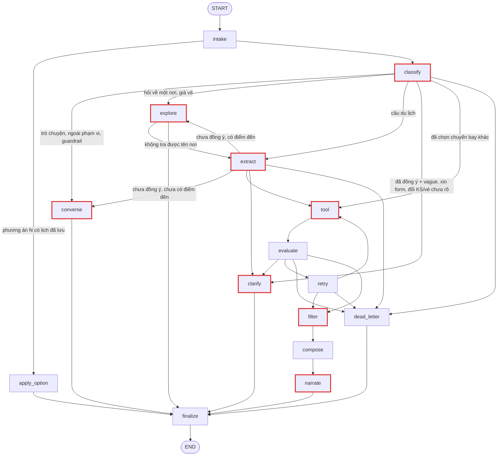

# LangGraph: mười lăm node và vì sao chia như vậy

Agent lập lịch trình là một LangGraph gồm mười lăm node. Tài liệu này giải thích **ý đồ** của cách chia đó — đọc xong bạn nói lại được cho người khác mà không cần mở code. Xem [README](README.md) để chạy demo.

Một lượt gọi API đi qua ba việc: **hiểu người dùng muốn gì**, **lấy sản phẩm thật từ catalog**, và **soạn câu trả lời**. Mỗi node lo một mẩu của ba việc đó, và tất cả cùng đọc/ghi vào một state chung.

## 1. Bốn giai đoạn

Đừng nhớ mười lăm node rời rạc. Nhớ bốn giai đoạn, mỗi giai đoạn trả lời một câu hỏi:

| Giai đoạn | Node | Câu hỏi nó trả lời |
|---|---|---|
| Hiểu người dùng | `intake`, `classify`, `extract` | Đây có phải yêu cầu du lịch không (`classify`), muốn gì và đã đủ thông tin chưa (`extract`)? |
| Lấy dữ liệu thật | `tool`, `evaluate`, `retry`, `filter` | Có sản phẩm thật nào dùng được không, và có điểm nào trùng nhau không (`filter`)? |
| Soạn câu trả lời | `converse`, `explore`, `compose`, `narrate`, `clarify`, `dead_letter` | Nói gì với người dùng? |
| Cửa ra chung | `finalize` | Câu trả lời này có an toàn để gửi đi không? |

Giai đoạn 3 có năm node (`compose` và `narrate` đi liền nhau) vì có đúng bốn tình huống cần nói với người dùng:

- `converse` — **trò chuyện**: chào hỏi, cảm ơn, "chưa biết đi đâu", câu hỏi cách dùng, hoặc việc ngoài phạm vi. Chưa đụng tới
  sản phẩm. Từ 2026-10-10 (FR-AGT-06) việc ngoài phạm vi là câu trả lời thường 200 kèm nút gợi ý (nói rõ không làm được,
  chỉ việc gần nhất làm được); chỉ đầu vào bị guardrail chặn mới trả lỗi 400.
  Xin lên lịch trình mà chưa nói điểm đến hay số ngày **không** thuộc nhóm này — đó vẫn là yêu cầu du lịch, đi `clarify`.
  `converse` không có dữ liệu sản phẩm. Lượt hỏi về một nơi cụ thể (`explore_place`) mà vẫn tới `converse`, tức không tra
  ra nơi đó trong catalog, trả câu cố định "chưa tìm thấy <nơi>, chưa kiểm được giờ, giá". Câu LLM viết không được dùng,
  vì ở chat thử 16 kiểu (M03) LLM từng nói sai "Văn Miếu không mở buổi tối".
- `explore` — **khám phá trước khi lập lịch** (FR-AGT-06, chốt 2026-10-10): "Hà Nội có gì?", "khách sạn nào có hồ bơi?" khi
  người dùng chưa đồng ý lập lịch. Gọi Search, chọn tối đa 4 thẻ bằng luật (mỗi thẻ một lý do đúng trên toàn bộ kết quả,
  `domain/itinerary/exploration.py`), LLM chỉ viết lời dẫn, số do code điền; thêm câu mời lập lịch và nút gợi ý. Xem mục
  "Giai đoạn trò chuyện và khám phá" bên dưới.
- `compose` — **dựng kết quả**: đã có sản phẩm thật, xếp thành lịch trình bằng luật.
- `narrate` — **diễn giải kết quả**: chỉ với `COMPLETED`, LLM viết lời tư vấn như một người lập kế hoạch du lịch (tiêu đề, các mục in đậm, vì sao sắp xếp như vậy). Backend chèn câu ghi nhận thay đổi ("Mình ghi nhận đổi ngày đi thành …") từ `previous_intent` so với `intent`, thay tên sản phẩm bằng tên canonical, điền giá từ dữ liệu và chặn `productId` lạ hoặc số tiền LLM tự viết; không dùng được thì `narration.fallback_message` dựng cùng bố cục bằng luật. Status khác `COMPLETED` đi qua nguyên vẹn.
- `clarify` — **hỏi thêm**: thiếu, sai, mâu thuẫn, loại nơi thay cho điểm đến, hoặc điều kiện bắt buộc không có sản phẩm. Khi nào hỏi gì: [nghiep-vu/hieu-y-dinh-va-hoi-lai.md](nghiep-vu/hieu-y-dinh-va-hoi-lai.md).

**Dòng tiêu đề.** Mọi câu trả lời của `clarify`, `converse` (trừ chào hỏi, cảm ơn), `compose` (`NO_RESULTS`, `FALLBACK`) và `narrate` (`COMPLETED.message`) mở đầu bằng `**Tiêu đề**` tóm tắt cả câu (bảng đầy đủ ở spec Itinerary §4.3). `clarify`/`converse` để LLM trả `title` cùng `message`, `conversation.reply_title` cho tiêu đề cố định khi thiếu; câu cố định (`compose`, chặn bởi guardrail, điều kiện bắt buộc không có sản phẩm) mang tiêu đề ngay trong chuỗi. `llm_context` không đưa dòng tiêu đề của tin nhắn trợ lý cũ cho LLM (xem "Ngữ cảnh cho LLM" bên dưới).
- `dead_letter` — **hỏng có kiểm soát**: lỗi auth, LLM không lập được plan, tool hỏng vĩnh viễn. Trả lỗi đúng chuẩn thay vì che thành thành công. (Điểm đến ngoài catalog **không** vào đây: `clarify` hỏi lại.)

**Phân luồng, trường bắt buộc, câu hỏi gộp và form gợi ý** là luật nghiệp vụ, mô tả ở
[nghiep-vu/hieu-y-dinh-va-hoi-lai.md](nghiep-vu/hieu-y-dinh-va-hoi-lai.md). Ở đây chỉ cần nhớ: `classify` chỉ trả một nhãn (`TurnRoute`), `extract` trích intent (`Extraction`) và quyết định hỏi lại; yêu cầu chỉ có `intentOverride` bỏ qua LLM của `classify`.

**Guardrail tất định (`steps/guardrails.py`), không gọi LLM.** Lớp phân luồng bằng LLM ở trên có thể phân
nhầm một câu vừa hợp lệ vừa chèn lệnh; `classify` chạy thêm một bước mẫu tất định (regex) trước khi gọi LLM —
khớp mẫu chèn lệnh/đòi secret rõ ràng (`ignore ... instructions`, `bỏ qua hướng dẫn trước`, `system prompt`,
`in ra API key`, …) thì chặn ngay, ghi `blocked_by_guardrail` và đi thẳng `converse` mà **không gọi LLM nào**
(`classify` lẫn `converse` sau đó) — rẻ hơn, nhanh hơn, và không đưa câu độc hại vào ngữ cảnh LLM lần nào nữa.
Đối xứng ở `finalize`: câu chữ LLM tự viết (`question`, `error.message`, `message` của `COMPLETED`) lộ chuỗi giống secret hoặc tuyên bố
đã đặt/đã thanh toán thì bị thay bằng câu cố định (với `COMPLETED` là bản dựng bằng luật), giữ nguyên `status`/HTTP. Mẫu cố ý hẹp để không chặn nhầm
câu du lịch hợp lệ.

**Guardrail tầng 1 — lọc rác rule-based (`guardrails.input_quality`, NFR-SEC-04).** Chặn tin nhắn rác hiển nhiên
trước mọi lượt gọi LLM, chi phí ~0, < 1 ms (đề xuất `docs/prd/update-archive/2026-10-01-guardrail-tang-1-rule-based.md`,
đã áp dụng). Không thay thế guardrail chèn lệnh ở trên mà chạy ngay sau nó.

Thứ tự trong `classify`: `_travel_without_message` (chip) → `input_violation` (chèn lệnh) → **`input_quality` (tầng 1)** → LLM.
Rate limit không nằm trong graph mà ở route `/assistant/itineraries*`, trước khi graph chạy.

| Luật (tên trong event) | Cách kiểm | Không coi là rác | Kết quả |
|---|---|---|---|
| `no_content` | Không còn chữ hoặc số (toàn ký hiệu, emoji: "?????", "😀😀") | — | `unclear` |
| `repeated_char` | Bỏ khoảng trắng, dài ≥ 4 và chỉ một ký tự ("aaaaaaa") | Lặp trong từ thật: "okkkkk", "đẹppppp" — gộp chuỗi lặp ≥ 3 về 1 ký tự trước khi xét token | `unclear` |
| `low_alnum_ratio` | Chữ + số < 30% ký tự không phải khoảng trắng ("!!!!!! a") | — | `unclear` |
| `gibberish` | Token hợp lệ < 50% số token chữ ("asdfjkl", "qwerty", "sdfgh jkl qwe"); chỉ xét tin nhắn đầu hội thoại | Câu chỉ có số: "2", "15/10", "10.000.000"; mọi tin nhắn giữa hội thoại (câu trả lời cụt "2 ng", "3n", "t7" để LLM đọc, chat thử M10) | `unclear` |
| `profanity` | Có token trong blacklist và phần còn lại (bỏ từ tục và lời gọi "you/mày/tao/bot…") không còn nội dung hợp lệ | Tục tĩu lẫn trong yêu cầu hợp lệ ("Đà Nẵng 3 ngày đm", "đẹp vl") → cho qua LLM | `abusive` |

Không chặn theo độ dài: "2", "ok", "ừ" là câu trả lời hợp lệ cho `clarify`; độ dài tối đa đã là `maxLength: 1000` trong contract (422).
Blacklist so trên chữ thường giữ dấu; bản không dấu chỉ gồm từ không trùng từ thường ("cac" trùng "các", "buoi" trùng "buổi" nên không có).

**Token hợp lệ** (xét trên chữ thường đã gộp chuỗi lặp; token một chữ cái luôn hợp lệ — "a", "ừ", "n" trong "3n2đ"):

- Âm tiết tiếng Việt kiểm **theo cấu trúc** `phụ âm đầu + vần` trên chữ đã bỏ dấu, không nạp danh sách ~7.000 âm tiết —
  nên câu không dấu ("di da nang 3 ngay") hợp lệ sẵn.
- Viết tắt/teencode (`ko`, `dc`, `j`, `ns`, `ks`, `hcm`, `tr`…) và tiếng cười (`haha`, `kkk`).
- Từ tiếng Anh thông dụng và từ du lịch (contract nhận cả `language=en`).
- Token Latin "đọc được": có nguyên âm, dài ≤ 14 ký tự (đã bỏ dấu), không dồn ≥ 5 phụ âm hoặc ≥ 4 nguyên âm liền, không phải
  gõ dọc một hàng phím ("qwerty", "lkjh") hay dồn hàng giữa ("ajsdhakjsd"). Hai điều kiện độ dài và nguyên âm bắt chuỗi
  spam có dấu nối bằng dấu câu ("pưaiegapòigấ;sldááđăsd…") — để tên riêng/thương hiệu ("VinWonders", "Thác Đray Nur", "Bangkok") và tiếng Anh ngoài
  từ điển đi qua.
- Chữ không phải Latin (Hán, Thái…): không xét.

**Hành vi khi chặn** (không gọi LLM nào, như guardrail chèn lệnh):

- `unclear` → state `unclear_input = <tên luật>`, `converse` trả câu cố định `messages.UNCLEAR_INPUT` ("**Mình chưa hiểu ý bạn**…"),
  `NEEDS_CLARIFICATION` HTTP 200, không có `missingFields`. Không trả 400 vì gõ nhầm không phải vi phạm.
- `abusive` → `blocked_by_guardrail = "abusive:profanity"`, đi nhánh từ chối sẵn có (`REFUSAL_BLOCKED`, 400 `VALIDATION_ERROR`).
- Event `classify` / `guardrail tier1` chỉ ghi tên luật, không ghi câu người dùng.

**Rate limit** (`api/v1/routes/assistant.py`): dùng chung limiter của auth (`RedisRateLimiter`, dev/test `InMemoryRateLimiter`,
gắn vào `app.state.rate_limiter`), scope `assistant:sender` = **10 tin / 60 giây** (`domain/auth/rate_limits.py`). Key là
`cdp_user_id` của Bearer hợp lệ, khách thì `ip:<client_ip>` (`X-Forwarded-For` chỉ được tin khi peer thuộc `TRUSTED_PROXIES`).
Vượt ngưỡng → 429 `TOO_MANY_ATTEMPTS`, `retryable: true`, `details.retryAfterSeconds` và header `Retry-After`; stream trả
429 JSON trước khi mở SSE. Một lượt trợ lý chạy vài giây nên 10 tin/phút chỉ chặn gửi dồn.

Kiểm thử: `tests/unit/agents/test_guardrails.py` (bảng dương/âm, không gọi LLM, và **không câu nào trong
`evaluation/datasets/agent_test_cases_nhat.yaml` bị chặn nhầm**), `tests/contract/test_assistant_rate_limit.py` (429 đã khai báo, đúng ngưỡng).

**Node nào gọi LLM:** chỉ `classify`, `extract`, `tool` (bước chọn tên điểm đến theo catalog và lập tool plan), `filter` (chỉ ra cặp điểm tham quan trùng), `converse`, `clarify` và `narrate`. Mọi lượt gọi LLM (trừ `filter`, chỉ nhận mã + tên điểm tham quan và điểm đến) nhận cùng ngữ cảnh hội thoại qua `steps/history.llm_context`: lịch sử gần nhất (giới hạn 20 message, 8.000 ký tự), chuyến đi đã chốt (`trip_so_far`, `known_constraints`), sản phẩm đã cho xem và câu hỏi gần nhất của trợ lý.

**Ngữ cảnh cho LLM là bản đã diễn giải, không phải dump thô.** Trace thật (01/10/2026): lịch trình cũ kèm giá xuất hiện hai lần trong payload, câu 5 chữ của người dùng chìm giữa đó, `extract` chép giá và tên khách sạn cũ thành ràng buộc mới, còn `clarify` mượn lý do từ chối cũ trong lịch sử. Nay `llm_context` gồm:

| Khoá | Nội dung |
|---|---|
| `trip_so_far` | Chuyến đi đã biết trong một dòng kèm trường còn thiếu (`turn_notes.trip_summary`): "Hà Nội, 3 ngày; chưa có: ngày khởi hành, số người, ngân sách" |
| `stage` | Đã gửi lịch trình (có `previous_selection`), đang hỏi thông tin, hay đầu hội thoại |
| `conversation_history` | Mỗi mục một khoá theo người nói: `user` là tin người dùng nguyên văn, `assistant_did` là **ghi chú theo nghĩa** của tin trợ lý (`note`), không còn cả bài lịch trình kèm giá: "gửi lịch trình Hà Nội 3 ngày", "không dùng được điểm đến "biển": không có trong danh sách điểm đến; hỏi điểm đến". Ghi chú lịch trình không kèm tên sản phẩm: sản phẩm đã cho xem chỉ nằm ở `previous_selection` (kèm id). Trace 02/10/2026: cặp `role`/`content` phẳng và tên sản phẩm lặp ở mỗi ghi chú làm payload dài, dễ đọc nhầm ghi chú trợ lý thành lời người dùng |
| `last_assistant_message` | Câu cuối của trợ lý: nguyên văn khi ≤ 500 ký tự (câu hỏi lại, để hiểu câu trả lời ngắn), ghi chú khi dài hơn (lịch trình) |
| `known_constraints`, `previous_selection` | Như trước |

`finalize` dựng ghi chú bằng luật (`steps/turn_notes.turn_note`, không gọi LLM) từ state đã chốt và lưu kèm tin nhắn trợ lý trong `conversation_history` (khoá `note`, tối đa 300 ký tự). Lịch sử lưu trước khi có ghi chú thì dùng câu gọn ≤ 500 ký tự hoặc dòng tiêu đề. `clarify`/`converse` nhận thêm `this_turn` — ghi chú của chính lượt đang trả lời — để câu trả lời biết vì sao đang hỏi. Message `human` gửi LLM là YAML đọc được (`history.prompt_yaml`: giữ nguyên tiếng Việt, chuỗi nhiều dòng dạng khối `|`, nội dung người dùng được quote nên không phá được cấu trúc), không phải chuỗi JSON. Đây là chỗ hay bị hiểu sai — **`compose` không gọi LLM**, nó xếp lịch bằng quy tắc cố định (mục 5); LLM của `narrate` chỉ viết lời về lịch đã dựng, không chọn hay đổi sản phẩm.

### Giai đoạn trò chuyện và khám phá (FR-AGT-06, chốt 2026-10-10)

Trước khi người dùng đồng ý lập lịch, trợ lý **không hỏi thông tin chuyến và không hiện form**. `classify` thêm nhãn
`explore` và cờ `plan_request`; luật đồng ý gom ở `steps/consent.py` (`plan_consented` xét ở `classify`, `planning_implied` xét sau `extract`); vòng đời các cờ hội thoại (lưu qua lượt, chỉ trong lượt, khi nào bị dọn) ở `steps/phase.py`:

| Người dùng | Đồng ý lập lịch? | Đi đâu |
|---|---|---|
| Đã đồng ý ở lượt trước (`plan_consent`), sửa form/chip, hoặc câu xin lập lịch ("lập lịch", "lên kế hoạch", nút "Lên lịch …") | Có | Như AC-AGT-01: `extract` → hỏi gộp → form → `tool` |
| Trợ lý vừa mời (`pending_offer`) và người dùng nói "ok", "được"… hoặc trả lời bằng thông tin chuyến | Có | Như trên; vừa đồng ý thì hỏi gộp một câu trước, chưa form |
| Nêu thông tin chuyến ngoài điểm đến ("Hà Nội 3 ngày", "đi 3 ngày", "2 người") | Có (`planning_implied`) | Như trên |
| Chỉ nêu hoặc hỏi về một nơi ("Hà Nội", "Hà Nội có gì?") | Chưa | `explore` thẳng, không qua `extract` (bớt một lượt LLM): tra tên nơi trong catalog và tên gọi khác ("hn", "Sài Gòn"), ghi làm điểm đến, kèm câu mời lập lịch lần đầu với nơi đó. Không tra được ("Bangkok có gì?") thì quay lại `extract` một lần (`route_after_explore`); câu có chữ số luôn qua `extract` trước |
| Hỏi về một nơi khi đã đồng ý | Giữ nguyên | `explore` thẳng, chuyến không đổi, nút "Tiếp tục lập lịch" |
| "Không biết" khi chưa có điểm đến | Chưa | Bậc 1 `converse` hỏi kiểu chuyến; bậc 2 `explore` tự chọn điểm đến nhiều sản phẩm nhất (`explore_pick`); bậc 3 ngừng hỏi |
| "Để sau", "không biết" khi đang có lời mời | Chưa | `converse`, xoá lời mời, không hỏi lại |
| "Cứ chọn đại", "tuỳ bạn", "đâu cũng được" khi chưa có điểm đến | Chưa | Luật `_DELEGATE`: `explore` tự chọn ngay (bậc 2), không đợi LLM xếp nhãn |
| Chê một nơi đã gợi ý ("chán, Đà Nẵng đi rồi", "chỗ khác đi") | Chưa | Ghi `rejected_destinations`, bỏ lời mời, `explore` chọn nơi khác; nơi bị chê không vào nút gợi ý; hỏi lại đúng tên nơi đó là đổi ý |
| Hỏi giá vé ("vé ra Hà Nội bao nhiêu?", "vé sg ra hn bao nhiu", "how much is a flight from saigon", "tao ở sài gòn, đi đâu cũng đc miễn vé rẻ", "ngày 20/10 có chuyến sớm không", "tại sao đắt") | Giữ nguyên | Tư vấn vé máy bay (FR-AGT-07, chốt 2026-10-11). LLM của `classify` nhận câu hỏi vé ở mọi cách viết và đọc ra `TurnRoute.fare` (`models.FareQuestion`): nơi đi, nơi đến, đi đâu cũng được, đắt nhất, chuyến về, ngày khác/rẻ hơn, chưa rõ loại vé, ngày bay hỏi (`day`, theo `today`), khung giờ (`time_of_day`: đi sớm < 09:00, sáng 05–12, chiều 12–18, tối ≥ 18:00), "tại sao đắt" (`why`), ngày nào có/không có chuyến (`availability`). Câu chỉ nói "vé" (không máy bay, bay, chuyến bay, hãng) là chưa rõ loại vé, kể cả kèm "đi đâu cũng được": hỏi lại vé máy bay, khách sạn hay vé tham quan, kèm 3 nút. Nhãn `fare` đi `explore`, nhánh giá vé (`fare_question`, `fare_ask`); phần còn lại là luật trong `steps/fares.answer`. Tên nơi được đối chiếu với điểm đến và tuyến bay của catalog (`_place`); chỗ LLM để trống lấy từ `pending_fare`, rồi từ `intent`. Thiếu điểm đến hoặc nơi đi thì hỏi lại kèm nút (nơi đi lấy từ `originCity` của các tuyến). Đủ thì `answer_text` dựng câu gọn chỉ nêu chuyến trả lời câu hỏi: rẻ/đắt nhất cả đợt mở bán; đúng ngày hỏi (các chuyến ngày đó, không có thì ngày gần nhất có chuyến, rồi ngày rẻ nhất cả đợt); trong khung giờ (không có thì nói rõ và tính mọi giờ); đợt mở bán và các ngày chưa có chuyến; "ngày khác" thì các ngày kế tiếp. Chuyến giá minh hoạ (`attributes.simulated`, Thương gia mô phỏng) chỉ tính khi tuyến không còn chuyến giá thật (`_one_way`). `why_text` nói rõ dữ liệu không có hành lý, điều kiện vé, ghế còn lại nên không khẳng định lý do, rồi chỉ nêu số liệu: gấp bao nhiêu lần vé rẻ nhất, so với giá phổ biến (trung vị), khác hạng ghế, giá minh hoạ, khác hãng, bay sát ngày (≤ 7 ngày). Chuyến nêu trong câu là link `[Hãng Số hiệu](product:id)`; tối đa 4 chuyến thật thành `searchResults.flight` (contract 1.25.0) và `candidates` để `finalize` kiểm grounding; widget hiện hàng thẻ ngày–giá, mỗi thẻ mở `/flights` đúng tuyến, đúng ngày. Câu hỏi tiếp "ngày khác", "tại sao đắt" giữ kiểu rẻ/đắt của lần trước; hỏi ngày, giờ, ngày nào có chuyến thì mặc định rẻ nhất. Nút của câu trả lời vé ("Từ TP. Hồ Chí Minh", "Đắt nhất thì sao?", "Ngày nào còn vé?", "Vé máy bay ra Hà Nội rẻ nhất") lưu trong `pending_fare.chips`; bấm (gõ y nguyên) nút đó thì `classify` đi thẳng nhánh vé bằng `fares.chip_reply`, không gọi LLM (chat thử 11/10: LLM hiểu "Từ TP. Hồ Chí Minh" là hỏi Sài Gòn có gì chơi). Sau khi báo giá, `pending_fare` giữ tuyến (`answered`), kiểu (`kind`), chuyến vừa hiện (`shown`). Đã có lịch: câu hỏi về chuyến của lịch ("chuyến bay về mấy giờ") trả lời theo tuyến của chuyến, chiều về đúng ngày cuối; lịch giữ nguyên. Câu gộp nhiều ý: trả lời phần vé, các ý còn lại (`other_questions`) thành nút. Câu **đổi** vé hay khách sạn là `travel`/`changes` |
| Xin form ("cho mình cái form", "đưa mình cái form") | Giữ nguyên/Đồng ý | `TurnRoute.form_request`: coi như đồng ý lập lịch, `clarify` lý do `suggest_form` kèm form điền sẵn ngay lượt này (`conversation._form_shown`); câu có kèm thông tin chuyến thì `extract` ghi trước, form vẫn hiện (chat thử 11/10: trợ lý hỏi lại bằng chữ) |
| "Đổi sang chỗ khác", "đổi địa điểm" chưa nêu nơi mới | Giữ nguyên | `extract` (`change_without_value = ["destination"]`) hỏi "đổi sang đâu" trước mọi câu hỏi phần còn thiếu, không form; 3 nút "Đổi sang <nơi>" là điểm đến khác của catalog, chữ nêu đúng các nơi đó (`conversation.destination_choices`, chat thử 11/10: từng ra form điền sẵn điểm đến cũ kèm "còn thiếu số ngày") |
| Hỏi về một nơi mà chưa rõ thành phố ("có khách sạn nào có hồ bơi gần phố cổ không?") | Giữ nguyên | `explore`: tên nơi LLM đọc ra (`explore_place`: "phố cổ") khớp nơi ở nhiều thành phố của catalog thì hỏi "Bạn muốn nói Khu Phố Cổ Hà Nội hay Phố cổ Hội An?" kèm một nút mỗi nơi (tên catalog, `ask_which_place`); không tra được nơi thì `extract` → `converse` hỏi lại. Câu hỏi gốc lưu ở `open_question`, những gì LLM hiểu ở câu đó (chỗ ở, giá rẻ) ở `open_understood`; lượt sau trả lời ngắn nêu điểm đến ("hà nội cha ơi") thì `explore` trả lời câu hỏi gốc ở đó. "gần <nơi>" khi hỏi chỗ ở: câu tìm khách sạn kèm "gần <nơi>", tìm thêm chính nơi đó làm mốc và chỉ giữ khách sạn trong 1,5 km quanh mốc (lý do `near`) |
| Hỏi về chính một nơi ("Văn Miếu buổi tối có mở không?") hoặc quanh nơi đó ("gần Văn Miếu có gì nữa?") | Giữ nguyên | `explore.pick`: chỉ thẻ nơi đó, câu đầu trả lời thẳng (`asked_only`); hỏi quanh nơi đó thì các điểm tham quan gần nhất (≤ 3 km), không lặp nơi đó, không chen khách sạn |
| Hỏi về một nơi bằng tên dân gian, gõ sai, không nêu thành phố ("Văn Miếu buổi tối có mở không?", "lăng bác mấy giờ mở cửa", "văn miếu tối mở ko b", "chợ bến thành mở tới mấy giờ") | Chưa | LLM của `classify` đọc ra tên nơi thường dùng (`explore_place`, ví dụ "Lăng Chủ tịch Hồ Chí Minh"), thành phố (`explore_city`), loại nơi (`explore_focus`) và việc có hỏi giá không (`explore_price`). `explore` dùng thành phố đó nếu nó là điểm đến của catalog, kể cả khi đang nói về thành phố khác. Không có thành phố thì tìm nơi đó trên cả catalog (`place_destination`) và lấy điểm đến của chính sản phẩm khớp tên. Câu tìm nơi là tên LLM đọc ra, đã bỏ tên thành phố (`place_query`), vì Search hiểu "Hồ Chí Minh" trong tên là điểm đến và hiểu "ko" là phủ định. Khớp tên bằng `named_in`; không khớp thì lấy tên gần nhất (`closest_named`). Payload LLM có giờ mở cửa, vé vào và địa chỉ của nơi được hỏi (`facts.entry`, `facts.ticketPrice`, `facts.address`); người dùng hỏi giá mà LLM không nêu thì code thêm câu giá. "ở đâu" chỉ là hỏi chỗ ở khi câu không nêu nơi nào ("chùa thiên mụ ở đâu" là hỏi vị trí, trả lời bằng địa chỉ catalog). Không tra ra nơi được hỏi: payload có `place_not_found`, LLM tự nói bằng lời của mình là không kiểm được nơi đó; lượt đi `converse` mà câu LLM có giờ, giá hoặc nói về giờ/giá/vé mà không nhận là không kiểm được thì thay bằng câu cố định (`conversation._claims_a_fact`) |
| Hỏi khách sạn rẻ nhất/đắt nhất ("rẻ nhất là chỗ nào", "còn đắt nhất") | Giữ nguyên | `explore_price` = `cheap`/`dear`. Không kèm "gần <nơi>": thẻ lấy từ danh sách khách sạn còn phòng của cả điểm đến xếp theo giá (`GET /products?sort=price_asc|price_desc`, `exploration.price_listing`), LLM được nói là rẻ/đắt nhất điểm đến (`price_scope = city`). Có "gần <nơi>": chỉ trong các khách sạn tìm được quanh nơi đó, LLM nói rõ phạm vi (`price_scope = found`). Lý do thẻ `cheapest`/`low_price`, `dearest`/`high_price` (chat thử M04) |
| Hỏi chọn điểm đến theo loại nơi ("đi biển", "chỗ nào mát mát") | Chưa/Giữ nguyên | `clarify` (lý do `destination_kind`): LLM nêu vài điểm đến của catalog hợp loại đó; mỗi điểm đến được nêu thành một nút (tối đa 3, `conversation._with_destination_buttons`) |
| Ngày đi ngoài cửa sổ mở bán (vé máy bay, khách sạn, vé tham quan đều thiếu vì ngày) | Giữ nguyên | `compose` tính một ngày đi chung gần nhất có đủ vé hai chiều, khách sạn cho cả chuyến và vé tham quan còn bán tới ngày về (`flights.joint_start`); câu mở đầu, mục vé máy bay và mục khách sạn cùng gợi ý ngày đó (chat thử M09) |

Khi đã đồng ý lập lịch:

- **Sở thích khách sạn** (hồ bơi, phù hợp trẻ nhỏ, view biển, có bữa sáng, spa; `domain/itinerary/preferences.py`) là
  **ưu tiên**: nằm trong `intent.interests`, không trong `constraints.hotel_attributes` (bộ lọc bắt buộc; catalog thật chỉ ghi
  tiện ích dạng chuỗi nên cờ bắt buộc sẽ loại gần hết khách sạn). Câu hỏi gộp mời nói sở thích; form có ô `interests` chọn
  nhiều (`interestOptions`, tích sẵn "Phù hợp trẻ nhỏ" khi có trẻ em); câu "ưu tiên …" được `extract` giữ mềm. Sở thích vào câu
  tìm khách sạn (`search_hints`) và lọc mềm ở `evaluate` (chỉ bỏ khách sạn không hợp khi còn ít nhất 3 khách sạn hợp).
- **Ngày đã chọn không có chuyến bay:** câu cảnh báo vé nêu thêm tối đa 2 ngày gần nhất có vé, giữ số ngày của chuyến, ngày
  đủ hai chiều trước (`domain/itinerary/flights.nearest_dates`, dữ liệu là chuyến `flight_options` đã tải, không tra thêm).
- **Đổi khi chưa nói đổi thế nào** (`steps/changes.py`, luật tất định chạy trong `classify` trước LLM, không gọi LLM):
  - "đổi khách sạn" trơn khi lịch đang hiện có phương án khác → `clarify` (lý do `choose_stay`, câu cố định) liệt kê các
    phương án kèm chênh tiền và km; nút "Lấy phương án N" vào `apply_option` như bấm hàng thẻ. Câu có hướng ("rẻ hơn", "gần
    biển") hoặc "bạn chọn giúp" thì đi `extract` như trước (loại khách sạn đang chọn rồi lập lại lịch).
  - "đổi chuyến bay", "đổi vé" → `clarify` (lý do `choose_flight`) liệt kê chuyến khác cùng ngày của từng chặng
    (`previous_flights`, do `compose` dựng bằng `flights.flight_choices`), mỗi chuyến một nút, thêm nút "Đổi ngày đi". Câu đã nói
    rõ — bấm nút có số hiệu, "chuyến về muộn hơn/sớm hơn/rẻ hơn", "bạn chọn giúp" — thì `classify` chọn luôn chuyến đó
    (`constraints.chosen_flights`) và đi thẳng `tool` để lập lại lịch (giờ bay đổi thì cửa sổ ngày đến, ngày về đổi);
    `choose_flights` ưu tiên chuyến đã chọn nếu còn bán đúng ngày. Không có chuyến hợp ý thì nói rõ và vẫn đưa danh sách.

Nút gợi ý (`suggestions`, tối đa 3) ở lượt trò chuyện và khám phá: LLM đề xuất, `exploration.checked_suggestions` bỏ nút
rỗng, dài, lặp nút lượt trước hoặc trùng mẫu câu (bỏ tên điểm đến và chữ số rồi so), luôn có một nút đi tiếp khi chưa có
nút xin lập lịch, thiếu thì bù nút mẫu. Response khám phá là `NEEDS_CLARIFICATION` có `searchResults` (contract 1.24.0);
`finalize` kiểm từng thẻ là đúng sản phẩm Search lượt đó và link trong câu chỉ trỏ tới các thẻ đó.

## 2. Vì sao mọi nhánh đều đi qua `finalize`

Nhìn sơ đồ sẽ thấy `converse`, `narrate`, `clarify` và `dead_letter` đều trỏ vào `finalize`. Đây không phải trùng lặp mà là chủ ý: **graph có nhiều đường vào nhưng chỉ một đường ra.**

Bốn node kia đều *soạn* response, nhưng **không node nào được tự trả response đó ra ngoài**. Tất cả phải qua `finalize`.

### `finalize` làm gì

Những việc phải xảy ra **đúng một lần cho mọi response, bất kể đi nhánh nào**:

| Việc | Vì sao phải đặt ở cửa ra chung |
|---|---|
| Kiểm schema OpenAPI | Client sinh từ OpenAPI sẽ vỡ nếu bất kỳ nhánh nào trả sai hình dạng |
| Kiểm grounding (`validate_plan`) | Mọi sản phẩm phải có trong `candidates`. Đây là cam kết grounding 100% — không được có một nhánh nào lách qua |
| Kiểm guardrail đầu ra (`guardrails.output_violations`) | Câu chữ LLM tự viết (`question`/`error.message`) không được lộ secret hay tuyên bố đã đặt/đã thanh toán (NFR-SEC-01) |
| Đo `latency_ms` | Chỉ đo được ở điểm cuối cùng |
| Lưu hội thoại | Redis giữ working memory 24 giờ; với user đăng nhập, Postgres archive lượt chat để Web mở lại. Archive lỗi không làm hỏng response |
| Sinh `final_answer` | Một chỗ duy nhất quyết định text hiển thị cho người dùng |

Cách để nhớ: **giống cổng an ninh sân bay.** Khách đến từ nhiều quầy check-in khác nhau, nhưng mọi người đều phải qua đúng một cổng soi chiếu. Lắp máy soi ở từng quầy thì vừa tốn, vừa chắc chắn có quầy quên lắp.

### Nếu không có `finalize` thì sao

Mỗi node phải tự kiểm lấy. Hai hậu quả:

1. Logic kiểm bị lặp bốn lần, sửa một quy tắc phải sửa bốn chỗ.
2. Nguy hiểm hơn: thêm một node mới mà quên copy phần kiểm là có ngay một đường thoát không ai canh. Với cam kết grounding 100%, đây đúng là loại lỗi không được phép mắc.

### `finalize` có quyền phủ quyết

Điểm dễ nhầm nhất: `finalize` **không chỉ đóng dấu**. Nó có quyền bác.

Một response `COMPLETED` không qua được `validate_plan` sẽ bị nó thay bằng lỗi `ITINERARY_VALIDATION_FAILED` (HTTP 500). Nghĩa là backend tự nhận lỗi của mình, thay vì đưa cho người dùng một lịch trình chưa được kiểm chứng. Thà báo lỗi còn hơn trả dữ liệu không có căn cứ.

## 3. Bảy ví dụ

Đi từ câu người dùng gõ, không phải từ tên node:

| Người dùng gõ | Đường đi | Ý được minh họa |
|---|---|---|
| "chào bạn" | `intake → classify → converse → finalize` | Trò chuyện, chưa đụng tới sản phẩm |
| "đi 3 ngày" (thiếu điểm đến) | `intake → classify → extract → clarify → finalize` | Thiếu thông tin thì hỏi, không đoán |
| "gợi ý cho tôi một chuyến đi" | `intake → classify → extract → clarify → finalize` | Chưa nói gì vẫn là yêu cầu du lịch, không phải trò chuyện |
| "Nha Trang 2 ngày" (chưa nêu ngày đi, số người, ngân sách) | `intake → classify → extract → clarify → finalize` | Đủ điểm đến và số ngày: hỏi gộp một câu những gì còn thiếu trong ngày đi, số người, ngân sách; hỏi một lần, chưa gọi tool |
| "Nha Trang 2 ngày" rồi trả lời bất kỳ (hoặc câu đầu đã đủ chi tiết) | `intake → classify → extract → tool → evaluate → filter → compose → narrate → finalize` | Luồng đầy đủ |
| "Paris 2 ngày" | `intake → classify → extract → tool → evaluate → dead_letter → finalize` | Ngoài catalog, dừng trước khi gọi Search |
| "Nha Trang 3 ngày từ hôm qua" | `intake → classify → extract → clarify → finalize` | Ngày đi đã qua: hỏi lại ngày (dòng đầu in đậm, LLM viết lý do và gợi ý), không gọi tool |
| "đi Vũng Tàu 1 ngày" (ngoài catalog) | `intake → classify → extract → tool → evaluate → clarify → finalize` | `tool` đối chiếu danh sách điểm đến rồi dừng (chưa Search); `evaluate` bỏ qua; hỏi lại điểm đến kèm danh sách hỗ trợ |
| "Nha Trang 2 ngày, khách sạn 5 sao" (không có) | `… → evaluate → clarify → finalize` | Điều kiện bắt buộc không đạt thì hỏi, không tự bỏ |
| Search lỗi mạng | `… → evaluate → retry → tool → evaluate → …` | Thử lại, tối đa một lần |

**Bảy tình huống khác hẳn nhau, nhưng cột nào cũng kết thúc bằng `finalize`.** Đó là mục 2 nhìn từ phía dữ liệu thật.

Sơ đồ đầy đủ — mỗi luồng một đường thẳng, không rẽ nhánh, điều kiện ghi ở cuối dòng:

```text
START → intake → classify → extract → tool → evaluate → filter → compose → narrate → finalize → END   (có candidate hợp lệ)
START → intake → classify → extract → tool → evaluate → filter → compose → narrate → finalize → END   (không có kết quả, NO_RESULTS: `filter`, `narrate` bỏ qua)
START → intake → classify → extract → tool → evaluate → clarify    → finalize → END   (vi phạm điều kiện bắt buộc)
START → intake → classify → extract → tool → evaluate → retry → tool → evaluate → …  → finalize → END   (lỗi tạm thời, thử lại tối đa một lần)
START → intake → classify → extract → tool → evaluate → dead_letter → finalize → END  (lỗi vĩnh viễn/auth)
START → intake → classify → extract → clarify             → finalize → END  (thiếu destination/days, mâu thuẫn, hoặc điều kiện không xác minh được)
START → intake → classify → converse                      → finalize → END  (chào hỏi, cảm ơn, hoặc yêu cầu ngoài phạm vi — không gồm yêu cầu du lịch thiếu chi tiết)
START → intake → classify → explore                       → finalize → END  (hỏi về một nơi, hỏi giá vé, "cứ chọn đại"; FR-AGT-06, FR-AGT-07)
START → intake → classify → explore → extract → …          → finalize → END  (explore không tra được tên nơi: quay lại extract một lần)
START → intake → classify → extract → explore              → finalize → END  (chưa đồng ý lập lịch, đã có điểm đến)
START → intake → classify → clarify                        → finalize → END  (đã đồng ý mà "không biết", xin form, đổi khách sạn/chuyến bay chưa rõ)
START → intake → classify → tool → evaluate → …            → finalize → END  (đã chọn chuyến bay khác bằng luật, lập lại lịch)
START → intake → apply_option                              → finalize → END  (bấm/gõ "phương án N" có lịch đã lưu)
START → intake → classify → dead_letter                    → finalize → END  (request lỗi hoặc LLM classify lỗi)
```

Dòng thứ tư (`retry`) tự nó rẽ tiếp thành ba luồng thẳng, theo `route_after_retry` (`src/backend/app/agents/routing.py`):

```text
… → evaluate → retry → tool → evaluate → filter → compose → narrate → finalize → END   (thử lại lần hai thành công)
… → evaluate → retry → filter → compose → narrate              → finalize → END   (fallback: dùng candidate cũ, không gọi lại tool)
… → evaluate → retry → dead_letter                   → finalize → END   (decision=error, hoặc đã hết số lần thử lại)
```

### 3.1. Sơ đồ mermaid

Cùng nội dung sơ đồ trên, vẽ bằng mermaid theo đúng cạnh trong `agents/graph.py` và điều kiện trong `agents/routing.py`. Node có viền đậm là node **có gọi LLM** (`classify`, `extract`, `tool` khi cần khớp destination hoặc lập plan, `filter` khi còn từ hai điểm tham quan, `converse`, `explore` khi viết lời dẫn thẻ — nhánh giá vé không gọi LLM, `clarify`, `narrate`); các node còn lại thuần rule-based.



## 4. Đọc bảng trace của Streamlit

Bảng bên phải màn hình demo là trace của **một lượt gọi API qua SSE**, theo đúng thứ tự event backend phát ra. Mỗi dòng là một node đã kết thúc; bảng không hiển thị raw state, prompt, token, JWT hay payload nội bộ.

| Cột | Cách đọc |
|---|---|
| `sequence` | Thứ tự event trong lượt chạy, bắt đầu từ 1. Không phải số thứ tự cố định của node trong mọi luồng. |
| `nodeId` | Tên node vừa hoàn tất. Node không đi qua trong lượt này sẽ không có dòng. |
| `outcome` | Trạng thái thực thi. `completed` chỉ có nghĩa node đã chạy xong; **kết quả nghiệp vụ vẫn phải xem response**. |
| `message` | Tóm tắt việc node vừa làm. Ví dụ `tool` ghi `retrieval completed (normalized destination)` khi tên điểm đến được đổi thành tên catalog. |
| `durationMs` | Thời gian chạy của chính node đó (wall-clock, gồm cả lúc chờ LLM/tool), lấy từ `latency_ms` của event — `build_graph` bọc mọi node bằng `timed()` để đo. Không gồm overhead cập nhật state giữa các node. Event nào thiếu `latency_ms` mới lùi về thời gian quan sát tại biên SSE. Tối thiểu 1 ms. |

Các điểm cần nhớ khi đọc trace:

- Không thấy `tool` nghĩa là agent **chưa truy xuất sản phẩm nào**; thường do thiếu `destination`/`days` (đi qua `clarify`), trò chuyện hoặc bị từ chối (đi qua `converse`).
- Thấy `converse` thì chắc chắn lượt đó **không có sản phẩm nào**; thấy `compose` thì chắc chắn **đã có dữ liệu thật**. Đây là lợi ích của việc tách hai node.
- `compose` không đồng nghĩa với `COMPLETED`: nó còn tạo `NO_RESULTS` và `FALLBACK`.
- `compose` không gọi LLM nên `durationMs` của nó chỉ vài mili giây, và cùng một tập candidate luôn cho cùng một lịch trình. `narrate` đứng ngay sau và có gọi LLM; `skipped (no itinerary)` nghĩa là lượt đó không phải `COMPLETED`, còn `narration fallback by rules` nghĩa là câu của LLM không dùng được (lý do ở `metadata.reason`: `llm_failed`, `unknown_product`, `raw_money`, ...).
- Có `retry` nghĩa là retrieval gặp lỗi tạm thời; graph chỉ cho retry một lần để tránh vòng lặp vô hạn.
- Chỉ `run.completed.response` và kết quả ở `finalize` mới cho biết trạng thái API cuối cùng. `completed` ở từng node **không phải** kết luận PASS của evaluation.
- Trace chạy fixture chỉ chứng minh luồng local và grounding vào fixture; **không** chứng minh availability, giá hiện tại, chất lượng Search hay latency production.

## 5. Quy tắc xếp lịch của `compose`

Luật nghiệp vụ (chọn chỗ ở, hoạt động, rải ngày, tối ưu quãng đường, đổi khách sạn, ngân sách, phương án khác, buổi theo
giờ bay, dòng `TRANSFER`, gói nhiều ngày, tiền) nằm ở
[nghiep-vu/xep-lich.md](nghiep-vu/xep-lich.md). Về kỹ thuật: `compose_plan` → `render_proposal` → `validate_plan`
(`domain/itinerary/planning.py`), gọi từ `steps/composition.composed`; hai hàm sau bác đề xuất của hàm đầu là lỗi
backend, `compose` trả `FALLBACK` và log `itinerary.composition_failed`. Khoảng cách (`domain/itinerary/geo.py`) và tối
ưu quãng đường (`domain/itinerary/routing.py`, `optimize`) là hàm thuần trên toạ độ của `candidates`, không gọi mạng;
`composed` tính tiền vé đã chọn (`flights.flight_cost`) và truyền vào `compose_plan(..., fixed_cost)` để trừ vào ngân sách.
Proposal có `criteria = "DISTANCE"`, `stays` theo đêm, `distance_km` và `options` (phương án khác) khi luật khoảng cách
được dùng; `composed` khi đó thêm warning `PLAN_CRITERIA` và `STAY_OPTIONS` (văn bản dựng bằng code, mọi số do code tính)
để `narrate` chèn mục "Cách mình xếp lịch" và "Phương án khác" trước mục chi phí, và ghi `stay_options` vào state để
`finalize` lưu thành `previous_options` cho lượt "lấy phương án N". Mỗi phương án còn được dựng thành lịch đầy đủ
(`render_proposal` + `validate_plan`, cùng vé bay) để trả trong `stayOptions` (contract 1.20.0) và để lượt chọn lấy ra.

**`filter`** (node thứ mười bốn, AC-AGT-04, chốt 2026-10-08, đề xuất `docs/prd/update-archive/2026-10-08-loc-trung-lap-bang-llm.md`):
`evaluate`/`retry` → `filter` → `compose`. Bỏ điểm tham quan trùng trước khi xếp lịch, hai bước: luật cùng tên
(`domain/itinerary/dedupe.same_name_pairs`, so trên `fold`), rồi LLM nhận mã + tên các điểm tham quan còn lại
(`FILTER_PROMPT`, `DuplicatePairs`) và trả mọi cặp mã trùng, mỗi cặp có `reason` rồi `duplicate`; chỉ cặp `duplicate=true`
được áp. `dedupe.apply_pairs` bỏ qua cặp có mã lạ hay không phải điểm tham quan, duyệt mã theo `planning.keep_rank` (Search
trước Recommendation, rẻ hơn, mã nhỏ hơn) và chỉ bỏ một mã khi nó cặp với một mã đang được giữ. Không bắc cầu: combo
"Water Taxi + Bảo Tàng Gấu" trùng với từng vé lẻ nhưng không làm hai vé lẻ thành trùng nhau (trace 08/10/2026). Mã bị bỏ ra khỏi `candidates` (nên cũng không vào phương án khác), ghi vào `dropped_duplicates` và có cảnh báo
`PRODUCT_DROPPED_DUPLICATE`. LLM lỗi hoặc quá `ITINERARY_LLM_TIMEOUT_SECONDS` (như các node LLM khác) thì chỉ dùng phần luật; lượt không đi tới
lịch (`decision` khác `compose`) hoặc còn dưới hai điểm tham quan thì không gọi LLM. Event `filter`: `metadata.reason`
(`llm`/`llm_failed`/`rule_only`), `by_rule`, `by_llm`.

**`apply_option`** (node thứ mười ba, chốt 2026-10-08): `intake` → `route_after_intake` → `apply_option` → `finalize` khi
request có `selectStayOption` hoặc câu "lấy phương án N" và lượt trước đã lưu lịch của phương án đó
(`option_swap.chosen_option`). Không phân luồng, không tool, không LLM: lấy lịch đã lưu, đổi chỗ với lịch đang chọn,
tính lại chênh km/tiền (bấm thẻ: không lời đáp, không thêm lượt hội thoại; gõ "lấy phương án N": lời đáp ngắn do code dựng), nạp sản phẩm của các lịch đã lưu làm `candidates` để `finalize`
kiểm grounding như mọi lượt.

## 6. Bảng tra cứu mười lăm node

Dùng khi đã nắm bức tranh chung ở trên và cần tra chi tiết một node. Tóm tắt hành vi trước, bảng field-level ở dưới cùng cho tên field thật trong `AgentState` (`agents/state.py`) — khớp `agents/nodes.py` (hàm node) và `agents/steps/` (luật chi tiết) tại thời điểm viết, `git blame`/`git log -p` mới là nguồn xác thực khi code đã đổi.

| Node | Nhận vào | Trả ra | Đi tiếp |
|---|---|---|---|
| `intake` | Message của người dùng, `conversationId` (nếu có), `selectStayOption` (nếu bấm thẻ phương án). | State khởi tạo: message đã chuẩn hóa, `conversationId`, intent, lịch sử chat, `previous_options`/`previous_plan` đã lưu của hội thoại. | `apply_option` nếu chọn đúng một phương án có lịch đã lưu (`route_after_intake`); còn lại `classify` |
| `apply_option` | `select_stay_option` hoặc câu "lấy phương án N", `previous_plan`, `previous_options`. **Không gọi LLM, không tool.** | `COMPLETED` với lịch đã lưu của phương án, `stayOptions` mới (lịch vừa bỏ thành một phương án), lời đáp ngắn chỉ khi gõ tay, `constraints.specific_hotel`; sản phẩm của các lịch đã lưu làm `candidates` cho `finalize`. | `finalize` |
| `classify` | Message mới và ngữ cảnh hội thoại chung. Guardrail tất định (regex) chạy trước; khớp thì bỏ qua LLM; luật đổi khách sạn/chuyến bay (`steps/changes.py`) cũng chạy trước LLM. Còn lại **gọi LLM** (prompt ngắn, một nhãn). | `decision` (`travel`/`missing_info`/`simple`/`error`), `interaction_type` (`travel`/`conversation`/`out_of_scope`), `refusal`, `blocked_by_guardrail` (nếu guardrail chặn); với nhánh trò chuyện thêm `missing_fields` của chuyến đi đã lưu; nhãn `vague` thêm `clarification_reason="suggest_form"`, `missing_fields`, `start_date_asked`. | `extract` nếu du lịch; `clarify` nếu `vague` và còn thiếu trường bắt buộc; `converse` nếu trò chuyện hoặc ngoài phạm vi; `dead_letter` nếu LLM lỗi |
| `extract` | Message mới, ngữ cảnh hội thoại chung, `intentOverride`, `start_date_asked`. **Gọi LLM.** | Intent/constraints (`destination`, `days`, `startDate`, `party`, `budget`...), các trường còn thiếu, `start_date_asked`. | `tool` nếu đủ `destination` + `days` và đã xử lý chi tiết chuyến đi; `clarify` nếu thiếu, chưa hỏi chi tiết, mâu thuẫn hoặc có điều kiện không xác minh được; `dead_letter` nếu intent không hợp lệ hoặc LLM lỗi |
| `tool` | Intent/constraints và lịch sử chat; ở lượt đổi món thêm `previous_selection`. **Có thể gọi LLM** để khớp tên điểm đến với catalog hoặc lập tool plan. | Tên điểm đến đã chuẩn hóa, kết quả Search/Recommendation/ProductDetail (hoặc lỗi) trong `tool_results`; chỉ ở lượt đổi món (có `previous_selection`) mới có thêm kết quả Similar. Có nơi đi thì tra chuyến bay song song, không qua LLM (`flight_options`, spec Itinerary §2.7). Điểm đến ngoài catalog thì xoá điểm đến khỏi intent, ghi `invalid_inputs` và `decision = "invalid_input"` (chưa gọi Search; hỏi lại kèm danh sách điểm đến hỗ trợ). | `evaluate` |
| `evaluate` | `tool_results` và intent. | Danh sách candidate hợp lệ có nguồn grounding, hoặc phân loại: `compose`, `no_results`, `fallback`, `constraint_clarification`, lỗi tạm thời/vĩnh viễn. Lỗi mềm của Similar không tính vào phân loại này: 404/409 luôn mềm; 503/timeout (mode `http`: mọi 5xx và lỗi kết nối) mềm khi có `search_products` trả dữ liệu (spec Itinerary §2.5). | `filter`, `clarify` (khi `constraint_clarification`), `retry` hoặc `dead_letter` |
| `retry` | Lỗi tool tạm thời và số lần đã thử. | Quyết định thử lại (tối đa một lần), dùng fallback hoặc báo lỗi. | `tool`, `filter` hoặc `dead_letter` |
| `converse` | Message mới, lịch sử chat, loại tương tác, cờ từ chối, `plan_consent`, `dont_know_count`, `pending_offer`, `last_suggestions`. **Gọi LLM**, trừ khi `blocked_by_guardrail` đã đặt ở `classify` — khi đó dùng thẳng câu cố định, không gọi LLM. | Câu trả lời trò chuyện (`NEEDS_CLARIFICATION` kèm `missingFields`, nút `suggestions` khi `offer_suggestions`); ngoài phạm vi cũng là câu trả lời 200 (FR-AGT-06); chỉ guardrail chặn mới là `VALIDATION_ERROR` 400. LLM lỗi thì dùng câu cố định. | `finalize` |
| `explore` | Message mới, `intent`, `plan_consent`, `pending_offer`, `offered_destinations`, `last_suggestions`, `explore_pick`, `fare_question`, `pending_fare`. **Gọi Search và LLM** (`ExploreNarration`); nhánh giá vé chỉ gọi GET /products, không LLM. Lời dẫn: mỗi thẻ một dòng nói nơi đó có gì hay (từ `about`/`tags`); điểm, lượt đánh giá, giờ mở cửa, giá không vào câu (giờ chỉ cho nơi được hỏi, giá chỉ khi hỏi giá). | `NEEDS_CLARIFICATION` có `searchResults` (tối đa 4 thẻ do luật chọn), `suggestions`, câu mời lập lịch hoặc nhắc tiếp tục; `candidates` cho `finalize`; `pending_offer`, `offered_destinations`; điểm đến của chuyến khi chưa đồng ý. LLM lỗi thì lời dẫn do code dựng. | `finalize`; `extract` khi đi thẳng từ `classify` mà không tra được tên nơi (`decision = needs_extract`) |
| `filter` | Candidate đã evaluate, `sources`. **Gọi LLM** khi còn từ hai điểm tham quan sau bước luật (chỉ mã + tên). | `candidates` đã bỏ điểm tham quan trùng, `dropped_duplicates`, cảnh báo `PRODUCT_DROPPED_DUPLICATE`. LLM lỗi thì chỉ dùng luật cùng tên. | `compose` |
| `compose` | Candidate đã evaluate và lọc trùng (chỉ `hotel`, `attraction`, `golf`). **Không gọi LLM.** | Lịch trình `COMPLETED` dựng bằng `compose_plan`, hoặc `NO_RESULTS`, `FALLBACK`. | `narrate` |
| `narrate` | Lịch trình `COMPLETED` vừa dựng, `intent` và `previous_intent`, ngữ cảnh hội thoại chung. **Gọi LLM** (`ItineraryNarration`), bỏ qua với status khác `COMPLETED`. | `response.message` (tiêu đề, câu ghi nhận thay đổi, các mục, link sản phẩm, giá điền từ dữ liệu) và `response.itinerary.title`. LLM lỗi, quá hạn hoặc viết id lạ/số tiền tự đặt thì dùng bản dựng bằng luật. | `finalize` |
| `clarify` | Lịch sử chat, trường còn thiếu (`missing_fields`), `clarification_reason` (`conflict`/`unverified`/`suggest_form`/`invalid_input`/`change_without_value`/`destination_kind`), hoặc `decision = constraint_clarification`. **Gọi LLM** để viết câu hỏi — riêng `constraint_clarification` dùng câu cố định. | `NEEDS_CLARIFICATION` kèm `knownIntent` (và `missingFields` nếu có; `clarificationForm` khi `clarification_reason = suggest_form`). LLM lỗi hoặc timeout thì dùng câu cố định theo đúng lý do. | `finalize` |
| `dead_letter` | Lỗi auth, tool plan/argument hoặc upstream. | `ErrorResponse` chuẩn, không che lỗi thành thành công. | `finalize` |
| `finalize` | Response từ một trong bốn node soạn và lịch sử chat trước lượt này. | Response cuối đã validate schema và grounding, kèm latency; nối cặp user/assistant rồi lưu conversation nếu thành công. Validation lỗi thành `ITINERARY_VALIDATION_FAILED`. Câu chữ LLM tự viết lộ secret/tuyên bố đã đặt/thanh toán thì bị thay bằng câu cố định (guardrail đầu ra), giữ nguyên `status`/HTTP. | `END` |

### 6.1. Field-level: từng node đọc field nào, ghi field nào

`state.X` là field đọc từ `AgentState` khi vào node; `ghi X` là key trong dict node trả về (LangGraph merge vào state chung — `events` là append-only, còn lại bị ghi đè). Route lấy từ `routing.py`; năm node router (`route_after_intake/classify/extract/evaluate/retry`) không phải node, chỉ đọc field `decision` do node đứng trước nó vừa ghi.

| Node | Đọc (`state.*`) | Gọi LLM | Ghi | Routing tiếp theo |
|---|---|---|---|---|
| `intake` | `query`/`message`, `conversation_id`, `conversation_history`, `intent`, `constraints`, `previous_selection`, `max_attempts`, `language`; async thêm: tra `conversation_id` qua `store` | Không | `query`, `conversation_id`, `conversation_history` đã làm sạch/giới hạn, `intent`, `constraints`, `previous_selection`, `attempt=0`, `max_attempts` (≤2), `tool_plan=[]`, `tool_results=[]`, `details={}`, `detail_errors={}`, `supported_destinations=None`, `candidates={}`, `sources={}`, `response={}`, `warnings=[]`, `missing_fields=[]`, `interaction_type=""`, `refusal=False`, `final_answer=None`, `http_status=200`, `decision=""`, `validation_issues=[]`, `started_at`, `language`, `events`. Async: không thấy `conversation_id` trong store → `decision="error"` (`CONVERSATION_NOT_FOUND`, 404); thấy → ghi đè `intent`/`constraints`/`language`/`previous_selection`/`conversation_history` từ bản lưu | → `classify` (cạnh cố định) |
| `classify` | `decision` (bỏ qua LLM nếu đã `"error"`), `query`, `intent_override` (không có `query` mà có override thì bỏ qua LLM), ngữ cảnh `llm_context` (`trip_so_far`, `stage`, `conversation_history`, `last_assistant_message`, `known_constraints`, `previous_selection`) | **Có** — `TurnRoute` (`CLASSIFY_PROMPT`), trừ khi `query` khớp mẫu guardrail (`guardrails.input_violation`, tất định, không LLM) | `decision` (`travel`/`missing_info`/`simple`/`error`), `interaction_type`, `refusal`, `missing_fields` (nhánh `simple` và `vague`), `clarification_reason`, `start_date_asked`, `clarification_rounds` (nhánh `vague`), `blocked_by_guardrail` (mẫu khớp, nếu guardrail chặn), `events`. Lỗi: `LLM_UNAVAILABLE` | `decision="travel"→extract`; `"missing_info"→clarify`; `"simple"→converse`; `"error"` hoặc khác→`dead_letter` |
| `extract` | `query`, ngữ cảnh `llm_context`, `intent_override`, `start_date_asked`, `clarification_rounds`, `language`, `request_id` | **Có** — `Extraction` (`EXTRACT_PROMPT`) | `intent` (merge patch + `intent_override`), `constraints` (merge, xử lý `clear_fields`/`hotel_attributes`/`require_hotel`/`exclude_products` — LLM chỉ được chọn `productId` có trong `previous_selection`, ID lạ bị lọc bỏ), `missing_fields` (`destination`/`days`; hoặc tập con của `startDate`/`party`/`budget` khi chưa hỏi chi tiết), `start_date_asked`, `clarification_rounds` (tăng khi vẫn thiếu `destination`/`days`), `clarification_reason` (`suggest_form` từ vòng thứ hai; `invalid_input` khi ngày đi < hôm nay hoặc số ngày/số người/ngân sách ngoài giới hạn — trường sai bị xoá khỏi `intent` và ghi vào `invalid_inputs`; `change_without_value` khi LLM báo người dùng muốn đổi một trong năm trường intent mà chưa nói giá trị mới (câu rút lại yêu cầu đổi như "không đổi nữa", "thôi giữ nguyên" không tính) — `missing_fields` là các trường đó, intent giữ nguyên, không gọi tool; backend chỉ hỏi khi lượt không thật sự đổi gì — intent sau gộp vẫn bằng intent đã lưu và các ràng buộc đổi món `exclude_products`/`specific_hotel`/`specific_activity`/`require_hotel` không đổi, vì LLM hay chép lại cả intent vào `patch` và liệt kê thừa trường; khi đó cờ `conflict` của LLM bị bỏ qua — xin đổi mà chưa có giá trị không phải mâu thuẫn; `destination_kind` khi LLM báo loại nơi ("biển") mà không có điểm đến mới — `missing_fields` có `destination`, `destination_kind` ghi vào state, không tăng `clarification_rounds`, intent giữ nguyên; loại nơi bị điền nhầm cả vào `patch.destination` thì bỏ khỏi patch), `invalid_inputs`, `destination_kind`, `decision` (`tool`/`missing_info`/`error`), `events`. `specific_hotel`/`specific_activity` trùng tên một sản phẩm trong `previous_selection` mà câu chat không nhắc tới (không trùng từ riêng nào, bỏ qua từ chung và từ của tên điểm đến) bị bỏ — LLM từng chép khách sạn của lịch trình cũ thành điều kiện bắt buộc. Trên đường async, lý do `destination_kind` vẫn nạp `supported_destinations` dù chưa có điểm đến. Lỗi: `VALIDATION_ERROR`/`LLM_UNAVAILABLE` (số ngày, số người, ngân sách, ngày đi không hợp lệ không còn là lỗi: `invalid_inputs`, hỏi lại) | `decision="tool"→tool`; `"missing_info"→clarify`; `"error"` hoặc khác→`dead_letter` |
| `tool` | `intent`, `constraints`, `conversation_history`, `supported_destinations`, `tool_plan`/`tool_results` (nếu đến từ `retry`), `query`, `request_id` | **Có thể** — chọn điểm đến khớp catalog (`DestinationChoice`) khi rule-based `match_destination` thất bại; lập `tool_plan` (`bind_tools` với `tool_choice="any"`: planner bắt buộc gọi ít nhất một tool, không được trả lời bằng câu chat) nếu chưa có sẵn. Payload planner: `llm_context`, `intent` rút gọn (`destination`, `interests`, `partyType`, `hasChildren` — không có ngân sách, ngày, số người), `constraints`, `search_hints`; `query` của mọi `search_products` qua `search_query_text` (bỏ thông tin dạng filter, thêm gợi ý — spec Itinerary §2 "Nội dung `query`") | `tool_plan`, `tool_results`, `details`, `detail_errors`, `flight_options` (chuyến bay tra qua `list_products`, song song với lời gọi của planner; spec Itinerary §2.7), `intent` (destination và origin đã chuẩn hóa theo catalog), `constraints` (chuẩn hóa), `supported_destinations`, `events`. Lỗi: `response`, `http_status`, `decision="error"` (`LLM_UNAVAILABLE`); điểm đến ngoài catalog thì ghi `invalid_inputs`, `missing_fields=["destination"]`, `clarification_reason="invalid_input"`, `decision="invalid_input"` (event `tool` mang `retrieval=false`), `tool_plan=[]`, `tool_results=[]` | → `evaluate` (cạnh cố định) |
| `evaluate` | `decision`, `tool_results`, `detail_errors`, `intent`, `constraints`, `request_id` | Không | `candidates`, `sources`, `constraints` (thêm `exclude_taxonomies` từ diagnostics recommendation cross-vertical), `warnings` (`PRODUCT_DROPPED_DATE` ghi cửa sổ mở bán), `nearest_open_date` (chỉ khi `no_results`), `drop_summary` (khi `compose`/`constraint_clarification`: lý do từng taxonomy không còn candidate, spec Itinerary §4.4.1), `decision` (`compose`/`no_results`/`fallback`/`constraint_clarification`/`needs_retry`/`failed`), `details={}` (xoá vì đã tiêu thụ), `events` | `decision="constraint_clarification"→clarify`; `"needs_retry"→retry`; `"failed"`/`"error"`→`dead_letter`; còn lại→`filter` |
| `retry` | `attempt`, `max_attempts`, `candidates` | Không | `attempt` (+1 nếu còn lượt), `decision` (`""`/`fallback`/`error`), `events` | `decision="fallback"` và có `candidates`→`filter`; `"error"→dead_letter`; `attempt < max(≤2)`→`tool`; hết lượt→`dead_letter` |
| `converse` | `query`, `conversation_history`, `interaction_type`, `intent`, `missing_fields`, `clarification_reason`, `refusal`, `supported_destinations`, `language`, `request_id`, `blocked_by_guardrail` (có thì bỏ qua LLM) | **Có** — `ConversationalAnswer` (`CONVERSATION_PROMPT`), trừ khi `blocked_by_guardrail` | `response` (`NEEDS_CLARIFICATION`, có `suggestedValues.destination`/`.days` khi `missing_fields` chứa `destination`/`days`; hoặc `VALIDATION_ERROR` 400 nếu `refusal`), `events`. LLM lỗi hoặc `blocked_by_guardrail` → câu cố định | → `finalize` (cạnh cố định) |
| `filter` (`filter_node`) | `decision` (chỉ lọc khi `compose`), `candidates`, `sources`, `intent.destination`, `warnings`, `request_id` | **Có** — `DuplicatePairs` (`FILTER_PROMPT`), chỉ khi còn ≥ 2 điểm tham quan sau luật cùng tên; lỗi/quá `timeout_seconds` thì chỉ dùng luật | `candidates` (bỏ mã trùng), `dropped_duplicates` (`productId`, `name`, `duplicateOf`, `duplicateOfName`, `by` = `rule`/`llm`), `warnings` (+ `PRODUCT_DROPPED_DUPLICATE` kèm `productId`), `events` (`metadata.reason`, `by_rule`, `by_llm`) | → `compose` (cạnh cố định) |
| `compose` | `decision` (`no_results`/`fallback` từ `evaluate`), `candidates`, `intent`, `sources`, `constraints`, `warnings`, `nearest_open_date`, `supported_destinations`, `conversation_id`, `request_id` | Không | `response` (`COMPLETED` qua `compose_plan`/`render_proposal`/`validate_plan`; `NO_RESULTS` kèm `message` nêu ngày khi ngày đi là lý do bị loại chính và `suggestions` (ngày gần nhất còn bán, bỏ ràng buộc đang bật, điểm đến khác); hoặc `FALLBACK` khi rule tự bác đề xuất; `COMPLETED` không có chỗ ở thêm cảnh báo `NO_STAY_AVAILABLE` nêu lý do từ `drop_summary`), `events` | → `narrate` (cạnh cố định) |
| `narrate` (`narrate_node`) | `response` (chỉ khi `status = COMPLETED`), `intent`, `previous_intent`, `query`, `conversation_history`, `language`, `request_id` | **Có** — `ItineraryNarration` (`NARRATE_PROMPT`); quá `timeout_seconds` hoặc lỗi thì dùng `narration.fallback_message` | `response.message`, `response.itinerary.title`, `events` (`metadata.reason`) | → `finalize` (cạnh cố định) |
| `clarify` (`ask_clarification_node`) | `decision` (`constraint_clarification` → câu cố định có tham số theo `drop_summary`, kèm `suggestions`, bỏ qua LLM), `query`, `conversation_history`, `interaction_type`, `intent`, `missing_fields`, `clarification_reason`, `clarification_rounds`, `invalid_inputs` (đưa vào payload LLM cùng `today` dạng dd/mm/yyyy, `valid_ranges`, `supported_destinations`, `form_shown` khi `clarification_reason = invalid_input`), `destination_kind` (cùng `supported_destinations` khi `clarification_reason = destination_kind`), `this_turn` (`turn_notes.question_note`), `refusal`, `supported_destinations`, `conversation_id`, `language`, `request_id` | **Có**, trừ khi `decision="constraint_clarification"` hoặc LLM lỗi/timeout (khi đó dùng câu cố định theo `missing_fields`/`clarification_reason`) | `response` (`NEEDS_CLARIFICATION` kèm `knownIntent`, `missingFields`/`suggestedValues` nếu có; `clarificationForm` khi `clarification_reason = suggest_form`), `final_answer`, `events` | → `finalize` (cạnh cố định) |
| `dead_letter` | `response.error` (bỏ qua nếu đã có), `tool_results` (`error`), `detail_errors`, `request_id` | Không | `response` (`ErrorResponse`: `INVALID_TOKEN`/`TOKEN_EXPIRED` 401, `LLM_UNAVAILABLE`, hoặc `SEARCH_UNAVAILABLE`), `http_status`, `decision="error"`, `events` | → `finalize` (cạnh cố định) |
| `finalize` | `response`, `http_status`, `candidates`, `sources`, `intent`, `constraints`, `previous_selection`, `conversation_history`, `query`, `conversation_id`, `request_id`, `started_at`, `refusal`, `missing_fields`, `clarification_reason` (hai field sau chỉ khi guardrail đầu ra soạn lại câu chữ) | Không | `response` (có thể thay bằng `ITINERARY_VALIDATION_FAILED` 500 nếu vi phạm schema/grounding; hoặc chỉ thay `question`/`error.message` bằng câu cố định nếu vi phạm guardrail đầu ra — `guardrails.output_violations`, giữ `status`/`http_status`), `http_status`, `validation_issues` (thêm mục `guardrail:*` nếu có), `final_answer`, `conversation_history` đã nối cặp user/assistant (tin trợ lý kèm `note` theo `turn_notes.turn_note`) và giới hạn lại, `latency_ms`, `events`. Async: lưu `intent`/`constraints`/`language`/`previous_selection`/`conversation_history` vào `store` nếu HTTP 200 hoặc lỗi `UNSUPPORTED_DESTINATION` (resumable); `previous_selection` chỉ cập nhật khi response `COMPLETED` (snapshot gọn `productId`/`name`/`taxonomy` của từng slot đã chọn, cũng là danh sách sản phẩm gốc hợp lệ cho Similar ở lượt sau), lượt khác giữ nguyên bản cũ | → `END` |
