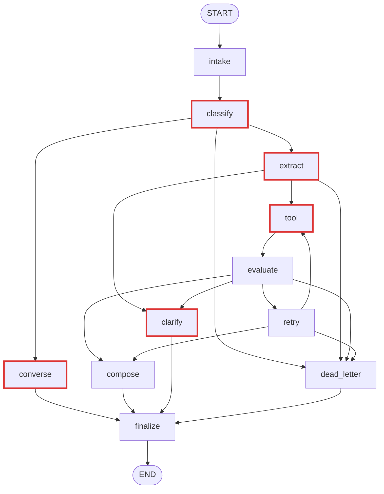

# LangGraph: mười một node và vì sao chia như vậy

Agent lập lịch trình là một LangGraph gồm mười một node. Tài liệu này giải thích **ý đồ** của cách chia đó — đọc xong bạn nói lại được cho người khác mà không cần mở code. Xem [README](README.md) để chạy demo.

Một lượt gọi API đi qua ba việc: **hiểu người dùng muốn gì**, **lấy sản phẩm thật từ catalog**, và **soạn câu trả lời**. Mỗi node lo một mẩu của ba việc đó, và tất cả cùng đọc/ghi vào một state chung.

## 1. Bốn giai đoạn

Đừng nhớ mười một node rời rạc. Nhớ bốn giai đoạn, mỗi giai đoạn trả lời một câu hỏi:

| Giai đoạn | Node | Câu hỏi nó trả lời |
|---|---|---|
| Hiểu người dùng | `intake`, `classify`, `extract` | Đây có phải yêu cầu du lịch không (`classify`), muốn gì và đã đủ thông tin chưa (`extract`)? |
| Lấy dữ liệu thật | `tool`, `evaluate`, `retry` | Có sản phẩm thật nào dùng được không? |
| Soạn câu trả lời | `converse`, `compose`, `clarify`, `dead_letter` | Nói gì với người dùng? |
| Cửa ra chung | `finalize` | Câu trả lời này có an toàn để gửi đi không? |

Giai đoạn 3 có bốn node vì có đúng bốn tình huống cần nói với người dùng:

- `converse` — **trò chuyện**: chào hỏi, cảm ơn, hoặc từ chối yêu cầu ngoài phạm vi. Chưa đụng tới sản phẩm.
  Xin lên lịch trình mà chưa nói điểm đến hay số ngày **không** thuộc nhóm này — đó vẫn là yêu cầu du lịch, đi `clarify`.
- `compose` — **dựng kết quả**: đã có sản phẩm thật, xếp thành lịch trình.
- `clarify` — **hỏi thêm**: thiếu điểm đến hoặc số ngày (vòng hỏi thứ hai trở đi kèm `clarificationForm` thay vì hỏi lại y hệt, xem "Form gợi ý" bên dưới); chưa hỏi ngày đi, số người, ngân sách (hỏi gộp một câu, một lần, trước lần lập lịch đầu tiên); thông tin mâu thuẫn; hoặc điều kiện bắt buộc không có sản phẩm nào đáp ứng.
- `dead_letter` — **hỏng có kiểm soát**: lỗi auth, điểm đến ngoài catalog, tool hỏng vĩnh viễn. Trả lỗi đúng chuẩn thay vì che thành thành công.

**Form gợi ý (`clarificationForm`).** Hỏi lại bằng câu chữ không giới hạn số lần dễ kẹt vòng: người dùng trả lời kiểu
"bao nhiêu ngày cũng được" thì LLM không trích được số, lượt sau lại hỏi đúng câu cũ. `extract` đếm `clarification_rounds`
theo hội thoại, chỉ tăng khi `missing_fields` còn `destination`/`days`: vòng 1 hỏi bằng câu chữ như cũ
(`clarification_reason = None`); từ vòng 2, `clarification_reason = "suggest_form"` và `clarify` gửi kèm `clarificationForm`
(điểm đến/số ngày/ngày đi/số người/ngân sách, đã điền sẵn giá trị gợi ý) thay vì hỏi lại. Người dùng chỉnh form rồi gửi một
câu chat bình thường — không có nhánh graph nào mới, luồng vẫn `extract → clarify → finalize` như hôm nay
(đề xuất `docs/prd/update-archive/2026-09-29-form-goi-y-thong-tin-chuyen-di.md`, đã áp dụng).

**`classify` chỉ phân luồng**, prompt ngắn, output đúng một nhãn: `travel` → `extract`; `conversation` và `out_of_scope` → `converse` (đặt chỗ, thanh toán, chèn lệnh, đòi secret đều là `out_of_scope`, trả 400); LLM lỗi → `dead_letter`. Yêu cầu chỉ có `intentOverride` (chip) bỏ qua LLM của `classify`. Việc trích intent nằm ở `extract`.

**Guardrail tất định (`steps/guardrails.py`), không gọi LLM.** Lớp phân luồng bằng LLM ở trên có thể phân
nhầm một câu vừa hợp lệ vừa chèn lệnh; `classify` chạy thêm một bước mẫu tất định (regex) trước khi gọi LLM —
khớp mẫu chèn lệnh/đòi secret rõ ràng (`ignore ... instructions`, `bỏ qua hướng dẫn trước`, `system prompt`,
`in ra API key`, …) thì chặn ngay, ghi `blocked_by_guardrail` và đi thẳng `converse` mà **không gọi LLM nào**
(`classify` lẫn `converse` sau đó) — rẻ hơn, nhanh hơn, và không đưa câu độc hại vào ngữ cảnh LLM lần nào nữa.
Đối xứng ở `finalize`: câu chữ LLM tự viết (`question`, `error.message`) lộ chuỗi giống secret hoặc tuyên bố
đã đặt/đã thanh toán thì bị thay bằng câu cố định, giữ nguyên `status`/HTTP. Mẫu cố ý hẹp để không chặn nhầm
câu du lịch hợp lệ.

**Node nào gọi LLM:** chỉ `classify`, `extract`, `tool` (bước chọn tên điểm đến theo catalog và lập tool plan), `converse` và `clarify`. Mọi lượt gọi LLM nhận cùng ngữ cảnh hội thoại qua `steps/history.llm_context`: lịch sử gần nhất (giới hạn 20 message, 8.000 ký tự), chuyến đi đã chốt (`known_intent`, `known_constraints`), sản phẩm đã cho xem và câu hỏi gần nhất của trợ lý. Đây là chỗ hay bị hiểu sai — **`compose` không gọi LLM**, nó xếp lịch bằng quy tắc cố định (mục 5).

## 2. Vì sao mọi nhánh đều đi qua `finalize`

Nhìn sơ đồ sẽ thấy `converse`, `compose`, `clarify` và `dead_letter` đều trỏ vào `finalize`. Đây không phải trùng lặp mà là chủ ý: **graph có nhiều đường vào nhưng chỉ một đường ra.**

Bốn node kia đều *soạn* response, nhưng **không node nào được tự trả response đó ra ngoài**. Tất cả phải qua `finalize`.

### `finalize` làm gì

Những việc phải xảy ra **đúng một lần cho mọi response, bất kể đi nhánh nào**:

| Việc | Vì sao phải đặt ở cửa ra chung |
|---|---|
| Kiểm schema OpenAPI | Client sinh từ OpenAPI sẽ vỡ nếu bất kỳ nhánh nào trả sai hình dạng |
| Kiểm grounding (`validate_plan`) | Mọi sản phẩm phải có trong `candidates`. Đây là cam kết grounding 100% — không được có một nhánh nào lách qua |
| Kiểm guardrail đầu ra (`guardrails.output_violations`) | Câu chữ LLM tự viết (`question`/`error.message`) không được lộ secret hay tuyên bố đã đặt/đã thanh toán (NFR-SEC-01) |
| Đo `latency_ms` | Chỉ đo được ở điểm cuối cùng |
| Lưu hội thoại | Redis giữ working memory 24 giờ; với user đăng nhập, Postgres archive lượt chat để Web mở lại. Archive lỗi không làm hỏng response |
| Sinh `final_answer` | Một chỗ duy nhất quyết định text hiển thị cho người dùng |

Cách để nhớ: **giống cổng an ninh sân bay.** Khách đến từ nhiều quầy check-in khác nhau, nhưng mọi người đều phải qua đúng một cổng soi chiếu. Lắp máy soi ở từng quầy thì vừa tốn, vừa chắc chắn có quầy quên lắp.

### Nếu không có `finalize` thì sao

Mỗi node phải tự kiểm lấy. Hai hậu quả:

1. Logic kiểm bị lặp bốn lần, sửa một quy tắc phải sửa bốn chỗ.
2. Nguy hiểm hơn: thêm một node mới mà quên copy phần kiểm là có ngay một đường thoát không ai canh. Với cam kết grounding 100%, đây đúng là loại lỗi không được phép mắc.

### `finalize` có quyền phủ quyết

Điểm dễ nhầm nhất: `finalize` **không chỉ đóng dấu**. Nó có quyền bác.

Một response `COMPLETED` không qua được `validate_plan` sẽ bị nó thay bằng lỗi `ITINERARY_VALIDATION_FAILED` (HTTP 500). Nghĩa là backend tự nhận lỗi của mình, thay vì đưa cho người dùng một lịch trình chưa được kiểm chứng. Thà báo lỗi còn hơn trả dữ liệu không có căn cứ.

## 3. Bảy ví dụ

Đi từ câu người dùng gõ, không phải từ tên node:

| Người dùng gõ | Đường đi | Ý được minh họa |
|---|---|---|
| "chào bạn" | `intake → classify → converse → finalize` | Trò chuyện, chưa đụng tới sản phẩm |
| "đi 3 ngày" (thiếu điểm đến) | `intake → classify → extract → clarify → finalize` | Thiếu thông tin thì hỏi, không đoán |
| "gợi ý cho tôi một chuyến đi" | `intake → classify → extract → clarify → finalize` | Chưa nói gì vẫn là yêu cầu du lịch, không phải trò chuyện |
| "Nha Trang 2 ngày" (chưa nêu ngày đi, số người, ngân sách) | `intake → classify → extract → clarify → finalize` | Đủ điểm đến và số ngày: hỏi gộp một câu những gì còn thiếu trong ngày đi, số người, ngân sách; hỏi một lần, chưa gọi tool |
| "Nha Trang 2 ngày" rồi trả lời bất kỳ (hoặc câu đầu đã đủ chi tiết) | `intake → classify → extract → tool → evaluate → compose → finalize` | Luồng đầy đủ |
| "Paris 2 ngày" | `intake → classify → extract → tool → evaluate → dead_letter → finalize` | Ngoài catalog, dừng trước khi gọi Search |
| "Nha Trang 2 ngày, khách sạn 5 sao" (không có) | `… → evaluate → clarify → finalize` | Điều kiện bắt buộc không đạt thì hỏi, không tự bỏ |
| Search lỗi mạng | `… → evaluate → retry → tool → evaluate → …` | Thử lại, tối đa một lần |

**Bảy tình huống khác hẳn nhau, nhưng cột nào cũng kết thúc bằng `finalize`.** Đó là mục 2 nhìn từ phía dữ liệu thật.

Sơ đồ đầy đủ — mỗi luồng một đường thẳng, không rẽ nhánh, điều kiện ghi ở cuối dòng:

```text
START → intake → classify → extract → tool → evaluate → compose    → finalize → END   (có candidate hợp lệ)
START → intake → classify → extract → tool → evaluate → compose    → finalize → END   (không có kết quả, NO_RESULTS)
START → intake → classify → extract → tool → evaluate → clarify    → finalize → END   (vi phạm điều kiện bắt buộc)
START → intake → classify → extract → tool → evaluate → retry → tool → evaluate → …  → finalize → END   (lỗi tạm thời, thử lại tối đa một lần)
START → intake → classify → extract → tool → evaluate → dead_letter → finalize → END  (lỗi vĩnh viễn/auth)
START → intake → classify → extract → clarify             → finalize → END  (thiếu destination/days, mâu thuẫn, hoặc điều kiện không xác minh được)
START → intake → classify → converse                      → finalize → END  (chào hỏi, cảm ơn, hoặc yêu cầu ngoài phạm vi — không gồm yêu cầu du lịch thiếu chi tiết)
START → intake → classify → dead_letter                    → finalize → END  (request lỗi hoặc LLM classify lỗi)
```

Dòng thứ tư (`retry`) tự nó rẽ tiếp thành ba luồng thẳng, theo `route_after_retry` (`src/backend/app/agents/routing.py`):

```text
… → evaluate → retry → tool → evaluate → compose     → finalize → END   (thử lại lần hai thành công)
… → evaluate → retry → compose                       → finalize → END   (fallback: dùng candidate cũ, không gọi lại tool)
… → evaluate → retry → dead_letter                   → finalize → END   (decision=error, hoặc đã hết số lần thử lại)
```

### 3.1. Sơ đồ mermaid

Cùng nội dung sơ đồ trên, vẽ bằng mermaid theo đúng cạnh trong `agents/graph.py` và điều kiện trong `agents/routing.py`. Node có viền đậm là node **có gọi LLM** (`classify`, `extract`, `tool` khi cần khớp destination hoặc lập plan, `converse`, `clarify`); các node còn lại thuần rule-based.



## 4. Đọc bảng trace của Streamlit

Bảng bên phải màn hình demo là trace của **một lượt gọi API qua SSE**, theo đúng thứ tự event backend phát ra. Mỗi dòng là một node đã kết thúc; bảng không hiển thị raw state, prompt, token, JWT hay payload nội bộ.

| Cột | Cách đọc |
|---|---|
| `sequence` | Thứ tự event trong lượt chạy, bắt đầu từ 1. Không phải số thứ tự cố định của node trong mọi luồng. |
| `nodeId` | Tên node vừa hoàn tất. Node không đi qua trong lượt này sẽ không có dòng. |
| `outcome` | Trạng thái thực thi. `completed` chỉ có nghĩa node đã chạy xong; **kết quả nghiệp vụ vẫn phải xem response**. |
| `message` | Tóm tắt việc node vừa làm. Ví dụ `tool` ghi `retrieval completed (normalized destination)` khi tên điểm đến được đổi thành tên catalog. |
| `durationMs` | Thời gian quan sát từ event node trước tới event hiện tại **tại biên SSE**, gồm cả overhead cập nhật state. Đây không phải CPU profile bên trong node. Tối thiểu 1 ms. |

Các điểm cần nhớ khi đọc trace:

- Không thấy `tool` nghĩa là agent **chưa truy xuất sản phẩm nào**; thường do thiếu `destination`/`days` (đi qua `clarify`), trò chuyện hoặc bị từ chối (đi qua `converse`).
- Thấy `converse` thì chắc chắn lượt đó **không có sản phẩm nào**; thấy `compose` thì chắc chắn **đã có dữ liệu thật**. Đây là lợi ích của việc tách hai node.
- `compose` không đồng nghĩa với `COMPLETED`: nó còn tạo `NO_RESULTS` và `FALLBACK`.
- `compose` không gọi LLM nên `durationMs` của nó chỉ vài mili giây, và cùng một tập candidate luôn cho cùng một lịch trình.
- Có `retry` nghĩa là retrieval gặp lỗi tạm thời; graph chỉ cho retry một lần để tránh vòng lặp vô hạn.
- Chỉ `run.completed.response` và kết quả ở `finalize` mới cho biết trạng thái API cuối cùng. `completed` ở từng node **không phải** kết luận PASS của evaluation.
- Trace chạy fixture chỉ chứng minh luồng local và grounding vào fixture; **không** chứng minh availability, giá hiện tại, chất lượng Search hay latency production.

## 5. Quy tắc xếp lịch của `compose`

`compose_plan` trong `src/backend/app/domain/itinerary/planning.py` chọn sản phẩm và xếp ngày bằng thứ tự
xác định, không có LLM. Cùng một tập candidate luôn cho cùng một lịch trình.

1. Chỉ xét candidate `available=true` thuộc `hotel`, `attraction`, `golf`. `flight` và `combo` vẫn được
   truy xuất và vẫn hiện trong `searchResults` của `FALLBACK`, nhưng không bao giờ vào slot.
2. **Chỗ ở:** chọn một `hotel`, ưu tiên giá thấp nhất; bằng giá thì sao cao hơn; bằng nữa thì `productId`
   nhỏ hơn. Giá `null` xếp cuối vì không so sánh được. Không bao giờ chọn cả phòng con lẫn khách sạn cha.
3. **Hoạt động:** hoạt động nguyên ngày (`durationMinutes >= 360`) được xếp trước và chiếm trọn một ngày.
   Phần còn lại xếp theo giá thấp nhất rồi `productId`.
4. **Rải ngày:** mỗi hoạt động vào ngày đang ít việc nhất, ngày sớm hơn thắng khi hòa. Tối đa
   2 hoạt động một ngày; hoạt động đầu vào `MORNING`, hoạt động thứ hai vào `AFTERNOON`.
5. Hoạt động dư so với sức chứa của chuyến thì không xếp, không dồn.
6. Ngày không có sản phẩm nào thì `slots` rỗng và response kèm warning `DAY_WITHOUT_PRODUCTS`.
   Không sinh slot bữa ăn/nghỉ ngơi `product=null`.

`pace` chưa phải đầu vào của bước xếp lịch; trần 2 hoạt động/ngày áp dụng cho mọi `pace`.
`render_proposal` và `validate_plan` vẫn là tiếng nói cuối cùng: nếu đề xuất tự sinh mà không qua được
hai hàm này thì đó là lỗi backend, `compose` trả `FALLBACK` và ghi log `itinerary.composition_failed`.

## 6. Bảng tra cứu mười một node

Dùng khi đã nắm bức tranh chung ở trên và cần tra chi tiết một node. Tóm tắt hành vi trước, bảng field-level ở dưới cùng cho tên field thật trong `AgentState` (`agents/state.py`) — khớp `agents/nodes.py` (hàm node) và `agents/steps/` (luật chi tiết) tại thời điểm viết, `git blame`/`git log -p` mới là nguồn xác thực khi code đã đổi.

| Node | Nhận vào | Trả ra | Đi tiếp |
|---|---|---|---|
| `intake` | Message của người dùng, `conversationId` (nếu có). | State khởi tạo: message đã chuẩn hóa, `conversationId`, intent và lịch sử chat đã lưu của hội thoại. | `classify` |
| `classify` | Message mới và ngữ cảnh hội thoại chung. Guardrail tất định (regex) chạy trước; khớp thì bỏ qua LLM. Còn lại **gọi LLM** (prompt ngắn, một nhãn). | `decision` (`travel`/`simple`/`error`), `interaction_type` (`travel`/`conversation`/`out_of_scope`), `refusal`, `blocked_by_guardrail` (nếu guardrail chặn); với nhánh trò chuyện thêm `missing_fields` của chuyến đi đã lưu. | `extract` nếu du lịch; `converse` nếu trò chuyện hoặc ngoài phạm vi; `dead_letter` nếu LLM lỗi |
| `extract` | Message mới, ngữ cảnh hội thoại chung, `intentOverride`, `start_date_asked`. **Gọi LLM.** | Intent/constraints (`destination`, `days`, `startDate`, `party`, `budget`...), các trường còn thiếu, `start_date_asked`. | `tool` nếu đủ `destination` + `days` và đã xử lý chi tiết chuyến đi; `clarify` nếu thiếu, chưa hỏi chi tiết, mâu thuẫn hoặc có điều kiện không xác minh được; `dead_letter` nếu số ngày ngoài 1–7, intent không hợp lệ hoặc LLM lỗi |
| `tool` | Intent/constraints và lịch sử chat; ở lượt đổi món thêm `previous_selection`. **Có thể gọi LLM** để khớp tên điểm đến với catalog hoặc lập tool plan. | Tên điểm đến đã chuẩn hóa, kết quả Search/Recommendation/ProductDetail (hoặc lỗi) trong `tool_results`; chỉ ở lượt đổi món (có `previous_selection`) mới có thêm kết quả Similar. Điểm đến ngoài catalog trả `UNSUPPORTED_DESTINATION` (422) kèm danh sách điểm đến hỗ trợ. | `evaluate` |
| `evaluate` | `tool_results` và intent. | Danh sách candidate hợp lệ có nguồn grounding, hoặc phân loại: `compose`, `no_results`, `fallback`, `constraint_clarification`, lỗi tạm thời/vĩnh viễn. Lỗi mềm của Similar không tính vào phân loại này: 404/409 luôn mềm; 503/timeout (mode `http`: mọi 5xx và lỗi kết nối) mềm khi có `search_products` trả dữ liệu (spec Itinerary §2.5). | `compose`, `clarify` (khi `constraint_clarification`), `retry` hoặc `dead_letter` |
| `retry` | Lỗi tool tạm thời và số lần đã thử. | Quyết định thử lại (tối đa một lần), dùng fallback hoặc báo lỗi. | `tool`, `compose` hoặc `dead_letter` |
| `converse` | Message mới, lịch sử chat, loại tương tác, cờ từ chối. **Gọi LLM**, trừ khi `blocked_by_guardrail` đã đặt ở `classify` — khi đó dùng thẳng câu cố định, không gọi LLM. | Câu trả lời trò chuyện (`NEEDS_CLARIFICATION` kèm `missingFields`), hoặc từ chối (`VALIDATION_ERROR`, HTTP 400). LLM lỗi thì dùng câu cố định. | `finalize` |
| `compose` | Candidate đã evaluate (chỉ `hotel`, `attraction`, `golf`). **Không gọi LLM.** | Lịch trình `COMPLETED` dựng bằng `compose_plan`, hoặc `NO_RESULTS`, `FALLBACK`. | `finalize` |
| `clarify` | Lịch sử chat, trường còn thiếu (`missing_fields`), `clarification_reason` (`conflict`/`unverified`/`suggest_form`), hoặc `decision = constraint_clarification`. **Gọi LLM** để viết câu hỏi — riêng `constraint_clarification` dùng câu cố định. | `NEEDS_CLARIFICATION` kèm `knownIntent` (và `missingFields` nếu có; `clarificationForm` khi `clarification_reason = suggest_form`). LLM lỗi hoặc timeout thì dùng câu cố định theo đúng lý do. | `finalize` |
| `dead_letter` | Lỗi auth, tool plan/argument hoặc upstream. | `ErrorResponse` chuẩn, không che lỗi thành thành công. | `finalize` |
| `finalize` | Response từ một trong bốn node soạn và lịch sử chat trước lượt này. | Response cuối đã validate schema và grounding, kèm latency; nối cặp user/assistant rồi lưu conversation nếu thành công. Validation lỗi thành `ITINERARY_VALIDATION_FAILED`. Câu chữ LLM tự viết lộ secret/tuyên bố đã đặt/thanh toán thì bị thay bằng câu cố định (guardrail đầu ra), giữ nguyên `status`/HTTP. | `END` |

### 6.1. Field-level: từng node đọc field nào, ghi field nào

`state.X` là field đọc từ `AgentState` khi vào node; `ghi X` là key trong dict node trả về (LangGraph merge vào state chung — `events` là append-only, còn lại bị ghi đè). Route lấy từ `routing.py`; bốn node router (`route_after_classify/extract/evaluate/retry`) không phải node, chỉ đọc field `decision` do node đứng trước nó vừa ghi.

| Node | Đọc (`state.*`) | Gọi LLM | Ghi | Routing tiếp theo |
|---|---|---|---|---|
| `intake` | `query`/`message`, `conversation_id`, `conversation_history`, `intent`, `constraints`, `previous_selection`, `max_attempts`, `language`; async thêm: tra `conversation_id` qua `store` | Không | `query`, `conversation_id`, `conversation_history` đã làm sạch/giới hạn, `intent`, `constraints`, `previous_selection`, `attempt=0`, `max_attempts` (≤2), `tool_plan=[]`, `tool_results=[]`, `details={}`, `detail_errors={}`, `supported_destinations=None`, `candidates={}`, `sources={}`, `response={}`, `warnings=[]`, `missing_fields=[]`, `interaction_type=""`, `refusal=False`, `final_answer=None`, `http_status=200`, `decision=""`, `validation_issues=[]`, `started_at`, `language`, `events`. Async: không thấy `conversation_id` trong store → `decision="error"` (`CONVERSATION_NOT_FOUND`, 404); thấy → ghi đè `intent`/`constraints`/`language`/`previous_selection`/`conversation_history` từ bản lưu | → `classify` (cạnh cố định) |
| `classify` | `decision` (bỏ qua LLM nếu đã `"error"`), `query`, `intent_override` (không có `query` mà có override thì bỏ qua LLM), ngữ cảnh `llm_context` (`conversation_history`, `intent`, `constraints`, `previous_selection`) | **Có** — `TurnRoute` (`CLASSIFY_PROMPT`), trừ khi `query` khớp mẫu guardrail (`guardrails.input_violation`, tất định, không LLM) | `decision` (`travel`/`simple`/`error`), `interaction_type`, `refusal`, `missing_fields` (nhánh `simple`), `blocked_by_guardrail` (mẫu khớp, nếu guardrail chặn), `events`. Lỗi: `LLM_UNAVAILABLE` | `decision="travel"→extract`; `"simple"→converse`; `"error"` hoặc khác→`dead_letter` |
| `extract` | `query`, ngữ cảnh `llm_context`, `intent_override`, `start_date_asked`, `clarification_rounds`, `language`, `request_id` | **Có** — `Extraction` (`EXTRACT_PROMPT`) | `intent` (merge patch + `intent_override`), `constraints` (merge, xử lý `clear_fields`/`hotel_attributes`/`require_hotel`/`exclude_products` — LLM chỉ được chọn `productId` có trong `previous_selection`, ID lạ bị lọc bỏ), `missing_fields` (`destination`/`days`; hoặc tập con của `startDate`/`party`/`budget` khi chưa hỏi chi tiết), `start_date_asked`, `clarification_rounds` (tăng khi vẫn thiếu `destination`/`days`), `clarification_reason` (`suggest_form` từ vòng thứ hai), `decision` (`tool`/`missing_info`/`error`), `events`. Lỗi: `INVALID_TRIP_DURATION`/`VALIDATION_ERROR`/`LLM_UNAVAILABLE` | `decision="tool"→tool`; `"missing_info"→clarify`; `"error"` hoặc khác→`dead_letter` |
| `tool` | `intent`, `constraints`, `conversation_history`, `supported_destinations`, `tool_plan`/`tool_results` (nếu đến từ `retry`), `query`, `request_id` | **Có thể** — chọn điểm đến khớp catalog (`DestinationChoice`) khi rule-based `match_destination` thất bại; lập `tool_plan` (`bind_tools`) nếu chưa có sẵn | `tool_plan`, `tool_results`, `details`, `detail_errors`, `intent` (destination đã chuẩn hóa), `constraints` (chuẩn hóa), `supported_destinations`, `events`. Lỗi: `response`, `http_status`, `decision="error"` (`LLM_UNAVAILABLE` hoặc `UNSUPPORTED_DESTINATION` 422), `tool_plan=[]`, `tool_results=[]` | → `evaluate` (cạnh cố định) |
| `evaluate` | `decision`, `tool_results`, `detail_errors`, `intent`, `constraints`, `request_id` | Không | `candidates`, `sources`, `constraints` (thêm `exclude_taxonomies` từ diagnostics recommendation cross-vertical), `warnings`, `decision` (`compose`/`no_results`/`fallback`/`constraint_clarification`/`needs_retry`/`failed`), `details={}` (xoá vì đã tiêu thụ), `events` | `decision="constraint_clarification"→clarify`; `"needs_retry"→retry`; `"failed"`/`"error"`→`dead_letter`; còn lại→`compose` |
| `retry` | `attempt`, `max_attempts`, `candidates` | Không | `attempt` (+1 nếu còn lượt), `decision` (`""`/`fallback`/`error`), `events` | `decision="fallback"` và có `candidates`→`compose`; `"error"→dead_letter`; `attempt < max(≤2)`→`tool`; hết lượt→`dead_letter` |
| `converse` | `query`, `conversation_history`, `interaction_type`, `intent`, `missing_fields`, `clarification_reason`, `refusal`, `supported_destinations`, `language`, `request_id`, `blocked_by_guardrail` (có thì bỏ qua LLM) | **Có** — `ConversationalAnswer` (`CONVERSATION_PROMPT`), trừ khi `blocked_by_guardrail` | `response` (`NEEDS_CLARIFICATION`, có `suggestedValues.destination`/`.days` khi `missing_fields` chứa `destination`/`days`; hoặc `VALIDATION_ERROR` 400 nếu `refusal`), `events`. LLM lỗi hoặc `blocked_by_guardrail` → câu cố định | → `finalize` (cạnh cố định) |
| `compose` | `decision` (`no_results`/`fallback` từ `evaluate`), `candidates`, `intent`, `sources`, `constraints`, `warnings`, `conversation_id`, `request_id` | Không | `response` (`COMPLETED` qua `compose_plan`/`render_proposal`/`validate_plan`; `NO_RESULTS` kèm `suggestions` dựng từ `constraints` đang bật; hoặc `FALLBACK` khi rule tự bác đề xuất), `events` | → `finalize` (cạnh cố định) |
| `clarify` (`ask_clarification_node`) | `decision` (`constraint_clarification` → câu cố định, bỏ qua LLM), `query`, `conversation_history`, `interaction_type`, `intent`, `missing_fields`, `clarification_reason`, `clarification_rounds`, `refusal`, `supported_destinations`, `conversation_id`, `language`, `request_id` | **Có**, trừ khi `decision="constraint_clarification"` hoặc LLM lỗi/timeout (khi đó dùng câu cố định theo `missing_fields`/`clarification_reason`) | `response` (`NEEDS_CLARIFICATION` kèm `knownIntent`, `missingFields`/`suggestedValues` nếu có; `clarificationForm` khi `clarification_reason = suggest_form`), `final_answer`, `events` | → `finalize` (cạnh cố định) |
| `dead_letter` | `response.error` (bỏ qua nếu đã có), `tool_results` (`error`), `detail_errors`, `request_id` | Không | `response` (`ErrorResponse`: `INVALID_TOKEN`/`TOKEN_EXPIRED` 401, `LLM_UNAVAILABLE`, hoặc `SEARCH_UNAVAILABLE`), `http_status`, `decision="error"`, `events` | → `finalize` (cạnh cố định) |
| `finalize` | `response`, `http_status`, `candidates`, `sources`, `intent`, `constraints`, `previous_selection`, `conversation_history`, `query`, `conversation_id`, `request_id`, `started_at`, `refusal`, `missing_fields`, `clarification_reason` (hai field sau chỉ khi guardrail đầu ra soạn lại câu chữ) | Không | `response` (có thể thay bằng `ITINERARY_VALIDATION_FAILED` 500 nếu vi phạm schema/grounding; hoặc chỉ thay `question`/`error.message` bằng câu cố định nếu vi phạm guardrail đầu ra — `guardrails.output_violations`, giữ `status`/`http_status`), `http_status`, `validation_issues` (thêm mục `guardrail:*` nếu có), `final_answer`, `conversation_history` đã nối cặp user/assistant và giới hạn lại, `latency_ms`, `events`. Async: lưu `intent`/`constraints`/`language`/`previous_selection`/`conversation_history` vào `store` nếu HTTP 200 hoặc lỗi `UNSUPPORTED_DESTINATION` (resumable); `previous_selection` chỉ cập nhật khi response `COMPLETED` (snapshot gọn `productId`/`name`/`taxonomy` của từng slot đã chọn, cũng là danh sách sản phẩm gốc hợp lệ cho Similar ở lượt sau), lượt khác giữ nguyên bản cũ | → `END` |
