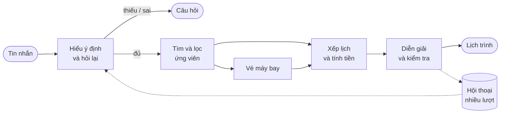

# Nghiệp vụ Itinerary Agent — đọc nhanh

Phục vụ FR-AGT-01..05, AC-AGT-01..03, NFR-REL-01 (`docs/prd/requirements.md`).

Bộ tài liệu này dành cho dev mới, hoặc cho chính mình khi quay lại sau một thời gian: trợ lý lập lịch trình **đang làm
gì** và **theo luật nào**. Không giải thích cách cài đặt; mỗi file có mục "Code liên quan" để mở tiếp.

- **Nguồn sự thật là code** tại ngày ghi ở đầu file. Khi lệch nhau thì PRD (`docs/prd/`) và contract
  (`src/shared/contracts/`) thắng, không phải bộ này.
- **⚠️ cần xác nhận** đánh dấu chỗ code mâu thuẫn với PRD, dang dở, hoặc chưa rõ ý đồ. Đừng coi là luật.
- **Mỗi khái niệm chỉ mô tả ở một file.** Nơi khác link tới đó; tra nhanh nghĩa ở [glossary.md](glossary.md).

## Bản đồ

## Thứ tự đọc

| # | File | Đọc để biết |
|---|---|---|
| 1 | [glossary.md](glossary.md) | Thuật ngữ |
| 2 | [vong-doi-mot-luot.md](vong-doi-mot-luot.md) | Một tin nhắn đi qua đâu, ra kết quả gì |
| 3 | [hieu-y-dinh-va-hoi-lai.md](hieu-y-dinh-va-hoi-lai.md) | Phân luồng, trường bắt buộc, khi nào hỏi lại, form |
| 4 | [tim-ung-vien.md](tim-ung-vien.md) | Gọi tool nào, query, lọc ứng viên, khi nào `NO_RESULTS`/`FALLBACK` |
| 5 | [ve-may-bay.md](ve-may-bay.md) | Tra và chọn vé, lý do thiếu vé |
| 6 | [xep-lich.md](xep-lich.md) | Chỗ ở, hoạt động, buổi, giờ bay, tiền |
| 7 | [dien-giai-va-kiem-tra.md](dien-giai-va-kiem-tra.md) | LLM viết gì, code điền gì, `finalize` chặn gì |
| 8 | [sua-lich-qua-nhieu-luot.md](sua-lich-qua-nhieu-luot.md) | Nhớ gì giữa các lượt, đổi món |

## Tổng hợp ⚠️ cần xác nhận

| Chỗ | File |
|---|---|
| Lọc theo ngày chỉ so ngày khởi hành, không theo ngày dùng thật | [tim-ung-vien.md](tim-ung-vien.md) |
| Vé được chọn lại mọi lượt, AC-AGT-02 nói chỉ khi chuyến đi đổi | [ve-may-bay.md](ve-may-bay.md) |
| Chưa đổi/bỏ được một chuyến bay cụ thể qua chat | [ve-may-bay.md](ve-may-bay.md) |
| Tiền chỗ ở không tính số phòng | [xep-lich.md](xep-lich.md) |
| Không có vé thì buổi không có khung giờ, không kiểm thời lượng | [xep-lich.md](xep-lich.md) |
| `expires_at` của hội thoại không được dùng khi khôi phục | [sua-lich-qua-nhieu-luot.md](sua-lich-qua-nhieu-luot.md) |

## Tài liệu khác

- Kỹ thuật graph, node, trace, guardrail: [../langgraph-nodes.md](../langgraph-nodes.md), [../state-fields.md](../state-fields.md)
- Hợp đồng API và tool: [../../hop-dong-tich-hop-itinerary-assistant.md](../../hop-dong-tich-hop-itinerary-assistant.md)
- Widget hiển thị: [../../../guide/doc-code-ui-tro-ly.md](../../../guide/doc-code-ui-tro-ly.md)
- Sửa, tune, đánh giá agent: [../working-context.md](../working-context.md)
