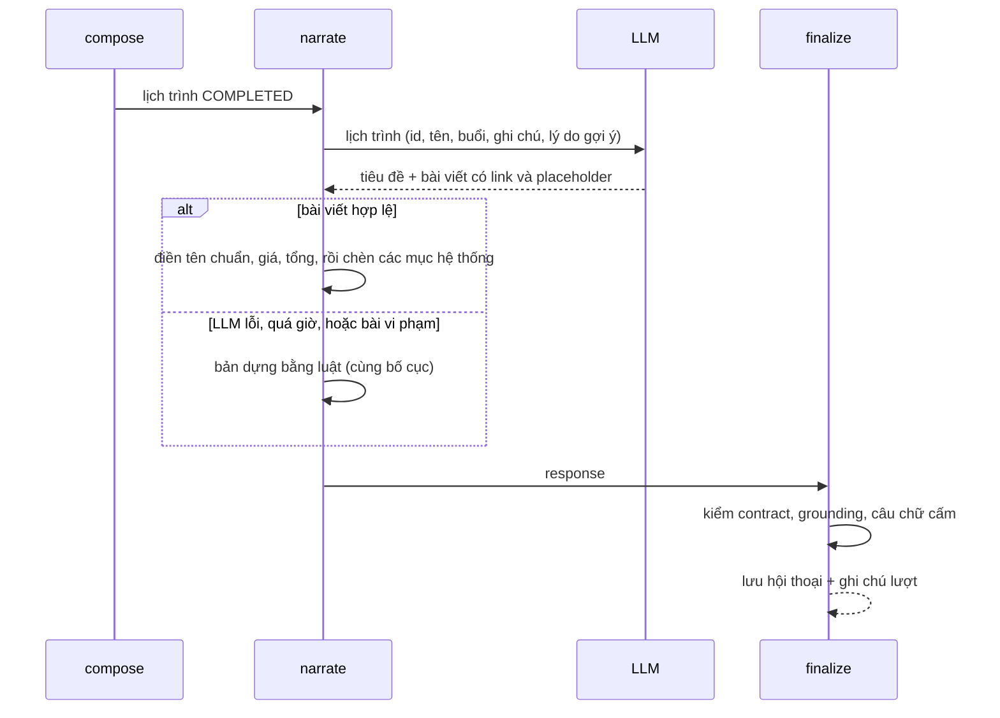

# Diễn giải lịch trình và kiểm tra trước khi trả

Phục vụ FR-AGT-03, FR-AGT-04, FR-AGT-06, FR-AGT-07, NFR-REL-01, NFR-SEC-01. Mô tả theo code tại 2026-10-11; khi lệch, PRD và contract thắng.

## Mục đích

Lịch trình đã dựng bằng luật ([xep-lich.md](xep-lich.md)) được viết thành lời như một người lập kế hoạch du lịch. LLM chỉ
viết chữ; tên sản phẩm, giá, tổng tiền và các mục nhạy cảm đều do code điền. Trước khi trả, mọi response đi qua một cửa
kiểm chung.

## Luồng chính

## Business rule của lời diễn giải

- **LLM chỉ nhắc sản phẩm qua link** `[Tên](product:<id>)` với id có trong lịch. Code thay bằng tên chuẩn của catalog.
- **LLM không viết số tiền.** Giá ghi bằng placeholder `[[price:<id>]]`, tổng là `[[total]]`, ngân sách là `[[budget]]`; code
  điền từ dữ liệu.
- **Bài viết bị bỏ** (dùng bản dựng bằng luật) khi: placeholder lạ, số tiền tự viết, link sai cú pháp, hoặc id không có trong
  lịch. Link lệch cú pháp nhưng đúng sản phẩm thì được sửa thay vì bỏ cả bài.
- **Các mục do hệ thống viết,** LLM được dặn không viết:

| Mục | Nội dung |
|---|---|
| Câu ghi nhận thay đổi | "Mình ghi nhận đổi ngày đi thành …", so intent đầu lượt với intent mới |
| **Vé máy bay** | Từng chặng: ngày, giờ, bay thẳng, giá × số khách; hoặc lý do chưa có vé |
| **Chưa có khách sạn** | Lý do thật từ dữ liệu, ngày gần nhất còn phòng |
| Gói nhiều ngày | Liệt kê và hỏi người dùng có muốn thêm không |
| **Ngoài ra trong lịch trình** | Sản phẩm đã xếp mà LLM quên nhắc, để vẫn bấm được |

- Dòng di chuyển `TRANSFER` được viết lại đúng ghi chú, không thêm chi tiết chuyến bay.
- [Lịch tham khảo](glossary.md#lich-tham-khao): câu mở đầu (ngày chưa mở bán, ngày gần nhất còn bán) do code viết; LLM chỉ
  kể chuyện từng nơi, không nói về ngày mở bán. `COMPLETED` có thể kèm tối đa 3 nút (ví dụ "Đi <nơi> <n> ngày từ ngày X").
- **Không bịa giờ, giá.** Khám phá mà không tra ra nơi được hỏi: LLM được báo để tự nói là chưa kiểm được. Lượt trò chuyện
  (`converse`) mà câu LLM nêu giờ, giá, vé không có dữ liệu: code thay bằng câu cố định. Câu trả lời vé do code viết hoàn
  toàn.
- Mọi câu trả lời (trừ chào hỏi, cảm ơn, chào tạm biệt khi người dùng không muốn đi nữa) mở đầu bằng **Tiêu đề** in đậm.

## Kiểm tra ở `finalize`

| Kiểm | Vi phạm thì |
|---|---|
| Response đúng schema OpenAPI | Thay bằng `ITINERARY_VALIDATION_FAILED` (500) |
| [Grounding](glossary.md#grounding): mọi sản phẩm trong lịch trùng khớp bản catalog đã truy xuất lượt này, đúng điểm đến, còn bán | 500 |
| Vé trùng khớp chuyến đã tra, còn bán, có giá | 500 |
| Lịch đúng số ngày; hoạt động cả ngày không chung ngày; hoạt động trong [cửa sổ giờ bay](xep-lich.md#theo-gio-bay) | 500 |
| Tổng và trạng thái ngân sách tính lại khớp | 500 |
| Link sản phẩm trong lời diễn giải đều có trong lịch | 500 |
| Sản phẩm của `FALLBACK`/gói nhiều ngày trùng khớp ứng viên | 500 |
| Thẻ khám phá và thẻ ngày–giá (`searchResults`) là đúng sản phẩm tra trong lượt; link trong câu chỉ trỏ tới các thẻ đó | 500 |
| Câu LLM viết lộ chuỗi giống secret, hoặc nói "đã đặt", "đã thanh toán" | Thay câu bằng bản cố định, giữ status |

## Mã cảnh báo (`warnings`) hay gặp

| Mã | Ý nghĩa |
|---|---|
| `PRODUCT_DROPPED_*` | Một sản phẩm bị loại khi lọc; xem [tim-ung-vien.md](tim-ung-vien.md) |
| `SNAPSHOT_ONLY` | Giá và trạng thái là snapshot tham khảo |
| `SCHEDULE_ESTIMATE` | Khung buổi là dự kiến |
| `UNKNOWN_TOTAL` / `PRODUCT_COST_ONLY` / `BUDGET_ON_PRODUCT_COST` | Về tổng tiền; xem [xep-lich.md](xep-lich.md) |
| `FREE_ENTRY_ASSUMED` | Có điểm tham quan tự do tính 0 đ |
| `RECOMMENDATION_FALLBACK` | Có mục lấy từ Recommendation vì Search không có |
| `NO_STAY_AVAILABLE` | Lịch không có chỗ ở |
| `PRODUCT_NOT_ON_SALE_FOR_DATE` | Điểm trong lịch tham khảo chưa mở bán cho ngày đi; nêu cửa sổ mở bán thật |
| `DAY_WITHOUT_PRODUCTS` | Một ngày không có sản phẩm |
| `FLIGHT_*` | Lý do thiếu vé; xem [ve-may-bay.md](ve-may-bay.md) |

## Edge case

- LLM của `narrate` lỗi hay quá giờ thì lượt vẫn `COMPLETED`, chỉ lời viết là bản dựng bằng luật.
- Câu cấm xuất hiện trong lời diễn giải của `COMPLETED`: chỉ lời viết bị thay, lịch trình giữ nguyên.

## Code liên quan

- [`agents/steps/narration.py`](../../../../src/backend/app/agents/steps/narration.py) — dựng input LLM, kiểm và điền bài viết, bản dựng bằng luật
- [`agents/steps/conversation.py`](../../../../src/backend/app/agents/steps/conversation.py) — `_claims_a_fact` (chặn giờ, giá không có dữ liệu)
- [`agents/steps/prompts.py`](../../../../src/backend/app/agents/steps/prompts.py) — `NARRATE_PROMPT`
- [`agents/steps/validation.py`](../../../../src/backend/app/agents/steps/validation.py) — kiểm response ở `finalize`
- [`agents/steps/guardrails.py`](../../../../src/backend/app/agents/steps/guardrails.py) — `output_violations`
- [`agents/steps/composition.py`](../../../../src/backend/app/agents/steps/composition.py) — bảng `WARNINGS`
