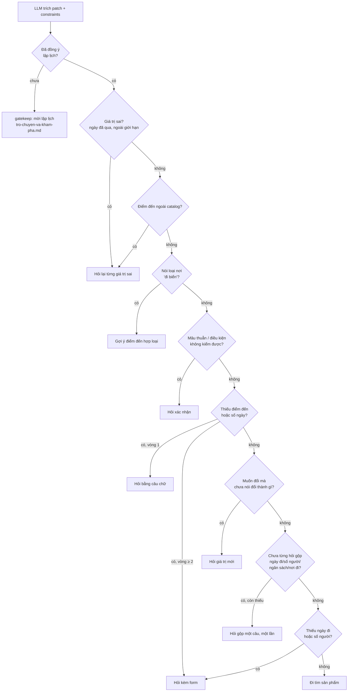

# Hiểu ý định và hỏi lại

Phục vụ FR-AGT-01, AC-AGT-01, NFR-SEC-01, NFR-SEC-04. Mô tả theo code tại 2026-10-13; khi lệch, PRD và contract thắng.

## Mục đích

Từ câu chat, trợ lý dựng [intent](glossary.md#intent) và [constraints](glossary.md#constraints) của chuyến đi.
Thiếu hoặc sai thì hỏi lại. Chỉ đủ thông tin mới đi tìm sản phẩm.

File này mô tả phần **sau khi người dùng [đồng ý lập lịch](glossary.md#dong-y-lap-lich)**. Trước đó trợ lý không hỏi
thông tin chuyến: xem [tro-chuyen-va-kham-pha.md](tro-chuyen-va-kham-pha.md).

## Luật trước LLM (`precheck`) và orchestrator

`precheck` không gọi LLM. Thứ tự kiểm, bước nào khớp thì dừng ở đó:

1. **Chip sửa tay** (`intentOverride`, không có message) → `extract`, coi như đồng ý.
2. **Chèn lệnh / đòi secret** khớp mẫu → từ chối 400 ở `converse` (câu cố định), không gọi LLM nào.
3. **Tin rác** (tầng 1): rác → hỏi "chưa hiểu" (200); chỉ có tục tĩu → từ chối 400. Không gọi LLM. Câu cụt giữa hội
   thoại ("2 ng", "3n") không bị coi là rác.
4. **Câu dừng chắc chắn** (`classification.says_stop`) → `orchestrate` với `turn_stop`: orchestrator chỉ viết lời cảm ơn,
   hẹn gặp lại; không nút, không thẻ, không hỏi thêm. So nguyên câu sau khi `fold` và bỏ từ đệm cuối câu (nhé, nha, đâu,
   luôn, rồi, mà, bạn), từ vựng đóng:
   `[thôi | vậy thôi] [mình | tôi | tui | tao | em | anh | chị] không/ko/k/kh/khg/hong/hok/hk/hem/chẳng/chả [muốn | cần]
   đi / đi du lịch / du lịch / đi chơi / lên lịch / lập lịch / lên kế hoạch + nữa`; `[thôi] huỷ chuyến [đi] / lịch trình [này]`;
   `thôi khỏi lên/lập lịch`; `[ok | cảm ơn | thanks] tạm biệt / bye / goodbye / hẹn gặp lại`. Câu có "?", có thêm tên nơi, số,
   ngày hay chữ ngoài danh sách không khớp và đi orchestrator; orchestrator vẫn có thể nhận ra câu dừng (`stop`). Cố ý
   không nhận "thôi khỏi", "thôi cảm ơn", "cảm ơn" đứng riêng (hay là từ chối một gợi ý hoặc còn nói tiếp) và "không đi"
   thiếu "nữa".
5. **Luật tất định:** chọn "phương án N" → `extract`; đổi khách sạn/chuyến bay
   ([sua-lich-qua-nhieu-luot.md](sua-lich-qua-nhieu-luot.md#doi-ve-khach-san)) → `clarify` hoặc `tool`; bấm nút của câu
   trả lời vé → `run_jobs` (job vé), không gọi LLM.
6. **Đã đồng ý lập lịch** và câu xin lập lịch ("lên lịch đi") hoặc trả lời "có" cho lời mời đang chờ → `extract`.
7. Còn lại → `orchestrate`.

Orchestrator (LLM, `OrchestratorTurn`) chọn một hành động:

| Hành động | Đi đâu |
|---|---|
| `answer` (trò chuyện, ngoài phạm vi, dừng) | `gatekeep` → `finalize`. Ngoài phạm vi trả lời 200: nói rõ không làm được, kèm nút việc gần nhất |
| `ask` (một câu hỏi khi chưa rõ đối tượng) | `gatekeep` → `finalize` |
| `execute` (việc chỉ đọc: khám phá, vé) | `run_jobs` → `orchestrate` → `gatekeep`; vé xem [tu-van-ve-may-bay.md](tu-van-ve-may-bay.md) |
| `plan` (người dùng đồng ý lập lịch: nhận lời mời, xin lập lịch, nêu thông tin chuyến, xin form) | Code kiểm lại đồng ý (`consent.py`), rồi `extract` |

"Đổi ngày", "không đổi nữa", "không đi Đà Nẵng nữa" (chê một nơi) không phải câu dừng; "không đi nữa" là dừng, không phải
huỷ đơn. Nối lại sau khi dừng ("thôi đi tiếp") giữ chuyến cũ. Luật guardrail chi tiết: [../langgraph-nodes.md](../langgraph-nodes.md)
mục Guardrail.

**Lỗi đã biết (13/10, `src/evaluation/reports/eval-2026-10-13-d3-snapshot-orchestrator.md`):** sau câu hỏi lại "nghỉ ở
đâu?", người dùng trả lời bằng tên một nơi thì orchestrator khám phá nơi đó thay vì `plan`, nên điểm đến không vào intent
(D3-01). Sửa ở D5 của `docs/plan/2026-10-12-go-luong-cu-orchestrator-chinh.md`.

## Trường của chuyến đi

| Trường | Bắt buộc trước khi tìm | Giới hạn (contract) | Ghi chú |
|---|---|---|---|
| `destination` | Có | Phải có trong catalog | Tên được chuẩn về tên catalog |
| `days` | Có | 1–7 | Suy được từ ngày về; đọc được "1 ngày 2 đêm", "3n2d" |
| `startDate` | Có | Không trước hôm nay (giờ VN) | Năm mặc định là năm nay |
| `party` | Có | ≥ 1 người lớn, ≥ 0 trẻ em | |
| `budget` | Không | ≥ 0 | Hỏi một lần, không bắt buộc |
| `origin` (nơi đi) | Không | — | Hỏi một lần; chỉ dùng cho [vé máy bay](ve-may-bay.md) |
| `interests` | Không | — | Sở thích khách sạn (hồ bơi, trẻ nhỏ, view biển…) là **ưu tiên mềm**, không phải bộ lọc bắt buộc |
| `pace` | Không | — | Hiện chưa ảnh hưởng xếp lịch |

## Quyết định hỏi lại (`extract`)

## Business rule

- **Hỏi gộp một lần mỗi hội thoại.** Câu hỏi gồm ngày đi, số người, ngân sách, nơi đi và sở thích; vừa đồng ý mà mới có
  điểm đến thì hỏi cả số ngày. Đã hỏi rồi mà vẫn thiếu ngày đi hoặc số người thì lượt nào cũng kèm form, cho tới khi đủ.
  Thiếu ngân sách hay nơi đi thì không hỏi lại. "Không có ngân sách" được LLM nhận ra (`skipped_details`) và không bị
  đòi nữa.
- **Xin form** ("cho mình cái form"): coi như đồng ý, có form điền sẵn ngay lượt đó.
- **Form gợi ý** (`clarificationForm`) gồm 7 ô: điểm đến, số ngày, ngày đi, số người, ngân sách, nơi đi, sở thích (chọn
  nhiều).
  - Giá trị người dùng đã nói luôn thắng giá trị gợi ý.
  - Gợi ý mặc định: 1 ngày, 2 người lớn. Ngày đi và điểm đến người dùng chưa nói thì để trống (`startDateMin` = hôm nay); form chỉ xác nhận được khi đã chọn đủ hai ô này (cập nhật 2026-10-12).
  - Không kèm form khi đang hỏi chọn điểm đến theo loại nơi.
- **"Đổi sang chỗ khác" chưa nêu nơi mới:** hỏi "đổi sang đâu" kèm 3 nút "Đổi sang <nơi>", không form.
- **Đếm vòng hỏi** (`clarification_rounds`) chỉ tăng khi còn thiếu điểm đến/số ngày.
- **Chip sửa tay là quyền cao nhất.** Ghi đè lên giá trị LLM trích, và không kích hoạt câu hỏi gộp.
- **Chỉ phục vụ điểm đến trong catalog (Việt Nam).** Ngoài catalog thì xoá điểm đến, giữ phần còn lại của chuyến, hỏi lại
  (200, không phải lỗi). LLM nhận danh sách điểm đến và cách viết tắt ("hn", "sg") để tự đổi về tên catalog; câu trả lời
  phải nằm trong danh sách.
- **Điều kiện bắt buộc không ai đáp ứng** (sau khi tìm): `require_hotel`, `specific_hotel`, `specific_activity`. Trợ lý hỏi
  trước khi nới, nêu lý do thật lấy từ dữ liệu (sai ngày, vượt giá…) và đưa chip gợi ý. Xem [tim-ung-vien.md](tim-ung-vien.md).

## Lưới an toàn cho LLM (đều từ trace thật)

| LLM làm sai | Code sửa |
|---|---|
| Bỏ sót ngày mới dù câu ghi rõ một ngày | Đọc ngày tường minh từ câu |
| Bỏ trống số ngày với "1 ngày 2 đêm" | Đọc thời lượng dạng gói |
| Chép tên khách sạn đã xem thành `specific_hotel` dù câu không nhắc | Bỏ ràng buộc đó |
| Bịa `productId` để loại trừ | Chỉ nhận id có trong sản phẩm đã cho xem |
| Báo "muốn đổi" nhưng lượt này thật ra đã có giá trị mới | Coi là đổi, không hỏi lại |
| Điền "biển" vào cả điểm đến | Bỏ khỏi điểm đến, hỏi theo loại nơi |

## Edge case

- "Chưa chốt ngày" không còn miễn ngày đi: vẫn hỏi.
- Ngày đi lẫn ngày về có trong câu mà lệch số ngày đã nói: hỏi xác nhận (mâu thuẫn).
- `require_hotel` và loại trừ `hotel` không thể cùng bật; `require_flight` và loại trừ `flight` cũng vậy.
- Điểm đến ngoài catalog bị kiểm ngay ở `extract` (đường async), nên "đi Trung Quốc" bị từ chối trước cả khi hỏi số ngày.
  Không lấy được danh sách catalog thì bỏ qua bước này; `tool` kiểm lại.

## Code liên quan

- [`agents/nodes.py`](../../../../src/backend/app/agents/nodes.py) — `precheck_node`: luật trước LLM
- [`agents/steps/orchestration.py`](../../../../src/backend/app/agents/steps/orchestration.py) — orchestrator chọn hành động
- [`agents/steps/consent.py`](../../../../src/backend/app/agents/steps/consent.py) — kiểm đồng ý lập lịch
- [`agents/steps/classification.py`](../../../../src/backend/app/agents/steps/classification.py) — trích, quyết định hỏi lại, câu dừng
- [`agents/steps/conversation.py`](../../../../src/backend/app/agents/steps/conversation.py) — câu hỏi, form, câu cố định khi LLM lỗi
- [`agents/steps/guardrails.py`](../../../../src/backend/app/agents/steps/guardrails.py) — chèn lệnh, tin rác, kiểm câu đầu ra
- [`agents/steps/tool_planning.py`](../../../../src/backend/app/agents/steps/tool_planning.py) — `check_destination`, `canonical_destination`
- [`agents/steps/explanations.py`](../../../../src/backend/app/agents/steps/explanations.py) — câu hỏi khi điều kiện bắt buộc không đạt
- [`agents/models.py`](../../../../src/backend/app/agents/models.py) — output LLM được phép (`OrchestratorTurn`, `Extraction`)
