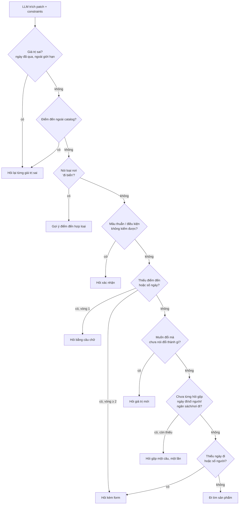

# Hiểu ý định và hỏi lại

Phục vụ FR-AGT-01, AC-AGT-01, NFR-SEC-01, NFR-SEC-04. Mô tả theo code tại 2026-10-07; khi lệch, PRD và contract thắng.

## Mục đích

Từ câu chat, trợ lý dựng [intent](glossary.md#intent) và [constraints](glossary.md#constraints) của chuyến đi.
Thiếu hoặc sai thì hỏi lại. Chỉ đủ thông tin mới đi tìm sản phẩm.

## Phân luồng (`classify`)

Thứ tự kiểm trong `classify`; bước nào khớp thì dừng ở đó:

1. **Chip sửa tay** (`intentOverride`, không có message) → du lịch, không gọi LLM.
2. **Chèn lệnh / đòi secret** khớp mẫu → từ chối 400, không gọi LLM nào nữa.
3. **Tin rác** (tầng 1): rác → hỏi "chưa hiểu" (200); chỉ có tục tĩu → từ chối 400. Không gọi LLM.
4. **LLM gắn một nhãn:**
   - `travel` → đi `extract`;
   - `vague` → nếu đã có lượt trước và còn thiếu trường bắt buộc thì hỏi lại kèm form, không thì như `travel`;
   - `conversation` → trò chuyện;
   - `out_of_scope` → từ chối 400.

`out_of_scope` gồm đặt chỗ, thanh toán, giỏ hàng, huỷ/đổi đơn đã có, chèn lệnh, đòi secret. "Không đi nữa", "đổi ngày"
vẫn là `travel`. Luật guardrail chi tiết: [../langgraph-nodes.md](../langgraph-nodes.md) mục Guardrail.

## Trường của chuyến đi

| Trường | Bắt buộc trước khi tìm | Giới hạn (contract) | Ghi chú |
|---|---|---|---|
| `destination` | Có | Phải có trong catalog | Tên được chuẩn về tên catalog |
| `days` | Có | 1–7 | Suy được từ ngày về; đọc được "1 ngày 2 đêm", "3n2d" |
| `startDate` | Có | Không trước hôm nay (giờ VN) | Năm mặc định là năm nay |
| `party` | Có | ≥ 1 người lớn, ≥ 0 trẻ em | |
| `budget` | Không | ≥ 0 | Hỏi một lần, không bắt buộc |
| `origin` (nơi đi) | Không | — | Hỏi một lần; chỉ dùng cho [vé máy bay](ve-may-bay.md) |
| `interests`, `pace` | Không | — | `pace` hiện chưa ảnh hưởng xếp lịch |

## Quyết định hỏi lại (`extract`)

## Business rule

- **Hỏi gộp một lần mỗi hội thoại.** Câu hỏi gồm ngày đi, số người, ngân sách và nơi đi. Đã hỏi rồi mà vẫn thiếu ngày đi
  hoặc số người thì lượt nào cũng kèm form, cho tới khi đủ. Thiếu ngân sách hay nơi đi thì không hỏi lại.
- **Form gợi ý** (`clarificationForm`) gồm 6 ô: điểm đến, số ngày, ngày đi, số người, ngân sách, nơi đi.
  - Giá trị người dùng đã nói luôn thắng giá trị gợi ý.
  - Gợi ý mặc định: 1 ngày, 2 người lớn, ngày đi hôm nay (`startDateMin` = hôm nay), điểm đến nhiều sản phẩm nhất.
  - Không kèm form khi đang hỏi chọn điểm đến theo loại nơi.
- **Đếm vòng hỏi** (`clarification_rounds`) chỉ tăng khi còn thiếu điểm đến/số ngày.
- **Chip sửa tay là quyền cao nhất.** Ghi đè lên giá trị LLM trích, và không kích hoạt câu hỏi gộp.
- **Chỉ phục vụ điểm đến trong catalog (Việt Nam).** Ngoài catalog thì xoá điểm đến, giữ phần còn lại của chuyến, hỏi lại
  (200, không phải lỗi). Tên gần đúng được LLM chọn lại trong danh sách catalog; câu trả lời phải nằm trong danh sách.
- **Điều kiện bắt buộc không ai đáp ứng** (sau khi tìm): `require_hotel`, `specific_hotel`, `specific_activity`. Trợ lý hỏi
  trước khi nới, nêu lý do thật lấy từ dữ liệu (sai ngày, vượt giá…) và đưa chip gợi ý. Xem [tim-ung-vien.md](tim-ung-vien.md).

## Lưới an toàn cho LLM (đều từ trace thật)

| LLM làm sai | Code sửa |
|---|---|
| Bỏ sót ngày mới dù câu ghi rõ một ngày | Đọc ngày tường minh từ câu |
| Bỏ trống số ngày với "1 ngày 2 đêm" | Đọc thời lượng dạng gói |
| Chép tên khách sạn đã xem thành `specific_hotel` dù câu không nhắc | Bỏ ràng buộc đó |
| Bịa `productId` để loại trừ | Chỉ nhận id có trong sản phẩm đã cho xem |
| Báo "muốn đổi" nhưng lượt này thật ra đã có giá trị mới | Coi là đổi, không hỏi lại |
| Điền "biển" vào cả điểm đến | Bỏ khỏi điểm đến, hỏi theo loại nơi |

## Edge case

- "Chưa chốt ngày" không còn miễn ngày đi: vẫn hỏi.
- Ngày đi lẫn ngày về có trong câu mà lệch số ngày đã nói: hỏi xác nhận (mâu thuẫn).
- `require_hotel` và loại trừ `hotel` không thể cùng bật; `require_flight` và loại trừ `flight` cũng vậy.
- Điểm đến ngoài catalog bị kiểm ngay ở `extract` (đường async), nên "đi Trung Quốc" bị từ chối trước cả khi hỏi số ngày.
  Không lấy được danh sách catalog thì bỏ qua bước này; `tool` kiểm lại.

## Code liên quan

- [`agents/steps/classification.py`](../../../../src/backend/app/agents/steps/classification.py) — phân luồng, trích, quyết định hỏi lại
- [`agents/steps/conversation.py`](../../../../src/backend/app/agents/steps/conversation.py) — câu hỏi, form, câu cố định khi LLM lỗi
- [`agents/steps/guardrails.py`](../../../../src/backend/app/agents/steps/guardrails.py) — chèn lệnh, tin rác, kiểm câu đầu ra
- [`agents/steps/tool_planning.py`](../../../../src/backend/app/agents/steps/tool_planning.py) — `check_destination`, `canonical_destination`
- [`agents/steps/explanations.py`](../../../../src/backend/app/agents/steps/explanations.py) — câu hỏi khi điều kiện bắt buộc không đạt
- [`agents/models.py`](../../../../src/backend/app/agents/models.py) — output LLM được phép (`TurnRoute`, `Extraction`)
