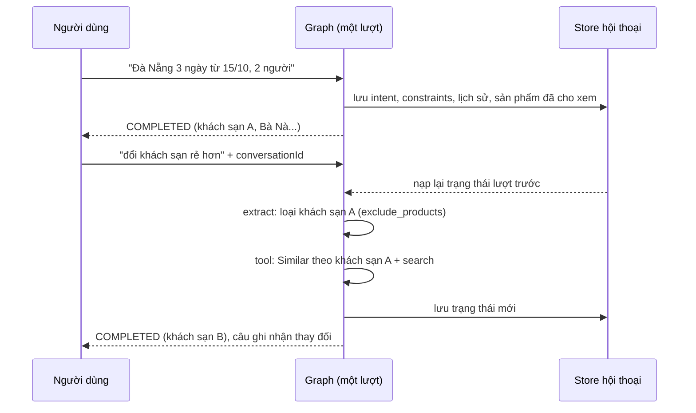
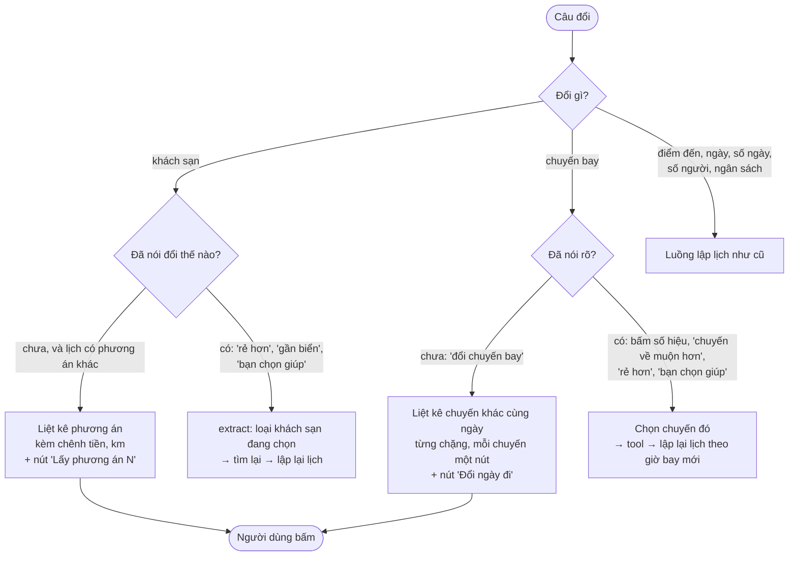

# Hội thoại nhiều lượt và sửa lịch

Phục vụ FR-AGT-01, FR-AGT-05, AC-AGT-04, AC-AGT-05. Mô tả theo code tại 2026-10-11; khi lệch, PRD và contract thắng.

## Mục đích

Người dùng nói tiếp trên cùng một hội thoại: trả lời câu hỏi, đổi ngày/số ngày/điểm đến, đổi khách sạn hay chuyến bay, hỏi
thêm về vé. Trợ lý nhớ chuyến đi đã chốt và chỉ sửa phần người dùng đổi. **Hỏi** thì lịch giữ nguyên; **đổi** thì lập lại
lịch.

## Luồng chính

## Cái gì được nhớ giữa các lượt

| Lưu | Nội dung |
|---|---|
| `intent`, `constraints` | Chuyến đi và ràng buộc đã chốt |
| Lịch sử chat | Tối đa 20 tin, 8.000 ký tự tổng, 1.000 ký tự mỗi tin; tin trợ lý kèm [ghi chú lượt](glossary.md#ghi-chu-luot) ≤ 300 ký tự |
| [Sản phẩm đã cho xem](glossary.md#previous_selection) | `productId`, tên, loại của chỗ ở và hoạt động trong lịch gần nhất |
| [Phương án khác](glossary.md#phuong-an-khac) (`previous_options`) | Số thứ tự và khách sạn theo đêm (`productId`, tên) của từng phương án khác đã hiện kèm lịch gần nhất |
| Chuyến bay đã chọn (`previous_flights`, `chosen_flights`) | Chuyến khác cùng ngày của từng chặng (để đổi vé) và chuyến người dùng đã chọn |
| Cờ hỏi | Đã hỏi gộp chưa, số vòng hỏi điểm đến/số ngày, ngân sách/nơi đi người dùng bảo bỏ qua |
| Giai đoạn trò chuyện | [Đồng ý lập lịch](glossary.md#dong-y-lap-lich), lời mời đang treo, nơi đã gợi ý, [nơi bị chê](glossary.md#noi-bi-che), số lần "không biết", nút lượt trước |
| Câu hỏi còn dở | [Câu hỏi về một nơi chưa rõ thành phố](glossary.md#cau-hoi-con-do) (`open_question`), [câu hỏi vé](glossary.md#cau-hoi-ve) (`pending_fare`); bỏ khi người dùng chuyển chuyện |
| Ngôn ngữ | `vi` / `en` |

Chỉ lượt trả 200 mới được lưu.

**Nơi lưu:**
- Store theo `conversationId` + chủ sở hữu: Redis TTL 24 giờ (dev/test dùng bộ nhớ trong).
- Người dùng đăng nhập (có `cdp_user_id`) còn được ghi từng lượt vào bảng `app.conversations` (Postgres). Khi store không
  còn, hội thoại được khôi phục từ đây.

## Business rule

- **Chỉ sửa phần được đổi.** Intent mới = intent cũ + phần LLM trích được lượt này + chip sửa tay (chip thắng).
- **"Đổi ngày" mà chưa nói ngày nào** thì hỏi giá trị mới, giữ intent cũ, không tìm lại. Xem
  [hieu-y-dinh-va-hoi-lai.md](hieu-y-dinh-va-hoi-lai.md).
- **Đổi một sản phẩm** (khi đã nói đổi thế nào, xem mục [Đổi vé, khách sạn](#doi-ve-khach-san)):
  - sản phẩm cũ vào `exclude_products`, nhưng chỉ nhận id có trong sản phẩm đã cho xem;
  - planner được mời dùng Similar với gốc là sản phẩm đó;
  - code luôn giữ một search cho loại đang đổi. Xem [tim-ung-vien.md](tim-ung-vien.md).
- **Chọn phương án khác** (AC-AGT-04, chốt 2026-10-08; hàng thẻ chốt 2026-10-08, đề xuất
  `update-archive/2026-10-08-chon-phuong-an-bang-nut.md`):
  - `compose` dựng sẵn lịch đầy đủ của từng phương án (cùng luật, cùng `validate_plan`); `finalize` lưu chúng vào
    `previous_options` cùng lịch đang chọn (`previous_plan`);
  - bấm "Dùng phương án này" (`selectStayOption.index`) hoặc nhắn "phương án N" / "option N" (so không dấu) mà N có lịch
    đã lưu thì graph đi `intake → apply_option → finalize`: lấy đúng lịch đã báo, không phân luồng, không tìm lại, không
    gọi LLM. Bấm thẻ thì không có lời đáp và không thêm lượt hội thoại (archive cập nhật câu trả lời gần nhất); gõ
    "lấy phương án N" thì có lời đáp ngắn do code dựng (đổi sang khách sạn nào, chênh tiền, chênh km, tổng km);
  - lịch vừa bỏ thành một phương án để quay lại; chênh km tính lại từ km tuyệt đối, chênh tiền tính lại tuyến tính, vượt
    ngân sách tính lại từ `estimatedTotal`; phương án còn lại chênh dưới 2 km bị bỏ; tối đa 3;
  - `constraints.specific_hotel` = tên khách sạn đêm 1 của phương án đã chọn, để các lượt sau giữ khách sạn đó;
  - grounding của lượt chọn: sản phẩm trong các lịch đã lưu phía server (đã kiểm với kết quả tool lúc `compose`);
    khách sạn lưu kèm lịch giữ `priceAdults` của candidate, vì sản phẩm trong lịch chỉ là `summary` mà `finalize` cần
    khoá này để tính lại số phòng (sửa 2026-10-09);
  - N không có lịch đã lưu (hội thoại cũ, số không tồn tại) thì câu đi như mọi câu khác (luồng `specific_hotel` cũ);
  - người dùng nêu thẳng tên khách sạn thì đi luồng `specific_hotel` sẵn có.
- **Ràng buộc tồn tại qua các lượt** cho tới khi người dùng bỏ (`clear_fields`). Loại hàng mà Recommendation tạm loại thì
  không được lưu.
- **Câu ghi nhận thay đổi** do code viết, so intent đầu lượt với intent mới.
- **Ngữ cảnh đưa cho LLM là bản đã diễn giải,** không phải dump thô:
  - một dòng tóm tắt chuyến đi;
  - giai đoạn hội thoại;
  - ghi chú thay cho cả bài lịch trình cũ;
  - câu cuối của trợ lý nguyên văn nếu ≤ 500 ký tự.

  Chi tiết: [../langgraph-nodes.md](../langgraph-nodes.md) mục "Ngữ cảnh cho LLM".
- **Vé được tra lại** ở mọi lượt có tìm sản phẩm; chuyến người dùng đã chọn được giữ. Xem [ve-may-bay.md](ve-may-bay.md).
- **Hỏi vé sau khi có lịch** ("chuyến về mấy giờ", "vé rẻ nhất là chuyến nào"): trả lời từ catalog, lịch giữ nguyên, các lượt
  sau vẫn dựa trên lịch đó. Xem [tu-van-ve-may-bay.md](tu-van-ve-may-bay.md).

## Đổi vé, khách sạn (AC-AGT-05, chốt 2026-10-11)

Luật tất định chạy trong `classify` trước LLM, không gọi LLM để hỏi lại.

- Không có chuyến hợp ý ("muộn hơn" mà không còn chuyến muộn hơn): nói rõ và vẫn đưa danh sách.
- Chọn "phương án N" đi đường riêng `apply_option`, không tìm lại (mục Business rule ở trên).

## Edge case

- `conversationId` không có ở store lẫn bảng hội thoại, hoặc thuộc người khác: 404.
- Lỗi đọc store: coi như không có. Lỗi ghi bảng hội thoại: chỉ log, không làm hỏng lượt.
- Lượt hỏi lại không đổi danh sách sản phẩm đã cho xem; chỉ lượt `COMPLETED` mới thay danh sách này. `previous_options`
  cũng vậy; lịch mới không có phương án khác thì danh sách thành rỗng.
- ⚠️ cần xác nhận: chọn phương án có hai khách sạn chỉ giữ được khách sạn đêm 1, vì `specific_hotel` chỉ nhận một tên.
  Lịch dựng lại có thể khác dòng phương án đã hiện (tìm lại cho ra ứng viên khác), nên km và tiền có thể lệch chút.
- ⚠️ cần xác nhận: lịch có hai khách sạn, không có phương án khác, người dùng nói "đổi khách sạn rẻ hơn" không nêu tên: cả hai cùng nằm
  trong sản phẩm đã cho xem, LLM tự chọn id để loại.
- ⚠️ cần xác nhận: bảng hội thoại ghi `expires_at` = 24 giờ sau tin cuối, nhưng lúc khôi phục không lọc theo cột này. Hội
  thoại cũ hơn 24 giờ vẫn khôi phục được, trừ khi có job dọn bảng (chưa thấy trong code agent).

## Code liên quan

- [`agents/nodes.py`](../../../../src/backend/app/agents/nodes.py) — `intake_node_async` (nạp), `finalize_node_async` (lưu)
- [`agents/steps/history.py`](../../../../src/backend/app/agents/steps/history.py) — giới hạn lịch sử, ngữ cảnh cho LLM
- [`agents/steps/turn_notes.py`](../../../../src/backend/app/agents/steps/turn_notes.py) — ghi chú lượt
- [`agents/steps/classification.py`](../../../../src/backend/app/agents/steps/classification.py) — gộp intent, ràng buộc đổi món, `picked_option`
- [`agents/steps/changes.py`](../../../../src/backend/app/agents/steps/changes.py) — đổi khách sạn/chuyến bay chưa rõ hay đã rõ
- [`agents/steps/option_swap.py`](../../../../src/backend/app/agents/steps/option_swap.py) — `apply_option`
- [`infrastructure/persistence/conversation_store.py`](../../../../src/backend/app/infrastructure/persistence/conversation_store.py), [`postgres_conversation_archive.py`](../../../../src/backend/app/infrastructure/persistence/postgres_conversation_archive.py)
