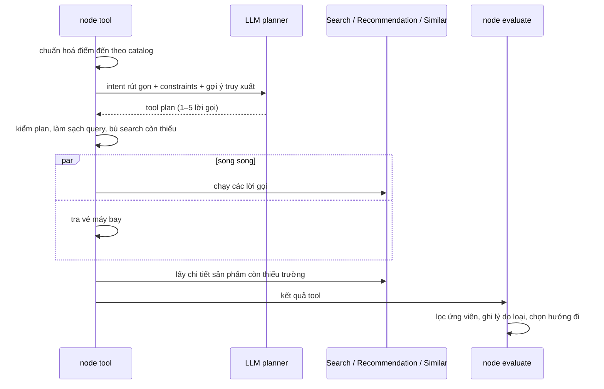

# Tìm và lọc ứng viên

Phục vụ FR-AGT-02, FR-AGT-04, FR-AGT-05, NFR-REL-01. Mô tả theo code tại 2026-10-07; khi lệch, PRD và contract thắng.

## Mục đích

Lấy sản phẩm thật từ catalog cho chuyến đi, rồi lọc còn những [ứng viên](glossary.md#candidate) dùng được. Mọi sản phẩm
trong lịch trình phải đi ra từ bước này ([grounding](glossary.md#grounding)). Vé máy bay đi đường riêng:
[ve-may-bay.md](ve-may-bay.md).

## Luồng chính

## Ba tool planner được dùng

| Tool | Khi nào | Giới hạn |
|---|---|---|
| `search_products` | Mọi lượt | 10 kết quả mỗi lời gọi |
| `get_recommendations` | Planner tự chọn; **luôn có** khi người dùng đã đăng nhập | k = 10 |
| `get_similar_products` | Chỉ ở lượt đổi món, khi đã có [sản phẩm đã cho xem](glossary.md#previous_selection) | ≤ 2 lời gọi, mỗi sản phẩm gốc một lần, gốc phải nằm trong danh sách đã xem |

Tổng tối đa 5 lời gọi một lượt. Quá trần thì Similar bị bỏ trước.

## Business rule của tool plan

- **Phủ đủ loại xếp được lịch.** Code tự thêm search cho `hotel`, `attraction`, `golf` còn thiếu, trừ loại người dùng loại
  trừ. Một search không lọc loại được coi là đã phủ mọi loại.
- **Điểm đến luôn là tên catalog,** không theo cách planner viết.
- **Query chỉ mang phần ngữ nghĩa.** Code cắt giá, ngân sách, ngày, số ngày, số người, số sao, phủ định và tên điểm đến khỏi
  query. Lý do: `/search` đọc các cụm đó thành filter **từng sản phẩm** ("ngân sách 5 triệu" thành trần giá mỗi sản phẩm),
  còn text đem embed thì không có chúng.
- **[Gợi ý truy xuất](glossary.md#goi-y-truy-xuat) luôn được thêm vào query:** tiện ích khách sạn bắt buộc, "phù hợp gia đình
  có trẻ nhỏ", sở thích, tên hoạt động bắt buộc. Lý do: các yêu cầu này chỉ được hậu kiểm trên top-10, nên phải kéo được
  sản phẩm đúng vào top-10. Giá trị `false` không thêm, vì vector không hiểu phủ định.
- **Ngân sách cả chuyến không thành filter giá.** Chỉ `hotel_price_max` và `star_rating_min` (người dùng nói về khách sạn)
  mới thành `priceMax`/`starRatingMin` của search khách sạn.
- **Lỗi của Similar là mềm:** không có phương án, hoặc hỏng khi search đã có dữ liệu, thì không làm lượt phải thử lại.

## Lọc ứng viên (`evaluate`)

Mỗi sản phẩm bị loại ở lý do đầu tiên khớp; lý do thành cảnh báo `PRODUCT_DROPPED_*`:

| Lý do | Điều kiện |
|---|---|
| `EXCLUDED` | Người dùng đã bỏ sản phẩm này ở lượt trước |
| `DESTINATION` | Khác điểm đến (Similar lệch điểm đến thì bỏ lặng lẽ, không cảnh báo) |
| `UNAVAILABLE` | `available = false` |
| `TAXONOMY` | Loại bị loại trừ |
| `DATE` | Ngày đi nằm ngoài `availableFrom`–`availableTo` của sản phẩm |
| `PRICE_BASIS`, `PRICE` | Khách sạn: không có giá hoặc sai đơn vị giá; vượt trần giá |
| `ATTRIBUTES` | Khách sạn: thiếu số sao tối thiểu, tiện ích không khớp |
| `NAMED_REQUIREMENT` | Không chứa tên khách sạn/hoạt động người dùng bắt buộc |

**Loại trừ tạm theo Recommendation:** loại hàng Recommendation báo người dùng đã mua trong chuyến thật trên CDP
(`excludedVerticals`) chỉ bị lọc **trong lượt này**, không ghi vào constraints. Bắt buộc có khách sạn thì không áp.

## Chọn hướng đi sau khi lọc

| Tình huống | Hướng |
|---|---|
| Có lỗi xác thực | Lỗi 401 |
| Chỉ có lỗi tạm thời | Thử lại (một lần) |
| Lỗi vĩnh viễn, còn ứng viên / không còn | `FALLBACK` / lỗi |
| Không ứng viên, có điều kiện bắt buộc | Hỏi lại về điều kiện đó |
| Không ứng viên | `NO_RESULTS` (kèm ngày gần nhất còn bán, nếu có) |
| Bắt buộc khách sạn/hoạt động mà không có loại đó | Hỏi lại |
| Không có gì xếp được lịch (chỉ combo/vé) | `FALLBACK` |
| Còn lại | Xếp lịch → [xep-lich.md](xep-lich.md) |

`drop_summary` ghi vì sao từng loại không còn ứng viên (lý do phổ biến nhất, cửa sổ mở bán, ngày gần nhất còn bán). Câu
"chưa có khách sạn" và câu hỏi về điều kiện bắt buộc dùng dữ liệu này, không để LLM tự nói lý do.

## Edge case

- ⚠️ cần xác nhận: lọc `DATE` chỉ so **ngày khởi hành** với cửa sổ mở bán. Hoạt động xếp ngày 3, hay khách sạn ở các đêm
  sau, không được kiểm theo đúng ngày dùng.
- Planner quên `query` → dùng tên điểm đến. Plan chỉ có Similar với gốc bịa → đổi thành một search theo điểm đến.
- Planner tự thêm tham số lạ (vd `excludeProducts`) → bỏ tham số, không huỷ plan.
- Không lấy được chi tiết một sản phẩm → tính là lỗi của lượt (tạm thời hay vĩnh viễn theo mã lỗi tool trả về).

## Code liên quan

- [`agents/steps/tool_planning.py`](../../../../src/backend/app/agents/steps/tool_planning.py) — lập, kiểm và chạy plan
- [`domain/itinerary/search_hints.py`](../../../../src/backend/app/domain/itinerary/search_hints.py) — làm sạch query, gợi ý truy xuất
- [`application/itinerary/retrieval.py`](../../../../src/backend/app/application/itinerary/retrieval.py) — lấy chi tiết, lọc, `drop_summary`
- [`agents/steps/evaluation.py`](../../../../src/backend/app/agents/steps/evaluation.py) — chọn hướng đi
- [`agents/runtime_dependencies.py`](../../../../src/backend/app/agents/runtime_dependencies.py) — bắt buộc Recommendation khi có JWT
- Hợp đồng tool: [../../hop-dong-tich-hop-itinerary-assistant.md](../../hop-dong-tich-hop-itinerary-assistant.md) §2
