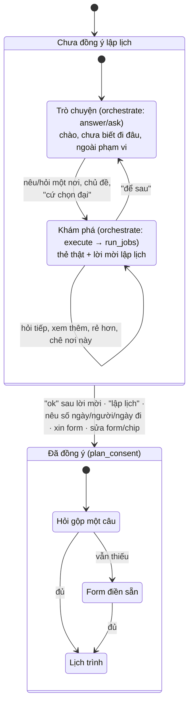

# Trò chuyện và khám phá trước khi lập lịch

Phục vụ FR-AGT-01, FR-AGT-06, AC-AGT-06, AC-AGT-07. Mô tả theo code tại 2026-10-13; khi lệch, PRD và contract thắng.

## Mục đích

Người dùng chưa xin lập lịch thì trợ lý **không hỏi thông tin chuyến, không hiện form**. Nó trò chuyện, gợi ý điểm đến,
giới thiệu một nơi bằng thẻ sản phẩm thật, rồi mời lập lịch. Chỉ khi người dùng
[đồng ý](glossary.md#dong-y-lap-lich) mới sang luồng hỏi gộp → form → lập lịch
([hieu-y-dinh-va-hoi-lai.md](hieu-y-dinh-va-hoi-lai.md)).

## Ai làm gì

Orchestrator là luồng duy nhất (chốt 2026-10-13). Một LLM đầu mối (`orchestrate`) đọc tin nhắn và ngữ cảnh, chọn một
trong bốn hành động: `answer`, `ask`, `plan` (khi đồng ý đã kiểm), `execute`.
- `execute` khai việc chỉ đọc: khám phá (`explore`: ý định `new|more|about_shown|cheaper|dearer`, phạm vi, mốc `near`,
  cách xếp) hoặc vé (`fare`).
- Code chạy việc qua port (`steps/jobs.py`), giữ kết quả đầy đủ và con trỏ, đưa cho LLM bản rút gọn với mã thẻ `#n`.
- LLM viết câu dùng mã và placeholder; `gatekeep` kiểm mã, số, luật lặp, số thẻ rồi điền số. Không có LLM riêng cho khám
  phá, không đoán ý bằng regex.

Không nêu thành phố và chưa có phạm vi đang nói thì tìm toàn catalog; đã có điểm đến đang nói thì giữ phạm vi đó. Có kết quả
trước rồi mới hỏi thu hẹp nếu cần. Chỉ hỏi trước khi chưa rõ đối tượng hoặc thiếu thông tin bắt buộc để thực thi.

Phạm vi của việc tìm khác với thành phố của một thẻ kết quả. Khi các thẻ đến từ tìm toàn catalog,
`via.destination=null` giữ nguyên nghĩa đó ở lượt "thêm"; không lấy thành phố của thẻ cuối làm bộ lọc.
Khi nhiều việc đã tạo thẻ có điều kiện khác nhau, chỉ kế thừa điều kiện chung, không tự chọn việc cuối.
Orchestrator dùng `Job.scope_mode=replace` khi người dùng đổi/mở rộng phạm vi (ví dụ "không chỉ mỗi Vũng Tàu"):
code chỉ dùng điều kiện khai trong việc mới, `destination=null` tìm toàn catalog, vẫn loại thẻ đã xem nếu `intent=more`.
`excluded_destinations` chỉ loại điểm đến trong phạm vi việc đó và các lượt tìm thêm kế thừa nó;
không ghi vào `rejected_destinations` của cả hội thoại. Việc đổi phạm vi không dùng `continue_from` nguồn cũ.

## Hai giai đoạn của hội thoại

Câu hỏi giá vé là việc `fare` ở cả hai giai đoạn: [tu-van-ve-may-bay.md](tu-van-ve-may-bay.md). Đã đồng ý rồi mà hỏi về
một nơi thì vẫn khám phá, chuyến giữ nguyên.

## Người dùng nói gì → trợ lý làm gì

Đây là hành vi mong đợi theo AC. Dòng có dấu * từng chỉ được kiểm trên luồng cũ (test đã xoá 13/10). Các dòng này phải kiểm
lại trên orchestrator (`docs/plan/2026-10-12-go-luong-cu-orchestrator-chinh.md` mục 1.5); lỗi đã biết ghi ở cột cuối.

| Người dùng | Trợ lý | Lỗi đã biết |
|---|---|---|
| "xin chào", muốn đi chơi nhưng chưa có nơi | Mời nói nơi muốn đến hoặc hỏi loại chuyến, kèm nút | D1-07: lượt mơ hồ có khi không có nút |
| "không biết", "cứ chọn đại", "tuỳ bạn" | Hỏi một câu về loại chuyến; lần sau tự chọn một điểm đến và khám phá luôn | |
| "Hà Nội", "hn có gì?" | Khám phá Hà Nội (tối đa 3 điểm tham quan/tour + 2 khách sạn), mời lập lịch | |
| "xem thêm", "còn gì nữa" | Thẻ mới, loại thẻ đã hiện trong cả hội thoại theo điểm đến + loại | |
| "khách sạn thứ hai giá bao nhiêu", "mấy chỗ đó có hồ bơi" | Tra lại đúng thẻ đã xem (`about_shown`), không tìm mới | D1-03: hỏi còn phòng ngày cụ thể rơi vào câu dự phòng |
| "rẻ hơn", "đắt hơn" | So với mốc giá mới, giữ điều kiện tìm cũ | |
| "chán, Đà Nẵng đi rồi", "chỗ khác đi" | Ghi [nơi bị chê](glossary.md#noi-bi-che), gợi ý nơi khác; nơi bị chê không vào nút* | |
| "Văn Miếu tối có mở không?"* | Chỉ thẻ nơi đó; câu đầu trả lời thẳng từ dữ liệu catalog | |
| "khách sạn gần Hồ Gươm", "gần Văn Miếu có gì"* | Tìm quanh mốc có toạ độ | D1-01: "Hồ Gươm" không khớp tên catalog "Hồ Hoàn Kiếm", 0 thẻ |
| "khách sạn có hồ bơi gần phố cổ" (nhiều thành phố có "phố cổ")* | Hỏi lại kèm nút từng nơi | |
| Ngoài phạm vi (thời tiết, đặt chỗ, thanh toán) | Trả lời thường (200): nói rõ không làm được, kèm nút việc gần nhất làm được | |
| Chèn lệnh, đòi secret, tục tĩu | Từ chối 400 ở `precheck` (guardrail, không gọi LLM) | |

## Business rule

- **Số thẻ (AC-AGT-06, chốt 13/10):** khi không nêu số lượng, tối đa 3 điểm tham quan/tour, 2 khách sạn khi hỏi chung,
  4 khi hỏi riêng chỗ ở; LLM được chọn ít hơn. Khi nêu số lượng, orchestrator khai nguyên số trong `Job.requested_count`;
  code áp trần tổng 20 thẻ/lượt và thông báo giới hạn khi yêu cầu vượt 20. Không lưu số lượng này vào `shown.via` để
  tránh ép lượt sau tiếp tục trả cùng số. Bản rút gọn mang số lượng; `continue_from` giữ số của việc gốc, không cộng
  thêm chỉ tiêu theo số alias. Khi model kết thúc mà bản rút gọn chưa đủ, nguồn vẫn còn và chưa chạm phanh, code yêu
  cầu continuation trong giới hạn 3 việc/vòng, 3 vòng/lượt, 10 tool. Gác cổng bù đủ thẻ từ mã mới đã liệt kê, có câu
  dẫn từ tên catalog; không lấy ứng viên chưa vào bản rút gọn. Thiếu thì câu trả lời có số đã chọn/yêu cầu và lý do.
  Lỗi tra cứu không ghi thành thiếu dữ liệu. Thẻ
  chỉ từ kết quả tool của chính lượt đó và có trong bản rút gọn; [lý do thẻ](glossary.md#ly-do-the) do code tính trên toàn bộ
  kết quả.
- **Lời dẫn:** LLM viết, nhắc thẻ bằng `#n`; code đổi thành link và điền số. Cụm khen chung chỉ giữ lần đầu
  (`replies.once_praise`).
- **[Nút gợi ý](glossary.md#nut-goi-y):** tối đa 3, ít nhất hai hướng; chưa có nút lập lịch thì thêm một. Không lặp nút lượt
  trước, không hai nút cùng mẫu câu, chỉ nêu nơi có thật. LLM đề xuất, code kiểm và bù (`replies.checked_suggestions`).
- **Một câu hỏi mỗi lượt.** Nhiều câu vé cùng thiếu thông tin thì chỉ hỏi một, các câu khác chờ đúng một lượt sau.
- **Tra cứu lỗi khác với không có.** Việc lỗi ghi trạng thái `failed` kèm mã nguyên nhân; câu trả lời không được nói "không
  có". Chỗ còn vi phạm đã biết: D1-02 (vé nhiều điểm đến).
- **Response:** `NEEDS_CLARIFICATION` có `searchResults` (contract 1.24.0); `finalize` kiểm lại từng thẻ.

## Edge case

- Tên nơi không có trong catalog: việc khám phá trả `empty` kèm ghi chú, orchestrator nói rõ và gợi ý nơi có.
- Câu có thông tin chuyến ("Hà Nội 3 ngày") được coi là đồng ý (`planning_implied`), đi `extract`.
- Gõ tắt, không dấu, tên dân gian: orchestrator đọc ra tên nơi, thành phố; code đối chiếu với catalog.
- LLM của orchestrator lỗi hoặc quá giờ: `gatekeep` dùng câu dự phòng từ dữ liệu đã tra.

## Code liên quan

- [`agents/steps/orchestration.py`](../../../../src/backend/app/agents/steps/orchestration.py) — `orchestrate`, `run_jobs`, `gatekeep`
- [`agents/steps/jobs.py`](../../../../src/backend/app/agents/steps/jobs.py) — việc khám phá, vé; phân trang, mốc, so giá
- [`domain/itinerary/gatekeeper.py`](../../../../src/backend/app/domain/itinerary/gatekeeper.py) — kiểm mã, số, luật lặp, số thẻ
- [`domain/itinerary/exploration.py`](../../../../src/backend/app/domain/itinerary/exploration.py) — chọn thẻ, lý do thẻ, khớp tên nơi, gần nơi
- [`agents/steps/consent.py`](../../../../src/backend/app/agents/steps/consent.py) — mọi luật đồng ý lập lịch
- [`agents/steps/phase.py`](../../../../src/backend/app/agents/steps/phase.py) — cờ hội thoại nào lưu qua lượt
- [`agents/steps/replies.py`](../../../../src/backend/app/agents/steps/replies.py) — nút gợi ý, cụm khen, phần mô tả
- Chi tiết kỹ thuật: [../langgraph-nodes.md](../langgraph-nodes.md) mục "Orchestrator"
