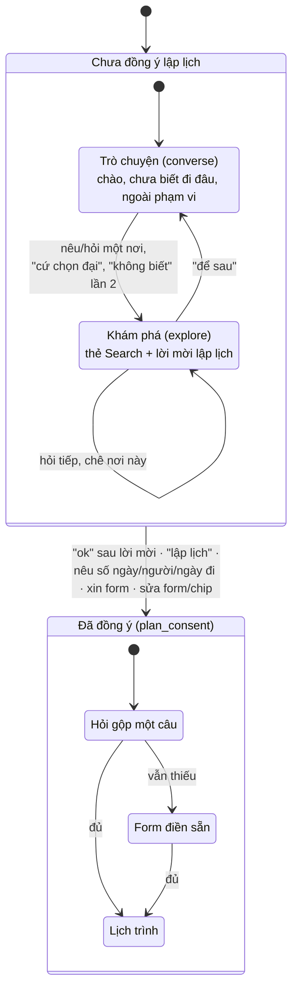

# Trò chuyện và khám phá trước khi lập lịch

Phục vụ FR-AGT-01, FR-AGT-06, AC-AGT-06, AC-AGT-07. Mô tả theo code tại 2026-10-11; khi lệch, PRD và contract thắng.

## Đường orchestrator sau cờ (chốt 12/10)

Mô tả bên dưới giữ đường cũ mặc định off. Cờ `ITINERARY_ORCHESTRATOR=on` dùng một LLM đầu mối để quyết trả lời,
hỏi một câu, lập lịch khi đã đồng ý, hoặc thực thi explore/fare. Không đoán ý bằng regex mới.
Nêu chủ đề/loại nơi/tiện ích đủ rõ (ví dụ 'đi chùa', 'có chùa nào') thì tự tìm và đưa thẻ ngay trong lượt đó,
không chờ khách nói 'tìm đi'. Chưa nêu thành phố và chưa có phạm vi đang nói thì tìm toàn catalog (`destination=null`);
đã có điểm đến đang nói thì giữ phạm vi đó. Có kết quả trước rồi mới hỏi thu hẹp nếu cần. Model nhận điểm đến của từng
mục từ tool, không tự chọn thành phố làm bộ lọc. Chỉ hỏi trước khi chưa rõ đối tượng hoặc thiếu thông tin bắt buộc
để thực thi (ví dụ tuyến vé); không nói không có dữ liệu trước khi tìm.
Chỉ nêu điểm đến thì tự khám phá chung; xin thêm thì loại thẻ đã hiện cả hội thoại theo điểm đến + loại. Hỏi 'khách sạn
thứ hai', 'mấy chỗ đó có hồ bơi' chỉ tra lại đúng mã đã xem; giá/rẻ hơn/đắt hơn dùng dữ liệu mới và giữ điều kiện tìm.
Câu hỏi mới được gặp lại thẻ cũ. Tối đa 3 điểm tham quan/tour, 2 khách sạn khi hỏi chung / 4 khi hỏi riêng.
Tin nhiều việc được trả lời đủ trong một response; vé là khối code viết nguyên văn; việc phụ thuộc chạy vòng sau.
Phanh 3 việc/vòng, 3 vòng execute, 10 lời gọi tool và thời gian; phần chưa làm phải nói rõ. Chỉ có một câu hỏi,
các câu vé khác còn thiếu thông tin chờ đúng lượt tiếp theo. Từ chối xoá lời mời, nút lập lịch không tạo lại; đồng ý
được kiểm trước nhánh lập lịch. Lịch đã có giữ nguyên khi đang hỏi vé/khám phá. Mọi đường qua finalize để kiểm và lưu.

Runtime và sơ đồ: [langgraph-nodes.md](../langgraph-nodes.md#orchestrator-sau-cờ-chốt-2026-10-12).
Hành vi chi tiết: [plan đã chốt](../../../plan/2026-10-12-nho-ket-qua-da-xem.md).

## Mục đích

Người dùng chưa xin lập lịch thì trợ lý **không hỏi thông tin chuyến, không hiện form**. Nó trò chuyện, gợi ý điểm đến,
giới thiệu một nơi bằng thẻ sản phẩm thật, rồi mời lập lịch. Chỉ khi người dùng
[đồng ý](glossary.md#dong-y-lap-lich) mới sang luồng hỏi gộp → form → lập lịch
([hieu-y-dinh-va-hoi-lai.md](hieu-y-dinh-va-hoi-lai.md)).

## Hai giai đoạn của hội thoại

Câu hỏi giá vé đi nhánh riêng ở cả hai giai đoạn: [tu-van-ve-may-bay.md](tu-van-ve-may-bay.md).
Đã đồng ý rồi mà hỏi về một nơi thì vẫn khám phá, chuyến giữ nguyên, nút "Tiếp tục lập lịch".

## Người dùng nói gì → trợ lý làm gì

| Người dùng | Trợ lý |
|---|---|
| "xin chào", muốn đi chơi nhưng chưa có nơi | Mời nói nơi muốn đến, gợi ý 3 điểm đến của catalog, mỗi điểm một nút |
| "không biết" (chưa có nơi) | Lần 1: hỏi loại chuyến (biển, mát, thành phố) kèm nút. Lần 2: tự chọn điểm đến nhiều sản phẩm nhất và khám phá luôn. Lần 3+: ngừng hỏi, chỉ giữ nút |
| "cứ chọn đại", "tuỳ bạn", "đâu cũng được" | Tự chọn và khám phá ngay (như lần 2) |
| "Hà Nội", "hn có gì?" | Khám phá Hà Nội, ghi làm điểm đến, mời lập lịch |
| "chán, Đà Nẵng đi rồi", "chỗ khác đi" | Ghi [nơi bị chê](glossary.md#noi-bi-che), khám phá nơi khác; nơi bị chê không vào nút |
| "đi biển", "chỗ nào mát" | Nêu vài điểm đến hợp loại, mỗi nơi một nút |
| "Văn Miếu tối có mở không?", "lăng bác mấy giờ mở" | Chỉ thẻ nơi đó; câu đầu trả lời thẳng (giờ, vé, địa chỉ lấy từ catalog) |
| "gần Văn Miếu có gì nữa?" | Điểm tham quan gần nhất (≤ 3 km), không lặp nơi đó |
| "khách sạn có hồ bơi gần phố cổ" (nhiều thành phố có "phố cổ") | Hỏi "Phố cổ Hà Nội hay Hội An?" kèm nút; nhớ [câu hỏi còn dở](glossary.md#cau-hoi-con-do) để trả lời khi người dùng chọn |
| "khách sạn rẻ nhất/đắt nhất" | Xếp theo giá của cả điểm đến (có "gần <nơi>" thì chỉ trong vùng 1,5 km quanh nơi đó) |
| Ngoài phạm vi (thời tiết, đặt chỗ, thanh toán) | Trả lời thường (200): nói rõ không làm được, kèm nút việc gần nhất làm được |
| Chèn lệnh, đòi secret, tục tĩu | Từ chối 400 (guardrail, không gọi LLM) |

## Business rule

- **Thẻ khám phá:** tối đa 4 thẻ mỗi lượt, lấy từ Search của chính lượt đó: 2 điểm tham quan/tour + 2 khách sạn (hỏi riêng
  chỗ ở thì 4 khách sạn). Code chọn thẻ và [lý do thẻ](glossary.md#ly-do-the) trên toàn bộ kết quả; LLM chỉ viết lời dẫn.
- **Lời dẫn:** mỗi thẻ 2–3 câu, đứng ngay sau câu đầu nhắc tới nó: nơi đó là gì, đáng trải nghiệm gì, hợp với ai. Không
  viết điểm, lượt đánh giá, giá, giờ (thẻ đã hiện). Giờ chỉ nêu khi hỏi đúng nơi đó; giá chỉ nêu khi hỏi giá.
- **Không bịa:** không tra ra nơi được hỏi thì nói thẳng là chưa kiểm được giờ, giá. Lượt rơi về `converse` mà câu LLM vẫn
  nêu giờ, giá thì code thay bằng câu cố định.
- **[Nút gợi ý](glossary.md#nut-goi-y):** tối đa 3, ít nhất hai hướng (đi tiếp / xem sâu / đổi hướng); chưa có nút lập lịch
  thì luôn thêm một. Không lặp nút lượt trước (trừ nút lập lịch, viết lại theo thông tin mới), không hai nút cùng mẫu câu,
  chỉ nêu nơi và sản phẩm có thật. LLM đề xuất, code kiểm và bù.
- **Giọng điệu:** mỗi lượt hỏi tối đa một câu, không hỏi lại cùng câu, không bình luận thái độ người dùng.
- **Response:** `NEEDS_CLARIFICATION` có `searchResults` (contract 1.24.0); `finalize` kiểm từng thẻ đúng là sản phẩm Search
  lượt đó.

## Edge case

- Tên nơi không có trong catalog ("Bangkok có gì?"): quay lại `extract` một lần, rồi hỏi lại như điểm đến ngoài catalog.
- Câu có chữ số luôn qua `extract` trước. Có số ngày, ngày đi hoặc số người ("Hà Nội 3 ngày") thì coi là đồng ý.
- Gõ tắt, không dấu, tên dân gian ("hn", "lăng bác", "văn miếu tối mở ko b"): LLM của `classify` đọc ra tên nơi, thành phố;
  code đối chiếu với catalog, không dùng bảng từ khoá.
- LLM viết lời dẫn lỗi hoặc quá giờ: code dựng lời dẫn từ dữ liệu thẻ.

## Code liên quan

- [`agents/steps/consent.py`](../../../../src/backend/app/agents/steps/consent.py) — mọi luật đồng ý lập lịch
- [`agents/steps/phase.py`](../../../../src/backend/app/agents/steps/phase.py) — cờ hội thoại nào lưu qua lượt, cờ nào bị dọn khi nào
- [`agents/steps/classification.py`](../../../../src/backend/app/agents/steps/classification.py) — `route_result`, chê nơi, "không biết"
- [`agents/steps/exploration.py`](../../../../src/backend/app/agents/steps/exploration.py) — node `explore`, lời dẫn, nút
- [`domain/itinerary/exploration.py`](../../../../src/backend/app/domain/itinerary/exploration.py) — chọn thẻ, lý do thẻ, khớp tên nơi, gần nơi
- [`agents/steps/conversation.py`](../../../../src/backend/app/agents/steps/conversation.py) — `converse`, câu cố định khi không kiểm được
- Chi tiết kỹ thuật: [../langgraph-nodes.md](../langgraph-nodes.md) mục "Giai đoạn trò chuyện và khám phá"
