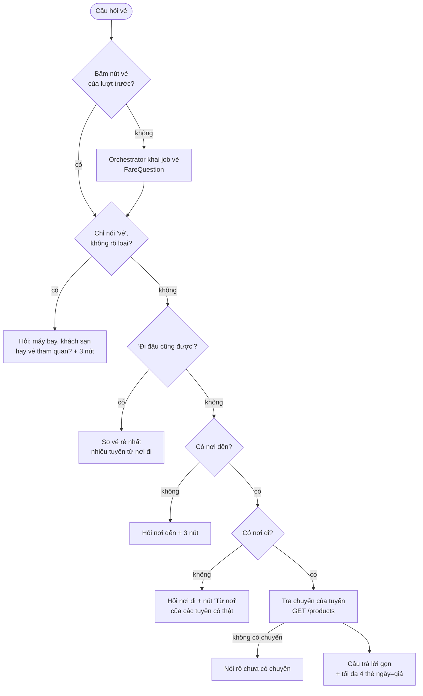

# Tư vấn vé máy bay

Phục vụ FR-AGT-07, AC-AGT-05, AC-AGT-08, NFR-REL-01. Mô tả theo code tại 2026-10-13; khi lệch, PRD và contract thắng.

## Mục đích

Người dùng hỏi giá hay giờ vé máy bay ở bất kỳ lúc nào, trước hoặc sau khi có lịch. Trợ lý trả lời ngay từ chuyến bay thật
của catalog và **không lập lịch lại**. Đã có lịch thì lịch giữ nguyên. Khác với [ve-may-bay.md](ve-may-bay.md), là vé
được chọn tự động khi lập lịch.

**LLM chỉ hiểu câu hỏi, code viết câu trả lời.** Orchestrator khai job vé (`fare`, `FareQuestion`): nơi đi, nơi đến, ngày,
khung giờ, rẻ hay đắt nhất. `run_jobs` tra chuyến qua `fares.answer` và dựng câu trả lời. Tin chỉ hỏi vé dùng nguyên câu
đó; tin hỏi vé và việc khác thì orchestrator chèn khối vé (`[[fare_block:n]]`) vào câu trả lời chung.

## Luồng chính

Chỗ LLM để trống được lấy từ câu hỏi vé còn dở (`pending_fare`), rồi từ chuyến đang nói (`intent`).

## Hỏi gì → trả lời gì

| Người dùng hỏi | Trợ lý nêu |
|---|---|
| "vé sg ra hn bao nhiêu" | Vé rẻ nhất của tuyến trong cả [đợt mở bán](glossary.md#dot-mo-ban), kèm ngày bay |
| "đắt nhất thì sao?" | Vé đắt nhất cả đợt |
| "ngày 20/10 thì sao" | Chuyến rẻ nhất ngày đó, so với cả đợt. Ngày đó không có chuyến: nói rõ, nêu tối đa 2 ngày gần nhất có chuyến và ngày rẻ nhất cả đợt |
| "đi sớm thì sao" | Chuyến trong khung giờ: đi sớm < 09:00, sáng 05–12, chiều 12–18, tối ≥ 18:00. Không có thì nói rõ và tính mọi giờ |
| "ngày nào không có chuyến" | Đợt mở bán và các ngày chưa có chuyến |
| "ngày khác thì sao" | Các ngày kế tiếp, không lặp ngày vừa hiện |
| "rẻ hơn nữa không" (sau khi đã báo giá cùng tuyến) | Nói rõ đây đã là vé rẻ nhất tới ngày cuối đợt, rồi nêu vé đó; kể cả khi lượt trước trả lời một ngày cụ thể như chặng về của lịch (chat thử M11 từng lặp y hệt câu ngày về) |
| "tại sao đắt vậy" | Nói rõ dữ liệu không có hành lý, điều kiện vé, ghế còn lại. Chỉ nêu số: gấp mấy lần vé rẻ nhất, so với giá phổ biến, hạng ghế, hãng, bay sát ngày (≤ 7 ngày) |
| "tao ở sài gòn, đi đâu cũng được miễn vé rẻ" | Chưa rõ loại vé nên hỏi lại trước. Chọn máy bay thì so vé rẻ nhất của nhiều tuyến từ Sài Gòn |
| "chuyến bay về mấy giờ" (đã có lịch) | Chiều về của chính chuyến đi, đúng ngày cuối |

## Business rule

- **Chỉ chuyến một chiều thật, còn bán từ hôm nay.** Chuyến giá minh hoạ (Thương gia mô phỏng) chỉ được tính khi tuyến không
  còn chuyến giá thật.
- **Câu trả lời gọn.** Câu chỉ nêu chuyến trả lời câu hỏi (hãng, số hiệu, giờ cất cánh, ngày, giá). Các chuyến khác thành
  [hàng thẻ ngày–giá](glossary.md#hang-the-ngay-gia), tối đa 4 thẻ (`searchResults.flight`, contract 1.25.0). Mỗi thẻ mở
  `/flights` đúng tuyến, đúng ngày.
- **Nhớ ngữ cảnh.** Sau khi báo giá, trợ lý giữ tuyến, kiểu hỏi (rẻ/đắt) và các chuyến vừa hiện, nên câu hỏi tiếp ngắn vẫn
  hiểu được. "Ngày khác", "tại sao đắt" giữ kiểu rẻ/đắt của lần trước; hỏi ngày, giờ thì mặc định rẻ nhất.
- **Nút của câu trả lời vé** ("Từ TP. Hồ Chí Minh", "Đắt nhất thì sao?", "Ngày nào còn vé?") được bấm thì đi thẳng nhánh vé,
  không gọi LLM.
- **Câu gộp nhiều ý:** trợ lý trả lời phần vé, các ý còn lại thành nút.
- **Hỏi khác với đổi.** "Vé rẻ nhất là chuyến nào?" là hỏi: lịch giữ nguyên. "Đổi chuyến bay" là đổi: đi luồng đổi và lập
  lại lịch ([sua-lich-qua-nhieu-luot.md](sua-lich-qua-nhieu-luot.md#doi-ve-khach-san)).
- **Grounding:** chuyến nêu trong câu là link `[Hãng Số hiệu](product:id)` và nằm trong thẻ; `finalize` kiểm như mọi sản
  phẩm khác.
- **Chưa có lịch:** nơi đi vừa biết được ghi vào chuyến, để lần lập lịch sau có vé. Đã có lịch thì câu hỏi vé không đổi
  chuyến.

## Edge case

- Không có tuyến nào tới nơi đến: nói rõ, không hỏi nơi đi.
- Tra catalog lỗi: câu cố định "chưa tra được vé lúc này", không lỗi lượt.
- Nơi đi không phải điểm đến của catalog (Hải Phòng, Cần Thơ): vẫn nhận nếu có tuyến bay từ đó.

## Code liên quan

- [`agents/steps/fares.py`](../../../../src/backend/app/agents/steps/fares.py) — `answer`, `answer_text`, `why_text`, `chip_reply`
- [`agents/models.py`](../../../../src/backend/app/agents/models.py) — `FareQuestion` (những gì LLM được phép đọc ra)
- [`application/itinerary/flights.py`](../../../../src/backend/app/application/itinerary/flights.py) — tra chuyến của tuyến
- Widget: [`WidgetFareDays.tsx`](../../../../src/frontend/src/features/itinerary/widget/WidgetFareDays.tsx)
- Hợp đồng: [../../hop-dong-tich-hop-itinerary-assistant.md](../../hop-dong-tich-hop-itinerary-assistant.md) mục "Tư vấn vé máy bay"
