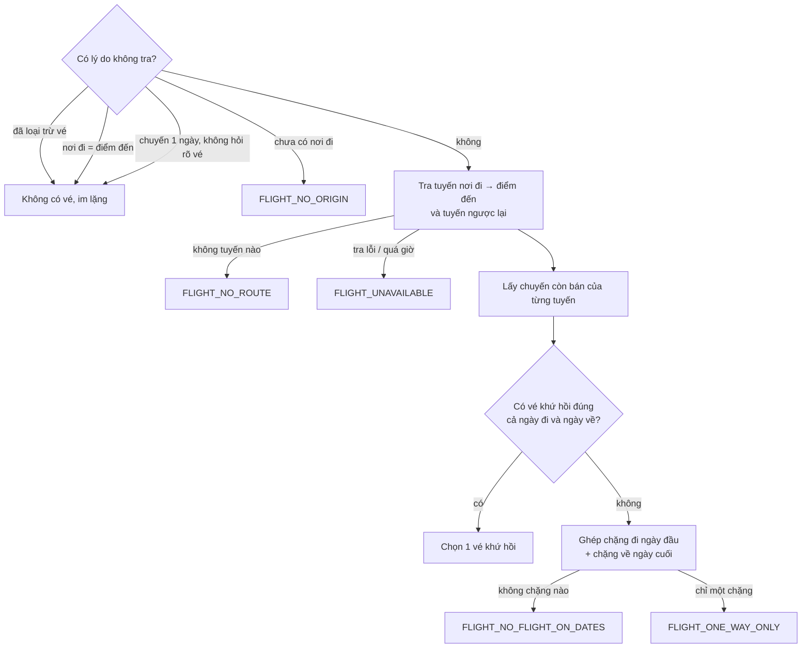

# Vé máy bay trong lịch trình

Phục vụ FR-AGT-02, FR-AGT-03, AC-AGT-02, AC-AGT-03, AC-AGT-05. Mô tả theo code tại 2026-10-11; khi lệch, PRD và contract thắng.

## Mục đích

Lịch trình có [chặng bay](glossary.md#chang-bay) đi và về từ chuyến bay thật của catalog. Vé được chọn **bằng luật**, LLM không
chọn và không viết về vé. Người dùng hỏi giá, giờ vé mà không lập lịch thì xem [tu-van-ve-may-bay.md](tu-van-ve-may-bay.md).

## Khái niệm

- **Tuyến** (`level: route`): một cặp thành phố, ví dụ Hà Nội → Đà Nẵng. Không đặt được.
- **Chuyến** (`level: flight`): một chuyến cụ thể dưới tuyến (`parentProductId`), có ngày, giờ, giá. Có hai kiểu:
  - một chiều (`tripType = oneWay`, hoặc để trống);
  - khứ hồi (`tripType = roundTrip`), nằm dưới tuyến chiều đi, giờ chặng về ghi ở `returnFlight`.
- **Chặng** (`direction`): `OUTBOUND` (đi), `RETURN` (về), `ROUND_TRIP` (một vé khứ hồi thay cho cả hai).

## Luồng chính

Vé được tra **song song** với Search/Recommendation trong node `tool`, qua `GET /products` (không qua `/search`, không qua
planner).

## Business rule

- **Ngày bay:** đi ngày `startDate`, về ngày `startDate + days − 1`.
- **Chỉ xét chuyến còn bán và có giá.** Chuyến không giá bị bỏ để tổng của cả chuyến không thành "chưa biết".
- **Chuyến người dùng đã chọn thắng.** Chuyến chọn qua "đổi chuyến bay" (`constraints.chosen_flights`) được giữ ở các
  lượt sau khi còn bán đúng ngày của chặng; khi đó không ưu tiên vé khứ hồi nữa. Cách đổi:
  [sua-lich-qua-nhieu-luot.md](sua-lich-qua-nhieu-luot.md#doi-ve-khach-san).
- **Thứ tự chọn trong cùng kiểu vé:**
  1. bay thẳng (chuyến không khai `nonstop` xếp sau);
  2. giá thấp;
  3. giờ hợp lý: chặng đi cất cánh sớm, chặng về cất cánh muộn;
  4. `productId` (để luôn ra cùng một kết quả).
- **Tiền vé** = giá một khách × (người lớn + trẻ em), kể cả vé khứ hồi. Cộng vào tổng của lịch trình.
- **Không bỏ vé vì vượt ngân sách.** Lịch trình báo vượt ngân sách.
- **Nơi đi được chuẩn về tên catalog** ("Sài Gòn" → "TP. Hồ Chí Minh", rồi theo `originCity` của tuyến) và ghi lại vào
  `intent.origin`.
- **Giờ bay quyết định buổi của ngày đến/ngày về.** Xem [xep-lich.md](xep-lich.md#theo-gio-bay).
- **Ngày đã chọn không có chuyến:** câu cảnh báo nêu thêm tối đa 2 ngày gần nhất có vé (ngày đủ hai chiều trước), giữ số
  ngày của chuyến. Khi khách sạn, vé tham quan cũng thiếu vì ngày thì gợi một [ngày đi chung](glossary.md#ngay-di-chung)
  ([xep-lich.md](xep-lich.md#ngay-ngoai-cua-so)).
- **Lý do thiếu vé luôn được nói.** Các mã `FLIGHT_*` thành cảnh báo, và thành mục **Vé máy bay** do hệ thống viết. Loại trừ
  vé, chuyến 1 ngày, nơi đi trùng điểm đến thì không nói. Xem [dien-giai-va-kiem-tra.md](dien-giai-va-kiem-tra.md).
- **Grounding riêng.** Vé không nằm trong [ứng viên](glossary.md#candidate), vì chặng về đến nơi đi và bay ngày cuối nên
  luật lọc điểm đến/ngày sẽ loại nhầm. Vé được kiểm với danh sách chuyến đã tra trong lượt (`flight_candidates`): phải trùng
  khớp bản catalog, còn bán và có giá.

## Nơi đi từ vị trí trình duyệt (Web)

Nút "Dùng vị trí hiện tại" trên form chỉ hỏi quyền khi người dùng bấm. Web tìm thành phố có sân bay gần nhất từ toạ độ sân
bay đi của các tuyến trong catalog. Chỉ tên thành phố được gửi lên; toạ độ không rời trình duyệt.
Code: [`src/frontend/src/services/flights.ts`](../../../../src/frontend/src/services/flights.ts),
[`TripDetailsForm.tsx`](../../../../src/frontend/src/components/assistant/TripDetailsForm.tsx).

## Edge case

- ⚠️ cần xác nhận: AC-AGT-02 ghi "lượt sửa lịch chỉ chọn lại vé khi nơi đi, ngày đi, số ngày hoặc điểm đến đổi, hoặc khi
  người dùng chủ động chọn chuyến khác". Code tra và chọn lại vé **ở mọi lượt có tìm sản phẩm** (chuyến người dùng đã chọn
  thì được giữ). Cùng dữ liệu thì luật ra cùng vé, nhưng nếu catalog đổi giá giữa hai lượt thì vé có thể đổi dù chuyến đi
  không đổi.
- Chặng đi tìm được mà không có chặng về (hoặc ngược lại): vẫn hiện chặng tìm được và báo thiếu chặng còn lại.

## Code liên quan

- [`domain/itinerary/flights.py`](../../../../src/backend/app/domain/itinerary/flights.py) — khi nào tra, chọn vé, tiền vé, giờ bay
- [`application/itinerary/flights.py`](../../../../src/backend/app/application/itinerary/flights.py) — tra tuyến và chuyến qua `CatalogPort`
- [`agents/steps/composition.py`](../../../../src/backend/app/agents/steps/composition.py) — gắn vé vào lịch, cảnh báo `FLIGHT_*`
- [`domain/itinerary/planning.py`](../../../../src/backend/app/domain/itinerary/planning.py) — `validate_plan` kiểm vé
- Hợp đồng: [../../hop-dong-tich-hop-itinerary-assistant.md](../../hop-dong-tich-hop-itinerary-assistant.md) §2.7
