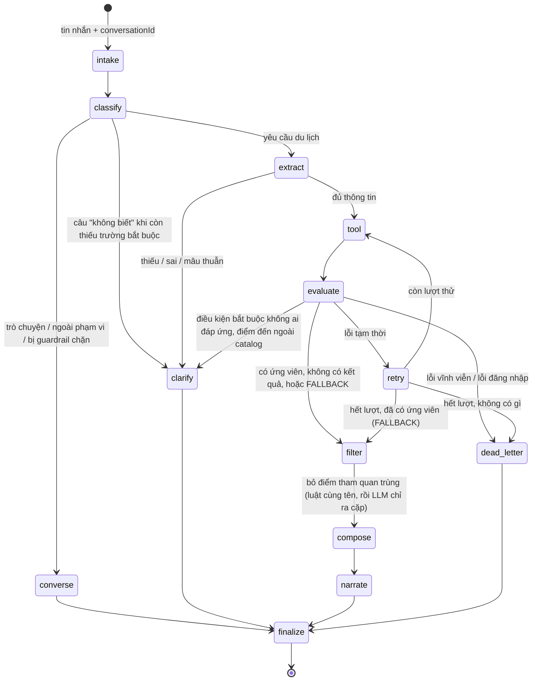

# Vòng đời một lượt chat

Phục vụ FR-AGT-01..05, NFR-REL-01. Mô tả theo code tại 2026-10-07; khi lệch, PRD và contract thắng.

## Mục đích

Người dùng gửi một tin nhắn, nhận về đúng một [response](glossary.md#response). Trợ lý quyết định nói chuyện, hỏi lại, hay
lập lịch trình từ sản phẩm thật. Mỗi lượt chạy qua một graph LangGraph cố định gồm 12 node.

## Luồng chính

| Giai đoạn | Node | Làm gì | Chi tiết |
|---|---|---|---|
| Hiểu người dùng | `intake`, `classify`, `extract` | Nạp hội thoại cũ, phân luồng, trích ý định | [hieu-y-dinh-va-hoi-lai.md](hieu-y-dinh-va-hoi-lai.md) |
| Lấy dữ liệu thật | `tool`, `evaluate`, `retry`, `filter` | Gọi Search/Recommendation/Similar, tra vé, lọc ứng viên, bỏ điểm tham quan trùng | [tim-ung-vien.md](tim-ung-vien.md), [ve-may-bay.md](ve-may-bay.md) |
| Soạn câu trả lời | `compose`, `narrate`, `clarify`, `converse`, `dead_letter` | Xếp lịch bằng luật, viết lời, hỏi lại, báo lỗi | [xep-lich.md](xep-lich.md), [dien-giai-va-kiem-tra.md](dien-giai-va-kiem-tra.md) |
| Cửa ra chung | `finalize` | Kiểm contract + grounding, lưu hội thoại | [dien-giai-va-kiem-tra.md](dien-giai-va-kiem-tra.md) |

LLM chỉ được gọi ở `classify`, `extract`, `tool` (chọn tên điểm đến, lập tool plan), `filter` (chỉ ra cặp điểm tham quan
trùng; giữ cái nào do luật), `clarify`, `converse`, `narrate`.
`compose`, `evaluate`, `retry`, `finalize` là luật thuần.

## Các kết quả của một lượt

| Kết quả | HTTP | Khi nào |
|---|---|---|
| `COMPLETED` | 200 | Có lịch trình (có thể thiếu chỗ ở, thiếu vé, kèm cảnh báo) |
| `NEEDS_CLARIFICATION` | 200 | Hỏi lại: thiếu thông tin, giá trị sai, mâu thuẫn, điều kiện bắt buộc không đạt, câu rác, chào hỏi |
| `NO_RESULTS` | 200 | Tìm xong nhưng không còn ứng viên nào; kèm tối đa 3 gợi ý bấm được |
| `FALLBACK` | 200 | Có sản phẩm nhưng không dựng được lịch (nguồn lỗi, không có gì xếp được, compose tự bác) — trả danh sách theo loại, tối đa 6 mỗi loại |
| `VALIDATION_ERROR` | 400 | Yêu cầu ngoài phạm vi (đặt chỗ, thanh toán, chèn lệnh, tục tĩu) |
| `VALIDATION_ERROR` | 422 | Chip sửa tay (`intentOverride`) sai schema, hoặc intent sau khi trích không hợp lệ |
| `CONVERSATION_NOT_FOUND` | 404 | `conversationId` không có trong store lẫn archive |
| `INVALID_TOKEN` / `TOKEN_EXPIRED` | 401 | Tool báo lỗi xác thực — không bao giờ bị che bởi một Search thành công |
| `LLM_UNAVAILABLE` | 503 | LLM lỗi/quá giờ ở `classify`/`extract`/lập plan; hoặc FALLBACK mà không có ứng viên |
| `SEARCH_UNAVAILABLE` | 503 | Tool hỏng không phục hồi được |
| `ITINERARY_VALIDATION_FAILED` | 500 | `finalize` phát hiện response sai schema hoặc lệch grounding |

Lỗi không ghi status riêng mặc định 503 (`messages.failure`).

## Business rule

- **Thử lại tối đa một lần** (`MAX_ATTEMPTS = 2`). Lần thử lại dùng lại plan cũ, không hỏi LLM lập plan mới, và dùng lại
  kết quả tool không lỗi.
- **Lỗi đăng nhập luôn thắng.** Một tool trả 401 thì cả lượt là 401, dù tool khác đã có dữ liệu.
- **Mọi nhánh đi qua `finalize`.** Không có đường nào trả response mà chưa kiểm.
- **Hội thoại nối tiếp theo `conversationId`.** `intake` nạp intent, ràng buộc, lịch sử và
  [sản phẩm đã cho xem](glossary.md#previous_selection) của lượt trước; `finalize` lưu lại sau mỗi lượt 200. Xem
  [sua-lich-qua-nhieu-luot.md](sua-lich-qua-nhieu-luot.md).

## Edge case

- Tin nhắn rỗng mà có chip sửa tay (`intentOverride`): coi là lượt du lịch, bỏ qua LLM của `classify`.
- `conversationId` lạ, hoặc của người khác: 404, không lộ nội dung.
- LLM của `clarify`/`converse`/`narrate` lỗi hoặc quá giờ: không lỗi lượt, mà dùng câu cố định dựng bằng luật. LLM của
  `filter` lỗi hoặc quá giờ: chỉ dùng phần lọc bằng luật (cùng tên).

## Code liên quan

- [`agents/graph.py`](../../../../src/backend/app/agents/graph.py) — cạnh của graph
- [`agents/routing.py`](../../../../src/backend/app/agents/routing.py) — điều kiện rẽ nhánh
- [`agents/nodes.py`](../../../../src/backend/app/agents/nodes.py) — 12 node
- [`agents/steps/failures.py`](../../../../src/backend/app/agents/steps/failures.py) — chọn mã lỗi của `dead_letter`
- Chi tiết kỹ thuật từng node và field state: [../langgraph-nodes.md](../langgraph-nodes.md), [../state-fields.md](../state-fields.md)
