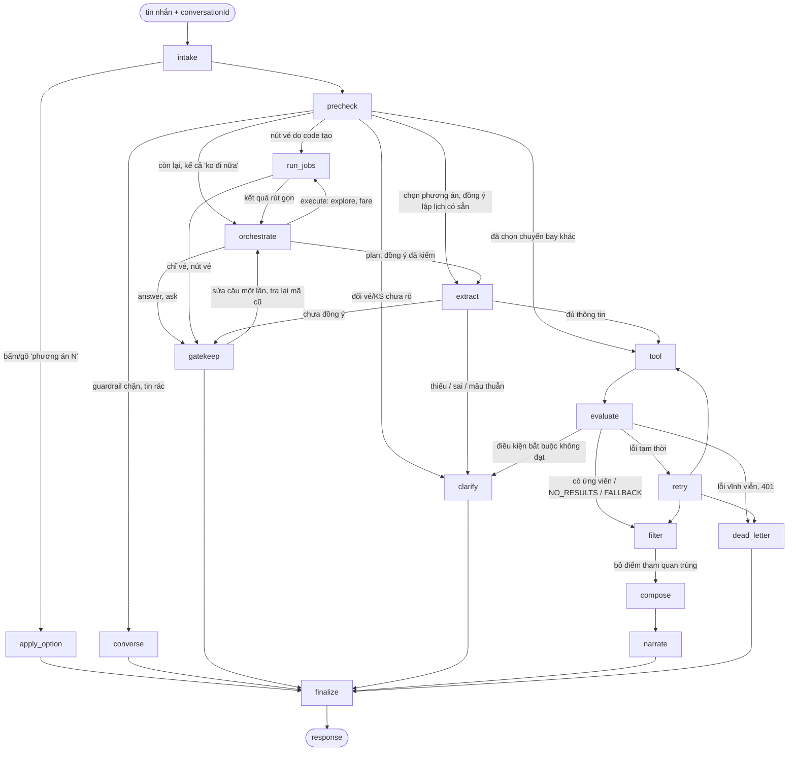

# Vòng đời một lượt chat

Phục vụ FR-AGT-01..07, NFR-REL-01. Mô tả theo code tại 2026-10-13; khi lệch, PRD và contract thắng.

Orchestrator là luồng duy nhất (PRD architecture §3, chốt 2026-10-13). Luồng phân loại cũ (`classify` bằng LLM, node
`explore`, `converse` bằng LLM) và cờ `ITINERARY_ORCHESTRATOR` đã gỡ.

## Mục đích

Người dùng gửi một tin nhắn, nhận về đúng một [response](glossary.md#response). Trợ lý quyết định trả lời, hỏi lại, khám
phá, trả lời giá vé, hay lập lịch trình từ sản phẩm thật. Một LLM đầu mối (orchestrator) hiểu tin nhắn và chọn việc; code
chạy việc qua port, gác cổng và viết mọi con số. Không đoán ý bằng regex.

## Luồng chính

Không cấu hình LLM thì `orchestrate` đi `dead_letter` (503 `LLM_UNAVAILABLE`). LLM lỗi ở `extract` cũng đi `dead_letter`
(không vẽ cho gọn).

| Giai đoạn | Node | Làm gì | Chi tiết |
|---|---|---|---|
| Hiểu người dùng | `intake`, `precheck`, `orchestrate`, `extract` | Nạp hội thoại cũ, luật trước LLM, chọn việc, trích ý định, xét đồng ý lập lịch | [tro-chuyen-va-kham-pha.md](tro-chuyen-va-kham-pha.md), [hieu-y-dinh-va-hoi-lai.md](hieu-y-dinh-va-hoi-lai.md) |
| Lấy dữ liệu thật | `run_jobs`, `tool`, `evaluate`, `retry`, `filter` | Việc chỉ đọc của orchestrator (khám phá, vé); gọi Search/Recommendation/Similar, tra vé, lọc ứng viên, bỏ điểm trùng | [tim-ung-vien.md](tim-ung-vien.md), [ve-may-bay.md](ve-may-bay.md), [tu-van-ve-may-bay.md](tu-van-ve-may-bay.md) |
| Soạn câu trả lời | `gatekeep`, `converse`, `compose`, `narrate`, `clarify`, `apply_option`, `dead_letter` | Kiểm và dựng câu của orchestrator, câu cố định khi bị chặn, xếp lịch, viết lời, hỏi lại, đổi phương án, báo lỗi | [tro-chuyen-va-kham-pha.md](tro-chuyen-va-kham-pha.md), [xep-lich.md](xep-lich.md), [dien-giai-va-kiem-tra.md](dien-giai-va-kiem-tra.md) |
| Cửa ra chung | `finalize` | Kiểm contract + grounding, lưu hội thoại và trí nhớ thẻ đã xem | [dien-giai-va-kiem-tra.md](dien-giai-va-kiem-tra.md) |

LLM chỉ được gọi ở `orchestrate`, `extract`, `tool` (chọn tên điểm đến, lập tool plan), `filter` (chỉ ra cặp điểm tham
quan trùng), `clarify`, `narrate`. `precheck`, `run_jobs`, `gatekeep`, `converse`, `compose`, `evaluate`, `retry`,
`apply_option`, `finalize` là code. Thứ tự luật của `precheck`: chip sửa tay → guardrail → tin rác → câu dừng → chọn
phương án → đổi vé/khách sạn → nút vé → đã đồng ý và xin lập lịch.

## Các kết quả của một lượt

| Kết quả | HTTP | Khi nào |
|---|---|---|
| `COMPLETED` | 200 | Có lịch trình (có thể thiếu chỗ ở, thiếu vé, kèm cảnh báo); ngày đi chưa mở bán thì là [lịch tham khảo](glossary.md#lich-tham-khao) |
| `NEEDS_CLARIFICATION` | 200 | Mọi câu trả lời không phải lịch: trò chuyện, ngoài phạm vi, khám phá (kèm `searchResults`), tư vấn vé (kèm thẻ ngày–giá), hỏi lại, câu rác |
| `NO_RESULTS` | 200 | Tìm xong nhưng không còn ứng viên nào; kèm tối đa 3 gợi ý bấm được |
| `FALLBACK` | 200 | Có sản phẩm nhưng không dựng được lịch (nguồn lỗi, không có gì xếp được, compose tự bác) — trả danh sách theo loại, tối đa 6 mỗi loại |
| `VALIDATION_ERROR` | 400 | Chỉ khi guardrail chặn: chèn lệnh, đòi secret, tục tĩu. Ngoài phạm vi (đặt chỗ, thời tiết…) là câu trả lời 200 |
| `VALIDATION_ERROR` | 422 | Chip sửa tay (`intentOverride`) sai schema, hoặc intent sau khi trích không hợp lệ |
| `CONVERSATION_NOT_FOUND` | 404 | `conversationId` không có trong store lẫn archive |
| `INVALID_TOKEN` / `TOKEN_EXPIRED` | 401 | Tool báo lỗi xác thực — không bao giờ bị che bởi một Search thành công |
| `LLM_UNAVAILABLE` | 503 | Không cấu hình LLM; LLM lỗi/quá giờ ở `extract`/lập plan; hoặc FALLBACK mà không có ứng viên |
| `SEARCH_UNAVAILABLE` | 503 | Tool hỏng không phục hồi được |
| `ITINERARY_VALIDATION_FAILED` | 500 | `finalize` phát hiện response sai schema hoặc lệch grounding |

Lỗi không ghi status riêng mặc định 503 (`messages.failure`).

## Business rule

- **Phanh của orchestrator:** tối đa 3 việc/vòng, 3 vòng execute, 10 lời gọi tool và ngân sách thời gian của lượt. Chạm
  phanh thì trả lời bằng dữ liệu đã có và nói rõ phần chưa làm. Mã nguyên nhân (`steps/limits.py`) nằm ở metadata event
  và log `itinerary.turn_limit`.
- **Thử lại tối đa một lần** ở nhánh lập lịch (`MAX_ATTEMPTS = 2`). Lần thử lại dùng lại plan cũ, không hỏi LLM lập plan
  mới, và dùng lại kết quả tool không lỗi.
- **Lỗi đăng nhập luôn thắng.** Một tool trả 401 thì cả lượt là 401, dù tool khác đã có dữ liệu.
- **Mọi nhánh đi qua `finalize`.** Không có đường nào trả response mà chưa kiểm.
- **Hội thoại nối tiếp theo `conversationId`.** `intake` nạp intent, ràng buộc, lịch sử, trí nhớ thẻ đã xem và
  [sản phẩm đã cho xem](glossary.md#previous_selection) của lượt trước; `finalize` lưu lại sau mỗi lượt 200. Xem
  [sua-lich-qua-nhieu-luot.md](sua-lich-qua-nhieu-luot.md).

## Edge case

- Tin nhắn rỗng mà có chip sửa tay (`intentOverride`): coi là lượt du lịch đã đồng ý lập lịch, đi thẳng `extract`.
- Bấm thẻ "Dùng phương án này": đi `apply_option`, không tìm lại, không gọi LLM.
- `conversationId` lạ, hoặc của người khác: 404, không lộ nội dung.
- LLM của orchestrator lỗi hoặc quá giờ: `gatekeep` dùng câu dự phòng từ dữ liệu đã tra. LLM của `clarify`/`narrate` lỗi
  hoặc quá giờ: dùng câu cố định dựng bằng luật. LLM của `filter` lỗi hoặc quá giờ: chỉ dùng phần lọc bằng luật (cùng tên).

## Code liên quan

- [`agents/graph.py`](../../../../src/backend/app/agents/graph.py) — cạnh của graph
- [`agents/routing.py`](../../../../src/backend/app/agents/routing.py) — điều kiện rẽ nhánh
- [`agents/nodes.py`](../../../../src/backend/app/agents/nodes.py) — node, kể cả `precheck`
- [`agents/steps/orchestration.py`](../../../../src/backend/app/agents/steps/orchestration.py) — `orchestrate`, `run_jobs`, `gatekeep`
- [`agents/steps/jobs.py`](../../../../src/backend/app/agents/steps/jobs.py) — việc chỉ đọc và phanh lời gọi tool
- [`agents/steps/failures.py`](../../../../src/backend/app/agents/steps/failures.py) — chọn mã lỗi của `dead_letter`
- Chi tiết kỹ thuật từng node và field state: [../langgraph-nodes.md](../langgraph-nodes.md), [../state-fields.md](../state-fields.md)
