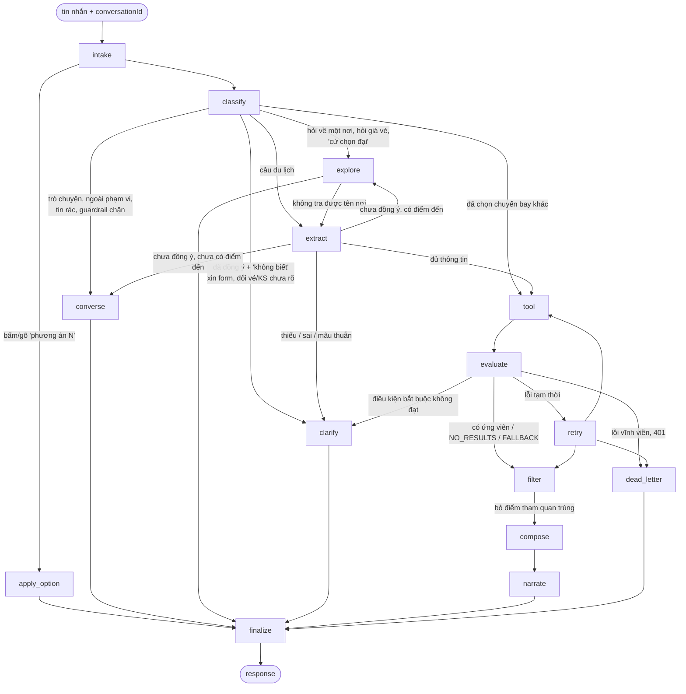

# Vòng đời một lượt chat

Phục vụ FR-AGT-01..07, NFR-REL-01. Mô tả theo code tại 2026-10-11; khi lệch, PRD và contract thắng.

## Mục đích

Người dùng gửi một tin nhắn, nhận về đúng một [response](glossary.md#response). Trợ lý quyết định nói chuyện, khám phá,
trả lời giá vé, hỏi lại, hay lập lịch trình từ sản phẩm thật. Mỗi lượt chạy qua một graph LangGraph cố định gồm 15 node.

## Luồng chính

LLM lỗi ở `classify`/`extract` thì đi `dead_letter` (không vẽ cho gọn).

| Giai đoạn | Node | Làm gì | Chi tiết |
|---|---|---|---|
| Hiểu người dùng | `intake`, `classify`, `extract` | Nạp hội thoại cũ, phân luồng, trích ý định, xét đồng ý lập lịch | [tro-chuyen-va-kham-pha.md](tro-chuyen-va-kham-pha.md), [hieu-y-dinh-va-hoi-lai.md](hieu-y-dinh-va-hoi-lai.md) |
| Lấy dữ liệu thật | `tool`, `evaluate`, `retry`, `filter` | Gọi Search/Recommendation/Similar, tra vé, lọc ứng viên, bỏ điểm trùng | [tim-ung-vien.md](tim-ung-vien.md), [ve-may-bay.md](ve-may-bay.md) |
| Soạn câu trả lời | `converse`, `explore`, `compose`, `narrate`, `clarify`, `apply_option`, `dead_letter` | Trò chuyện, khám phá/tư vấn vé, xếp lịch, viết lời, hỏi lại, đổi phương án, báo lỗi | [tro-chuyen-va-kham-pha.md](tro-chuyen-va-kham-pha.md), [tu-van-ve-may-bay.md](tu-van-ve-may-bay.md), [xep-lich.md](xep-lich.md), [dien-giai-va-kiem-tra.md](dien-giai-va-kiem-tra.md) |
| Cửa ra chung | `finalize` | Kiểm contract + grounding, lưu hội thoại | [dien-giai-va-kiem-tra.md](dien-giai-va-kiem-tra.md) |

LLM chỉ được gọi ở `classify`, `extract`, `tool` (chọn tên điểm đến, lập tool plan), `filter` (chỉ ra cặp điểm tham quan
trùng), `explore` (lời dẫn thẻ; nhánh giá vé không gọi LLM), `clarify`, `converse`, `narrate`.
`compose`, `evaluate`, `retry`, `apply_option`, `finalize` là luật thuần.
Trước LLM của `classify` có các luật tất định: chip sửa tay → guardrail → tin rác → chọn phương án, đổi vé/khách sạn,
bấm nút vé.

## Các kết quả của một lượt

| Kết quả | HTTP | Khi nào |
|---|---|---|
| `COMPLETED` | 200 | Có lịch trình (có thể thiếu chỗ ở, thiếu vé, kèm cảnh báo); ngày đi chưa mở bán thì là [lịch tham khảo](glossary.md#lich-tham-khao) |
| `NEEDS_CLARIFICATION` | 200 | Mọi câu trả lời không phải lịch: trò chuyện, ngoài phạm vi, khám phá (kèm `searchResults`), tư vấn vé (kèm thẻ ngày–giá), hỏi lại, câu rác |
| `NO_RESULTS` | 200 | Tìm xong nhưng không còn ứng viên nào; kèm tối đa 3 gợi ý bấm được |
| `FALLBACK` | 200 | Có sản phẩm nhưng không dựng được lịch (nguồn lỗi, không có gì xếp được, compose tự bác) — trả danh sách theo loại, tối đa 6 mỗi loại |
| `VALIDATION_ERROR` | 400 | Chỉ khi guardrail chặn: chèn lệnh, đòi secret, tục tĩu. Ngoài phạm vi (đặt chỗ, thời tiết…) từ 2026-10-10 là câu trả lời 200 |
| `VALIDATION_ERROR` | 422 | Chip sửa tay (`intentOverride`) sai schema, hoặc intent sau khi trích không hợp lệ |
| `CONVERSATION_NOT_FOUND` | 404 | `conversationId` không có trong store lẫn archive |
| `INVALID_TOKEN` / `TOKEN_EXPIRED` | 401 | Tool báo lỗi xác thực — không bao giờ bị che bởi một Search thành công |
| `LLM_UNAVAILABLE` | 503 | LLM lỗi/quá giờ ở `classify`/`extract`/lập plan; hoặc FALLBACK mà không có ứng viên |
| `SEARCH_UNAVAILABLE` | 503 | Tool hỏng không phục hồi được |
| `ITINERARY_VALIDATION_FAILED` | 500 | `finalize` phát hiện response sai schema hoặc lệch grounding |

Lỗi không ghi status riêng mặc định 503 (`messages.failure`).

## Business rule

- **Thử lại tối đa một lần** (`MAX_ATTEMPTS = 2`). Lần thử lại dùng lại plan cũ, không hỏi LLM lập plan mới, và dùng lại
  kết quả tool không lỗi.
- **Lỗi đăng nhập luôn thắng.** Một tool trả 401 thì cả lượt là 401, dù tool khác đã có dữ liệu.
- **Mọi nhánh đi qua `finalize`.** Không có đường nào trả response mà chưa kiểm.
- **Hội thoại nối tiếp theo `conversationId`.** `intake` nạp intent, ràng buộc, lịch sử và
  [sản phẩm đã cho xem](glossary.md#previous_selection) của lượt trước; `finalize` lưu lại sau mỗi lượt 200. Xem
  [sua-lich-qua-nhieu-luot.md](sua-lich-qua-nhieu-luot.md).

## Edge case

- Tin nhắn rỗng mà có chip sửa tay (`intentOverride`): coi là lượt du lịch đã đồng ý lập lịch, bỏ qua LLM của `classify`.
- Bấm thẻ "Dùng phương án này": đi `apply_option`, không phân luồng, không tìm lại, không gọi LLM.
- `conversationId` lạ, hoặc của người khác: 404, không lộ nội dung.
- LLM của `clarify`/`converse`/`explore`/`narrate` lỗi hoặc quá giờ: không lỗi lượt, mà dùng câu cố định dựng bằng luật. LLM của
  `filter` lỗi hoặc quá giờ: chỉ dùng phần lọc bằng luật (cùng tên).

## Code liên quan

- [`agents/graph.py`](../../../../src/backend/app/agents/graph.py) — cạnh của graph
- [`agents/routing.py`](../../../../src/backend/app/agents/routing.py) — điều kiện rẽ nhánh
- [`agents/nodes.py`](../../../../src/backend/app/agents/nodes.py) — 15 node
- [`agents/steps/failures.py`](../../../../src/backend/app/agents/steps/failures.py) — chọn mã lỗi của `dead_letter`
- Chi tiết kỹ thuật từng node và field state: [../langgraph-nodes.md](../langgraph-nodes.md), [../state-fields.md](../state-fields.md)
