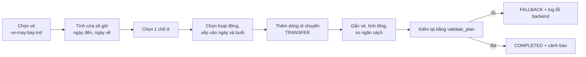
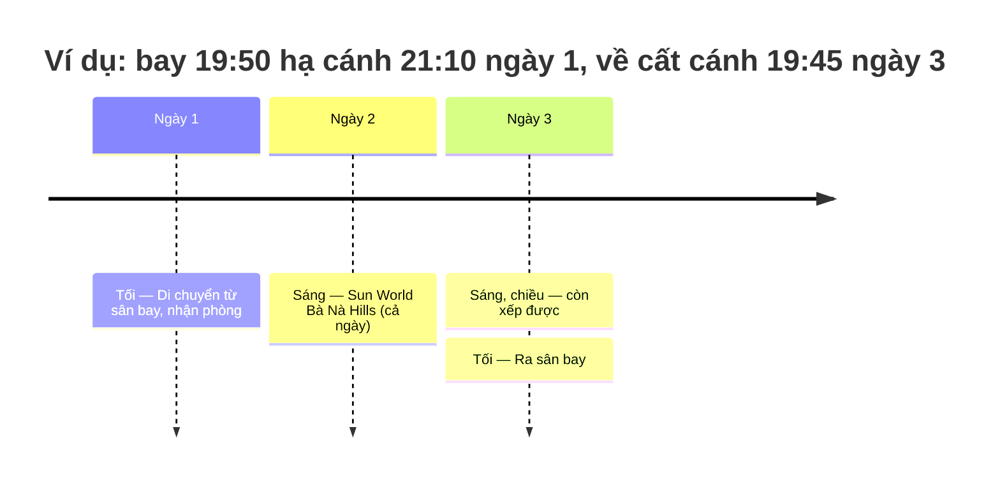

# Xếp lịch và tính tiền

Phục vụ FR-AGT-03, FR-AGT-04, AC-AGT-02. Mô tả theo code tại 2026-10-07; khi lệch, PRD và contract thắng.

## Mục đích

Từ các [ứng viên](glossary.md#candidate) đã lọc, dựng lịch trình theo ngày và buổi, rồi tính tổng tiền.
`compose` **không gọi LLM**: cùng một tập ứng viên và cùng vé luôn cho cùng một lịch trình.

## Luồng chính

## Business rule

**Cái gì được xếp**
- Chỉ ứng viên còn bán thuộc `hotel`, `attraction`, `golf`. `combo` và `flight` không bao giờ vào slot (vé có chỗ riêng,
  xem [ve-may-bay.md](ve-may-bay.md)).
- [Gói nhiều ngày](glossary.md#goi-nhieu-ngay) (từ 2 ngày: theo `durationMinutes` hoặc tên như "03 ngày", "4D3N", "3N2Đ")
  không vào slot. Tối đa 2 gói mỗi loại được trả kèm để người dùng cân nhắc riêng; không tính vào tổng.

**Chỗ ở** — đúng một khách sạn, cho `max(1, days − 1)` đêm. Thứ tự chọn:
1. nguồn Search trước Recommendation;
2. giá thấp (không có giá xếp cuối);
3. sao cao;
4. `productId`.

Không bao giờ chọn cả phòng lẫn khách sạn cha của nó.

**Hoạt động**
- Thứ tự chọn:
  1. nguồn Search trước Recommendation;
  2. [hoạt động cả ngày](glossary.md#hoat-dong-ca-ngay) (≥ 360 phút) trước;
  3. giá thấp;
  4. `productId`.
- Không chọn hai sản phẩm cùng cha.
- **Rải ngày:** mỗi hoạt động vào ngày đang ít việc nhất, hoà thì ngày sớm hơn.
- Tối đa 2 hoạt động một ngày, ở buổi sáng rồi buổi chiều. Hoạt động cả ngày đứng một mình trong ngày.
- Hoạt động dư so với sức chứa của chuyến thì không xếp, không dồn.
- `pace` (nhịp độ) chưa ảnh hưởng xếp lịch.

**Theo giờ bay** (khi có vé)
- **[Khung buổi](glossary.md#buoi)** (giờ Việt Nam): sáng 08:00–12:00, trưa 12:00–13:30, chiều 13:30–17:00, tối 18:00–21:00.
- **Ngày đến:** chỉ dùng buổi bắt đầu từ 90 phút sau giờ hạ cánh. **Ngày về:** chỉ dùng buổi kết thúc trước giờ cất cánh ít
  nhất 150 phút. Sức chứa của ngày = số buổi sáng/chiều còn lại.
- **Hoạt động cả ngày** chỉ vào ngày còn đủ cả bốn buổi.
- **Dòng di chuyển** (`TRANSFER`, không gắn sản phẩm) ở buổi hạ cánh ("Di chuyển từ sân bay, nhận phòng.") và buổi cất cánh
  ("Ra sân bay."). Cùng buổi thì đến nơi trước, ra sân bay sau hoạt động.
- So theo ngày giờ đầy đủ, nên chuyến hạ cánh sau nửa đêm thuộc ngày hôm sau. Vé thiếu giờ bay thì không giới hạn.

**Tiền**

| Đơn vị giá | Tiền |
|---|---|
| `PER_NIGHT` (chỗ ở) | giá × số đêm |
| `PER_PERSON` | giá × (người lớn + trẻ em) |
| `PER_PACKAGE` | giá × 1 |
| Vé máy bay | giá một khách × số khách |
| [Tham quan tự do](glossary.md#tham-quan-tu-do) | 0 |
| Không có giá / `UNKNOWN` | Tổng = chưa biết |

- Một khoản chưa biết thì cả tổng là chưa biết (`UNKNOWN_TOTAL`). Không coi giá thiếu là 0.
- Có ngân sách thì so: `WITHIN_BUDGET` / `OVER_BUDGET`; không có thì `NO_BUDGET`.
- Tổng chỉ gồm sản phẩm trong lịch, chưa gồm ăn uống, đi lại (`PRODUCT_COST_ONLY`, `BUDGET_ON_PRODUCT_COST`).

## Edge case

- Không có khách sạn nào dùng được (chuyến từ 2 ngày): vẫn lập lịch, kèm câu "chưa có khách sạn" nêu lý do thật lấy từ
  `drop_summary` (vd chỉ mở bán từ ngày X) và ngày gần nhất còn phòng.
- Ngày không có sản phẩm: cảnh báo `DAY_WITHOUT_PRODUCTS`. Riêng ngày mà giờ bay không chừa buổi nào thì không cảnh báo.
- Luật tự bác lịch do chính nó đề xuất: đây là lỗi backend, được log `itinerary.composition_failed` rồi trả `FALLBACK`.
- ⚠️ cần xác nhận: tiền chỗ ở = giá × số đêm, **không tính số phòng**. Đoàn đông người vẫn tính như một phòng.
- ⚠️ cần xác nhận: khung buổi chỉ dùng khi có vé. Không có vé thì buổi chỉ là nhãn, không kiểm thời lượng hoạt động (vd
  hoạt động 5 giờ vẫn có thể nằm ở buổi chiều).

## Code liên quan

- [`domain/itinerary/planning.py`](../../../../src/backend/app/domain/itinerary/planning.py) — `compose_plan`, `day_windows`, `render_proposal`, `totals`, `validate_plan`
- [`agents/steps/composition.py`](../../../../src/backend/app/agents/steps/composition.py) — ghép vé, cảnh báo, `NO_RESULTS`/`FALLBACK`
- [`agents/steps/explanations.py`](../../../../src/backend/app/agents/steps/explanations.py) — câu "chưa có khách sạn"
