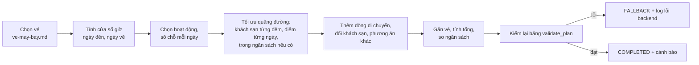
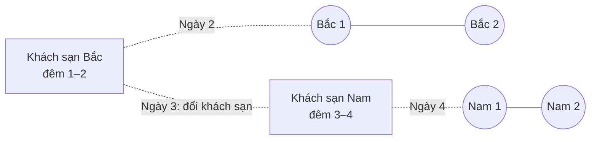
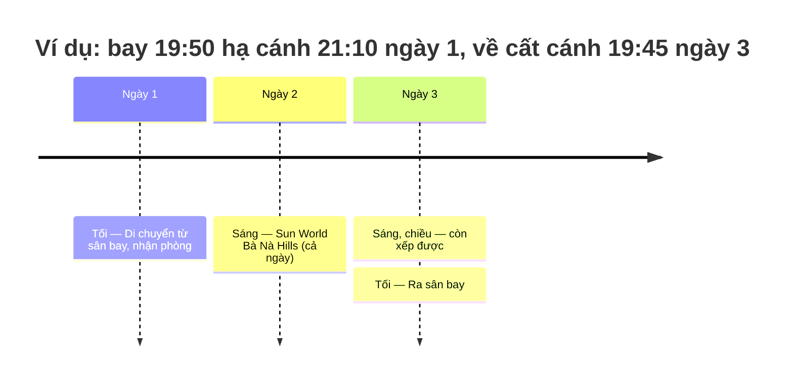

# Xếp lịch và tính tiền

Phục vụ FR-AGT-03, FR-AGT-04, AC-AGT-02, AC-AGT-04. Mô tả theo code tại 2026-10-08; khi lệch, PRD và contract thắng.

## Mục đích

Từ các [ứng viên](glossary.md#candidate) đã lọc, dựng lịch trình theo ngày và buổi, rồi tính tổng tiền.
`compose` **không gọi LLM**: cùng một tập ứng viên và cùng vé luôn cho cùng một lịch trình.

## Luồng chính

## Business rule

**Cái gì được xếp**
- Chỉ ứng viên còn bán thuộc `hotel`, `attraction`, `golf`. `combo` và `flight` không bao giờ vào slot (vé có chỗ riêng,
  xem [ve-may-bay.md](ve-may-bay.md)).
- [Gói nhiều ngày](glossary.md#goi-nhieu-ngay) (từ 2 ngày: theo `durationMinutes` hoặc tên như "03 ngày", "4D3N", "3N2Đ")
  không vào slot. Tối đa 2 gói mỗi loại được trả kèm để người dùng cân nhắc riêng; không tính vào tổng.

**Chỗ ở** — tối đa 2 khách sạn cho `max(1, days − 1)` đêm, chọn **sau** khi đã biết số hoạt động mỗi ngày, cùng lúc với
việc ghép ngày (xem [tối ưu quãng đường](#gom-theo-khoang-cach)). Chỉ khách sạn rõ vị trí, cùng mức nguồn tốt nhất
(Search trước Recommendation) được đem ra so. Không hoạt động nào rõ vị trí thì một khách sạn, thứ tự chọn:
1. nguồn Search trước Recommendation;
2. khách sạn rõ vị trí trước;
3. giá thấp (không có giá xếp cuối);
4. sao cao;
5. `productId`.

Không bao giờ chọn cả phòng lẫn khách sạn cha của nó, và hai khách sạn của một chuyến không cùng cha.

**Hoạt động**
- Thứ tự chọn:
  1. nguồn Search trước Recommendation;
  2. [hoạt động cả ngày](glossary.md#hoat-dong-ca-ngay) (≥ 360 phút) trước;
  3. [mức khoảng cách](glossary.md#muc-khoang-cach) tới [mốc](glossary.md#moc) của chuyến; chưa rõ vị trí xếp sau;
  4. giá thấp; [tham quan tự do](glossary.md#tham-quan-tu-do) tính 0 đ (như ở tổng tiền), không xếp cuối như giá chưa
     biết;
  5. `productId`.
- Không chọn hai sản phẩm cùng cha.
- **Rải ngày:** mỗi hoạt động vào ngày đang ít việc nhất, hoà thì ngày sớm hơn. Luật này quyết định *số* hoạt động mỗi
  ngày; *điểm nào* đi cùng ngày do [gom theo khoảng cách](#gom-theo-khoang-cach) quyết định.
- Tối đa 2 hoạt động một ngày, ở buổi sáng rồi buổi chiều. Hoạt động cả ngày đứng một mình trong ngày.
- Hoạt động dư so với sức chứa của chuyến thì không xếp, không dồn.
- `pace` (nhịp độ) chưa ảnh hưởng xếp lịch.

**Tối ưu quãng đường** (AC-AGT-04, chốt 2026-10-07; ngân sách và phương án khác chốt 2026-10-08)
- Khoảng cách là đường chim bay giữa hai toạ độ catalog (`attributes.latitude`/`longitude`).
- **Rõ vị trí:** có toạ độ hợp lệ và không phải toạ độ tâm thành phố. Toạ độ tâm thành phố = có từ 4 chữ số thập phân
  trở xuống **và** dùng chung cho từ 5 ứng viên trở lên của cùng điểm đến trong lượt.
- **[Mốc](glossary.md#moc):** medoid của các hoạt động rõ vị trí nguồn Search (không có thì mọi nguồn). Dùng để chọn
  hoạt động nào được xếp khi có nhiều hơn số chỗ.
- **[Quãng đường của chuyến](glossary.md#quang-duong-chuyen)**, với H_d là khách sạn đêm d:
  - ngày 1: A → B → H₁ (chưa tính chặng sân bay);
  - ngày d giữa chuyến: H(d−1) → A → B → H_d;
  - ngày cuối: H(n−1) → A → B. Chuyến 1 ngày có 1 đêm nên kết thúc ở khách sạn.

  Điểm chưa rõ vị trí bị bỏ qua khi cộng chặng.
- **Chi phí** = quãng đường + 15 km cho mỗi lần [đổi khách sạn](glossary.md#doi-khach-san).
- **Cách tìm** (`routing.optimize`):
  1. Số chỗ mỗi ngày (rải ngày, giờ bay, hoạt động cả ngày) giữ nguyên.
  2. Các chuỗi khách sạn đem ra so:
     - một khách sạn cả chuyến: 6 khách sạn gần các điểm nhất, cộng 3 khách sạn rẻ nhất;
     - đổi một lần, chỉ khi chuyến từ 5 ngày: chia các điểm thành 2 cụm (k-medoids), lấy 4 khách sạn gần mỗi cụm, mỗi
       khách sạn ít nhất 2 đêm.
  3. Với mỗi chuỗi, gán điểm vào ngày và thứ tự sáng/chiều để chi phí nhỏ nhất. Có tối đa 10 điểm thì giải chính xác
     (quy hoạch động trên tập con); nhiều hơn thì tìm kiếm cục bộ (đổi chỗ hai điểm giữa hai ngày), chỉ gần tối ưu.
     Mọi chuỗi được chấm nhanh bằng tìm kiếm cục bộ, rồi chỉ 3 chuỗi đứng đầu được giải chính xác.
  4. Thử thay một điểm đã chọn bằng điểm bị bỏ cùng nguồn, nhận khi bớt ít nhất 2 km (tối đa 2 vòng). Có ngân sách thì
     không thay nếu lịch đang vừa ngân sách thành vượt.
- **[Chọn lịch](glossary.md#lich-vua-ngan-sach):**

  | Trường hợp | Khoá so, nhỏ thắng |
  |---|---|
  | Không có ngân sách | (mức khoảng cách của chi phí, tiền, mã): gần trước, chênh dưới 2 km thì rẻ hơn |
  | Có ngân sách, lịch vừa | (0, mức khoảng cách, tiền, mã) |
  | Có ngân sách, lịch không vừa | (1, tiền, mức khoảng cách, mã): không lịch nào vừa thì lịch rẻ nhất thắng |

  Lịch vừa ngân sách: mọi giá biết được và tiền lịch (khách sạn + hoạt động) ≤ ngân sách − tiền vé máy bay. Vé chưa rõ
  giá thì dùng dòng "không có ngân sách".
- **[Phương án khác](glossary.md#phuong-an-khac)** (warning `STAY_OPTIONS`):
  - cùng các điểm của lịch đã chọn, chỉ khác chuỗi khách sạn (kéo theo cách ghép ngày);
  - lấy từ các lịch không bị lịch nào khác hơn cả về tiền lẫn km thật (không cộng phạt);
  - phía gần hơn (bớt ≥ 2 km, đắt hơn): lịch rẻ nhất và lịch ít km nhất; phía rẻ hơn (đi thêm ≥ 2 km): lịch đi thêm ít
    nhất và lịch rẻ nhất; giải chính xác các lịch này rồi lọc lại;
  - tối đa 3, mỗi phía tối đa 2, phía gần hơn đứng trước. Mỗi dòng ghi khách sạn, chênh tiền, chênh km, và số tiền vượt
    ngân sách nếu có;
  - không hiện khi lịch có giá chưa biết, hoặc không phương án nào chênh từ 2 km.
- **Câu trả lời:**
  - mục "Cách mình xếp lịch" (warning `PLAN_CRITERIA`): câu có vế ngân sách khi có ngân sách và biết giá vé; thêm câu
    nêu đêm đổi và hai khách sạn khi có đổi;
  - mục do code chèn, LLM không viết lại (prompt có `criteria_shown_separately`);
  - "Phương án khác" không còn là đoạn chữ: từ contract 1.20.0 là hàng thẻ `stayOptions` ở mục "Nơi nghỉ" của widget
    (`docs/spec/hop-dong-tich-hop-frontend.md`); warning `STAY_OPTIONS` vẫn giữ cho client cũ;
  - lịch chưa hiện số km từng ngày; tổng km và chênh km chỉ có trong mục Phương án khác.
- **Đổi khách sạn:** ngày đổi có dòng `TRANSFER` "Trả phòng, chuyển sang khách sạn mới." (`note_kind = CHANGE_STAY`) ở
  buổi sáng. `itinerary.stays` liệt kê khách sạn theo đêm (`fromNight`, `nights`); `itinerary.stay` = `stays[0]`.
- **Chọn phương án ở lượt sau:** xem [sua-lich-qua-nhieu-luot.md](sua-lich-qua-nhieu-luot.md).
- Không hoạt động nào rõ vị trí: xếp như luật cũ (giá), một khách sạn, không có `PLAN_CRITERIA` lẫn `STAY_OPTIONS`.

**Theo giờ bay** (khi có vé)
- **[Khung buổi](glossary.md#buoi)** (giờ Việt Nam): sáng 08:00–12:00, trưa 12:00–13:30, chiều 13:30–17:00, tối 18:00–21:00.
- **Ngày đến:** chỉ dùng buổi bắt đầu từ 90 phút sau giờ hạ cánh. **Ngày về:** chỉ dùng buổi kết thúc trước giờ cất cánh ít
  nhất 150 phút. Sức chứa của ngày = số buổi sáng/chiều còn lại.
- **Hoạt động cả ngày** chỉ vào ngày còn đủ cả bốn buổi.
- **Dòng di chuyển** (`TRANSFER`, không gắn sản phẩm) ở buổi hạ cánh ("Di chuyển từ sân bay, nhận phòng.") và buổi cất cánh
  ("Ra sân bay."). Cùng buổi thì đến nơi trước, ra sân bay sau hoạt động.
- So theo ngày giờ đầy đủ, nên chuyến hạ cánh sau nửa đêm thuộc ngày hôm sau. Vé thiếu giờ bay thì không giới hạn.

**Tiền**

| Đơn vị giá | Tiền |
|---|---|
| `PER_NIGHT` (chỗ ở) | giá × số đêm |
| `PER_PERSON` | giá × (người lớn + trẻ em) |
| `PER_PACKAGE` | giá × 1 |
| Vé máy bay | giá một khách × số khách |
| [Tham quan tự do](glossary.md#tham-quan-tu-do) | 0 |
| Không có giá / `UNKNOWN` | Tổng = chưa biết |

- Một khoản chưa biết thì cả tổng là chưa biết (`UNKNOWN_TOTAL`). Không coi giá thiếu là 0.
- Có ngân sách thì so: `WITHIN_BUDGET` / `OVER_BUDGET`; không có thì `NO_BUDGET`. Ngân sách cũng quyết định khách sạn
  (xem [chọn lịch](#gom-theo-khoang-cach)).
- Nhiều khách sạn: mỗi khách sạn giá × số đêm ở đó.
- Tổng chỉ gồm sản phẩm trong lịch, chưa gồm ăn uống, đi lại (`PRODUCT_COST_ONLY`, `BUDGET_ON_PRODUCT_COST`).

## Edge case

- Không có khách sạn nào dùng được (chuyến từ 2 ngày): vẫn lập lịch, kèm câu "chưa có khách sạn" nêu lý do thật lấy từ
  `drop_summary` (vd chỉ mở bán từ ngày X) và ngày gần nhất còn phòng.
- Ngày không có sản phẩm: cảnh báo `DAY_WITHOUT_PRODUCTS`. Riêng ngày mà giờ bay không chừa buổi nào thì không cảnh báo.
- Luật tự bác lịch do chính nó đề xuất: đây là lỗi backend, được log `itinerary.composition_failed` rồi trả `FALLBACK`.
- ⚠️ cần xác nhận: tiền chỗ ở = giá × số đêm, **không tính số phòng**. Đoàn đông người vẫn tính như một phòng.
- ⚠️ cần xác nhận: nhận diện toạ độ tâm thành phố là cách tạm. Staging 07/10/2026 có khoảng 270/953 điểm tham quan dùng
  toạ độ tâm thành phố (Vũng Tàu 48/48, Huế 64/80). Số ứng viên chung toạ độ được đếm trong lượt, nên khi ít hơn 5 tour
  về cùng một điểm, chúng vẫn bị coi là rõ vị trí. Cần nguồn đánh dấu độ chính xác (ví dụ `attributes.geoPrecision`).
- ⚠️ cần xác nhận: km là đường chim bay, nên chênh km của phương án khác chỉ là ước lượng (câu chữ ghi "khoảng"). Ở
  đảo, đường thật có thể dài hơn nhiều; OSRM là việc sau.
- ⚠️ cần xác nhận: khung buổi chỉ dùng khi có vé. Không có vé thì buổi chỉ là nhãn, không kiểm thời lượng hoạt động (vd
  hoạt động 5 giờ vẫn có thể nằm ở buổi chiều).

## Code liên quan

- [`domain/itinerary/planning.py`](../../../../src/backend/app/domain/itinerary/planning.py) — `compose_plan`, `day_windows`, `render_proposal`, `totals`, `validate_plan`
- [`domain/itinerary/routing.py`](../../../../src/backend/app/domain/itinerary/routing.py) — `route_cost`, `optimize` (chuỗi khách sạn, gán ngày, ngân sách, phương án khác)
- [`domain/itinerary/geo.py`](../../../../src/backend/app/domain/itinerary/geo.py) — `located`, `medoid`, `band`, `haversine_km`
- [`agents/steps/composition.py`](../../../../src/backend/app/agents/steps/composition.py) — ghép vé, tiền vé trừ vào ngân sách, cảnh báo (`PLAN_CRITERIA`, `STAY_OPTIONS`), `NO_RESULTS`/`FALLBACK`
- [`agents/steps/explanations.py`](../../../../src/backend/app/agents/steps/explanations.py) — câu "chưa có khách sạn"
