# Sơ đồ luồng xác thực (Auth) — Sequence & Activity

- Ngày: 2026-09-23
- Phục vụ: FR-USR-01, FR-USR-03, NFR-SEC-01, NFR-SEC-02 (`docs/prd/requirements.md` §1.6, §2.3)
- Nguồn: `docs/spec/hop-dong-tich-hop-auth.md` (gọi tắt **spec auth**). Tài liệu này chỉ **vẽ lại** spec đó cho dễ đọc; khi có chỗ khác nhau thì spec auth và OpenAPI (`src/shared/contracts/paths/auth.yaml`) thắng.
- Kế hoạch triển khai: `docs/plan/2026-09-23-auth-p0.md`

> **Lưu ý trạng thái.** Cơ chế BFF (Next.js) + Redis đã được chốt vào PRD ngày 2026-09-23 (`docs/prd/update-archive/2026-09-23-auth-hybrid-session.md`). **Mục 7 (2FA/OTP) ngoài phạm vi** — giữ lại chỉ để tham khảo. Khách chưa đăng nhập không sinh sự kiện CDP; không có bước gộp lịch sử ẩn danh.

## Mục lục

1. [Các thành phần tham gia](#1-các-thành-phần-tham-gia)
2. [Cách đọc sơ đồ](#2-cách-đọc-sơ-đồ)
3. [Đăng nhập](#3-đăng-nhập)
4. [Đăng ký tài khoản](#4-đăng-ký-tài-khoản)
5. [Gọi API khi đã đăng nhập](#5-gọi-api-khi-đã-đăng-nhập)
6. [Làm mới token và phát hiện token bị đánh cắp](#6-làm-mới-token-và-phát-hiện-token-bị-đánh-cắp)
7. [Xác minh OTP 2 lớp (ngoài phạm vi)](#7-xác-minh-otp-2-lớp-ngoài-phạm-vi)
8. [Đăng xuất](#8-đăng-xuất)
9. [Vòng đời phiên đăng nhập](#9-vòng-đời-phiên-đăng-nhập)
10. [Bảng lỗi và cách hiển thị](#10-bảng-lỗi-và-cách-hiển-thị)

---

## 1. Các thành phần tham gia

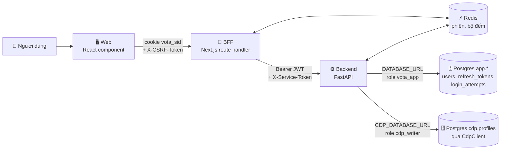

| Thành phần | Làm gì | Không bao giờ làm |
|---|---|---|
| **Người dùng** | Nhập email, mật khẩu, mã OTP | — |
| **Web** (React) | Hiện form, hiện lỗi theo `code` | Giữ token, gọi thẳng FastAPI, tự quyết định quyền |
| **BFF** (Next.js) | Giữ cookie phiên, kiểm CSRF, cất token trong Redis, gắn `Authorization` khi chuyển tiếp | Tự ký JWT, giữ khoá ký |
| **Redis** | Lưu phiên (`session:{sid}`), bộ đếm rate limit, khoá refresh | Lưu dữ liệu cần giữ lâu dài |
| **Backend** (FastAPI) | Kiểm mật khẩu, phát JWT, xoay refresh token, rate limit, **mọi quyết định quyền** | Tin `cdp_user_id` do client gửi |
| **Postgres `app`** | Tài khoản, refresh token (bản băm), nhật ký đăng nhập | — |
| **Postgres `cdp`** | Hồ sơ khách hàng `cdp.profiles` — chỉ ghi được qua `CdpClient` | Biết gì về mật khẩu hay phiên |

**Không có swimlane Admin hay Payment Service.** Spec auth §1.3 để phân quyền theo vai trò (admin) ngoài phạm vi, và thanh toán thật nằm ngoài phạm vi dự án (`docs/prd/project-brief.md` §4.2).

**Điểm quan trọng nhất:** trình duyệt chỉ giữ một cookie "con trỏ" (`vota_sid`), không bao giờ giữ JWT. Token nằm trong Redis phía BFF. Nhờ vậy, kể cả khi trang web bị chèn mã độc (XSS), kẻ tấn công vẫn không đọc được token.

---

## 2. Cách đọc sơ đồ

**Sequence diagram** trả lời câu hỏi *"ai gửi gì cho ai, theo thứ tự nào"*. Đọc từ trên xuống; mũi tên liền là lời gọi, mũi tên nét đứt là phản hồi. Khối `alt/else` là rẽ nhánh, `opt` là bước tuỳ chọn, `loop` là lặp.

**Activity diagram** trả lời câu hỏi *"hệ thống quyết định thế nào ở mỗi bước"*. Ký hiệu dùng chung cho mọi sơ đồ activity trong tài liệu:

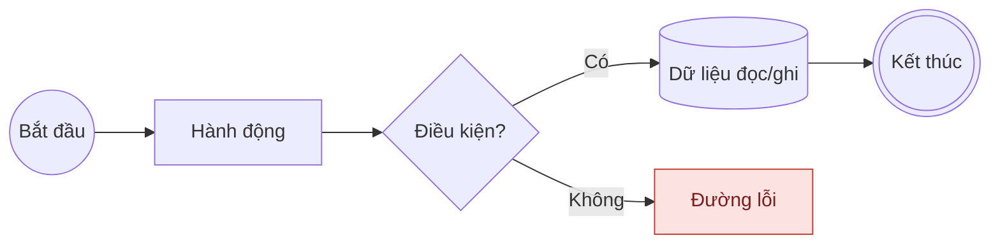

| Ký hiệu | Ý nghĩa |
|---|---|
| Hình tròn `Bắt đầu` / tròn kép `Kết thúc` | Điểm bắt đầu và kết thúc |
| Hình chữ nhật | Hành động cụ thể |
| Hình thoi | Điều kiện rẽ nhánh |
| Hình trụ | Dữ liệu được tạo, đọc hoặc thay đổi (nối bằng nét đứt) |
| Ô **đỏ** | Đường lỗi: lỗi mạng, dữ liệu sai, hết hạn, không đủ quyền |
| Khung có tiêu đề | Swimlane: ai thực hiện bước đó |
| Mũi tên quay ngược lên | Vòng lặp |

---

## 3. Đăng nhập

### 3.1. Sequence

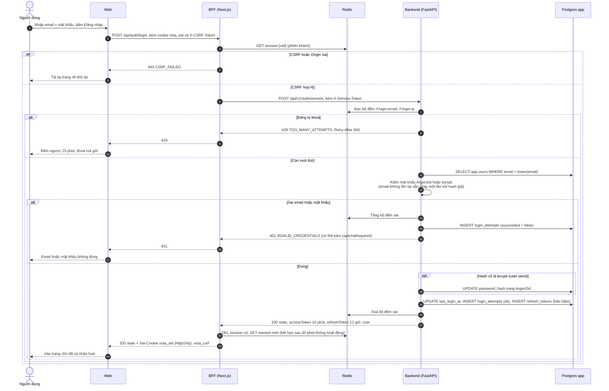

**Giải thích dễ hiểu:**

- Ở bước 2, Web chỉ gửi email và mật khẩu cho BFF. Web **không** nhận lại token nào.
- Sai email hay sai mật khẩu đều trả **cùng một lỗi, cùng thông điệp và mất cùng khoảng thời gian**. Nếu hai trường hợp khác nhau, kẻ xấu sẽ dò được email nào đã đăng ký.
- Khi đăng nhập thành công, phiên khách cũ bị xoá và một `sid` mới được phát (chống *session fixation*: kẻ xấu cài sẵn một `sid` cho nạn nhân rồi chờ nạn nhân đăng nhập bằng chính `sid` đó).
- 54 tài khoản seed dùng mật khẩu băm kiểu cũ (bcrypt). Lần đăng nhập đầu, hệ thống tự băm lại bằng Argon2id; người dùng không thấy gì khác.

### 3.2. Activity

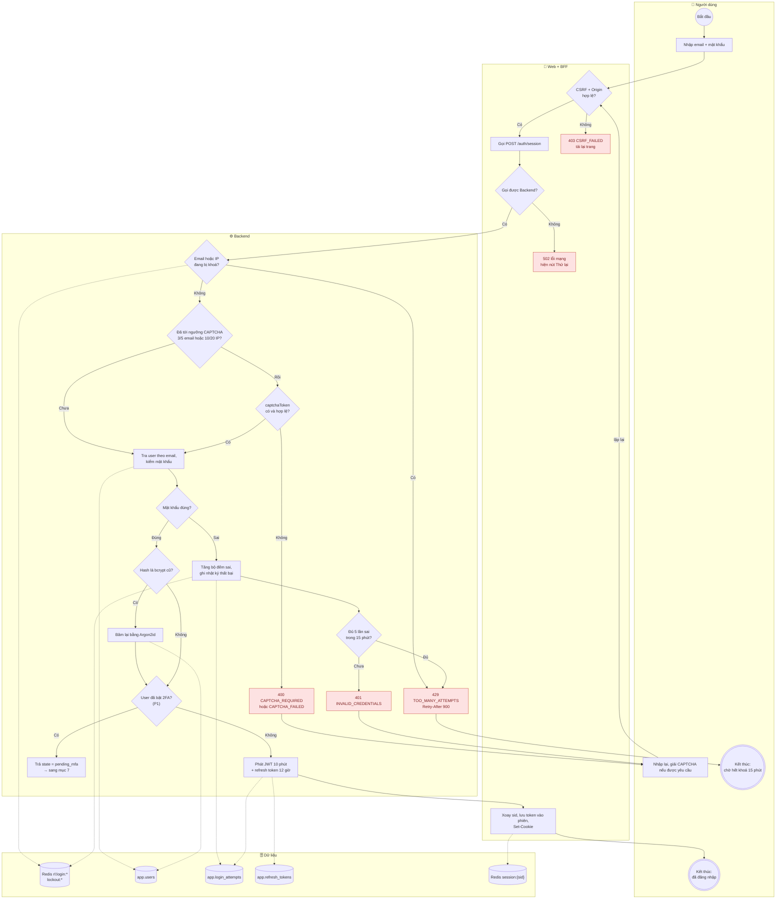

**Vòng lặp:** người dùng được thử lại nhiều lần. Từ lần sai thứ 3 (theo email) phải giải CAPTCHA; tới lần sai thứ 5 trong 15 phút thì tài khoản bị **khoá tạm 15 phút**, không khoá vĩnh viễn. Khoá vĩnh viễn sẽ biến tính năng bảo vệ thành công cụ để kẻ xấu cố tình khoá tài khoản của người khác.

**Vì sao đếm cả theo email và theo IP:** chỉ đếm theo IP thì kẻ tấn công đổi proxy là thử tiếp được; chỉ đếm theo email thì kẻ tấn công thử một mật khẩu phổ biến trên 2.000 email khác nhau mà không chạm ngưỡng.

---

## 4. Đăng ký tài khoản

Đăng ký khó hơn đăng nhập vì phải ghi vào **hai nơi có quyền khác nhau**: hồ sơ khách hàng `cdp.profiles` (chỉ role `cdp_writer` ghi được) và tài khoản `app.users` (role `vota_app`). Hai kết nối này **không được** gói chung một transaction (`AGENTS.md` §6.2), nên hệ thống làm theo hai pha: tạo hồ sơ CDP trước, tạo tài khoản sau.

### 4.1. Sequence

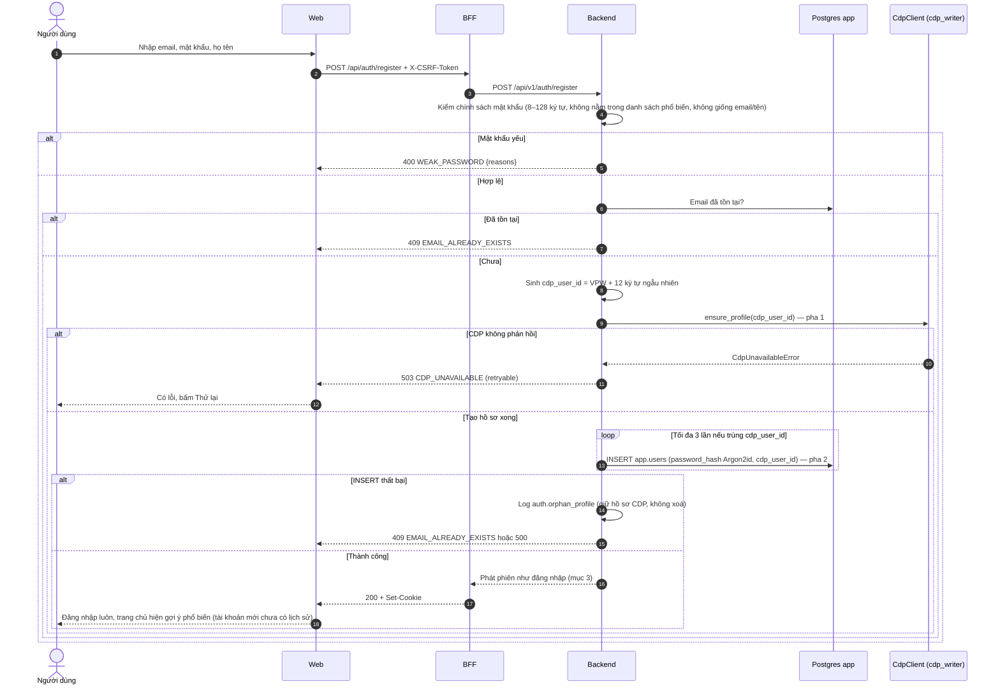

### 4.2. Activity

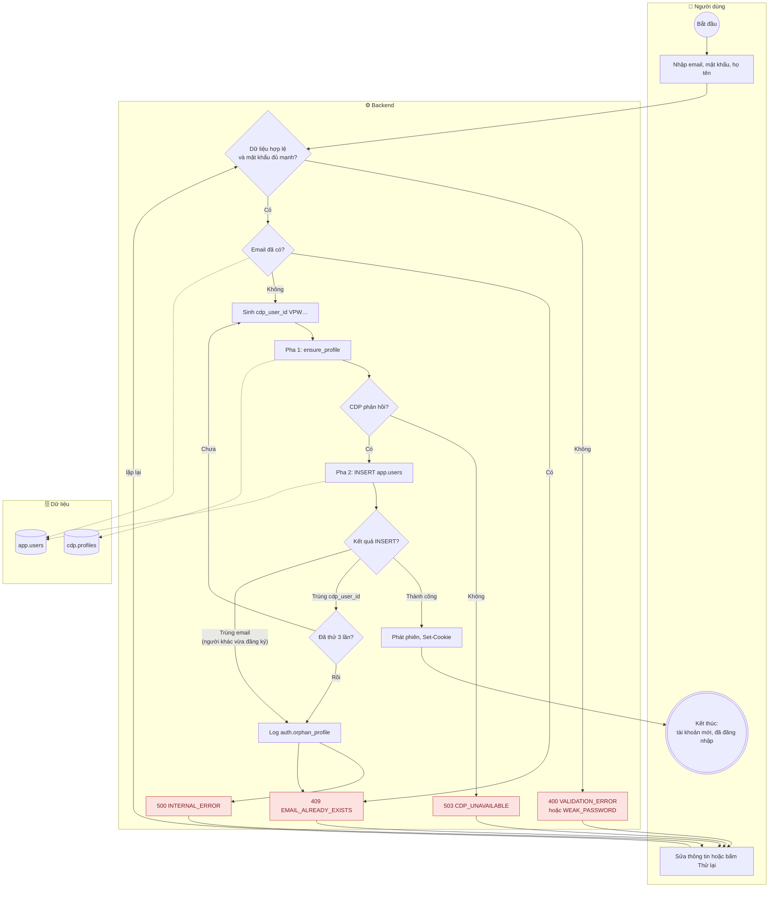

**Giải thích dễ hiểu:**

- **Vì sao CDP đi trước:** cột `app.users.cdp_user_id` bắt buộc trỏ tới một hồ sơ có thật, nên phải có hồ sơ rồi mới tạo được tài khoản.
- **Nếu pha 2 hỏng, hồ sơ CDP bị bỏ lại ("mồ côi")** và hệ thống **cố ý không xoá**. Role `cdp_writer` không có quyền xoá hồ sơ; cấp thêm quyền xoá chỉ để dọn rác thì rủi ro hơn lợi. Hồ sơ rỗng không có sự kiện nào nên không ảnh hưởng gợi ý hay số liệu. Hệ thống ghi log `auth.orphan_profile` để job dọn dẹp xử lý sau.
- **Mã `VPW…` ngẫu nhiên, không tuần tự:** mã tuần tự cho phép đoán mã của người khác. Dải `VP0000001–VP0002000` dành riêng cho dữ liệu seed.
- Tài khoản mới chưa có lịch sử, nên trang chủ hiện gợi ý **phổ biến** (`coldStart: true`).

---

## 5. Gọi API khi đã đăng nhập

Ví dụ: người dùng mở trang chủ (gợi ý cá nhân hoá) hoặc thêm sản phẩm vào giỏ. Mọi request đều đi qua BFF; BFF gắn token rồi chuyển sang Backend.

### 5.1. Sequence

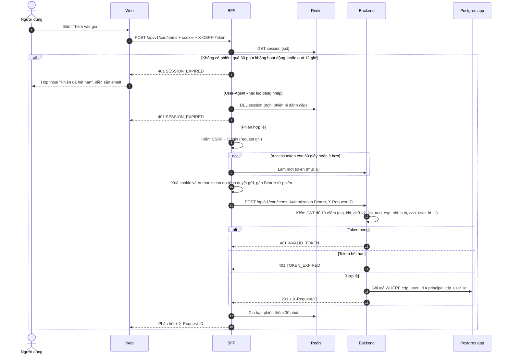

### 5.2. Activity — Backend quyết định danh tính và quyền

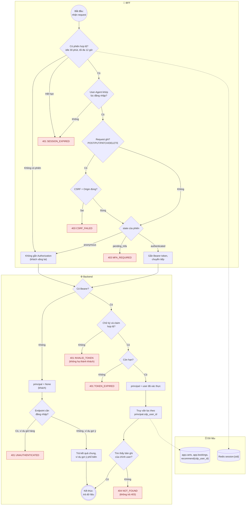

**Giải thích dễ hiểu:**

- **Danh tính chỉ lấy từ phiên đã xác thực**, không bao giờ từ tham số trên URL hay trong body. Trước đây `/recommendations?cdp_user_id=VP0000001` cho phép bất kỳ ai xem gợi ý của người khác; đường này đã bị bỏ.
- **Token hỏng thì báo lỗi, không lặng lẽ coi là khách.** Nếu hạ ngầm thành khách, người dùng sẽ thấy trang chủ không cá nhân hoá mà không hiểu vì sao, và lỗi xác thực sẽ không bao giờ lộ ra trong demo.
- **Đơn của người khác trả `404` chứ không `403`.** Trả `403` là ngầm xác nhận "mã đơn này có tồn tại".
- **Frontend chỉ lo trải nghiệm.** Ẩn nút "Thêm vào giỏ" khi chưa đăng nhập chỉ để giao diện gọn; Backend vẫn tự kiểm lại mọi thứ.

---

## 6. Làm mới token và phát hiện token bị đánh cắp

Access token chỉ sống 10 phút. BFF tự đổi refresh token lấy cặp token mới, người dùng không thấy gì. Mỗi refresh token **chỉ dùng được một lần**.

### 6.1. Sequence — hai tab cùng làm mới, và trường hợp token bị đánh cắp

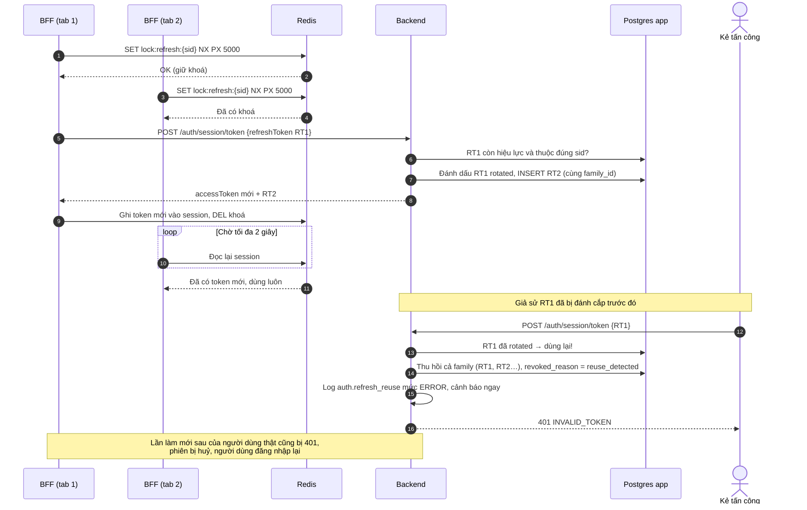

### 6.2. Activity

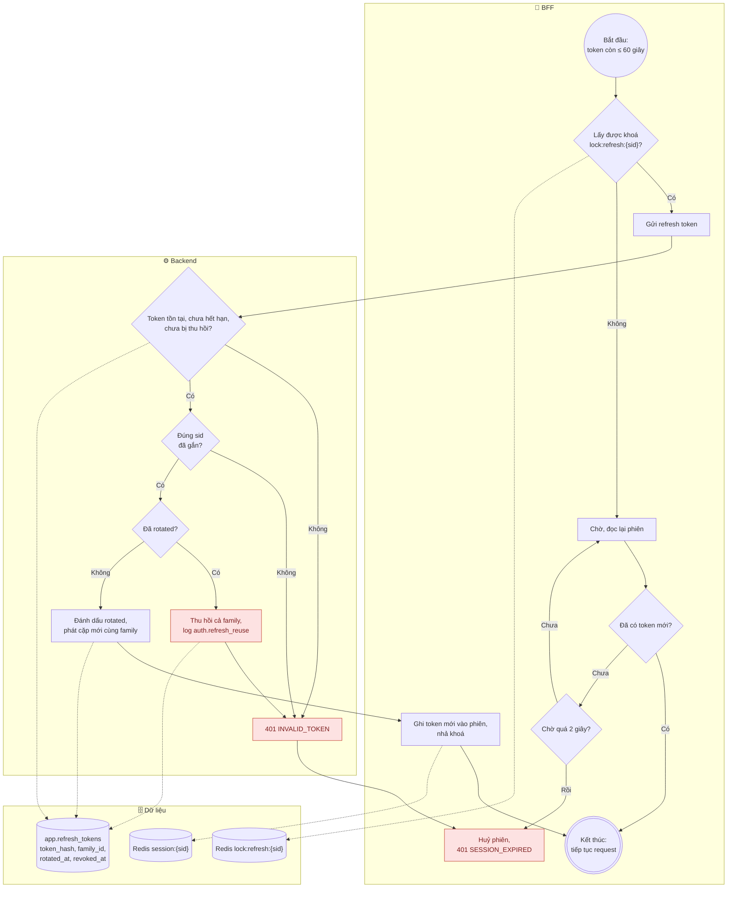

**Vì sao cần khoá:** không có khoá, hai tab cùng gửi một refresh token; tab thứ hai sẽ bị coi là "dùng lại token" và tự đăng xuất người dùng.

**Vì sao thu hồi cả chuỗi:** khi một token cũ bị dùng lại, hệ thống không biết bên nào là người thật, bên nào là kẻ trộm. Thu hồi hết là cách an toàn duy nhất; người dùng thật chỉ mất công đăng nhập lại.

---

## 7. Xác minh OTP 2 lớp (ngoài phạm vi)

> **Ngoài phạm vi** theo PRD chốt 2026-09-23. Mục này chỉ mô tả hành vi ở spec auth §12 và §3.8 dòng D–E để tham khảo; không triển khai. Ở phạm vi hiện tại, nhánh "User đã bật 2FA?" trong mục 3.2 luôn là **Không**.

Người dùng đã bật 2FA thì đăng nhập đúng mật khẩu **chưa đủ**: phiên ở trạng thái `pending_mfa`, chưa mang danh tính nghiệp vụ (`cdpUserId = null`) và chỉ được gọi một endpoint duy nhất là xác minh OTP.

### 7.1. Sequence

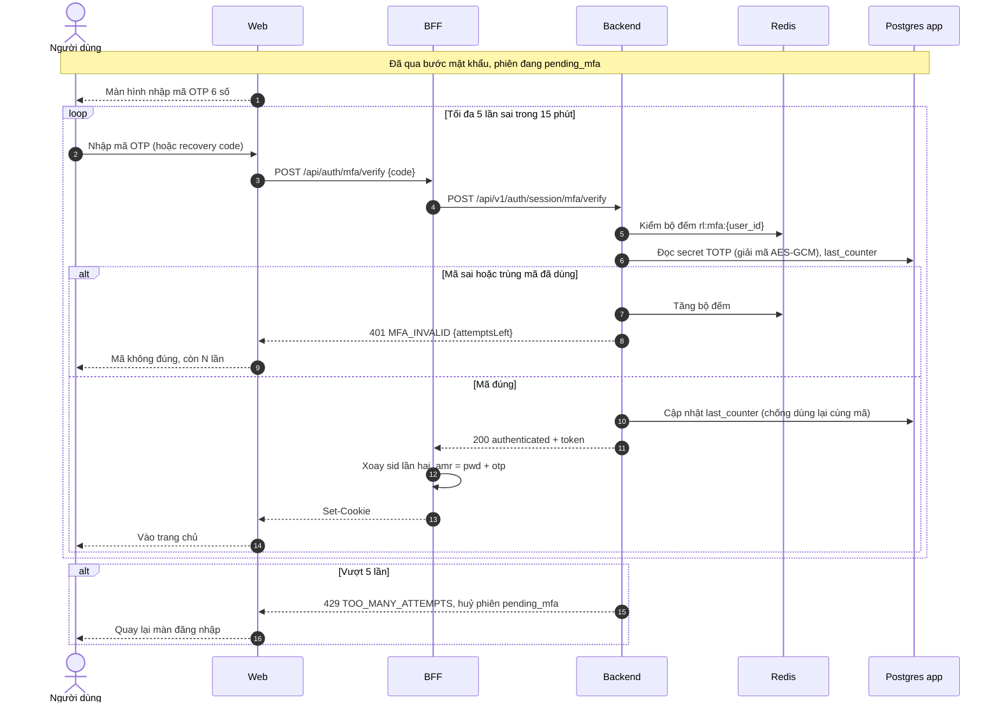

### 7.2. Activity

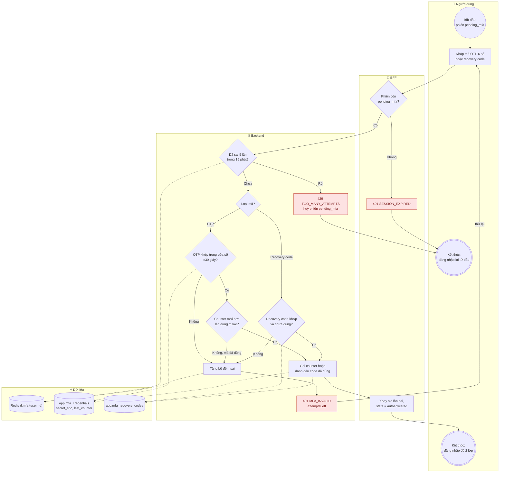

**Vòng lặp:** tối đa **5 lần sai trong 15 phút** (spec auth §9.1, khoá `rl:mfa`). Vượt ngưỡng thì phiên `pending_mfa` bị huỷ và người dùng phải nhập lại mật khẩu từ đầu.

**Vì sao lưu `last_counter`:** một mã OTP hợp lệ trong 30 giây. Nếu kẻ xấu nhìn trộm được mã, họ có thể dùng lại ngay trong 30 giây đó. Ghi lại counter đã dùng thì mỗi mã chỉ dùng được một lần.

---

## 8. Đăng xuất

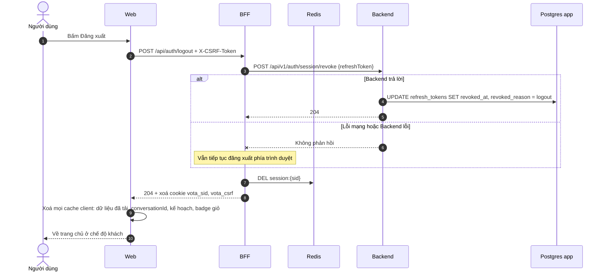

**Điểm cần nhớ:** BFF **luôn** xoá cookie, kể cả khi Backend lỗi. Người dùng bấm đăng xuất mà vẫn còn đăng nhập là lỗi nặng hơn việc một refresh token còn sống thêm ít giờ trong database. Token đó cũng không dùng được nữa, vì bản rõ chỉ nằm trong phiên Redis vừa bị xoá.

---

## 9. Vòng đời phiên đăng nhập

Phiên chỉ có **ba trạng thái**. Mỗi lần mức đặc quyền thay đổi, `sid` được thay mới (ô "xoay sid").

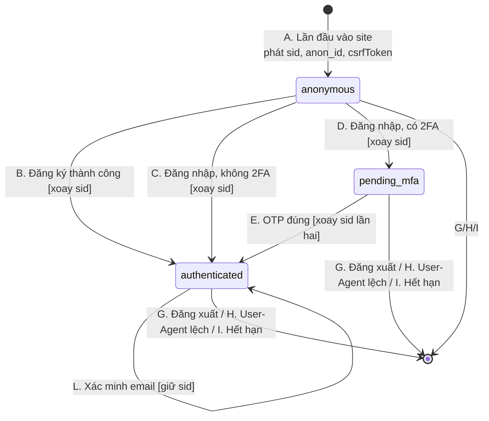

| Trạng thái | Có `cdpUserId`? | Được làm gì |
|---|---|---|
| `anonymous` (khách) | Không | Duyệt, tìm kiếm, chat, xem gợi ý phổ biến. Không có sự kiện nào ghi vào CDP. |
| `pending_mfa` | **Không** | Chỉ gọi được xác minh OTP. Mọi route khác trả `403 MFA_REQUIRED`. |
| `authenticated` | Có | Mọi tính năng, dữ liệu lọc theo `cdpUserId` của chính mình. |

**Hai mốc hết hạn:** không hoạt động **30 phút** thì hết phiên (idle); và dù hoạt động liên tục, phiên cũng hết sau **12 giờ** (absolute). Đổi IP (ví dụ điện thoại chuyển từ Wi-Fi sang 4G) **không** huỷ phiên; hệ thống chỉ ghi log và yêu cầu nhập lại mật khẩu cho hành động nhạy cảm như đổi mật khẩu.

---

## 10. Bảng lỗi và cách hiển thị

| HTTP | Mã | Khi nào | Web hiển thị | Thử lại tự động? |
|---:|---|---|---|---|
| 400 | `VALIDATION_ERROR` | Thiếu trường, sai định dạng email | Lỗi dưới ô nhập | Không |
| 400 | `WEAK_PASSWORD` | Mật khẩu vi phạm chính sách | Lỗi dưới ô mật khẩu, kèm lý do | Không |
| 400 | `CAPTCHA_REQUIRED` / `CAPTCHA_FAILED` | Tới ngưỡng CAPTCHA mà thiếu hoặc sai | Hiện hoặc reset widget CAPTCHA | Không |
| 401 | `INVALID_CREDENTIALS` | Sai email hoặc mật khẩu | "Email hoặc mật khẩu không đúng" | Không |
| 401 | `UNAUTHENTICATED` | Route cần đăng nhập, chưa đăng nhập | Hộp thoại đăng nhập tại chỗ, xong tự làm tiếp hành động | Không |
| 401 | `SESSION_EXPIRED` | Phiên hết hạn hoặc bị huỷ | Hộp thoại "Phiên đã hết hạn", điền sẵn email, gửi lại request **đúng một lần** | Một lần sau khi đăng nhập lại |
| 401 | `INVALID_TOKEN` / `TOKEN_EXPIRED` | Token hỏng hoặc hết hạn (client nội bộ) | BFF xử lý, Web thấy `SESSION_EXPIRED` | Không |
| 401 | `MFA_INVALID` | OTP sai (P1) | Lỗi dưới ô mã, số lần còn lại | Không |
| 403 | `CSRF_FAILED` | Thiếu/sai CSRF hoặc Origin lạ | Tải lại trang rồi thử lại | Không |
| 403 | `MFA_REQUIRED` | Phiên `pending_mfa` gọi route khác | Chuyển sang màn nhập OTP | Không |
| 404 | `BOOKING_NOT_FOUND` | Đơn không có **hoặc không thuộc về bạn** | "Không tìm thấy đơn" | Không |
| 409 | `EMAIL_ALREADY_EXISTS` | Email đã đăng ký | Gợi ý đăng nhập | Không |
| 429 | `TOO_MANY_ATTEMPTS` | Vượt rate limit hoặc đang bị khoá | Đếm ngược theo `retryAfterSeconds`, khoá nút gửi | **Có**, sau thời gian chờ |
| 502 | — | BFF không gọi được Backend (lỗi mạng) | Trạng thái lỗi + nút Thử lại | Người dùng bấm |
| 503 | `CDP_UNAVAILABLE` | Không tạo được hồ sơ CDP khi đăng ký | Trạng thái lỗi + nút Thử lại | **Có** |

Mọi lỗi theo đúng Error Envelope `{ error: { code, message, retryable, requestId, details } }` (`src/shared/contracts/schemas/common.yaml`). Khi báo lỗi cho team, gửi kèm `requestId` để tra log.

**Không bao giờ ghi vào log:** mật khẩu (kể cả mật khẩu sai), JWT, refresh token, `sid` đầy đủ (chỉ 8 ký tự đầu), CSRF token, secret OTP, recovery code, email đầy đủ (dùng bản băm hoặc `m***h@example.com`), IP đầy đủ (chỉ /24).
