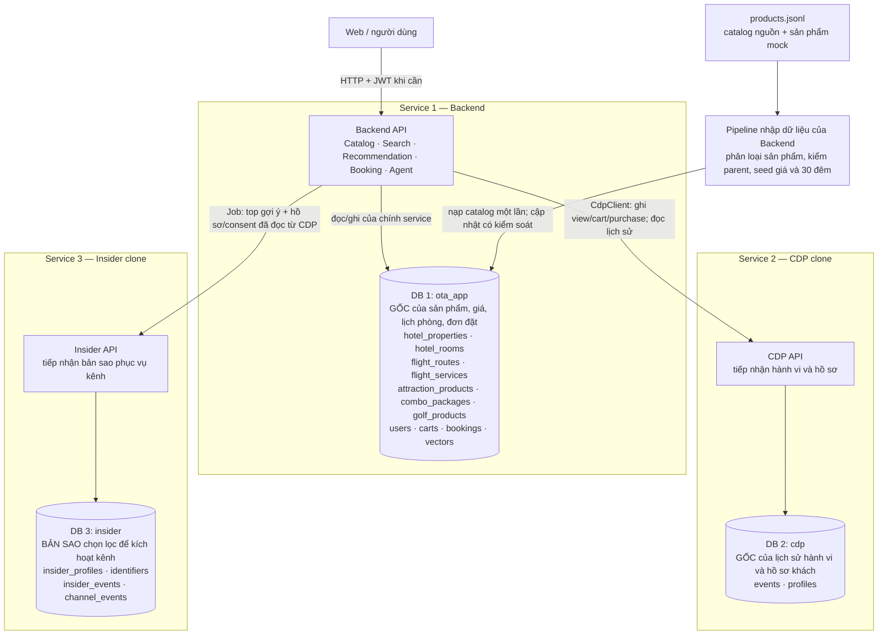

# Ba database: dữ liệu gốc ở đâu, dữ liệu truyền đi đâu?

**Thiết kế đề xuất cho demo hiện tại — 17/09/2026.**  
Đọc bản này trước [schema từng bảng](thiet-ke-schema-3-service-chi-tiet.md) và [review hợp đồng](ra-soat-hop-dong-2026-09-17.md).

**Có đúng 3 database: `ota_app`, `cdp`, `insider`.** Nhiều bảng trong sơ đồ chi tiết không có nghĩa là nhiều database. Search, Recommendation và Itinerary Agent nằm trong Backend, dùng DB của Backend; vector cũng nằm trong DB này.

## 1. Thiết kế nên dùng

**Mỗi loại dữ liệu có nơi giữ bản gốc riêng.** “DB gốc” của catalog là `ota_app`; “DB gốc” của hành vi là `cdp`. `insider` nhận bản sao cần thiết để minh họa tích hợp kênh. Không có database tổng thứ tư đứng trước ba database này.

Ở demo, có thể chạy ba PostgreSQL riêng qua Docker Compose cho dễ nhìn ranh giới. Ba database không bắt buộc là ba máy vật lý. Chỉ `ota_app` cần pgvector. Mỗi service dùng connection/credentials của DB mình; Backend gọi API CDP/Insider, không mở kết nối vào DB của chúng.

## 2. Nạp products.jsonl vào đâu?

**Nạp vào `ota_app`, không nạp ba bản giống nhau.** Pipeline thuộc phần dữ liệu của Backend nên được phép ghi DB Backend.

| Dòng trong file | Bảng đích bên trong **cùng DB `ota_app`** |
|---|---|
| `taxonomy=hotel`, `level=property` | `hotel_properties`: 1.494 cơ sở |
| `taxonomy=hotel`, `level=room` | `hotel_rooms`: 4.646 hạng phòng; FK về property |
| `taxonomy=flight`, `level=route` | `flight_routes`: 60 tuyến |
| `taxonomy=flight`, `level=flight` | `flight_services`: 184 chuyến; FK về route |
| `taxonomy=attraction` | `attraction_products`: 3.517 vé/tour/điểm tham quan |
| `taxonomy=combo` | `combo_packages`: 93 gói |
| `taxonomy=golf` | `golf_products`: 6 voucher/địa điểm golf |

`catalog_keys` chỉ giữ ID/loại/nguồn để tham chiếu. Bảy bảng trên giữ nội dung và thuộc tính riêng; chúng không phải bảy database. `v_catalog` là một view đọc để Search trả payload thống nhất; cũng không phải database riêng.

Sau khi nhập room, pipeline khởi tạo trong **`ota_app`**:

- `hotel_room_prices`: **một giá/đêm cho mỗi room**.
- `hotel_room_nights`: trạng thái từng đêm, **30 đêm active/room**.
- Tổng ban đầu: 4.646 giá và **139.380 dòng lịch active**, nếu seed toàn bộ room.
- Job ngày mới bổ sung đêm ở cuối cửa sổ; không mở lại đêm đã đặt. Giá không đổi chỉ vì qua ngày mới.

File catalog/metadata nhập vẫn có thể giữ trên filesystem để truy nguồn; không cần tạo thêm một “raw database” trong MVP.

## 3. CDP nhận gì nếu không nhận nguyên catalog?

CDP cần biết **ai đã làm gì, với sản phẩm nào, khi nào**. Nó giữ ID sản phẩm và một số thuộc tính tại thời điểm hành vi; không cần giữ cả bảng phòng và 30 ngày tồn.

Ví dụ đặt **Hòn Tằm Resort - Deluxe Bungalow hướng vườn 2 giường đơn**, room ID `b6a1a7c0-5cf8-57c9-a008-67ec054d11d9`, từ 18/09 tới 21/09:

| Database | Dữ liệu thay đổi |
|---|---|
| **ota_app** | Tạo booking và booking item, chốt 3 đêm × 2.219.215 = 6.657.645 VND; ba đêm 18, 19, 20/09 chuyển false; liên kết mỗi đêm tới booking item |
| **cdp** | Một `purchase` có `cdpUserId`, room `productId`, `taxonomy=hotel`, `eventId`, `eventGroupId`, `quantity=1`, `unitPrice=2219215`, `usingDate=2026-09-18` |
| **insider** | Job sau đó có thể thay danh sách gợi ý cho khách sang vé tham quan/chuyến bay; không sao chép ba row lịch phòng |

Ví dụ giá lấy từ file để minh họa quy tắc mock, không là báo giá trực tiếp nhà cung cấp. Event CDP hiện chưa có `nights`, vì vậy tổng tiền 3 đêm vẫn lấy từ booking.

Hợp đồng hiện chọn ghi purchase vào CDP trước commit booking. Nếu booking thất bại thì rollback lịch phòng và huỷ event qua API; còn rủi ro giữa hai service cần đối soát. Chi tiết ở [luồng checkout](thiet-ke-schema-3-service-chi-tiet.md#52-checkout-an-toàn-trong-một-database-bù-trừ-qua-cdp). Bảng trên mô tả **kết quả sau khi đặt thành công**, không phải tuyên bố ba DB cùng commit một lúc.

## 4. Recommendation lấy cả sản phẩm lẫn hành vi bằng cách nào?

1. Backend biết khách đang đăng nhập từ `users.cdp_user_id`.
2. Recommendation gọi **CDP API** lấy event chưa bị huỷ của khách.
3. Từ `productId` trong event, Recommendation tra catalog/vector trong **DB `ota_app` của chính mình**.
4. Tính gợi ý và lý do `because`, rồi trả Web. Nếu có kỳ lưu trú, kiểm `hotel_room_nights` trước khi khẳng định phòng đặt được.
5. CDP lỗi → dùng phương án fallback đã định nghĩa. Insider lỗi không làm Search/booking phải dừng.

Đây là kết hợp dữ liệu **ở tầng ứng dụng qua API**, không phải SQL JOIN giữa hai database. `productId`, `cdpUserId`, `eventId` là cầu nối; không đặt FK xuyên DB.

## 5. Insider nhận dữ liệu từ đâu?

Một job trong Backend điều phối:

1. Lấy danh sách khách cần xử lý. Demo có thể dùng danh sách `users` đã seed, không cần `demo_accounts`.
2. Đọc profile/consent từ CDP API theo `cdpUserId`.
3. Tính top gợi ý bằng Recommendation của Backend.
4. Gọi Insider API upsert identifier + phần profile cần thiết + top gợi ý.
5. Insider lưu vào DB riêng, áp quy tắc merge/TTL/consent của clone.

Job không đọc thẳng DB CDP, không ghi thẳng DB Insider. Với nhóm khách ngoài `users` Backend, cần API CDP liệt kê profile trước khi mở rộng job cho toàn bộ khách. Đồng bộ toàn bộ hành vi sang Insider là tính năng riêng chưa nằm trong hợp đồng CDP hiện tại; không tự giả định đã có CDC/replication.

## 6. Ma trận nguồn gốc và bản sao

| Dữ liệu | DB gốc / nơi có quyền sửa | DB khác giữ gì? |
|---|---|---|
| Khách sạn, room, tuyến/chuyến, vé/tour, combo, golf | **ota_app** | CDP: ID/taxonomy trên event; Insider: ID/tên/link trong kết quả gợi ý hoặc event được chọn |
| Giá phòng, lịch từng đêm | **ota_app** | CDP có giá tại thời điểm purchase; không có quyền sửa giá/lịch. Insider không giữ lịch phòng |
| Giỏ, đơn đặt, tiền đã chốt | **ota_app** | CDP có event nghiệp vụ tương ứng; không phải bản sao đầy đủ của đơn |
| Login/password/tài khoản web | **ota_app** | CDP và Insider nối bằng `cdpUserId`; không copy password hash |
| Lịch sử hành vi | **cdp** | Backend đọc qua API để tính gợi ý; Insider chỉ nhận tập được chọn nếu có luồng đồng bộ đó |
| Profile/consent phục vụ tích hợp | **cdp** | Insider nhận bản sao; seed/job ghi qua CDP API. Thay consent về sau cần đồng bộ lại |
| Vector sản phẩm / kết quả tính toán | **ota_app** | Insider nhận top kết quả, không nhận vector index |
| Tương tác email/push/SMS của clone | **insider** | Đọc qua export API khi cần đánh giá; không tự ghi ngược CDP nếu chưa có hợp đồng |

Như vậy, hướng đi không phải luôn là một chuỗi `DB1 → DB2 → DB3`. **Backend và CDP trao đổi hai chiều qua API; Insider nhận dữ liệu chọn lọc từ job.** Sản phẩm mới được nạp không cần tạo event hay profile CDP cho đến khi có hành vi hoặc seed lịch sử.

## 7. Vì sao chọn cách này cho nhóm?

- Giá, lịch phòng và booking ở **cùng một database**, nên có thể khóa đêm và commit nguyên khối, xử lý đặt trùng rõ ràng.
- Có đúng ba service/DB như thiết kế được cung cấp; không phải dựng thêm luồng sao chép toàn catalog và xử lý xung đột dữ liệu giữa ba nơi.
- CDP giữ lịch sử kể cả khi sản phẩm ngừng bán, phục vụ vòng phản hồi recommendation.
- Insider thể hiện đúng vai trò bản sao phục vụ kích hoạt; lỗi đồng bộ kênh không làm mất khả năng đặt phòng.

Nếu tương lai bắt buộc **CDP là kho catalog gốc tập trung**, ownership catalog phải đổi: Data nạp CDP, Backend nhận bản đọc catalog qua API/job, còn tồn phòng và đơn vẫn cần owner duy nhất. Đó là một thay đổi kiến trúc có thêm đồng bộ/version/độ trễ; không phải chỉ đổi tên DB. Với demo hiện tại, đề xuất giữ **catalog + giá + lịch phòng + booking trong `ota_app`**, phù hợp quy tắc tạm của hợp đồng CDP §11.

## 8. Thứ tự triển khai gọn nhất

1. **ota_app trước:** nhập catalog đúng loại → một giá/room → lịch trượt → đặt được phòng và khóa đêm đúng.
2. **CDP kế tiếp:** seed profile/event qua API → ghi purchase từ booking → đọc lịch sử để gợi ý thay đổi.
3. **Insider sau:** seed định danh → upsert top gợi ý + consent → kiểm TTL và export của clone.

Giữ `users`, bỏ `demo_accounts`. Các thay đổi hợp đồng/chi tiết lỗi cần làm đồng bộ đã liệt kê trong [bản review](ra-soat-hop-dong-2026-09-17.md); sơ đồ bảng và checkout đầy đủ ở [bản thiết kế chi tiết](thiet-ke-schema-3-service-chi-tiet.md).
