# Kiến trúc Search OTA: Sơ đồ và giải thích từng giai đoạn

## 1. Mục tiêu kiến trúc

Search OTA không chỉ là tìm văn bản giống câu khách gõ. Một query có thể chứa đồng thời:

- Ý định và loại sản phẩm: hotel, room, golf, golf voucher, attraction/VinWonders ticket, flight, combo.
- Điểm đến, thương hiệu, airport/city alias.
- Ràng buộc cứng: giá, sao, ngày, availability, có/không có tiện ích, ticketed, origin/destination flight.
- Ràng buộc phủ định: không có, không gồm, không phải, trừ.
- Nhu cầu diễn đạt tự nhiên: phù hợp gia đình, nghỉ dưỡng biển yên tĩnh, honeymoon.
- Nhiễu nhập liệu: không dấu, abbreviation, typo, tách/ghép từ.

Nguyên tắc kiến trúc:

> **Hard constraints phải được parse và filter; semantic preference được rank bằng retrieval.**

Vector search không nên là nơi quyết định “không có sân golf”, “không phải Vinpearl”, “từ Hà Nội đến Đà Nẵng”, hoặc “dưới 2 triệu”. Các điều kiện này phải trở thành cấu trúc có thể kiểm tra trên catalog.

---

## 2. Sơ đồ toàn hệ thống

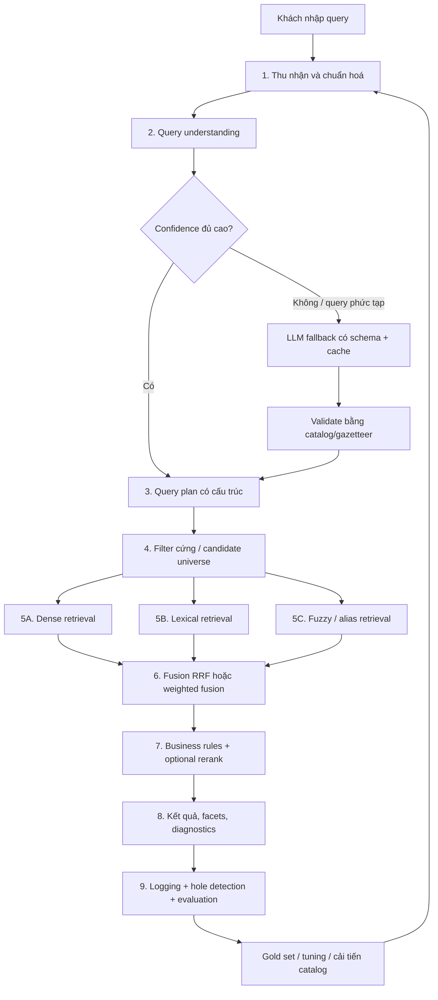

Pipeline chia làm chín giai đoạn. Giai đoạn 1–4 xử lý **hiểu đúng và giới hạn đúng tập sản phẩm**; giai đoạn 5–7 xếp hạng; giai đoạn 8–9 phục vụ UI và cải tiến hệ thống qua gold/evaluation.

---

## 3. Giai đoạn 1 — Thu nhận và chuẩn hoá query

### Sơ đồ

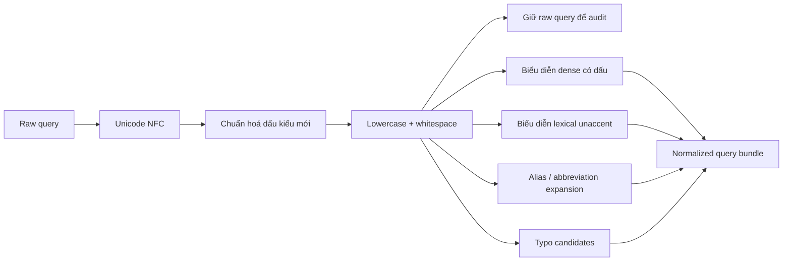

### Đầu vào và đầu ra

**Đầu vào:** chuỗi khách gõ nguyên bản.

**Đầu ra:** một `normalized_query_bundle`, không phải một string bị rewrite duy nhất:

```json
{
  "raw_query": "voucer gofl hoi an",
  "normalized_text": "voucer gofl hoi an",
  "dense_text": "voucer gofl hoi an",
  "lexical_text": "voucer gofl hoi an",
  "unaccent_text": "voucer gofl hoi an",
  "aliases_expanded": [],
  "typo_candidates": [
    "voucher golf hoi an",
    "voucher golf hội an"
  ]
}
```

### Việc cần làm

- Chuẩn hoá Unicode NFC.
- Chuẩn hoá các biến thể dấu tiếng Việt theo policy thống nhất, ví dụ `hoà → hòa` nếu catalog dùng `hòa`.
- Lowercase và chuẩn hoá khoảng trắng cho lookup/cache.
- Tạo bản `unaccent` cho lexical matching.
- Mở rộng alias có kiểm soát: `ks → khách sạn`, `vw → VinWonders`, `vp → Vinpearl`, `pq → Phú Quốc`, `nt → Nha Trang`.
- Sinh candidate typo bằng fuzzy/trigram hoặc dictionary catalog; không rewrite destructive nếu confidence thấp.

### Điều không làm

- Không bỏ dấu trước khi embedding.
- Không thay thế raw query bằng một bản sửa lỗi duy nhất mà không lưu trace.
- Không dùng LLM để sửa mọi query.
- Không fuzzy-match toàn bộ long description; fuzzy ưu tiên name, brand, destination, alias và short entity fields.

### Vì sao cần nhiều biểu diễn?

Query `voucher golf hoi an` cần được xử lý khác theo từng kênh:

- Dense có thể dùng câu nguyên gốc/canonical candidate để nhận nhu cầu gần nghĩa.
- Lexical dùng `unaccent` để match `Hội An`.
- Alias resolver hiểu `vw`, `vp`, `nt`.
- Typo resolver cứu `voucer`, `gofl`.

Nếu chỉ có một bản rewrite, hệ thống có thể sửa sai và mất khả năng audit. Nếu chỉ có embedding, các typo ngắn/abbreviation/entity có thể không ổn định.

---

## 4. Giai đoạn 2 — Query understanding

### Sơ đồ

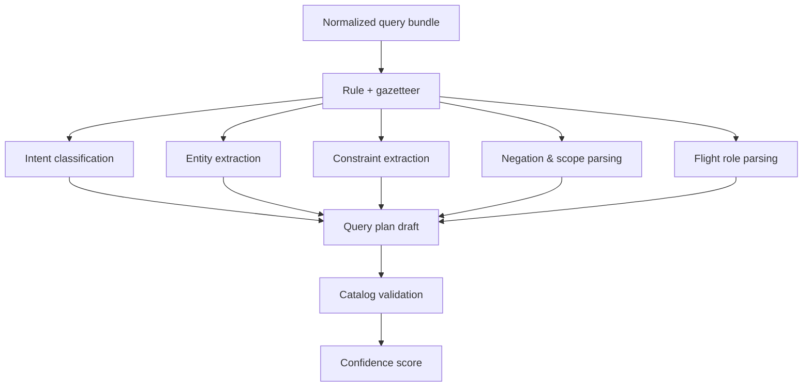

### Mục tiêu

Biến câu tự nhiên thành một query plan có field rõ ràng. Lớp này trả lời các câu hỏi:

- Khách đang tìm vertical nào?
- Destination/brand/entity nào được nêu?
- Điều kiện nào là hard filter?
- Điều kiện nào là semantic preference?
- Có phủ định không, phủ định áp vào field nào?
- Với flight: đâu là origin, đâu là destination, có chiều rõ ràng không?

### Ưu tiên kỹ thuật

1. **Rule + gazetteer trước:** nhanh, rẻ, dễ kiểm thử và phù hợp domain hẹp.
2. **Lightweight classifier:** dùng khi rule chưa đủ rõ cho intent/taxonomy.
3. **LLM fallback:** chỉ cho query dài, đa ý, conflict hoặc confidence thấp; output bắt buộc theo JSON schema và phải validate lại bằng catalog.

### Gazetteer cần có

| Nhóm | Ví dụ |
|---|---|
| Brand | Vinpearl, VinWonders, Vinpearl Golf |
| Vertical | resort, khách sạn, villa, phòng, combo, golf, voucher, vé, máy bay |
| Destination | Phú Quốc, Nha Trang, Hội An, Đà Nẵng, Hạ Long, Hà Tĩnh |
| Airport/city alias | Hà Nội/HAN, Sài Gòn/TP.HCM/SGN, Đà Nẵng/DAD, Phú Quốc/PQC, Nha Trang/Cam Ranh/CXR |
| Abbreviation | VP, VW, PQ, NT, ĐN, KS, KDL |
| Operator | từ, đến, đi, về, ra, vào, không, chỉ, trừ, gồm, bao gồm |

### Ví dụ output: taxonomy collision

Input:

```text
voucher golf Hoi An
```

Output:

```json
{
  "intent": "catalog_search",
  "confidence": 0.98,
  "vertical": ["golf"],
  "product_kind": ["voucher"],
  "destination": "Hội An",
  "hard_filters": [
    {"eq": ["vertical", "golf"]},
    {"eq": ["product_kind", "voucher"]},
    {"eq": ["destination", "Hội An"]}
  ],
  "must_not": [
    {"in": ["taxonomy", ["vinwonders_ticket", "attraction_ticket"]]}
  ],
  "semantic_text": "voucher golf Hội An"
}
```

### Ví dụ output: phủ định

Input:

```text
resort Nha Trang không có sân golf
```

Output:

```json
{
  "intent": "hotel_search",
  "confidence": 0.96,
  "vertical": ["hotel_property", "resort"],
  "destination": "Nha Trang",
  "hard_filters": [
    {"eq": ["destination", "Nha Trang"]},
    {"eq": ["has_golf", false]}
  ],
  "must_not": [
    {"eq": ["has_golf", true]}
  ],
  "negation_scope": "hard_exclusion",
  "semantic_text": "resort Nha Trang"
}
```

### Ví dụ output: flight direction

Input:

```text
vé máy bay từ Hà Nội vào Đà Nẵng
```

Output:

```json
{
  "intent": "flight_search",
  "confidence": 0.99,
  "vertical": ["flight_route"],
  "origin": "Hà Nội",
  "destination": "Đà Nẵng",
  "direction": "Hà Nội->Đà Nẵng",
  "hard_filters": [
    {"eq": ["origin_city", "Hà Nội"]},
    {"eq": ["destination_city", "Đà Nẵng"]}
  ],
  "semantic_text": "vé máy bay Hà Nội đến Đà Nẵng"
}
```

### Phân biệt phủ định hard và soft

| Query | Parse đúng |
|---|---|
| `resort không có sân golf` | Hard exclusion: `has_golf=false` |
| `combo không gồm vé máy bay` | Hard exclusion: `includes_flight=false` |
| `khách sạn không phải Vinpearl` | Hard exclusion: `brand != Vinpearl` |
| `villa có hồ bơi riêng, không cần gần biển` | `private_pool=true`; beach proximity là `do_not_require`, không loại item gần biển |
| `không nhất thiết 5 sao` | Bỏ điều kiện 5 sao; không filter `star_rating != 5` |
| `không quá 2 triệu` | Numeric bound: `price <= 2,000,000` |
| `không dưới 4 sao` | Numeric bound: `star_rating >= 4` |

---

## 5. Giai đoạn 3 — Router confidence và LLM fallback

### Sơ đồ quyết định

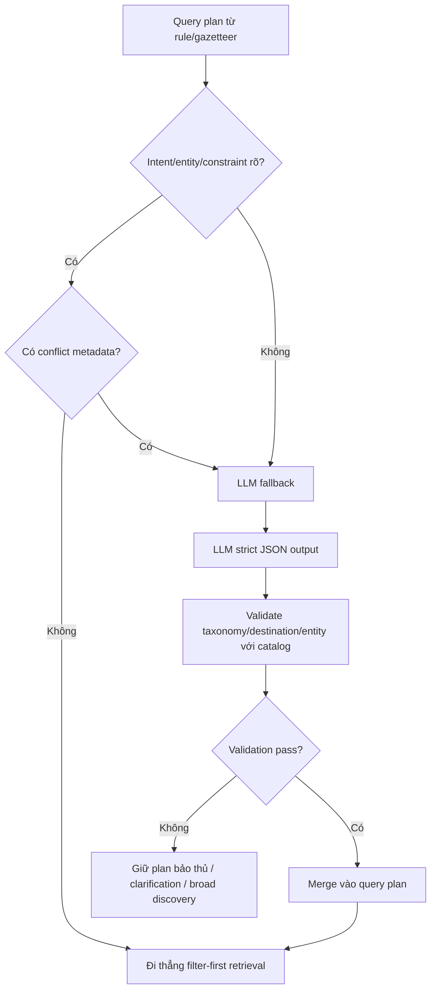

### Khi nào gọi LLM?

Chỉ gọi khi có ít nhất một tín hiệu:

- Intent confidence thấp.
- Entity matching conflict, ví dụ một alias map được nhiều destination.
- Query dài, nhiều ràng buộc, có quan hệ giữa các phần.
- Phủ định scope không xác định được bằng rule.
- Code-switching/typo nặng làm parser thất bại.
- Query dạng hội thoại hoặc itinerary: `nhà mình 4 người muốn đi Nha Trang tháng sau, không chơi VinWonders nhưng có sân golf`.

### Khi nào không gọi LLM?

- Query exact đơn giản: `Vinpearl Nha Trang`, `vé VinWonders Phú Quốc`, `bay Hà Nội Đà Nẵng`.
- Query đã có hard parse confidence cao.
- Query phổ biến đã có cache theo normalized query.
- Quyết định availability/price/route direction đã xác định bằng structured fields.

### Hợp đồng LLM

LLM chỉ tạo **structured hypothesis**, không trả item ID và không xếp hạng kết quả:

```json
{
  "intent": "hotel_search",
  "confidence": 0.92,
  "entities": [{"type": "destination", "value": "Nha Trang"}],
  "hard_filters": [{"eq": ["family_friendly", true]}],
  "soft_preferences": [{"field": "beachfront", "preference": "prefer"}],
  "must_not": [{"eq": ["vertical", "attraction_ticket"]}],
  "unknown_slots": []
}
```

Server validate every enum/value against catalog taxonomy, destination table, alias mapping and allowed filter schema. Nếu LLM trả một entity không tồn tại, không tự tạo filter sai.

---

## 6. Giai đoạn 4 — Filter-first và candidate universe

### Sơ đồ

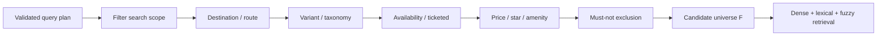

### Vai trò

Filter-first tạo tập `F`: chỉ các search unit hợp lệ mới được đưa vào ranker. Đây là cơ chế chặn lỗi cross-vertical và hard constraint sớm nhất.

Ví dụ `voucher golf Hội An`:

```text
Tất cả catalog
  -> destination = Hội An
  -> vertical = golf
  -> product_kind = voucher
  -> exclude attraction/VinWonders ticket
  -> F = chỉ các golf voucher hợp lệ tại Hội An
```

Vé VinWonders không được phép vào dense/BM25 candidate list, nên không thể thắng do embedding similarity.

### Filter nên bao phủ

| Nhóm | Field/filter ví dụ |
|---|---|
| Geography | `destination`, `province`, `city`, geo radius/POI nếu có |
| Taxonomy | `variant`, `vertical`, `product_kind`, `ticketed` |
| Brand/entity | `brand`, canonical entity ID |
| Hotel | `star_rating`, `family_friendly`, `has_golf`, `private_pool` |
| Room child | `unit_price`, occupancy, bed, view, availability |
| Combo | `nights`, `includes_flight`, item/BOM attributes |
| Flight | `origin_city`, `destination_city`, airline, non-stop, dates |
| Negative constraint | `must_not` bằng boolean/enum/range/relationship |
| Inventory | `available`, booking/open status, travel date validity |

### Parent–child filter

Hotel/property thường là vector search unit, nhưng giá và occupancy thuộc room child. Vì vậy:

```text
Filter parent: destination=Nha Trang, variant=hotel_property, star>=5
Child filter: tồn tại ít nhất một room có unit_price <= 2,000,000
```

Output parent chỉ hợp lệ nếu có child thỏa `child_filter`; UI cần nhận `expected_children` hoặc room IDs phù hợp để không hiển thị property đúng nhưng room price sai.

### Candidate universe rỗng

Nếu filter tạo `F = ∅`:

- Không hạ filter cứng một cách im lặng.
- Trả no-result có giải thích, hoặc đề xuất nới **soft** constraint rõ ràng.
- Với query missing slot, ví dụ `bay đến Đà Nẵng`, chuyển sang discovery/clarification theo UX thay vì bịa origin.
- Log query để thêm vào `expected_no_result`, query refinement hoặc catalog gap review.

---

## 7. Giai đoạn 5 — Candidate retrieval đa kênh

### Sơ đồ

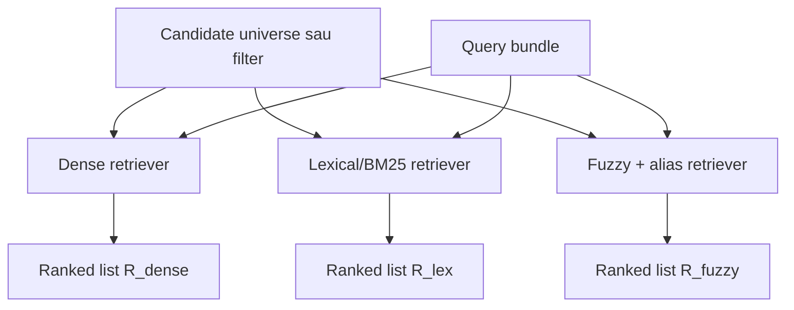

### 5A. Dense retrieval

**Mạnh khi:** khách diễn đạt nhu cầu hoặc paraphrase tự nhiên.

Ví dụ:

- `nghỉ dưỡng biển cho gia đình có trẻ nhỏ`
- `villa riêng tư để đi cùng nhóm bạn`
- `resort yên tĩnh cho tuần trăng mật`

Dense dùng `semantic_text` đã loại hoặc tách hard constraint. Không nhét giá/date/route direction thành thứ phải suy ra từ cosine.

Ở catalog nhỏ, có thể exact cosine trên tập `F`; khi tập filtered lớn hơn thì dùng ANN/HNSW. Embedding cache theo normalized query/canonical semantic text.

### 5B. Lexical/BM25 retrieval

**Mạnh khi:** exact name, brand, mã, rare term, destination, token chính xác.

Ví dụ:

- `Vinpearl Resort Nha Trang`
- `VinWonders Phú Quốc`
- `HAN DAD`
- `voucher golf Hội An`

Kênh lexical tiếng Việt cần tối thiểu:

- `tsvector('simple', unaccent(...))` cho text search không dấu.
- `pg_trgm`/trigram cho typo ở `name`, alias, brand, destination.
- Boost field name/brand cao hơn description.

### 5C. Fuzzy và alias retrieval

Fuzzy/alias không thay ranking chính; nó giúp tạo candidates mà exact BM25 có thể bỏ sót:

| Input | Canonical candidate |
|---|---|
| `vinwoder nha trang` | VinWonders Nha Trang |
| `voucer gofl hoi an` | voucher golf Hội An |
| `vp pq` | Vinpearl Phú Quốc |
| `ks vinpearl nt` | khách sạn Vinpearl Nha Trang |

Fuzzy nên restricted theo field/entity để tránh match noise từ toàn bộ mô tả.

---

## 8. Giai đoạn 6 — Fusion

### Sơ đồ

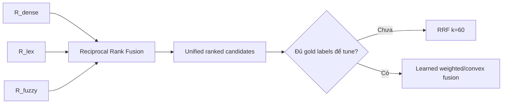

### Tại sao fusion theo rank?

Dense cosine và BM25 score không cùng đơn vị. RRF dùng vị trí trong từng list nên không đòi hỏi score calibration:

\[
RRF(d) = \sum_r \frac{1}{k + rank_r(d)}
\]

Khởi điểm an toàn là `k=60`.

### Chính sách triển khai

- Ban đầu dùng RRF cho dense + lexical; fuzzy/alias có thể là channel riêng hoặc bổ sung candidate vào lexical channel.
- Khi gold có đủ query gán nhãn và coverage tốt, thử convex combination/weighted fusion trên validation split.
- Không tune fusion weight trên chính gold test set rồi báo kết quả như test; cần split dev/test hoặc nested evaluation.

### Khi có thể route thay vì full hybrid?

Ban đầu có thể chạy hybrid sau filter cho hầu hết query để giảm rủi ro. Sau benchmark, thêm routing để tối ưu latency/cost:

| Query type | Ưu tiên |
|---|---|
| Exact brand/name/code | Lexical + alias/fuzzy, dense backfill |
| Typo/không dấu/abbreviation | Unaccent + trigram + alias, dense bổ sung |
| Semantic need | Dense-first hoặc hybrid |
| Taxonomy/price/negation/flight | Parse + filter trước; retrieval trên `F` |
| Low confidence/mixed query | Hybrid |

Router chỉ được bật khi gold chứng minh không tạo regression ở slices safety.

---

## 9. Giai đoạn 7 — Business rules và optional rerank

### Sơ đồ

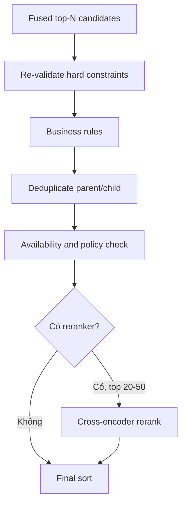

### Các bước bắt buộc

1. **Re-validate hard filters:** bảo đảm retrieval/fusion không đưa item sai do join, stale metadata hoặc implementation bug.
2. **Deduplicate:** không hiển thị nhiều room siblings của cùng parent nếu UX yêu cầu parent-level results.
3. **Availability/inventory:** loại item hết bán/không có ngày phù hợp.
4. **Business ranking:** promotion, popularity, margin chỉ được áp trong tập items đã relevant; không được kéo sai taxonomy lên.
5. **Diversity:** nếu danh sách quá giống nhau, có thể MMR/group limit theo property/vertical.

### Reranker có cần không?

Reranker chỉ hữu ích sau khi candidate set đã đúng taxonomy/filter. Nó không chữa được query plan sai.

Khuyến nghị MVP:

- Không đặt cross-encoder trên hot path CPU nếu latency budget thấp.
- Dùng reranker offline để đánh giá, lọc synthetic query và phân tích hard negatives.
- Online chỉ rerank top 20–50 khi có GPU/hosted service, đo p50/p95 và chứng minh nDCG tăng trên gold.

---

## 10. Giai đoạn 8 — Response, facets và giải thích

### Sơ đồ

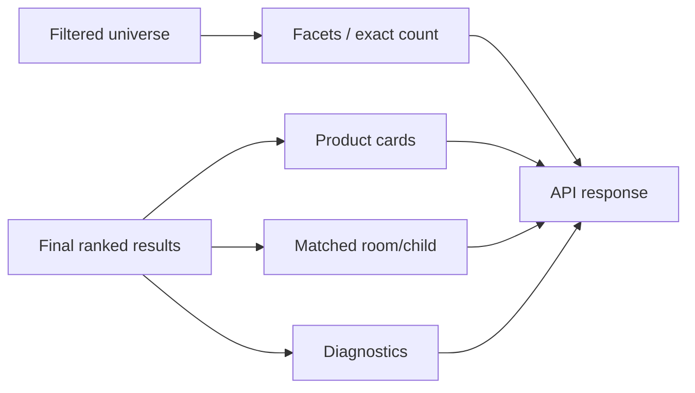

### API response nên phân biệt

- `results`: list xếp hạng final.
- `facets`: tính trên candidate universe sau filter nếu cần count chính xác.
- `total`: nêu rõ exact/lower-bound tùy retrieval mode.
- `applied_filters`: filter thực sự đã áp, để UI/debug trace được.
- `relaxed_constraints`: chỉ có nếu UX cho phép nới điều kiện; không nới im lặng.
- `matched_children`: room/flight child thỏa price/date/occupancy.
- `diagnostics`: debug/internal, gồm query plan, cache hit, source ranks, filter pass rate.

Ví dụ rút gọn:

```json
{
  "results": ["product_1", "product_2"],
  "applied_filters": {
    "destination": "Hội An",
    "vertical": "golf",
    "product_kind": "voucher"
  },
  "facets": {"brand": [{"value": "Vinpearl Golf", "count": 2}]},
  "total": {"value": 2, "exact": true},
  "diagnostics": {
    "query_plan_confidence": 0.98,
    "retrieval_mode": "hybrid_rrf",
    "filter_pass_rate": 1.0
  }
}
```

---

## 11. Giai đoạn 9 — Logging, gold và vòng lặp cải tiến

### Sơ đồ

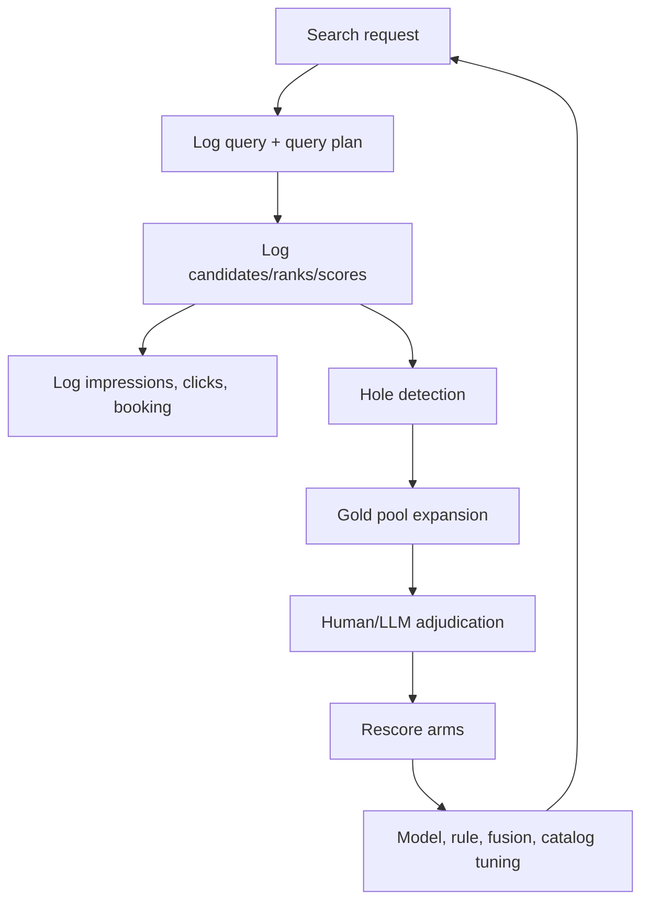

### Những gì cần log

```text
raw_query
normalized_query
canonical/rewrite candidates
intent + confidence
entities and parsed slots
hard filters + must-not
filter candidate count
retrieval mode
rank per dense/lexical/fuzzy channel
fusion score
final top_ids
filter violation / forbidden hits
latency + cache hit
impression / click / booking outcome
```

### Hole detection

Gold là pooled/incomplete. Khi arm mới trả top-10 có product chưa có judgment:

1. Ghi product là `hole` kèm arm/rank/query/slice.
2. Pool thêm các holes theo batch.
3. Rule auto-label hard 0 nếu evidence chắc chắn.
4. LLM pre-label phần semantic chưa rõ.
5. Human adjudicate positive/partial/conflict/high-risk.
6. Merge vào gold version mới.
7. Rescore mọi arm từ `per_query.parquet.top_ids`.

### Tách lỗi để sửa đúng chỗ

| Triệu chứng | Khả năng root cause | Nơi sửa |
|---|---|---|
| `voucher golf Hội An` ra VinWonders | Không parse taxonomy hoặc không filter | Query understanding / schema / filter |
| Query không dấu rỗng | Thiếu unaccent/alias | Normalization / lexical index |
| Typo trả brand sai | Fuzzy quá rộng hoặc typo resolver sai | Entity dictionary / fuzzy threshold |
| `không có sân golf` vẫn trả resort có golf | Negation scope/filter sai | Constraint parser / hard filter |
| Hà Nội → Đà Nẵng trả Đà Nẵng → Hà Nội | Origin/destination role bị đảo | Flight parser / route schema |
| Query semantic không ra đúng resort | Dense embedding/text builder/ranking | Dense retrieval / catalog text / fusion |
| Filter đúng nhưng thứ tự chưa tốt | Fusion/rerank/business ranking | Fusion/rerank |

---

## 12. Sơ đồ dữ liệu và index tối thiểu

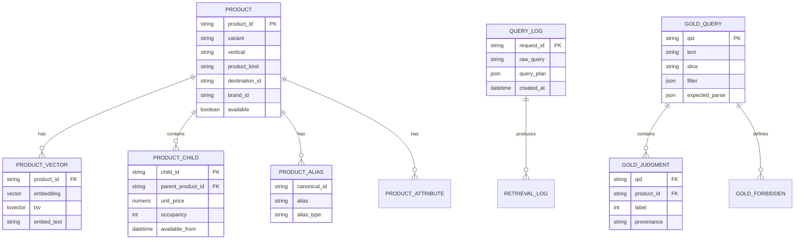

### Index/search fields tối thiểu

| Nhu cầu | Index/field |
|---|---|
| Dense semantic retrieval | `embedding` vector/halfvec, exact scan trên filtered set hoặc HNSW khi scale |
| Không dấu lexical | `tsvector('simple', unaccent(name + embed_text))` |
| Typo/name | trigram GIN trên `unaccent(name)` và alias fields |
| Destination/taxonomy | B-tree/composite index: destination, vertical/variant, available |
| Flight direction | composite index: origin_city, destination_city, available/date |
| Hotel child price | index trên child parent ID + price/availability/occupancy |
| Amenities/exclusions | boolean columns hoặc JSONB/GIN theo schema; tránh parse từ description |

---

## 13. Sequence diagram: ba query điển hình

### 13.1 `voucher golf Hoi An`

```mermaid
sequenceDiagram
    participant U as User
    participant N as Normalize
    participant QU as Query Understanding
    participant F as Filter
    participant R as Retrieval
    participant X as Fusion
    participant API as Search API

    U->>N: voucher golf Hoi An
    N->>QU: canonical destination=Hội An candidate
    QU->>QU: detect golf + voucher + destination
    QU->>F: vertical=golf, product_kind=voucher, destination=Hội An
    F-->>R: only valid golf vouchers
    R->>R: dense + lexical/unaccent + alias
    R->>X: ranked lists
    X->>API: fused valid candidates
    API-->>U: golf voucher results; no VinWonders ticket
```

### 13.2 `resort Nha Trang không có sân golf`

```mermaid
sequenceDiagram
    participant U as User
    participant QU as Query Understanding
    participant F as Filter
    participant R as Retrieval
    participant API as Search API

    U->>QU: resort Nha Trang không có sân golf
    QU->>QU: negation scope = hard exclusion
    QU->>F: destination=Nha Trang AND has_golf=false
    F-->>R: resorts only; golf resorts excluded
    R->>R: dense + lexical rank semantic preferences
    R->>API: valid ranked resorts
    API-->>U: resort results without golf
```

### 13.3 `vé máy bay từ Hà Nội vào Đà Nẵng`

```mermaid
sequenceDiagram
    participant U as User
    participant QU as Query Understanding
    participant F as Route Filter
    participant R as Retrieval
    participant API as Search API

    U->>QU: vé máy bay từ Hà Nội vào Đà Nẵng
    QU->>QU: origin=Hà Nội; destination=Đà Nẵng
    QU->>F: origin_city=Hà Nội AND destination_city=Đà Nẵng
    F-->>R: forward route only
    R->>R: rank airline/semantic preferences if any
    R->>API: valid route candidates
    API-->>U: Hà Nội → Đà Nẵng; never reverse route
```

---

## 14. Lộ trình triển khai

### Phase A — Chặn lỗi nghiêm trọng

- Chuẩn hoá NFC, unaccent, whitespace và alias table.
- Gazetteer brand/destination/airport/vertical.
- Parser rule-based cho destination, taxonomy, giá, sao, phủ định cơ bản và route explicit.
- Filter-first theo taxonomy, destination, `must_not`, flight direction.
- Lexical `unaccent` + trigram cho name/alias.
- Gold v4a: no-diacritic, typo, negation hard, taxonomy collision, flight direction.
- Guard `Forbidden@10`, direction accuracy, filter pass.

### Phase B — Tuning retrieval

- Benchmark dense-only, lexical-only, fuzzy/alias và hybrid RRF theo slice.
- Calibrate cutoff/score policy trên dev split.
- Kiểm tra Full/Condensed và hole rate.
- Tối ưu field boost, RRF, candidate K và typo threshold.
- Chỉ bật query routing sau khi chứng minh không regression ở safety slices.

### Phase C — LLM fallback có kiểm soát

- Cache theo normalized query.
- Strict JSON schema, catalog validation, shadow mode.
- Chỉ bật ở low confidence/complex query/conflict.
- Log parser comparison rule vs LLM.
- Không cho LLM trực tiếp rank hoặc bypass hard filters.

### Phase D — Rerank và learning-to-rank

- Dùng reranker offline để phân tích hard negatives và synthetic queries.
- Bật online rerank top 20–50 nếu latency/cost cho phép và gold chứng minh lợi ích.
- Khi có click/booking đủ chất lượng, train ranker với feature retrieval + structured/business signal; vẫn giữ filter-first.

---

## 15. Checklist vận hành

`[x]` đã có trong V-OTA (06/10/2026, phần lớn sau cờ), `[~]` một phần, `[ ]` chưa — chi tiết ở §17.

### Request path

- [~] Lưu raw query và normalized forms. *(06/10: câu gốc + filter đã áp → `app.search_logs` sau cờ `SEARCH_LOG_QUERIES`; dạng chuẩn hoá chỉ ở `diagnostics.normalizedQuery`, chưa ghi log)*
- [x] Parse/validate hard constraints trước retrieval. *(query plan F1–F6 + loại trừ loại sản phẩm / số khách, `domain/search/query_plan.py`)*
- [x] Không bỏ dấu trước dense embedding. *(embed dùng câu chuẩn hoá còn dấu; câu không dấu chỉ đổi bộ ngưỡng — F2)*
- [x] Apply `must_not` tại filter layer. *(tiện ích, thương hiệu, loại sản phẩm, cờ combo — `UnitIndex.mask`)*
- [x] Route flight bằng origin/destination có thứ tự. *(F5 + param `origin`; chiều bay 0,11 → 1,00 trên gold)*
- [x] Run dense và lexical trên cùng candidate universe. *(cùng mask id; kênh fuzzy cũng trong mask)*
- [x] Re-validate filters sau fusion. *(`queryPlan.revalidatedDrops`; kiểm chung giá + số khách bằng phòng con)*
- [x] Không dùng promotion/rerank để vượt hard relevance. *(không có promotion; rerank chỉ offline, chạy trên tập đã lọc)*

### Evaluation path

- [x] Report trung bình và theo slice. *(cùng khối rubric v3 / v4 và split dev / test)*
- [x] Theo dõi `Judged@10` cùng nDCG/Recall. *(+ condensed; 06/10 Judged@10 = 1,00 cho 45 arm)*
- [x] Pool và label holes từ arm mới. *(D9a–D9e, 1.924 nhãn máy chưa duyệt)*
- [~] Hard fail khi forbidden taxonomy/route/negation item xuất hiện. *(`sb guards` báo PASS/FAIL theo `metrics.guards_proposed`; ngưỡng chưa chốt, chưa chặn CI)*
- [~] Aggregate typo/no-diacritic variants theo query family. *(cơ chế `family` / `by_family` / `family_macro_ndcg@10` có; gold chưa có cặp biến thể chắc chắn nên chưa gắn họ nào)*
- [x] Tách query-understanding metrics khỏi ranking metrics. *(parse accuracy theo trường, so `expected_parse` 154 câu)*

### Data/catalog path

- [~] Taxonomy đủ chi tiết để phân biệt golf voucher, tee time, attraction ticket, room, property, combo. *(taxonomy + variant của catalog; golf voucher / tee time chưa tách — việc của Data)*
- [x] Destination và airport mapping canonical, có aliases. *(alias trong `normalize.py`; IATA ↔ thành phố dựng từ attributes tuyến bay mỗi lần nạp catalog)*
- [~] Attribute `has_golf`, `includes_flight`, `ticketed`, `product_kind`, price/availability có nguồn dữ liệu đáng tin. *(dựng trong RAM, không DDL: tiện ích chuẩn hoá (golf…), `includesFlight` / `includesHotel` từ `combo_items.item_kind`, `ticketed`, giá thấp nhất kể cả phòng con, sức chứa; một số danh sách tiện ích nguồn bị cắt ở 60 chuỗi)*
- [x] Parent/child relationship và child filter được kiểm tra trước khi hiển thị. *(`results[].matchedChildren`, kiểm chung giá + số khách)*

## 16. Quyết định kiến trúc chốt

1. Dùng **rule + gazetteer + catalog validation** làm đường nóng cho query understanding.
2. Dùng LLM như fallback có cache và strict schema, không thay thế hard filter.
3. Dùng **filter-first** để giảm candidate universe theo taxonomy, destination, route, phủ định, giá, sao và availability.
4. Dùng hybrid dense + lexical + fuzzy/alias sau filter; RRF là baseline an toàn trước khi có đủ data tune weight.
5. Dùng vector search cho semantic preference/paraphrase, không dùng nó để giải logic phủ định hay directionality.
6. Đánh giá với gold có `forbidden`, expected parse và safety guards; không chỉ dựa vào nDCG trung bình.

## 17. Trạng thái hiện thực trong V-OTA (06/10/2026)

Phục vụ FR-SRC-01, FR-SRC-03, FR-SRC-04, AC-SRC-01; NFR-PERF-01. Hợp đồng chi tiết: `docs/spec/hop-dong-tich-hop-search-recommendation.md`
§2.2, §2.4, §2.5, §7.3, §10 (contract **1.16.0**). Số đo: `src/evaluation/reports/eval-2026-10-06-search-query-plan-gold-v4.md` (gold_v4 + 1.924 nhãn máy chưa duyệt, Judged@10 = 1,00;
mốc A = hybrid + normalize production, nDCG@10 0,707).

| Giai đoạn kiến trúc | Trạng thái | Ở đâu | Cờ (mặc định) | Bằng chứng bench (nDCG@10 Δ so A, guard) |
|---|---|---|---|---|
| 1 — chuẩn hoá NFC, unaccent, alias, sửa chính tả | có | `domain/search/normalize.py` | `SEARCH_NORMALIZE` (bật) | hybrid không normalize −2,9 |
| 1 — vị trí dấu thanh (oà/òa…) | có, sau cờ | `domain/search/tone.py` | `SEARCH_TONE_NORMALIZE` (tắt) | 0,0 — gold không có câu lệch kiểu dấu |
| 2 — điểm đến suy từ câu (F1) | có, sau cờ | `query_plan.py`, `destination.py` | `SEARCH_DEST_FILTER` (tắt) | **WIN** +3,8 |
| 2 — câu không dấu (F2) | có, sau cờ | `use_cases.py` | `SEARCH_NO_DIACRITICS_MODE` (off) | 0 khi không cutoff |
| 2 — phủ định tiện ích / thương hiệu / loại sản phẩm / cờ combo (F3) | có, sau cờ | `constraints.py`, `amenities.py` | `SEARCH_NEGATION_FILTER` (tắt) | +4,5; Forbidden câu phủ định → 0 |
| 2 — loại sản phẩm suy từ câu (F4), combo đứng đầu, cue mạnh/yếu | có, sau cờ | `constraints.py` | `SEARCH_TAXONOMY_FILTER`, `SEARCH_TAXONOMY_STRONG_ONLY` (tắt) | +1,6; `taxonomy_collision` +21,8 |
| 2 — tuyến bay có chiều (F5), IATA | có, sau cờ | `constraints.py`, param `origin` | `SEARCH_ROUTE_FILTER` (tắt) | chiều bay 0,11 → 1,00 |
| 2 — giá hard / sao soft (F6) | có, sau cờ | `constraints.py` | `SEARCH_NUMERIC_FILTER` (tắt) | constraint precision 0,79 → 0,92 |
| 2 — số khách / occupancy | có (tham số request luôn áp, suy từ câu sau cờ) | `parse_party`, `UnitIndex.mask` | `SEARCH_PARTY_FILTER` (tắt) | −0,4 (3 câu) |
| 3 — router confidence | có (chỉ khai) | `queryPlan.confidence`, `fallbackReasons` | luôn phát | — |
| 3 — LLM fallback | **chưa** — lệch PRD | đề xuất `docs/prd/update/2026-10-06-search-llm-fallback-query-plan.md` | — | chờ chốt |
| 4 — filter-first; F rỗng không nới (trừ điểm đến suy ra) | có | `UnitIndex.mask`, `queryPlan.emptyReason` | theo cờ từng họ | zero-result trong catalog 0 |
| 4 — parent–child filter | có | `matchedChildren`, kiểm chung giá + số khách | theo F6 / số khách | — |
| 5A — dense | có | Weaviate `nearVector` top-200 | — | dense-only −4,4 |
| 5B — BM25 | có | Weaviate BM25 top-50 + luật vớt | — | lexical-only −11,8 |
| 5C — fuzzy / alias tên (trigram trong tiến trình) | có, sau cờ | `domain/search/fuzzy.py` | `SEARCH_FUZZY_K` (0) | −0,5 (ngưỡng 0,75) |
| 6 — RRF, trọng số theo kênh | có | `hybrid.py` | `SEARCH_RRF_*_WEIGHT` (1,0) | lexical 0,5: +1,7 trên A, +1,2 trên F1–F6 (TIE) |
| 6 — routing thay full hybrid | chưa | — | — | chưa có bằng chứng an toàn |
| 7 — re-validate sau fusion | có | `queryPlan.revalidatedDrops` | luôn | — |
| 7 — rerank | **chỉ offline** (bench) | `src/evaluation/search_bench/rerank.py` (bge-reranker-v2-m3) | — | +3,8 trên F1–F6 nhưng ~3,4 s CPU/câu, constraint precision 0,93 |
| 8 — response: `appliedFilters`, `queryPlan`, kết quả yếu | có (kết quả yếu do client) | contract 1.16.0 | — | margin 0,058 (chọn trên dev, kiểm trên test) |
| 9 — log truy vấn | có, sau cờ | writer `app.search_logs` | `SEARCH_LOG_QUERIES` (tắt) | — |
| 9 — gold có forbidden / expected parse / guard / hole | có | `config/query_annotations.yaml`, `sb guards`, `sb gold holes` | — | 28 forbidden, 154 expected parse |

Cấu hình đề xuất bật (người dùng chốt; F4 cần ý kiến Web vì đổi số đếm tab): F1 + F2 + F3 + F4 + F5 + F6, không cutoff tuyệt đối —
arm `APP.e5s.hybrid_norm_nocut_f1f6` nDCG@10 **0,807** (+9,9, WIN), mọi guard Phase A PASS.
