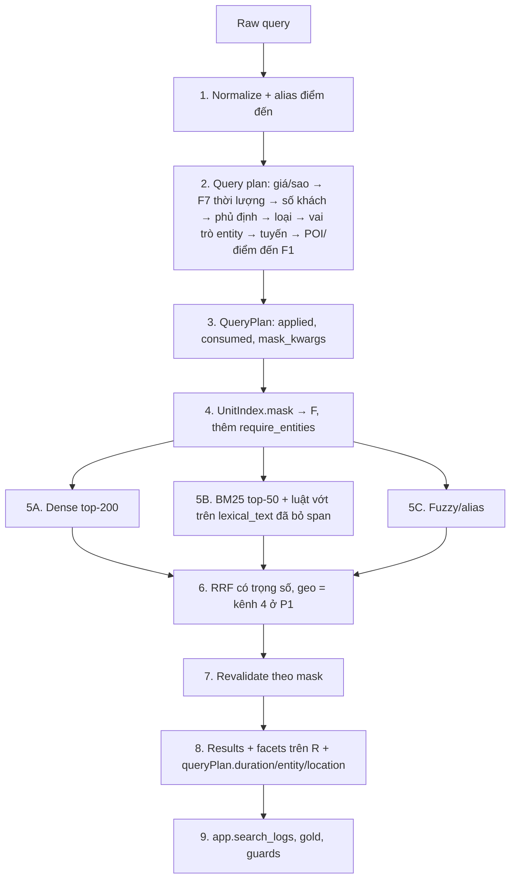
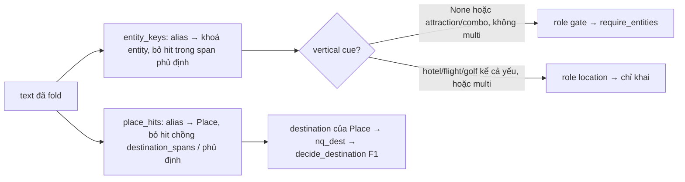

# Tổng hợp chỉnh sửa luồng Search OTA: thời lượng (F7), địa danh → F1, cổng entity (P0) và geo (P1)

Phục vụ: **FR-SRC-01**, **FR-SRC-03**, **FR-SRC-04**, **AC-SRC-01**; **NFR-PERF-01** (docs/prd/requirements.md). Hợp đồng: src/shared/contracts/schemas/search.yaml (contract **1.18.0**, additive); docs/spec/hop-dong-tich-hop-search-recommendation.md §2.2/§2.4/§2.5/§10. Kiến trúc: kien_truc_search_ota_so_do_va_giai_doan.md §17.

Trạng thái: spec chốt ngày 07/10/2026, viết **trước** code (plan: `docs/plan/2026-10-07-search-duration-entity-poi.md`). Mọi luật P0 ở §3 là nguồn sự thật cho contract 1.18.0 và backend; code lệch spec này thì sửa code.

## 1. Mục tiêu

Tài liệu gom ba lỗi production của `/search` và chuyển thành thay đổi cụ thể, nhỏ nhất, sau cờ, trên pipeline hiện có:

1. `vinwonder 3 ngay 2 dem` trả đúng attraction/combo nhưng lẫn hotel (`HOTEL THU NGUYEN - ngay BẾN NINH KIỀU & CHỢ ĐÊM`, `December Hotel Dalat - Ngay Trung Tâm & Chợ Đêm`).
2. `khách sạn gần Hồ Hoàn Kiếm` trả facet `destination` ở nhiều điểm đến ngoài Hà Nội.
3. Địa danh/landmark/khu du lịch chưa map về điểm đến catalog: Hồ Hoàn Kiếm → Hà Nội, Cầu Rồng → Đà Nẵng, Phố cổ Hội An → Hội An.

### 1.1 Root cause đã xác minh trên code và catalog bench (3.183 unit, `bench_out/search/data/items.parquet`)

| Lỗi | Chẩn đoán cũ của tài liệu | Root cause thật |
|---|---|---|
| 1 | "BM25 chạy trên toàn catalog, token duration là text term tự do" | Đúng một nửa: **không có duration parser** nên `ngay`/`dem` ở lại `lexical_text`. Hai hotel trên có **cả `ngay` lẫn `dem` trong tên** → coverage 2/3 ≥ 0,6 → được vớt qua cổng BM25. F4 tắt ở prod và `vinwonders` chỉ là cue yếu nên không có gate loại sản phẩm. |
| 2 | "Facet tính trước filter" | **Sai.** Facets đã tính trên R sau mask (contract [C4], `_retrieve` đếm lại khi revalidate loại unit). Nguyên nhân là **F1 không kích hoạt**: gazetteer chỉ gồm điểm đến catalog + 17 viết tắt, "Hồ Hoàn Kiếm" không phải điểm đến → không có mask → R = top-200 dense toàn quốc → facet toàn quốc là đúng theo contract. |
| 3 | "Thiếu entity hierarchy / bảng DB" | Thiếu **bảng địa danh trong repo**. Tên có sẵn city (`Phố cổ Hội An`, `Dragon Bridge Da Nang`) đã resolve qua alias điểm đến; chỉ địa danh trần là chưa. |

Dữ liệu catalog: `attributes.latitude/longitude` 100 %; `locationPrecision` ∈ {exact, venue, airport, poi, destination}; `city` 88 % (có cả "Quận Hoàn Kiếm"); `nights` = 0 unit; "N ngày" nằm trong **tên vé** (31 unit: 20 attraction + 11 combo, 0 hotel, 0 tên có "N đêm"); VinWonders trong 141 tên; `brand` chỉ có Vinpearl.

Kết luận: pipeline đã có ~80 % kiến trúc đích (§2.1). Không cần lớp query understanding mới, không đổi embedding, không đổi trọng số BM25. Cần bốn việc: parser thời lượng (F7), gazetteer địa danh nối vào F1, cổng entity cứng, và geo ở P1.

Nguyên tắc giữ nguyên:

> **Parse hard constraint và entity trước; filter đúng tập candidate; dense/BM25 chỉ xếp hạng. Facet tính trên R (contract [C4]) — không đổi.**

### 1.2 Quyết định 07/10 (người dùng chốt)

1. Cổng entity **cứng** (HARD, không nới; F rỗng → `emptyReason = "entity"`).
2. Gazetteer **trong repo**: module Python `src/backend/app/domain/search/gazetteer.py`, không bảng DB, không đọc file lúc runtime.
3. Facets **giữ contract**: tính trên R; không `facetMeta`, không `globalDiscovery`.
4. Geo (bán kính, toạ độ) là **P1**, contract 1.19.0.
5. Vai trò entity: entity + cue loại khác (**kể cả cue yếu**) → vai trò `location`; brand hotel (Vinpearl, Meliá…) **không phải** entity.
6. Khối `queryPlan` mới **ẩn trừ khi cờ bật** (quy ước 1.16): cờ tắt không parse, không khai → response byte-identical 1.17.0.
7. **Probe fixture trước, gold_v6 sau**: đo trên fixture ngoài `gold/` rồi mới gán nhãn.
8. Khôi phục regression do merge `21d72ae` **trước** (đã làm 07/10: `history/2026-10-07-restore-search-prod-defaults-llm-fallback.md`).
9. Sửa tài liệu trước → plan → contract → code.

---

## 2. Chẩn đoán tổng quan

### 2.1 Gap so với kien_truc_search_ota_so_do_va_giai_doan.md §17

| Giai đoạn kiến trúc | Đã có (§17, 06/10) | Chưa có → việc của spec này |
|---|---|---|
| 1 — chuẩn hoá NFC/unaccent/alias/chính tả | có (`normalize.py`, `SEARCH_NORMALIZE` bật) | — |
| 2 — điểm đến suy từ câu (F1) | có (`destination.py`, WIN +3,3) | **địa danh/khu vực → điểm đến** (POI → F1, `SEARCH_POI_RESOLVE`) |
| 2 — câu không dấu (F2) | có | — |
| 2 — phủ định (F3) | có (`constraints.py`, `amenities.py`) | — |
| 2 — loại sản phẩm suy từ câu (F4), cue mạnh/yếu, combo đứng đầu | có (tắt ở prod) | — (không sửa F4) |
| 2 — tuyến bay (F5), IATA | có | — |
| 2 — giá/sao (F6), số khách | có | **thời lượng (F7, `SEARCH_DURATION_FILTER`)**: parse + consume span, chưa lọc |
| 2 — entity điểm vui chơi | **không** (VinWonders/Safari chỉ là `POI_BRAND_CUES` yếu của F4) | **cổng entity cứng (`SEARCH_ENTITY_FILTER`)** |
| 3 — router confidence, LLM fallback | có (1.17.0, cờ off) | — (confidence và trigger set **không đổi**) |
| 4 — filter-first, F rỗng không nới (trừ điểm đến suy ra), consume span | có (`UnitIndex.mask`, `emptyReason`) | thêm một kwarg mask `require_entities`; một bước `entity` trong `families_in_order` |
| 5A/5B/5C — dense, BM25 + luật vớt, fuzzy | có | — |
| 6 — RRF có trọng số theo kênh | có (`hybrid.rrf`) | geo = kênh thứ 4 (P1) |
| 7 — re-validate sau fusion | có (`revalidatedDrops`) | — |
| 8 — `appliedFilters`, `queryPlan`, facets trên R | có (contract 1.16.0/1.17.0) | 3 khối additive 1.18.0 |
| 9 — log, gold forbidden/expected parse/guard | có | 2 slice, 21 câu nháp, 4 arm |
| geo: toạ độ, bán kính, `distanceKm` | **không** | P1 (§10.2) |

### 2.2 Luồng (bước 2–5 đã tồn tại; phần thêm: F7, vai trò entity, POI, require_entities, geo P1)



Điểm thay đổi so với 1.17.0 (tất cả sau cờ, mặc định tắt):

- F7: thời lượng được parse, cụm bị bỏ khỏi `lexicalText`; **không lọc** (catalog chưa có trường).
- POI: địa danh gazetteer đưa điểm đến vào F1 như địa danh thường; `hard.destinationSource = "poi"`.
- Entity: vai trò `gate` → mask chỉ giữ unit attraction/combo có tên chứa entity; vai trò `location` → không lọc.
- Geo: P1.

---

## 3. Luồng search sau khi chỉnh sửa (luật P0, nguyên văn plan Bước 4–5)

### 3.1 Chuẩn hoá: dense text không đổi

- Văn bản đưa vào dense **không đổi** (khoá cache embedding `query_text()` giữ nguyên; không re-embed).
- Chỉ `lexical_text` bỏ các span đã consume (thời lượng vào cùng danh sách với giá/sao/số khách/phủ định/loại/tuyến).
- Không có `semantic_text` rewrite. Không có bước fuzzy entity riêng (fuzzy/alias tên đã có ở 5C).

### 3.2 Vai trò token

Đã có trong `constraints.py` / `normalize.py`: điểm đến (F1), phủ định (F3), loại sản phẩm với cue mạnh/yếu (F4), tuyến bay (F5), giá/sao (F6), số khách (party). Vai trò mới:

| Vai trò mới | Ví dụ | Xử lý | Consume span? |
|---|---|---|---|
| Thời lượng | `3 ngày 2 đêm`, `3N2Đ`, `2 đêm` | `queryPlan.duration`, bỏ khỏi `lexicalText` | có |
| Địa danh / khu vực / quận / sân bay | `Hồ Hoàn Kiếm`, `Phố cổ Hội An`, `Nội Bài` | điểm đến catalog → F1 | không (F1 vốn `drop_tokens` theo alias điểm đến; địa danh giữ nguyên trong BM25) |
| Entity điểm vui chơi | `VinWonders`, `Safari`, `Grand World`, `Hòn Tằm` | vai trò `gate` hoặc `location` | **không** (tên sản phẩm; tiền lệ `POI_BRAND_CUES`) |

**Luật vai trò entity** (tính từ `VerticalParse` đã có, không sửa `constraints.py`):

```
gate = vertical.skipped != SKIPPED_MULTI and (vertical.taxonomy is None or vertical.taxonomy in {"attraction", "combo"})
entity_role = "gate" nếu gate, ngược lại "location"
```

| Câu | `parse_vertical` | Vai trò | Hệ quả |
|---|---|---|---|
| `Grand World Phú Quốc` | attraction / weak | gate | ẩn 8 hotel tên Grand World (chấp nhận; c0697/c0700 phủ hai phía) |
| `combo VinWonders Phú Quốc` | combo | gate | chỉ combo tên chứa VinWonders |
| `vé VinWonders và Safari` | attraction | gate, OR hai khoá | |
| `khách sạn ở Grand World Phú Quốc` (c0697) | hotel / strong | location | hotel giữ |
| `phòng gần Grand World` | hotel / **weak** | location | hotel giữ — lý do chọn luật "kể cả cue yếu" |
| `khách sạn gần biển và vé VinWonders` | multi | location | |
| `không lấy VinWonders, vé Safari` | attraction | gate, chỉ `safari` (hit trong span phủ định bị bỏ) | |
| `khách sạn Vinpearl ở Nha Trang` (c0709) | hotel | không có khoá entity | brand hotel không phải entity |

Tham số `taxonomy` của request **không đổi vai trò** (tab Web fan-out): `taxonomy=hotel` + gate → mask giao → tab Lưu trú 0, `emptyReason = "entity"` (không phải `param`).

### 3.3 Gazetteer: module `src/backend/app/domain/search/gazetteer.py` (plan 4a)

Pattern `amenities.py`: tuple frozen dataclass inline, stdlib, không I/O; chỉ import `.lexical.fold`, `.normalize.spans/find_phrases`. Export ở `domain/search/__init__.py`.



Hai tra cứu độc lập: `entity_table()` chỉ chứa entry có `entity` (brand + venue + site), `place_table()` chỉ chứa entry có `destination` (landmark/area/district/airport + venue + site). Một site entry như `vinwonders_nha_trang` nằm ở cả hai: khoá entity `vinwonders` cho gate, điểm đến Nha Trang cho F1 — nhưng câu "VinWonders Nha Trang" đã có "Nha Trang" trong `destination_spans` nên `place_hits` bỏ hit chồng, F1 vẫn đi đường alias điểm đến (`destinationSource: query`).

```python
LANDMARK, AREA, DISTRICT, AIRPORT, VENUE = "landmark", "area", "district", "airport", "venue"
ENTITY_TAXONOMIES = frozenset({"attraction", "combo"})

@dataclass(frozen=True)
class Place:
    key: str; name: str; kind: str
    aliases: tuple[str, ...]        # đã fold, duy nhất toàn PLACES
    destination: str | None         # giá trị catalog; None = brand nhiều site (vinwonders, safari, grand_world, aquafield)
    entity: str | None = None       # khoá entity cho venue (site entry → khoá brand); None cho landmark/area/district/airport

PLACES: tuple[Place, ...]; MAX_ALIAS_TOKENS: int
def place_table(destinations=None) -> dict[str, Place]   # alias → Place cho entry CÓ destination; bỏ entry destination ∉ catalog (luật normalize.py:145)
def entity_table() -> dict[str, str]                      # alias → khoá entity cho entry CÓ entity
def entities_of_name(name, table) -> frozenset[str]       # find_phrases(spans(name), table.__contains__, MAX_ALIAS_TOKENS)
```

**Seed P0** (đã đối chiếu 38 điểm đến bench):

- Brand (destination `None`): `vinwonders` (vinwonders, vinwonder, vin wonders, vinpearl land) · `safari` (safari, vinpearl safari) · `grand_world` (grand world, mega grand world) · `aquafield`. "safari" ở mức brand vì catalog có 51 unit tên safari: Phú Quốc 44 / Hội An 6 / Rạch Giá 1 — khoá về Phú Quốc sẽ loại tour Hội An.
- Venue một site (destination + entity): `hon_tam` → Nha Trang · `vinpearl_harbour` → Nha Trang · `vinke` (vinke, vinpearl aquarium) → Hà Nội · `grand_park` → TP. Hồ Chí Minh · `wave_park` → Hà Nội.
- Site entry từ `src/data_collection/collectors/venues.csv` (23 dòng — **chép làm seed, không đọc runtime**) với `entity` = khoá brand: `vinwonders_nha_trang`, `vinwonders_phu_quoc`, `vinwonders_nam_hoi_an`, `vinwonders_cua_hoi` → Nghệ An, `vinwonders_vu_yen` → Hải Phòng, `safari_phu_quoc`, `grand_world_phu_quoc`, `grand_world_ha_noi`… Golf **không** là entity (là sản phẩm `golf`).
- Landmark/area/district/airport, chỉ cho điểm đến catalog:
  - Hà Nội: `ho_hoan_kiem` (ho hoan kiem, ho guom, hoan kiem lake), `quan_hoan_kiem`, `pho_co_ha_noi` (không "pho co" trần), `ho_tay`, `times_city`, `ocean_city`, `noi_bai`.
  - Đà Nẵng: `cau_rong` (cau rong, dragon bridge), `my_khe`, `ba_na` (ba na, ba na hills, sun world ba na), `son_tra`, `ngu_hanh_son`.
  - Hội An: `pho_co_hoi_an`, `an_bang`, `cua_dai`. Nha Trang: `hon_tre`, `bai_dai`, `cam_ranh`. Phú Quốc: `bai_sao`, `bai_truong`, `duong_dong`, `an_thoi`.
  - TP. Hồ Chí Minh: `quan_1`, `ben_thanh`, `tan_son_nhat`. Hạ Long: `bai_chay`, `tuan_chau`. Đà Lạt: `ho_xuan_huong`. Sa Pa: `fansipan`. Huế: `lang_co`. Phan Thiết: `mui_ne`. Ninh Bình: `trang_an`, `tam_coc`.
  - Không Vũng Tàu (không phải điểm đến catalog).

**Luật vệ sinh** (docstring module + `tests/unit/domain/test_gazetteer.py`): alias đã fold và duy nhất toàn `PLACES`; alias không trùng khoá `DESTINATION_ALIASES`, không trùng điểm đến đã fold, không trùng khoá `VERTICAL_CUES` hay `BRAND_CUES` ("vinpearl"); không "thuy cung" trần (đụng "thuỷ cung hoà bình"); mọi `VENUE` có `entity`; `place_table({"Nha Trang"})` bỏ entry Hà Nội. Entry có destination ∉ catalog là dữ liệu chết, bị `place_table` bỏ lúc nạp — không bao giờ lọc.

Quản trị: thêm alias/entry = sửa module + test vệ sinh + câu gold; LLM không tự ghi alias; không bịa toạ độ (toạ độ chỉ vào ở P1 với nguồn ghi rõ).

### 3.4 Parser thời lượng `parse_duration` (plan 4b; `constraints.py`, nối sau phần party)

Tái dùng `_toks`, `_overlaps`, `_gap_has`, `_INT`, `Span`; chép vòng ghép span của `parse_party`.

```python
_DAY_UNITS = {"ngay","day","days"}; _NIGHT_UNITS = {"dem","night","nights"}
_COMPACT_DURATION = re.compile(r"^(\d{1,2})n(\d{1,2})d$")   # fold("3N2Đ") == "3n2d"
_DURATION_MIN, _DURATION_MAX = 1, 30; _DURATION_LINKS = {"va"}
@dataclass(frozen=True)
class DurationParse: days: int|None=None; nights: int|None=None; spans: tuple[Span,...]=()
def parse_duration(text, protected=()) -> DurationParse
```

Luật: bỏ token chồng `protected`; (a) token compact → cả hai; (b) `_INT` 1..30 + token **ngay sau** là unit → ghi; giá trị đầu mỗi loại thắng; mọi span khớp đều consume; span kề ghép qua `va`/`,`/`-`/`/`. Chỉ chữ số (như party). Không suy phần thiếu. `protected = (*numeric.spans, *party.spans)` — đủ vì `_absorb_unit_tail` đã nuốt "/đêm", "một đêm" vào span giá.

Bảng bảo đảm (test parametrize `test_parse_duration_values`):

| Câu | (days, nights) | Ghi chú |
|---|---|---|
| `VinWonders 3 ngày 2 đêm` · `3 ngay 2 dem` | (3, 2) | một span |
| `3N2Đ` · `3n2d` | (3, 2) | compact |
| `2 ngày` | (2, None) | |
| `phòng cho 2 người 3 đêm` | (None, 3) | party giữ "2 người" |
| `resort 2 triệu/đêm Phú Quốc` · `tầm 1.5 triệu một đêm` | None | "/đêm" nằm trong numeric span |
| `(3 tiếng)` (c0372) | None | |
| `qua đêm` · `ban đêm` · `chợ đêm` · `ngay trung tâm` | None | không có chữ số |
| `2 đêm 3 ngày` · `3 ngày, 2 đêm` · `3 days 2 nights` | (3, 2) | cả hai, một span |
| `khách sạn 3 sao 2 đêm` | (None, 2) | "3 sao" là span sao |
| `45 ngày` · `0 đêm` | None | ngoài 1..30 |
| `ngày 15/10 đến 17/10` | None | unit đứng trước số |
| `vé máy bay Hà Nội Đà Nẵng 3 ngày 2 đêm` | (3, 2) | tuyến không đổi |

Chính sách consume: consume mọi mẫu khớp. Bằng chứng BM25 mất chỉ là "ngay" trên 31 tên vé (dense vẫn thấy toàn văn). Phương án dự phòng một dòng nếu arm `_dur` làm xấu slice `named_entity`: khai nhưng không consume "N ngày" trần.

### 3.5 Nối vào `query_plan.py` (plan 4c)

- Hằng: `APPLIED_DURATION = "duration"`, `APPLIED_ENTITY = "entity"` (test contract ép cả hai vào `applied` + `emptyReason` enum); `ROLE_GATE, ROLE_LOCATION = "gate", "location"`. **Không** thêm `REASON_*` (đổi confidence → đổi LLM trigger set).
- `PlanFlags` += `duration`, `poi`, `entity: bool = False`.
- `PlanGazetteers` += `entities: Mapping[str,str]` (default `entity_table()`), `places: Mapping[str,Place]` (default `place_table()`); hai method theo mẫu `city_spans`: `entity_keys(text, excluded=()) -> tuple[str,...]` (khớp dài nhất, thứ tự xuất hiện, dedup, bỏ hit trong `excluded`), `place_hits(text, known, excluded=()) -> tuple[(start,end,Place),...]` (bỏ hit chồng `known` = `nq.destination_spans` hoặc `excluded`).
- `QueryPlan` += (cuối, có default): `duration_days`, `duration_nights: int|None`, `duration_source: str|None`, `entity_keys: tuple[str,...] = ()`, `entity_role: str|None`, `location: Place|None`, `poi_destinations: tuple[str,...] = ()`; property:

```python
@property
def destination_via_poi(self) -> bool:
    return self.destination.source == SOURCE_QUERY and self.destination.value in self.poi_destinations
```

(**không** dùng `value not in nq.destinations` — sai với "vé máy bay HAN DAD": route override cho `candidates=()` sẽ khai `poi` cho điểm đến suy từ IATA.)

- `build_query_plan`, **chỉ khi cờ bật** (tắt = `DurationParse()`/`()`/None, không có đường code mới chạy):
  1. Sau party: `duration = parse_duration(text, protected=(*numeric.spans, *party.spans))`; có giá trị → `applied.append(APPLIED_DURATION)`, `consumed.extend(duration.spans)`.
  2. Sau F4, trước F5: `entity_keys = gaz.entity_keys(text, excluded=negation.spans)`; nếu có → luật vai trò §3.2; gate → `applied.append(APPLIED_ENTITY)`. Entity token **không** consume.
  3. Trước F1, sau F5 (F5 vẫn dùng `nq.destination_spans` gốc): `hits = gaz.place_hits(text, nq.destination_spans, excluded=negation.spans)`; `location = hits[0][2]`; `poi_destinations` = destination của hit chưa có trong `nq.destinations` (dedup); `nq_dest = replace(nq, destinations=(*nq.destinations, *poi_destinations))` → `decide_destination(nq_dest, …)` **không đổi**: một → lọc `source="query"` (giữ FR-SRC-04 fallback, `drop_tokens`, enum đóng); ≥ 2 → `skipped=multi` ("khách sạn Hà Nội gần Cầu Rồng"); flight → `skipped=flight`. `_fallback_reasons(text, nq, …)` giữ `nq` **gốc** → confidence không đổi. Vai trò gate không đưa destination vào F1; site alias chồng destination span bị `place_hits` bỏ.
- `mask_kwargs`: `if APPLIED_ENTITY in applied: kw["require_entities"] = entity_keys`.
- `families_in_order`: bước `entity` ngay sau bước taxonomy-query → tab `taxonomy=hotel` + gate → `emptyReason="entity"`. Duration: **không** mask, không step → `emptyReason="duration"` không bao giờ phát.
- `as_diagnostics(extended)`: `duration {days, nights, source}`; `entity {keys, role}` (cả role `location`, để bench đo c0697 vs c0700); `location {key, name, kind, destination}`. `applied_filters()`: `hard["entity"] = list(entity_keys)` khi applied; `hard["destinationSource"] = "poi" if destination_via_poi else destination.source`. Câu chỉ có thời lượng → `applied_filters()` trả None → **không có** `appliedFilters`; `lexicalText`/`applied` vẫn phát.
- Docstring module: thứ tự parse giá/sao → thời lượng → số khách → phủ định → loại → vai trò entity → tuyến → POI/điểm đến.

Bất biến: cờ tắt ⇒ response byte-identical 1.17.0; dense text không đổi; `confidence`/LLM trigger set không đổi; không re-embed; không DDL; P0 không sửa `normalize.py`, `destination.py`, `hybrid.py`, `scoring.py`, `hypothesis.py`, loader `postgres_store.py`.

### 3.6 Catalog và mask (plan Bước 5)

- `domain/catalog/unit_attributes.py`: field `entities: tuple[frozenset[str], ...] = ()` nối sau `children`; `__post_init__` điền `(frozenset(),)*n` + kiểm chiều; `build()`:

```python
table = entity_table()
entities = tuple(entities_of_name(p.name, table) if p.taxonomy in ENTITY_TAXONOMIES else frozenset() for p in units)
```

  **Tên unit**, allow-list áp lúc build (chỉ attraction/combo có entity). **Không sửa loader** (`postgres_store.py`, `in_memory_vector_store.py`, `app_adapter.py`, prewarm đều gọi `build(units, children, kinds)`).
- `application/ports/unit_index.py` `mask`: một kwarg `require_entities: Iterable[str] = ()`; sau `min_occupancy`:

```python
req = frozenset(k for k in require_entities if k)
if req:
    m &= np.array([bool(e & req) for e in a.entities], dtype=bool)
```

  Không thêm `entity_taxonomies` (allow-list đã nằm trong data; `taxonomy` param + F3 `exclude_taxonomies` AND qua kwargs sẵn có — c0703 "vé lẻ VinWonders, không lấy combo" → {attraction}).
- `use_cases._plan_gazetteers(units, *, entities=None, destinations=None)` truyền `places=place_table(destinations)` và `entities` **chỉ gồm khoá có mặt trong `attrs.entities`** — entity không có sản phẩm không bao giờ gate (vai trò rơi về `location`).

### 3.7 Ví dụ query plan sau khi sửa (cờ bật)

Tên loại = enum taxonomy catalog (`hotel`, `attraction`, `combo`, `flight`, `golf`); trường lọc = `destination` (giá trị catalog), không `city`.

`vinwonder 3 ngay 2 dem`:

```json
{
  "applied": ["duration", "entity"],
  "lexicalText": "vinwonder",
  "duration": {"days": 3, "nights": 2, "source": "query"},
  "entity": {"keys": ["vinwonders"], "role": "gate"},
  "appliedFilters": {"hard": {"entity": ["vinwonders"]}}
}
```

Mask: unit có `taxonomy ∈ {attraction, combo}` và tên chứa alias VinWonders. Hotel "Chợ Đêm" bị loại ở mask, không phải sau fusion.

`khách sạn gần Hồ Hoàn Kiếm` (POI, F1 bật):

```json
{
  "applied": [],
  "destinationFilter": {"source": "query", "value": "Hà Nội"},
  "derivedDestinations": ["Hà Nội"],
  "location": {"key": "ho_hoan_kiem", "name": "Hồ Hoàn Kiếm", "kind": "landmark", "destination": "Hà Nội"},
  "appliedFilters": {"hard": {"destination": "Hà Nội", "destinationSource": "poi"}}
}
```

Facets tính trên R = unit Hà Nội → `facets.destination = {"Hà Nội": n}` tự đúng, không cần đổi contract facet. Bán kính 3 km quanh hồ: **P1** (§10.2).

`khách sạn ở Grand World Phú Quốc` (c0697): `entity {keys: [grand_world], role: location}`; không `hard.entity`; destination Phú Quốc từ alias điểm đến (`destinationSource: query`); hotel tên Grand World giữ.

`khách sạn gần Cầu Rồng` → destination Đà Nẵng, `location.key = cau_rong`. `homestay phố cổ Hội An` → đã resolve từ trước qua alias "Hội An"; với cờ POI thêm `location.key = pho_co_hoi_an`, `destinationSource` vẫn `query` (điểm đến đã có trong `nq.destinations`, `poi_destinations` rỗng).

### 3.8 Truy xuất, fusion, revalidate

- Dense/BM25/fuzzy chạy trên F như hiện nay (`_retrieve` → `hybrid_filter_score`); F7 chỉ đổi `lexical_text`; entity/POI chỉ đổi mask.
- Fusion = `hybrid.rrf` có trọng số theo kênh (`dense_weight`, `lexical_weight`, `fuzzy_weight`). **Không có công thức tuyến tính** `w1·geo + w2·dense + …`. Geo ở P1 = kênh thứ 4 trong `legs` với `HybridConfig.geo_weight` mặc định 0 (số y hệt khi tắt) + thứ tự mềm `soft_geo_order` (phân hoạch ổn định như `soft_star_order`).
- Revalidate sau fusion đã có (`revalidate(out.order, mask)`, `queryPlan.revalidatedDrops`); mask mới có `require_entities` nên hotel lọt qua BM25 không thể quay lại.

### 3.9 Facets và response: giữ contract

- Facets tính trên R sau mask ([C4]); `sum(facets.taxonomy) == total`. Không `facetMeta`, không `globalDiscovery`, không "facet scope".
- Response thêm **chỉ** ba khối con của `diagnostics.queryPlan` (`duration`, `entity`, `location`) + hai giá trị enum + hai khoá trong `appliedFilters.hard` (§5). `locationResolution` cũ → `diagnostics.queryPlan.location`.

---

## 4. Data model: không DDL ở P0

| Mục cũ | Trạng thái thật | Quyết định |
|---|---|---|
| 4.1 Bảng `location_entities` | không cần | → module `domain/search/gazetteer.py` (§3.3); toạ độ/bán kính thêm vào `Place` ở P1 |
| 4.2 Trường vị trí của sản phẩm (`latitude`, `longitude`, `location_precision`…) | **đã có** trong `attributes` (docs/spec/data-collection/schema.md §3.2): lat/lon 100 %, `locationPrecision` ∈ {exact, venue, airport, poi, destination} | chỉ cần đưa vào `UnitAttributes` (P1, RAM, không DDL) |
| 4.3 Trường thời lượng (`nights`, `duration_days`, `validity_days`) | `nights` **không có** trên unit nào; "N ngày" nằm trong tên vé (31 unit) | P0 không lọc theo thời lượng; P1 dựng `duration_days` RAM parse từ tên unit, thứ tự mềm |
| 4.4 Quan hệ combo (`combo_items.label`, `item_product_id`) | đo trên 133 combo / 306 dòng `combo_items`: `label` thêm **+2** combo (vinwonders), `item_product_id` thêm **+10** (vinpearl harbour 5, aquarium 2, vinwonders 2, safari 1); `item_product_id` NULL 168/306 | P0 entity theo **tên unit**; `item_product_id` → P1 (cần `_COMBO_QUERY` + 3 loader) nếu arm `_ent` lộ combo bị sót |

---

## 5. Contract 1.18.0 (additive) — `src/shared/contracts/schemas/search.yaml`, trước code (plan Bước 3)

- Ghi chú version: `# 1.18.0 (2026-10-07, additive): queryPlan.duration / location / entity (chỉ khai khi SEARCH_DURATION_FILTER / SEARCH_POI_RESOLVE / SEARCH_ENTITY_FILTER bật); "duration","entity" trong applied; "entity" trong emptyReason (+ "duration" khai cho đủ họ, không bao giờ phát); appliedFilters.hard.entity, hard.destinationSource = poi. Mặc định tắt → response y như 1.17.0.`
- Dưới `queryPlan.properties`, sau `party`, trước `lexicalText`, ba object đóng (`additionalProperties: false`, mô tả tiền tố `(1.18.0)`):
  - `duration: {days: [integer,'null'] min 1, nights: [integer,'null'] min 1, source: enum [query]}` — "N ngày M đêm / 3N2Đ / N ngày / M đêm / N days M nights, chữ số 1–30. P0: chỉ khai + bỏ cụm khỏi lexicalText; không lọc (catalog chưa có trường)".
  - `entity: {keys: array string minItems 1, role: enum [gate, location]}` — "Điểm vui chơi trong gazetteer (vinwonders, safari, grand_world…). gate: câu chỉ nêu entity (hoặc kèm cue attraction/combo) → chỉ giữ unit attraction/combo có tên chứa entity (HARD, không nới). location: câu có cue loại khác (khách sạn/vé máy bay/golf, kể cả cue yếu) hoặc ≥ 2 loại → entity chỉ định vị. Tham số taxonomy của request không đổi role, chỉ giao với mask (tab Web có thể 0 → emptyReason entity)".
  - `location: {key: string, name: string, kind: enum [landmark, area, district, airport, venue], destination: string}` — "Địa danh/khu vực đầu tiên trong câu khớp gazetteer và điểm đến catalog của nó; điểm đến này vào derivedDestinations và luật F1 như địa danh thường (duy nhất → lọc, ≥ 2 → multi, F rỗng → FR-SRC-04)".
- `applied` enum → `+ duration, entity`; `emptyReason` enum → `+ entity, duration` (duration không bao giờ phát — bắt buộc bởi `test_contract_declares_every_domain_constant`).
- Mô tả: `lexicalText` += "thời lượng"; `AppliedFilters.hard` += "Từ 1.18.0: entity (khoá entity), destinationSource = poi (điểm đến suy từ địa danh gazetteer)"; `destinationFilter`: "điểm đến suy từ POI vẫn source = query"; `derivedDestinations`: "gồm điểm đến suy từ POI khi cờ bật"; block comment "KỂ CẢ khi mọi cờ tắt" thêm ngoại lệ ba khối 1.18.0 (tiền lệ `party`). **Không đổi** enum `destinationFilter.source`, `stageMs`, `llm`, `paths/search.yaml`, mocks.
- Ghim version: `openapi.yaml`, `src/backend/app/main.py`, `tests/contract/test_search_contract.py`, `tests/contract/test_search_llm_contract.py` → `1.18.0`.
- Kiểm: `PYTHONUTF8=1 PYTHONDONTWRITEBYTECODE=1 python src/shared/contracts/tests/validate_contract.py` → PASS; `cd src/frontend && npm run generate:api-types` → commit `api.gen.ts` (FE không đọc khối mới → không sửa component).

**Không thêm tham số request** (`locationEntityId`, `locationRelation`, `radiusMeters`): FR-SRC-03 quy định `/search` không có filter điểm đến ngoài những gì đã có; tham số mới là lệch PRD → **P2**, phải qua đề xuất `docs/prd/update/` trước khi viết spec.

---

## 6. Application, cấu hình, luồng gọi (plan Bước 6)

- `application/search/use_cases.py`: field sau `party_filter`: `duration_filter`, `poi_resolve`, `entity_filter: bool = False`; `PlanFlags(...)` += 3 cờ theo `derive_plan` (docstring "năm cờ họ" → "tám"); `__post_init__` → `_plan_gazetteers(self.index.units, entities=self.index.attrs.entities, destinations=set(self.index.destination.tolist()))`; `derivedDestinations` ← `plan.destination.candidates`; `_plan_diagnostics` chỉ sửa docstring (không `hide` mới: cờ tắt không parse).
- `core/config.py`: `search_duration_filter`, `search_poi_resolve`, `search_entity_filter: bool = False` (entity: "đổi số đếm tab Web khi bật — cần Web xác nhận", tiền lệ F4).
- `main.py` `build_recsys` truyền 3 kwargs; log khởi động += `duration=%s poi=%s entity=%s`.
- `.env.example`: khối `# 07/10 (contract 1.18.0): mặc định tắt — tắt không parse, không khai.` + `SEARCH_DURATION_FILTER=false`, `SEARCH_POI_RESOLVE=false`, `SEARCH_ENTITY_FILTER=false   # đổi số đếm tab của Web khi bật`.

Bảng cờ (quy ước ẩn-trừ-khi-bật, như 1.16):

| Cờ | Setting | Khi tắt | Khi bật |
|---|---|---|---|
| `SEARCH_DURATION_FILTER` | `search_duration_filter` | không gọi `parse_duration`; `lexicalText` giữ "3 ngày 2 đêm" | khối `queryPlan.duration`, `applied += duration`, span bỏ khỏi `lexicalText`; không mask |
| `SEARCH_POI_RESOLVE` | `search_poi_resolve` | không gọi `place_hits` | khối `queryPlan.location`; điểm đến POI vào `decide_destination` → chỉ lọc khi `SEARCH_DEST_FILTER` cũng bật; `hard.destinationSource = poi` |
| `SEARCH_ENTITY_FILTER` | `search_entity_filter` | không gọi `entity_keys` | khối `queryPlan.entity` (cả hai role); role gate → `require_entities`, `applied += entity`, `emptyReason` có thể là `entity` |

Cả ba theo `derive_plan` như F1/F3–F6 (Agent không truyền → theo env). Bật/tắt từng cờ độc lập; tổ hợp bất kỳ hợp lệ.

Pseudocode theo `SearchProducts.__call__` / `_retrieve` thật (phần in đậm là mới):

```python
def __call__(q, *, taxonomy, destination, origin, limit, offset, derive_plan=None):
    nq = normalizer(q)                                    # dense text / cache key: không đổi
    flags = PlanFlags(..., **duration=, poi=, entity=** theo cờ)
    plan = build_query_plan(q, nq, params, flags, gazetteers)
        # giá/sao → **parse_duration (consume)** → party → phủ định → F4 → **entity role** → F5 → **place_hits → nq_dest** → decide_destination (F1)
    mask = index.mask(**plan.mask_kwargs(destination))    # taxonomy/route/price/star/party/must_not + **require_entities**
    out = hybrid_filter_score(cosines, dense_rank(F), lexical_rank(F, plan.lexical_text), …, facet_fields)   # facets trên R
    order, drops = revalidate(out.order, mask)            # drops → đếm lại facets
    empty_reason = _empty_reason(plan, destination)       # families_in_order: … taxonomy → **entity** → …
    response = {results, total, facets, diagnostics.queryPlan (+ **duration/entity/location** khi cờ bật)}
    if plan.applied_filters(): response["appliedFilters"] = …   # hard.entity, hard.destinationSource = "poi"
```

Không có `llm_fallback(parsed)` kiểu mới: router confidence và LLM fallback 1.17.0 giữ nguyên, không đọc ba khối mới.

---

## 7. Debug production: log

Không thêm trường log. `search_log.py` chép nguyên `appliedFilters.hard` + `queryPlan.confidence` vào `app.search_logs.filters` (jsonb) → `entity: [...]` và `destinationSource: "poi"` tự vào log khi cờ bật. Khoá không được tên `confidence`/`llm`. Test: một case trong `tests/unit/application/test_search_log.py`.

| Triệu chứng | Root cause | Sửa ở |
|---|---|---|
| Hotel "Chợ Đêm" cho câu thời lượng | thiếu parser → `ngay`/`dem` trong `lexical_text`, hai hotel có cả hai token trong tên → vớt BM25 | F7 (`parse_duration`, consume) |
| Facet nhiều điểm đến cho câu POI | F1 không kích hoạt (gazetteer thiếu địa danh) → R toàn quốc | POI → F1 |
| Hồ Hoàn Kiếm / Cầu Rồng không map | thiếu entry gazetteer | `gazetteer.py` seed |
| Hotel lẫn vào câu VinWonders ngay cả khi F7 bật | không có gate loại/entity (F4 tắt, cue yếu) | cổng entity cứng |
| Dense trả hotel semantic rộng | không có mask → top-200 | cả ba ở trên (filter-first) |

Smoke sau rollout: `GET /api/v1/search?q=vinwonder%203%20ngay%202%20dem` không có hotel "Ngay Chợ Đêm"; `q=khách sạn gần Hồ Hoàn Kiếm` có `hard.destinationSource == "poi"`.

---

## 8. Gold set và guard (plan Bước 8)

### 8.1 Slice mới

Nối **cuối** `gold_schema.SLICES` (sau `flight_direction`; `sb gold split` seed theo `SLICES.index`): `duration_false_positive`, `poi_resolution`. `config/sbench.yaml gold.slices` quota 9 + 12 → `target 232`, `minimum ≥ 51`.

### 8.2 Dạng `forbidden_filter` (AST `store/filters.py`)

Chỉ các toán tử có thật: `{and: [...]}`, `{or: [...]}`, `{not: F}`, `{eq: [field, v]}`, `{in: [field, [v…]]}`, `contains_all/any`, range. **Không có `neq`**. Trường = `taxonomy` (enum catalog), `destination` (giá trị catalog) — không `variant`, không `city`.

```yaml
# duration_false_positive — câu VinWonders: không hotel/golf/flight trong top-10
forbidden_filter: {in: [taxonomy, [hotel, golf, flight]]}
# poi_resolution — câu Hồ Gươm: không unit ngoài Hà Nội
forbidden_filter: {not: {eq: [destination, "Hà Nội"]}}
# c0754 — hotel gần VinWonders Nam Hội An: phải là hotel VÀ ở Hội An
forbidden_filter: {or: [{not: {eq: [taxonomy, hotel]}}, {not: {eq: [destination, "Hội An"]}}]}
```

Ví dụ câu 8.1 cũ viết lại: `expected_parse: {taxonomy: null, …, duration_days: 3, duration_nights: 2, entity: [vinwonders], entity_role: gate}` (`taxonomy` chỉ so khi F4 bật; `taxonomy: hotel` ở câu POI là enum taxonomy, không phải `product_meta.variant`).

### 8.3 Trường parse mới trong bench (`metrics.PARSE_FIELDS`)

`duration_days`, `duration_nights` (INT); `entity` (LIST, sorted keys); `entity_role`, `location_entity` (STR, = `location.key`). `plan_fields` đọc `queryPlan.duration.days/nights`, `entity.keys/role`, `location.key`.

### 8.4 21 câu nháp (probe fixture `gold/v6a/probe.jsonl`, c0736–c0756; `expected_parse` chỉ trường cần so)

| qid | slice | câu | expected_parse | forbidden_filter |
|---|---|---|---|---|
| c0736–c0738 | duration_false_positive | vinwonder 3 ngay 2 dem · VinWonders 3 ngày 2 đêm · combo VinWonders 3N2Đ | duration 3/2, entity [vinwonders], role gate (c0738 taxonomy combo) | `{in:[taxonomy,[hotel,golf,flight]]}` |
| c0739–c0741 | duration_false_positive | khách sạn Đà Lạt 2 đêm · ks da lat 2 dem 3 ngay · Dalat hotel 3 days 2 nights | destination Đà Lạt, duration (None,2)/(3,2)/(3,2) | `{not:{eq:[destination,"Đà Lạt"]}}` |
| c0742 | duration_false_positive | khách sạn gần chợ đêm Đà Lạt | destination Đà Lạt, duration null | như trên |
| c0743 | duration_false_positive | tour VinWonders Phú Quốc 3 tiếng | duration null, entity [vinwonders] | `{in:[taxonomy,[hotel,golf,flight]]}` |
| c0744 | duration_false_positive | phòng dưới 2 triệu/đêm Nha Trang | price_max 2000000, duration_nights null | `{not:{eq:[destination,"Nha Trang"]}}` |
| c0745–c0747 | poi_resolution | khách sạn gần Hồ Hoàn Kiếm · ks gan ho guom · hotel near Hoan Kiem lake | destination Hà Nội, location_entity ho_hoan_kiem | `{not:{eq:[destination,"Hà Nội"]}}` |
| c0748–c0749 | poi_resolution | khách sạn gần Cầu Rồng · ks gan cau rong da nang | destination Đà Nẵng, location_entity cau_rong | `{not:{eq:[destination,"Đà Nẵng"]}}` |
| c0750–c0751 | poi_resolution | resort gần biển Mỹ Khê · vé Bà Nà Hills | destination Đà Nẵng, location my_khe / ba_na | như trên |
| c0752 | poi_resolution | homestay phố cổ Hội An | destination Hội An, location pho_co_hoi_an | `{not:{eq:[destination,"Hội An"]}}` |
| c0753 | poi_resolution | khach san gan san bay Noi Bai | destination Hà Nội, location noi_bai | `{not:{eq:[destination,"Hà Nội"]}}` |
| c0754 | poi_resolution | khách sạn gần VinWonders Nam Hội An | destination Hội An, entity [vinwonders], role location | `{or:[{not:{eq:[taxonomy,hotel]}},{not:{eq:[destination,"Hội An"]}}]}` |
| c0755 | poi_resolution | khách sạn gần Hồ Gươm hoặc Hồ Tây | destination Hà Nội (hai POI cùng city) | `{not:{eq:[destination,"Hà Nội"]}}` |
| c0756 | poi_resolution | khách sạn gần Hồ Gươm hoặc Cầu Rồng | destination null, location_entity null (multi) | — |

Khối 3 câu/ý định (có dấu · không dấu · tiếng Anh) để slice đo cả F2.

### 8.5 Arm và guard

- Arm: `APP.e5s.prod_f12356_dur`, `_poi`, `_ent`, `_dur_poi_ent` (chép `APP.e5s.prod_f12356.yaml` + khoá, `parent`, `composite: true` cho arm cuối). Khoá `duration_filter` / `poi_resolve` / `entity_filter` là **tuỳ chọn** trong `app_adapter` (vắng ≡ off, tiền lệ `app.llm`) → 55 YAML, hash, `regression/baseline_v1.json` không đổi.
- Guard: `forbidden_at_10 = 0` trên hai slice mới; `parse_accuracy` trường mới ≥ 0,9; 12 qid hồi quy (c0697, c0709, c0703, c0700, c0472, c0372, c0316/c0321/c0324/c0332/c0336/c0338) không tệ hơn trên `_ent`/`_dur_poi_ent`; `topids-diff` identity arm `APP.e5s.prod_f12356` sau code = rỗng. Một arm không WIN nếu nDCG tăng nhưng `Forbidden@10` tăng.
- Quy trình: identity → probe fixture (run-id `2026-10-07-v6a-probe`, **không trích dẫn**) → `drafts_raw.tsv` → `sb gold pool` → `split --overlap 0` → QAnh gán nhãn → `merge` → `import --append --provenance pool@gold_v6` → **chỉ sau import** thêm annotations c0736–c0756 → `check`, `verify-append gold_v5` → holes → tag `gold_v6` → `devtest` (report liệt kê qid đổi bên) → run 5 arm `2026-10-07-dur-poi-ent` → `compare`, `guards`, `rescore`, `regress check` → report `src/evaluation/reports/eval-2026-10-07-search-duration-entity-poi.md`.

---

## 9. Đồng bộ tài liệu và rollout (plan Bước 9)

- `docs/spec/hop-dong-tich-hop-search-recommendation.md`: §2.2 khối "Từ 2026-10-07 (contract 1.18.0, mặc định tắt)…" + hoà với đoạn VinWonders/Safari/Grand World (vẫn là cue yếu F4 giữ trong `lexicalText`; bật `SEARCH_ENTITY_FILTER` thì thêm gate; F4 bật + entity bật → AND) + span thời lượng consume + `emptyReason` entity; sửa đoạn LLM fallback còn ghi "chờ chốt" (đã ship 1.17.0, cờ off); §2.4 knob YAML += `durationFilter: false, poiResolve: false, entityFilter: false` (+ `llmFallback` đang thiếu); §2.5 dòng Hard `entity`, `poi` ở đoạn destinationSource; §9 tiêu chí 10d/10e; §10 S18.
- `kien_truc` §17: 3 dòng mới ("chưa đo" tới khi có report), "contract 1.16.0" → 1.18.0. `docs/spec/product.md` §4.2.3: ghi chú `SEARCH_ENTITY_FILTER` như F4 (tab có thể 0, cần Web xác nhận). Không thêm dòng F7/POI/entity vào `deployment-plan.md` (F1–F6 chưa từng có).
- Rollout: `SEARCH_DURATION_FILTER`, `SEARCH_POI_RESOLVE` lên `.env` VM sau WIN/TIE trên test + `forbidden_at_10 = 0` + guards + 12 qid hồi quy + p95 không tăng > 30 % (NFR-PERF-01); `SEARCH_ENTITY_FILTER` chỉ sau Web sign-off ghi cạnh `product.md` §4.2.3; smoke §7; theo dõi `app.search_logs.filters.entity` tỷ lệ zero-result 48 h; rollback = bỏ env.
- Agent: `engine_tools.py` / `itinerary_http_clients.py` không truyền `derive_plan` → gate áp cả Agent khi bật env (tool `taxonomy=hotel` + "VinWonders" → NO_RESULTS); chạy `test_itinerary_engine_tools.py` với cờ bật trước rollout.

---

## 10. Lộ trình

### 10.1 P0 (plan `docs/plan/2026-10-07-search-duration-entity-poi.md`)

| # | Bước | Cổng |
|---|---|---|
| 0 | Khôi phục regression merge `21d72ae` (đã làm 07/10) | pytest + `test_production_defaults_restored` |
| 1 | Spec này | — |
| 2 | Plan doc | — |
| 3 | Contract 1.18.0 → `validate_contract.py` PASS → `api.gen.ts` | PASS |
| 4 | Backend: `gazetteer.py` → `parse_duration` → `query_plan.py` → `unit_attributes` / `mask` → `use_cases` / config / main / .env → tests | `python -m pytest src/backend/tests -q` |
| 5 | Bench: adapter, 4 arm, slice, `debug_search_app` | bench tests + `topids-diff` = 0 |
| 6 | Probe fixture → drafts v6a → QAnh → `gold_v6` → report | report |
| 7 | Đồng bộ spec/contract docs + rollout | — |

### 10.2 P1 — Geo (phác thảo, contract 1.19.0)

- `Place` += `lat/lon/radius_m` (additive, nguồn ghi rõ); `UnitAttributes.latitude/longitude` (float64 NaN) + `location_precision` (object "") từ `attributes` (100 % coverage, không DDL).
- `UnitIndex.mask(near=(lat, lon, radius_m))` haversine numpy — precision `destination`/`airport` hoặc NaN = không biết → **giữ** ([C2]) và demote bằng `soft_geo_order` (phân hoạch ổn định như `soft_star_order`).
- F rỗng → bán kính ×2 → chỉ điểm đến; khai bằng trường fallback **cấp `location`** (`queryPlan.location.radiusM/fallback`) — không tái dùng `destinationFilter.fallback` (enum đóng; kien_truc §6 cấm nới filter suy ra khác điểm đến).
- Xếp hạng = kênh thứ 4 trong `hybrid.rrf` (`legs`) với `HybridConfig.geo_weight` mặc định 0 — **không fusion tuyến tính**.
- 1.19.0: `queryPlan.location.radiusM/fallback`, `emptyReason + geo`, `stageMs.geo`, `ScoredProduct.distanceKm`; `duration.source + param` (travelContext nights) + thứ tự mềm theo `duration_days` parse từ tên unit; POI sân bay cấp cho F5 `city_spans`; entity combo qua `combo_items.item_product_id` (+10 combo); bench cột RAM `entity_keys`/`distance_km` + `contains_any`/`lte`, slice `geo_radius` nối cuối, arm `_geo` (parent `_dur_poi_ent`); cờ `SEARCH_GEO_FILTER` tắt; tuỳ chọn `validate_hypothesis` bỏ chữ số trong span thời lượng.

### 10.3 P2 — Ngoài phạm vi PRD hiện hành

- Tham số request `locationEntityId` / `locationRelation` / `radiusMeters`: lệch FR-SRC-03 → đề xuất `docs/prd/update/` trước.
- Fielded BM25, reranker online, routing thay full hybrid: chưa có bằng chứng an toàn (§17).

---

## 11. Checklist developer (P0)

- [ ] Cờ tắt: `test_search_v116_defaults` + `topids-diff` identity rỗng; không khối `duration`/`entity`/`location` trong `queryPlan`.
- [ ] `parse_duration` qua bảng §3.4; "chợ đêm", "/đêm", "3 tiếng", "ngày 15/10" → None.
- [ ] Gazetteer: test vệ sinh §3.3; `entities_of_name("[VinWonders Nha Trang] - Combo Vé VinWonders + Buffet") == {"vinwonders"}`, `("Khách sạn Sweet Lavender - Ngay Chợ Đêm") == set()`.
- [ ] Vai trò entity theo bảng §3.2; "vé máy bay HAN DAD" + `poi=True` → `destination_via_poi is False`.
- [ ] POI: "resort gần Bãi Sao" → `destinationFilter {source: query, value: Phú Quốc}`, `hard.destinationSource == "poi"`, `derivedDestinations == ["Phú Quốc"]`; "Hồ Gươm hoặc Cầu Rồng" → multi; "khách sạn Hà Nội gần Hồ Gươm" → không via_poi.
- [ ] Gate: "VinWonders Nha Trang" → chỉ attraction/combo tên chứa VinWonders, `facets.taxonomy` không có hotel; + `taxonomy=hotel` → total 0, `emptyReason == "entity"`.
- [ ] `fallback_reasons`/`confidence` y hệt khi 3 cờ bật.
- [ ] Contract: `validate_contract.py` PASS; `test_contract_declares_every_domain_constant` thấy `duration`, `entity`.
- [ ] Log: `hard.entity`, `destinationSource: poi` vào `app.search_logs.filters`.
- [ ] Bench: adapter từ chối non-bool; True trên backend thiếu field → raise; 2 slice nối cuối; `sb gold check` PASS.

---

## 12. Quyết định kiến trúc chốt

1. Giữ **rule + gazetteer + catalog validation** làm đường nóng (kien_truc §16); LLM fallback 1.17.0 không đọc khối mới.
2. **Filter-first** mở rộng thêm cổng entity cứng và điểm đến suy từ địa danh; F rỗng không nới (trừ điểm đến suy ra, FR-SRC-04).
3. Thời lượng là ràng buộc có cấu trúc: parse + consume khỏi BM25; chưa lọc cho tới khi catalog có trường.
4. Gazetteer sống trong repo dưới dạng module Python có test vệ sinh; entry phải trỏ về điểm đến catalog; không bảng DB, không toạ độ bịa.
5. Entity chỉ gồm điểm vui chơi (attraction/combo); brand hotel không phải entity; vai trò quyết định bởi cue loại trong câu, không bởi tham số request.
6. Fusion = RRF có trọng số theo kênh; mọi tín hiệu mới (geo) là kênh RRF hoặc thứ tự mềm, không fusion tuyến tính.
7. Facets giữ contract [C4] (trên R); response chỉ thêm khối additive sau cờ.
8. Mọi cờ mặc định tắt; cờ tắt không parse, không khai; rollout theo bench WIN/TIE + guard + Web sign-off cho `SEARCH_ENTITY_FILTER`.
9. Gold: slice nối cuối, `forbidden_filter` theo AST thật, probe fixture trước khi gán nhãn, report ghi commit/run-id/gold tag.
10. Không lệch PRD: không tham số request mới, không DDL, không đổi facet contract (quyết định 07/10, §1.2).
