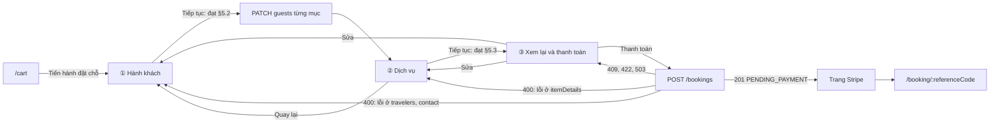
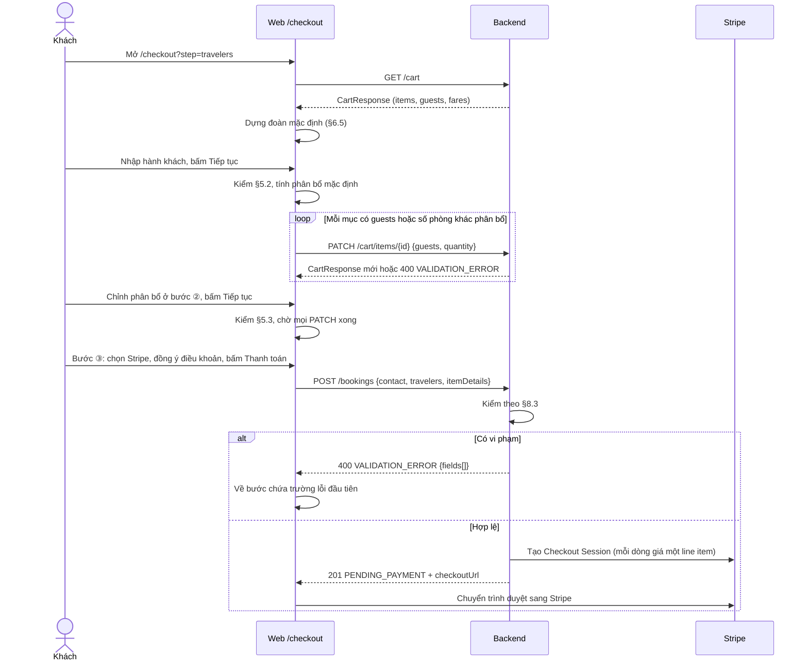

# Checkout nhiều bước: hành khách người lớn/trẻ em, giá theo loại khách và kiểm tra hai phía

- Ngày: 2026-09-29
- Người viết: mihhquan / Claude Code (vai PO)
- Trạng thái: **Bản nháp, chờ chốt. Chưa được code theo spec này.** Spec lệch PRD ở các điểm liệt kê tại §15. Theo `AGENTS.md` §8, cần một đề xuất trong `docs/prd/update/` được chốt và áp dụng vào PRD trước khi sửa contract, DDL hay code.
- Phục vụ: FR-BKG-01, FR-BKG-02, FR-BKG-06, FR-CAT-02, FR-CAT-03, NFR-SEC-01, NFR-MAINT-02 (`docs/prd/requirements.md`). Mã mới đề xuất: FR-BKG-08, AC-BKG-05…07 (§12.1, §15.1).
- Giữ nguyên: giữ chỗ 30 phút, Stripe Checkout, webhook, đối soát, huỷ và hoàn tiền (`docs/spec/booking/so-do-luong-dat-cho-thanh-toan.md`). Spec này chỉ đổi phần **trước** khi bấm Thanh toán, cách tính tiền theo loại khách và dữ liệu hành khách lưu kèm đơn.
- Căn cứ: code nhánh `feat/booking` (commit `5feb987`), snapshot catalog `src/data_collection/snapshots/2026-09-23`, mẫu UX trên Mobbin (§16).

## Mục lục

1. Tóm tắt
2. Hiện trạng và lỗi
3. Mục tiêu và phạm vi
4. Khái niệm và quy tắc giá
5. Bộ luật kiểm tra
6. Luồng nhiều bước (UX)
7. Hợp đồng API
8. Backend
9. Database
10. Frontend
11. Trường hợp biên
12. Kiểm thử và nghiệm thu
13. Kế hoạch triển khai và rủi ro
14. Quyết định cần chốt
15. Lệch PRD và tài liệu phải sửa sau khi chốt
16. Tham khảo UX (Mobbin)

Phụ lục A. Dịch vụ thêm của vé máy bay (FR-BKG-11)

---

## 1. Tóm tắt

- **Vấn đề.** Mỗi dịch vụ trong giỏ chỉ có một con số `quantity`. Hệ thống không biết đoàn có những ai, bao nhiêu trẻ em. Vì vậy trẻ em bị tính giá người lớn, phòng nhận quá sức chứa, vé máy bay thiếu tên, và Backend nhận mọi thông tin khách mà không kiểm (§2).
- **Giải pháp.** `/checkout` chia thành ba bước: **① Hành khách → ② Dịch vụ → ③ Xem lại và thanh toán**. Sau đó sang Stripe như hiện nay.
- **Khai đoàn một lần, dùng cho mọi dịch vụ.** Khách khai đoàn một lần: người lớn từ 12 tuổi, trẻ em dưới 12 tuổi kèm ngày sinh. Ở mỗi dịch vụ, khách chọn ai dùng. Với khách sạn, khách xếp người vào từng phòng.
- **Giá theo loại khách, do Backend tính từ catalog.** Vé có giá trẻ em hợp lệ thì trẻ em trả giá đó. Vé không có giá trẻ em thì mọi khách trả một giá. Web không tự cộng tiền.
- **Một bộ luật, kiểm ở hai nơi.** Web kiểm để báo lỗi sớm, ngay tại trường. Backend kiểm lại toàn bộ và có quyết định cuối cùng, kể cả khi có người gọi API trực tiếp (§5).

---

## 2. Hiện trạng và lỗi

### 2.1. Luồng hiện tại

`/checkout` (`src/frontend/src/components/checkout/CheckoutView.tsx`) là **một trang** gồm bốn khối: thông tin liên hệ; thông tin từng dịch vụ; phương thức thanh toán; điều khoản và nút Thanh toán. Quy tắc tên khách hiện tại (`docs/spec/hop-dong-tich-hop-frontend.md` §4.5): khách sạn 1 tên; vé máy bay đủ `quantity` tên; loại khác không có tên. Khi khách bấm Thanh toán, Web gọi `POST /bookings`, Backend giữ chỗ và tạo phiên Stripe.

### 2.2. Lỗi logic

| # | Lỗi | Hậu quả | Chỗ trong code |
|---|---|---|---|
| L1 | Không có khái niệm đoàn khách. `quantity` là số phòng (khách sạn) hoặc số khách (loại khác), không tách người lớn và trẻ em. Trợ lý thêm mọi mục vào giỏ với `quantity = 1`. | Lịch trình cho 2 người lớn + 2 trẻ em, nhưng giỏ và Stripe chỉ tính 1 vé máy bay, 1 vé vui chơi. Tổng ở checkout thấp hơn tổng trên lịch trình. | `src/frontend/src/hooks/useAssistantCart.ts:24`; ghi nhận ở `history/2026-09-25-widget-thanh-toan-them-du-gio.md` |
| L2 | Trẻ em trả giá người lớn. Thành tiền luôn là `unitPrice × quantity`, bỏ qua `attributes.childPrice`. | Vé "[Wonder Ngon] VinWonders Nha Trang + Buggy + Fastpass" có giá người lớn 1.500.000 ₫, trẻ em 504.000 ₫. Gia đình 2 người lớn + 1 trẻ em bị tính 4.500.000 ₫ thay vì 3.504.000 ₫. | `src/backend/app/domain/booking/pricing.py:11-14` |
| L3 | Khách sạn có một ô tên cho mọi phòng. Hệ thống không kiểm sức chứa, dù 95% hạng phòng có `maxOccupancy`. | Đặt 3 phòng chỉ có 1 tên khách. Đoàn 5 người đặt 1 phòng sức chứa 2 mà không có cảnh báo nào. | `CheckoutView.tsx:39-40`; `Product.max_occupancy` (`src/backend/app/domain/catalog/models.py:62`) chưa được booking dùng |
| L4 | Vé máy bay chỉ có tên, không có loại khách. Hệ thống không kiểm trẻ em có người lớn đi cùng, không kiểm số em bé. | Vé cho một trẻ 1 tuổi đi một mình trông giống hệt vé người lớn. | `CheckoutView.tsx:39-44` |
| L5 | Backend không kiểm thông tin khách. Nó chỉ giới hạn `guestNames` tối đa 20 phần tử. Mục giỏ không có `itemDetails` vẫn được đặt. | Theo code hiện tại, gọi thẳng `POST /bookings` cho vé máy bay 3 khách mà không gửi tên nào vẫn nhận `201`. | `src/backend/app/api/v1/schemas/booking.py:33`; `src/backend/app/application/booking/create_hold.py:96-101` |
| L6 | Vé tham quan, combo, golf không ghi vé dành cho ai. | Giỏ mua 1 vé cho đoàn 4 người không bị phát hiện. | `hop-dong-tich-hop-frontend.md` §4.5 ("loại khác không gửi `guestNames`") |
| L7 | Stripe nhận một dòng mỗi mục, với đơn giá là `unitPrice`. | Khi có giá trẻ em, trang Stripe không khớp tóm tắt đơn. | `create_hold.py:59`, `create_hold.py:120` |
| L8 | `app.booking_items.line_total` là cột sinh `unit_price * quantity`. Cột này đã sai với khách sạn nhiều đêm và sẽ sai thêm khi có giá trẻ em. | Truy vấn SQL doanh thu theo dòng ra kết quả sai. | `db/vota_schema.sql:253` |
| L9 | Một trang dài chứa mọi dịch vụ. Lỗi chỉ lộ ra khi bấm Thanh toán ở cuối trang. | Với giỏ 5 dịch vụ, khách phải cuộn qua 5 khối, và lỗi ở khối đầu dễ bị bỏ sót. | `docs/spec/product.md` §4.5.2 ("Một trang, 3 khối") |

### 2.3. Dữ liệu catalog liên quan

Đếm trên snapshot `2026-09-23` (11.387 sản phẩm).

| Dữ liệu | Có ở | Hệ quả cho spec |
|---|---|---|
| `attributes.maxOccupancy` của hạng phòng | 7.382 / 7.738 hạng phòng (95%) | Dùng để kiểm sức chứa. Với 5% còn lại, hệ thống không kiểm và UI ghi rõ điều đó |
| `attributes.childPrice` | 297 sản phẩm: 199 vé tham quan, 93 combo, 5 golf | Chỉ **97** sản phẩm có giá dùng được (0 < giá trẻ em ≤ giá người lớn). **103** sản phẩm có giá 0, nghĩa là nguồn không có giá riêng, không phải miễn phí. Ví dụ: thẻ hội viên Aquafield 6.000.000 ₫, workshop cho trẻ em 500.000 ₫. **97** sản phẩm có giá trẻ em cao hơn giá người lớn, nghi là sai dữ liệu. Ví dụ: Grand Park, người lớn 100.000 ₫, trẻ em 450.000 ₫ |
| Giá trẻ em, em bé của chuyến bay | Không có | Mọi hành khách trả `unitPrice` (D3) |
| Giá khách sạn | Theo phòng/đêm. Khách sạn cấp property hỏi giá cho 2 người lớn (`priceAdults = 2`) | Số khách không làm đổi giá phòng. Phụ thu trẻ em chỉ có trong văn bản tự do (`conditions`, `policies`) |
| Quy định vé trẻ em của Vinpearl | Văn bản trong `attributes.policies`, tính theo **chiều cao**: dưới 100 cm miễn phí; từ 100 đến dưới 140 cm giá trẻ em | Không phân tích tự động được. Web hiện nguyên văn để khách tự quyết trẻ nào cần vé |

---

## 3. Mục tiêu và phạm vi

### 3.1. Mục tiêu

- **G1.** Mỗi dịch vụ trong đơn biết đúng ai dùng: số người lớn, số trẻ em, họ tên từng người. Với khách sạn: ai ở phòng nào.
- **G2.** Tiền thu bằng tổng giá catalog theo loại khách. Tổng ở bước ③ bằng `payment.amount` trên Stripe.
- **G3.** Không tạo được đơn vi phạm luật ở §5, kể cả khi gọi API trực tiếp.
- **G4.** Khách thấy lỗi ngay tại trường, ở bước đang làm, không phải chờ tới nút Thanh toán.
- **G5.** Hành vi giữ chỗ, Stripe, huỷ đã chốt không đổi. FR-BKG-03…07 và AC-BKG-01…04 vẫn đạt.

Các mục tiêu được đo bằng test (§12), không cần số liệu người dùng. Mọi ca trong bảng §12.2 phải cho cùng kết quả ở Web và Backend, và `db/verify.sql` không được có đơn nào lệch tổng.

### 3.2. Trong phạm vi

| Ưu tiên | Hạng mục |
|---|---|
| P0 | Checkout ba bước; bộ luật §5 ở Web và Backend; giá theo loại khách; lưu hành khách kèm đơn; trang đơn hiển thị hành khách |
| P0 | Giỏ lưu số người lớn/trẻ em của mỗi mục (`guests`) và các dòng giá (`fares`) |
| P1 | Trang chi tiết: chọn số người lớn/trẻ em (vé), hoặc số phòng và số khách (khách sạn) khi thêm vào giỏ |
| P1 | Trợ lý: thêm vào giỏ theo `intent.party` thay vì `quantity = 1` |
| P1 | Trang giỏ: hiện và sửa số khách của từng mục |

### 3.3. Ngoài phạm vi

- Sổ hành khách lưu trong hồ sơ để chọn lại lần sau. Đây là hướng mở rộng của FR-USR-02, cần đề xuất riêng.
- Giấy tờ tuỳ thân, quốc tịch, giới tính, số hộ chiếu. Catalog chỉ có chuyến bay nội địa và hệ thống không xuất vé thật.
- Bảo hiểm, suất ăn, mã giảm giá. Hành lý ký gửi và chọn ghế của vé máy bay thuộc phạm vi qua Phụ lục A (FR-BKG-11).
- Giá trẻ em/em bé riêng của chuyến bay; phụ thu trẻ em hoặc giường phụ của khách sạn; vé người cao tuổi. Catalog chưa có dữ liệu có cấu trúc cho các loại giá này.
- Kiểm chiều cao trẻ em khi mua vé khu vui chơi. Nhân viên kiểm tại cổng.
- Khách chưa đăng nhập: checkout vẫn bắt buộc đăng nhập.
- Mọi thay đổi về giữ chỗ, Stripe, huỷ, hoàn tiền.

---

## 4. Khái niệm và quy tắc giá

### 4.1. Thuật ngữ

| Thuật ngữ | Nghĩa |
|---|---|
| Đoàn khách | Những người đi trong đơn, khai một lần ở bước ①. Tối đa 9 người (D6) |
| Hành khách | Một người trong đoàn, gồm loại khách, họ tên và ngày sinh (bắt buộc với trẻ em). Web gán cho mỗi người một mã tạm `travelerRef` để các dịch vụ tham chiếu |
| Người liên hệ | Người nhận thông tin đơn (`contact`). Có thể không đi cùng (D10) |
| Loại khách (`TravelerType`) | `ADULT`: từ 12 tuổi. `CHILD`: dưới 12 tuổi |
| Em bé | Trẻ em dưới 2 tuổi tại ngày bay. Không phải một loại khách riêng; chỉ dùng cho luật chuyến bay |
| Phân bổ | Ai dùng dịch vụ nào. Với khách sạn: ai ở phòng nào, ai là người đại diện nhận phòng |
| Loại giá (`FareType`) | `ADULT`, `CHILD` (dịch vụ tính theo người), `ROOM` (khách sạn), `PACKAGE` (combo) |
| Dòng giá (`FareLine`) | Một loại giá trong một dịch vụ, gồm đơn giá, số lượng, số đêm (chỉ với `ROOM`) và thành tiền |
| `guests` | Số người lớn và số trẻ em (theo loại giá) của một mục giỏ. Lưu ở giỏ, không chứa tên |

### 4.2. Loại khách và cách tính tuổi (D1)

- **Người lớn:** từ 12 tuổi. Hệ thống không hỏi ngày sinh và tin vào khai báo.
- **Trẻ em:** dưới 12 tuổi tại **ngày sử dụng sớm nhất của đơn**. Bắt buộc có ngày sinh.
- **Loại giá của trẻ em** ở từng dịch vụ tính theo tuổi tại `usingDate` của dịch vụ đó. Nếu trẻ tròn 12 tuổi giữa chuyến, các dịch vụ từ ngày đó tính giá người lớn, và Web báo rõ (W-04).
- **Em bé:** trẻ em dưới 2 tuổi tại `usingDate` của chuyến bay.
- **Cách tính tuổi:** số năm tròn theo lịch Việt Nam (`Asia/Ho_Chi_Minh`). `tuổi(d) = năm(d) − năm(sinh)`, trừ thêm 1 nếu ngày-tháng của `d` đứng trước ngày-tháng sinh. Với người sinh ngày 29/02, năm không nhuận coi sinh nhật là 01/03. Web và Backend dùng cùng quy tắc và cùng một bộ ngày để test (§12.2).
- **Căn cứ mốc 12 và 2 tuổi:** chuẩn hành khách của các hãng bay nội địa. Khách sạn và vé dùng chung mốc này, để mỗi người chỉ có một loại khách trong cả đơn. Quy định trẻ em riêng của từng điểm đến (tính theo chiều cao) chỉ được hiển thị, không dùng để tính giá (§2.3).

### 4.3. Số lượng, số khách và dòng giá theo loại dịch vụ

| `taxonomy` | `quantity` là | `guests` | Dòng giá | Thành tiền |
|---|---|---|---|---|
| `hotel` (hạng phòng) | Số phòng | Khách ở các phòng. Mỗi phòng có ít nhất 1 người lớn và không vượt sức chứa | Một dòng `ROOM` | `unitPrice × số đêm × số phòng`. Số khách không làm đổi giá |
| `flight` | Số hành khách, bằng `adults + children` | Bắt buộc khớp `quantity` | `ADULT`, `CHILD` | Mọi hành khách có ghế riêng và trả `unitPrice` (D3) |
| `attraction`, `golf` | Số vé, bằng `adults + children` | Bắt buộc khớp `quantity` | `ADULT`, `CHILD` | Người lớn trả `unitPrice`. Trẻ em trả giá trẻ em hợp lệ (§4.4); không có thì trả `unitPrice` |
| `combo` | Số gói | Những người dùng gói, chỉ để ghi nhận, không ràng buộc với `quantity` | Một dòng `PACKAGE` | `unitPrice × số gói` (D4) |

`lineTotal` của một mục bằng tổng `amount` các dòng giá của mục đó. `total` của giỏ và của đơn bằng tổng `lineTotal`. Công thức hiện tại ở `hop-dong-tich-hop-backend.md` §2.6 là trường hợp riêng khi không có trẻ em, nên client cũ không thấy khác biệt.

Mọi đơn giá lấy từ catalog tại thời điểm tính (FR-BKG-02). Hệ thống không tự đặt tỷ lệ giảm giá và không nhận số tiền từ client.

### 4.4. Giá trẻ em hợp lệ (D2)

Giá trẻ em **hợp lệ** khi `attributes.childPrice` là một số và `0 < childPrice ≤ unitPrice`. Khi đó vé trẻ em có đơn giá `childPrice`. Mọi trường hợp khác (không có trường này, giá bằng 0, giá cao hơn người lớn) đều coi như sản phẩm **không có giá trẻ em riêng**: trẻ em trả `unitPrice`, và UI ghi "Trẻ em: cùng giá người lớn".

- **Không dùng giá bằng 0.** Dữ liệu cho thấy 0 nghĩa là nguồn không có giá riêng (§2.3). Hiểu 0 là miễn phí sẽ khiến V-OTA thu thiếu tiền.
- **Không dùng giá cao hơn người lớn.** Có 97 sản phẩm lệch kiểu này, nhiều khả năng do job cào lấy nhầm giá. Khách không bao giờ phải trả vé trẻ em đắt hơn vé người lớn vì lỗi dữ liệu.
- **Việc của Data:** soát 200 sản phẩm lệch và xác nhận nghĩa của `childPrice = 0` (§13, bước 0). Khi dữ liệu được sửa, luật này tự áp dụng, không cần đổi code.

### 4.5. Ví dụ tính tiền

Gia đình 2 người lớn + 1 trẻ em (sinh 12/05/2019, 7 tuổi) đi Nha Trang. Giá lấy từ catalog snapshot 2026-09-23.

| Dịch vụ | Ngày | Phân bổ | Dòng giá | Thành tiền | Cách tính hiện tại |
|---|---|---|---|---|---|
| Lucky Sun Hotel Nha Trang Beach, Phòng Deluxe 3 Người (sức chứa 3) | 17/10 → 19/10 (2 đêm) | Phòng 1: 3 khách, người đại diện là Nguyễn Minh Anh | `ROOM` 777.192 ₫ × 2 đêm × 1 phòng | 1.554.384 ₫ | 1.554.384 ₫ |
| [Wonder Ngon] Vé VinWonders Nha Trang + Buggy + Fastpass 3 game hot | 18/10 | 3 khách | `ADULT` 2 × 1.500.000 ₫; `CHILD` 1 × 504.000 ₫ | 3.504.000 ₫ | 4.500.000 ₫ (với `quantity = 3`) |
| VietJet Air VJ601 Nha Trang → TP. Hồ Chí Minh 16:20 | 19/10 | 3 khách | `ADULT` 2 × 634.000 ₫; `CHILD` 1 × 634.000 ₫ | 1.902.000 ₫ | 1.902.000 ₫ |
| **Tổng** | | | | **6.960.384 ₫** | 7.956.384 ₫ |

---

## 5. Bộ luật kiểm tra

### 5.1. Nguyên tắc

- Mỗi luật có một mã. Web và Backend dùng cùng mã luật, cùng `reason` và cùng câu thông báo (§5.6).
- **Web** kiểm để báo lỗi sớm. Lỗi định dạng được kiểm khi khách rời trường (blur); luật của cả bước được kiểm khi khách bấm **Tiếp tục**. Web không kiểm theo từng phím gõ (giữ nguyên `product.md` §4.5.2).
- **Backend** kiểm lại toàn bộ và có quyết định cuối cùng. Backend trả về **mọi** vi phạm trong một lần, không dừng ở vi phạm đầu tiên.
- **Chặn** nghĩa là Web không cho sang bước sau và Backend trả `400 VALIDATION_ERROR`. **Cảnh báo** nghĩa là chỉ hiển thị, không chặn; chỉ Web làm.

### 5.2. Luật đoàn khách và người liên hệ (bước ①)

| Mã | Luật | Mức | `reason` (trường) |
|---|---|---|---|
| R-TRV-01 | Đoàn có ít nhất 1 người lớn | Chặn | `ADULT_REQUIRED` (`travelers`) |
| R-TRV-02 | Đoàn có từ 1 đến 9 người | Chặn | `PARTY_TOO_LARGE` (`travelers`) |
| R-TRV-03 | Mọi hành khách phải có họ tên (D5). Sau khi bỏ khoảng trắng thừa, họ tên dài 2–100 ký tự, có ít nhất 2 từ, chỉ gồm chữ cái (kể cả tiếng Việt có dấu), khoảng trắng, `'` và `-` | Chặn | `REQUIRED`, `NAME_INVALID` (`travelers[i].fullName`) |
| R-TRV-04 | Trẻ em có ngày sinh. Ngày sinh không ở tương lai và không sau ngày sử dụng sớm nhất của đơn | Chặn | `REQUIRED`, `BIRTH_DATE_INVALID` (`travelers[i].birthDate`) |
| R-TRV-05 | Trẻ em dưới 12 tuổi tại ngày sử dụng sớm nhất của đơn | Chặn | `CHILD_AGE_INVALID` (`travelers[i].birthDate`) |
| R-TRV-06 | `travelerRef` không trùng nhau trong đơn. Chỉ Backend kiểm, vì Web tự sinh mã | Chặn | `TRAVELER_DUPLICATED` (`travelers[i].travelerRef`) |
| R-CON-01 | Người liên hệ: họ tên 1–100 ký tự; số điện thoại khớp `^0[0-9]{9}$`; email là email của tài khoản | Chặn | Như hiện hành (`contact.*`) |

Trên Web, bộ đếm khoá nút − và + ở giới hạn, nên R-TRV-01 và R-TRV-02 chủ yếu để Backend chặn request gọi thẳng API.

### 5.3. Luật theo dịch vụ (bước ②)

| Mã | Áp dụng | Luật | Mức | `reason` (trường) |
|---|---|---|---|---|
| R-ITM-01 | Mọi mục | Mỗi mục giỏ có đúng một `itemDetails`: không thiếu, không thừa, không lặp | Chặn | `ITEM_DETAIL_MISSING`, `ITEM_DETAIL_UNKNOWN`, `ITEM_DETAIL_DUPLICATED` (`itemDetails`) |
| R-ITM-02 | Mọi mục | Mục có ít nhất 1 hành khách. Mọi `travelerRef` phải có trong `travelers`. Một người không xuất hiện hai lần trong cùng mục | Chặn | `ITEM_WITHOUT_TRAVELER`, `TRAVELER_UNKNOWN`, `TRAVELER_DUPLICATED` (`itemDetails[j]…`) |
| R-ITM-03 | Mọi mục | Mục có trẻ em phải có ít nhất 1 người lớn trong cùng mục | Chặn | `ADULT_REQUIRED` (`itemDetails[j].travelerRefs`) |
| R-ITM-04 | `flight`, `attraction`, `golf` | Số người lớn và trẻ em (theo loại giá tại ngày của mục) khớp `guests` của mục giỏ, tức là khớp giá khách đã thấy | Chặn | `GUEST_COUNT_MISMATCH` (`itemDetails[j]`) |
| R-FLT-01 | `flight` | Số em bé (dưới 2 tuổi tại ngày bay) không vượt số người lớn trên chuyến | Chặn | `INFANTS_EXCEED_ADULTS` (`itemDetails[j].travelerRefs`) |
| R-HTL-01 | `hotel` | Số phòng trong `rooms` bằng `quantity` của mục | Chặn | `ROOM_COUNT_MISMATCH` (`itemDetails[j].rooms`) |
| R-HTL-02 | `hotel` | Mỗi phòng có ít nhất 1 người lớn | Chặn | `ADULT_REQUIRED` (`itemDetails[j].rooms[k]`) |
| R-HTL-03 | `hotel` | Số khách mỗi phòng không vượt `maxOccupancy`. Hạng phòng không có `maxOccupancy` thì bỏ qua luật này | Chặn | `OCCUPANCY_EXCEEDED` (`itemDetails[j].rooms[k]`) |
| R-HTL-04 | `hotel` | Một người chỉ ở một phòng trong cùng mục | Chặn | `TRAVELER_DUPLICATED` (`itemDetails[j].rooms[k].travelerRefs`) |
| R-HTL-05 | `hotel` | Người đại diện nhận phòng là người lớn ở trong phòng đó | Chặn | `LEAD_GUEST_INVALID` (`itemDetails[j].rooms[k].leadTravelerRef`) |

Khách sạn và combo không kiểm R-ITM-04, vì số khách không làm đổi giá. Phân bổ gửi lúc checkout được dùng làm số khách thật của đơn.

### 5.4. Cảnh báo (không chặn, chỉ Web)

| Mã | Tình huống | Hiển thị |
|---|---|---|
| W-01 | Một người trong đoàn không dùng dịch vụ nào | "{Tên} chưa có dịch vụ nào trong đơn." |
| W-02 | Dịch vụ tính theo người không phủ cả đoàn | Nhãn "{n}/{tổng} khách" trên thẻ dịch vụ |
| W-03 | Một người ở hai khách sạn có đêm trùng nhau | "{Tên} đang ở 2 khách sạn trong đêm {dd/mm}." |
| W-04 | Trẻ em tròn 12 tuổi trước ngày của một dịch vụ | "Từ {dd/mm/yyyy}, {tên} tính giá người lớn." |
| W-05 | Hai hành khách trùng họ tên | "Có hai hành khách cùng tên {tên}. Kiểm tra lại nếu nhập nhầm." |

### 5.5. Luật khi thêm hoặc sửa mục giỏ

Áp dụng cho `POST /cart/items` và `PATCH /cart/items/{cartItemId}`. Lỗi trả `400 VALIDATION_ERROR` với `reason` như bảng.

| Mã | Luật | `reason` |
|---|---|---|
| R-CRT-01 | `guests.adults ≥ 1`, `guests.children ≥ 0`, tổng không quá 9 | `ADULT_REQUIRED`, `PARTY_TOO_LARGE` |
| R-CRT-02 | `flight`, `attraction`, `golf`: khi gửi `guests`, `quantity` bằng `adults + children` (được phép bỏ `quantity`). Gửi cả hai mà lệch nhau thì bị từ chối | `GUEST_COUNT_MISMATCH` |
| R-CRT-03 | `hotel`: `adults ≥ quantity` (mỗi phòng một người lớn). `adults + children ≤ maxOccupancy × quantity` khi hạng phòng có `maxOccupancy` | `ADULT_REQUIRED`, `OCCUPANCY_EXCEEDED` |
| R-CRT-04 | Thêm trùng `productId` + `usingDate` thì cộng dồn cả `quantity` lẫn `guests`. Kết quả sau khi cộng vẫn phải đạt R-CRT-01…03 | Như trên |
| R-CRT-05 | Không gửi `guests` (client cũ): `hotel` và dịch vụ tính theo người mặc định `{adults: quantity, children: 0}`; `combo` mặc định `{adults: 1, children: 0}`. `PATCH` chỉ đổi `quantity` của mục đang có trẻ em thì giữ nguyên `children` và đặt `adults = quantity − children`, với điều kiện kết quả ≥ 1 | `ADULT_REQUIRED` |

### 5.6. Mã `reason` và câu thông báo

Mọi lỗi trong bảng dưới đều là `400 VALIDATION_ERROR`. `message` dùng tiếng Việt, hiển thị được trực tiếp cho người dùng.

| `reason` | Câu thông báo (mẫu) |
|---|---|
| `REQUIRED` | "Vui lòng nhập {tên trường}." |
| `NAME_INVALID` | "Nhập đầy đủ họ và tên như trên giấy tờ, ví dụ: Nguyễn Minh Anh." |
| `BIRTH_DATE_INVALID` | "Ngày sinh không hợp lệ." |
| `CHILD_AGE_INVALID` | "Bé đã đủ 12 tuổi vào {dd/mm/yyyy}. Vui lòng chọn loại Người lớn." |
| `ADULT_REQUIRED` | Tuỳ chỗ: "Cần ít nhất 1 người lớn (từ 12 tuổi)."; "Trẻ em cần đi cùng ít nhất 1 người lớn trong dịch vụ này."; "Mỗi phòng cần ít nhất 1 người lớn." |
| `PARTY_TOO_LARGE` | "Mỗi đơn tối đa 9 khách. Vui lòng tách thành nhiều đơn." |
| `TRAVELER_UNKNOWN` | "Hành khách không có trong đoàn." (lỗi kỹ thuật; Web không để xảy ra) |
| `TRAVELER_DUPLICATED` | "{Tên} đã được chọn ở chỗ khác trong dịch vụ này." |
| `ITEM_DETAIL_MISSING` | "Thiếu thông tin cho {tên dịch vụ}." |
| `ITEM_DETAIL_UNKNOWN`, `ITEM_DETAIL_DUPLICATED` | Lỗi kỹ thuật; Web tải lại giỏ |
| `ITEM_WITHOUT_TRAVELER` | "Chọn ít nhất 1 khách dùng {tên dịch vụ}, hoặc xoá dịch vụ khỏi giỏ." |
| `GUEST_COUNT_MISMATCH` | "Số khách của {tên dịch vụ} vừa thay đổi. Vui lòng xem lại giá." |
| `INFANTS_EXCEED_ADULTS` | "Mỗi em bé dưới 2 tuổi cần một người lớn đi kèm trên chuyến bay." |
| `ROOM_COUNT_MISMATCH` | "Bạn đã đặt {n} phòng. Hãy xếp khách vào đủ {n} phòng hoặc giảm số phòng." |
| `OCCUPANCY_EXCEEDED` | "Phòng {k} chứa tối đa {x} khách." |
| `LEAD_GUEST_INVALID` | "Người đại diện nhận phòng phải là người lớn ở trong phòng." |

---

## 6. Luồng nhiều bước (UX)

### 6.1. Tổng quan





### 6.2. Điều hướng

- Route vẫn là `/checkout` (bảng route của PRD). Bước hiện tại nằm ở query `step`: `travelers` (mặc định), `services`, `review`. Mỗi lần chuyển bước tạo một mục trong lịch sử trình duyệt, nên nút Back của trình duyệt đưa khách về bước trước mà không mất dữ liệu.
- Nếu khách mở thẳng một bước sau trong khi bước trước chưa đạt (ví dụ tải lại trang ở `?step=review`), Web chuyển về bước đầu tiên chưa đạt.
- Thanh bước ở đầu trang: bước đã xong có dấu ✓ và bấm được để quay lại; bước hiện tại tô đậm; bước chưa tới không bấm được.
- Nút **Tiếp tục** luôn bấm được. Nếu bấm khi còn lỗi, Web không chuyển bước mà hiện hộp tóm tắt lỗi ở đầu bước (mỗi dòng là một link tới trường lỗi), gắn lỗi dưới từng trường và đưa focus tới trường lỗi đầu tiên. Không khoá nút Tiếp tục, vì nút bị khoá không cho khách biết mình còn thiếu gì.
- Nút **Thanh toán** ở bước ③ giữ quy tắc PRD hiện hành (`user-flow.md` §3.3): khoá cho tới khi khách đã chọn phương thức và đồng ý điều khoản. Dữ liệu ở các bước trước đã đạt, nên không còn điều kiện nào khác.
- Không giữ chỗ, không tạo đơn, không gọi Stripe trước khi bấm Thanh toán (FR-BKG-06). Cập nhật số khách ở bước ① và ② chỉ sửa giỏ (`PATCH /cart/items`) và không ghi event CDP.
- Mỗi lần chuyển bước, Web gọi `GET /cart`. Nếu giỏ bị đổi ở tab khác: mục mới nhận phân bổ mặc định, mục đã xoá bị bỏ ra, và Web hiện banner "Giỏ hàng vừa thay đổi". Nếu giỏ rỗng thì về `/cart`.
- Nếu hết phiên (401) giữa chừng: hiện hộp đăng nhập lại và giữ nguyên dữ liệu đang nhập (như `product.md` §4.5.3).

### 6.3. Khung chung của ba bước

- **Header rút gọn:** logo và "← Quay lại giỏ hàng", như hiện hành.
- **Desktop:** cột trái là nội dung bước. Cột phải là **Tóm tắt đơn**, dính khi cuộn: đoàn khách ("2 người lớn · 1 trẻ em"), từng dịch vụ kèm ngày và thành tiền, và tổng. Mọi con số lấy từ `CartResponse`. Khi một `PATCH` đang chạy, thành tiền của mục đó và tổng hiện khung chờ (skeleton).
- **Mobile** (dưới breakpoint `lg`): một cột. Thanh cố định ở đáy màn hình gồm đoàn khách, tổng tiền và nút chính của bước. Bấm vào tổng mở tóm tắt chi tiết dạng bottom sheet. Mẫu tham khảo: Trip.com [M2].

Thanh dưới cùng trên mobile:

```
┌──────────────────────────────────────────┐
│ 2 người lớn · 1 trẻ em     6.960.384 ₫ ⌃ │
│ [              Tiếp tục               ]  │
└──────────────────────────────────────────┘
```

### 6.4. Bước ① Hành khách

```
┌ Logo · ← Quay lại giỏ hàng ─────────────────────────────────────────────────────────┐
│  ① Hành khách ──── ② Dịch vụ ──── ③ Xem lại và thanh toán                           │
├──────────────────────────────────────────────────────┬──────────────────────────────┤
│ AI ĐI CHUYẾN NÀY?                                    │ ĐƠN CỦA BẠN (3 dịch vụ)      │
│  Người lớn   Từ 12 tuổi          [ − ]  2  [ + ]     │ 2 người lớn · 1 trẻ em       │
│  Trẻ em      Dưới 12 tuổi        [ − ]  1  [ + ]     │ Khách sạn Lucky Sun          │
│  Tối đa 9 khách mỗi đơn.                             │  17–19/10 · 1 phòng          │
│                                                      │              1.554.384 ₫     │
│ THÔNG TIN HÀNH KHÁCH                                 │ Vé VinWonders · 18/10        │
│  ⓘ Nhập đúng họ tên như trên CCCD hoặc giấy khai     │              3.504.000 ₫     │
│    sinh. Hãng bay, khách sạn có thể từ chối nếu      │ Bay VJ601 · 19/10            │
│    tên sai.                                          │              1.902.000 ₫     │
│ ┌ Người lớn 1 ─────────────────────────────────────┐ │ ──────────────────────────── │
│ │ Họ và tên *  [Nguyễn Minh Anh                  ] │ │ Tổng         6.960.384 ₫     │
│ └──────────────────────────────────────────────────┘ │                              │
│ ┌ Người lớn 2 ─────────────────────────────────────┐ │                              │
│ │ Họ và tên *  [                                 ] │ │                              │
│ └──────────────────────────────────────────────────┘ │                              │
│ ┌ Trẻ em 1 ────────────────────────────────────────┐ │                              │
│ │ Họ và tên *  [                                 ] │ │                              │
│ │ Ngày sinh *  [dd/mm/yyyy]                        │ │                              │
│ │ 7 tuổi vào 17/10/2026 (ngày sử dụng sớm nhất)    │ │                              │
│ └──────────────────────────────────────────────────┘ │                              │
│ NGƯỜI LIÊN HỆ                                        │                              │
│  Họ và tên *      [Nguyễn Minh Anh             ]     │                              │
│  Số điện thoại *  [0912345678                  ]     │                              │
│  Email            [minhanh@example.vn (khoá)   ]     │                              │
│  ☑ Người liên hệ cũng là Người lớn 1                 │                              │
│                                       [ Tiếp tục → ] │                              │
└──────────────────────────────────────────────────────┴──────────────────────────────┘
```

| Trường | Bắt buộc | Cách nhập | Luật |
|---|---|---|---|
| Số người lớn | Có | Bộ đếm 1–9, dòng phụ "Từ 12 tuổi" | R-TRV-01, R-TRV-02 |
| Số trẻ em | Có | Bộ đếm từ 0 tới (9 − số người lớn), dòng phụ "Dưới 12 tuổi" | R-TRV-02 |
| Họ và tên (mỗi hành khách) | Có | Ô chữ | R-TRV-03 |
| Ngày sinh (trẻ em) | Có | Ô `dd/mm/yyyy`, bàn phím số, tự chèn `/` | R-TRV-04, R-TRV-05 |
| Người liên hệ: họ tên, số điện thoại | Có | Như hiện hành; email khoá theo tài khoản | R-CON-01 |
| "Người liên hệ cũng là Người lớn 1" | — | Checkbox, mặc định bật | Khi bật, họ tên Người lớn 1 lấy theo người liên hệ và đồng bộ khi một trong hai ô được sửa |

Hành vi:

- Tăng bộ đếm thì thêm một thẻ hành khách vào cuối nhóm; giảm thì bỏ thẻ cuối nhóm. Nếu thẻ bị bỏ đã có dữ liệu, Web hỏi lại trước khi xoá.
- Khi khách nhập xong ngày sinh (blur), thẻ trẻ em hiện dòng phụ "{n} tuổi vào {ngày sử dụng sớm nhất}".
- Khi bấm Tiếp tục, Web kiểm §5.2, tính phân bổ mặc định (§6.5), rồi `PATCH` lần lượt các mục có `guests` hoặc số phòng khác phân bổ. Trong lúc đó nút hiện "Đang cập nhật giá (2/3)…". Xong thì sang bước ②. Nếu một `PATCH` lỗi, Web vẫn sang bước ② và gắn lỗi vào thẻ dịch vụ đó.

### 6.5. Điền sẵn và phân bổ mặc định

**Đoàn mặc định** khi mở `/checkout` lần đầu trong phiên:

1. Số người lớn là giá trị lớn nhất trong `guests.adults` của các mục giỏ. Số trẻ em là giá trị lớn nhất trong `guests.children`. Luôn có ít nhất 1 người lớn. Nhờ vậy, giỏ tạo từ trợ lý cho 2 người lớn + 2 trẻ em mở ra đúng đoàn đó.
2. Họ tên Người lớn 1 lấy từ tài khoản; các ô khác để trống. Ngày sinh trẻ em luôn để trống, vì giỏ không lưu ngày sinh.

**Phân bổ mặc định** chỉ tính cho mục khách chưa chỉnh trong phiên. Mục khách đã chỉnh thì giữ nguyên, chỉ bỏ những người đã rời đoàn.

- `flight`, `attraction`, `golf`, `combo`: gán cả đoàn (D10). Nếu có người không dùng, khách bỏ chọn ở bước ②, ví dụ trẻ dưới 100 cm được vào cửa miễn phí.
- `hotel` có R phòng, mỗi phòng chứa tối đa C người (hạng phòng không có C thì không giới hạn):
  1. Lần lượt xếp mỗi phòng một người lớn, theo thứ tự trong đoàn.
  2. Xếp người lớn còn lại, rồi đến trẻ em, xoay vòng vào các phòng còn chỗ.
  3. Người đại diện của mỗi phòng là người lớn đầu tiên trong phòng.
  4. Nếu còn người chưa có chỗ, thẻ khách sạn báo "Còn {n} khách chưa có phòng" kèm nút [+ Thêm phòng]. Nút chỉ hiện khi đoàn còn người lớn chưa đứng tên phòng nào. Nếu số người lớn ít hơn số phòng, thẻ báo R-HTL-02 trên phòng trống kèm nút [− Bớt phòng].
- Sau khi phân bổ, `guests` của mỗi mục là số người lớn và trẻ em theo loại giá tại `usingDate` của mục. Trẻ đã tròn 12 tuổi tại ngày đó được tính là người lớn.

### 6.6. Bước ② Dịch vụ

```
│  ① Hành khách ✓ ──── ② Dịch vụ ──── ③ Xem lại và thanh toán                          │
│ CHUYẾN NHA TRANG                                                                     │
│ ┌ [Khách sạn] Lucky Sun – Phòng Deluxe 3 Người · 17/10 → 19/10 · 2 đêm ────── ✓ ───┐ │
│ │ Số phòng [ − ] 1 [ + ]          Tối đa 3 khách/phòng                             │ │
│ │ Phòng 1 (3/3): [Minh Anh ×] [Thu Hà ×] [Gia Bảo ×]                               │ │
│ │   Người đại diện nhận phòng: [Nguyễn Minh Anh ▾]                                 │ │
│ │ 777.192 ₫ × 2 đêm × 1 phòng                                                      │ │
│ │ Yêu cầu đặc biệt (không bắt buộc) [                                            ] │ │
│ └──────────────────────────────────────────────────────────────── 1.554.384 ₫ ─────┘ │
│ ┌ [Vé tham quan] VinWonders + Buggy + Fastpass 3 game hot · 18/10 ─────────── ✓ ───┐ │
│ │ Ai dùng vé?  ☑ Nguyễn Minh Anh · Người lớn   ☑ Trần Thu Hà · Người lớn           │ │
│ │              ☑ Nguyễn Gia Bảo · Trẻ em, 7 tuổi                                   │ │
│ │ Người lớn  2 × 1.500.000 ₫                                                       │ │
│ │ Trẻ em     1 ×   504.000 ₫                                                       │ │
│ │ ▸ Điều kiện vé trẻ em của điểm đến                                               │ │
│ └──────────────────────────────────────────────────────────────── 3.504.000 ₫ ─────┘ │
│ ┌ [Vé máy bay] VietJet VJ601 Nha Trang → TP. Hồ Chí Minh · 19/10 16:20 ────── ✓ ───┐ │
│ │ Hành khách:  ☑ Minh Anh · Người lớn  ☑ Thu Hà · Người lớn  ☑ Gia Bảo · Trẻ em    │ │
│ │ Người lớn 2 × 634.000 ₫ · Trẻ em 1 × 634.000 ₫                                   │ │
│ │ ⓘ Chưa có giá vé trẻ em riêng: trẻ em và em bé có ghế riêng, tính giá người lớn. │ │
│ └──────────────────────────────────────────────────────────────── 1.902.000 ₫ ─────┘ │
│ [← Quay lại]                                                         [ Tiếp tục → ]  │
```

| Loại dịch vụ | Khách chỉnh gì | Hiển thị giá |
|---|---|---|
| Vé máy bay | Chọn hành khách trên chuyến (checkbox). Mỗi người có nhãn Người lớn, Trẻ em hoặc Em bé theo tuổi tại ngày bay | "Người lớn 2 × 634.000 ₫ · Trẻ em 1 × 634.000 ₫", kèm ghi chú về giá trẻ em (D3) |
| Khách sạn (hạng phòng) | Số phòng; xếp khách vào từng phòng (chip tên, chọn phòng từ danh sách); người đại diện mỗi phòng | "777.192 ₫ × 2 đêm × 1 phòng". Mỗi phòng hiện "3/3 khách". Hạng phòng không có `maxOccupancy` thì hiện "Khách sạn chưa công bố sức chứa phòng" |
| Vé tham quan, golf | Chọn ai dùng vé (checkbox) | Hai dòng giá. Nếu sản phẩm không có giá trẻ em hợp lệ thì ghi "Trẻ em: cùng giá người lớn". Mục "Điều kiện vé trẻ em" mở ra văn bản `attributes.policies` nếu có |
| Combo | Chọn ai dùng gói (để ghi nhận). Số gói giữ như trong giỏ | "{số gói} × {đơn giá}" |

Mọi thẻ đều có ô "Yêu cầu đặc biệt (không bắt buộc, tối đa 500 ký tự)" như hiện hành.

Hành vi:

- Thẻ dịch vụ gom theo điểm đến như ở trang giỏ và sắp theo ngày sử dụng. Mỗi thẻ có trạng thái: ✓ (hợp lệ) hoặc ! (cần sửa).
- Khi một thay đổi làm đổi `guests` hoặc số phòng, Web chờ 400 ms không có thao tác mới rồi gọi `PATCH /cart/items/{cartItemId}`. Các `PATCH` của cùng một mục chạy lần lượt. Thành tiền của thẻ và tổng hiện khung chờ cho tới khi có `CartResponse` mới. Nút Tiếp tục chờ mọi `PATCH` xong.
- Nếu `PATCH` trả lỗi nghiệp vụ (`PRODUCT_UNAVAILABLE`, `DATE_OUT_OF_RANGE`, `VALIDATION_ERROR`), Web gắn lỗi vào thẻ. Nếu mục hết chỗ, thẻ có nút [Xoá khỏi giỏ].
- Nếu đơn giá trong `CartResponse` mới khác lần trước mà không do đổi số khách, Web hiện toast "Giá {tên} vừa cập nhật: {cũ} → {mới}".
- Khi bấm Tiếp tục, Web kiểm §5.3. Cảnh báo §5.4 được hiện nhưng không chặn.

### 6.7. Bước ③ Xem lại và thanh toán

```
│  ① Hành khách ✓ ──── ② Dịch vụ ✓ ──── ③ Xem lại và thanh toán                        │
│ HÀNH KHÁCH (3)                                                              [Sửa]    │
│  Nguyễn Minh Anh · Người lớn   Trần Thu Hà · Người lớn   Nguyễn Gia Bảo · Trẻ em, 7t │
│  Liên hệ: Nguyễn Minh Anh · 0912345678 · minhanh@example.vn                          │
│ DỊCH VỤ (3)                                                                 [Sửa]    │
│  Lucky Sun – Deluxe 3 Người · 17–19/10 · 1 phòng, 3 khách            1.554.384 ₫     │
│  VinWonders + Buggy + Fastpass · 18/10 · 2 người lớn, 1 trẻ em       3.504.000 ₫     │
│  VJ601 Nha Trang → TP. Hồ Chí Minh · 19/10 · 3 khách                 1.902.000 ₫     │
│ ──────────────────────────────────────────────────────────────────────────────────── │
│  Tổng thanh toán                                                     6.960.384 ₫     │
│ PHƯƠNG THỨC THANH TOÁN                                                               │
│  (●) Stripe — Thẻ (chế độ test)  ( ) Ví điện tử [Sắp có]  ( ) Chuyển khoản [Sắp có]  │
│ ☐ Tôi đã kiểm tra họ tên hành khách và đồng ý Điều khoản dịch vụ, Chính sách huỷ:    │
│   hoàn 100% nếu huỷ trước 00:00 ngày 16/10/2026.                                     │
│ [                         Thanh toán 6.960.384 ₫                          ]          │
│  Giữ chỗ 30 phút sau khi bấm Thanh toán. Bạn sẽ được chuyển sang Stripe.             │
```

- Khối Hành khách và Người liên hệ có nút [Sửa] về bước ①. Khối Dịch vụ có nút [Sửa] về bước ②. Mỗi dịch vụ hiện ngày, tóm tắt phân bổ, các dòng giá (mở rộng được) và thành tiền.
- Tổng thanh toán là `CartResponse.total`.
- Chính sách huỷ hiện hạn tính theo FR-BKG-07: 00:00 của ngày liền trước ngày sử dụng sớm nhất. Đây chỉ là hiển thị; Backend vẫn quyết định `cancellableUntil`.
- Phương thức thanh toán như hiện hành: Stripe chọn sẵn; ví điện tử và chuyển khoản ghi "Sắp có".
- Checkbox điều khoản gộp thêm việc xác nhận họ tên. Trip.com dùng một hộp thoại riêng cho việc này [M1]; ở đây gộp vào để không thêm một bước.
- Nút "Thanh toán {tổng}". Khi đang gửi: hiện spinner và chặn bấm lặp, như hiện hành. Web gửi `POST /bookings` với `contact`, `travelers`, `itemDetails` (§7.4).

Cách Web xử lý kết quả (bổ sung cho `hop-dong-tich-hop-frontend.md` §8):

| Kết quả | Web làm gì |
|---|---|
| `400 VALIDATION_ERROR`, trường thuộc `travelers[…]` hoặc `contact.*` | Về bước ①, gắn lỗi vào trường, focus trường đầu tiên |
| `400 VALIDATION_ERROR`, trường thuộc `itemDetails[…]` | Về bước ②, cuộn tới thẻ dịch vụ, gắn lỗi |
| `400 VALIDATION_ERROR` có `GUEST_COUNT_MISMATCH` | `GET /cart`, tính lại phân bổ cho mục đó, về bước ② kèm thông báo |
| `409 PRICE_CHANGED` | Như hiện hành. Nếu có `details.fareType`, banner ghi rõ loại giá, ví dụ "Giá vé trẻ em của …" |
| `409 PRODUCT_UNAVAILABLE`, `422 DATE_OUT_OF_RANGE` | Như hiện hành (banner và link Quay lại giỏ) |
| `409 BOOKING_PENDING_PAYMENT` | Như hiện hành (hộp thoại tiếp tục thanh toán, hoặc huỷ đơn đó và đặt lại). Đặt lại thì gửi lại đúng dữ liệu đang có |
| `503 PAYMENT_PROVIDER_UNAVAILABLE`, lỗi mạng | Như hiện hành: ở lại bước ③, có nút Thử lại |
| `400 CART_EMPTY` | Về `/cart` |

### 6.8. Sau Stripe: trang đơn

Ở `/booking/{referenceCode}`, khối thông tin chuyến hiện hành khách của từng dịch vụ (`BookingItem.travelers`) và các dòng giá (`fares`). Khách sạn hiện khách theo phòng và đánh dấu người đại diện. Trang không hiện ngày sinh. Đơn tạo trước thay đổi này vẫn hiện `guestNames` như hiện nay.

### 6.9. Trang giỏ, trang chi tiết, trợ lý (P1)

- **Trang giỏ `/cart`:** mỗi mục hiện "2 người lớn · 1 trẻ em" và các dòng giá. Nút [Sửa] mở cùng bộ đếm như ở trang chi tiết và gọi `PATCH` với `guests`.
- **Trang chi tiết, hộp đặt:**
  - Vé tham quan, golf, chuyến bay: thay bộ đếm "số khách" bằng hai bộ đếm Người lớn (≥ 1) và Trẻ em (≥ 0), kèm đơn giá từng loại [M4] [M5]. Tổng trong hộp đặt vẫn là ước tính để hiển thị, tính theo cùng luật §4.4.
  - Khách sạn: số phòng, số người lớn, số trẻ em, kèm gợi ý "Tối đa {C} khách/phòng". Khi vượt sức chứa, gợi ý thêm phòng [M7] [M11].
  - Combo: giữ bộ đếm số gói.
  - `POST /cart/items` gửi kèm `guests`.
- **Trợ lý** (`useAssistantCart`, dùng cho cả widget và `/assistant`): lấy `intent.party` của `ItineraryResponse`.
  - Dịch vụ tính theo người: gửi `guests = party`, `quantity` bằng tổng số khách.
  - Khách sạn: gửi `quantity = min(adults, max(1, ⌈(adults + children) / C⌉))` phòng và `guests = party`. Hạng phòng không có C thì đặt 1 phòng.
  - Combo: gửi `guests = party`, `quantity = 1`.
  - Mục bị từ chối (ví dụ vượt sức chứa) được báo trong toast tổng kết như hiện nay.
  - Tổng trên lịch trình vẫn có thể khác tổng giỏ ở những vé có giá trẻ em. Giá ở checkout là giá chính thức (`hop-dong-tich-hop-backend.md` §7.2).

### 6.10. Văn bản giao diện

| Chỗ | Văn bản |
|---|---|
| Tên bước | "Hành khách", "Dịch vụ", "Xem lại và thanh toán" |
| Bộ đếm | "Người lớn · Từ 12 tuổi", "Trẻ em · Dưới 12 tuổi" |
| Ghi chú họ tên | "Nhập đúng họ tên như trên CCCD hoặc giấy khai sinh. Hãng bay, khách sạn có thể từ chối nếu tên sai." |
| Ngày sinh | Nhãn "Ngày sinh (dd/mm/yyyy)"; dòng phụ "{n} tuổi vào {dd/mm/yyyy}" |
| Hộp tóm tắt lỗi | "Còn {n} thông tin cần sửa", mỗi dòng là một link tới trường |
| Nút | "Tiếp tục", "Quay lại", "Thanh toán {tổng}" |
| Vé không có giá trẻ em | "Trẻ em: cùng giá người lớn" |
| Chuyến bay có trẻ em | "Chưa có giá vé trẻ em riêng: trẻ em và em bé có ghế riêng, tính giá người lớn." |
| Sức chứa phòng | "Tối đa {x} khách/phòng"; "Khách sạn chưa công bố sức chứa phòng" |
| Tải lại trang | "Để bảo vệ thông tin cá nhân, họ tên và ngày sinh không được lưu khi tải lại trang. Vui lòng nhập lại." |
| Giỏ đổi ở tab khác | "Giỏ hàng vừa thay đổi. Danh sách dịch vụ đã được cập nhật." |

### 6.11. Khả năng truy cập

- Thanh bước là `<nav aria-label="Các bước thanh toán">` chứa `<ol>`; bước hiện tại có `aria-current="step"`.
- Khi chuyển bước, focus chuyển tới tiêu đề của bước mới.
- Hộp tóm tắt lỗi có `role="alert"`. Lỗi của từng trường được nối với trường qua `aria-describedby`.
- Nút bộ đếm có nhãn đọc được ("Thêm người lớn", "Bớt trẻ em"); số hiện tại được đọc qua vùng `aria-live="polite"`.
- Ô ngày sinh dùng `inputMode="numeric"`, có ví dụ định dạng trong nhãn, không chỉ trong placeholder.

---

## 7. Hợp đồng API

### 7.1. Nguyên tắc

- Chỉ thêm schema và trường mới. Mọi trường mới là tuỳ chọn, cả trong request lẫn response (`api-contract.md` §3.2). Không đổi tên, không xoá, không đổi nghĩa trường cũ: `quantity`, `lineTotal`, `guestNames` giữ nguyên nghĩa.
- File cần sửa: `src/shared/contracts/schemas/booking.yaml`, `schemas/common.yaml`, và phần mô tả trong `paths/booking.yaml`. `openapi.yaml` lên **1.8.0**. Sinh lại `src/frontend/src/types/api.gen.ts` và chạy `validate_contract.py`.

### 7.2. Schema mới

```yaml
TravelerType:
  type: string
  enum: [ADULT, CHILD]
  description: ADULT từ 12 tuổi; CHILD dưới 12 tuổi tại ngày sử dụng sớm nhất của đơn.
FareType:
  type: string
  enum: [ADULT, CHILD, ROOM, PACKAGE]
GuestCounts:
  type: object
  required: [adults, children]
  properties:
    adults:   { type: integer, minimum: 1, maximum: 9 }
    children: { type: integer, minimum: 0, maximum: 8 }
FareLine:
  type: object
  required: [fareType, unitPrice, count, nights, amount]
  properties:
    fareType:  { $ref: ../openapi.yaml#/components/schemas/FareType }
    unitPrice: { type: integer, minimum: 0, description: VND cho 1 khách, 1 phòng-đêm hoặc 1 gói. }
    count:     { type: integer, minimum: 1 }
    nights:    { type: [integer, 'null'], minimum: 1, description: Chỉ khác null khi fareType là ROOM. }
    amount:    { type: integer, minimum: 0, description: unitPrice × count × (nights hoặc 1). }
CheckoutTraveler:
  type: object
  required: [travelerRef, type, fullName]
  properties:
    travelerRef: { type: string, pattern: '^[A-Za-z0-9_-]{1,36}$', description: Mã tạm do Web sinh, duy nhất trong request. }
    type:        { $ref: ../openapi.yaml#/components/schemas/TravelerType }
    fullName:    { type: string, minLength: 2, maxLength: 100 }
    birthDate:   { type: [string, 'null'], format: date, description: Bắt buộc khi type là CHILD (Backend kiểm, lỗi REQUIRED). }
CheckoutRoom:
  type: object
  required: [travelerRefs, leadTravelerRef]
  properties:
    travelerRefs:    { type: array, minItems: 1, maxItems: 9, items: { type: string } }
    leadTravelerRef: { type: string }
BookingTraveler:
  type: object
  required: [fullName, type, roomNo, isLead]
  properties:
    fullName: { type: string }
    type:     { $ref: ../openapi.yaml#/components/schemas/TravelerType }
    roomNo:   { type: [integer, 'null'], minimum: 1, description: Chỉ khác null với khách sạn. }
    isLead:   { type: boolean, description: Người đại diện nhận phòng. Luôn false với loại khác. }
```

`BookingTraveler` không có ngày sinh, để response trả ít dữ liệu cá nhân nhất có thể.

### 7.3. Trường thêm vào schema có sẵn

| Schema | Trường thêm | Ghi chú |
|---|---|---|
| `AddCartItemRequest` | `guests?: GuestCounts` | Theo R-CRT-01…05 |
| `UpdateCartItemRequest` | `guests?: GuestCounts` | Được tính vào `minProperties: 1` |
| `CartItem` | `guests?: GuestCounts`, `fares?: FareLine[]` | Backend mới luôn trả hai trường này. `lineTotal` bằng tổng `fares[].amount` |
| `CheckoutRequest` | `travelers?: CheckoutTraveler[]` (1–9 phần tử) | Có `travelers` thì áp dụng luật mới; không có thì theo §7.6 |
| `CheckoutItemDetail` | `travelerRefs?: string[]` (dịch vụ tính theo người, combo), `rooms?: CheckoutRoom[]` (khách sạn) | Khi request có `travelers`, `guestNames` bị bỏ qua |
| `BookingItem` | `fares?: FareLine[]`, `travelers?: BookingTraveler[]` | `guestNames` là họ tên các khách của mục, theo thứ tự trong đoàn |
| Lỗi `VALIDATION_ERROR` | `details.fields[].reason` | Mã ở §5.6. `field` là đường dẫn trong request, ví dụ `travelers[2].birthDate` |
| Lỗi `PRICE_CHANGED` | `details.fareType?` | Có giá trị `CHILD` khi giá trẻ em đổi |

### 7.4. Ví dụ

`POST /api/v1/bookings` cho gia đình ở §4.5:

```json
{
  "contact": { "fullName": "Nguyễn Minh Anh", "email": "minhanh@example.vn", "phone": "0912345678" },
  "travelers": [
    { "travelerRef": "t1", "type": "ADULT", "fullName": "Nguyễn Minh Anh" },
    { "travelerRef": "t2", "type": "ADULT", "fullName": "Trần Thu Hà" },
    { "travelerRef": "t3", "type": "CHILD", "fullName": "Nguyễn Gia Bảo", "birthDate": "2019-05-12" }
  ],
  "itemDetails": [
    {
      "cartItemId": "ci-hotel",
      "rooms": [ { "travelerRefs": ["t1", "t2", "t3"], "leadTravelerRef": "t1" } ],
      "specialRequest": "Phòng tầng cao nếu còn"
    },
    { "cartItemId": "ci-vinwonders", "travelerRefs": ["t1", "t2", "t3"] },
    { "cartItemId": "ci-vj601", "travelerRefs": ["t1", "t2", "t3"] }
  ]
}
```

Một `CartItem` trong `CartResponse`:

```json
{
  "cartItemId": "ci-vinwonders",
  "product": { "productId": "…", "name": "[Wonder Ngon] - Vé VinWonders Nha Trang + Buggy + Fastpass 3 game hot", "taxonomy": "attraction", "unitPrice": 1500000, "attributes": { "childPrice": 504000 }, "…": "ProductSummary" },
  "usingDate": "2026-10-18",
  "quantity": 3,
  "nights": null,
  "guests": { "adults": 2, "children": 1 },
  "fares": [
    { "fareType": "ADULT", "unitPrice": 1500000, "count": 2, "nights": null, "amount": 3000000 },
    { "fareType": "CHILD", "unitPrice": 504000, "count": 1, "nights": null, "amount": 504000 }
  ],
  "lineTotal": 3504000
}
```

Phần thêm vào một `BookingItem` khách sạn:

```json
{
  "fares": [ { "fareType": "ROOM", "unitPrice": 777192, "count": 1, "nights": 2, "amount": 1554384 } ],
  "travelers": [
    { "fullName": "Nguyễn Minh Anh", "type": "ADULT", "roomNo": 1, "isLead": true },
    { "fullName": "Trần Thu Hà", "type": "ADULT", "roomNo": 1, "isLead": false },
    { "fullName": "Nguyễn Gia Bảo", "type": "CHILD", "roomNo": 1, "isLead": false }
  ],
  "guestNames": ["Nguyễn Minh Anh", "Trần Thu Hà", "Nguyễn Gia Bảo"]
}
```

### 7.5. Lỗi

```json
{
  "error": {
    "code": "VALIDATION_ERROR",
    "message": "Thông tin hành khách chưa hợp lệ.",
    "retryable": false,
    "requestId": "01JB…",
    "details": {
      "fields": [
        { "field": "travelers[2].birthDate", "reason": "CHILD_AGE_INVALID", "message": "Bé đã đủ 12 tuổi vào 17/10/2026. Vui lòng chọn loại Người lớn." },
        { "field": "itemDetails[0].rooms[0]", "reason": "OCCUPANCY_EXCEEDED", "message": "Phòng 1 chứa tối đa 3 khách." }
      ]
    }
  }
}
```

Không thêm mã lỗi mới vào `ErrorCode`. Mọi lỗi hành khách dùng `VALIDATION_ERROR` và phân biệt bằng `reason`, để client cũ vẫn hiểu được.

### 7.6. Tương thích với client cũ

- **Giỏ không có `guests`:** áp dụng mặc định R-CRT-05. Số tiền y như hiện nay.
- **`POST /bookings` không có `travelers`:** Backend coi `guestNames` là tên người lớn. Chỉ chấp nhận khi mọi mục giỏ không có trẻ em. Quy tắc tên hiện có trong `hop-dong-tich-hop-frontend.md` §4.5 nay được Backend kiểm thật: vé máy bay đủ `quantity` tên không rỗng; khách sạn có ít nhất 1 tên; mọi mục có `itemDetails`. Vi phạm thì trả `400 VALIDATION_ERROR`. Đây là phần sửa lỗi L5, nên request cũ nào đang lọt qua sẽ bị từ chối.
- **`quantity > 9`:** hiện được nhận (tối đa 99). Sau thay đổi này bị từ chối theo R-CRT-01 (D6).
- Đường cũ sẽ được gỡ ở v2, sau khi Web chuyển hết sang luật mới (D11). Hiện chỉ Web gọi `/cart` và `/bookings`; Agent không gọi hai nhóm endpoint này.

### 7.7. Mock

Theo `docs/spec/shared-assets.md`:

- Thêm `src/shared/mocks/booking/getCart.200-family.json`, `createBooking.201-family.json`, `createBooking.400-party-invalid.json`.
- Sửa các fixture giỏ và đơn hiện có để có `guests` và `fares`.
- Đăng ký các fixture mới trong `src/shared/mocks/index.json`.

---

## 8. Backend

### 8.1. Domain

Đây là code thuần, không import framework (`architecture.md` §2, quy tắc 4).

| File | Nội dung |
|---|---|
| `domain/booking/party.py` (mới) | `TravelerType`, `Traveler`, `age_on(birth_date, day)`, `fare_type_on(traveler, day)`, `is_infant_on(traveler, day)` |
| `domain/booking/fares.py` (mới) | `child_unit_price(product)` theo §4.4; `fare_lines(product, guests, quantity, nights)` theo §4.3; `line_total(lines)`. Thay cho `pricing.line_total` |
| `domain/booking/party_rules.py` (mới) | Các hàm kiểm thuần cho §5.2, §5.3, §5.5. Trả danh sách `Violation(field, reason, params)` và không dừng ở vi phạm đầu tiên |
| `domain/booking/pricing.py` | `check_product` so thêm giá trẻ em với snapshot khi mục có trẻ em |
| `domain/booking/models.py` | `BookingItem` thêm `fares`, `traveler_refs`, `rooms`; `Booking` thêm `travelers` |

### 8.2. Application và adapter

- `CartService.add` và `CartService.update` nhận `guests`, kiểm R-CRT, rồi ghi `adults`, `children`, snapshot giá người lớn và snapshot giá trẻ em. `cart_response` trả thêm `guests` và `fares`.
- `CreateBookingHold` nhận `travelers`, `ItemDetail.traveler_refs`, `ItemDetail.rooms`. Nó kiểm theo §8.3 trước khi gọi Stripe, rồi dựng `BookingItem` có `fares` và phân bổ.
- `errors.ValidationFailed` mang `fields[]` có `reason`. Application dựng câu thông báo (§5.6) từ `Violation`.
- `views.booking_response` thêm `fares`, `travelers` (không có ngày sinh), và dựng `guestNames` từ hành khách.
- Port `CartRepository`, `BookingStore` và adapter Postgres (`infrastructure/persistence/postgres_cart.py`, `postgres_booking.py`) đọc và ghi các cột mới (§9).
- DTO ở `api/v1/schemas/booking.py` và route `api/v1/routes/booking.py` ánh xạ các trường mới. Route không chứa luật nghiệp vụ.

### 8.3. Trình tự kiểm của `POST /bookings`

Phần này bổ sung vào `so-do-luong-dat-cho-thanh-toan.md` §6.2.

1. Kiểm schema request (pydantic). Sai kiểu dữ liệu: `400 VALIDATION_ERROR`.
2. Có đơn giữ chỗ còn hạn: `409 BOOKING_PENDING_PAYMENT` (như hiện hành).
3. Giỏ rỗng: `400 CART_EMPTY`.
4. Tải sản phẩm từ catalog. Sản phẩm không tồn tại: `404 PRODUCT_NOT_FOUND`.
5. Kiểm luật dữ liệu: R-ITM-01, §5.2, §5.3 (dùng `maxOccupancy` của catalog và `guests` của giỏ). Gom **mọi** vi phạm vào một `400 VALIDATION_ERROR`. Có vi phạm thì dừng: không gọi Stripe, không ghi gì.
6. Với từng mục: còn bán; giá người lớn và giá trẻ em khớp snapshot; ngày nằm trong cửa sổ bán. Vi phạm trả `409 PRODUCT_UNAVAILABLE`, `409 PRICE_CHANGED` hoặc `422 DATE_OUT_OF_RANGE`, như hiện hành. Giá được kiểm sau luật dữ liệu để khách thấy thay đổi giá ngay trước khi trả tiền.
7. Tạo phiên Stripe (§8.4).
8. Ghi đơn, hành khách và dòng giá trong một transaction, như hiện hành.

### 8.4. Stripe

- Mỗi dòng giá thành một line item. Tên line item: "{tên sản phẩm} · Người lớn", "· Trẻ em", với khách sạn là "· {n} đêm", với combo là "· Gói". `unit_amount` bằng đơn giá (nhân số đêm với `ROOM`); `quantity` bằng `count`.
- Tổng các line item phải bằng `total` của đơn. Nếu lệch (chỉ xảy ra khi code có lỗi), Backend không tạo phiên và ghi log lỗi.
- Không gửi họ tên hay ngày sinh hành khách sang Stripe, kể cả trong metadata. Stripe chỉ nhận `customer_email`, như hiện hành.

### 8.5. CDP

- Không thêm event, không đổi trường của event. 13 trường theo handbook là cố định.
- Event `purchase` vẫn là một event cho mỗi mục, khớp 1:1 với `booking_items`. `quantity` là `quantity` của mục (số khách, vé, phòng hoặc gói); `unitPrice` là giá catalog người lớn, như hiện nay.
- Hệ quả: tổng chi tiêu tính từ CDP (FR-CDP-03) có thể cao hơn số tiền thu thật khi đơn có vé trẻ em. Doanh thu chính xác đọc từ `app.bookings`. Điểm này cần ghi vào `hop-dong-tich-hop-cdp.md` sau khi chốt.

### 8.6. Dữ liệu cá nhân và log

- Họ tên và ngày sinh chỉ đi trong `POST /bookings` (qua BFF, HTTPS) và chỉ lưu ở `app.booking_travelers`.
- Không ghi log họ tên, ngày sinh, số điện thoại. Log chỉ ghi số lượng (`adults=2 children=1`) và `requestId` (NFR-SEC-01, `hop-dong-tich-hop-backend.md` §8.6).
- Response không trả ngày sinh.
- Không gửi dữ liệu hành khách sang CDP, Insider hay Stripe.

---

## 9. Database

`db/vota_schema.sql`, `db/init/01_vota.sql` và migration `db/migrations/0005_checkout_travelers.sql` phải sửa cùng nhau, trong cùng một commit (`AGENTS.md` §6).

### 9.1. Thay đổi

| Bảng | Thay đổi | Ghi chú |
|---|---|---|
| `app.cart_items` | Thêm `adults integer NOT NULL` (≥ 1); `children integer NOT NULL DEFAULT 0` (≥ 0); `CHECK (adults + children <= 9)`; `child_unit_price_snapshot numeric(14,2)` (NULL nghĩa là sản phẩm không có giá trẻ em hợp lệ lúc thêm hoặc sửa) | Nguồn của `guests`, và của việc kiểm `PRICE_CHANGED` cho giá trẻ em |
| `app.booking_travelers` (mới) | `booking_id` (FK `app.bookings`, xoá theo đơn), `traveler_ref`, `position` (1–9), `traveler_type` (`adult` hoặc `child`), `full_name`, `birth_date`. Khoá chính (`booking_id`, `traveler_ref`); `UNIQUE (booking_id, position)`; `CHECK (traveler_type = 'adult' OR birth_date IS NOT NULL)` | Đoàn khách của đơn (D8) |
| `app.booking_items` | Thêm `metadata jsonb NOT NULL DEFAULT '{}'`. `line_total` bỏ biểu thức sinh (`ALTER COLUMN line_total DROP EXPRESSION`, cần Postgres 13 trở lên; compose đang dùng Postgres 16) và từ nay do Backend ghi | `metadata` là trường đã có trong ERD của PRD (`data-model.md` §2.2: "Thông tin vé, phòng, ghi chú đặc biệt"). `line_total` là phần sửa lỗi L8 (D9) |

`guest_names` được giữ lại và ghi bằng họ tên khách của mục, để truy vấn cũ và client cũ không vỡ.

### 9.2. Nội dung `booking_items.metadata`

```json
{
  "fares": [
    { "fareType": "ADULT", "unitPrice": 1500000, "count": 2, "nights": null, "amount": 3000000 },
    { "fareType": "CHILD", "unitPrice": 504000, "count": 1, "nights": null, "amount": 504000 }
  ],
  "travelerRefs": ["t1", "t2", "t3"],
  "rooms": []
}
```

---

## Phụ lục A. Dịch vụ thêm của vé máy bay (FR-BKG-11)

Phục vụ FR-BKG-11, AC-BKG-10, FR-BKG-02 (`docs/prd/requirements.md`). Căn cứ đề xuất đã áp dụng `docs/prd/update-archive/2026-09-29-ve-may-bay-dich-vu-them.md`. Giai đoạn này chỉ có hành lý ký gửi và chọn chỗ ngồi; suất ăn và bảo hiểm ngoài phạm vi.

### A.1. Quy tắc

| Mã | Quy tắc | Xử lý |
|---|---|---|
| R-EXT-01 | Chỉ bán dịch vụ thêm khi chuyến bay có `baggageOptions` hoặc `seatPricing` trong catalog (`data-model.md` §3.1). Thiếu thì ẩn phần tương ứng | Không có lựa chọn |
| R-EXT-02 | Hành lý ký gửi chọn theo từng hành khách và từng chặng, một gói `kg` trong `baggageOptions`. Hạng vé đã gồm `checkedKg` ≥ gói thì không bán thêm phần đó | Chặn: `EXTRA_INCLUDED_IN_FARE` |
| R-EXT-03 | Chọn ghế theo từng hành khách và từng chặng; không hai hành khách cùng ghế. Không chọn thì hãng xếp miễn phí | Chặn: `SEAT_TAKEN` |
| R-EXT-04 | Trẻ em, em bé và người lớn đi kèm em bé không ngồi hàng lối thoát hiểm (`aircraft.exitRows`) | Chặn: `SEAT_NOT_ALLOWED` (`extras.seats[i]`) |
| R-EXT-05 | Ghế trên sơ đồ có sẵn hay "đã có người" là mô phỏng, sinh ổn định từ mã chuyến và ngày bay; giao diện ghi rõ | Không kiểm tồn kho thật |
| R-EXT-06 | Hạng vé đã gồm ghế hàng đầu thì không tính phí ghế hàng đầu | Giá ghế = 0 |
| R-EXT-07 | Backend tính lại giá dịch vụ thêm từ catalog khi tạo đơn; giá client gửi lên không được tin | Lệch giá: `PRICE_CHANGED` |

### A.2. Dòng giá và tiền

`FareType` thêm `BAG` (hành lý ký gửi) và `SEAT` (chọn chỗ ngồi). Mỗi loại là một `FareLine` riêng của mục vé máy bay, `count` là số lượt chọn và `amount = unitPrice × count`; `lineTotal` vẫn bằng tổng `fares[].amount`. Dòng giá đi vào tổng đơn, line item Stripe và `booking_items.metadata.fares`. Event `purchase` gửi CDP giữ nguyên 13 trường và không tách dịch vụ thêm. Huỷ và hoàn cùng đơn theo FR-BKG-07.

### A.3. Hợp đồng API (sửa contract trước khi code)

- `FareType` thêm `BAG`, `SEAT`.
- `CheckoutItemDetail` thêm `extras?: { baggage?: [{ travelerRef, kg }], seats?: [{ travelerRef, seat }] }`, tách theo chặng vì mỗi chặng là một mục giỏ riêng.
- `BookingItem` trả lại `extras` đã lưu.
- Mã `reason` mới: `EXTRA_INCLUDED_IN_FARE`, `SEAT_TAKEN`, `SEAT_NOT_ALLOWED`.
- Sơ đồ ghế: trả trong chi tiết sản phẩm chuyến bay từ `attributes.aircraft` (không thêm endpoint riêng nếu chi tiết sản phẩm đủ).

### A.4. Backend, database, frontend

- Backend: dòng giá `BAG`/`SEAT` trong `domain/booking/fares.py`; luật ghế trong `domain/booking/party_rules.py`; line item Stripe gộp theo loại dịch vụ.
- Database: không thêm cột; ghế và hành lý lưu trong `booking_items.metadata.extras`.
- Frontend: nút "Chọn ghế", sơ đồ ghế theo tab chặng và hành khách, lựa chọn hành lý trong form thông tin bay (wireframe `user-flow.md` §4.4).

### A.5. Kiểm thử

AC-BKG-10: ghế 12A cho trẻ em bị từ chối kèm lý do; ghế 6A cho người lớn và 20 kg ký gửi chiều đi được tính; tổng đơn và số tiền Stripe khớp. Thêm unit test cho R-EXT-02…04 và contract test cho `extras`.

