# Sơ đồ luồng đặt chỗ và thanh toán Stripe (MoR) — Sequence & Activity

- Ngày: 2026-09-24
- Phục vụ: FR-BKG-01…07, NFR-REL-02, NFR-SEC-01, NFR-SEC-03 (`docs/prd/requirements.md` §1.5, §2.2, §2.3); AC-BKG-01…04.
- Đề xuất PRD: `docs/prd/update-archive/2026-09-24-thanh-toan-stripe-mor.md`
- Kế hoạch triển khai: `docs/plan/2026-09-24-booking-thanh-toan-stripe.md`
- Căn cứ hiện hành: `docs/spec/hop-dong-tich-hop-backend.md` §7 (giỏ, checkout, ghi event), `docs/spec/hop-dong-tich-hop-cdp.md` §3.3 và §5 (chống trùng, huỷ, bù trừ `purchase`), `docs/spec/auth/so-do-luong-xac-thuc.md` (BFF, JWT).

> **Trạng thái: đã chốt và đã triển khai.** Đề xuất Stripe MoR được chốt ngày 2026-09-24 theo đúng phương án Q1–Q8 và đã áp dụng vào PRD. Contract, DDL, Backend và Web đã hiện thực theo tài liệu này (`history/2026-09-24-trien-khai-booking-thanh-toan-stripe.md`). Khác biệt giữa sơ đồ và code được ghi ngay tại mục liên quan.

## Mục lục

1. [Phạm vi](#1-phạm-vi)
2. [Mô hình thanh toán MoR](#2-mô-hình-thanh-toán-mor)
3. [Các thành phần tham gia](#3-các-thành-phần-tham-gia)
4. [Cách đọc sơ đồ](#4-cách-đọc-sơ-đồ)
5. [Vòng đời trạng thái](#5-vòng-đời-trạng-thái)
6. [Case 1 — Đặt chỗ và thanh toán thành công](#6-case-1--đặt-chỗ-và-thanh-toán-thành-công)
7. [Case 2 — Thanh toán thất bại](#7-case-2--thanh-toán-thất-bại)
8. [Case 3 — Trạng thái giữ chỗ](#8-case-3--trạng-thái-giữ-chỗ)
9. [Case 4 — Khách huỷ booking](#9-case-4--khách-huỷ-booking)
10. [Bảng lỗi và cách hiển thị](#10-bảng-lỗi-và-cách-hiển-thị)
11. [Checklist trước khi chốt](#11-checklist-trước-khi-chốt)

---

## 1. Phạm vi

| | |
|---|---|
| **Bắt đầu** | Người dùng đã đăng nhập bấm **"Thanh toán"** ở trang thanh toán, với một trong hai nguồn mục: giỏ có ít nhất một mục (`/checkout`), hoặc một đơn nháp còn hạn của Đặt ngay (`/checkout?draft=<draftId>`). Khách chưa đăng nhập điền được cả ba bước, bấm Thanh toán thì đăng nhập tại chỗ trước |
| **Kết thúc thành công** | Đơn `CONFIRMED`, event `purchase` đã ghi vào CDP, trang `/booking/{referenceCode}` hiện mã đặt chỗ và gợi ý chặng tiếp |
| **Kết thúc khác** | `PAYMENT_FAILED` (thanh toán thất bại), `EXPIRED` (hết giờ giữ chỗ), `CANCELLED` (khách huỷ, có hoặc không hoàn tiền) |
| **Không bao gồm** | Thêm/sửa giỏ (`hop-dong-tich-hop-backend.md` §7.1), tạo và sửa đơn nháp, gộp giỏ của khách khi đăng nhập (`docs/spec/booking/dat-truc-tiep-theo-don-nhap.md`) · email xác nhận · trả tiền cho nhà cung cấp · tự động xử lý tranh chấp (chỉ ghi log) · Stripe live mode · trạng thái `COMPLETED` sau ngày sử dụng |

| Case người dùng yêu cầu | Mục | Trạng thái cuối |
|---|---|---|
| Booking thành công | 6 | `CONFIRMED` |
| Thanh toán thất bại | 7 | `PAYMENT_FAILED`, hoặc vẫn `PENDING_PAYMENT` nếu còn lượt thử |
| Trạng thái giữ chỗ | 8 | `PENDING_PAYMENT` → `EXPIRED` nếu không trả |
| Khách huỷ booking | 9 | `CANCELLED` |

---

## 2. Mô hình thanh toán MoR

**Merchant of Record (MoR)** là bên đứng tên người bán trên giao dịch thẻ. Ở đây V-OTA là MoR: khách mua của V-OTA, không mua trực tiếp của khách sạn hay hãng bay.

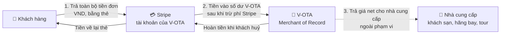

| Việc | Ai chịu trách nhiệm | Trong dự án |
|---|---|---|
| Tên người bán trên sao kê thẻ | V-OTA | Đặt ở Stripe Dashboard (test) |
| Giá khách trả | V-OTA, theo giá niêm yết tại checkout | Backend tính từ catalog; client không gửi số tiền |
| Hoàn tiền | V-OTA quyết định theo chính sách huỷ, gọi Refund API | Mục 9 |
| Tranh chấp (chargeback) | V-OTA | Chỉ ghi log `charge.dispute.created`, xử lý tay |
| Thuế, hoá đơn | V-OTA, trên toàn bộ giá trị đơn | MVP không tách thuế (`hop-dong-tich-hop-backend.md` §7.1 mục 4) |
| Dữ liệu thẻ | Stripe | V-OTA không bao giờ thấy số thẻ (trang nhập thẻ do Stripe host) |
| Trả tiền cho nhà cung cấp | V-OTA | Ngoài phạm vi |

Vì V-OTA là người bán duy nhất nên chỉ cần **một tài khoản Stripe**, không dùng Stripe Connect. Connect dành cho marketplace, nơi nhà cung cấp mới là người bán.

**Chỉ dùng test mode.** Stripe không mở tài khoản cho doanh nghiệp đăng ký tại Việt Nam, nên dự án chạy bằng khoá `sk_test_…` và thẻ test. Không có tiền thật đi qua hệ thống.

---

## 3. Các thành phần tham gia

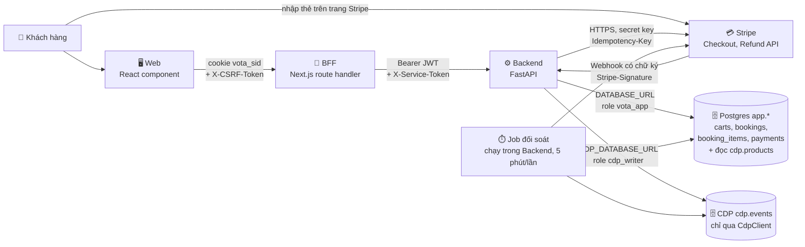

| Thành phần | Làm gì | Không bao giờ làm |
|---|---|---|
| **Khách hàng** | Chọn giỏ, điền liên hệ, nhập thẻ trên trang Stripe, huỷ đơn | — |
| **Web** (React) | Hiện form, chuyển trang sang `checkoutUrl`, hỏi lại trạng thái đơn, hiện lỗi theo `code` | Tự tính tiền, gọi Stripe API, giữ khoá Stripe, coi việc quay về `success_url` là đã trả tiền |
| **BFF** (Next.js) | Như luồng auth: giữ cookie phiên, kiểm CSRF, gắn JWT khi chuyển tiếp | Nhận webhook Stripe |
| **Backend** (FastAPI) | Kiểm giỏ, tạo đơn giữ chỗ, tạo phiên Stripe, xử lý webhook, ghi `purchase`, huỷ đơn, hoàn tiền | Nhận số tiền từ client, lưu số thẻ, xử lý webhook sai chữ ký |
| **Job đối soát** | Quét đơn giữ chỗ quá hạn mà chưa có webhook, đơn đã thu tiền mà chưa xác nhận, lệnh hoàn tiền và lệnh huỷ event CDP còn dở | Đổi trạng thái mà không hỏi lại Stripe |
| **Postgres `app`** | Trạng thái đơn và thanh toán — nguồn sự thật của V-OTA | — |
| **CDP** | Nhận `purchase` khi đơn được xác nhận; đánh dấu huỷ khi khách huỷ | Biết gì về thanh toán |
| **Stripe** | Trang nhập thẻ, xác thực 3DS, chấm điểm gian lận, giữ dữ liệu thẻ, hoàn tiền | Quyết định đơn có được huỷ không |

**Điểm quan trọng nhất:** việc trình duyệt quay về `success_url` **không phải** bằng chứng đã trả tiền, vì ai cũng tự gõ được URL đó. Đơn chỉ chuyển `CONFIRMED` khi Backend nhận webhook `checkout.session.completed` có chữ ký hợp lệ, hoặc khi chính Backend hỏi lại Stripe.

---

## 4. Cách đọc sơ đồ

**Sequence diagram** trả lời câu hỏi *"ai gửi gì cho ai, theo thứ tự nào"*. Đọc từ trên xuống; mũi tên liền là lời gọi, mũi tên nét đứt là phản hồi, mũi tên có dấu `x` là lời gọi thất bại (timeout, lỗi mạng). Khối `alt/else` là rẽ nhánh, `opt` là bước tuỳ chọn, `loop` là lặp, `par/and` là hai việc xảy ra song song.

**Activity diagram** trả lời câu hỏi *"hệ thống quyết định thế nào ở mỗi bước"*. Ký hiệu dùng chung:

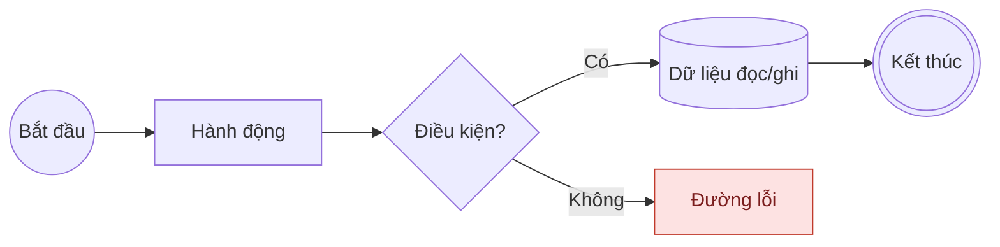

| Ký hiệu | Ý nghĩa |
|---|---|
| Hình tròn `Bắt đầu` / tròn kép `Kết thúc` | Điểm bắt đầu và kết thúc |
| Hình chữ nhật | Hành động cụ thể, bắt đầu bằng động từ |
| Hình thoi | Điều kiện rẽ nhánh, nhãn trên cạnh là giá trị kiểm được |
| Hình trụ | Dữ liệu được tạo, đọc hoặc thay đổi (nối bằng nét đứt) |
| Ô **đỏ** | Đường lỗi: lỗi mạng, dữ liệu sai, hết hạn, không đủ quyền |
| Khung có tiêu đề | Swimlane: ai thực hiện bước đó |
| Cạnh ghi "lặp lại" | Vòng lặp |

Tên trạng thái viết HOA (`PENDING_PAYMENT`) là giá trị trong API; trong database lưu chữ thường (`pending_payment`).

---

## 5. Vòng đời trạng thái

Hệ thống theo dõi **hai** trạng thái riêng: trạng thái **đơn** (`app.bookings.status`) và trạng thái **thanh toán** (`app.payments.status`). Tách ra vì "đã nhận tiền" và "đơn đã xác nhận" là hai việc khác nhau. Ví dụ: Stripe đã thu tiền nhưng CDP đang lỗi, nên chưa ghi được `purchase`. Lúc đó thanh toán là `SUCCEEDED` còn đơn vẫn `PENDING_PAYMENT`; nhờ vậy job hết hạn biết là **không** được huỷ đơn này.

### 5.1. Đơn đặt chỗ — `app.bookings.status`

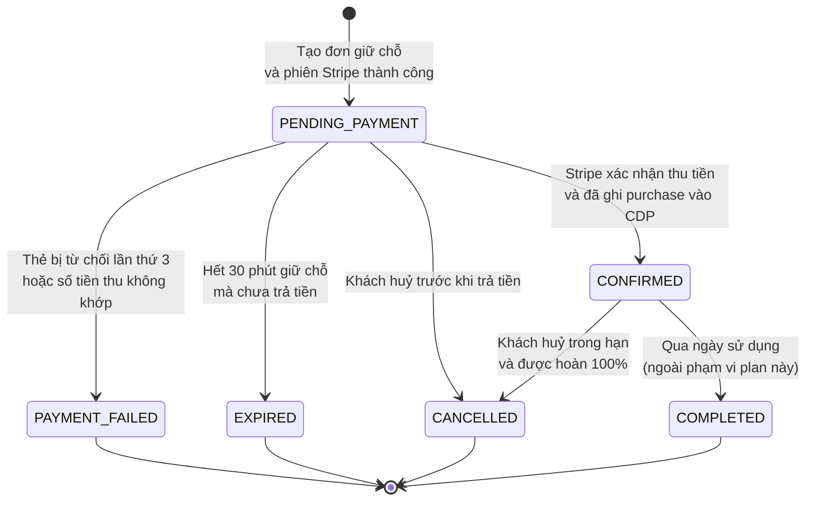

| Trạng thái | Nghĩa | Đang giữ chỗ? | Tiền | Event `purchase` trong CDP | Khách thấy ở `/booking/{ref}` |
|---|---|---|---|---|---|
| `PENDING_PAYMENT` | Đã giữ giá và thành phần đơn, chờ trả tiền đến `holdExpiresAt` | Có | Chưa thu (hoặc vừa thu, đang xác nhận) | Chưa có | Đồng hồ đếm ngược, nút "Tiếp tục thanh toán", "Huỷ đơn" |
| `CONFIRMED` | Đã thu tiền, đơn có hiệu lực | — | Đã thu | Đã ghi | Mã đặt chỗ, tóm tắt chuyến, gợi ý chặng tiếp, nút "Huỷ đơn" nếu còn hạn |
| `PAYMENT_FAILED` | Thanh toán không thành công, đơn đóng | Không | Không thu (hoặc đã hoàn nếu lệch tiền) | Không có | "Thanh toán không thành công", nút "Đặt lại" (đơn nháp mới từ các mục của đơn, giá hiện tại) |
| `EXPIRED` | Hết giờ giữ chỗ, đơn đóng | Không | Không thu | Không có | "Hết thời gian giữ chỗ", nút "Đặt lại" (đơn nháp mới từ các mục của đơn, giá hiện tại) |
| `CANCELLED` | Khách đã huỷ | Không | Không thu, hoặc đã/đang hoàn | Đã huỷ (nếu từng ghi) | "Đã huỷ đơn" và trạng thái hoàn tiền |

### 5.2. Thanh toán — `app.payments.status`

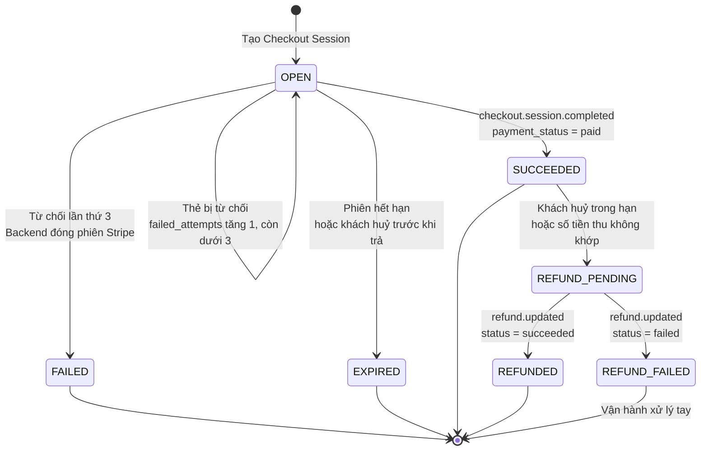

Các cặp trạng thái hợp lệ giữa đơn và thanh toán:

| Đơn | Thanh toán | Khi nào |
|---|---|---|
| `PENDING_PAYMENT` | `OPEN` | Đang chờ khách trả |
| `PENDING_PAYMENT` | `SUCCEEDED` | Đã thu tiền, đang ghi CDP hoặc lưu đơn (thường chỉ vài trăm mili giây; kéo dài khi CDP lỗi) |
| `CONFIRMED` | `SUCCEEDED` | Hoàn tất |
| `PAYMENT_FAILED` | `FAILED` | Từ chối 3 lần |
| `PAYMENT_FAILED` | `REFUND_PENDING` / `REFUNDED` | Thu tiền nhưng số tiền không khớp, đã hoàn tự động |
| `EXPIRED` | `EXPIRED` | Hết giờ giữ chỗ |
| `CANCELLED` | `EXPIRED` | Khách huỷ trước khi trả |
| `CANCELLED` | `REFUND_PENDING` / `REFUNDED` / `REFUND_FAILED` | Khách huỷ sau khi trả |
| `PAYMENT_FAILED` | `REFUND_FAILED` | Hoàn tự động (lệch số tiền, tiền về sau khi đã đóng phiên) nhưng Stripe từ chối hoàn; vận hành xử lý tay |
| `EXPIRED` | `REFUND_PENDING` / `REFUNDED` / `REFUND_FAILED` | Tiền về cho đơn đã hết hạn giữ chỗ (nhánh đỏ "tiền về cho đơn đã đóng" ở mục 6.3), Backend hoàn tự động |

Mọi cặp khác là lỗi dữ liệu; dòng `booking/payment status pairs valid` trong `db/verify.sql` kiểm đúng bảng này.

---

## 6. Case 1 — Đặt chỗ và thanh toán thành công

### 6.1. Sequence

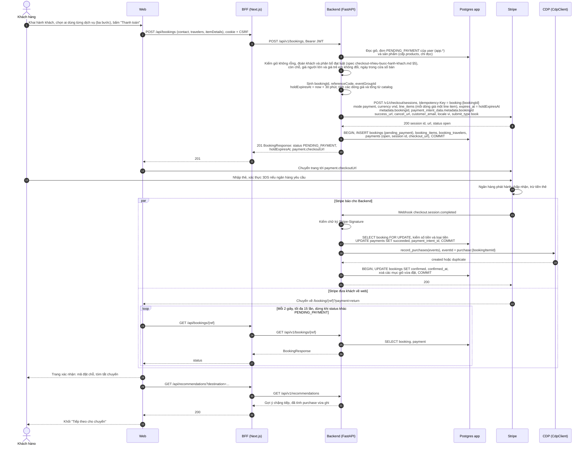

**Giải thích dễ hiểu:**

- **Gọi Stripe trước, ghi database sau.** Stripe lỗi thì chưa có gì trong database để dọn. Database lỗi sau khi Stripe đã tạo phiên thì Backend đóng phiên đó (mục 7.2).
- **`Idempotency-Key`**: nếu mạng chập và thư viện Stripe tự gửi lại yêu cầu, Stripe trả lại đúng phiên đã tạo thay vì tạo phiên thứ hai.
- **Số tiền do Backend tính.** Stripe coi VND là tiền tệ không có số lẻ, nên `amount` gửi sang Stripe chính là số đồng, không nhân 100. Mỗi dòng giá của mỗi mục (người lớn, trẻ em, phòng-đêm, gói) là một line item, và tổng các line item phải bằng tổng đơn trước khi gọi Stripe (spec `checkout-nhieu-buoc-hanh-khach.md` §8.4).
- **`expires_at` của phiên Stripe bằng hạn giữ chỗ.** Hết hạn thì Stripe tự đóng trang thanh toán, khách không trả được nữa. Stripe chỉ cho đặt hạn từ 30 phút đến 24 giờ, vì vậy giữ chỗ tối thiểu 30 phút.
- **Hai luồng song song (`par`)**: webhook và trình duyệt quay về có thể đến theo bất kỳ thứ tự nào. Web vì vậy hỏi lại trạng thái (polling) chứ không tin URL quay về.
- **Ghi `purchase` trước khi xác nhận đơn**, giữ cam kết "đơn thành công mà thiếu event là trạng thái không được phép" (`hop-dong-tich-hop-backend.md` §7.4). Web chỉ gọi `/recommendations` sau khi thấy `CONFIRMED`, nên gợi ý đã đổi ngay (AC-REC-02).
- Hết 15 lần hỏi (30 giây) mà đơn vẫn `PENDING_PAYMENT`: nếu `payment.status` là `SUCCEEDED` thì Web hiện "Đã nhận thanh toán, đang xác nhận đơn" (mục 7.2c); nếu vẫn `OPEN` thì hiện trang giữ chỗ (mục 8).

### 6.2. Activity — tạo đơn giữ chỗ

> **Hai nguồn mục (2026-10-01, FR-BKG-01).** Sơ đồ dưới vẽ nguồn giỏ. Khi request có `draftId`, mọi chỗ ghi "giỏ" là "đơn nháp": Backend đọc `app.booking_drafts` + `booking_draft_items` thay cho `app.carts` + `cart_items`; đơn nháp không tồn tại hoặc không thuộc người gọi thì `404 BOOKING_DRAFT_NOT_FOUND`, quá 30 phút thì `410 BOOKING_DRAFT_EXPIRED` (kiểm sau bước "đang có đơn giữ chỗ", trước các bước kiểm mục); đơn nháp bị xoá trong cùng transaction ghi đơn `PENDING_PAYMENT`, giỏ không bị đụng tới. Khách sạn và vé máy bay chỉ đi qua nguồn đơn nháp vì chúng không vào giỏ. Bộ luật: `docs/spec/booking/dat-truc-tiep-theo-don-nhap.md` §6.

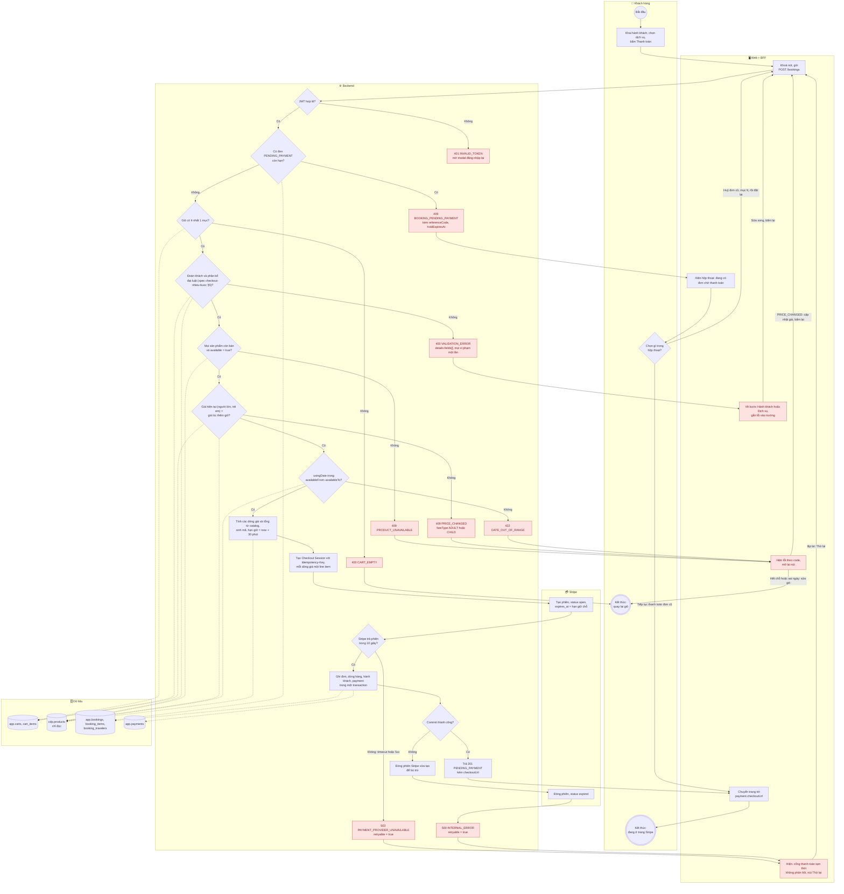

**Thứ tự kiểm khi bấm Thanh toán** (spec `checkout-nhieu-buoc-hanh-khach.md` §8.3): đơn đang giữ chỗ (`409`), giỏ rỗng (`400`), sản phẩm tồn tại (`404`), luật dữ liệu đoàn khách và phân bổ (`400 VALIDATION_ERROR`, mọi vi phạm một lần), rồi từng mục còn bán, giá và ngày (`409`, `409`, `422`), sau cùng mới tới Stripe. Luật dữ liệu được kiểm trước giá để lỗi nhập liệu không bị che bởi lỗi giá, còn thay đổi giá vẫn hiện ngay trước khi khách trả tiền. Vi phạm luật dữ liệu thì không gọi Stripe và không ghi gì.

**Vì sao chặn đơn thứ hai khi đang giữ chỗ:** chống bấm hai lần tạo hai đơn và hai phiên thanh toán, và không để một người khoá nhiều mức giá cùng lúc. Database ép quy tắc này bằng unique index một phần trên `(cdp_user_id) WHERE status = 'pending_payment'`. Nếu đơn cũ đã quá `holdExpiresAt` nhưng webhook hết hạn chưa tới, Backend hỏi lại Stripe để đóng đơn cũ ngay trong request (mục 8.3) rồi mới tạo đơn mới.

### 6.3. Activity — xử lý webhook `checkout.session.completed`

Sơ đồ này dùng chung cho mọi case có tiền về. Các loại webhook khác xử lý ở mục 7.3, 8.3, 9.3.

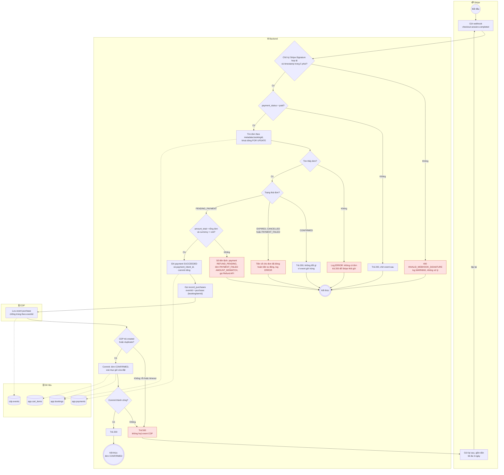

**Vòng lặp:** Stripe gửi lại webhook cho tới khi nhận `2xx`, giãn dần trong tối đa 3 ngày. Job đối soát (mục 8.2) cũng tự chạy lại đường xác nhận sau 5 phút, nên đơn không phải đợi lâu nếu CDP hồi phục sớm.

**Vì sao ghi `payment SUCCEEDED` trong một commit riêng trước khi gọi CDP:** để nếu CDP lỗi, database vẫn biết tiền đã về. Web hiện đúng "Đã nhận thanh toán, đang xác nhận", và job hết hạn giữ chỗ không huỷ nhầm đơn này.

**Vì sao ở đây commit lỗi thì *không* huỷ event CDP**, khác với bù trừ ở checkout cũ (`hop-dong-tich-hop-cdp.md` §5): tiền đã thu nên đơn chắc chắn phải được xác nhận. Nếu huỷ event rồi Stripe gửi lại webhook, CDP trả `duplicate` và event **vẫn ở trạng thái huỷ** (`hop-dong-tich-hop-cdp.md` §3.3 mục 4). Kết quả là đơn `CONFIRMED` nhưng gợi ý không bao giờ thấy chuyến này. Giữ event và thử lại commit thì hai bên sớm muộn cũng khớp (NFR-REL-02).

---

## 7. Case 2 — Thanh toán thất bại

"Thanh toán thất bại" gồm bốn trường hợp khác nhau. Chúng có thể cùng dẫn tới việc khách chưa trả được tiền, nhưng cách hiển thị, cách thử lại và cách ghi log khác nhau:

| Loại | Ví dụ | Ai phát hiện | Đơn | Khách thấy | Thử lại |
|---|---|---|---|---|---|
| **Nghiệp vụ** — thẻ bị từ chối | `card_declined`, `insufficient_funds`, `expired_card`, `incorrect_cvc`, xác thực 3DS thất bại | Ngân hàng phát hành, qua Stripe | Giữ `PENDING_PAYMENT`; lần thứ 3 → `PAYMENT_FAILED` | Lỗi hiện ngay trên trang Stripe; quay về V-OTA thấy lý do trong `payment.failureReason` | Thử thẻ khác trong cùng phiên, tối đa 3 lần |
| **Kỹ thuật phía Stripe** | Timeout, 5xx khi tạo phiên | Backend | Không tạo đơn | "Cổng thanh toán tạm thời không phản hồi" | Nút Thử lại (`retryable: true`) |
| **Kỹ thuật phía V-OTA** | Database lỗi sau khi tạo phiên; CDP lỗi khi xử lý webhook | Backend | Không tạo đơn / giữ `PENDING_PAYMENT` với payment `SUCCEEDED` | "Lỗi hệ thống, thử lại" / "Đã nhận thanh toán, đang xác nhận" | Khách bấm Thử lại / hệ thống tự thử lại, khách không phải làm gì |
| **Khách bỏ ngang** | Bấm "Quay lại" trên trang Stripe | — | Giữ `PENDING_PAYMENT` | Trang giữ chỗ | Không phải lỗi, xem mục 8 |

### 7.1. Sequence — thẻ bị từ chối, thử lại, đủ 3 lần

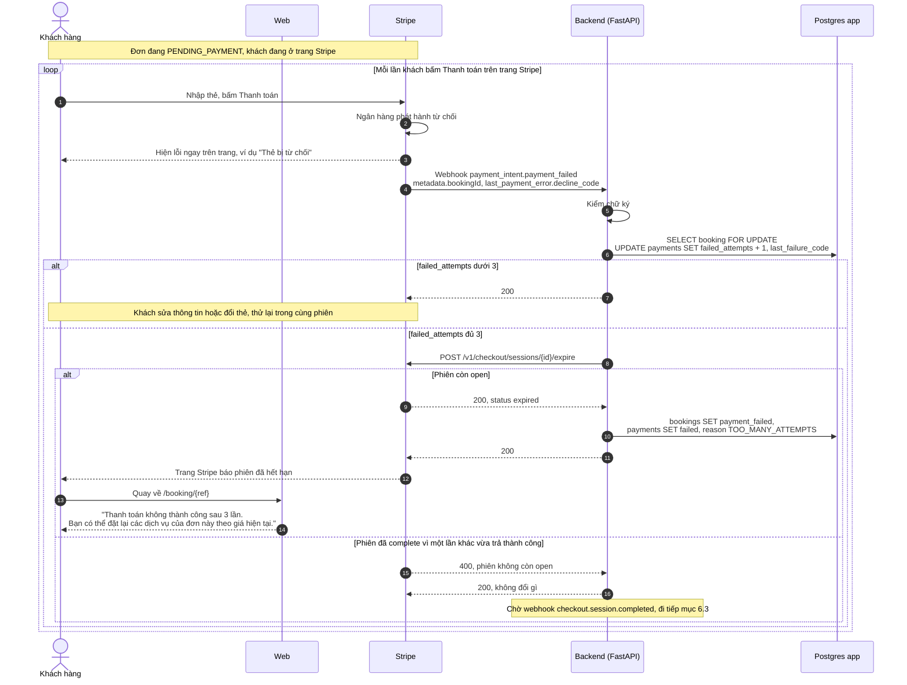

**Vì sao giới hạn 3 lần:** kẻ gian hay dùng trang thanh toán của các website để thử hàng loạt số thẻ ăn cắp (*card testing*). Đóng phiên sau 3 lần từ chối làm việc này tốn công hơn. Stripe Radar cũng chặn riêng ở phía Stripe.

**Vì sao đếm bằng webhook, không đếm ở Web:** Web không thấy trang Stripe, và con số do client đếm có thể bị sửa.

### 7.2. Sequence — lỗi kỹ thuật

**a) Stripe không phản hồi khi tạo phiên**

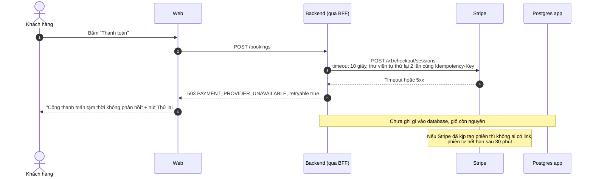

**b) Database lỗi sau khi đã tạo phiên**

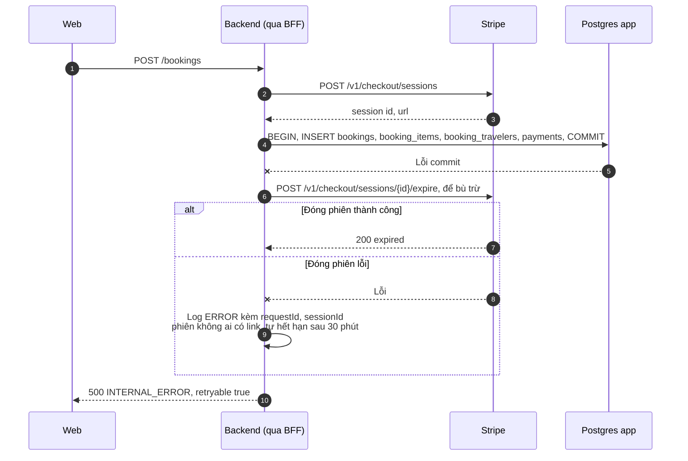

**c) CDP lỗi khi xử lý webhook — tiền đã thu**

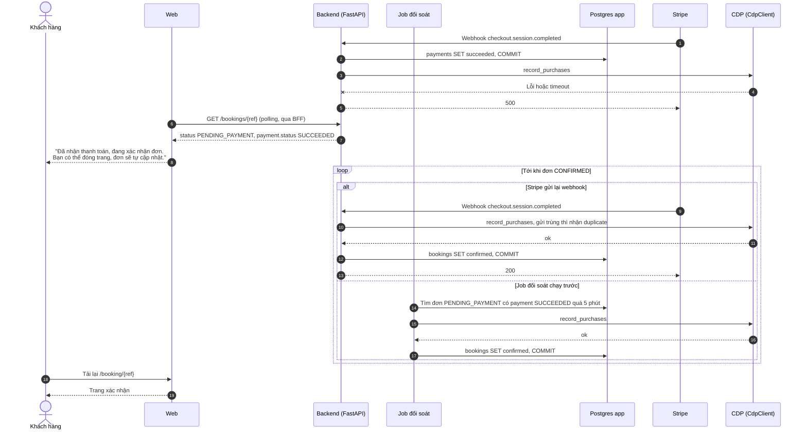

### 7.3. Activity — thẻ bị từ chối

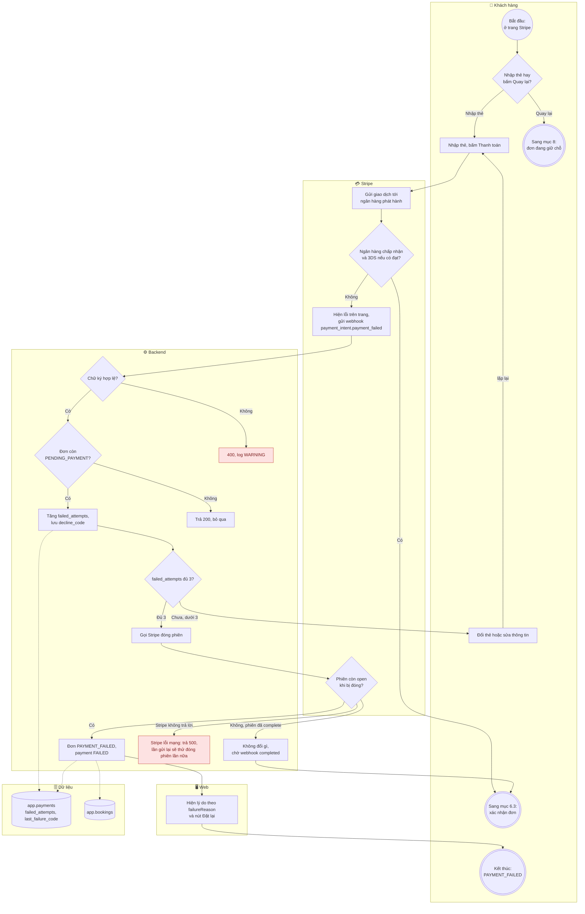

---

## 8. Case 3 — Trạng thái giữ chỗ

| Quy tắc | Giá trị | Lý do |
|---|---|---|
| Thời gian giữ | 30 phút từ lúc tạo đơn (`BOOKING_HOLD_MINUTES`) | Stripe chỉ cho phiên Checkout hết hạn sau 30 phút đến 24 giờ. 30 phút đủ để nhập thẻ mà không khoá giá quá lâu |
| Giữ những gì | Giá và thành phần đơn tại lúc tạo. Phiên Stripe hết hạn cùng lúc với đơn | Khách trả đúng số tiền đã thấy |
| Không giữ gì | **Không trừ tồn kho.** Hệ thống không có bảng tồn kho, lịch trống chỉ là `attributes.availability` đọc-only | Tồn kho thời gian thực ngoài phạm vi (`project-brief.md` §4.2) |
| Số đơn giữ cùng lúc | Tối đa **1** đơn `PENDING_PAYMENT` mỗi người dùng | Chống bấm hai lần; không để một người khoá nhiều mức giá |
| Giỏ hàng | Giữ nguyên trong lúc giữ chỗ. Chỉ xoá các mục đã đặt khi đơn `CONFIRMED` (kể cả bản chép của tour và tiện ích khi đơn tạo từ đơn nháp) | Hết hạn hay thất bại thì tour, trải nghiệm và tiện ích vẫn còn trong giỏ; khách sạn và vé máy bay không được giữ, khách bấm "Đặt lại" ở trang đơn để có đơn nháp mới theo giá hiện tại |
| Đơn nháp của Đặt ngay | Sống 30 phút (`BOOKING_DRAFT_TTL_MINUTES`), tính từ lúc bấm Đặt ngay; bị xoá khi tạo đơn giữ chỗ | Đồng hồ này tách khỏi đồng hồ giữ chỗ: 30 phút để điền thông tin, rồi 30 phút nữa để trả tiền trên Stripe |
| Đồng hồ đếm ngược | Web đếm theo `holdExpiresAt` do server trả, không theo giờ máy người dùng | Giờ máy người dùng có thể sai |
| Nguồn sự thật về hết hạn | Stripe: `expires_at` của phiên và webhook `checkout.session.expired`. Job đối soát hỏi lại Stripe trước khi đổi trạng thái | Tránh đóng nhầm một đơn khách vừa trả ở giây cuối |

### 8.1. Sequence — quay lại tiếp tục thanh toán, và bấm thanh toán lần nữa khi đang giữ chỗ

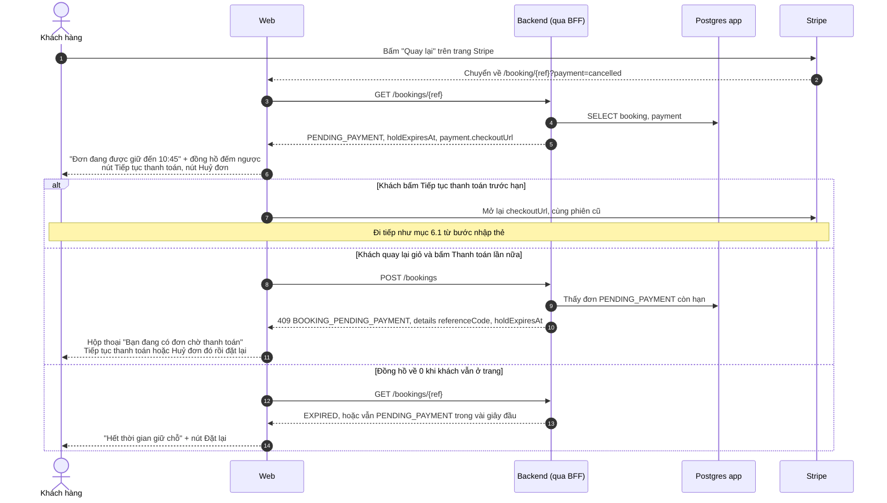

`checkoutUrl` chỉ có trong response khi thanh toán còn `OPEN`. Đơn ở trạng thái khác trả `checkoutUrl: null`, nên Web không bao giờ đưa khách tới một phiên đã đóng.

### 8.2. Sequence — hết hạn giữ chỗ

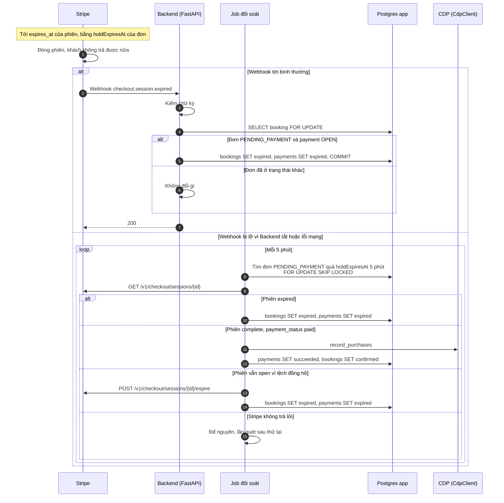

`FOR UPDATE SKIP LOCKED` để khi chạy nhiều worker Backend, mỗi đơn chỉ do một worker xử lý.

**Khác biệt so với sơ đồ (đã triển khai):** job không chờ thêm 5 phút ân hạn; đơn được chọn ngay khi quá `holdExpiresAt` hoặc khi thanh toán đã `SUCCEEDED` mà đơn chưa xác nhận. An toàn vì mỗi bước khoá dòng đơn (`FOR UPDATE`) trước khi đổi trạng thái và mọi bước đều idempotent: nếu webhook và job cùng xử lý một đơn thì bên đến sau thấy trạng thái đã đổi và không làm gì, `record_purchases` gửi trùng nhận `duplicate`, Refund API dùng cùng `Idempotency-Key`. Chu kỳ quét cấu hình bằng `BOOKING_RECONCILE_INTERVAL_SECONDS` (mặc định 300; `0` tắt job, chỉ dùng cho test). Cùng vòng quét, job còn làm lại ba việc dở dang: xác nhận đơn đã thu tiền nhưng chưa ghi được CDP (mục 7.2c), gọi lại Refund API cho payment `REFUND_PENDING` chưa có `refund_id`, và gọi lại `cancel_purchases` cho đơn huỷ chưa có `purchase_events_cancelled_at` (mục 9).

### 8.3. Activity — vòng đời một đơn giữ chỗ

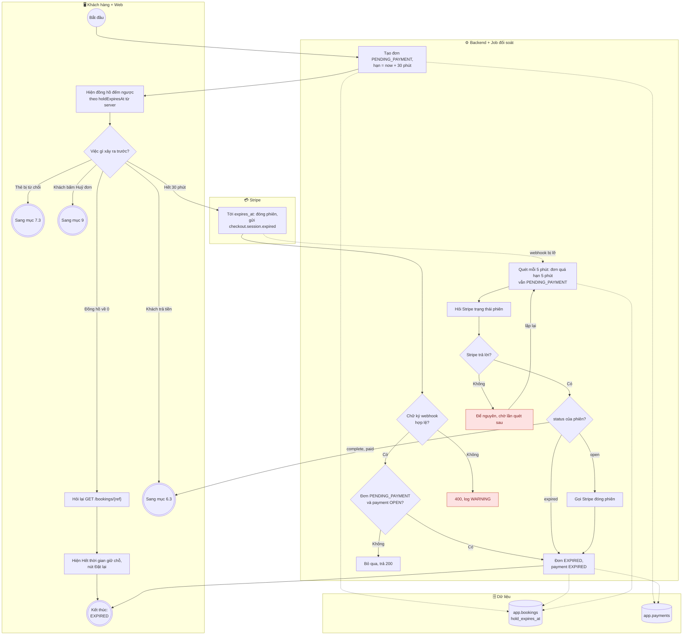

---

## 9. Case 4 — Khách huỷ booking

Chính sách huỷ (Q5, đã chốt — FR-BKG-07). Huỷ **cả đơn**, không huỷ từng mục.

| Trạng thái đơn lúc bấm huỷ | Điều kiện | Kết quả | Tiền |
|---|---|---|---|
| `PENDING_PAYMENT` | Luôn cho huỷ | `CANCELLED`, đóng phiên Stripe | Chưa thu nên không hoàn |
| `CONFIRMED` | Trước `cancellableUntil` = 00:00 giờ Việt Nam của ngày liền trước `usingDate` sớm nhất trong đơn | `CANCELLED`, huỷ event `purchase` trên CDP | Hoàn 100% qua Stripe |
| `CONFIRMED` | Từ `cancellableUntil` trở đi | `409 BOOKING_NOT_CANCELLABLE`, `reason: TOO_LATE` | Không hoàn |
| `CANCELLED` | — | `200`, trả lại đơn như cũ (huỷ lặp lại không làm gì thêm) | Không hoàn thêm |
| `EXPIRED`, `PAYMENT_FAILED` | — | `409 BOOKING_NOT_CANCELLABLE`, `reason: NOT_ACTIVE` | — |

Ví dụ: đơn có phòng nhận ngày 15/10 và vé tham quan ngày 16/10. `usingDate` sớm nhất là 15/10, nên `cancellableUntil` là 00:00 ngày 14/10 (giờ Việt Nam). Huỷ lúc 23:59 ngày 13/10 thì được hoàn đủ; huỷ lúc 08:00 ngày 14/10 thì không.

### 9.1. Sequence — huỷ khi chưa thanh toán

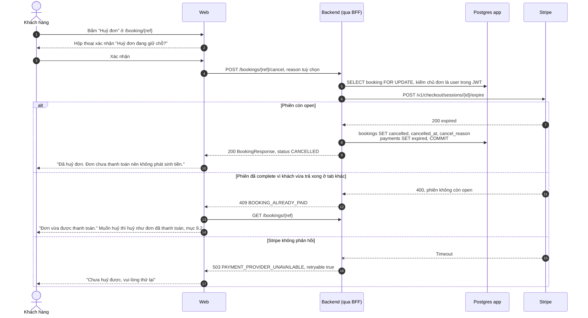

**Vì sao phải đóng phiên Stripe được thì mới ghi `CANCELLED`:** nếu ghi `CANCELLED` mà phiên vẫn mở, khách (hoặc tab khác) vẫn trả tiền được cho một đơn đã huỷ, và hệ thống phải hoàn tiền tự động (nhánh đỏ ở mục 6.3). Đóng phiên trước thì trường hợp đó không xảy ra.

### 9.2. Sequence — huỷ sau khi đã thanh toán, có hoàn tiền

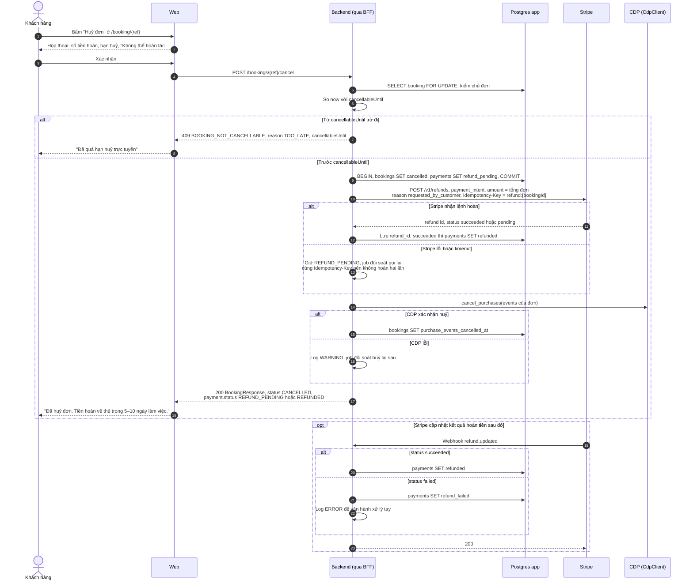

**Giải thích dễ hiểu:**

- **Ghi `CANCELLED` + `REFUND_PENDING` trước khi gọi Stripe.** Database lúc này là bản ghi bền của ý định "phải hoàn tiền". Backend có chết giữa chừng thì job đối soát vẫn thấy `REFUND_PENDING` chưa có `refund_id` và gọi hoàn tiếp.
- **Không hoàn hai lần:** cùng `Idempotency-Key` thì Stripe trả lại lệnh hoàn cũ. `Idempotency-Key` chỉ có hiệu lực 24 giờ, nhưng đây là hoàn toàn bộ, nên lần hoàn thứ hai sau 24 giờ cũng bị Stripe từ chối vì khoản thanh toán đã được hoàn hết. Trước khi gọi lại, job vẫn liệt kê refund của `payment_intent` để chắc chắn.
- **Huỷ event `purchase`** để Recommendation không còn coi chuyến này là chuyến sắp đi (`hop-dong-tich-hop-cdp.md` §3.3 mục 3). CDP không xoá event, chỉ đánh dấu huỷ.
- **Không khôi phục giỏ hàng** sau khi huỷ đơn đã thanh toán; khách muốn đặt lại thì thêm vào giỏ hoặc Đặt ngay như bình thường. Huỷ đơn **chưa** thanh toán: tour và tiện ích của đơn vẫn nằm trong giỏ (chúng chỉ bị gỡ khi đơn `CONFIRMED`), khách sạn và vé máy bay thì không.

### 9.3. Activity — khách huỷ

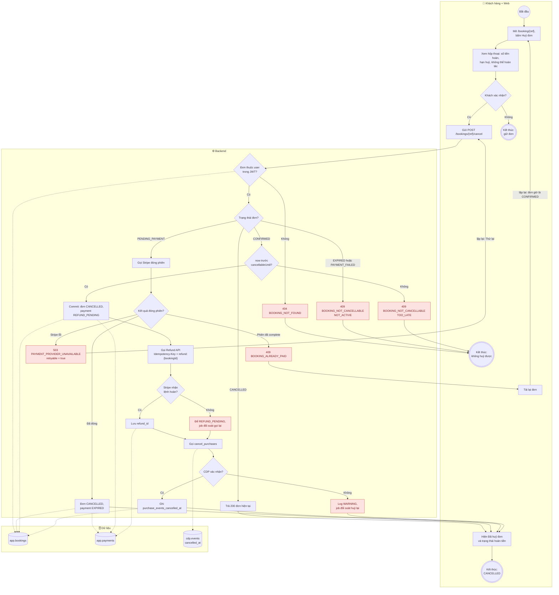

---

## 10. Bảng lỗi và cách hiển thị

### 10.1. Mã lỗi của API

Mã có ghi **(mới)** là năm mã thêm vào `schemas/common.yaml` cùng đợt triển khai Stripe (contract 1.5.0); tất cả đều có trong `hop-dong-tich-hop-backend.md` §8.2.

| HTTP | Mã | Loại | Khi nào | `retryable` | Web hiển thị |
|---:|---|---|---|---|---|
| 400 | `CART_EMPTY` | Nghiệp vụ | Tạo đơn khi giỏ rỗng | false | Chuyển `/cart` |
| 404 | `BOOKING_DRAFT_NOT_FOUND` | Nghiệp vụ | `draftId` không tồn tại, đã dùng, hoặc của người khác | false | "Không tìm thấy phiên thanh toán này" |
| 410 | `BOOKING_DRAFT_EXPIRED` | Nghiệp vụ | Đơn nháp quá 30 phút | false | Màn hình "Phiên thanh toán đã hết hạn" |
| 400 | `VALIDATION_ERROR` | Dữ liệu sai | Thiếu `contact`, `cartItemId` lạ | false | Gắn lỗi vào trường tương ứng |
| 401 | `INVALID_TOKEN`, `TOKEN_EXPIRED` | Không đủ quyền | Phiên hết hạn | false | Modal đăng nhập lại, giữ nguyên form (`hop-dong-tich-hop-frontend.md` §7) |
| 404 | `BOOKING_NOT_FOUND` | Không đủ quyền | Đơn không tồn tại hoặc của người khác | false | "Không tìm thấy đơn đặt chỗ này" |
| 409 | `PRODUCT_UNAVAILABLE` | Nghiệp vụ | Hết chỗ lúc tạo đơn | false | Banner "{tên} vừa hết chỗ" + link Quay lại giỏ |
| 409 | `PRICE_CHANGED` | Nghiệp vụ | Giá đổi so với lúc thêm giỏ | false | Banner giá cũ → giá mới + "Cập nhật và tiếp tục" |
| 422 | `DATE_OUT_OF_RANGE` | Dữ liệu sai | Ngày ngoài cửa sổ bán | false | Lỗi dưới ô ngày |
| 409 | `BOOKING_PENDING_PAYMENT` **(mới)** | Nghiệp vụ | Đã có đơn giữ chỗ còn hạn | false | Hộp thoại: Tiếp tục thanh toán / Huỷ đơn đó |
| 409 | `BOOKING_ALREADY_PAID` **(mới)** | Nghiệp vụ | Huỷ đơn chưa trả nhưng Stripe vừa thu tiền | false | Tải lại đơn, báo "Đơn vừa được thanh toán" |
| 409 | `BOOKING_NOT_CANCELLABLE` **(mới)** | Nghiệp vụ | Quá hạn huỷ (`TOO_LATE`) hoặc đơn đã đóng (`NOT_ACTIVE`) | false | "Đã quá hạn huỷ trực tuyến (hạn: …)" / "Đơn này không còn hiệu lực" |
| 503 | `PAYMENT_PROVIDER_UNAVAILABLE` **(mới)** | Kỹ thuật, phía Stripe | Stripe timeout hoặc 5xx khi tạo phiên, đóng phiên | true | "Cổng thanh toán tạm thời không phản hồi" + Thử lại |
| 500 | `INTERNAL_ERROR` | Kỹ thuật, phía V-OTA | Database lỗi | true | `ErrorState` + Thử lại |
| — | `NETWORK_ERROR` (mã giả phía client) | Kỹ thuật, mạng | Không có response | true | "Mất kết nối" + Thử lại. Bấm lại `POST /bookings` an toàn: nếu lần trước đã tạo đơn thì nhận `409 BOOKING_PENDING_PAYMENT` và tiếp tục đơn đó |
| 400 | `INVALID_WEBHOOK_SIGNATURE` **(mới)** | Bảo mật | Webhook sai chữ ký | — | Chỉ Stripe nhận; log `WARNING`, không đổi dữ liệu |

### 10.2. Lý do thanh toán thất bại — `payment.failureReason`

Stripe tự hiện lỗi trên trang của Stripe. Trường này để trang `/booking/{ref}` giải thích khi khách quay về.

| `failureReason` | Nguồn từ Stripe | Loại | Web hiển thị |
|---|---|---|---|
| `CARD_DECLINED` | `card_declined`, `generic_decline` | Nghiệp vụ | "Thẻ bị từ chối. Hãy thử thẻ khác." |
| `INSUFFICIENT_FUNDS` | `insufficient_funds` | Nghiệp vụ | "Thẻ không đủ số dư." |
| `EXPIRED_CARD` | `expired_card` | Nghiệp vụ | "Thẻ đã hết hạn." |
| `INCORRECT_CVC` | `incorrect_cvc` | Dữ liệu sai | "Mã CVC không đúng." |
| `AUTHENTICATION_FAILED` | `payment_intent_authentication_failure` (3DS) | Nghiệp vụ | "Xác thực với ngân hàng không thành công." |
| `PROCESSING_ERROR` | `processing_error` | Kỹ thuật | "Ngân hàng xử lý lỗi. Thử lại sau ít phút." |
| `TOO_MANY_ATTEMPTS` | Backend đếm đủ 3 lần | Nghiệp vụ | "Thanh toán không thành công sau 3 lần. Bạn có thể đặt lại các dịch vụ của đơn này theo giá hiện tại." |
| `AMOUNT_MISMATCH` | Backend kiểm ở webhook | Kỹ thuật | "Có lỗi khi xác nhận thanh toán. Tiền đã được hoàn tự động." |

### 10.3. Ghi log

| Tình huống | Mức | Nội dung (không có số thẻ, email, token) |
|---|---|---|
| Webhook sai chữ ký | `WARNING` | `requestId`, IP nguồn |
| Thẻ bị từ chối | `INFO` | `bookingId`, `decline_code`, `failed_attempts` |
| Stripe timeout/5xx | `WARNING` | `requestId`, thao tác, mã HTTP |
| CDP lỗi khi xác nhận hoặc huỷ event | `WARNING` | `bookingId`, `requestId` |
| Tiền về cho đơn đã đóng, số tiền lệch, hoàn tiền thất bại, đóng phiên bù trừ thất bại | `ERROR` | `bookingId`, `checkout_session_id`, `payment_intent_id` |
| Tranh chấp `charge.dispute.created` | `ERROR` | `payment_intent_id`, số tiền |

---

## 11. Checklist trước khi chốt

| Câu hỏi | Trả lời trong tài liệu |
|---|---|
| Feature bắt đầu và kết thúc ở đâu? | Mục 1: bắt đầu ở nút "Thanh toán", kết thúc ở một trong 4 trạng thái cuối; phần không bao gồm liệt kê rõ |
| Happy path đã rõ chưa? | Mục 6.1 (sequence) và 6.2, 6.3 (activity) |
| Có đủ actor và hệ thống liên quan chưa? | Mục 3: Khách hàng, Web, BFF, Backend, Job đối soát, Postgres, CDP, Stripe. Không có Admin: RBAC ngoài phạm vi (`hop-dong-tich-hop-auth.md` §1.3); việc tay của vận hành chỉ xuất hiện ở log `ERROR` |
| Mỗi bước đã có owner chưa? | Mọi activity có swimlane; mọi sequence có participant riêng cho từng thành phần |
| Điều kiện ở decision node có cụ thể chưa? | Mọi hình thoi kiểm một giá trị: `failed_attempts đủ 3`, `amount_total = tổng đơn`, `now trước cancellableUntil`, `payment_status = paid`… |
| Đã xử lý lỗi, timeout, retry, cancel chưa? | Timeout Stripe (7.2a), database lỗi (7.2b), CDP lỗi (7.2c), webhook lỡ (8.2), webhook trùng (6.3), huỷ (9), vòng thử lại có giới hạn (7.1) |
| Phân biệt được lỗi nghiệp vụ và lỗi kỹ thuật không? | Bảng đầu mục 7, cột "Loại" ở mục 10.1 và 10.2 |
| Trạng thái dữ liệu có được cập nhật đúng không? | Mục 5: hai máy trạng thái và bảng các cặp trạng thái hợp lệ; mỗi sequence ghi rõ `SET` trạng thái nào |
| Có bước nào gom quá nhiều logic không? | Webhook tách riêng (6.3); job đối soát tách riêng (8.2); huỷ tách theo trạng thái trước/sau thanh toán (9.1, 9.2) |
| Người không viết code có đọc được không? | Mỗi sơ đồ có phần "Giải thích dễ hiểu" hoặc bảng quy tắc bằng lời |
| Có đường nối chéo, vòng lặp hoặc nhánh vô định hướng không? | Mọi vòng lặp có nhãn "lặp lại" và điều kiện dừng (3 lần, hết hạn, Stripe dừng gửi sau 3 ngày). Mọi nhánh kết thúc ở một nút Kết thúc hoặc chuyển sang mục khác được ghi rõ |
