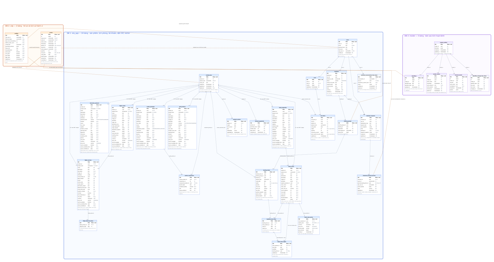

# Toàn bộ schema Database — một sơ đồ duy nhất

Ngày 17/09/2026. Bản thiết kế đề xuất, chưa chạy migration.

**[Mở sơ đồ có phóng to và kéo để xem](schema-database-toan-bo.html)** · **[SVG đầy đủ](diagrams/schema-database-toan-bo.svg)**

Sơ đồ gồm đúng **3 vùng database, 31 bảng**, thể hiện cột, kiểu dữ liệu, PK/FK/UK và nullable:

| Database | Bảng |
|---|---|
| `ota_app` — 24 bảng | `catalog_keys`; `hotel_properties`, `hotel_rooms`, `hotel_room_prices`, `hotel_room_nights`; `flight_routes`, `flight_services`, `flight_observed_dates`; `attraction_products`; `combo_packages`, `combo_components`; `golf_products`; `users`, `carts`, `cart_items`; `bookings`, `booking_groups`, `booking_items`, `booking_room_stays`; `checkout_requests`, `checkout_purchase_journal`; `product_vectors`, `product_popularity`; `assistant_conversations` |
| `cdp` — 2 bảng | `profiles`, `events` |
| `insider` — 5 bảng | `insider_profiles`, `identifiers`, `insider_events`, `channel_events`, `identifier_changes` |

- **Nét liền:** 34 quan hệ FK trong cùng database. Nhãn `1`, `0..1`, `0..N`, `1..N` ghi số lượng quan hệ ở mỗi đầu.
- **Nét đứt:** 7 quan hệ tham chiếu ID, không có FK. Trong đó quan hệ `cdp.profiles`–`cdp.events` cũng chỉ dùng giá trị `cdp_user_id`, vì có event trước khi có profile.
- Hai bảng đánh dấu **[tùy chọn]**: `assistant_conversations` nếu chọn lưu hội thoại trong Postgres, và `identifier_changes` để theo dõi thay đổi định danh. Tổng 31 bao gồm hai bảng này; bỏ cả hai thì còn 29.
- Bảy loại sản phẩm có bảng riêng và đầy đủ cột dùng chung ngay trên bảng. `catalog_keys` chỉ là registry ID/loại/nguồn, không thay thế các bảng sản phẩm.
- Không có `demo_accounts`.
- Phòng: một giá/room trong `hotel_room_prices`; mỗi đêm một dòng `hotel_room_nights`. Đặt đêm nào khóa đêm đó; cửa sổ 30 đêm trượt theo ngày Việt Nam.

Đọc [thiết kế chi tiết](thiet-ke-schema-3-service-chi-tiet.md) để xem các CHECK, composite FK, ràng buộc liên bảng và transaction. Sơ đồ không thay thế DDL thực thi. [Review hợp đồng](ra-soat-hop-dong-2026-09-17.md) liệt kê các phần API cần sửa.

Nguồn chỉnh sửa: [Graphviz DOT](diagrams/schema-database-toan-bo.dot), [mô tả bảng và quan hệ JSON](diagrams/schema-database-toan-bo.json), [script dựng sơ đồ](diagrams/render-full-schema.cjs). Script cần Node.js và package `@viz-js/viz`; có thể trỏ thư mục package bằng biến `SCHEMA_NODE_MODULES`.
