# Thiết kế chi tiết 3 service — từng loại sản phẩm và lịch phòng 30 đêm

> **[Xem toàn bộ schema trong một ERD duy nhất](schema-database-toan-bo.html)** — 3 vùng database, 31 bảng, đầy đủ cột và quan hệ. Các sơ đồ bên dưới dùng để đọc sâu từng phần.

**Ngày:** 17/09/2026. **Trạng thái:** bản thiết kế để triển khai, chưa phải schema đã migrate.  
**Đọc cùng:** [kết quả review hợp đồng](ra-soat-hop-dong-2026-09-17.md).  
**Thay đổi theo người dùng:** giá phòng cố định, availability theo đêm, đặt đêm nào khóa đêm đó, cửa sổ 30 đêm trượt; **bỏ bảng `demo_accounts`**.

**Có đúng 3 database:** `ota_app`, `cdp`, `insider`. Các khối còn lại là bảng bên trong chúng. Xem [giải thích DB gốc và luồng truyền dữ liệu](ba-database-va-luong-du-lieu.md) trước khi đọc các ERD.

## 1. Quy ước của bản vẽ

- Có **7 bảng sản phẩm cụ thể**, không dùng một bảng `products` chứa toàn bộ nghiệp vụ trong JSON.
- `catalog_keys` chỉ đăng ký **ID + loại + nguồn** để event/vector/giỏ có cùng hệ định danh. Nó không lưu giá, phòng, tuyến, vé hay khả dụng. Mỗi ID thuộc đúng **một** trong 7 bảng.
- `v_catalog` là **VIEW / projection API**, không phải bảng sản phẩm thứ tám. Search và API dùng nó để giữ payload `ProductSummary` thống nhất.
- PK: khóa chính; FK: khóa ngoại trong cùng DB; UK: duy nhất; `?`: nullable. Các quan hệ xuyên service chỉ là ID, không FK.
- Taxonomy API vẫn có 5 giá trị. `product_kind` trong DB có 7 giá trị: `HOTEL_PROPERTY`, `HOTEL_ROOM`, `FLIGHT_ROUTE`, `FLIGHT_SERVICE`, `ATTRACTION`, `COMBO`, `GOLF`.
- Các sơ đồ sau là **đề xuất đích đến**. Phần CDP mô tả hình dạng hợp đồng local `0f630a2`, có ghi riêng đề xuất đổi tiền sang số nguyên; Insider là thiết kế theo handbook, chưa có hợp đồng riêng đã nghiệm thu.

## 2. Tổng thể: ai gọi ai, dữ liệu ở đâu

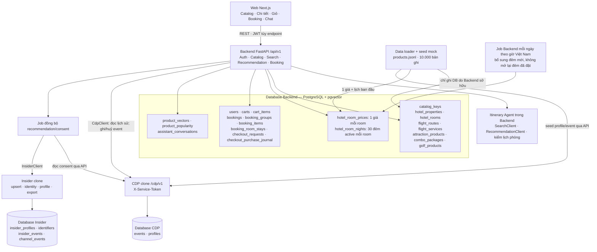

Web không gọi CDP/Insider. Agent nằm trong Backend, không phải service thứ tư và không có DB catalog riêng. Dữ liệu mẫu tài khoản nằm trong `users`; không có `demo_accounts` hoặc bảng persona thay thế.

## 3. Từ 10.000 dòng JSONL tới đúng bảng

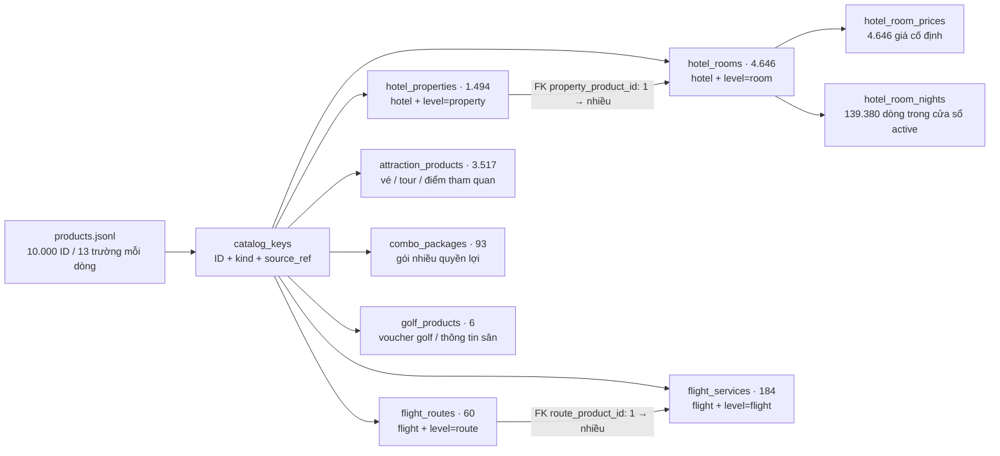

### 3.1 ID và các cột dùng chung

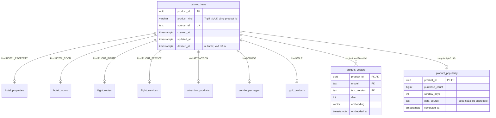

Mỗi nhánh `0..1` là tùy chọn riêng lẻ, nhưng tổng cộng **đúng một subtype/ID**. Triển khai bằng FK composite `(product_id, product_kind)` tới `catalog_keys`, cột `product_kind` có CHECK hằng số tại mỗi subtype, cộng constraint trigger deferred kiểm đúng một subtype trước COMMIT. Không chỉ viết quy tắc trong comment rồi bỏ kiểm tra.

Các cột **C** dưới đây tồn tại trong **từng bảng** của 7 loại; không có một bảng dữ liệu sản phẩm chung chứa chúng:

| Cột C | Kiểu | Nguồn / quy tắc |
|---|---|---|
| `product_id` | uuid PK, FK | Giữ nguyên UUID từ file, không sinh lại |
| `product_kind` | varchar NOT NULL | CHECK theo loại bảng; không phải taxonomy công khai |
| `name`, `destination` | text NOT NULL | Nguyên bản từ JSONL |
| `description` | text nullable | Nguyên bản; API detail có thể đổi null thành chuỗi rỗng theo contract |
| `image_url` | text nullable | Ảnh chính |
| `attributes` | jsonb NOT NULL | Giữ mọi khóa nguồn, false, mảng/object; cột typed là projection do loader cập nhật cùng transaction |

Các bảng **không phải room** có thêm snapshot nguồn: `unit_price bigint?`, `currency varchar(3)='VND'`, `price_unit varchar='UNKNOWN'`, `source_available boolean`, `source_available_from date?`, `source_available_to date?`. `hotel_rooms` lấy **giá vận hành duy nhất** từ `hotel_room_prices`. File JSONL được giữ nguyên như nguồn nhập; `attributes.pricesByDate` cũ không dùng làm giá vận hành sau khi áp quy tắc mock.

Không sửa `attributes` để giả vờ giá mock là giá nhà cung cấp hiện tại. Adapter giá phòng trả `pricingMode=MOCK_FIXED` theo đề xuất §9; metadata nguồn vẫn giữ nguyên. Trường mới của API không đồng nghĩa thêm trường vào file JSONL.

### 3.2 Khách sạn và hạng phòng — hai đối tượng khác nhau

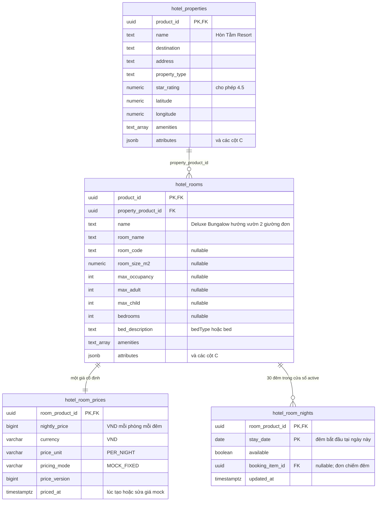

**Ví dụ ID thật từ file:**

- Khách sạn **Hòn Tằm Resort**: `bebec426-afc3-548d-a2ca-193e21fd3b37`.
- Hạng phòng **Hòn Tằm Resort - Deluxe Bungalow hướng vườn 2 giường đơn**: `b6a1a7c0-5cf8-57c9-a008-67ec054d11d9`, FK tới khách sạn trên.
- Giá nguồn hiện tại của phòng là **2.219.215 VND**. Có thể dùng làm giá seed mock cố định; đây không phải báo giá trực tiếp hôm nay của Hòn Tằm.

`hotel_properties` là cơ sở; `hotel_rooms` là **hạng phòng bán trong demo**, không phải phòng vật lý số 101/102. Theo cách mock đã mô tả, mỗi hạng đại diện 1 đơn vị tồn mỗi đêm. Giá hiển thị “từ …” của khách sạn được lấy từ các room con; không cho đặt khách sạn cha, không cộng giá cha với con. 243 cơ sở chưa có room con chưa có hàng để checkout.

### 3.3 Tuyến bay và chuyến bay cụ thể

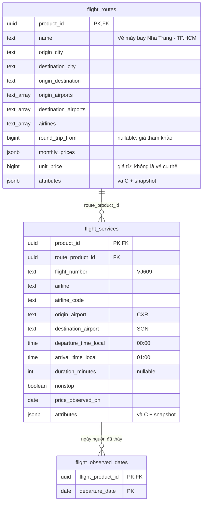

Tuyến thật `0ccbb0e7-4c4b-5c2f-a9f9-7b939cc61bdd`; chuyến **VietJet Air VJ609** `21ff77cb-a25b-54c1-8646-f646f70c6859`. `datesSeen` là 18/09, 26/09, 07/10, 11/10/2026. Không suy ra chuyến bay có vào mọi ngày giữa 18/09 và 11/10. `priceObservedAt` hiện là ngày, không tự thêm giờ giả. Chuyến qua đêm cần xác định arrival date offset từ căn cứ đủ rõ; giờ về nhỏ hơn giờ đi không tự chứng minh dữ liệu sai.

`flight_observed_dates` chỉ là ngày được quan sát, **không phải bảng tồn ghế**. Phương án 30 đêm của phòng chưa mở rộng sang vé máy bay.

### 3.4 Vé/tour tham quan, combo và golf

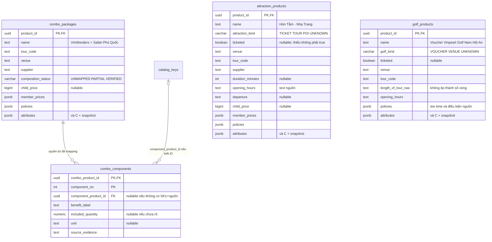

| Loại | Ví dụ thật / quy tắc |
|---|---|
| Vé/tour/POI | **Hòn Tằm - Nha Trang**, `61992f56-5c81-5ab6-a401-e1cc21cd2884`. `tourCode` không đủ để phân biệt tour với vé vì vé Vinpearl cũng dùng trường này. Phân loại bằng mapping có chứng cứ; chưa rõ → `UNKNOWN` |
| POI không bán | 139 attraction `ticketed=false`: hiển thị trong nội dung khám phá nếu phù hợp, không thêm giỏ, không dùng giá điền 0 để suy mọi dịch vụ tại đó miễn phí |
| Combo | **Combo Vé vào cửa VinWonders + Vinpearl Safari Phú Quốc**, `1a49c701-4d5f-5711-a290-3b8c386a8bdd`. Là combo vé, không mặc định gồm phòng. JSONL chưa có danh sách component ID đã xác minh; bảng `combo_components` ban đầu có thể rỗng |
| Golf | **Voucher Vinpearl Golf Nam Hội An**, `a86717ae-2a66-5aa0-9def-7e42f56fc40f`. Điều kiện tee time/nhóm/ngày trong policies chưa thành tồn có thể đặt |
| Địa điểm golf | **Sea Links Golf & Country Club**, `dacb4472-d4ea-5e9b-bd15-5045bd2377e1`, `ticketed=false`. Không biến thành voucher chỉ vì có giá mock |

Một component chưa có ID catalog vẫn có thể có nhãn quyền lợi từ nguồn, nhưng không tự tạo SKU để hoàn thiện sơ đồ. Mapping combo chỉ ghi khi có bằng chứng; không cộng thêm giá từng quyền lợi đã bao gồm vào tổng combo.

## 4. Một giá phòng, nhiều trạng thái theo đêm

### 4.1 Quy tắc cửa sổ

Đặt `D = ngày hiện tại tại Asia/Ho_Chi_Minh`, `H = D + 30 ngày`.

| Nội dung | Quy tắc |
|---|---|
| Đêm đang bán | `D <= stay_date < H` |
| Check-in | `D <= checkIn < H` |
| Check-out | `checkIn < checkOut <= H` |
| Số đêm | `nights = checkOut - checkIn` |
| Kỳ hợp lệ | Có đúng `nights` dòng lịch cho **cùng room ID**, tất cả `available=true` |
| Giá | `hotel_room_prices.nightly_price × nights`; quantity phòng mock = 1 |
| Ngoài cửa sổ / thiếu dòng | Không coi là available; không tự kéo dài bằng `availableTo` của file nguồn |
| Ngày checkout | Không chiếm tồn. Đơn sau có thể nhận phòng đúng ngày này |

Giá được seed một lần từ `unitPrice` của phòng; không thay giá chỉ vì cửa sổ sang ngày mới. `price_version` chỉ tăng nếu chủ động sửa giá mock. Checkout so giá/phiên bản đã hiển thị trong giỏ với giá hiện hành; không chốt âm thầm giá mới.

### 4.2 Ví dụ đặt 3 đêm

Ví dụ **fixture nghiệp vụ**, dùng room ID thật ở §3.2; ngày còn phòng dưới đây là giả lập, không phải dữ liệu tồn nguồn.

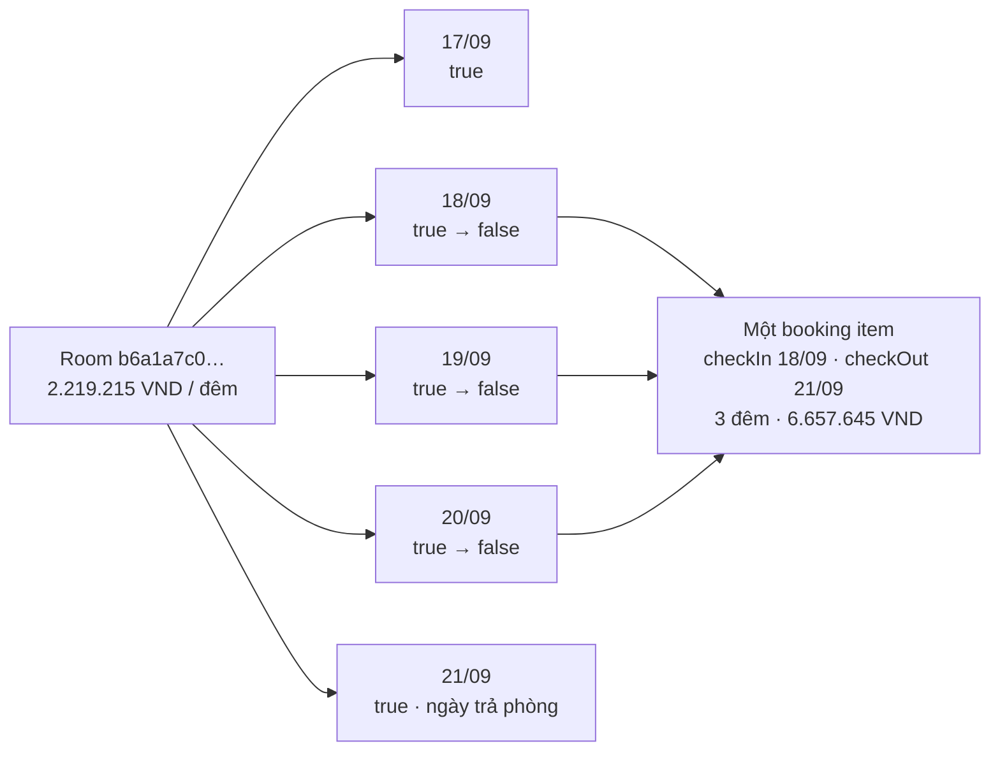

Nếu ban đầu cả 30 đêm đều mở: đặt 1 đêm còn 29, đặt 3 đêm còn 27. Đây là **số đêm chưa bị chiếm trong cửa sổ**, không phải số phòng vật lý còn lại.

### 4.3 Job mỗi ngày

1. Tính D theo giờ Việt Nam ở thời điểm chạy; không hardcode `2026-09-17` trong code.
2. Với room còn hoạt động, bảo đảm có đủ ngày `[D, D+30)`. Insert phần thiếu bằng `ON CONFLICT DO NOTHING`.
3. Đêm mới mặc định `available=true` cho mock. Fixture ca hết phòng có thể seed false trước; không ghi đè row đã tồn tại.
4. Không reset `available=false` hoặc `booking_item_id` của các đêm đã đặt. Nạp lại catalog không reset lịch hay giá vận hành.
5. Đêm cũ ra ngoài cửa sổ bị ẩn khỏi API active, **không phải tự động xóa lịch sử booking**. MVP có thể giữ các dòng cũ; số dòng toàn bảng tăng theo thời gian, 139.380 chỉ là số dòng active khi đủ 4.646 room.
6. Job dừng nhiều ngày thì bù tất cả ngày thiếu, không chỉ thêm một dòng. Dùng cùng thao tác idempotent khi seed room mới.

Ví dụ 18/09: cửa sổ là 18/09–17/10; thêm đêm 17/10, ẩn đêm 17/09. Booking của đêm 18/09 vẫn chiếm đêm đó. Dùng lịch chủ động chạy sau nửa đêm và bù idempotent khi phục vụ request nếu cần; nếu chưa bù được, trả thiếu dữ liệu, không tự coi là mở.

## 5. Backend: tài khoản, giỏ, đơn và liên kết từng đêm

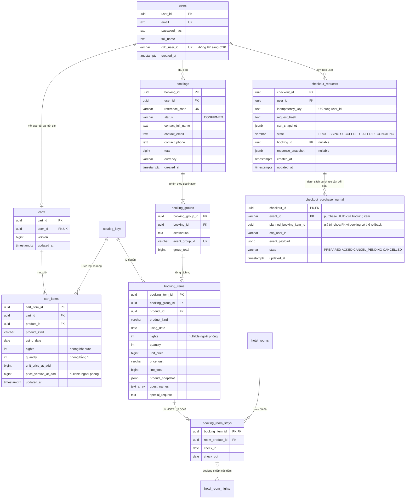

Không có bảng `demo_accounts`. `GET /auth/demo-accounts` trong hợp đồng cũ nên bỏ khỏi phạm vi và UI chuyển tài khoản dùng đăng nhập thông thường. Seed mẫu có thể vẫn tạo `users` + profile/event CDP qua API; không cần metadata persona trong DB ứng dụng.

### 5.1 Ràng buộc không thể bỏ qua

| Bảng / quan hệ | Ràng buộc |
|---|---|
| `hotel_rooms.property_product_id` | FK thật tới `hotel_properties.product_id`, không chỉ chuỗi trong JSON |
| `flight_services.route_product_id` | FK thật tới `flight_routes.product_id` |
| `hotel_room_prices` | Một row / room; `nightly_price >= 0`, `price_unit='PER_NIGHT'`, `currency='VND'` |
| `hotel_room_nights` | PK `(room_product_id, stay_date)`; `available NOT NULL`; nếu `booking_item_id` khác null thì `available=false` |
| Lịch → stay | FK composite `(booking_item_id, room_product_id)` tới UK cùng hai cột trong `booking_room_stays`; một đêm không thể trỏ sang booking của room khác |
| Stay → booking item | `room_product_id = booking_items.product_id`, kind là `HOTEL_ROOM`, quantity=1, check-in bằng using_date, chênh ngày bằng nights. Dùng constraint trigger kiểm liên bảng |
| Số đêm trong đơn | Deferred validation lúc commit: row lịch liên kết phải đúng tập ngày `[check_in, check_out)` và đúng `nights`; không có ngày thừa/thiếu |
| `cart_items` phòng | Partial UNIQUE `(cart_id, product_id) WHERE product_kind='HOTEL_ROOM'`; quantity=1; nights>=1. POST lại cùng kỳ không cộng quantity; đổi kỳ bằng PATCH |
| `cart_items` khác | Có thể giữ UNIQUE `(cart_id, product_id, using_date)` và quy tắc số lượng của từng loại đã được định nghĩa |
| Dòng tham chiếu catalog | `(product_id, product_kind)` FK composite để không khai room ID nhưng kind flight. Backend kiểm đúng leaf và chính sách bán |
| `bookings` / `booking_groups` | Mã đơn UK; `(booking_id,destination)` UK; `event_group_id` toàn cục; tổng = tổng dòng trong cùng transaction |
| `checkout_requests` | UNIQUE `(user_id, idempotency_key)`; hash body chuẩn hóa, user, cart version và lựa chọn. Cùng key/body trả kết quả đã lưu, khác body trả conflict |
| Giữ lịch sử | Booking/user/catalog đã được đơn tham chiếu: RESTRICT + soft delete khi phù hợp; không cascade xóa lịch sử đơn |

Giỏ không giữ chỗ; cả GET giỏ, PATCH giỏ và checkout kiểm lại kỳ ở. Lịch được giữ chỗ chính thức khi transaction checkout commit. Nếu trong cùng checkout có hai dòng phòng chồng đêm cùng room, từ chối trước ghi CDP.

`booking_items.product_snapshot` chốt tên, taxonomy, destination, ảnh, `priceUnit`, `pricingMode` và các thuộc tính cần render đơn. Giá chốt nằm ở `unit_price`, `line_total`. Đọc lại booking không hydrate giá/tên từ catalog sống.

### 5.2 Checkout an toàn trong một database, bù trừ qua CDP

```mermaid
sequenceDiagram
    participant W as Web
    participant B as Backend
    participant A as DB Backend
    participant C as CDP API
    W->>B: POST /bookings + JWT + Idempotency-Key
    B->>A: nhận key duy nhất; khóa logic giỏ; chụp cart/version
    B->>A: ghi PREPARED journal + ID purchase dự kiến (transaction nhỏ)
    B->>A: BEGIN; lock cart; khóa giá và đêm theo room/date thứ tự cố định
    B->>A: kiểm lại version, giá, đủ N đêm available=true, quantity=1
    alt thiếu đêm / giá đổi / đêm bị chiếm
        B->>A: ROLLBACK; đánh dấu request FAILED
        B-->>W: 409 hoặc 422; không gửi purchase
    else hợp lệ
        B->>A: INSERT booking + item + room stay; đổi N đêm false
        B->>C: POST events: purchase:{bookingItemId}
        alt CDP lỗi / timeout
            B->>A: ROLLBACK cả booking và trạng thái đêm
            B->>A: request RECONCILING; journal CANCEL_PENDING
            B->>C: đối soát và huỷ purchase nếu đã được ghi
            B-->>W: 500 retryable; giỏ còn
        else CDP xác nhận đã ghi / duplicate hợp lệ
            B->>A: xóa các cart item đã chụp; ghi response/key SUCCEEDED; COMMIT
            alt commit xác nhận thành công
                B-->>W: 201 BookingResponse; lần retry trả cùng đơn
                W->>B: GET recommendations
            else commit lỗi hoặc mất xác nhận
                B->>A: tra booking/key bằng kết nối mới để biết có commit không
                Note over B,C: Chỉ huỷ CDP khi xác định booking không tồn tại.<br/>Chưa biết kết quả commit: giữ RECONCILING.
                B-->>W: phản hồi retry có kiểm soát; không tạo đơn thứ hai
            end
        end
    end
```

**Khóa đêm:** dùng row lock `FOR UPDATE` theo `(room_product_id, stay_date)` có thứ tự cố định. Sau khi khóa phải đọc/kiểm lại `available`, rồi cập nhật trong chính transaction đó. Request thứ hai đợi; khi có khóa thấy false và bị từ chối. Dùng cùng thứ tự khóa cho checkout nhiều room để giảm deadlock. Phải khóa giá hoặc kiểm `price_version` và cập nhật có điều kiện, tránh race giá.

**Giới hạn:** vẫn giữ chính sách purchase đồng bộ trước commit của hợp đồng cũ. Không có atomic commit giữa Backend và CDP. Journal là dữ liệu điều phối bền vững, **không phải outbox phát purchase sau commit**. Nó giúp biết phải đối soát/huỷ những ID nào sau restart. Cần worker xử lý `RECONCILING`, không chỉ một lệnh huỷ tại thời điểm lỗi.

Nếu POST event timeout, lệnh huỷ có thể trả 404 khi event chưa được ghi xong; chưa được coi 404 đó là đã xử lý vĩnh viễn. Worker phải đối soát lại, và có trạng thái cần xử lý nếu không xác định được. Trong cửa sổ trước đối soát, purchase mồ côi vẫn có thể ảnh hưởng recommendation; không tuyên bố exactly-once hoặc nhất quán tức thời trong mọi lỗi.

ID của một lần checkout được cố định trong journal. Không phát lại một event đã CANCELLED để thử đặt mới, vì CDP giữ cancelled với cùng event ID. Request đã FAILED được trả lại lỗi đã lưu; một lần đặt mới có chủ ý dùng key mới, sau khi lần cũ đã được giải quyết. Thời hạn lưu key/journal cần đủ dài cho retry và đối soát, không xóa chỉ vì giỏ trống.

## 6. Database CDP: hành vi và hồ sơ

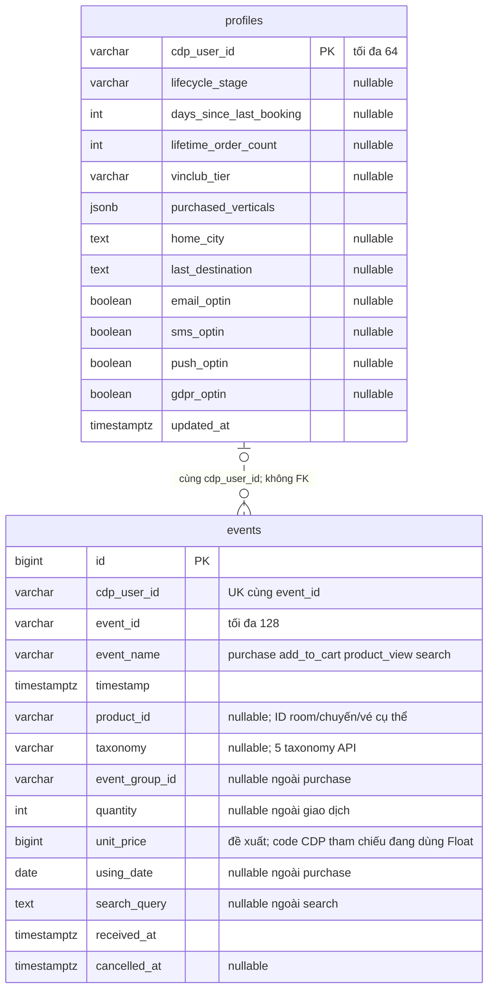

- `events` giữ vĩnh viễn theo contract; không xóa khi catalog đổi hoặc profile thiếu. Không FK tới database Backend hoặc `profiles`.
- UNIQUE `(cdp_user_id,event_id)`; index `(cdp_user_id,timestamp DESC)`; loại event đã huỷ khỏi lịch sử mặc định.
- Profile là snapshot do seed/job cập nhật, không tự tính lại khi ghi event. Tài khoản mới có thể có event nhưng profile chưa tồn tại.
- Phòng được đặt ghi **ID room**, không ghi ID khách sạn cha. Taxonomy vẫn là `hotel` để recommendation nhận biết đã có lưu trú.
- `purchase.quantity=1`, `unitPrice=giá/đêm`, `usingDate=checkIn`, một event cho một booking item, không một event mỗi đêm. Hợp đồng CDP hiện chưa có `nights`/`checkOut`/`lineTotal`; **không tính doanh thu bằng quantity × unitPrice với phòng nhiều đêm**. Báo cáo tiền lấy từ booking; nếu CDP cần tổng tiền thì phải bổ sung các field này vào schema/version rõ ràng.
- Khi catalog đã xoá mềm, Backend dùng thông tin lưu để giải thích `because`. Event seed tham chiếu ID chưa từng được import có thể không có tên: cần mapping tên lịch sử ở Backend hoặc bỏ căn cứ không đủ dữ liệu; soft delete không tự giải quyết trường hợp đó.

### 6.1 Các API CDP đang có trong hợp đồng tham chiếu

| API | Caller / mục đích |
|---|---|
| `POST /cdp/v1/events` | Backend ghi event, seed ghi lịch sử; tối đa 100 event/request theo tài liệu |
| `GET /cdp/v1/users/{cdpUserId}/events` | Recommendation đọc tối đa 500 event gần nhất, mặc định bỏ cancelled |
| `PUT /cdp/v1/users/{cdpUserId}/events/{eventId}/cancellation` | Bù trừ purchase |
| `GET /cdp/v1/profiles/{cdpUserId}` | Đọc snapshot/consent |
| `PUT /cdp/v1/profiles/{cdpUserId}` | Seed/job thay snapshot |

Thiếu API danh sách profile và thống kê toàn catalog: giữ explicit trong backlog; demo dùng danh sách user seed và thống kê seed nếu cần. Không tạo query join chéo DB để thay thế API.

## 7. Database Insider: bản sao kích hoạt, không giữ tồn phòng

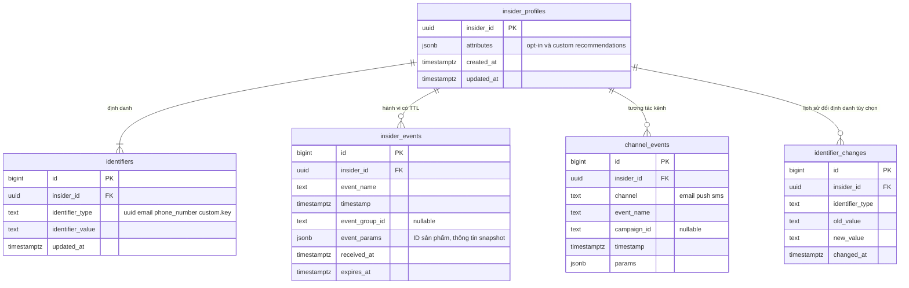

Theo yêu cầu clone trong handbook được cung cấp, không phải xác minh API Insider production hiện tại:

| Quy tắc | Nơi thực hiện |
|---|---|
| Identifier ánh xạ tới một user | UK `(identifier_type,identifier_value)`; UK `(insider_id,identifier_type)` cho tập con clone đã chọn |
| Mapping đề xuất | `identifiers.type='uuid'`, value=`cdpUserId`; không FK sang CDP |
| TTL hành vi | `expires_at = timestamp + 90 ngày`, purchase +730 ngày; đọc luôn loại hết hạn, job dọn vật lý |
| Upsert | Mảng append mặc định; `not_append=true` thay danh sách gợi ý; giữ semantics null/chuỗi rỗng theo handbook |
| Consent | Mapping camelCase CDP → snake_case Insider; null là chưa biết, không tự chuyển thành opt-in. Không phát kênh khi `gdpr_optin=false`; kênh cụ thể còn phải có opt-in phù hợp |
| Bề mặt | `/user/v1/upsert`, `/user/v1/identity`, `/user/v1/profile`, `/raw/v1/export` |
| Giới hạn clone | 1.000 user/request, 5 MB/request theo handbook; kiểm trước khi ghi |
| Gợi ý trong custom | Chỉ danh sách ID/tên/link đã lấy từ Backend; không copy toàn catalog hoặc lịch phòng vào Insider |

## 8. Search, Recommendation và Agent dùng các bảng cụ thể thế nào

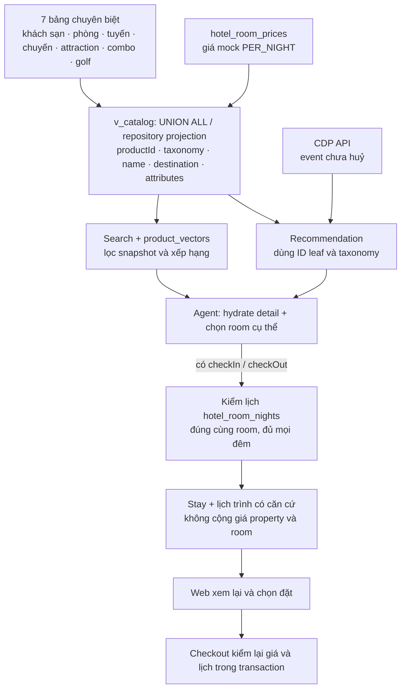

`v_catalog` không UNION hàng của `catalog_keys`; chỉ UNION bảy bảng có nội dung thật. Mỗi nhánh gắn taxonomy và `attributes.level` phù hợp. Index cho tìm kiếm thường dùng `(destination,product_id)` ở subtype, FK parent ở room/chuyến; chọn model/chiều vector trước khi tạo index vector cụ thể.

Ở API catalog cũ, `available` vẫn là trường snapshot, không đủ cho CTA theo ngày. API lịch ở §9 cung cấp `availableForStay`. Với room chưa chọn ngày, UI hiển thị giá/đêm và yêu cầu chọn kỳ; không ghi “còn phòng cho chuyến của bạn”. Nếu bổ sung trường tổng hợp `hasAnyAvailableNight`, phải đặt tên đúng nghĩa và không thay cho kiểm toàn kỳ.

Property khi có ngày phải tìm **một room con có đủ tất cả các đêm**. Không ghép đêm A của phòng Standard và đêm B của phòng Deluxe rồi kết luận cùng một phòng còn cho cả kỳ. Người dùng muốn chuyển phòng giữa chuyến phải chọn các stay riêng, ngoài luồng một stay MVP này.

Search hiện không nhận ngày/party: giữ retrieval như cũ, Agent hoặc Web hậu kiểm lịch phòng. Muốn lọc ngày ngay trong Search cần mở rộng request/schema, không tự gửi khóa lạ vào SearchRequest hiện tại. Agent gọi Search không JWT để không sinh event search người dùng; Recommendation dùng danh tính đã xác thực theo quyền truy cập.

`assistant_conversations` nếu lưu Postgres: `conversation_id PK`, `user_id FK nullable`, `anonymous_session_hash nullable`, `intent jsonb`, `updated_at`, `expires_at`. Kiểm ownership cho cả đăng nhập và phiên ẩn danh; chỉ biết conversation ID không đủ để đọc/sửa hội thoại người khác. Không lưu catalog/availability làm nguồn chính thức trong conversation.

## 9. Phụ lục hợp đồng mới cho phòng mock — đề xuất

### 9.1 Danh sách room của khách sạn

`GET /api/v1/products/{propertyProductId}/rooms?checkIn=2026-09-18&checkOut=2026-09-21`

- Property ID bắt buộc thuộc `HOTEL_PROPERTY`; trả các room ID FK tới property.
- Hai ngày cùng có hoặc cùng vắng. Khi có ngày, mỗi room có `availableForStay`, số đêm và tổng giá, không suy từ boolean của property.
- Property không có room → mảng rỗng; không tự sinh room có thể đặt từ giá property.
- Endpoint này **chưa tồn tại trong OpenAPI đã kiểm tra**; cần thêm trước triển khai.

### 9.2 Lịch của một hạng phòng

`GET /api/v1/products/{roomProductId}/availability?checkIn=2026-09-18&checkOut=2026-09-21`

Hai query có thể cùng vắng để chỉ đọc toàn bộ lịch active; khi đó `stay=null`. Ví dụ dưới đây rút gọn `nights` để minh họa, response thực trả đủ 30 dòng active.

```json
{
  "productId": "b6a1a7c0-5cf8-57c9-a008-67ec054d11d9",
  "timezone": "Asia/Ho_Chi_Minh",
  "window": { "startDate": "2026-09-17", "endDateExclusive": "2026-10-17" },
  "pricingMode": "MOCK_FIXED",
  "unitPrice": 2219215,
  "currency": "VND",
  "priceUnit": "PER_NIGHT",
  "priceVersion": 1,
  "quantity": 1,
  "nights": [
    { "date": "2026-09-18", "available": true },
    { "date": "2026-09-19", "available": true },
    { "date": "2026-09-20", "available": true },
    { "date": "2026-09-21", "available": true }
  ],
  "stay": {
    "checkIn": "2026-09-18",
    "checkOut": "2026-09-21",
    "nightCount": 3,
    "availableForStay": true,
    "unavailableDates": [],
    "total": 6657645
  }
}
```

Response không trả `booking_item_id` hay thông tin người đã đặt cho người xem lịch. `total` là báo giá mock cho kỳ hợp lệ về ngày; CTA còn phụ thuộc `availableForStay`. Nếu lịch thiếu đêm, trả lỗi không đủ dữ liệu, không phát `true`. Các trạng thái nghiệp vụ đã bán thể hiện qua `false` trong lịch, không đổi giá cố định.

### 9.3 Giữ request giỏ hiện tại, sửa ngữ nghĩa phòng

```json
{
  "productId": "b6a1a7c0-5cf8-57c9-a008-67ec054d11d9",
  "usingDate": "2026-09-18",
  "nights": 3,
  "quantity": 1
}
```

`usingDate=checkIn`; `checkOut=usingDate+nights`. Không cần đổi request sang hai cách biểu diễn ngày cùng lúc. Backend kiểm room leaf + giá + mọi đêm. `unitPrice`/`priceVersion` trong giỏ do server chốt; nếu cần client xác nhận báo giá đã xem thì bổ sung `expectedPriceVersion` rõ trong schema, không tin giá client.

Checkout thêm header `Idempotency-Key`. Response booking giữ cấu trúc đã có; snapshot phòng dùng giá chốt và `priceUnit=PER_NIGHT`. Không thêm `demo_accounts` để phục vụ mẫu UI.

### 9.4 Các lỗi cần thống nhất vào OpenAPI

| HTTP | Mã đề xuất | Khi nào |
|---:|---|---|
| 404 | `PRODUCT_NOT_FOUND` | ID không có / đã xóa mềm |
| 422 | `PRODUCT_NOT_BOOKABLE` | Property, route, POI không bán; loại chưa có quy tắc đủ để checkout |
| 422 | `INVALID_ROOM_QUANTITY` | Phòng mock gửi quantity khác 1 |
| 422 | `DATE_OUT_OF_RANGE` | Kỳ nằm ngoài `[D,D+30)` hoặc check-out vượt biên |
| 400 | `VALIDATION_ERROR` | Ngày sai định dạng, nights<1, chỉ gửi một trong hai query ngày |
| 409 | `PRODUCT_UNAVAILABLE` | Ít nhất một đêm đã false; `details.unavailableDates` |
| 503 | `AVAILABILITY_NOT_READY` | Thiếu row lịch trong cửa sổ; không được diễn giải là mở |
| 409 | `PRICE_CHANGED` | Giá/phiên bản thay đổi so với giỏ |
| 409 | `CART_CHANGED` | Giỏ khác snapshot của lần checkout đang xử lý |
| 409 | `IDEMPOTENCY_CONFLICT` | Cùng key nhưng request khác |
| 409 | `CHECKOUT_IN_PROGRESS` | Lần checkout/key còn PROCESSING/RECONCILING; client không tự tạo key mới |

Đây là danh sách thay đổi đề xuất, không phải tuyên bố các mã này đã được endpoint hiện tại hỗ trợ. Loại sai với endpoint chỉ dành room/property có thể dùng `VALIDATION_ERROR` kèm `expectedKind`, tránh nhập nhằng với ID không tồn tại.

## 10. Nạp và chuyển dữ liệu

1. Chọn một commit hợp đồng chung cho các team; working tree hiện chỉ có OpenAPI placeholder 0.1.0, trong khi ref local `0f630a2` có 1.3.0.
2. Tạo migration mới cho Backend với registry ID, 7 subtype, giá phòng, lịch đêm, giỏ/booking/idempotency. Không sửa migration đã được dùng ở môi trường khác.
3. Đọc JSONL theo 13 trường, validate UUID/kind/parent/sourceRef; không thay ID hoặc biến mọi hotel thành room.
4. Nạp `catalog_keys`, các bảng cha và bảng không có cha, rồi room/chuyến, trong transaction phù hợp. Ràng buộc deferred bảo đảm không commit ID thiếu subtype.
5. Copy các cột C và thuộc tính typed từ nguồn; thiếu dữ liệu để null, không đoán sức chứa hay đơn vị từ taxonomy. Giữ `attributes` nguyên bản.
6. Với **room mới**, seed một giá cố định từ `unitPrice`, `price_version=1`, `pricing_mode=MOCK_FIXED`. Room không có giá hợp lệ không tự đặt 0 để bán.
7. Sinh 30 đêm theo D; ngày mới mặc định mở, fixture chủ động tạo một số đêm false để thử UI. Seed chạy lại dùng insert-if-missing; không đặt lại giá hoặc mở đêm đã bán.
8. Seed tài khoản trực tiếp vào `users`; bỏ model/migration/seed/API/UI phụ thuộc `demo_accounts` khi triển khai thay đổi đã yêu cầu. Dùng API CDP cho profiles/events, cùng `cdpUserId`.
9. Tạo projection tương thích ProductSummary và vector theo loại. `model + text_version` xác định đúng cách tạo embedding; không dùng vector của property để giả làm room nếu metadata không đúng.
10. Đối chiếu số liệu trong [audit](evidence/catalog-audit-2026-09-17.json), chạy các ca nghiệm thu trong [review](ra-soat-hop-dong-2026-09-17.md#8-tiêu-chí-kiểm-chứng-khi-triển-khai).

Không migrate hay reseed database đang chạy trong phạm vi bản vẽ này. Các thao tác trên là kế hoạch chuyển đổi có thứ tự, không phải việc đã thực hiện.

## 11. Danh sách bảng theo service

| Database | Nhóm | Bảng |
|---|---|---|
| Backend | Định danh catalog | `catalog_keys` |
| Backend | Lưu trú | `hotel_properties`, `hotel_rooms`, `hotel_room_prices`, `hotel_room_nights` |
| Backend | Hàng không | `flight_routes`, `flight_services`, `flight_observed_dates` |
| Backend | Trải nghiệm | `attraction_products`, `combo_packages`, `combo_components`, `golf_products` |
| Backend | Tài khoản / giỏ | `users`, `carts`, `cart_items` |
| Backend | Booking | `bookings`, `booking_groups`, `booking_items`, `booking_room_stays` |
| Backend | Retry / bù trừ | `checkout_requests`, `checkout_purchase_journal` |
| Backend | Search / gợi ý | `product_vectors`, `product_popularity` |
| Backend | Hội thoại | `assistant_conversations` nếu chọn lưu Postgres |
| CDP | Dữ liệu khách | `profiles`, `events` |
| Insider | Bản sao kích hoạt | `insider_profiles`, `identifiers`, `insider_events`, `channel_events`; `identifier_changes` tùy chọn |

**Không có `products` chung, không có `demo_accounts`, không có FK xuyên service.** Registry ID và view API là hai lớp kỹ thuật để tham chiếu/tìm kiếm, còn dữ liệu nghiệp vụ được vẽ tới từng loại sản phẩm ở các sơ đồ trên.
