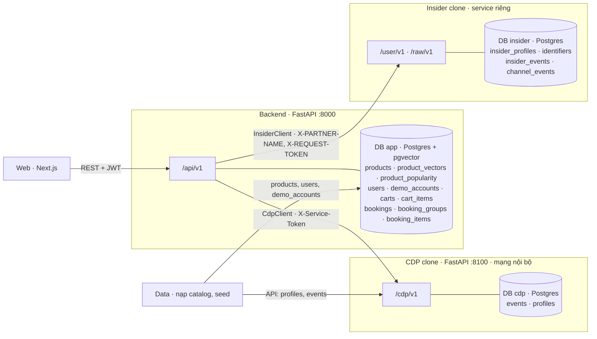
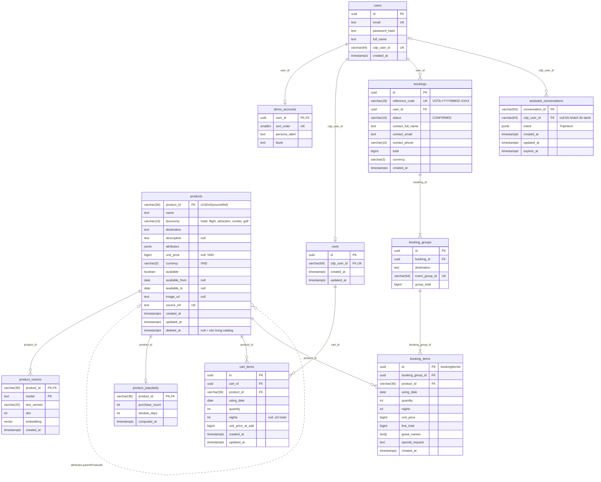
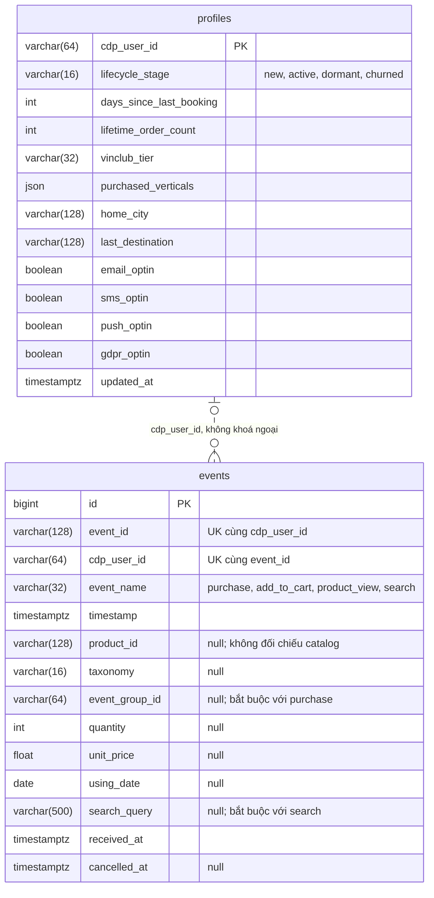
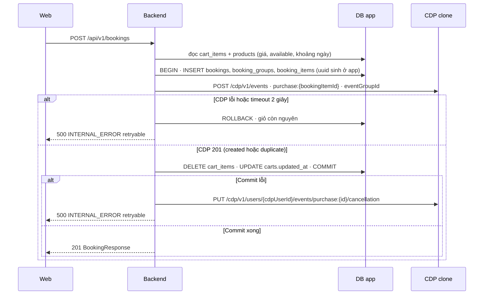
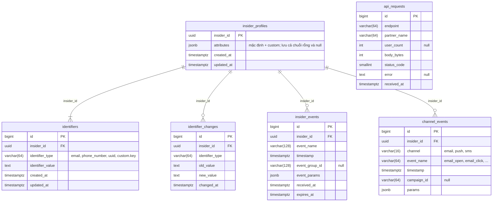

# Thiết kế schema ba service: Backend · CDP clone · Insider clone

> **[Sơ đồ hoàn chỉnh toàn bộ database trong một hình](schema-database-toan-bo.html)** — bản ERD gồm 3 database và mọi bảng/cột/quan hệ.

> **Bản vẽ chi tiết cập nhật ngày 17/09/2026:** xem [từng loại sản phẩm và lịch phòng 30 đêm](thiet-ke-schema-3-service-chi-tiet.md) và [review hợp đồng](ra-soat-hop-dong-2026-09-17.md). Bản mới phản ánh quyết định mock một giá/phòng, availability từng đêm, cửa sổ trượt và bỏ `demo_accounts`. Nội dung bên dưới được giữ làm bản đề xuất trước đó, không dùng các quy tắc cũ mâu thuẫn với bản cập nhật để triển khai.

**Trạng thái:** đề xuất, chờ review của Backend, Data và Integration (`src/ARCHITECTURE.md` §11)  
**Ngày:** 2026-09-17  
**Căn cứ:** nhánh `origin/data_contract` `0f630a2` — OpenAPI 1.3.0, `cdp-clone.openapi.yaml`, `hop-dong-tich-hop-backend.md`,
`hop-dong-tich-hop-cdp.md`, code `src/cdp_clone`, handbook §3 và §6

Tài liệu này **không đổi API**. Nó vẽ dữ liệu của từng service sau khi tách, và chỉ ra chỗ nào các hợp đồng còn thiếu
để schema chạy được. Mục có nhãn **đề xuất** là lựa chọn cần duyệt; mục có nhãn **chờ xác nhận** giữ nguyên quy tắc
tạm đã ghi trong hợp đồng.

---

## 0. Tóm tắt

- **Ba service, ba database, không có khoá ngoại xuyên service.** Service khác chỉ đọc/ghi qua API: Backend gọi CDP
  bằng `CdpClient`, gọi Insider bằng `InsiderClient`. Web chỉ gọi Backend.
- **Backend** giữ catalog, vector, tài khoản, giỏ và đơn đặt — đúng quy tắc tạm `hop-dong-tich-hop-cdp.md` §11.
- **CDP clone** giữ `events` và `profiles`, như code hiện có. Không thêm bảng.
- **Insider clone** giữ bản sao nhỏ: hồ sơ, identifier, event có TTL, tương tác kênh.
- Hai quyết định đề xuất đáng chú ý nhất:
  1. ID nào đi sang service khác (`bookingItemId`, `eventGroupId`, `cdpUserId`) phải **duy nhất toàn cục**,
     không lấy từ sequence của database. Lý do ở §5.1.
  2. `products` **xoá mềm** (`deleted_at`) để `because[].productName` vẫn có tên sau khi sản phẩm rời catalog,
     vì event trong CDP không mang tên sản phẩm.
- Bốn chỗ hợp đồng còn thiếu cần chốt trước khi code (§8): độ phổ biến, `destination` mặc định của gợi ý, liệt kê
  khách cho job Tuần 5, hợp đồng Insider.

---

## 1. Ba service và dữ liệu của mỗi bên

| Dữ liệu | Service sở hữu | Căn cứ |
|---|---|---|
| Catalog `products`, `product_vectors` | Backend | `hop-dong-tich-hop-cdp.md` §11, quy tắc tạm |
| `users`, `demo_accounts` | Backend | hợp đồng Backend §3; handbook §6 "demo only" |
| `carts`, `cart_items` | Backend | hợp đồng Backend §7.1 |
| `bookings`, `booking_groups`, `booking_items` | Backend | hợp đồng Backend §7.2; handbook §6 "demo only" |
| Trạng thái hội thoại Agent | Backend, **chờ Team Agent chọn nơi lưu** | hợp đồng Agent §6, `src/ARCHITECTURE.md` §8 |
| `events` — hành vi, giữ vĩnh viễn | CDP clone | `hop-dong-tich-hop-cdp.md` §1.1 |
| `profiles` — snapshot do seed/job ghi | CDP clone | `hop-dong-tich-hop-cdp.md` §3.4 |
| Hồ sơ, identifier, event TTL 90/730 ngày, tương tác kênh | Insider clone | handbook §3, §6 |

---

## 2. Quy tắc chung khi dữ liệu nằm ở ba nơi

| # | Quy tắc | Vì sao |
|---|---|---|
| G1 | Không có khoá ngoại hay join giữa hai database. Tham chiếu sang service khác là **giá trị** (`cdpUserId`, `productId`, `eventId`) | `src/ARCHITECTURE.md` §2: không truy cập database của service khác |
| G2 | Trong **một** database thì dùng khoá ngoại thật | Toàn vẹn rẻ nhất là do Postgres giữ |
| G3 | ID gửi sang service khác phải duy nhất toàn cục, không phải số tự tăng | §5.1 |
| G4 | Thời điểm lưu `timestamptz`, trả UTC; ngày dùng `date` | hợp đồng Backend §2.6, hợp đồng CDP (đầu tài liệu) |
| G5 | Tiền VND là số nguyên: `bigint` | hợp đồng Backend §2.6 |
| G6 | Cột Postgres `snake_case`; JSON của Backend và CDP dùng `camelCase`; JSON của Insider giữ `snake_case` như API Insider thật | handbook §6; API Insider |
| G7 | Không transaction xuyên service. `purchase` ghi đồng bộ trước commit, lỗi thì huỷ event; không outbox | `hop-dong-tich-hop-cdp.md` §5, §13 |
| G8 | Mỗi service một Postgres riêng. CDP ở `127.0.0.1:5433` (đã có). **Đề xuất:** Backend `127.0.0.1:5434` dùng image `pgvector/pgvector:pg16`; Insider `127.0.0.1:5435` | `src/cdp_clone/docker-compose.yml`; Backend cần pgvector |

---

## 3. Backend — database `app`

### 3.1 Sơ đồ

Nét liền là khoá ngoại. Nét đứt là quan hệ mềm trong cùng database: hạng phòng → cơ sở, chuyến bay → tuyến, đọc
qua `attributes->>'parentProductId'` để `products` giữ đúng hình dạng 13 trường của handbook §6 — phòng khi sau này
chuyển catalog sang CDP.

### 3.2 `products` — catalog

| Cột | Kiểu | Null | Mặc định | Ràng buộc, index | API | Ghi chú |
|---|---|---|---|---|---|---|
| `product_id` | `varchar(36)` | không | — | **PK** | `productId` | UUIDv5 của `sourceRef` |
| `name` | `text` | không | — | | `name` | |
| `taxonomy` | `varchar(16)` | không | — | CHECK 5 giá trị; index (`destination`, `taxonomy`) | `taxonomy` | Cùng độ dài với `events.taxonomy` của CDP |
| `destination` | `text` | không | — | index (`destination`, `taxonomy`) | `destination` | `GET /destinations` = đếm theo cột này |
| `description` | `text` | có | — | | `description` | `ProductDetail`: `null` → `""` |
| `attributes` | `jsonb` | không | `{}` | index biểu thức `attributes->>'parentProductId'` | `attributes` | Hình dạng theo `SCHEMA.md` |
| `unit_price` | `bigint` | có | — | CHECK `>= 0` | `unitPrice` | `null` không phải miễn phí |
| `currency` | `varchar(3)` | không | `'VND'` | | `currency` | |
| `available` | `boolean` | không | `false` | index | `available` | Snapshot lúc crawl |
| `available_from` | `date` | có | — | CHECK `available_from <= available_to` khi cả hai khác null | `availableFrom` | |
| `available_to` | `date` | có | — | | `availableTo` | |
| `image_url` | `text` | có | — | | `imageUrl` | |
| `source_ref` | `text` | không | — | **UNIQUE** | `sourceRef` (debug) | |
| `created_at` | `timestamptz` | không | `now()` | | — | |
| `updated_at` | `timestamptz` | không | `now()` | | — | Loader cập nhật khi nạp lại |
| `deleted_at` | `timestamptz` | có | — | partial index `WHERE deleted_at IS NULL` | — | **Đề xuất.** Khác null thì mọi API catalog coi như không tồn tại (`404 PRODUCT_NOT_FOUND`), Search và Recommendation bỏ qua; dòng vẫn giữ để `because[]` lấy tên và `booking_items` còn trỏ được |

### 3.3 `product_vectors`, `product_popularity`

| Bảng | Cột | Kiểu | Ràng buộc | Ghi chú |
|---|---|---|---|---|
| `product_vectors` | `product_id` | `varchar(36)` | **PK₁**, **FK** → `products` CASCADE | |
| | `model` | `text` | **PK₂** | Tên mô hình |
| | `text_version` | `varchar(32)` | NOT NULL | **Đề xuất.** Phiên bản bộ dựng văn bản của Data; đổi thì embed lại. `modelVersion` của API = `model` + `text_version` |
| | `dim` | `int` | CHECK `> 0` | |
| | `embedding` | `vector` | NOT NULL | Chốt mô hình ở Tuần 2 → migration đặt `vector(N)` và tạo HNSW |
| | `created_at` | `timestamptz` | mặc định `now()` | |
| `product_popularity` | `product_id` | `varchar(36)` | **PK**, **FK** → `products` CASCADE | **Chờ xác nhận nguồn** (§8 Q1) |
| | `purchase_count` | `int` | CHECK `>= 0` | Số `purchase` chưa huỷ trong cửa sổ |
| | `window_days` | `int` | CHECK `> 0` | |
| | `computed_at` | `timestamptz` | NOT NULL | Snapshot, job ghi lại toàn bảng |

### 3.4 Tài khoản

| Bảng | Cột | Kiểu | Null | Ràng buộc | API |
|---|---|---|---|---|---|
| `users` | `id` | `uuid` | không | **PK**, mặc định `gen_random_uuid()` | `AuthUser.userId`, JWT `sub` |
| | `email` | `text` | không | **UNIQUE**, CHECK `email = lower(email)` | `email` |
| | `password_hash` | `text` | không | BCrypt, không bao giờ trả ra | — |
| | `full_name` | `text` | không | CHECK độ dài 1–100 | `fullName` |
| | `cdp_user_id` | `varchar(64)` | không | **UNIQUE**; không FK (profile ở CDP) | `cdpUserId`, JWT `cdp_user_id` |
| | `created_at` | `timestamptz` | không | mặc định `now()` | — |
| `demo_accounts` | `user_id` | `uuid` | không | **PK**, **FK** → `users` CASCADE | `email`, `fullName` lấy từ `users` |
| | `sort_order` | `smallint` | không | **UNIQUE** | thứ tự `accounts[]` |
| | `persona_label` | `text` | không | | `personaLabel` |
| | `blurb` | `text` | không | | `blurb` |

`cdp_user_id` dài 64 để khớp giới hạn của CDP clone. Đăng ký tài khoản **không** tạo profile trong CDP: profile là
snapshot do seed/job ghi (`hop-dong-tich-hop-cdp.md` §3.4); người dùng mới có `GET /profiles` trả `404` và rơi vào
cold start. Cách sinh `cdp_user_id` khi đăng ký: §8 Q5.

### 3.5 Giỏ hàng

| Bảng | Cột | Kiểu | Null | Ràng buộc | API |
|---|---|---|---|---|---|
| `carts` | `id` | `uuid` | không | **PK** | `cartId` |
| | `cdp_user_id` | `varchar(64)` | không | **UNIQUE**, **FK** → `users(cdp_user_id)` CASCADE | `cdpUserId` |
| | `created_at` | `timestamptz` | không | | — |
| | `updated_at` | `timestamptz` | không | Cập nhật ở **mọi** thao tác lên `cart_items` | `updatedAt` |
| `cart_items` | `id` | `uuid` | không | **PK** | `items[].cartItemId` |
| | `cart_id` | `uuid` | không | **FK** → `carts` CASCADE | — |
| | `product_id` | `varchar(36)` | không | **FK** → `products` RESTRICT; index | `items[].product` (đọc lại lúc `GET`) |
| | `using_date` | `date` | không | UNIQUE (`cart_id`, `product_id`, `using_date`) | `items[].usingDate` |
| | `quantity` | `int` | không | CHECK `>= 1` | `items[].quantity` |
| | `nights` | `int` | có | CHECK null hoặc `>= 1`; chỉ hotel (API kiểm) | `items[].nights` |
| | `unit_price_at_add` | `bigint` | không | CHECK `>= 0` | `details.oldPrice` của `PRICE_CHANGED` |
| | `created_at`, `updated_at` | `timestamptz` | không | | — |

Giỏ khoá theo `cdpUserId` đúng hợp đồng §7.1, và vẫn có khoá ngoại vì `users.cdp_user_id` là UNIQUE. `lineTotal`,
`itemCount`, `subtotal`, `total` tính khi đọc, không lưu.

### 3.6 Đơn đặt chỗ

| Bảng | Cột | Kiểu | Null | Ràng buộc | API |
|---|---|---|---|---|---|
| `bookings` | `id` | `uuid` | không | **PK** | không lộ ra |
| | `reference_code` | `varchar(18)` | không | **UNIQUE**, CHECK `^VOTA-[0-9]{8}-[A-Z0-9]{4}$`; trùng thì sinh lại | `referenceCode` |
| | `user_id` | `uuid` | không | **FK** → `users` RESTRICT; index | chỉ chủ đơn đọc được |
| | `status` | `varchar(16)` | không | CHECK `= 'CONFIRMED'` | `status` |
| | `contact_full_name` | `text` | không | CHECK độ dài 1–100 | `contact.fullName` |
| | `contact_email` | `text` | không | | `contact.email` |
| | `contact_phone` | `varchar(10)` | không | CHECK `^0[0-9]{9}$` | `contact.phone` |
| | `total` | `bigint` | không | CHECK `>= 0`; = Σ `group_total` | `total` |
| | `currency` | `varchar(3)` | không | mặc định `'VND'` | `currency` |
| | `created_at` | `timestamptz` | không | | `createdAt` |
| `booking_groups` | `id` | `uuid` | không | **PK** | — |
| | `booking_id` | `uuid` | không | **FK** → `bookings` CASCADE; UNIQUE (`booking_id`, `destination`) | — |
| | `destination` | `text` | không | | `groups[].destination` |
| | `event_group_id` | `varchar(64)` | không | **UNIQUE** | `groups[].eventGroupId` → `events.event_group_id` ở CDP |
| | `group_total` | `bigint` | không | CHECK `>= 0`; = Σ `line_total` | `groups[].groupTotal` |
| `booking_items` | `id` | `uuid` | không | **PK**; sinh ở app **trước** khi gọi CDP | `bookingItemId`; `eventId` ở CDP = `purchase:{id}` |
| | `booking_group_id` | `uuid` | không | **FK** → `booking_groups` CASCADE; index | — |
| | `product_id` | `varchar(36)` | không | **FK** → `products` RESTRICT; index | `items[].product` |
| | `using_date` | `date` | không | | `usingDate` |
| | `quantity` | `int` | không | CHECK `>= 1` | `quantity` |
| | `nights` | `int` | có | CHECK null hoặc `>= 1` | `nights` |
| | `unit_price` | `bigint` | không | CHECK `>= 0`; giá chốt lúc checkout | **Đề xuất:** dùng làm `product.unitPrice` trong `BookingResponse` để đơn đọc lại không đổi theo catalog |
| | `line_total` | `bigint` | không | CHECK `>= 0` | `lineTotal` |
| | `guest_names` | `text[]` | không | mặc định `{}` | `guestNames` |
| | `special_request` | `text` | có | CHECK độ dài `<= 500` | `specialRequest` |
| | `created_at` | `timestamptz` | không | | — |

`bookings` → `users` là RESTRICT, không phải CASCADE: đơn đã có event `purchase` ở CDP, xoá đơn sẽ để lại event mồ
côi mà không ai huỷ.

### 3.7 `assistant_conversations` — chờ Team Agent

Hợp đồng Agent §6 chỉ nói mỗi conversation giữ TripIntent đã chuẩn hóa gần nhất và hết hạn sau 24 giờ; chưa nói lưu
ở đâu. Nếu chọn Postgres thì bảng tối thiểu như sơ đồ: `conversation_id` là PK, `cdp_user_id` null với khách ẩn
danh, `intent` là `jsonb` theo schema `TripIntent`, và `expires_at` = `updated_at` + 24 giờ. Hết hạn thì trả
`404 CONVERSATION_NOT_FOUND`. Giữ trong bộ nhớ process cũng hợp lệ với hợp đồng hiện tại.

---

## 4. CDP clone — database `cdp`

### 4.1 Sơ đồ (đúng như `src/cdp_clone/app/infrastructure/tables.py`, revision `0001`)

`events` và `profiles` chỉ nối nhau bằng giá trị `cdp_user_id`: một khách có thể có event mà chưa có profile (người
vừa đăng ký), hoặc có profile mà chưa có event.

### 4.2 Trường bắt buộc theo `event_name` (domain `events.py`)

| `event_name` | Bắt buộc ngoài `cdp_user_id` | `event_id` do Backend sinh |
|---|---|---|
| `search` | `search_query` | `search:{uuid}` |
| `product_view` | `product_id`, `taxonomy` | `product_view:{uuid}` |
| `add_to_cart` | `product_id`, `taxonomy`, `quantity` | `add_to_cart:{uuid}` |
| `purchase` | `event_id`, `product_id`, `taxonomy`, `event_group_id`, `quantity`, `unit_price`, `using_date` | `purchase:{bookingItemId}` |

Chống trùng bằng UNIQUE (`cdp_user_id`, `event_id`); gửi lại trả `duplicate`, giữ bản đầu. Huỷ là đặt
`cancelled_at`, không xoá; lịch sử mặc định bỏ event đã huỷ.

### 4.3 Góp ý cho schema CDP — không đổi API

| # | Hiện tại | Đề xuất | Lý do |
|---|---|---|---|
| C1 | `unit_price float` | `numeric(14,0)` hoặc `bigint` | VND là số nguyên (hợp đồng Backend §2.6); tránh so sánh số thực. API vẫn là `number` |
| C2 | Enum chỉ kiểm ở Pydantic | Thêm CHECK cho `event_name`, `taxonomy`, `lifecycle_stage` | Seed hoặc job ghi sai vẫn bị chặn ở database |
| C3 | Không có cách xoá event | Giữ nguyên. Seed chạy lại thì **huỷ** event cũ của 4 persona (liệt kê bằng `includeCancelled=false` rồi `PUT …/cancellation`), sau đó ghi mới với `eventId` dạng `seed:{ngày seed}:{persona}:{n}` | `hop-dong-tich-hop-cdp.md` §1.5 cấm seed ghi thẳng database |

---

## 5. Quan hệ xuyên service

### 5.1 Vì sao ID gửi đi phải duy nhất toàn cục

`eventId` của `purchase` là `purchase:{bookingItemId}` và CDP chống trùng theo nó. Nếu `bookingItemId` là số tự
tăng, lần reset database Backend khi dev (`alembic downgrade`, `docker compose down -v`) sẽ cấp lại `1, 2, 3…`
trong khi database CDP vẫn còn `purchase:1` từ lần trước. Checkout mới gửi `purchase:1`, CDP trả `duplicate`, Backend
coi là thành công và commit, nhưng **event của đơn mới không bao giờ được ghi** — gợi ý không đổi, không có lỗi nào
hiện ra. Cùng lý do áp dụng cho `eventGroupId` (hai chuyến bị gộp thành một) và `cdpUserId` (người đăng ký mới thừa
hưởng lịch sử của người cũ).

Vì vậy: `booking_items.id`, `bookings.id`, `cart_items.id`, `carts.id`, `users.id` dùng `uuid`. `eventGroupId` và
`cdpUserId` cần quy tắc sinh riêng: §8 Q4, Q5.

### 5.2 Bảng quan hệ

| # | Phía giữ giá trị | Phía được tham chiếu | Giá trị | Ai ghi | Toàn vẹn do ai giữ | Phía kia lỗi hoặc thiếu |
|---|---|---|---|---|---|---|
| S1 | Backend `users.cdp_user_id` | CDP `events`, `profiles` | `cdpUserId` | Đăng ký; seed | Seed kiểm 4 persona ở cả hai bên (`hop-dong-tich-hop-cdp.md` §9.2) | Profile `404` → cold start; CDP sập → `popular` |
| S2 | CDP `events.event_id` | Backend `booking_items.id` | `purchase:{bookingItemId}` | Checkout, đồng bộ | UNIQUE ở CDP; huỷ bù trừ khi commit lỗi | Huỷ cũng lỗi → event mồ côi, log `ERROR` để huỷ tay |
| S3 | CDP `events.event_group_id` | Backend `booking_groups.event_group_id` | `eventGroupId` | Checkout | UNIQUE ở Backend | Chuyến seed không có dòng tương ứng ở Backend |
| S4 | CDP `events.product_id` | Backend `products.product_id` | `productId` | Backend điền từ catalog | CDP không đối chiếu catalog (hợp đồng CDP §3.1) | Sản phẩm đã xoá mềm → `because[].productId = null`, tên lấy từ dòng đã xoá |
| S5 | CDP `events.taxonomy`, `unit_price` | Backend `products` | bản chụp | Backend | — | Giữ nguyên khi catalog đổi |
| S6 | Insider `identifiers` | CDP / Backend `cdp_user_id`, `users.email` | `uuid`, `email` | Job Tuần 5 | Không | §8 Q6 |
| S7 | Insider `insider_profiles.attributes.custom` | Backend `products.product_id` | danh sách `productId` gợi ý | Job Tuần 5 | Không | Sản phẩm xoá sau lần đẩy vẫn nằm trong attribute tới lần đẩy sau |

### 5.3 Checkout — nơi ba bảng Backend và một bảng CDP phải khớp nhau

### 5.4 Các luồng còn lại

| Luồng | Backend đọc/ghi | CDP | Insider |
|---|---|---|---|
| Xem sản phẩm `POST /api/v1/events` | Đọc `products` (còn, lấy `taxonomy`) | Ghi nền `product_view`; lỗi thì bỏ | — |
| Tìm kiếm `POST /api/v1/search` | `products` + `product_vectors` trong một truy vấn | Ghi nền `search` nếu có JWT và `offset = 0` | — |
| Thêm giỏ | Ghi `cart_items`, `carts.updated_at` | Ghi nền `add_to_cart`, giá lấy từ `products` | — |
| Gợi ý `GET /api/v1/recommendations` | `product_vectors`, `products` (kể cả dòng xoá mềm để lấy tên) | Đọc ≤ 500 event chưa huỷ; lỗi → `popular` | — |
| Nạp catalog | Loader upsert `products`; sản phẩm biến mất khỏi file → đặt `deleted_at` | — | — |
| Seed demo | `users`, `demo_accounts`, `carts`, `cart_items` | `PUT /profiles`, `POST /events` qua API | — |
| Tuần 5: đẩy gợi ý | Tính gợi ý | Đọc danh sách khách và consent (§8 Q3) | `POST /user/v1/upsert` ≤ 1.000 user, ≤ 5 MB, `not_append: true` |

---

## 6. Insider clone — database `insider`

**Chưa có hợp đồng** trong repo. Bảng và nội dung theo handbook §6; tên trường theo API Insider thật, vì handbook yêu
cầu clone phơi ra đúng bề mặt API thật. Cột cụ thể là **đề xuất**.

### 6.1 Sơ đồ

### 6.2 Từ điển bảng

| Bảng | Cột | Kiểu | Ràng buộc | Ghi chú |
|---|---|---|---|---|
| `insider_profiles` | `insider_id` | `uuid` | **PK** | Trả ra là `iid` trong response profile |
| | `attributes` | `jsonb` | NOT NULL, mặc định `{}` | Mặc định: `name`, `surname`, `email_optin`, `sms_optin`, `whatsapp_optin`, `gdpr_optin`, `language`, `city`…; tuỳ biến trong `custom`. Tập con của CDP |
| | `created_at`, `updated_at` | `timestamptz` | | |
| `identifiers` | `id` | `bigint` tự tăng | **PK** | Không đi ra ngoài service nên số tự tăng không sao |
| | `insider_id` | `uuid` | **FK** → `insider_profiles` CASCADE | |
| | `identifier_type` | `varchar(64)` | CHECK `email`, `phone_number`, `uuid` hoặc bắt đầu `custom.` | |
| | `identifier_value` | `text` | NOT NULL; UNIQUE (`identifier_type`, `identifier_value`); UNIQUE (`insider_id`, `identifier_type`) | `phone_number` theo E.164 |
| `identifier_changes` | … | | **FK** → `insider_profiles` CASCADE | **Tuỳ chọn.** Nhật ký `PATCH /user/v1/identity`, để chứng minh đổi identifier không mất lịch sử |
| `insider_events` | `insider_id` | `uuid` | **FK** CASCADE; index (`insider_id`, `timestamp`) | Luôn append, không ghi đè |
| | `event_name` | `varchar(128)` | NOT NULL | |
| | `timestamp` | `timestamptz` | NOT NULL | Thời điểm hành vi, không phải lúc nhận |
| | `event_group_id` | `varchar(128)` | null | Insider bắt buộc với `purchase` |
| | `event_params` | `jsonb` | mặc định `{}` | `product_id`, `name`, `taxonomy` (mảng), `currency`, `quantity`, `unit_price`, `unit_sale_price`, `url`, `custom` |
| | `expires_at` | `timestamptz` | NOT NULL; index | `timestamp` + 730 ngày nếu `purchase`, còn lại + 90 ngày. **Tính ở app**: `timestamptz + interval` không immutable nên không dùng generated column được |
| `channel_events` | `insider_id` | `uuid` | **FK** CASCADE; index (`insider_id`, `timestamp`) | Seed sẵn |
| | `channel` | `varchar(16)` | CHECK `email`, `push`, `sms` | |
| | `event_name` | `varchar(64)` | NOT NULL | Theo cách đặt tên của Insider: `email_open`, `email_click`, `email_bounce`, `email_unsubscribe`, `push_open`, `sms_click`… |
| | `timestamp` | `timestamptz` | NOT NULL; index | Lọc theo khoảng ngày cho export |
| `api_requests` | … | | | **Tuỳ chọn.** Nhật ký request: chứng minh lô 1.001 user bị từ chối, và đo số request, byte mỗi khách cho báo cáo Tuần 5 |

Tên partner và token đọc từ biến môi trường của service, không cần bảng.

### 6.3 Quy tắc handbook ánh xạ vào schema

| Quy tắc (handbook §3) | Nằm ở đâu |
|---|---|
| `X-PARTNER-NAME` viết thường, có `X-REQUEST-TOKEN`, sai thì `403` | Tầng API; ghi `api_requests` |
| Tối đa 1.000 user mỗi request, body 5 MB | Tầng API, trước khi ghi bất kỳ bảng nào |
| Mảng trong `attributes` mặc định **append**, trừ khi `not_append: true` | Logic merge vào `insider_profiles.attributes` |
| Gửi `""` hoặc `null` **không** xoá thuộc tính mà lưu giá trị rỗng | `jsonb` giữ khoá với giá trị `""` hoặc `null` |
| Event thường hết hạn sau 90 ngày, `purchase` sau 730 ngày | `insider_events.expires_at`; đọc luôn lọc `expires_at > now()`; job xoá định kỳ |
| `gdpr_optin: false` thì không nhận gì qua kênh nào | `attributes.gdpr_optin`; job Tuần 5 loại khách này; seed không sinh `channel_events` cho họ |
| `PATCH /user/v1/identity`: một user, identifier cũ và mới cùng kiểu, giữ lịch sử | Cập nhật một dòng `identifiers`; `insider_events` giữ nguyên vì nối qua `insider_id` |
| `POST /user/v1/profile` trả hồ sơ đã lưu | `identifiers` → `insider_profiles` + `insider_events` còn hạn |
| `POST /raw/v1/export` trả tương tác kênh theo khoảng ngày | `channel_events` theo `timestamp`. Insider thật trả file qua webhook và giới hạn 1 request/ngày; clone trả đồng bộ theo mô tả handbook |

---

## 7. Chuyển từ code hiện có trên nhánh `data`

`src/data_collection/cdp/` trên nhánh `data` đang dựng **một** database gồm 11 bảng cho cả CDP lẫn demo. Theo thiết
kế này:

| Hiện tại trên `data` | Chuyển thành | Việc cần làm |
|---|---|---|
| `models.Product` | Backend `products` | Thêm `created_at`, `updated_at`, `deleted_at`; `taxonomy` `varchar(16)` |
| `models.ProductVector` | Backend `product_vectors` | Thêm `text_version` |
| `models.User`, `DemoAccount` | Backend `users`, `demo_accounts` | `id` `bigint` → `uuid`; bỏ FK sang `profiles`; `cdp_user_id` `varchar(64)` |
| `models.Cart`, `CartItem` | Backend `carts`, `cart_items` | `uuid`; FK `carts.cdp_user_id` → `users(cdp_user_id)`; `cart_items.product_id` RESTRICT |
| `models.Booking`, `BookingGroup`, `BookingItem` | Backend `bookings`, `booking_groups`, `booking_items` | `uuid`; `bookings.user_id` RESTRICT; CHECK `contact_phone`, `special_request`; `event_group_id` `varchar(64)` |
| `models.Profile`, `models.Event` | **Bỏ**, dùng `src/cdp_clone` | CDP dùng `event_id`, `search_query`, `cancelled_at`, `received_at`; không còn `payload` (`query`, `productName`, `bookingItemId`) |
| `client.py` (`PostgresCdpClient`) | **Bỏ** | Backend dùng `application/ports/cdp_client.py` + `infrastructure/clients/cdp_http_client.py` |
| `load_products.py` | Loader vào database Backend | Đổi biến `CDP_DATABASE_URL` → URL database Backend; đánh dấu `deleted_at` cho sản phẩm không còn trong file |
| `seed_demo.py` | Tách hai phần | Backend: `users`, `demo_accounts`, `carts`. CDP: `PUT /profiles`, `POST /events` qua API (§4.3 C3) |
| `check.py` | Tách hai phần | Kiểm tra toàn vẹn database Backend; đối chiếu 4 persona qua API CDP |
| `docker-compose.yml` (pgvector, `5433`) | Database Backend | Trùng cổng `5433` với `src/cdp_clone` → chuyển sang `5434` |
| `alembic/versions/0001_cdp_schema.py` | Migration của Backend | Viết lại cho 9 bảng Backend; chưa push nên còn sửa thẳng được |

Nhánh `data` chưa có `src/cdp_clone` và `src/backend/app/application/ports`. Cần merge `data_contract` vào `data`
trước khi sửa code (xung đột dự kiến ở `src/data_collection/README.md`, `docs/SCHEMA.md`).

---

## 8. Chờ xác nhận

Theo `AGENTS.md` §2, các mục dưới đây không được tự chọn khi code. Đến khi có câu trả lời, dùng quy tắc tạm ở cột cuối.

| # | Câu hỏi | Vì sao chặn | Chủ | Đề xuất / quy tắc tạm |
|---|---|---|---|---|
| Q1 | `GET /products?sort=popular` lấy độ phổ biến ở đâu? Hợp đồng Backend §4.1 nói đếm `purchase` trong `events`, nhưng `events` giờ ở CDP và API CDP chỉ đọc theo từng khách | Không có nguồn cho section "Phổ biến" luôn-render | Backend + CDP | Thêm endpoint thống kê ở CDP, job ghi `product_popularity`. Tạm thời Data seed `product_popularity` từ bộ sinh lịch sử |
| Q2 | `destination` mặc định của `/recommendations`: hợp đồng Backend §6.1 lấy `last_destination` của profile; hợp đồng CDP §3.4 nói gợi ý tính từ event, không dựa vào profile | Hai hợp đồng nói ngược nhau | Backend | Lấy điểm đến của `purchase` chưa huỷ gần nhất (event → `products.destination`); không có thì dùng profile |
| Q3 | Job Tuần 5 liệt kê toàn bộ khách và consent bằng cách nào? API CDP không có endpoint liệt kê profile | Không đẩy được gợi ý sang Insider | CDP + Backend | Thêm `GET /cdp/v1/profiles` có phân trang; cập nhật `cdp-clone.openapi.yaml` trước |
| Q4 | Định dạng `eventGroupId` do Backend sinh | Số thứ tự trong ngày bị trùng sau khi reset database (§5.1) | Backend | `OFF{YYYYMMDD}` + chuỗi ngẫu nhiên, UNIQUE ở `booking_groups`; seed giữ dải `901–999` |
| Q5 | Định dạng `cdpUserId` khi đăng ký | Trùng với khách seed hoặc Evaluation thì kế thừa lịch sử người khác | Backend + Evaluation | Chia tiền tố: seed/Evaluation dùng `VP0…`, đăng ký dùng tiền tố khác kèm phần ngẫu nhiên |
| Q6 | Gửi `cdpUserId` sang Insider dưới identifier nào | Quyết định khoá của `identifiers` | Integration | `uuid` = `cdpUserId` (identifier mặc định của Insider); phương án khác: `custom.cdp_user_id` |
| Q7 | Tên attribute chứa gợi ý trong Insider | Hình dạng payload job Tuần 5, giới hạn khoảng 5 KB mỗi khách (handbook §7) | Backend | `custom` gồm danh sách `productId`, tên, link cho top 3–5 và `strategy` |
| Q8 | Có xoá mềm `products` không | `because[].productName` cần tên sản phẩm đã xoá mà event CDP không mang tên (hợp đồng Backend §6.3 mục 3) | Backend + Data | Có, cột `deleted_at` (§3.2) |
| Q9 | ID dạng `uuid` cho `userId`, `cartId`, `cartItemId`, `bookingItemId` | Mock đang dùng `web-user-001`, `ci-8k3f2a`, `bi-01` | Backend + Web | `uuid`; API vẫn là `string` nên không phá hợp đồng; mock chỉ là ví dụ |
| Q10 | Chuyển `products`, `users`, `bookings`, `product_vectors` sang CDP | Đã ghi chờ xác nhận ở hợp đồng CDP §11 | V-OTA | Giữ ở Backend. Thiết kế này để `products` giữ hình dạng 13 trường nên chuyển về sau không phải đổi dữ liệu |
