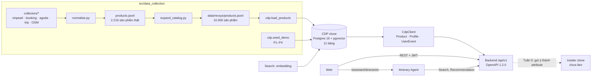
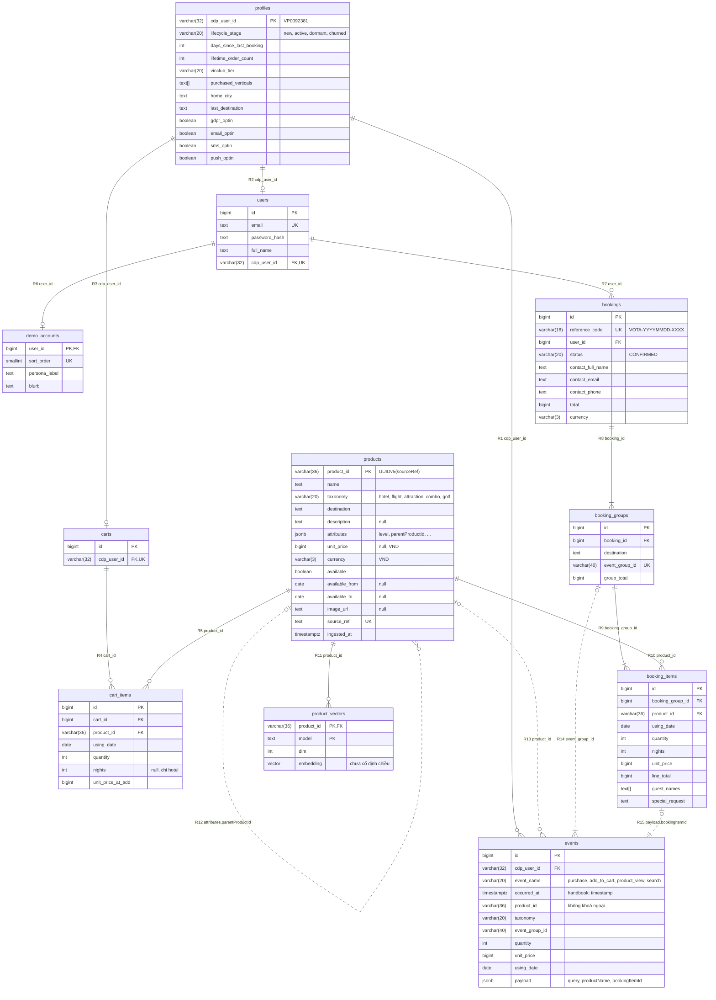
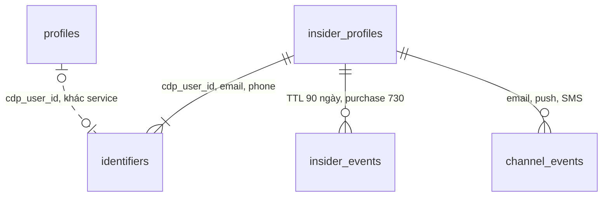

# Báo cáo schema thống nhất

Bản 17/09/2026 · viết từ nhánh `data`, gồm cả phần chưa commit · đối chiếu `origin/main` (`8196b8e`) và
`origin/data_contract` (`29a09d2`, OpenAPI 1.2.0).

> **Cập nhật 17/09:** nhánh `data_contract` đã chốt CDP clone là service riêng, chỉ giữ `events` và `profiles`.
> Các phần coi CDP clone là một database chung (§2–§6, §8.2–§8.5 và X4, X14–X16, X23) được thay bằng
> [thiết kế schema ba service](../../../docs/spec/thiet-ke-schema-3-service.md). Phần catalog (§7, §8.1, X2–X3, X5–X13,
> Phụ lục) vẫn dùng được.

Số liệu catalog đếm trực tiếp trên `data/recsys/products.jsonl` (10.000 dòng). Lệnh tái tạo ở Phụ lục C.
Tài liệu này không thay `SCHEMA.md`: `SCHEMA.md` giải thích từng khoá cho người dùng catalog, còn tài liệu này nối
catalog, CDP clone, `CdpClient` và API thành một bức tranh, rồi liệt kê chỗ các tầng đang nói khác nhau.

---

## 0. Tóm tắt

- Một sản phẩm đi qua bốn tầng: **catalog JSON** → **CDP clone** (Postgres, 11 bảng) → **`CdpClient`** (dataclass
  camelCase) → **API `/api/v1`** (OpenAPI 1.2.0). Insider clone là tầng thứ năm, chưa có code.
- Ba khoá xuyên suốt: `productId` = UUIDv5(`sourceRef`), đúng cho 10.000/10.000 dòng; `cdpUserId` khoá hồ sơ,
  event và giỏ; `eventGroupId` gom một chuyến đi.
- 15 quan hệ trong CDP clone: 11 khoá ngoại thật, 4 quan hệ mềm do `check.py` hoặc tầng API giữ (§4).
- Catalog sạch về liên kết cha–con: 4.646 hạng phòng và 184 chuyến bay đều trỏ đúng cha, cùng điểm đến với cha.
- **6 chỗ phải chốt trước khi Backend và Search viết code** (§9, X1–X6): hợp đồng nằm ở nhánh chưa merge,
  `attributes` ra API dạng nào, đơn vị giá và `lineTotal`, định dạng ID ở API, giá 0 VND của điểm không bán vé,
  bốn bộ khoá điểm đánh giá.

---

## 1. Nguồn sự thật

| Tài liệu / file | Quyết định điều gì | Nằm ở | Trạng thái |
|---|---|---|---|
| Handbook §6 | Tên và hình dạng bảng, trường CDP | `docs/spec/recsys-internship-handbook-v3-vi.md` | có trên `main` |
| `products.jsonl` | Dữ liệu catalog | `src/data_collection/data/recsys/`, ngoài git | 10.000 dòng |
| `cdp/models.py` + `cdp/alembic/versions/0001_cdp_schema.py` | DDL của CDP clone | nhánh `data` | **chưa commit** |
| `src/shared/contracts/openapi.yaml` 1.2.0 + `schemas/*.yaml` | Hình dạng API. Chính file ghi: khi tài liệu và file này mâu thuẫn, file này thắng | `origin/data_contract` | **chưa vào `main`** (`main` chỉ có khung 0.1.0) |
| `docs/spec/contract-baseline-v1.1.md`, `src/shared/contracts/MVP.md` | Trường bắt buộc/tuỳ chọn, giá snapshot, `priceUnit` | `origin/data_contract` | chưa vào `main` |
| `docs/spec/hop-dong-tich-hop-backend.md` 1.0 | Quy tắc Auth, Catalog, Search, Recommendation, Booking | `origin/data_contract` | chưa vào `main`; một phần bị baseline 1.1 và MVP 1.2 thay |
| `docs/spec/hop-dong-tich-hop-itinerary-assistant.md` | Hợp đồng Agent | `main` | còn dùng tên trường cũ (X21) |
| `src/data_collection/docs/SCHEMA.md` | Tham chiếu catalog | nhánh `data` | viết cho bản 2.216 dòng; §8 theo hợp đồng 1.0 (X10) |

**Thứ tự ưu tiên khi mâu thuẫn, đề xuất chốt:** handbook §6 cho tên trường CDP → OpenAPI 1.2.0 cho hình dạng API
→ baseline 1.1 / MVP 1.2 → hợp đồng Backend 1.0 → `SCHEMA.md`.

---

## 2. Các tầng



**Quy ước tên:** Postgres dùng `snake_case`; catalog JSON, `CdpClient` và API dùng `camelCase`
(`unit_price` ↔ `unitPrice`). Các ngoại lệ:

| Ở đâu | Tên | Tương ứng | Lý do |
|---|---|---|---|
| `events` | `occurred_at` | `timestamp` của UserEvent §6 | chỗ duy nhất đổi tên so với §6; `CdpClient.UserEvent.timestamp` trả lại đúng tên |
| JWT | `cdp_user_id` | `cdpUserId` | quy ước claim, hợp đồng Backend §3.5 |
| `events` | `payload` | không có trong §6 | chỗ cho `query`, `productName`, `bookingItemId`; đang chờ hỏi V-OTA |
| `products` | `ingested_at` | không có trong §6 | metadata lần nạp đầu, không đi qua `CdpClient` |

---

## 3. Định danh

| ID | Trong DB | Ở API | Dạng thật | Dạng trong mock | Ai sinh | Đề xuất |
|---|---|---|---|---|---|---|
| `productId` | `products.product_id` `varchar(36)` PK | string | `7e0803f8-907b-5fe9-a27c-a2976cc0996e` | `nt-h-01` (mock UI), UUID thật (mock Agent) | `uuid5(7a1c9e1e-3b0e-4f5c-9d3a-2f6f0b9c4e21, sourceRef)` trong `normalise.py` và `expand_catalog.py` | Giữ. Test tích hợp dùng UUID thật; `nt-h-01` không tồn tại trong CDP |
| `sourceRef` | `products.source_ref` `text` UNIQUE | `ProductDetail.sourceRef`, chỉ debug | `vinpearl:tour:VW01392` · `vinpearl:hotel:<uuid>:room:<uuid>` · `trip:flight:HAN-CXR:VJ781` · `synthetic:catalog-v1:42:a5d4e76725bb:hotel:000000:room:0` | `vinpearl:HTNHA001` | collector | Ghi dạng `<nguồn>:<loại>:<id>[:room:<id>]` vào hợp đồng |
| `cdpUserId` | `profiles.cdp_user_id` `varchar(32)` PK | string; JWT `cdp_user_id` | `VP0092381` | như nhau | seed; Backend khi đăng ký | X4 |
| `userId` | `users.id` `bigint` | `AuthUser.userId` string; JWT `sub` | số tự tăng | `web-user-001` | sequence Postgres | X4 |
| `cartId` | `carts.id` `bigint` | string | số tự tăng | `cart-01JXYZ` | sequence | X4 |
| `cartItemId` | `cart_items.id` `bigint` | string | số tự tăng | `ci-8k3f2a` | sequence | X4 |
| `bookingItemId` | `booking_items.id` `bigint`; `events.payload.bookingItemId` | string | số tự tăng | `bi-01` | sequence | X4 |
| `referenceCode` | `bookings.reference_code` `varchar(18)` UNIQUE + CHECK | pattern `^VOTA-[0-9]{8}-[A-Z0-9]{4}$` | `VOTA-20260916-8K3F` | như nhau | Backend | Giữ |
| `eventGroupId` | `events.event_group_id`, `booking_groups.event_group_id` UNIQUE, `varchar(40)` | string | `OFF` + `YYYYMMDD` + `901…` (seed) | `OFF20260916001` | seed dùng số 901+; Backend khi checkout | X4 |
| `conversationId` | không có bảng | string | — | `conv-01JXYZ` | Agent | X22 |
| `requestId` | không lưu | string, header `X-Request-ID` | — | `search-01JXYZ` | service đầu tiên | — |
| `model` | `product_vectors.model` | `RecommendationResponse.modelVersion` | — | `multilingual-e5-base-v1.2` | Search | X20 |

---

## 4. Quan hệ

### 4.1 Sơ đồ CDP clone

Nét liền là khoá ngoại trong Postgres. Nét đứt là quan hệ mềm, không có khoá ngoại.



### 4.2 Bảng quan hệ

Cột **Cha : con** đọc là "một dòng cha ứng với bao nhiêu dòng con". Cột **Con có cha** cho biết dòng con bắt buộc
hay không bắt buộc có cha.

| # | Con | Cha | Cột nối | Cha : con | Con có cha | Loại | Xoá cha | Ai giữ toàn vẹn | Lý do |
|---|---|---|---|---|---|---|---|---|---|
| R1 | `events` | `profiles` | `cdp_user_id` | 1 : 0..N | bắt buộc | FK | CASCADE | Postgres | Xoá khách thì xoá lịch sử |
| R2 | `users` | `profiles` | `cdp_user_id` | 1 : 0..1 | bắt buộc | FK + UNIQUE | RESTRICT | Postgres | Mỗi tài khoản web đúng một `cdpUserId` và ngược lại |
| R3 | `carts` | `profiles` | `cdp_user_id` | 1 : 0..1 | bắt buộc | FK + UNIQUE | CASCADE | Postgres | Một giỏ mỗi `cdpUserId` (D6) |
| R4 | `cart_items` | `carts` | `cart_id` | 1 : 0..N | bắt buộc | FK | CASCADE | Postgres | |
| R5 | `cart_items` | `products` | `product_id` | 1 : 0..N | bắt buộc | FK | CASCADE | Postgres | Sản phẩm rời catalog thì mục trong giỏ biến mất |
| R6 | `demo_accounts` | `users` | `user_id` (cũng là PK) | 1 : 0..1 | bắt buộc | FK | CASCADE | Postgres | |
| R7 | `bookings` | `users` | `user_id` | 1 : 0..N | bắt buộc | FK | CASCADE | Postgres | Chỉ chủ đơn đọc được đơn (§7.3) |
| R8 | `booking_groups` | `bookings` | `booking_id` | 1 : 1..N | bắt buộc | FK + UNIQUE(`booking_id`, `destination`) | CASCADE | Postgres; "ít nhất 1 nhóm" do API | Mỗi điểm đến trong đơn là một chuyến (D7) |
| R9 | `booking_items` | `booking_groups` | `booking_group_id` | 1 : 1..N | bắt buộc | FK | CASCADE | Postgres; "ít nhất 1 mục" do API | |
| R10 | `booking_items` | `products` | `product_id` | 1 : 0..N | bắt buộc | FK | **RESTRICT** | Postgres | Đã đặt thì không cho xoá sản phẩm |
| R11 | `product_vectors` | `products` | `product_id` (PK cùng `model`) | 1 : 0..N | bắt buộc | FK | CASCADE | Postgres | Mỗi sản phẩm có vector của nhiều mô hình |
| R12 | `products` con | `products` cha | `attributes->>'parentProductId'` | 1 : 0..N | chỉ `room`, `flight` | mềm, index biểu thức `ix_products_parent` | — | `check.py`; `expand_catalog.py` từ chối input thiếu cha | Giữ đúng 13 trường §6 |
| R13 | `events` | `products` | `product_id` | 1 : 0..N | không (`search`, sản phẩm đã xoá) | mềm, index `ix_events_product` | event giữ nguyên id | API trả `because[].productId = null` khi không còn sản phẩm | Event store giữ lịch sử sản phẩm đã rời catalog |
| R14 | `events` purchase | `booking_groups` | `event_group_id` | 1 : 1..N | không (chuyến seed `OFF…9xx`) | mềm; UNIQUE ở `booking_groups` | — | Backend, trong transaction checkout | Chuyến seed không có đơn đặt chỗ |
| R15 | `events` purchase | `booking_items` | `payload->>'bookingItemId'` | 1 : 1 | không (event seed) | mềm; unique index một phần `ux_events_booking_item` | — | Postgres chặn trùng; `check.py` soát "đúng một" | Một mục không bao giờ sinh hai event (§7.4 mục 6) |

**Quan hệ bắc cầu cần nhớ.** `bookings` khoá theo `users.id`, còn `carts` và `events` khoá theo `cdp_user_id`. Hai
đường gặp nhau vì R2 là 1–1, nên "đơn của một khách" = `bookings JOIN users USING (…) WHERE users.cdp_user_id = ?`.

### 4.3 Quan hệ bên trong catalog

| Quan hệ | Con | Đích | Số lượng trong 10.000 dòng | Dùng làm khoá được không |
|---|---|---|---|---|
| Hạng phòng → cơ sở | `hotel/room` | `hotel/property` | 4.646 phòng → 1.251 trên 1.494 cơ sở; tối đa 13 phòng một cơ sở | Được. 0 mồ côi, 0 lệch `destination`, không có cấp cháu |
| Chuyến bay → tuyến | `flight/flight` | `flight/route` | 184 chuyến → 60 trên 60 tuyến; tối đa 5 chuyến một tuyến | Được. 0 mồ côi; `originCity` khớp 184/184 |
| `poiRef` | attraction, combo Vinpearl | attraction trip.com, dạng `sourceRef` | 67 tham chiếu, 16 trỏ được vào catalog | Không |
| `sameAs` | hotel, attraction | `sourceRef` của bản trùng đã gộp | 53 tham chiếu, 0 còn trong catalog | Không, chỉ để truy vết dedup |
| `venue` | attraction, combo, golf | `collectors/venues.csv` | 1.857 dòng, 412 giá trị, 23 có trong CSV | Không, mock tự sinh tên venue |
| `originDestination` | `flight/*` | nhãn `destination` | 244, đều là điểm đến có trong catalog | Theo giá trị |
| Loại tay | — | `collectors/excluded_products.csv` | 10 `sourceRef` | `seed_demo.py` dùng `vinpearl:tour:VW00881` làm "sản phẩm đã xoá" |

Hệ quả cho Search, Recommendation và Agent: 10.000 sản phẩm **không** phải 10.000 thứ độc lập để gợi ý. Cơ sở và
hạng phòng của nó là cùng một nơi ở; tuyến và chuyến là cùng một đường bay. Không cộng giá cha với con, và cần chốt
index cấp nào (cơ sở, phòng, hay cả hai rồi gộp khi hiển thị).

### 4.4 Bản chụp giá trị

Các giá trị dưới đây cố ý được chép sang bảng khác. Đừng "chuẩn hoá" chúng về một chỗ.

| Giá trị gốc | Bản chụp | Chụp lúc | Để làm gì |
|---|---|---|---|
| `products.unit_price` | `cart_items.unit_price_at_add` | thêm vào giỏ | phát hiện `PRICE_CHANGED` khi checkout |
| `products.unit_price` | `booking_items.unit_price`, `line_total` | checkout | giá chốt, không đổi theo catalog |
| `products.unit_price` | `events.unit_price` | ghi event | lịch sử |
| `products.taxonomy` | `events.taxonomy` | ghi event | `excludedVerticals` vẫn tính được khi sản phẩm đã xoá |
| `products.name` | `events.payload.productName` | ghi event | `because[].productName` khi sản phẩm đã xoá |
| `products.destination` | `booking_groups.destination` | checkout | gom nhóm theo điểm đến |
| `destination` của lượt đặt gần nhất | `profiles.last_destination` | seed; sau checkout chưa ai cập nhật (X14) | `destination` mặc định của `/recommendations` |
| Σ `booking_items.line_total` | `booking_groups.group_total` → Σ → `bookings.total` | checkout | `check.py` soát bằng nhau |

---

## 5. Từ điển bảng — CDP

### 5.1 `products` — CDP catalog

| Cột | Kiểu | Null | Mặc định | Ràng buộc, index | `CdpClient` | Ghi chú |
|---|---|---|---|---|---|---|
| `product_id` | `varchar(36)` | không | — | **PK** | `productId` | UUIDv5 của `sourceRef` |
| `name` | `text` | không | — | | `name` | Phòng: `"<Khách sạn> - <Hạng phòng>"` |
| `taxonomy` | `varchar(20)` | không | — | CHECK 5 giá trị; index (`destination`, `taxonomy`) | `taxonomy` | |
| `destination` | `text` | không | — | index (`destination`, `taxonomy`) | `destination` | Nhãn du lịch, không phải tỉnh (`attributes.province`) |
| `description` | `text` | có | — | | `description` | `ProductDetail`: `null` → `""` |
| `attributes` | `jsonb` | không | `{}` | index biểu thức `attributes->>'parentProductId'` | `attributes` | 121 khoá, Phụ lục A |
| `unit_price` | `bigint` | có | — | CHECK `>= 0` | `unitPrice` | VND nguyên |
| `currency` | `varchar(3)` | không | `'VND'` | | `currency` | |
| `available` | `boolean` | không | `false` | index | `available` | Nguồn có trả giá lúc crawl. **Không phải còn chỗ** |
| `available_from` | `date` | có | — | | `availableFrom` | 10.000/10.000 đã điền (X8) |
| `available_to` | `date` | có | — | | `availableTo` | như trên |
| `image_url` | `text` | có | — | | `imageUrl` | |
| `source_ref` | `text` | không | — | **UNIQUE** | `sourceRef` | |
| `ingested_at` | `timestamptz` | không | `now()` | | — | Lần nạp đầu; upsert của loader không cập nhật cột này |

Chỉ loader ghi được bảng này (`PostgresCdpClient.upsert_products` cố ý nằm ngoài interface `CdpClient`).

### 5.2 `profiles` — CDP Profile Store

| Cột | Kiểu | Null | Mặc định | Ràng buộc, index | `CdpClient` | Ghi chú |
|---|---|---|---|---|---|---|
| `cdp_user_id` | `varchar(32)` | không | — | **PK** | `cdpUserId` | `VP` + 7 chữ số |
| `lifecycle_stage` | `varchar(20)` | có | — | CHECK `new`, `active`, `dormant`, `churned`; index | `lifecycleStage` | |
| `days_since_last_booking` | `int` | có | — | | `daysSinceLastBooking` | Ảnh chụp lúc seed (X14) |
| `lifetime_order_count` | `int` | không | `0` | | `lifetimeOrderCount` | Seed đếm số `event_group_id` purchase khác nhau, tức số chuyến |
| `vinclub_tier` | `varchar(20)` | có | — | không CHECK | `vinclubTier` | `Gold`, `Platinum`, `Diamond` (X13) |
| `purchased_verticals` | `text[]` | không | `{}` | | `purchasedVerticals` | Tập `taxonomy` đã mua |
| `home_city` | `text` | có | — | | `homeCity` | |
| `last_destination` | `text` | có | — | | `lastDestination` | Cùng bộ giá trị với `products.destination` |
| `gdpr_optin` | `boolean` | không | `true` | | `gdprOptin` | `false` = không gửi gì qua kênh nào |
| `email_optin` | `boolean` | không | `true` | | `emailOptin` | P3 = `false` |
| `sms_optin` | `boolean` | không | `false` | | `smsOptin` | |
| `push_optin` | `boolean` | không | `false` | | `pushOptin` | |
| `created_at`, `updated_at` | `timestamptz` | không | `now()` | `updated_at` tự đổi chỉ khi ghi qua ORM | — | |

### 5.3 `events` — CDP Event Store

| Cột | Kiểu | Null | Mặc định | Ràng buộc, index | `CdpClient.UserEvent` | Ghi chú |
|---|---|---|---|---|---|---|
| `id` | `bigint` tự tăng | không | — | **PK** | — | |
| `cdp_user_id` | `varchar(32)` | không | — | **FK** → `profiles` CASCADE; index (`cdp_user_id`, `occurred_at`) | `cdpUserId` | |
| `event_name` | `varchar(20)` | không | — | CHECK 4 giá trị | `eventName` | |
| `occurred_at` | `timestamptz` | không | — | nằm trong index trên | `timestamp` | Thời điểm hành vi |
| `product_id` | `varchar(36)` | có | — | index; **không FK** (R13) | `productId` | |
| `taxonomy` | `varchar(20)` | có | — | CHECK 5 giá trị hoặc null | `taxonomy` | Bản chụp |
| `event_group_id` | `varchar(40)` | có | — | index | `eventGroupId` | |
| `quantity` | `int` | có | — | | `quantity` | |
| `unit_price` | `bigint` | có | — | | `unitPrice` | Bản chụp |
| `using_date` | `date` | có | — | | `usingDate` | |
| `payload` | `jsonb` | không | `{}` | unique index một phần trên `payload->>'bookingItemId'` | `payload` | |
| `created_at` | `timestamptz` | không | `now()` | | — | Thời điểm ghi, khác `occurred_at` |

Trường nào có giá trị, theo loại event (theo `seed_demo.py`, `check.py` và hợp đồng Backend §7.4):

| `event_name` | `product_id` | `taxonomy` | `event_group_id` | `quantity` | `unit_price` | `using_date` | `payload` |
|---|---|---|---|---|---|---|---|
| `purchase` | có | có | **bắt buộc** (`check.py`) | có | có | có | `productName`; `bookingItemId` nếu sinh từ checkout |
| `add_to_cart` | có | có | null | có | có | có | `productName` |
| `product_view` | có | có | null | null | null | null | `productName` |
| `search` | null | null | null | null | null | null | **`query` bắt buộc** (`check.py`) |

Khoá của `payload`:

| Khoá | Có ở | Ý nghĩa | Đi ra API |
|---|---|---|---|
| `query` | `search` | Truy vấn người dùng gõ | `because[].productName` khi `event = search` |
| `productName` | event có sản phẩm | Tên lúc ghi event | `because[].productName` |
| `bookingItemId` | `purchase` từ checkout | `booking_items.id`, lưu dạng chuỗi số để `check.py` so với `bi.id::text` | — |

### 5.4 `product_vectors`

| Cột | Kiểu | Null | Ràng buộc | Ghi chú |
|---|---|---|---|---|
| `product_id` | `varchar(36)` | không | **PK₁**, **FK** → `products` CASCADE | |
| `model` | `text` | không | **PK₂** | Tên mô hình; nên khớp `modelVersion` của API (X20) |
| `dim` | `int` | không | CHECK `> 0` | |
| `embedding` | `vector` | không | chưa có index | Chiều để tự do; chốt mô hình xong thêm migration `vector(N)` + HNSW |
| `created_at` | `timestamptz` | không | mặc định `now()` | |

---

## 6. Từ điển bảng — chỉ cho demo

### 6.1 `users`

| Cột | Kiểu | Null | Ràng buộc | API | Ghi chú |
|---|---|---|---|---|---|
| `id` | `bigint` tự tăng | không | **PK** | `AuthUser.userId`, JWT `sub` | Dạng chuỗi ở API (X4) |
| `email` | `text` | không | **UNIQUE**, CHECK `email = lower(email)` | `email` | |
| `password_hash` | `text` | không | | — | BCrypt, không bao giờ trả ra hay ghi log |
| `full_name` | `text` | không | CHECK độ dài 1–100 | `fullName` | |
| `cdp_user_id` | `varchar(32)` | không | **UNIQUE**, **FK** → `profiles` RESTRICT | `cdpUserId`, JWT `cdp_user_id` | Đăng ký: tạo `profiles` trước rồi mới tạo `users` |
| `created_at` | `timestamptz` | không | mặc định `now()` | — | |

### 6.2 `demo_accounts`

| Cột | Kiểu | Null | Ràng buộc | API `GET /auth/demo-accounts` |
|---|---|---|---|---|
| `user_id` | `bigint` | không | **PK**, **FK** → `users` CASCADE | `email`, `fullName` lấy từ `users` |
| `sort_order` | `smallint` | không | **UNIQUE** | thứ tự trong `accounts[]` |
| `persona_label` | `text` | không | | `personaLabel` |
| `blurb` | `text` | không | | `blurb` |

### 6.3 `carts`

| Cột | Kiểu | Null | Ràng buộc | API `CartResponse` |
|---|---|---|---|---|
| `id` | `bigint` tự tăng | không | **PK** | `cartId` (X4) |
| `cdp_user_id` | `varchar(32)` | không | **UNIQUE**, **FK** → `profiles` CASCADE | `cdpUserId` |
| `created_at`, `updated_at` | `timestamptz` | không | mặc định `now()` | `updatedAt` (X15) |

### 6.4 `cart_items`

| Cột | Kiểu | Null | Mặc định | Ràng buộc | API `CartItem` | Ghi chú |
|---|---|---|---|---|---|---|
| `id` | `bigint` tự tăng | không | — | **PK** | `cartItemId` | |
| `cart_id` | `bigint` | không | — | **FK** → `carts` CASCADE | — | |
| `product_id` | `varchar(36)` | không | — | **FK** → `products` CASCADE; index | `product` | `ProductSummary` đọc lại lúc `GET`, không phải lúc thêm |
| `using_date` | `date` | không | — | UNIQUE (`cart_id`, `product_id`, `using_date`) | `usingDate` | Trùng sản phẩm và ngày thì cộng dồn `quantity` |
| `quantity` | `int` | không | `1` | CHECK `>= 1` | `quantity` | |
| `nights` | `int` | có | — | CHECK null hoặc `>= 1` | `nights` | Chỉ hotel; API kiểm (X18) |
| `unit_price_at_add` | `bigint` | không | — | CHECK `>= 0` | — | `details.oldPrice` của `PRICE_CHANGED` |
| `created_at`, `updated_at` | `timestamptz` | không | `now()` | | — | |
| *(không lưu)* | | | | | `lineTotal` | Tính khi đọc (X3) |

### 6.5 `bookings`

| Cột | Kiểu | Null | Mặc định | Ràng buộc | API `BookingResponse` |
|---|---|---|---|---|---|
| `id` | `bigint` tự tăng | không | — | **PK** | không lộ ra |
| `reference_code` | `varchar(18)` | không | — | **UNIQUE**, CHECK `^VOTA-[0-9]{8}-[A-Z0-9]{4}$` | `referenceCode` |
| `user_id` | `bigint` | không | — | **FK** → `users` CASCADE; index | chủ đơn |
| `status` | `varchar(20)` | không | `'CONFIRMED'` | CHECK chỉ `CONFIRMED` | `status` |
| `contact_full_name` | `text` | không | — | | `contact.fullName` |
| `contact_email` | `text` | không | — | | `contact.email` |
| `contact_phone` | `text` | không | — | chưa CHECK `^0[0-9]{9}$` (X18) | `contact.phone` |
| `total` | `bigint` | không | — | CHECK `>= 0` | `total` = Σ `groupTotal` |
| `currency` | `varchar(3)` | không | `'VND'` | | `currency` |
| `created_at` | `timestamptz` | không | `now()` | | `createdAt` |

### 6.6 `booking_groups`

| Cột | Kiểu | Null | Ràng buộc | API `BookingGroup` |
|---|---|---|---|---|
| `id` | `bigint` tự tăng | không | **PK** | — |
| `booking_id` | `bigint` | không | **FK** → `bookings` CASCADE; UNIQUE (`booking_id`, `destination`) | — |
| `destination` | `text` | không | | `destination` |
| `event_group_id` | `varchar(40)` | không | **UNIQUE** | `eventGroupId` |
| `group_total` | `bigint` | không | CHECK `>= 0` | `groupTotal` |

### 6.7 `booking_items`

| Cột | Kiểu | Null | Mặc định | Ràng buộc | API `BookingItem` |
|---|---|---|---|---|---|
| `id` | `bigint` tự tăng | không | — | **PK** | `bookingItemId`; = `events.payload.bookingItemId` |
| `booking_group_id` | `bigint` | không | — | **FK** → `booking_groups` CASCADE; index | — |
| `product_id` | `varchar(36)` | không | — | **FK** → `products` RESTRICT; index | `product` (X16) |
| `using_date` | `date` | không | — | | `usingDate` |
| `quantity` | `int` | không | — | CHECK `>= 1` | `quantity` |
| `nights` | `int` | có | — | CHECK null hoặc `>= 1` | `nights` |
| `unit_price` | `bigint` | không | — | CHECK `>= 0` | giá chốt |
| `line_total` | `bigint` | không | — | CHECK `>= 0` | `lineTotal` |
| `guest_names` | `text[]` | không | `{}` | | `guestNames` |
| `special_request` | `text` | có | — | chưa CHECK độ dài 500 (X18) | `specialRequest` |
| `created_at` | `timestamptz` | không | `now()` | | — |

---

## 7. Catalog `products.jsonl`

### 7.1 Mười ba trường, đếm trên 10.000 dòng

Mọi dòng có đủ 13 khoá, không dòng nào có khoá cấp cao nhất thứ 14.

| Trường | Kiểu thực tế | Khác null | Phân bố | So với `SCHEMA.md` (2.216 dòng) |
|---|---|---:|---|---|
| `productId` | string, UUIDv5 | 10.000 | 10.000 giá trị khác nhau | |
| `name` | string | 10.000 | | |
| `taxonomy` | enum | 10.000 | hotel 6.140 · attraction 3.517 · flight 244 · combo 93 · golf 6 | |
| `destination` | string | 10.000 | 20 giá trị, §7.3 | |
| `description` | string | 10.000 | 0 chuỗi rỗng | |
| `attributes` | object | 10.000 | 0 object rỗng · 121 khoá | |
| `unitPrice` | int | 10.000 | 139 dòng bằng `0` | trước: 140 `null` (X5) |
| `currency` | string | 10.000 | luôn `VND` | |
| `available` | bool | 10.000 | `true` 9.859 · `false` 141 (140 attraction, 1 golf) | |
| `availableFrom` | date | 10.000 | 9.349 dòng là `2026-10-15` | trước: 26% (X8) |
| `availableTo` | date | 10.000 | | trước: 26% (X8) |
| `imageUrl` | URL | 10.000 | | trước: 89%; 244 vé máy bay nay dùng ảnh điểm đến |
| `sourceRef` | string | 10.000 | `synthetic` 7.784 · `booking` 1.092 · `trip` 453 · `vinpearl` 428 · `agoda` 243 | |

### 7.2 Bảy biến thể

| Biến thể | `taxonomy` | `attributes.level` | Thật | Mock | Tổng | Cha |
|---|---|---|---:|---:|---:|---|
| `hotel/property` | `hotel` | `property` | 559 | 935 | 1.494 | — |
| `hotel/room` | `hotel` | `room` | 907 | 3.739 | 4.646 | `hotel/property` |
| `flight/route` | `flight` | `route` | 60 | 0 | 60 | — |
| `flight/flight` | `flight` | `flight` | 184 | 0 | 184 | `flight/route` |
| `attraction` | `attraction` | không có | 407 | 3.110 | 3.517 | — |
| `combo` | `combo` | không có | 93 | 0 | 93 | — |
| `golf` | `golf` | không có | 6 | 0 | 6 | — |
| **Tổng** | | | **2.216** | **7.784** | **10.000** | |

Mock nhận biết bằng `sourceRef` bắt đầu `synthetic:`, `attributes.locationSource = "mock"` và
`attributes.fieldSources.unitPrice = "mock"`. Không có cờ riêng.

### 7.3 Điểm đến

| Điểm đến | Sản phẩm | Điểm đến | Sản phẩm |
|---|---:|---|---:|
| Nha Trang | 773 | Huế | 645 |
| Phú Quốc | 766 | Quy Nhơn | 635 |
| Hà Nội | 719 | Phan Thiết | 628 |
| Hải Phòng | 694 | Sa Pa | 622 |
| TP. Hồ Chí Minh | 682 | Hà Tĩnh | 611 |
| Đà Nẵng | 660 | Hạ Long | 589 |
| Hội An | 656 | Bắc Ninh | 7 |
| Nghệ An | 650 | Thanh Hóa, Quảng Bình, Ninh Bình, Tây Ninh | 4 mỗi nơi |
| Đà Lạt | 647 | | |

`GET /destinations` là `GROUP BY destination` trên bảng này. `booking_groups.destination` và
`profiles.last_destination` phải dùng đúng các chuỗi trên.

Toàn bộ khoá `attributes` theo biến thể: Phụ lục A.

---

## 8. Ánh xạ xuyên tầng

### 8.1 Sản phẩm

**Bắt buộc** theo OpenAPI 1.2.0. "tuỳ chọn" = được gửi nhưng client không được giả định là có.

| Catalog JSON | `products` | `CdpClient.Product` | `ProductSummary` | `ProductDetail` | `RecommendationItem` | Quy đổi |
|---|---|---|---|---|---|---|
| `productId` | `product_id` | `productId` | **bắt buộc** | **bắt buộc** | **bắt buộc** | giữ nguyên |
| `name` | `name` | `name` | **bắt buộc** | **bắt buộc** | **bắt buộc** | giữ nguyên |
| `taxonomy` | `taxonomy` | `taxonomy` | **bắt buộc** | **bắt buộc** | **bắt buộc** | giữ nguyên |
| `destination` | `destination` | `destination` | **bắt buộc** | **bắt buộc** | **bắt buộc** | giữ nguyên |
| `unitPrice` | `unit_price` | `unitPrice` | **bắt buộc**, nullable | **bắt buộc**, nullable | **bắt buộc**, nullable | `null` không phải miễn phí (X5) |
| `currency` | `currency` | `currency` | **bắt buộc** | **bắt buộc** | **bắt buộc** | luôn `VND` |
| `available` | `available` | `available` | **bắt buộc** | **bắt buộc** | **bắt buộc** | trạng thái lúc crawl |
| `availableFrom`, `availableTo` | `available_from`, `available_to` | cùng tên | tuỳ chọn, nullable | **bắt buộc**, nullable | — | `date` → `YYYY-MM-DD` |
| `imageUrl` | `image_url` | `imageUrl` | tuỳ chọn | tuỳ chọn | tuỳ chọn | `null` → placeholder theo `taxonomy` |
| `description` | `description` | `description` | tuỳ chọn | **bắt buộc** | — | `null` → `""` |
| `attributes` | `attributes` | `attributes` | tuỳ chọn | **bắt buộc** | tuỳ chọn | X2 |
| `sourceRef` | `source_ref` | `sourceRef` | — | tuỳ chọn, chỉ debug | — | |
| `attributes.reviewScore`, … | trong `attributes` | trong `attributes` | `rating` tuỳ chọn | như Summary | — | X6 |
| `attributes.reviewCount`, … | trong `attributes` | trong `attributes` | `reviewCount` tuỳ chọn | như Summary | — | X6 |
| — | — | — | `priceUnit` tuỳ chọn, thiếu = `UNKNOWN` | như Summary | tuỳ chọn | X3 |
| — | `product_vectors` | — | `score` (chỉ `ScoredProduct`) | — | `score`, `rank` tuỳ chọn | cosine chuẩn hoá 0–1 |
| — | `events` | — | — | — | `because` **bắt buộc** | §8.2 |

### 8.2 Event → gợi ý

| Nguồn | `CdpClient` | Đầu ra `GET /recommendations` | Quy tắc |
|---|---|---|---|
| `events.event_name` | `eventName` | `because[].event` | |
| `events.occurred_at` | `timestamp` | `because[].daysAgo` | số ngày tới `generatedAt` |
| `events.product_id` | `productId` | `because[].productId` | `null` khi `search` hoặc không còn trong `products` |
| `events.payload.productName` / `.query` | `payload` | `because[].productName` | `search` lấy `query` |
| `products.image_url` | `imageUrl` | `because[].imageUrl` | `null` khi sản phẩm đã xoá |
| `events.taxonomy` theo `event_group_id` | `taxonomy`, `eventGroupId` | `diagnostics.excludedVerticals`, `nextVertical`, `strategy = cross_vertical` | loại danh mục đã đặt trong chuyến |
| số event | — | `diagnostics.eventsUsed`, `coldStart` (dưới 3) | |
| `max(occurred_at)` | — | `strategy = dormant` (trên 90 ngày) | |
| `profiles.last_destination` | `lastDestination` | `destination` khi query không truyền | X14 |
| `profiles.cdp_user_id` | `cdpUserId` | `cdpUserId` | `null` khi không có JWT |
| `product_vectors.model` | — | `modelVersion` | X20 |

### 8.3 Auth

| DB | API | JWT | Quy tắc |
|---|---|---|---|
| `users.id` | `AuthUser.userId` | `sub` | X4 |
| `users.cdp_user_id` | `AuthUser.cdpUserId` | `cdp_user_id` | |
| `users.email` | `AuthUser.email` | `email` | lưu chữ thường |
| `users.full_name` | `AuthUser.fullName` | — | |
| `users.password_hash` | — | — | BCrypt |
| `demo_accounts` + `users` | `DemoAccountListResponse.accounts[]` | — | `ORDER BY sort_order`; `404` khi `APP_ENV=production` |

### 8.4 Giỏ hàng

| DB | API `CartResponse` | Quy tắc |
|---|---|---|
| `carts.id` | `cartId` | X4 |
| `carts.cdp_user_id` | `cdpUserId` | lấy từ JWT |
| `cart_items.id` | `items[].cartItemId` | X4 |
| `cart_items.product_id` → `products` | `items[].product` | đọc lại lúc `GET`, nên hết chỗ tự lộ ra |
| `cart_items.using_date` | `items[].usingDate` | nằm trong `availableFrom`–`availableTo`, nếu không `DATE_OUT_OF_RANGE` |
| `cart_items.quantity`, `nights` | `items[].quantity`, `nights` | |
| — | `items[].lineTotal` | X3 |
| `cart_items.unit_price_at_add` | `error.details.oldPrice` | so với `products.unit_price` lúc checkout |
| — | `itemCount` | X17 |
| — | `subtotal` = `total` = Σ `lineTotal` | MVP không có thuế, phí |
| `carts.updated_at` | `updatedAt` | X15 |

### 8.5 Checkout — một transaction

| Bước | Ghi vào | Đi ra API |
|---|---|---|
| 1 | Kiểm tra: giỏ không rỗng, sản phẩm còn, `available`, giá khớp `unit_price_at_add`, `using_date` trong khoảng | `400 CART_EMPTY`, `409 PRODUCT_UNAVAILABLE`, `409 PRICE_CHANGED`, `422 DATE_OUT_OF_RANGE` |
| 2 | `bookings` | `referenceCode`, `createdAt`, `status`, `contact`, `total` |
| 3 | `booking_groups`: mỗi `products.destination` một dòng, một `event_group_id` mới | `groups[].destination`, `eventGroupId`, `groupTotal` |
| 4 | `booking_items`: giá chốt, `line_total`, `guest_names` và `special_request` từ `itemDetails` | `groups[].items[]` |
| 5 | `events` purchase cho từng mục qua `CdpClient.record_event`, `payload.bookingItemId` = id của mục | — |
| 6 | *(đề xuất)* cập nhật tổng hợp `profiles` | X14 |
| 7 | xoá `cart_items` | gửi lại cùng request → `CART_EMPTY` |

Bước 2–7 nằm trong `session_scope`: commit khi xong, rollback nếu lỗi. Event ghi xong trước khi trả `201`.

### 8.6 Itinerary Agent

Agent không có bảng nào và không đọc CDP. Nó gọi `POST /search` và `GET /recommendations` qua HTTP, dùng
`ProductSummary` cho `ItineraryStay.product` và `ItinerarySlot.product`, giữ `because[]`, rồi bàn giao cho Web bằng
`productId` → `/product/{productId}` → giỏ. `bookableCount` loại sản phẩm `available = false`, giá `null`,
`ticketed = false` và bản ghi cha khi đã chọn con. Trạng thái hội thoại chưa có nơi lưu (X22).

---

## 9. Chỗ lệch cần thống nhất

**P0** chặn tích hợp, chốt trước khi Backend và Search viết code · **P1** mảng Data tự sửa được ·
**P2** ghi nhận cho Backend.

| # | Mức | Chủ | Chỗ lệch | Đề xuất |
|---|---|---|---|---|
| X1 | P0 | cả nhóm | OpenAPI 1.2.0, hợp đồng Backend và baseline nằm ở `origin/data_contract`, chưa vào `main`. Code CDP trên `data` trỏ tới `docs/spec/hop-dong-tich-hop-backend.md`, file không có trên `data` lẫn `main` | Merge `data_contract` → `main`, rồi merge `main` → `data`. Mô phỏng trên bản `data` gồm cả phần chưa commit: merge `main` sạch; merge `data_contract` xung đột ở `src/data_collection/README.md` và `docs/SCHEMA.md`, vì `data_contract` mang bản sao cũ của commit crawl (`43bdedd`) — giữ bản của `data`. Chốt thứ tự ưu tiên ở §1 |
| X2 | P0 | Backend, Web, Data | `attributes` ra API: hợp đồng 1.0 §2.5 và `SCHEMA.md` §8.2 dùng bộ khoá cố định, chỉ `true`; OpenAPI 1.2.0 giữ nguyên `attributes` catalog. Catalog không có sẵn `wifi`, `pool`… Trung vị `attributes` 0,9–3,9 KB một sản phẩm | `ProductDetail`: giữ nguyên. `ProductSummary`, `RecommendationItem`: bỏ hẳn, hoặc chỉ gửi `starRating`, `level`, `parentProductId`, `ticketed` cộng các nhãn suy ra. Nhãn suy ra thì **thêm vào**, không thay khoá gốc |
| X3 | P0 | Data, Booking | `lineTotal`: hợp đồng 1.0 §2.6 suy đơn vị từ `taxonomy`; baseline 1.1 cấm suy, thiếu thì `UNKNOWN`. `booking_items.line_total` lại `NOT NULL`. Baseline giao Data làm bảng ánh xạ đơn vị giá | Data thêm `attributes.priceUnit` khi có chứng cứ, xem chi tiết dưới bảng. Booking chốt: mục `UNKNOWN` không cho vào giỏ, hay tạm tính theo `taxonomy` và ghi là giả định demo |
| X4 | P0 | Backend | ID ở API là chuỗi (`web-user-001`, `cart-01JXYZ`, `ci-8k3f2a`, `bi-01`), ở DB là `bigint`. `cdpUserId` và `eventGroupId` chưa có pattern | ID ở API = chuỗi số của `bigint` (`"42"`); mock chỉ là ví dụ. `payload.bookingItemId` lưu đúng chuỗi đó. `cdpUserId` `^VP[0-9]{7}$`: đăng ký cấp từ `VP1000000`, dải `VP0…` để cho seed và Evaluation. `eventGroupId` `^OFF[0-9]{8}[0-9]{3}$`: Backend dùng 001–900 mỗi ngày, seed 901–999 |
| X5 | P0 | Data | `expand_catalog.py` điền `unitPrice = 0` cho 139 điểm không bán vé và 1.700.000 VND cho golf Sea Links `ticketed = false`. OpenAPI: `null` không phải miễn phí, hiển thị "Chưa có giá" | Không điền giá cho `ticketed = false`, giữ `null`; OpenAPI 1.2.0 đã cho `unitPrice` nullable. Nếu giữ `0`, lọc `priceMax` và sắp `price_asc` với `availableOnly = false` sẽ đưa các điểm này lên đầu |
| X6 | P0 | Data, Search | Bốn bộ khoá điểm: hotel `reviewScore`/`reviewScoreScale` thang 10 (528), attraction `rating`/`ratingScale` thang 5 (159), `tripRating`/`tripReviewCount` (67), `tripAdvisorRating` (15), thêm `agodaReviewScore`, `bookingReviewScore`. OpenAPI chỉ nói tới `reviewScore` nên 159 điểm tham quan mất `rating`. `SCHEMA.md` §8.1 ghi nhầm 159 sản phẩm này "không có điểm". `attributes.rating` trùng tên `rating` của API | Trong `normalise.py`: đổi `rating`/`ratingScale` → `reviewScore`/`reviewScoreScale`. Thứ tự lấy `rating` ở API: `reviewScore` → `tripAdvisorRating` → `tripRating`. Phủ được 769/10.000 |
| X7 | P1 | Data | Khoá trùng nghĩa: `policy` (string, 15) / `policies` (object, 285); `memberPrice` (number, 12) / `memberPrices` (object, 23); `bed` (776) / `bedType` (83); năm khoá URL `url`, `bookingUrl`, `agodaUrl`, `bookingComUrl`, `tripUrl`; `starRating` lẫn int (771) và number (5.043), có 26 giá trị x,5 | Gộp về `policies`, `memberPrices`, `bed`; URL nguồn phụ gom vào một object; `starRating` luôn là number |
| X8 | P1 | Data, Backend | `availableFrom`/`To` điền cho 9.459 sản phẩm, gồm cả khách sạn thật. Trong bản ghi không phân biệt được giá trị điền với giá trị nguồn; nhật ký chỉ nằm ở `report.json` | Giữ cho demo để `DATE_OUT_OF_RANGE` chạy được. Ghi vào `SCHEMA.md` và baseline rằng đây là cửa sổ đặt chỗ giả định, không dùng để khẳng định còn chỗ |
| X9 | P1 | Data | Hợp đồng Backend §11 cần ít nhất 1 sản phẩm `description` rỗng và 1 sản phẩm `attributes: {}`. Catalog 10.000 dòng có 0 và 0 | Thêm 2 bản ghi biên có `sourceRef` `synthetic:edge:…`, hoặc chốt để trường hợp này chỉ nằm trong mock |
| X10 | P1 | Data | `SCHEMA.md` còn ghi 2.216 sản phẩm và độ phủ cũ; §8.1 sai (X6); §8.3–8.4 không còn đúng sau khi điền null; ghi `memberPrices` có khoá `Gold`, thực tế là `VIN33 - Gold`; link hợp đồng Backend gãy (X1) | Sửa `SCHEMA.md` sau khi chốt X2–X6, tách rõ số liệu bản thật và bản 10.000 |
| X11 | P1 | Data | Tham chiếu mềm không phân giải được: `venue` 23/412, `poiRef` 16/67, `sameAs` 0/53 | Ghi rõ trong `SCHEMA.md` là nhãn, không phải khoá; không join theo chúng |
| X12 | P1 | Data | 26 hạng phòng Vinpearl có `unitPrice` (booking.com) ≠ `pricesByDate[priceDate]` (vinpearl.com) | Đúng thiết kế theo `fieldSources.unitPrice`. Ghi vào `SCHEMA.md` để không ai coi là lỗi |
| X13 | P1 | Data, Backend | `profiles.vinclub_tier` = `Gold`/`Platinum`/`Diamond`; khoá `memberPrices` = `VIN33 - Gold`/`VIN33 - Platinum`/`VIN33 - Diamond`/`Khách hàng đặc biệt` | Chuẩn hoá khoá `memberPrices` về đúng giá trị `vinclub_tier`, giữ nhãn gốc ở chỗ khác nếu cần |
| X14 | P2 | Backend | Không ai cập nhật `days_since_last_booking`, `lifetime_order_count`, `purchased_verticals`, `last_destination` sau checkout, trong khi `/recommendations` dùng `last_destination` làm mặc định | Cập nhật trong transaction checkout, hoặc tính khi đọc từ `events`. Chốt `lifetime_order_count` đếm chuyến hay đếm đơn |
| X15 | P2 | Backend | `carts.updated_at` không đổi khi chỉ sửa `cart_items`; `updated_at` tự đổi chỉ khi ghi qua ORM | `updatedAt` = max của `carts` và `cart_items`, hoặc cập nhật `carts.updated_at` ở mọi thao tác giỏ |
| X16 | P2 | Backend | `BookingItem.product.unitPrice` là giá hiện tại hay giá đã chốt | Dùng `booking_items.unit_price` để đơn đọc lại không đổi theo catalog |
| X17 | P2 | Backend, Web | `itemCount` là số dòng hay tổng `quantity` | Chốt một nghĩa và ghi vào OpenAPI |
| X18 | P2 | Backend | Ràng buộc có ở API nhưng không có ở DB: `contact_phone` `^0[0-9]{9}$`, `special_request` tối đa 500, phần tử `guest_names` không rỗng, `nights` chỉ cho hotel | Kiểm ở tầng API; thêm CHECK cho ba ràng buộc đầu khi viết migration kế tiếp |
| X19 | P2 | Backend | `src/backend/app/core/config.py` vẫn là `sqlite:///./data/app.db` và `chroma_persist_dir`, trên cả `main` lẫn `data_contract` | Trỏ `database_url` tới CDP clone (`CDP_DATABASE_URL`), bỏ Chroma |
| X20 | P2 | Search | `product_vectors.embedding` chưa cố định chiều; quan hệ `model` ↔ `modelVersion` chưa chốt | Chốt mô hình ở Tuần 2 → migration `0002` đặt `vector(N)` và tạo HNSW; `modelVersion` = `model` + phiên bản text builder |
| X21 | P2 | Agent | Hợp đồng Agent trên `main` còn `category`/`HOTEL`, `price {amount, currency, unit}`, `attributes` dạng mảng, `semanticScore`, `userId`, `reason`, `bookingUrl` | Sửa theo hợp đồng Backend §9 và OpenAPI 1.2.0; `main` mới đổi `RESTAURANT` → `GOLF` |
| X22 | P2 | Agent | Hội thoại lưu TripIntent mới nhất, hết hạn sau 24 giờ, nhưng không có nơi lưu | Không đưa vào CDP; chốt bộ nhớ trong process hay bảng riêng của Agent |
| X23 | P2 | Backend | Xoá `users` kéo theo `bookings` nhưng event purchase vẫn giữ `payload.bookingItemId`, làm `check.py` báo lỗi. `seed_demo.py` tránh được vì xoá cả `profiles` | Chỉ xoá người dùng demo qua đường của seed; ghi lại quy tắc này |

### Chứng cứ cho `priceUnit` (X3)

Đếm trên 10.000 dòng theo khoá đang có. "Cần xác nhận" nghĩa là có chứng cứ gián tiếp, chưa đủ để gán.

| Biến thể | Chứng cứ | Gán được | Còn lại |
|---|---|---|---|
| hotel, thật | `priceNights = 1` (hỏi giá 1 đêm; cơ sở hỏi cho 2 người lớn) | `PER_NIGHT`: 1.350 | 116 hạng phòng Vinpearl không có `priceNights` |
| hotel, mock | mô tả ghi "một đêm" / "mỗi đêm" | `PER_NIGHT`: 4.674 | 0 |
| flight | mô tả ghi "Giá một chiều" từ trip.com | `PER_PERSON` cần xác nhận: 244 | |
| attraction, combo, golf | có `adultOriginalPrice` và `childPrice` | `PER_PERSON`: 1.852 | 208 điểm tham quan thật (139 không bán vé), 1.555 tour mock, 1 golf |

---

## 10. Insider clone — chưa có code

Handbook §3 và §6 chỉ nêu nội dung từng bảng, chưa nêu cột. Phần dưới giữ đúng mức đó; cột cụ thể cần chốt khi
làm, không tự nghĩ ra.

| Bảng | Chứa | Quy tắc |
|---|---|---|
| `insider_profiles` | Thuộc tính nhận qua `POST /user/v1/upsert`, khoá theo identifier | Cố ý là tập con của CDP. Gửi `""` hoặc `null` không xoá thuộc tính. Mảng mặc định append trừ khi `not_append: true` |
| `insider_events` | Event nhận qua Upsert | Hết hạn sau 90 ngày, `purchase` sau 730 ngày |
| `channel_events` | Email mở, click, bounce, huỷ đăng ký; push, SMS | Seed sẵn, trả ra qua `POST /raw/v1/export` |
| `identifiers` | Ánh xạ `cdp_user_id`, email, số điện thoại về một profile | `PATCH /user/v1/identity`: một user mỗi request, identifier cũ và mới cùng kiểu |



Quan hệ với CDP chỉ đi qua giá trị `cdp_user_id` trong `identifiers`, không có khoá ngoại vì là service khác.
`profiles.gdpr_optin = false` thì batch Tuần 5 không đẩy gì cho khách đó. Lịch sử dài hạn đọc từ CDP, không đọc từ
Insider.

---

## 11. Việc tiếp theo cho mảng Data

1. Commit phần đang làm trên `data` và push (§1): schema CDP 11 bảng, `seed_demo.py`, `expand_catalog.py`.
2. Merge `data_contract` → `main` → `data` (X1; hai xung đột ở `README.md`, `SCHEMA.md`, giữ bản của `data`), rồi
   chạy `python3 src/shared/contracts/tests/validate_contract.py`.
3. Chốt X2–X6 với Backend, Search, Web. Sửa `normalise.py` và `expand_catalog.py` theo kết quả, sinh lại catalog.
4. Sửa `SCHEMA.md` (X10) và ghi rõ các giá trị demo (X8, X12).
5. Chạy CDP clone đầu-cuối: `docker compose up -d` → `alembic upgrade head` → `load_products` → `seed_demo` →
   `check`. Máy hiện tại chưa có quyền docker cho user thường.
6. Tuần 2 của Data theo handbook §11: **bộ dựng văn bản** cho embedding, câu khách sạn và câu chuyến bay dựng khác
   nhau; quyết định dùng hay bỏ mô tả tự sinh (`attributes.descriptionSource`).
7. Tuần 3: gom event thành chuyến, suy ra danh mục đã đặt, điểm đến gần nhất, ngày đi sắp tới (nối với X14).

---

## Phụ lục A — Khoá `attributes` theo biến thể

Phần trăm số dòng của biến thể có khoá đó, đếm trên 10.000 dòng. `·` là không có.
**Thật / mock** cho biết khoá xuất hiện ở bản ghi crawl, bản ghi `synthetic:` hay cả hai.

Số dòng mỗi biến thể: property 1.494 · room 4.646 · route 60 · flight 184 · attraction 3.517 · combo 93 · golf 6

| Khoá | Kiểu | property | room | route | flight | attraction | combo | golf | Thật / mock | Ghi chú |
|---|---|---:|---:|---:|---:|---:|---:|---:|---|---|
| **Định danh, liên kết, nguồn** | |  |  |  |  |  |  |  | | |
| `level` | string | 100 | 100 | 100 | 100 | · | · | · | thật + mock |  |
| `parentProductId` | string | · | 100 | · | 100 | · | · | · | thật + mock | khoá mềm → `products.product_id` (§4.3) |
| `fieldSources` | object | 100 | 100 | 100 | 100 | 100 | 100 | 100 | thật + mock | mock: `{unitPrice: "mock"}` |
| `url` | string | 100 | 100 | 100 | 100 | 100 | 100 | 100 | thật + mock | mock: `example.com` |
| `bookingUrl` | string | 64 | 83 | · | · | · | · | · | thật + mock | trùng tên với `bookingUrl` bị bỏ khỏi hợp đồng · X7 |
| `agodaUrl` | string | 2 | · | · | · | · | · | · | thật | X7 |
| `bookingComUrl` | string | 1 | · | · | · | · | · | · | thật | X7 |
| `tripUrl` | string | · | · | · | · | <1 | · | · | thật | X7 |
| `sameAs` | array | 3 | · | · | · | <1 | · | · | thật | `sourceRef` của bản ghi đã gộp, 0/53 còn trong catalog |
| `poiRef` | string | · | · | · | · | 1 | 27 | · | thật | dạng `sourceRef`, 16/67 trỏ được vào catalog |
| `poiName` | string | · | · | · | · | 1 | 27 | · | thật |  |
| `venue` | string | · | · | · | · | 50 | 100 | 83 | thật + mock | 23/412 giá trị có trong `collectors/venues.csv` |
| `brand` | string | 64 | 84 | · | · | 6 | 100 | 83 | thật + mock |  |
| `supplier` | string | · | · | · | · | 50 | 100 | · | thật + mock |  |
| `hotelCode` | string | 1 | · | · | · | · | · | · | thật |  |
| `hotelName` | string | 63 | 100 | · | · | · | · | · | thật + mock |  |
| `roomId` | string | · | 17 | · | · | · | · | · | thật |  |
| `roomCode` | string | · | 83 | · | · | · | · | · | thật + mock |  |
| `roomName` | string | · | 100 | · | · | · | · | · | thật + mock |  |
| `otaRoomName` | string | · | 1 | · | · | · | · | · | thật |  |
| `tourCode` | string | · | · | · | · | 94 | 100 | 83 | thật + mock |  |
| `vinpearlType` | int | · | · | · | · | 6 | 100 | 83 | thật |  |
| `salesChannels` | array | · | · | · | · | 6 | 100 | 83 | thật |  |
| `hasDetail` | bool | · | · | · | · | 6 | 100 | 83 | thật |  |
| `nameEn` | string | 10 | · | · | · | 5 | · | 17 | thật |  |
| **Vị trí, điểm đến** | |  |  |  |  |  |  |  | | |
| `latitude` | number | 100 | 100 | 100 | 100 | 100 | 100 | 100 | thật + mock |  |
| `longitude` | number | 100 | 100 | 100 | 100 | 100 | 100 | 100 | thật + mock |  |
| `locationSource` | string | 100 | 100 | 100 | 100 | 100 | 100 | 100 | thật + mock | mock: `mock` |
| `locationPrecision` | string | 100 | 100 | 100 | 100 | 100 | 100 | 100 | thật + mock |  |
| `locationWarning` | string | <1 | <1 | · | · | <1 | · | · | thật |  |
| `locationNote` | string | <1 | · | · | · | · | · | · | thật |  |
| `address` | string | 37 | 17 | · | · | 7 | 27 | 17 | thật |  |
| `province` | string | 21 | 17 | · | · | 9 | 100 | 100 | thật |  |
| `city` | string | 37 | 17 | · | · | · | · | · | thật |  |
| `district` | string | · | · | · | · | 6 | · | 17 | thật |  |
| `departure` | string | · | · | · | · | 45 | 2 | · | thật + mock |  |
| `originalDestination` | string | <1 | · | · | · | <1 | · | 17 | thật |  |
| `destinationSource` | string | <1 | · | · | · | <1 | · | · | thật |  |
| `destinationEvidence` | string | <1 | · | · | · | <1 | · | · | thật |  |
| **Mô tả, chính sách, nhãn** | |  |  |  |  |  |  |  | | |
| `descriptionLang` | string | 100 | 100 | 100 | 100 | 100 | 100 | 100 | thật + mock |  |
| `descriptionSource` | string | <1 | 17 | 100 | 100 | 6 | 26 | 17 | thật | có giá trị = mô tả tự sinh |
| `descriptionOriginal` | string | <1 | <1 | · | · | <1 | · | · | thật |  |
| `policies` | object | · | · | · | · | 6 | 91 | 83 | thật | object · X7 |
| `policy` | string | 1 | · | · | · | · | · | · | thật | string · trùng nghĩa `policies` (object) · X7 |
| `entryPolicies` | array | · | · | · | · | <1 | · | · | thật |  |
| `conditions` | array | · | 17 | · | · | · | · | · | thật |  |
| `highlights` | array | 18 | · | · | · | · | · | · | thật |  |
| `promo` | string | · | · | · | · | 6 | 100 | 83 | thật |  |
| `ranking` | string | · | · | · | · | 3 | · | · | thật |  |
| `tags` | array | · | · | · | · | 93 | 17 | · | thật + mock |  |
| `audience` | array | · | · | · | · | 94 | 100 | 83 | thật + mock |  |
| **Giá** | |  |  |  |  |  |  |  | | |
| `priceDate` | string | 100 | 100 | · | · | · | · | · | thật + mock |  |
| `priceNights` | int | 37 | 17 | · | · | · | · | · | thật |  |
| `priceAdults` | int | 37 | · | · | · | · | · | · | thật |  |
| `pricesByDate` | object | 63 | 83 | · | · | · | · | · | thật + mock | 26 phòng: `unitPrice` ≠ giá ngày `priceDate` · X12 |
| `ratePlans` | array | 63 | 83 | · | · | · | · | · | thật + mock |  |
| `otaPrices` | object | 37 | · | · | · | <1 | · | · | thật |  |
| `vinpearlPrice` | int | 1 | 1 | · | · | <1 | · | · | thật |  |
| `memberPrice` | number | <1 | · | · | · | · | · | · | thật | number · trùng nghĩa `memberPrices` (object) · X7 |
| `memberPrices` | object | · | · | · | · | <1 | 6 | · | thật | object · X7 |
| `adultOriginalPrice` | int / number | · | · | · | · | 50 | 100 | 83 | thật + mock |  |
| `childPrice` | int / number | · | · | · | · | 50 | 100 | 83 | thật + mock |  |
| `roundTripFrom` | int | · | · | 100 | · | · | · | · | thật |  |
| `monthlyPrices` | object | · | · | 70 | · | · | · | · | thật |  |
| `cheapestMonth` | string | · | · | 70 | · | · | · | · | thật |  |
| `priceObservedAt` | string | · | · | 100 | 100 | · | · | · | thật |  |
| `datesSeen` | array | · | · | · | 100 | · | · | · | thật |  |
| `soldQuantity` | int | · | · | · | · | 6 | 100 | 83 | thật |  |
| **Lưu trú** | |  |  |  |  |  |  |  | | |
| `starRating` | number / int | 93 | 95 | · | · | · | · | · | thật + mock | int lẫn number, 26 giá trị x,5 · X7 |
| `starRatingType` | string | 31 | 12 | · | · | · | · | · | thật |  |
| `propertyType` | string | 9 | 7 | · | · | · | · | · | thật |  |
| `amenities` | array | 99 | 100 | · | · | · | · | · | thật + mock |  |
| `images` | array | 100 | 83 | · | · | 100 | 100 | 100 | thật + mock |  |
| `roomTypeCount` | int | 21 | · | · | · | · | · | · | thật |  |
| `roomSizeM2` | int | · | 99 | · | · | · | · | · | thật + mock |  |
| `maxOccupancy` | int | · | 99 | · | · | · | · | · | thật + mock |  |
| `maxAdult` | int | · | 83 | · | · | · | · | · | thật + mock |  |
| `maxChild` | int | · | 83 | · | · | · | · | · | thật + mock |  |
| `bedrooms` | int | · | 83 | · | · | · | · | · | thật + mock |  |
| `bed` | string | · | 17 | · | · | · | · | · | thật | trùng nghĩa `bedType` · X7 |
| `bedType` | string | · | 2 | · | · | · | · | · | thật | trùng nghĩa `bed` · X7 |
| `familyFriendly` | bool | 92 | 85 | · | · | 95 | 100 | 83 | thật + mock |  |
| `oceanView` | bool | 13 | 3 | · | · | · | · | · | thật |  |
| **Tham quan, vé, golf** | |  |  |  |  |  |  |  | | |
| `ticketed` | bool | · | · | · | · | 94 | · | 17 | thật + mock | `false`: 139 điểm tham quan + 1 golf · X5 |
| `openingHours` | string | · | · | · | · | 51 | 27 | 17 | thật + mock |  |
| `openingHoursDetail` | string | · | · | · | · | 2 | 23 | · | thật |  |
| `durationMinutes` | int | · | · | 100 | 98 | 94 | 25 | · | thật + mock |  |
| `suggestedDuration` | string | · | · | · | · | 94 | 25 | · | thật + mock |  |
| `lengthOfTour` | string | · | · | · | · | · | · | 83 | thật |  |
| `popularityScore` | number | · | · | · | · | 6 | · | 17 | thật |  |
| **Đánh giá (chỉ số tổng hợp)** | |  |  |  |  |  |  |  | | |
| `reviewScore` | number | 35 | · | · | · | · | · | · | thật | thang 10 · X6 |
| `reviewScoreScale` | number | 35 | · | · | · | · | · | · | thật | luôn 10 · X6 |
| `reviewCount` | int | 35 | · | · | · | 5 | · | · | thật |  |
| `rating` | number | · | · | · | · | 5 | · | · | thật | thang 5, trùng tên `rating` của API · X6 |
| `ratingScale` | int | · | · | · | · | 5 | · | · | thật | luôn 5 · X6 |
| `tripRating` | number | · | · | · | · | 1 | 27 | · | thật | thang 5 · X6 |
| `tripReviewCount` | int | · | · | · | · | 1 | 27 | · | thật |  |
| `tripAdvisorRating` | number | 1 | · | · | · | · | · | · | thật | thang 5 · X6 |
| `tripAdvisorReviewCount` | int | 1 | · | · | · | · | · | · | thật |  |
| `agodaReviewScore` | number | 2 | · | · | · | · | · | · | thật |  |
| `agodaReviewCount` | int | 2 | · | · | · | · | · | · | thật |  |
| `bookingReviewScore` | number | 1 | · | · | · | · | · | · | thật |  |
| `bookingReviewCount` | int | 1 | · | · | · | · | · | · | thật |  |
| **Vé máy bay** | |  |  |  |  |  |  |  | | |
| `originCity` | string | · | · | 100 | 100 | · | · | · | thật |  |
| `destinationCity` | string | · | · | 100 | 100 | · | · | · | thật |  |
| `originDestination` | string | · | · | 100 | 100 | · | · | · | thật |  |
| `originAirport` | string | · | · | · | 100 | · | · | · | thật |  |
| `destinationAirport` | string | · | · | · | 100 | · | · | · | thật |  |
| `originAirports` | array | · | · | 100 | · | · | · | · | thật |  |
| `destinationAirports` | array | · | · | 100 | · | · | · | · | thật |  |
| `destinationAirportName` | string | · | · | 100 | 100 | · | · | · | thật |  |
| `originLatitude` | number | · | · | 100 | 100 | · | · | · | thật |  |
| `originLongitude` | number | · | · | 100 | 100 | · | · | · | thật |  |
| `airline` | string | · | · | · | 100 | · | · | · | thật |  |
| `airlineCode` | string | · | · | · | 100 | · | · | · | thật |  |
| `airlines` | array | · | · | 100 | · | · | · | · | thật |  |
| `flightNumber` | string | · | · | · | 100 | · | · | · | thật |  |
| `departureTimeLocal` | string | · | · | · | 100 | · | · | · | thật |  |
| `arrivalTimeLocal` | string | · | · | · | 100 | · | · | · | thật |  |
| `nonstop` | bool | · | · | · | 100 | · | · | · | thật |  |
| `flightCount` | int | · | · | 100 | · | · | · | · | thật |  |

---

## Phụ lục B — Enum

Catalog, CDP và phần lõi API dùng chữ thường (`hotel`, `purchase`, `cross_vertical`). Trạng thái đơn, mã lỗi và enum
của Agent dùng CHỮ HOA. Không trộn hai kiểu trong cùng một enum.

| Enum | Giá trị | Ràng buộc ở |
|---|---|---|
| `taxonomy` | `hotel` · `flight` · `attraction` · `combo` · `golf` | CHECK `products`, `events`; OpenAPI `Taxonomy` |
| `attributes.level` | `property` · `room` · `route` · `flight`; không có với attraction, combo, golf | catalog; OpenAPI `ProductAttributes.level` |
| `event_name` = `because[].event` | `purchase` · `add_to_cart` · `product_view` · `search` | CHECK `events`; OpenAPI `BecauseEvent` |
| `lifecycle_stage` | `new` · `active` · `dormant` · `churned` | CHECK `profiles` |
| `vinclub_tier` | `Gold` · `Platinum` · `Diamond`; `null` = không hạng | chỉ ghi chú trong `models.py` (X13) |
| `strategy` | `cross_vertical` · `recent_activity` · `dormant` · `popular` | OpenAPI `Strategy` |
| `bookings.status` | `CONFIRMED` | CHECK `bookings`; OpenAPI `const` |
| `currency` | `VND` | mặc định DB; OpenAPI `const` |
| `priceUnit` | `PER_NIGHT` · `PER_PERSON` · `PER_PACKAGE` · `UNKNOWN` | chỉ OpenAPI (X3) |
| `sort` của `/products` | `popular` · `price_asc` · `price_desc` | OpenAPI `ProductSort` |
| `sort` của `/search` | `relevance` · `price_asc` · `price_desc` | OpenAPI `SearchSort` |
| `attributes.locationSource` | `booking.com` · `trip.com` · `agoda.com` · `ourairports` · `vinpearl` · `manual` · `osm` · `mock` | catalog |
| `attributes.locationPrecision` | `exact` · `venue` · `airport` | catalog |
| `attributes.starRatingType` | `official` · `booking_estimate` | catalog |
| `attributes.descriptionLang` | `vi` | catalog |
| `attributes.audience` | `Gia đình` · `Nhóm bạn` · `Cặp đôi` · `Doanh nhân` | catalog, nhãn tự do của nguồn |
| `ItineraryResponse.status` | `COMPLETED` · `NEEDS_CLARIFICATION` · `NO_RESULTS` · `FALLBACK` | OpenAPI |
| `SlotTime` | `MORNING` · `NOON` · `AFTERNOON` · `EVENING` | OpenAPI |
| `ActivityType` | `MEAL` · `REST` · `FREE_TIME` · `TRANSFER` · `SIGHTSEEING` | OpenAPI |
| `PartyType` | `SOLO` · `COUPLE` · `FAMILY_WITH_KIDS` · `FRIENDS` | OpenAPI |
| `Pace` | `RELAXED` · `BALANCED` · `PACKED` | OpenAPI |
| `BudgetStatus` | `WITHIN_BUDGET` · `OVER_BUDGET` · `NO_BUDGET` · `UNKNOWN` | OpenAPI |
| `ItemSource` | `SEARCH` · `RECOMMENDATION` | OpenAPI |
| `ErrorCode` | `VALIDATION_ERROR` · `CART_EMPTY` · `INVALID_CREDENTIALS` · `INVALID_TOKEN` · `TOKEN_EXPIRED` · `DEMO_ONLY` · `PRODUCT_NOT_FOUND` · `CART_ITEM_NOT_FOUND` · `BOOKING_NOT_FOUND` · `NOT_FOUND` · `EMAIL_ALREADY_EXISTS` · `PRODUCT_UNAVAILABLE` · `PRICE_CHANGED` · `DATE_OUT_OF_RANGE` · `SEARCH_UNAVAILABLE` · `INTERNAL_ERROR` · `INVALID_TRIP_DURATION` · `CONVERSATION_NOT_FOUND` · `UNSUPPORTED_DESTINATION` · `LLM_UNAVAILABLE` · `ITINERARY_VALIDATION_FAILED` | OpenAPI `ErrorCode` |

---

## Phụ lục C — Tái tạo số liệu

Chạy từ `src/data_collection`.

```bash
python3 -m unittest discover -s tests -p 'test_expand_catalog.py'   # 19 test của expand_catalog
python -m cdp.check                                                 # khi CDP clone đang chạy: đếm bảng, soát 8 liên kết
```

Các con số chính của §4.3 và §7:

```python
import json, uuid
from collections import Counter

NS = uuid.UUID("7a1c9e1e-3b0e-4f5c-9d3a-2f6f0b9c4e21")
P = [json.loads(line) for line in open("data/recsys/products.jsonl", encoding="utf-8")]
by_id = {p["productId"]: p for p in P}
variant = lambda p: "/".join(filter(None, [p["taxonomy"], p["attributes"].get("level")]))

print(Counter(len(p) for p in P))                                              # {13: 10000}
print(sum(str(uuid.uuid5(NS, p["sourceRef"])) == p["productId"] for p in P))    # 10000
print(Counter((variant(p), p["sourceRef"].startswith("synthetic:")) for p in P))
print(Counter((variant(p), variant(by_id[p["attributes"]["parentProductId"]]))  # room→property, flight→route
              for p in P if p["attributes"].get("parentProductId") in by_id))
print(sum(1 for p in P if (par := p["attributes"].get("parentProductId")) and par not in by_id))  # 0 mồ côi
```

Hợp đồng API đang ở nhánh khác, đọc mà không cần checkout:

```bash
git fetch origin
git show origin/data_contract:src/shared/contracts/openapi.yaml
git show origin/data_contract:src/shared/contracts/schemas/catalog.yaml
git show origin/data_contract:docs/spec/hop-dong-tich-hop-backend.md
```
